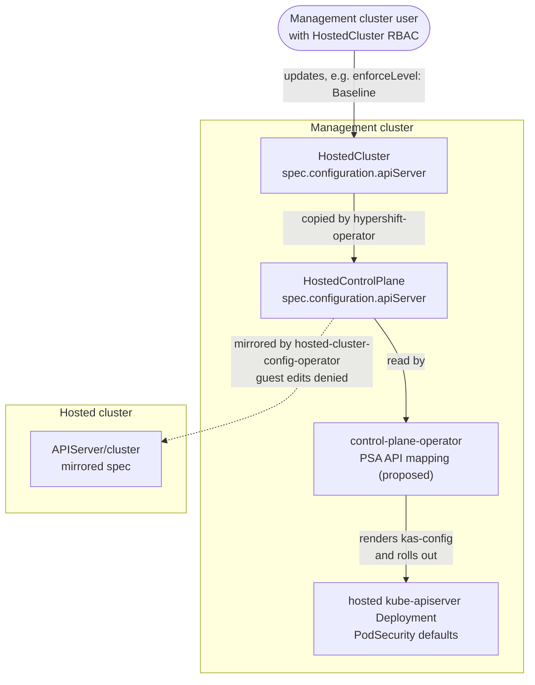
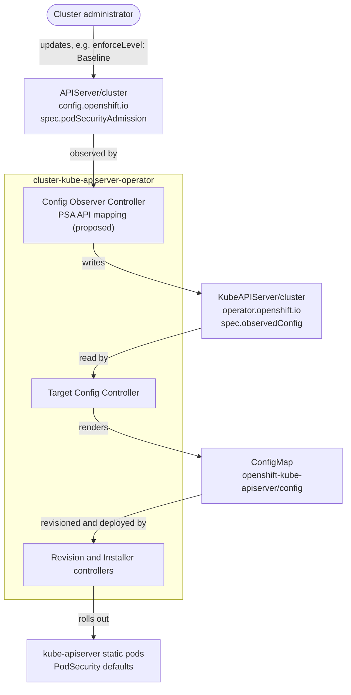

# Pod Security Admission API

## Summary

This proposal retires the PSA label syncer in OpenShift and the effort to migrate clusters automatically to `restricted` enforcement.
Instead, cluster owners decide whether their workloads are ready for stricter Pod Security Admission (PSA) enforcement.
The `APIServer` custom resource will expose cluster-wide PSA defaults, with enforcement and reporting defaulting to `privileged`.

## Motivation

Earlier Pod Security Admission (PSA) efforts aimed to enable `restricted` enforcement by default, deriving suitable namespace PSA levels from existing Security Context Constraints (SCC) configuration.
However, SCC admission also considers the pod creator's permissions, so the derived levels can be too strict for workloads admitted through user-granted SCCs.
Automatic migration cannot guarantee that these workloads stay admitted.

This proposal therefore gives cluster owners control over whether and when to adopt stricter PSA enforcement.
They can assess workload compatibility and choose `privileged`, `baseline`, or `restricted` according to their requirements, while SCCs continue to apply.

PSA still adds a namespace-level ceiling on top of SCCs, based on the upstream Pod Security Standards (PSS).

### User Stories

* As a System Administrator, I want to adopt stricter PSA enforcement after preparing my namespaces and workloads for the chosen PSS level.
* As a System Administrator, I want to select a less restrictive PSS level when my workload requirements justify it.
* As a System Administrator, I want to return PSA enforcement to `privileged` and manage workload security solely through SCCs.
* As a System Administrator, I want to keep my existing setup without configuring PSA, including after upgrades.

### Goals

1. Allow cluster owners to configure and change cluster-wide PSA defaults through the `APIServer` API.
2. Keep stricter cluster-wide PSA enforcement opt-in, with `privileged` as the default and SCCs continuing to apply.
3. Label OCP-managed namespaces with the most restrictive PSA level compatible with their workloads: `restricted`, `baseline`, or `privileged`.
4. Retire the PSA label syncer in OpenShift and make OCP component owners responsible for maintaining their namespace PSA labels.

### Non-Goals

1. Replace SCCs with PSA.
2. Automatically migrate customer clusters to `restricted` PSA enforcement.
3. Offer exhaustive PSA analysis, recommendations, or tooling.

## Proposal

### Workflow Description

The **cluster administrator** starts with `spec.podSecurityAdmission` unset on `APIServer/cluster`, so the global PSA defaults are `privileged`.

1. The cluster administrator prepares namespace PSA labels and workload configurations for the target PSS level.
2. The administrator updates `APIServer/cluster.spec.podSecurityAdmission` with the desired cluster-wide defaults.
3. The operator applies the new defaults through a kube-apiserver rollout.
   The administrator confirms rollout completion and observes that workload admission keeps behaving as intended.
4. The administrator corrects unexpected admission failures in the affected namespaces or workloads.
   If the new global default causes widespread problems that cannot be corrected promptly, the administrator temporarily relaxes that default.

### API Extensions

`PodSecurityAdmissionConfig` is added to the existing `APIServerSpec` in `config/v1/types_apiserver.go` in openshift/api.

The `enforceLevel` field gives administrators direct control over the cluster-wide PSS default, including `baseline`.
It defaults to `Privileged`, keeping stricter PSA enforcement opt-in.

The `reportLevel` field lets administrators assess workloads against stricter PSS levels without changing enforcement.
Reporting defaults use the latest policy version supported by the API server, independently of `enforceVersion`.
This helps administrators prepare for newer rules while keeping enforcement pinned.

Without `spec.podSecurityAdmission`, reporting defaults to `Privileged`, like enforcement, so clusters that do not opt in get no warnings or audit events from the cluster-wide default.
Today, OpenShift audits and warns at `restricted`, and the PSA label syncer's `warn` and `audit` labels align each namespace it manages with what its SCCs allow.
With the PSA label syncer retired and its labels removed, a `restricted` default would warn about and audit every pod that an SCC admits but `restricted` would reject.
Administrators who want that reporting set `reportLevel: Restricted`.

```go
package v1 // config/v1/types_apiserver.go in openshift/api

type APIServerSpec struct {
	// ... existing fields: servingCerts, clientCA, additionalCORSAllowedOrigins,
	// encryption, tlsSecurityProfile, tlsAdherence, audit ...

	// podSecurityAdmission configures cluster-wide Pod Security Admission defaults.
	// Namespace PSA labels take precedence over the corresponding defaults.
	//
	// When omitted, enforce, warn and audit default to privileged.
	// Namespace PSA labels continue to apply.
	//
	// +openshift:enable:FeatureGate=OpenShiftPodSecurityAdmission
	// +optional
	PodSecurityAdmission PodSecurityAdmissionConfig `json:"podSecurityAdmission,omitempty,omitzero"`
}

// PodSecurityStandard names one of the upstream Pod Security Standards.
// +kubebuilder:validation:Enum:=Privileged;Baseline;Restricted
type PodSecurityStandard string

const (
	// PodSecurityStandardPrivileged is the unrestricted standard.
	PodSecurityStandardPrivileged PodSecurityStandard = "Privileged"
	// PodSecurityStandardBaseline prevents known privilege escalations while
	// permitting the default Pod configuration.
	PodSecurityStandardBaseline PodSecurityStandard = "Baseline"
	// PodSecurityStandardRestricted is the hardened standard, following current
	// Pod hardening best practices.
	PodSecurityStandardRestricted PodSecurityStandard = "Restricted"
)

// PodSecurityAdmissionConfig records the administrator's requested Pod Security
// Admission enforcement. It is never written by a controller.
// +kubebuilder:validation:MinProperties=1
type PodSecurityAdmissionConfig struct {
	// enforceLevel sets the default Pod Security Standard level for namespaces without a specific label.
	// Valid values are Privileged, Baseline and Restricted.
	// When omitted, Privileged is used.
	// +optional
	EnforceLevel PodSecurityStandard `json:"enforceLevel,omitempty"`

	// enforceVersion sets the Pod Security Standards revision.
	// Must be "latest" or "v1.<minor>", e.g. "v1.34", and not newer than the Kubernetes version of the cluster's release.
	// Maximum length is 10 characters.
	// When omitted, latest is used, so checks added by Kubernetes
	// upgrades apply automatically.
	// +kubebuilder:validation:Pattern=`^(latest|v1\.(0|[1-9][0-9]*))$`
	// +kubebuilder:validation:MaxLength=10
	// +kubebuilder:validation:XValidation:rule="self == 'latest' || int(self.split('.')[1]) <= 37",message="enforceVersion must not be newer than v1.37"
	// +optional
	EnforceVersion string `json:"enforceVersion,omitempty"`

	// reportLevel sets the default audit and warning levels.
	// Valid values are Privileged, Baseline and Restricted.
	// When omitted, enforceLevel is used.
	// If both levels are omitted, Privileged is used.
	// Audit and warning defaults use the latest policy version supported by the API server.
	// The reporting version is independent of enforceVersion.
	// +optional
	ReportLevel PodSecurityStandard `json:"reportLevel,omitempty"`
}
```

### Topology Considerations

#### Hypershift / Hosted Control Planes

Users with `HostedCluster` RBAC on the management cluster configure each hosted cluster's PSA defaults through `HostedCluster.spec.configuration.apiServer.podSecurityAdmission`.
This uses HyperShift's existing per-cluster configuration path.
In the hosted cluster, `APIServer/cluster` is a read-only mirror, so `oc edit apiserver cluster` cannot change the defaults.
Hosted cluster administrators can still set namespace PSA labels.
On ROSA HCP and ARO HCP the service owns the `HostedCluster`, so customers can set the field only once the service API exposes it.
Changing the field rolls out the hosted kube-apiserver, not the NodePools.



`HostedCluster` needs no type changes, but HyperShift must bump openshift/api in both its root and `api/` modules.
It must also list `OpenShiftPodSecurityAdmission` in `api/hypershift/v1beta1/featuregates/`, first for TechPreviewNoUpgrade and at GA for Default.
Without that entry, HyperShift's CRD generation drops the gated field.
During Tech Preview, the field therefore needs a management cluster installed with TechPreviewNoUpgrade CRDs and a hosted cluster with the gate enabled.

The control-plane-operator currently hardcodes PSA defaults: audit and warn `restricted`, and enforce `privileged` or `restricted` based on the hosted cluster's `OpenShiftPodSecurityAdmission` feature gate.
With the gate enabled, it maps the API fields like `cluster-kube-apiserver-operator`, so hosted clusters that never set the field get the same defaults as standalone clusters.
With the gate disabled, it keeps today's hardcoded defaults and ignores the field.
One `HostedCluster` CRD serves all hosted clusters of a management cluster, so unlike on standalone clusters, a hosted cluster can store the field while its gate is disabled.

Each control-plane-operator comes from its hosted cluster's release, which can be older than the hypershift-operator that exposes the field.
An older control-plane-operator drops the field when it decodes the `HostedControlPlane`.
Node ignition waits until the hypershift-operator's hash of `HostedCluster.spec.configuration` matches the control-plane-operator's hash of its copy, so a dropped field would block ignition for new nodes.
HyperShift therefore excludes `podSecurityAdmission` from that hash in the same change that bumps openshift/api.
The hypershift-operator reports `PodSecurityAdmissionConfigApplied=False` on the `HostedCluster` while the field is set but has no effect, without blocking reconciliation.
It detects an older control-plane-operator through a capability label on that operator's image, and a control-plane-operator with the gate disabled reports the condition through the `HostedControlPlane`.
Until the field takes effect, SCCs and namespace PSA labels keep applying as before.
It takes effect without further action once the hosted cluster runs a release that supports it with the gate enabled, usually after an upgrade.
From then on, new pods that violate the defaults are rejected in namespaces without PSA labels.

The PSA label syncer runs in the hosted control plane as part of cluster-policy-controller, whose configuration there enables all controllers.
As on standalone clusters, it stops once the hosted cluster's gate is on.
The hosted-cluster-config-operator keeps the PSA label syncer's RBAC for the cleanup controller described in [Removing Leftover PSA Labels](#removing-leftover-psa-labels).
The privileged PSA label syncer and its RBAC stay.
The Pod Security Readiness Controller does not run in HyperShift, so its retirement needs no HyperShift change.

#### Standalone Clusters

Unless stated otherwise, this proposal describes standalone clusters.

#### Single-node Deployments or MicroShift

##### Single-node Deployments

Changing PSA defaults triggers a kube-apiserver static pod rollout.

##### MicroShift

MicroShift keeps its PSA behavior, including the PSA label syncer.
OpenShift drops its plan to enforce `restricted` by default, because workloads running today could stop being admitted after an upgrade, as described in [Motivation](#motivation).
Every generally available MicroShift release has enforced `restricted` with the PSA label syncer, so its users meet PSA rejections when they first deploy a workload, not after an upgrade.

MicroShift does not serve `apiservers.config.openshift.io` ([core CRDs](https://github.com/openshift/microshift/blob/d7fe7f11a017752374b9dbc0e1ddccdd8ab0b1dc/pkg/assets/crd.go#L37-L52)), so `spec.podSecurityAdmission` does not exist there.

MicroShift's [kube-apiserver configuration](https://github.com/openshift/microshift/blob/d7fe7f11a017752374b9dbc0e1ddccdd8ab0b1dc/assets/controllers/kube-apiserver/defaultconfig.yaml#L12-L31) hardcodes `restricted` for enforce, audit and warn.
MicroShift passes no feature gates to cluster-policy-controller, so its PSA label syncer defaults to [writing `enforce` labels](https://github.com/openshift/cluster-policy-controller/blob/81e222007c2ceec48a908877eb71fb135a2c2453/pkg/cmd/controller/psalabelsyncer.go#L17-L38) on namespaces that users create.

Without the PSA label syncer, new pods that need more than `restricted` can be rejected despite SCC permission, unless sufficient namespace PSA labels are already set.
MicroShift's rebase pulls these parts from OpenShift, so their owners must keep them:

- cluster-policy-controller: the PSA label syncer and its enforcing mode when no feature gates are passed.
- cluster-kube-controller-manager-operator: the PSA label syncer's ClusterRole and ClusterRoleBinding files, until MicroShift owns copies. [The rebase copies them](https://github.com/openshift/microshift/blob/d7fe7f11a017752374b9dbc0e1ddccdd8ab0b1dc/scripts/auto-rebase/assets.yaml#L133-L134) and fails without them.
- cluster-kube-apiserver-operator: the `PodSecurity` block in `bindata/assets/config/defaultconfig.yaml`. The rebase [overwrites only its `defaults`](https://github.com/openshift/microshift/blob/d7fe7f11a017752374b9dbc0e1ddccdd8ab0b1dc/scripts/auto-rebase/rebase.sh#L786-L788), so MicroShift inherits its `kind`, `apiVersion` and exemptions.
- OLM, optional on MicroShift: the [downstream plugin](https://github.com/openshift/operator-framework-olm/blob/14f999ff089a3275d3a144224e871d825461ec3b/staging/operator-lifecycle-manager/pkg/controller/operators/olm/plugins/downstream_csv_namespace_labeler_plugin.go#L28-L36) that opts non-payload `openshift-*` namespaces with an operator into the PSA label syncer. Only MicroShift still needs it.

#### OpenShift Kubernetes Engine

PSA configuration and label syncer retirement apply equally to OKE.
The proposal does not depend on features excluded from the OKE subscription.

### Implementation Details/Notes/Constraints

#### Configuring the kube-apiserver

On standalone clusters, `cluster-kube-apiserver-operator` maps `spec.podSecurityAdmission` to the kube-apiserver `PodSecurity` admission defaults.
The API mapping replaces the existing feature-gate-based selection of PSA defaults.
`enforceLevel` and `enforceVersion` set `enforce` and `enforce-version`.
`reportLevel` sets `audit` and `warn`, whose versions stay `latest`.

Omitted `enforceLevel` defaults to `Privileged`.
Omitted `enforceVersion` defaults to `latest`.
When `reportLevel` is omitted, it follows `enforceLevel`, including later changes.

| Administrator intent                                             | `enforceLevel`         | `enforceVersion`   | `reportLevel`          |
| ---------------------------------------------------------------- | ---------------------- | ------------------ | ---------------------- |
| Leave `spec.podSecurityAdmission` unset                          | `Privileged` (default) | `latest` (default) | `Privileged` (default) |
| Assess restricted without enforcing                              | `Privileged`           | `latest`           | `Restricted`           |
| Enforce baseline while assessing restricted                      | `Baseline`             | `latest`           | `Restricted`           |
| Keep enforcement pinned while assessing current restricted rules | `Restricted`           | `v1.34`            | `Restricted`           |

Namespace PSA labels take precedence in every row, so `privileged` does not lift enforcement from labeled namespaces.

Example for the last row, applied with `oc edit apiserver cluster`:

```yaml
apiVersion: config.openshift.io/v1
kind: APIServer
metadata:
  name: cluster
spec:
  podSecurityAdmission:
    enforceLevel: Restricted
    enforceVersion: v1.34
    reportLevel: Restricted
```

The proposed API mapping uses the existing configuration and static pod rollout controllers.



#### Repurposing `OpenShiftPodSecurityAdmission` feature gate

`OpenShiftPodSecurityAdmission` is repurposed to gate `spec.podSecurityAdmission`, starting in `TechPreviewNoUpgrade` and moving to `Default` at GA.
Its new behavior is consistent across development and release branches.
The previous behavior was enabled in `Default` on [development builds](https://github.com/openshift/api/blob/736ea4c8e9e443232bb3b327c3ab809f9712eb29/features/features.go#L94-L100).
On [release branches](https://github.com/openshift/api/blob/release-4.21/features/features.go#L64-L70), it was limited to `NoUpgrade` feature sets.

| With the gate enabled       | Previous behavior       | Proposed behavior                                       |
| --------------------------- | ----------------------- | ------------------------------------------------------- |
| `spec.podSecurityAdmission` | absent                  | available                                               |
| kube-apiserver PSA defaults | all `restricted`        | configured through the API, all `privileged` when unset |
| PSA label syncer            | writes `enforce` labels | stopped                                                 |

With the gate disabled, existing PSA defaults and the PSA label syncer remain unchanged.
The [Upgrade / Downgrade Strategy](#upgrade--downgrade-strategy) and [Version Skew Strategy](#version-skew-strategy) describe the transition, and [Removing Leftover PSA Labels](#removing-leftover-psa-labels) the label cleanup.

The PSA label syncer will get its enforce capability removed before the repurposed gate takes effect, because during an upgrade / downgrade it could start enforcing.

MicroShift must retain the PSA label syncer's enforcement behavior independently of this gate, including after the gate is removed following GA.
Its dependencies are described in [MicroShift](#microshift).

CI will set `enforceLevel: Restricted` explicitly to retain coverage previously provided by the gate's previous behavior.
This detects admission failures in the OpenShift workloads exercised by those tests.

#### Retiring the PSA Label Syncer

This proposal retires the PSA label syncer (`openshift.io/podsecurity-admission-label-syncer`) in OpenShift's cluster-policy-controller.
MicroShift keeps it, as described in [MicroShift](#microshift).

The privileged PSA label syncer (`openshift.io/privileged-namespaces-psa-label-syncer`) remains enabled on all topologies.
It labels `default`, `kube-system` and `kube-public` as `privileged`.
SCC admission skips these namespaces, so the labels keep PSA consistent with SCCs there under any `enforceLevel`.

##### Why the PSA Label Syncer Retires

The PSA label syncer derives namespace PSA labels from the SCCs their service accounts can use.
SCC admission also considers the pod creator's permissions, so generated labels can conflict with workloads admitted through user-granted SCCs.

Extending the PSA label syncer to handle additional SCC admission cases would require more engineering effort and permission analysis at runtime.
This proposal considers that cost unjustified because PSA largely overlaps with protection already provided by SCCs.

##### Who Labels Namespaces

In OpenShift, cluster administrators own the PSA labels of their namespaces, and OCP component owners own the labels of OpenShift namespaces.
[CI monitor tests](https://github.com/openshift/origin/pull/31645) flag OpenShift namespaces that lack suitable PSA labels or opt in to the PSA label syncer, covering the gap it leaves.
On MicroShift they must accept the opt-in label `security.openshift.io/scc.podSecurityLabelSync`, because MicroShift keeps the PSA label syncer and OLM still sets that label there.

Tests and CI tooling must also be updated to work without the PSA label syncer before it is retired.
For example, [openshift/ci-tools](https://github.com/openshift/ci-tools/blob/5cbefcbf339d56eac6983dcefad61dcfa1717c52/pkg/util/namespace.go#L14-L26) waits for the PSA label syncer's `security.openshift.io/MinimallySufficientPodSecurityStandard=privileged` annotation before nested-podman steps.

##### Removing Leftover PSA Labels

Once stopped, the PSA label syncer leaves its `warn` and `audit` labels and its `security.openshift.io/MinimallySufficientPodSecurityStandard` annotation behind.
These labels would override `reportLevel` in every namespace the PSA label syncer managed, and removing them rejects no pods.

Whether the PSA label syncer runs depends on the `OpenShiftPodSecurityAdmission` feature gate and the topology, and cluster-policy-controller already makes that decision.
A cleanup controller in cluster-policy-controller therefore removes the leftovers wherever the PSA label syncer is stopped.
It removes only what the PSA label syncer's field manager owns, so labels whose value an administrator changed stay.

#### Retiring Pod Security Readiness Controller

The Pod Security Readiness Controller in cluster-kube-apiserver-operator dry-runs PSA enforcement on namespaces without an `enforce` label and reports violations as `ClusterFleetEvaluation` telemetry.
The data measured the fleet-wide impact of PSA and was meant to decide when a cluster could move to `restricted` automatically.
Automatic migration is no longer planned, so this proposal removes the controller.
Removing it does not affect admission.

#### Configuring PSA Enforcement at Install Time

Administrators can configure cluster-wide PSA defaults for standalone clusters by supplying an `APIServer/cluster` manifest during installation.
No installer changes are required because the installer already [loads custom manifests from `openshift/`](https://github.com/openshift/installer/blob/main/pkg/asset/manifests/openshift.go#L299-L325).

Generate the installation manifests:

```bash
openshift-install create manifests --dir=./cluster
```

Create `./cluster/openshift/cluster-apiserver-02-config.yml` with the following content:

```yaml
apiVersion: config.openshift.io/v1
kind: APIServer
metadata:
  name: cluster
spec:
  podSecurityAdmission:
    enforceLevel: Baseline
    enforceVersion: v1.34
    reportLevel: Restricted
```

Proceed with installation:

```bash
openshift-install create cluster --dir=./cluster
```

Installation starts with cluster-wide PSA enforcement at `privileged`, leaving a window before the requested enforcement level takes effect.
`cluster-kube-apiserver-operator` then applies these settings through the configuration mapping and static pod rollout described in [Configuring the kube-apiserver](#configuring-the-kube-apiserver).
The requested defaults take effect on each kube-apiserver instance during rollout and apply across all instances once rollout completes.
Namespace PSA labels retain precedence.

### Risks and Mitigations

#### Unexpected Workload Rejection

Stricter PSA enforcement leaves existing pods running but rejects replacement pods that violate the new policy.
Failures may therefore appear only when pods are recreated.
Checks against existing pods also miss Jobs and other temporary workloads whose pods are absent.

Administrators can use dry-run checks and review PSA violations in audit logs before tightening enforcement.
Audit logs collected at the target reporting level provide a broader history, including Jobs whose pods no longer exist.
If critical workloads are blocked, administrators can temporarily relax the applicable enforcement policy while correcting the workload or namespace configuration.

#### SCC Priority Changes

SCC admission sorts SCCs by [priority](https://github.com/openshift/apiserver-library-go/blob/218f2c488d901eb7d06d1ebf1e5f3b41f40cd8fb/pkg/securitycontextconstraints/util/sort/bypriority.go#L19-L34) and admits a pod with the first SCC that validates it, mutating its `securityContext` on the way.
Running pods keep their SCC, as SCC admission [mutates nothing on updates and tries the previously validated SCC first](https://github.com/openshift/apiserver-library-go/blob/218f2c488d901eb7d06d1ebf1e5f3b41f40cd8fb/pkg/securitycontextconstraints/sccadmission/admission.go#L572-L588).
New pods, e.g. after a rollout or an eviction, go through the selection again.
A new SCC with a higher priority than `restricted-v2` therefore replaces it for new pods of every customer workload whose service account can use the new SCC.
Under `restricted` enforcement, workloads that passed `restricted` only due to the mutation of `restricted-v2` **get rejected by PSA on their next pod creation**.
The `openshift.io/required-scc` annotation [limits SCC admission to the pinned SCC](https://github.com/openshift/apiserver-library-go/blob/218f2c488d901eb7d06d1ebf1e5f3b41f40cd8fb/pkg/securitycontextconstraints/sccadmission/admission.go#L553-L558), but customer workloads need to set it themselves.

#### Impact on OpenShift Workloads

Previously, the `restricted` global default in development builds made it difficult to introduce OpenShift workloads without compatible namespace labels.
Repurposing the feature gate weakens this automatic safeguard until the default test uses the new API.

Two monitoring tests help catch regressions in non-enforce-restricted test clusters with reporting set to restricted:

- The existing **audit-log monitor test** detects Pod Security violations recorded during CI.
- The **namespace-label monitor test** identifies OpenShift namespaces without PSA labels.

The [Test Plan](#test-plan) describes how the default CI configuration validates OpenShift workloads under a `restricted` global default.

OCP component owners must address the findings.
These checks reduce the risk but cannot cover workloads or operational procedures that CI does not exercise.

### Drawbacks

#### No Stricter Enforcement by Default

OpenShift does not become more secure by default.
Enforcement stays `privileged` until an administrator opts in, so namespaces without PSA labels rely on SCCs alone.

#### Customer Responsibility

Administrators who want stricter enforcement must choose levels and label namespaces themselves.
OpenShift should not risk rejecting pods by choosing PSA levels on their behalf.
Keeping the PSA label syncer in advising mode carries the same risk, because a recommended level invites adoption without review.

#### Reporting Off by Default

Clusters that leave `spec.podSecurityAdmission` unset lose the PSA warnings, audit annotations and `PodSecurityViolation` alerts OpenShift produces today.
The PSA label syncer's `warn` and `audit` labels are removed, and reporting defaults to `privileged`.
That default keeps clusters that do not opt in from reporting every pod that SCCs admit beyond `restricted`.

Audit logs rotate, so administrators who want the violation history must collect it before upgrading.
To keep reporting after the upgrade, administrators set `reportLevel`.

## Alternatives (Not Implemented)

### Enforce `restricted` by Default

[openshift/enhancements#1747](https://github.com/openshift/enhancements/pull/1747) proposed moving clusters to `restricted` enforcement automatically.
The PSA label syncer would write `enforce` labels, and the Pod Security Readiness Controller would keep clusters with violating namespaces in a temporary `Legacy` mode.
Fresh installs would start in `Restricted`, and `Legacy` would eventually be removed.

This relies on the PSA label syncer deriving correct levels, which it cannot do in every case, as described in [Why the PSA Label Syncer Retires](#why-the-psa-label-syncer-retires).
The readiness evaluation runs every 4 hours and sees only a snapshot of existing pods, so workloads missing from every snapshot could still be rejected.
Once `Legacy` was removed, administrators could no longer opt out cluster-wide.

### Rely on SCCs Only

OpenShift would set all PSA defaults to `privileged`, remove the PSA label syncers and the Pod Security Readiness Controller, and add no API.
This needs the least work, and PSA largely overlaps with SCCs.

PSA still adds a namespace-level ceiling that holds regardless of which SCCs users and service accounts can use.
Without a cluster-wide default, administrators could set that ceiling only per namespace, so new namespaces would always start `privileged`.

## Open Questions

### How do managed offerings adopt stricter PSA?

On OSD and ROSA, customers cannot set `spec.podSecurityAdmission` themselves, because of the [`regular-user-validation` webhook](https://github.com/openshift/managed-cluster-validating-webhooks/blob/19ce19a288f49386d6e2375b79e1b3fa63f255d0/pkg/webhooks/regularuser/common/regularuser.go#L125-L132) on classic clusters and the service-owned `HostedCluster` on HCP.
How they adopt stricter PSA enforcement needs to be clarified with the OSD and ROSA teams.
They may need a custom solution, or they may verify compatibility by scanning customer namespaces and workloads against the requested Pod Security level, for example with server-side dry-run labels.

### How does OLM adapt to the retired PSA label syncer and a configurable default?

OLM's [downstream plugin](https://github.com/openshift/operator-framework-olm/blob/14f999ff089a3275d3a144224e871d825461ec3b/staging/operator-lifecycle-manager/pkg/controller/operators/olm/plugins/downstream_csv_namespace_labeler_plugin.go#L28-L36) opts non-payload `openshift-*` namespaces with an operator into the PSA label syncer.
Once the PSA label syncer is retired, these namespaces get no PSA labels, and the ownership split in [Who Labels Namespaces](#who-labels-namespaces) does not cover them.
If OLM keeps opting them in, the monitor tests can also flag them in CI.

OLM adapts its catalog pods to `restricted` through their security context, not through namespace labels.
Unless the `CatalogSource` sets it, OLM [derives the security context from the namespace's `enforce` label](https://github.com/openshift/operator-framework-olm/blob/14f999ff089a3275d3a144224e871d825461ec3b/staging/operator-lifecycle-manager/pkg/controller/registry/reconciler/reconciler.go#L418-L431), so it does not see the cluster-wide default.

Whether the operator author or the administrator labels these namespaces, and how OLM should account for the cluster-wide default, needs to be clarified with the OLM team.

## Test Plan

### One-time tests

After the upgrade to OCP 5.1:

- **No ClusterFleetEvaluation (CFE) reports**: `kubeapiserver/cluster` has no `PodSecurity*EvaluationConditionsDetected` conditions, which requires adding them to the kube-apiserver-operator's [stale conditions controller](https://github.com/openshift/cluster-kube-apiserver-operator/blob/ad5501e4bfad0397f73b1f91a907c5dc6cfe5fd0/pkg/operator/starter.go#L501).

After the upgrade to OCP 5.2:

- **PSA label syncer labels are removed**: no namespace has `managedFields` from `pod-security-admission-label-synchronization-controller` or the annotation `security.openshift.io/MinimallySufficientPodSecurityStandard`.
- **Customer PSA labels survive the cleanup**: a `pod-security.kubernetes.io/warn` label whose value an administrator changed keeps the new value.

After both upgrades:

- **An unset field keeps the enforcement**: with `spec.podSecurityAdmission` unset, the kube-apiserver enforces `privileged`, on standalone and on HyperShift.

### Default test

CI jobs install the cluster with `Restricted` through an additional `APIServer/cluster` install manifest and run the e2e suite.
Comparable to running OCP on minimal hardware, this proves that the platform works with the strictest setup.

- **When**: the field only exists where the feature gate is on.
  In OCP 5.1, only TechPreview jobs install with `Restricted`.
  Jobs in the `Default` feature set follow in OCP 5.2 once the feature gate is promoted to Default.
  Until then, they rely on the PSA label syncer, `audit` and `warn` at `restricted`, and the [monitoring tests](#monitoring-tests).
- **An assertion after install**: on a cluster whose feature set has the field's feature gate off, the field doesn't exist: `oc apply` fails with "unknown field", and clients without strict validation drop it silently, so the install can succeed without `Restricted`.
  Therefore, the job checks after install that `APIServer/cluster` still carries the field and the kube-apiserver defaults are `restricted`.
- **What the run catches**: the cluster-wide level only applies to namespaces without PSA labels, and the e2e framework [labels its namespaces `restricted` itself](https://github.com/openshift/origin/blob/f95ab45b16cf0ae68b7c106c48cd3befd8eaf9fb/test/extended/util/client.go#L714-L719).
  Therefore, the run catches tests that create namespaces without PSA labels, and OpenShift namespaces without PSA labels whose workloads need more than `restricted`.
- **Gap**: upgrade jobs into OCP 5.2 install OCP 5.1 first, whose `Default` feature set does not know the field, so the cluster runs with the field unset after the upgrade.

### Testing the API

An e2e test walks one cluster through `privileged` → `baseline` → `restricted` → `privileged` (admin reverts attempt) → `restricted` and checks after every step:

- **Rollout**: the kube-apiserver rolls out the new defaults.
- **Admission**: a pod that violates the new level gets rejected, and a pod that complies gets admitted.
- **Running pods**: pods admitted under the previous level keep running.

Additional cases:

- **Report level**: with `enforceLevel: Privileged` and `reportLevel: Restricted`, a pod that violates `restricted` gets admitted with a warning / audit entry.
- **Version**: an `enforceVersion` above the cluster's Kubernetes version, e.g. `v1.99` on a Kubernetes 1.37 cluster, gets rejected.
- **Malformed values**: the API rejects levels outside the enum, like `restricted` in lowercase as in the namespace labels, for `enforceLevel` and `reportLevel`, and versions like `v1.034`.

### Periodic tests

Periodic jobs run the e2e suite on fresh installs outside of `Restricted`, as the default production setup needs coverage, and some tests might derive their setup from the enforced level, e.g. the OLM tests that failed when the feature gate was turned off ([OCPBUGS-83412](https://redhat.atlassian.net/browse/OCPBUGS-83412)):

- **Unset field (`privileged`)**: no `spec.podSecurityAdmission`, the default production setup of every cluster that does not opt in.
- **Baseline (optional)**: `Baseline` for all three modes, as pods that pass `restricted` in the Default test also pass `baseline`.

### Monitoring tests

The target state consists of two monitor tests:

- **No PSA violations**: the existing [audit log analysis](https://github.com/openshift/origin/blob/f95ab45b16cf0ae68b7c106c48cd3befd8eaf9fb/pkg/monitortests/kubeapiserver/auditloganalyzer/handle_audit_violation.go#L50-L78) fails on any audit event with a `pod-security.kubernetes.io/audit-violations` annotation.
  This is the must-have test, and it only needs an update to verify that the cluster-wide audit level is `restricted`.
  Then, namespaces whose workloads need more than `restricted` and that lack the correct PSA labels cause violations.
- **PSA labels on OpenShift namespaces**: a [new test](https://github.com/openshift/origin/pull/31645) verifies that every `openshift` and `openshift-*` namespace sets the `enforce`, `audit` and `warn` labels.
  It also verifies that no OpenShift namespace opts in to the PSA label syncer with `security.openshift.io/scc.podSecurityLabelSync: "true"`.
  Otherwise, labels that the PSA label syncer wrote pass the check above and disappear once the PSA label syncer retires (see the edge case in [Tech Preview -> GA](#tech-preview---ga)).
  It makes explicit PSA labels the default for OpenShift components, and it covers namespaces whose workloads create no pods during the e2e job.
  As the audit-log monitor test covers the urgent part, this test starts as a flake that collects findings for triage.
  It turns into a failure once namespaces are either labeled or exempt.

### HyperShift / MicroShift

The standalone tests do not reach both platforms, as HyperShift configures PSA through the `HostedCluster` and MicroShift keeps its own PSA behavior:

- **HyperShift**: an e2e test in the HyperShift repository sets `spec.configuration.apiServer.podSecurityAdmission` on a `HostedCluster` and checks in the guest cluster:
  - A violating pod in a namespace without PSA labels gets rejected under `Restricted`.
  - The konnectivity agent in `kube-system` keeps running, as the hosted cluster config operator labels `kube-system` as `privileged`.
  - A level change on the `HostedCluster` reaches the guest kube-apiserver.

  A hosted cluster with the gate disabled reports `PodSecurityAdmissionConfigApplied=False` on its `HostedCluster` while the field is set.
- **MicroShift**: MicroShift's PSA behavior must not change, and no MicroShift test may fail.
  The namespace-label monitor test therefore needs MicroShift exceptions, as described in [Who Labels Namespaces](#who-labels-namespaces).

## Graduation Criteria

### Dev Preview -> Tech Preview

OCP 5.1 ships the feature as Tech Preview, with the gate enabled in `TechPreviewNoUpgrade` and `DevPreviewNoUpgrade` only.

### Tech Preview -> GA

The core criterion: **OpenShift keeps working when the cluster-wide level is stricter than `privileged`.**
A customer who sets `Baseline` or `Restricted` should only hit failures in their own workloads, not in OpenShift's.

The gate gets enabled in `Default`, once:

- **Promotion bar**: the [promotion requirements](../../dev-guide/feature-zero-to-hero.md#promotion-requirements) are met, checked by `verify-feature-promotion` on the promotion PR.
- **Restricted install**: the [Default test](#default-test) passes on every supported platform, including the assertion that the field survived the install.
- **No PSA violations**: the audit log [monitor test](#monitoring-tests) stays green in jobs that proved they see violations.
- **No opt-in**: the [PSA label monitor test](#monitoring-tests) fails on any OpenShift namespace with `security.openshift.io/scc.podSecurityLabelSync: "true"`, as the PSA label syncer [only labels `openshift-*` namespaces, that opt in](https://github.com/openshift/cluster-policy-controller/blob/c9e9a348260921c9e788e33a51e904502cbe2d13/pkg/psalabelsyncer/podsecurity_label_sync_controller.go#L484-L494).
- **Unset field**: the [periodic jobs](#periodic-tests) without `spec.podSecurityAdmission` pass, as this is every cluster that doesn't opt in.
- **Upgrade**: the upgrade from OCP 5.1 and the rollback of a failed upgrade pass on standalone and on HyperShift, and so do the [one-time tests](#one-time-tests).
- **HyperShift**: a hosted cluster created with `Restricted` passes the e2e suite, and a unit test checks the control-plane-operator rendering for every hosted release that it supports.
- **MicroShift**: no MicroShift test fails, as its PSA behavior must not change.
- **Docs and release notes**: openshift-docs describe the feature and help users who want stricter enforcement move to `Baseline` or `Restricted`.

### Removing a deprecated feature

- **OCP 5.1** removes the Pod Security Readiness Controller and deprecates the PSA label syncer.
  The PSA label syncer still runs, and the release notes announce its removal for non-MicroShift clusters.
- **OCP 5.2** enables the gate in `Default`, which stops the PSA label syncer on standalone clusters and HyperShift.
  MicroShift keeps it, as described in [MicroShift](#microshift).

## Upgrade / Downgrade Strategy

**OCP 5.2 with `spec.podSecurityAdmission` unset admits the same pods as OCP 5.0 and 5.1.**
The interesting case is an admin who sets `enforceLevel: $LEVEL` on OCP 5.2 and then rolls back to OCP 5.1:

| What                             | OCP 5.1 (gate disabled)      | OCP 5.2, field unset | OCP 5.2, `enforceLevel: $LEVEL`                              | Rolled back to OCP 5.1       |
| -------------------------------- | ---------------------------- | -------------------- | ------------------------------------------------------------ | ---------------------------- |
| Global `enforce`                 | `privileged`                 | `privileged`         | `$LEVEL`                                                     | `privileged`                 |
| Global `warn` and `audit`        | `restricted`                 | `privileged`         | `reportLevel`, `$LEVEL` if unset                             | `restricted`                 |
| Rejected by the global default   | nothing                      | nothing              | pods that violate `$LEVEL` in namespaces without `enforce`   | nothing                      |
| PSA label syncer                 | advising, `warn` and `audit` | stopped              | stopped                                                      | advising, `warn` and `audit` |
| Labels owned by PSA label syncer | maintained                   | removed              | removed                                                      | maintained                   |
| `spec.podSecurityAdmission`      | not in the `Default` CRD     | unset                | `enforceLevel: $LEVEL`                                       | pruned, the value is lost    |

OCP 5.0 behaves as OCP 5.1 in `Default`, as both run with the gate disabled.

### Upgrade

#### OCP 5.0 to OCP 5.1

No action is needed: nothing changes in `Default`.
OCP 5.1 changes what an enabled gate means, but ships it disabled in `Default`:
the PSA label syncer loses its enforcing mode on non-MicroShift clusters.

#### OCP 5.1 to OCP 5.2

No action is needed to keep the admission decisions, as the global `enforce` level stays `privileged`.

- **Warnings and the `PodSecurityViolation` alert go quiet**, as described in [Reporting Off by Default](#reporting-off-by-default).
- **The PSA label syncer's own labels get removed**. Labels whose value an admin changed stay.

### Downgrade

#### OCP 5.2 to OCP 5.1

**Enforcement loosens, and the admin's choice gets lost without a warning.**
OCP 5.1's `Default` `APIServer` CRD doesn't know `spec.podSecurityAdmission`.
The kube-apiserver [prunes unknown fields](https://github.com/kubernetes/apiextensions-apiserver/blob/v0.37.1/pkg/apiserver/customresource_handler.go#L1428-L1434) when it reads the object from etcd, so the field disappears right away, and the next write to `apiserver/cluster` drops it for good.
OCP 5.1's kube-apiserver-operator reads the gate disabled and renders [`enforce: privileged` and `restricted` for `warn` and `audit`](https://github.com/openshift/cluster-kube-apiserver-operator/blob/5f22e9c7b00f1cd914e9938ef56899684ee8ac5a/pkg/operator/configobservation/auth/podsecurityadmission.go#L100-L104), whatever the field said.
The PSA label syncer comes back in advising mode, [skips labels owned by another field manager](https://github.com/openshift/cluster-policy-controller/blob/c9e9a348260921c9e788e33a51e904502cbe2d13/pkg/psalabelsyncer/podsecurity_label_sync_controller.go#L357), and never writes `enforce`, so it can't reject a pod.

#### OCP 5.1 to OCP 5.0

No action is needed in `Default`: OCP 5.0's PSA label syncer reads `OpenShiftPodSecurityAdmission=false` and runs in advising mode, as long as OCP 5.1 keeps the gate declared and disabled.

### Z-stream and EUS upgrades

Nothing in this enhancement runs on nodes.
Within one minor release, all components give the gate the same meaning, so z-stream skips need nothing extra.
An EUS-to-EUS upgrade still takes the control plane through every minor release, so both hops above apply in order.

### Test coverage

The [one-time tests](#one-time-tests) run after each upgrade, and [Tech Preview -> GA](#tech-preview---ga) requires the upgrade and rollback jobs to pass.

## Version Skew Strategy

### Feature gates

**Reusing `OpenShiftPodSecurityAdmission` is safe in both directions, because OCP 5.1 changes what an enabled gate means.**
In OCP 5.0, an enabled gate means [enforce `restricted`](https://github.com/openshift/cluster-kube-apiserver-operator/blob/5f22e9c7b00f1cd914e9938ef56899684ee8ac5a/pkg/operator/configobservation/auth/podsecurityadmission.go#L100-L109) and [run the PSA label syncer in enforcing mode](https://github.com/openshift/cluster-policy-controller/blob/c9e9a348260921c9e788e33a51e904502cbe2d13/pkg/cmd/controller/psalabelsyncer.go#L17-L37).
In OCP 5.1, an enabled gate means the PSA label syncer and global enforce gets disabled.

Each operator [reads the gate value for its own version](https://github.com/openshift/library-go/blob/79b4826daec46f1ad433ba01de636f56b955f74d/pkg/operator/configobserver/featuregates/simple_featuregate_reader.go#L204), but the kube-controller-manager-operator [copies all gates](https://github.com/openshift/cluster-kube-controller-manager-operator/blob/c4854ad5ad5d1f9b2dfef3f721f96632334acde7/pkg/operator/configobservation/configobservercontroller/observe_config_controller.go#L128-L134) into the [cluster-policy-controller config](https://github.com/openshift/cluster-kube-controller-manager-operator/blob/c4854ad5ad5d1f9b2dfef3f721f96632334acde7/pkg/operator/targetconfigcontroller/targetconfigcontroller.go#L375-L381).
After a rollback, the older cluster-policy-controller can start with the gate list that the newer release wrote.
This race comes from reading the code and has not been reproduced.
OCP 5.0 would read an enabled gate as "run the enforcing PSA label syncer", which writes `enforce` labels on customer namespaces.

OCP 5.1 closes the race:

- **cluster-policy-controller**: runs the advising PSA label syncer only on `=false`, and `=true` or a missing entry stop it.
  Without any feature gates, as on MicroShift, it keeps the enforcing PSA label syncer, as described in [MicroShift](#microshift).
- **kube-apiserver-operator and HyperShift control-plane-operator**: an enabled gate means "configure from `spec.podSecurityAdmission`", never "enforce `restricted`".

| Rollback                                | Copied list says | Target reads it as | Outcome                                                          |
| --------------------------------------- | ---------------- | ------------------ | ---------------------------------------------------------------- |
| OCP 5.2 to OCP 5.1                      | `=true`          | stop               | stopped, until OCP 5.1's operator writes `=false`, then advising |
| OCP 5.1 to OCP 5.0                      | `=false`         | advising           | same as OCP 5.0                                                  |
| OCP 5.3 to OCP 5.2, gate deleted in 5.3 | missing          | stop               | stopped                                                          |

Therefore, the target for GA is OCP 5.2, see [Graduation Criteria](#graduation-criteria), and OCP 5.1 keeps the gate declared and disabled in `Default`.

## Operational Aspects of API Extensions

This proposal adds one optional field, `spec.podSecurityAdmission`, to the existing `apiservers.config.openshift.io` CRD.
It adds no CRD, webhook, aggregated API server or finalizer.

PSA already evaluates every pod admission, so a stricter level adds no new request path.
Each change to the field triggers one kube-apiserver rollout, which takes the Kubernetes API down on single-node deployments while the only instance restarts.

Failure modes and their signals:

- **Workloads rejected**: a level that is too strict rejects new pods, as described in [Unexpected Workload Rejection](#unexpected-workload-rejection).
- **Configuration not observed**: an error in the config observer of `cluster-kube-apiserver-operator` sets `ConfigObservationDegraded` on `kubeapiserver/cluster`, and the observer must keep the previous configuration.
- **Rollout stuck**: the existing conditions of the `kube-apiserver` ClusterOperator report it.
- **Field ignored on HyperShift**: the `HostedCluster` reports `PodSecurityAdmissionConfigApplied=False`.

Escalations go to the kube-apiserver and auth teams, and for hosted clusters to the HyperShift team.

## Support Procedures

### Finding workloads that would fail

Before raising `enforceLevel`, administrators can find workloads that would fail in three ways:

- **Report first**: set `reportLevel: Restricted` and keep `enforceLevel: Privileged`.
  Violating pods and pod templates then cause warnings, `pod-security.kubernetes.io/audit-violations` audit annotations and the `PodSecurityViolation` alert, without rejection.
  This is the only check that sees pods created over time, so it should run through a full workload cycle, including CronJobs.
- **Dry run**: a server-side dry run of the target label on namespaces without an `enforce` label, which the cluster-wide default reaches, warns about every existing pod that would violate it:
  `oc label --dry-run=server ns -l '!pod-security.kubernetes.io/enforce' pod-security.kubernetes.io/enforce=restricted`
  It only sees existing pods, checks at most 3000 pods or 1 second per namespace, and says nothing once the level is already in effect.
  The same dry run also checks a single namespace directly.
  Running it with `baseline` instead of `restricted` shows whether `baseline` is enough:
  `oc label --dry-run=server --overwrite ns $NAMESPACE pod-security.kubernetes.io/enforce=baseline`
  If the dry run warns for both levels, the namespace needs `privileged`.
- **SCC hint**: pods admitted with an SCC other than `restricted-v2` may need more than `restricted`:
  `oc get pods -A -o custom-columns='NAMESPACE:.metadata.namespace,NAME:.metadata.name,SCC:.metadata.annotations.openshift\.io/scc' | grep -v restricted-v2`

### Detecting rejected workloads

Rejections often appear only when pods are recreated, as described in [Unexpected Workload Rejection](#unexpected-workload-rejection).

- **Controller-created pods**: no pod exists, and the owner, e.g. a ReplicaSet or Job, has a `FailedCreate` event containing `violates PodSecurity`.
  Events expire after 3 hours.
- **Directly created pods**: the client receives a `403` error containing `violates PodSecurity`.
- **Metric**: `pod_security_evaluations_total{decision="deny",mode="enforce"}` counts rejections beyond the event lifetime.
- **Audit log**: rejections (`violates PodSecurity`) and reported violations (`would violate PodSecurity`) stay in the kube-apiserver audit log until it rotates:
  `oc adm node-logs --role=master --path=kube-apiserver/audit.log --raw | grep -E 'violates? PodSecurity'`
  `oc adm must-gather -- /usr/bin/gather_audit_logs` collects the rotated logs.

Rejected pods in an OpenShift namespace point to a missing PSA label in that component and are a bug.
As a workaround, administrators can label the namespace, as described in [Going back](#going-back).

### Going back

From narrow to wide:

1. **Label the namespace**: `oc label --overwrite ns $NAMESPACE pod-security.kubernetes.io/enforce=privileged`, or use the strictest level the namespace passes.
   This needs a cluster administrator and no rollout.
2. **Relax the cluster-wide default**: set `enforceLevel: Privileged`, or remove `spec.podSecurityAdmission`, which also resets reporting.
   This rolls out the kube-apiserver, with an API outage on single-node deployments.
   On HyperShift, the `HostedCluster` owner changes the field in the management cluster.

Consequences:

- **Running workloads**: unaffected.
- **New workloads**: controllers retry creating pods, so Deployments, Jobs and similar recover without changes.
  Directly created pods must be recreated by whoever created them.
- **Namespace labels** stay and keep overriding the cluster-wide default.

Raising the level again needs no repair, as PSA keeps no state, but pods admitted in the meantime get checked on their next creation.

## Infrastructure Needed [optional]

None.
