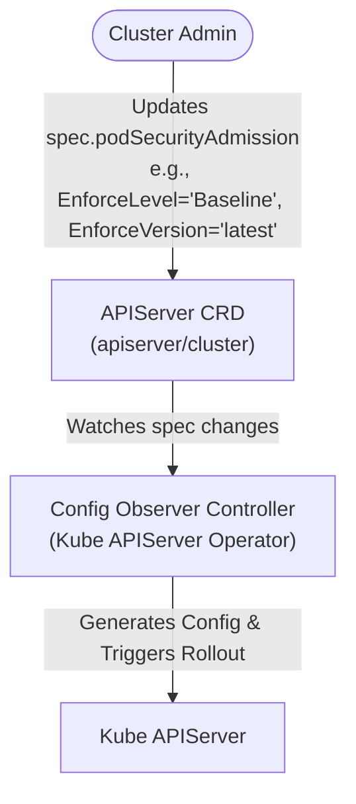
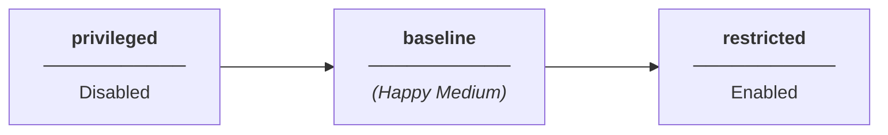

# Pod Security Admission Config / PSA Label Syncer Retirement

## Summary

Pod Security Admission has long been a part of the development process in OpenShift. 
Primarily, this was done through PSA Label Syncer and manually labelling the namespaces
with the appropriate `pod-security.kubernetes.io/*` labels. This enhancement proposes
that this functionality is brought to customers via a new configurable API, which enables 
PSA for customers with `privileged` being the default value. Additionally, it proposes 
the permanent retirement of PSA Label Syncer and its dependent labels, while placing the 
responsibility on us, the developers, to ensure the namespaces are labelled appropriately 
before runtime. 

## Motivation

PSA has played a key role in the internal development process in OpenShift for quite some 
time, giving the team a reliable mechanism to enforce Pod Security Standards (PSS) via 
the PSA Label Syncer based on workload SCC pinning.

However, this capability has not yet been shipped to customers. While OpenShift platform 
workloads ship fully secured with their own PSA labels out of the box, customers cannot 
leverage the same label syncer for their custom applications. While SCCs deliver strong 
protection downstream, PSA remains the established upstream standard. Today, PSA is supported
internally, but offer no supported pathway for customer adoption.

While the `OpenShiftPodSecurityAdmission` feature gate enabled on the `main` branch, it is 
intentionally removed at release branching (release-n).

Even if the `OpenShiftPodSecurityAdmission` feature gate is enabled on `release-` branches, the current 
implementation lacks the controls customers require. Evaluating workloads strictly against the `restricted`
PSS level is too rigid for general customer workloads. Adoption must be elective, allowing customers to 
choose their desired enforcement level (`privileged`, `baseline`, or `restricted`), or stick exclusively 
with SCCs.

This enhancement provides customers with an additional opt-in mechanism to manage workload 
security effectively. Crucially, it ensures that enabling or removing PSA enforcement is safe, 
controlled, and non-disruptive across cluster upgrades and downgrades.

### User Stories

* As a System Administrator, I want to enable PSA enforcement as I have labelled my namespaces 
effectively and I am confident that my workloads will not break.
* As a System Administrator, I want to revert my PSA enforcement from `restricted` to either 
`baseline` or `privileged` because I discovered failing workloads.
* As a System Administrator, I want to move PSA enforcement from either `restricted` or 
`baseline` to `privileged` as I want to rely solely on workload SCCs instead.

### Goals

1. A customer can successfully configure the level of PSA enforcement (e.g. `baseline`) 
   for their workloads via API configuration at will.
2. PSA enforcement is completely optional for the customer and serves to 
   compliment their existing security posture.
3. An exhaustive effort will be made to label OCP namespaces appropriately
   (i.e. `restricted` level) such that a customer won't run into issues
   when configuring the global PSA enforcement level, regardless of the
   PSA enforcement level they set.

### Non-Goals

1. The level of PSA enforcement set by the customer is not guaranteed,
   and the customer should be aware that there is always a possibility,
   that the PSS set may not be suitable for customer workloads.
2. The proposal does not implement a mechanism to predict whether a workload
   is safe to be admitted when the PSA enforcement level is set either at 
   namespace level or globally.
3. Migrating customers automatically to the most secure PSA setup by reading
   the SCCs.
4. Offering exhaustive tooling / analytics (for now). Might change if the 
   feature is in high demand.

## Proposal

### Workflow Description



The **Config Observer** in `cluster-kube-apiserver-operator` is the single 
consumer, turning the API config into the kube-apiserver's global `PodSecurity` 
admission configuration.

1. The cluster administrator ensures the PSA labels are set appropriately. This 
   means they have:
   1. Checked their workloads will support the proposed PSS.
   2. Checked any pod security violations in audit logs before updating. Alternatively,
      the cluster administrator sets the config to report any potential violations in
      either `baseline` or `restricted`, while the cluster itself remains in `privileged`
      mode.
   3. Fixed any workloads that would not comply with the proposed PSS. This could mean
      updating the image the pod uses to the latest version, for example.
2. After ensuring the PSA labels are set appropriately for their workloads, they set
   the level of PSA enforcement via the API to `baseline`. If they choose to later,
   they can move to `restricted` . 
3. The Config Observer validates the API config and reconciles. It sets the Kube API
   Server configuration which triggers a rollout.
4. PSA is now being enforced at `baseline`. If the cluster administrator notices failing
   workloads due to PSA, they can revert to `privileged` if they are unable to fix the 
   workload simply. If the cluster administrator does not see any report logs about 
   failing workloads, they can move to `restricted`.

### API Extensions

`PodSecurityAdmissionConfig` is added to the existing `APIServerSpec` in `config/v1/types_apiserver.go`
in openshift/api. 

* While it does not or should not impact others, it does add to an existing struct. This will allow 
  users to modify the `apiserver` resource on their cluster to configure PSA.

```go
package v1 // config/v1/types_apiserver.go in openshift/api

type APIServerSpec struct {
	// ... existing fields: servingCerts, clientCA, additionalCORSAllowedOrigins,
	// encryption, tlsSecurityProfile, tlsAdherence, audit ...

	// podSecurityAdmission configures the Pod Security Standard the
	// kube-apiserver enforces, warns on and audits for Namespaces that
	// carry no pod-security.kubernetes.io label of their own.
	//
	// When omitted, this means the cluster has opted out of Pod Security
	// Admission. The PodSecurity admission plugin remains configured, with
	// all three of enforce, warn and audit set to privileged, so an
	// opted-out cluster neither rejects nor reports.
	//
	// +openshift:enable:FeatureGate=OpenShiftPodSecurityAdmission
	// +optional
	PodSecurityAdmission PodSecurityAdmissionConfig `json:"podSecurityAdmission,omitempty,omitzero"`
}

// PodSecurityStandard names one of the upstream Pod Security Standards.
// +kubebuilder:validation:Enum:=privileged;baseline;restricted
type PodSecurityStandard string

const (
	// PodSecurityStandardPrivileged is the unrestricted standard. As an
	// enforcement level it means the cluster has opted out of enforcement.
	PodSecurityStandardPrivileged PodSecurityStandard = "privileged"
	// PodSecurityStandardBaseline prevents known privilege escalations while
	// permitting the default Pod configuration.
	PodSecurityStandardBaseline PodSecurityStandard = "baseline"
	// PodSecurityStandardRestricted is the hardened standard, following current
	// Pod hardening best practices.
	PodSecurityStandardRestricted PodSecurityStandard = "restricted"
)

// PodSecurityAdmissionConfig records the administrator's requested Pod Security
// Admission enforcement. It is never written by a controller.
type PodSecurityAdmissionConfig struct {
	// EnforceLevel sets the default Pod Security Standard level for namespaces without a specific label.
	// Defaults to Privileged.
	// +optional
	EnforceLevel PodSecurityStandard `json:"enforceLevel,omitempty"`

	// EnforceVersion sets the Pod Security Standards revision (e.g. "v1.34" or "latest").
	// Versions higher than the cluster version are clamped down. Defaults to cluster Kubernetes version.
	// +kubebuilder:validation:Pattern=`^(latest|v1\.(0|[1-9][0-9]*))$`
	// +kubebuilder:validation:MaxLength=10
	// +optional
	EnforceVersion string `json:"enforceVersion,omitempty"`

	// ReportLevel sets the global audit and warning level across the cluster.
	// Defaults to Privileged.
	// +optional
	ReportLevel PodSecurityStandard `json:"reportLevel,omitempty"`
}
```

### Topology Considerations

#### Hypershift / Hosted Control Planes


In order to configure PSA in HyperShift, the `HostedCluster` object will need to
be modified. Furthermore, the hosted control plane logic will need to be modified
in HyperShift to be aware of the new fields. 

Config Observer Logic should not need modification in HyperShift.

#### Standalone Clusters

Yes, the change is very relevant for standalone clusters. The
proposal focuses mainly on this topology.

#### Single-node Deployments or MicroShift

##### Single-node Deployments

As there is only one node available in SNO, updating `APIServer/cluster`
to configure PSA enforcement will cause a **temporary** kube-apiserver 
outage. This is because there is only one API server instance, and it 
needs to perform a static pod rollout to apply the new changes. This
should not be **permanent**. 

##### MicroShift

MicroShift currently does not support the `APIServer` OpenShift API.
Logic will need to be added so that MicroShift can support this feature.
`.spec` field will need to be brought over. These changes
would need to be made in [MicroShift's API Server logic](https://github.com/openshift/microshift/blob/main/pkg/config/apiserver.go).

MicroShift sets PSA level to `restricted` by default via its own
[Kube API Server config](https://github.com/openshift/microshift/blob/a3b74f7954e26b90aa099fefe9800879ce6abf8d/assets/controllers/kube-apiserver/defaultconfig.yaml#L12-L31). This will need to change to `privileged`
by default to ensure the feature works the same on MicroShift as on any
other platform. This does not mean engineers won't develop with `restricted`
by default; it simply means any workloads outside of OCP do not need to be
evaluated at `restricted` level unless the user decides to do so by configuring
the API. 

Configuring this feature would also look different; `config.yaml` would need
to be edited - there is no `oc` command to do this as OpenShift API has
limited support here. Then, MicroShift would need to be restarted by the admin
for changes to take effect.

#### OpenShift Kubernetes Engine

The proposed changes do not depend on features excluded from the OKE product 
offering. Therefore, while involved as a part of the proposal, it should not
be any different from a standalone implementation.

### Implementation Details/Notes/Constraints

#### PSA Configuration Overview



When configuring PSA, it is important to understand what each PSS standard means.
PSA enablement/disablement is fluid. There are three states that the API can be
configured.

`baseline` is a new addition to the PSA feature for OpenShift - it will allow customers
to have a "happy medium" so they can secure their workloads without being too 
restrictive. 

The following table was inspired from the [upstream PSS documentation](https://kubernetes.io/docs/concepts/security/pod-security-standards). 

|Pod Security Standard|Description|
|-------|-----------|
|`privileged`| PSA enforcement is effectively disabled.|
|`baseline`| Enforces a minimally restrictive policy which prevents known privilege escalations. |
|`restricted`| Enforces a heavily restricted policy, following Pod hardening best practices relative the the enforcement version set. |

Within the API, the standard is set when modifying `APIServer` cluster object in 
`.spec.podSecurityAdmission` . This applies for `enforceLevel`, `enforceVersion` 
and `reportLevel` .

`reportLevel` combines `audit` and `warn` and serves as a mechanism to gather data.
This is particularly useful for customers that want insight into how their workloads
would "behave" under a particular PSS, without actually enforcing. 

For example, the cluster admin can keep `enforceLevel` as `privileged` and set 
`reportLevel` to `restricted` so they can view the audit and warn logs to understand what 
workloads need to be adjusted to bring PSA enforcement to `restricted`. This can help the 
customer predict workload admission so they are more informed about the choices they make.

#### Repurposing `OpenShiftPodSecurityAdmission` feature gate

The `OpenShiftPodSecurityAdmission` feature gate has been used for development
testing since 4.12 . Its purpose was to ensure OpenShift namespaces and workloads
were labelled as strictly as possible, i.e. `restricted` or `privileged`, so that
customer workloads would not be affected by PSA. This meant that PSA components, 
such as the PSA Label Syncer or Pod Security Readiness Controller, were enabled in
the development process, and disabled in release branches. Because this feature gate 
was never part of the `Default` feature set, the customer never got the chance to use
these features for their workloads.

For this feature proposal, the feature gate will be used for a different
purpose; the API will be added, retiring components, and providing testing
to ensure OpenShift workloads adhere to the strictest PSS standard where possible.
This means in development, the feature gate will no longer be used to check if
the workloads conform to a PSS standard; it won't be on in development and off
in production. Rather, it will always be on once implemented, and monitor testing
will take over this responsibility to ensure all OCP namespaces have PSS labels set.

#### Retiring PSA Label Syncer

The purpose of the PSA label syncer was to set correct PSA labels based on workload
SCCs in a namespace. The proposal is to retire the PSA label syncer as part of the
feature work. There will be monitoring tests present to detect the PSA labels on 
OCP namespaces in place of the syncer, and developers will need to ensure their 
namespaces conform to `restricted` PSS if possible.

#### Retiring Pod Security Readiness Controller

The purpose of the PodSecurityReadinessController was to collect metrics about
failing workloads due to pod security violations. The proposal is to retire
the controller as part of the feature work. This is because OCP namespaces
will need to be labelled as part of this work. `audit` and `warn` labels
will provide the logs necessary to debug why a namespace/workload cannot
conform to a given PSS and to fix it.

#### Configuring PSA Enforcement at Install Time

Many customers use IaC to configure their cluster. This makes
configuring PSA enforcement at install time a necessity.
It allows the cluster admin to set an enforcement level
from the get-go that suits the needs for their workloads. This 
would be the global level being set, not the namespace level.

In order to enable this, **no changes are required for `openshift/installer`.**
There is logic there that [loads YAML manifests at install time](https://github.com/openshift/installer/blob/main/pkg/asset/manifests/openshift.go#L321). The user only
needs to worry about creating the YAML manfiest for `cluster/APIServer` and 
that it is correct. 

When the user wants to install the cluster, they use the `openshift-install`
binary. First, create the manifests structure in a chosen directory:

```bash
openshift-install create manifests --dir="./my-favorite-dir"
```

A lot of manifests are created. This only primes the cluster install - it creates 
the manifests necessary to bootstrap the cluster. 
**The user needs to create the `cluster/APIServer` manifest in "./my-favorite-dir/openshift.**
This is the `cluster/APIServer` manifest called `cluster-apiserver-02-config.yml`
with .spec.podSecurityAdmissionConfig filled out. 

```yaml
apiVersion: config.openshift.io/v1
kind: APIServer
...
spec:
...
  podSecurityAdmission:
    enforceLevel: "baseline"
    enforceVersion: "1.34"
    reportLevel: "restricted"
```

Once created, the user can proceed with install.

```bash
openshift-install create cluster --dir="./my-favorite-dir"
```

The change that we do need to make lies in `openshift/cluster-kube-apiserver-operator`
repo. Observer logic (to configure PSA via manifest) is added to a new file in
`pkg/operator/configobservation/apiserver/observe_podsecurityadmission.go`,
similar to [observer logic for CORS](https://github.com/openshift/cluster-kube-apiserver-operator/blob/main/pkg/operator/configobservation/apiserver/observe_cors.go). 
Then, the new observer logic is wired up [to the controller](https://github.com/openshift/cluster-kube-apiserver-operator/blob/main/pkg/operator/configobservation/configobservercontroller/observe_config_controller.go). 
This enables the config observer to reconcile the new changes, and triggers a 
static pod rollout. This should not be discernible in terms of time to the user, 
as it happens during the bootstrap process.

#### PSA configuration

As mentioned above, PSA Enforcement will be configurable at install time. However,
it will also be configurable once the cluster is running. The cluster administrator
needs to edit the `cluster/APIServer` crd to make this happen. 

They run `oc edit apiserver cluster` and they add the following changes:

```yaml
apiVersion: config.openshift.io/v1
kind: APIServer
...
spec:
...
  podSecurityAdmission:
    enforceLevel: "Baseline"
    enforceVersion: "1.34"
    reportLevel: "Restricted"
```

Then the config observer controller picks up on these changes, resolves the version, 
generates config and rolls out PSA Enforcement
via the Kube APIServer. What PSA Enforcement actually means is discussed below. 

### Risks and Mitigations

#### Operator Lifecycle Manager (OLM) Namespaces

OLM does PSA labelling a bit different to the rest of OpenShift. They write their
PSA labels via their own config and follow their own behavior in regards to when
they will write the labels. Therefore, they are exempt from the namespace
labelling requirements due to their distinct nature.

This enhancement proposes not to touch these namespaces e.g. `openshift-operators`
The proposed monitor tests will filter these namespaces out.

#### PSA Enforcement Configuration Issues

The XValidation markers in the API should account for most validation concerns.
For example, if the user makes a typo in enforcement level configuration, the 
enums for the  enforcement level should help by giving the validation error.

If the user chooses an invalid version of `enforce` or `report`, e.g. `1.39` if
`1.38` is the latest version, and XValidation passes, then the API's
`.spec.podSecurityAdmission` cannot be set. This means we need to make sure we have
input validation in Kube APIServer so we don't set a wrong version. Enums should be
sufficient to validate PSS standards as they are quite established upstream. The 
enums can/should be modified in the case that they change.

**The API is not modified until a valid configuration is provided.**

If Kubernetes moves from `v1.x` to `v2.x` then changes to the XValidation marker
after the API goes in will be needed.

#### Unexpected failure to admit workload based on enforcement level

The Kube API Server will fail a workload according to the level being set. It
could be that the application owner was not aware of a privilege needed to run
a specific workload or set of workloads. To mitigate, the cluster administrator
would need to re-configure PSA enforcement either at namespace or global level.

A workload that has failed to meet admission requirements will continue to run 
until it needs to restart, at which point the workload will not be redeployed 
until the system administrator sets the PSS level for the workload namespace to 
the appropriate level.

It should be straightforward to determine the workloads that have are currently
failing PSA admission by dry run labelling all namespaces with the PSA label 
desired.

```bash
oc label --dry-run=server --overwrite ns --all \
 pod-security.kubernetes.io/enforce=restricted
```

However, this can only check current running workloads. If there are jobs or
temporary pods that run occasionally, this requires a more nuanced approach.

Setting `reportLevel` to the level of desired PSS will set global `audit` and
`warn` level to that PSS. This will provide the user logs that they can use to
debug their failing workloads. At namespace level the user can run the following
command. 

```bash
kubectl label ns <namespace> \
  pod-security.kubernetes.io/warn=restricted \
  pod-security.kubernetes.io/audit=restricted
```

This would be recommended if they set the namespace labels already. Otherwise,
`reportLevel` will be sufficient to view logs for debugging the workload.

#### Impact on OCP workloads (PSA Label Syncer + Readiness Controller disablement)

From the developer perspective, `OpenShiftPodSecurityAdmission` has a completely
new meaning; it is now customer facing. The PSA Label Syncer and the Readiness 
Controller will be disabled, which leaves a discernable gap in OpenShift's
security posture.

The PSA Label Syncer's role was to label namespaces which has `security.openshift.io/scc.podSecurityLabelSync`
label set to `true`, with the appropriate `enforce`,`warn` and `audit` labels.

To mitigate the lack of the PSA Label Syncer, monitor tests to ensure namespaces have 
an appropriate PSA label in place to enforce on workload admissions will be used to give 
insight to OCP engineers to ensure that OCP workloads can run with a global setting of 
`restricted` to not block the feature. The responsibility will be on the OCP engineers to 
ensure they have labelled their namespace appropriately for either the new workloads 
introduced or the new namespaces. 

Nothing will be there to check the OCP namespaces' appropriate PSA labelling once this 
feature is complete, so both OCP engineers and cluster admins will need to know their 
workload permissions and how to compare the enforcement level with the Pod Security 
Standards based on the latest enforcement version available to them at the time.

The PodSecurityReadinessController collected metrics for ClusterFleetEvaluation.
This has no discernable impact on OCP workloads upon disablement.

For some customers who used this feature in Dev/Tech preview, they may have set the
`security.openshift.io/scc.podSecurityLabelSync` label for their namespaces. They
might not know the PSA Label Syncer is being removed. For these customers, they cannot
upgrade, so they are stuck with their current offering. They must be informed when they
use a new cluster, how this feature has changed.

### Drawbacks

#### PSA Enforcement is Optional

This is important; PSA enforcement is optional. This means the default state
of PSA enforcement will be `privileged` meaning no assertions on workloads
out of the box. This does not improve the security posture for the consumer
right away - they have to determine the level of PSA enforcement that suits
them. 

#### Manual labelling of namespaces

All namespaces that were labelled by the PSA label syncer will now to be labelled
appropriately so that the global enforcement level set by the customer will
not impact OpenShift workloads and vice-versa; OpenShift PSA enforcement does
not conflict with customer PSA enforcement.

#### Customer Responsibility

It is not guaranteed as part of this feature work, that the chosen PSS set
by the customer, will work. If the customer is unsure about the PSS level
they need to set, it is better not to set the label in the first place. Doing
so can cause more harm than good; they must be informed of the implications
for their workloads in documentation so they can make the decision best for them.

The responsibility is with the customer to ensure their workloads can meet
the level of enforcement set. This can cause issues for customers who wish
to improve their security posture but do not know where to start.

OpenShift is not becoming more secure by default with the completion of this
feature. What it is becoming, is offering an additional measure of security
for the customer should they wish to use it. Each cluster is unique to the
customer, so the customer needs to configure the PSA both at global and namespace
level in a way that suits their workload needs.

This conflates with a [previous enhancement proposal draft](https://github.com/ibihim/enhancements/blob/7aad97ca4a0068f0fc50fb76347852d1e683c3ad/enhancements/authentication/pod-security-admission-enforcement.md) that wanted to make 
OpenShift more secure out of the box with the level of enforcement being restricted 
with a temporary API to ease transition issues for customers. Now, the API is 
permanent, the customer can use the feature if they wish to take on the responsibility,
or rely on existing mechanisms such as SCCs for their workloads.

#### Developer Learning Curve

OpenShift developers will need to be aware that the `OpenShiftPodSecurityAdmission`
feature gate will now be used to move this feature forward, not to be used
in development branch anymore as a mechanism to ensure the correct PSA labelling
for their namespace and workloads.

Instead, monitor tests will be used to report non labelled namespaces for PSA 
enforcement, and developers will need to be aware of this moving forward.

Overall, there should not significant maintenance burden beside the manual labelling
of namespaces as appropriate.

## Alternatives (Not Implemented)

Similar to the `Drawbacks` section the `Alternatives` section is used
to highlight and record other possible approaches to delivering the
value proposed by an enhancement, including especially information
about why the alternative was not selected.

### PSA Enforcement being restricted out of the box

As mentioned before, a [previous enhancement proposal draft](https://github.com/ibihim/enhancements/blob/7aad97ca4a0068f0fc50fb76347852d1e683c3ad/enhancements/authentication/pod-security-admission-enforcement.md) proposed making PSA Enforcement mandatory,
and that customers would need to transition towards this reality over a few releases.

This would have kept components such as the PSA Label Syncer and Pod Security
Readiness Controller, allowing customers to understand the risks now introduced
at the cost of a more secure platform. The API mentioned was going to be temporary,
and at a certain release be removed. New clusters had PSA enforcement out of the box,
while existing clusters worked to transition to this new reality. 

This was not something that was desired in this proposal, as customers now had to accept
a `restricted` by default mindset for their workloads, meaning many customers would
need to set the PSA enforcement level to `legacy` until they could not, or set `privileged`
at namespace level for all of their workloads. This creates a lot of work for a customer
to set an enforcement level they never asked for, and would have created major headaches.

### Do Nothing

This is also a potential path forward, but it was not chosen as the EP proposes to
stop the `OpenShiftPodSecurityAdmission` feature gate from constantly being 
removed in release branches. There comes a time where the feature gate should
transition to `Default` feature set, and customers should be able to take advantage
of this. 

By repurposing the feature gate, another path forward can be provided for customers
wanting to use PSA enforcement. Equally, this needs to be made aware to developers
so that they will manually add the appropriate PSA labels to their namespaces when
adding new workloads to OCP.

## Open Questions [optional]

This is where to call out areas of the design that require closure before deciding
to implement the design.  For instance,
 > 1. This requires exposing previously private resources which contain sensitive
  information.  Can we do this?

## Test Plan

**Note:** *Section not required until targeted at a release.*

Consider the following in developing a test plan for this enhancement:
- Will there be e2e and integration tests, in addition to unit tests?
- How will it be tested in isolation vs with other components?
- What additional testing is necessary to support managed OpenShift service-based offerings?

No need to outline all of the test cases, just the general strategy. Anything
that would count as tricky in the implementation and anything particularly
challenging to test should be called out.

All code is expected to have adequate tests (eventually with coverage
expectations).

## Graduation Criteria

**Note:** *Section not required until targeted at a release.*

Define graduation milestones.

These may be defined in terms of API maturity, or as something else. Initial proposal
should keep this high-level with a focus on what signals will be looked at to
determine graduation.

Consider the following in developing the graduation criteria for this
enhancement:

- Maturity levels
  - [`alpha`, `beta`, `stable` in upstream Kubernetes][maturity-levels]
  - `Dev Preview`, `Tech Preview`, `GA` in OpenShift
- [Deprecation policy][deprecation-policy]

Clearly define what graduation means by either linking to the [API doc definition](https://kubernetes.io/docs/concepts/overview/kubernetes-api/#api-versioning),
or by redefining what graduation means.

In general, we try to use the same stages (alpha, beta, GA), regardless how the functionality is accessed.

[maturity-levels]: https://git.k8s.io/community/contributors/devel/sig-architecture/api_changes.md#alpha-beta-and-stable-versions
[deprecation-policy]: https://kubernetes.io/docs/reference/using-api/deprecation-policy/

**If this is a user facing change requiring new or updated documentation in [openshift-docs](https://github.com/openshift/openshift-docs/),
please be sure to include in the graduation criteria.**

**Examples**: These are generalized examples to consider, in addition
to the aforementioned [maturity levels][maturity-levels].

### Dev Preview -> Tech Preview

- Ability to utilize the enhancement end to end
- End user documentation, relative API stability
- Sufficient test coverage
- Gather feedback from users rather than just developers
- Enumerate service level indicators (SLIs), expose SLIs as metrics
- Write symptoms-based alerts for the component(s)

### Tech Preview -> GA

- More testing (upgrade, downgrade, scale)
- Sufficient time for feedback
- Available by default
- Backhaul SLI telemetry
- Document SLOs for the component
- Conduct load testing
- User facing documentation created in [openshift-docs](https://github.com/openshift/openshift-docs/)

**For non-optional features moving to GA, the graduation criteria must include
end to end tests.**

### Removing a deprecated feature

- Announce deprecation and support policy of the existing feature
- Deprecate the feature

## Upgrade / Downgrade Strategy

If applicable, how will the component be upgraded and downgraded? Make sure this
is in the test plan.

Consider the following in developing an upgrade/downgrade strategy for this
enhancement:
- What changes (in invocations, configurations, API use, etc.) is an existing
  cluster required to make on upgrade in order to keep previous behavior?
- What changes (in invocations, configurations, API use, etc.) is an existing
  cluster required to make on upgrade in order to make use of the enhancement?

Upgrade expectations:
- Each component should remain available for user requests and
  workloads during upgrades. Ensure the components leverage best practices in handling [voluntary
  disruption](https://kubernetes.io/docs/concepts/workloads/pods/disruptions/). Any exception to
  this should be identified and discussed here.
- Micro version upgrades - users should be able to skip forward versions within a
  minor release stream without being required to pass through intermediate
  versions - i.e. `x.y.N->x.y.N+2` should work without requiring `x.y.N->x.y.N+1`
  as an intermediate step.
- Minor version upgrades - you only need to support `x.N->x.N+1` upgrade
  steps. So, for example, it is acceptable to require a user running 4.3 to
  upgrade to 4.5 with a `4.3->4.4` step followed by a `4.4->4.5` step.
- While an upgrade is in progress, new component versions should
  continue to operate correctly in concert with older component
  versions (aka "version skew"). For example, if a node is down, and
  an operator is rolling out a daemonset, the old and new daemonset
  pods must continue to work correctly even while the cluster remains
  in this partially upgraded state for some time.

Downgrade expectations:
- If an `N->N+1` upgrade fails mid-way through, or if the `N+1` cluster is
  misbehaving, it should be possible for the user to rollback to `N`. It is
  acceptable to require some documented manual steps in order to fully restore
  the downgraded cluster to its previous state. Examples of acceptable steps
  include:
  - Deleting any CVO-managed resources added by the new version. The
    CVO does not currently delete resources that no longer exist in
    the target version.

## Version Skew Strategy

How will the component handle version skew with other components?
What are the guarantees? Make sure this is in the test plan.

Consider the following in developing a version skew strategy for this
enhancement:
- During an upgrade, we will always have skew among components, how will this impact your work?
- Does this enhancement involve coordinating behavior in the control plane and
  in the kubelet? How does an n-2 kubelet without this feature available behave
  when this feature is used?
- Will any other components on the node change? For example, changes to CSI, CRI
  or CNI may require updating that component before the kubelet.

## Operational Aspects of API Extensions

Describe the impact of API extensions (mentioned in the proposal section, i.e. CRDs,
admission and conversion webhooks, aggregated API servers, finalizers) here in detail,
especially how they impact the OCP system architecture and operational aspects.

- For conversion/admission webhooks and aggregated apiservers: what are the SLIs (Service Level
  Indicators) an administrator or support can use to determine the health of the API extensions

  Examples (metrics, alerts, operator conditions)
  - authentication-operator condition `APIServerDegraded=False`
  - authentication-operator condition `APIServerAvailable=True`
  - openshift-authentication/oauth-apiserver deployment and pods health

- What impact do these API extensions have on existing SLIs (e.g. scalability, API throughput,
  API availability)

  Examples:
  - Adds 1s to every pod update in the system, slowing down pod scheduling by 5s on average.
  - Fails creation of ConfigMap in the system when the webhook is not available.
  - Adds a dependency on the SDN service network for all resources, risking API availability in case
    of SDN issues.
  - Expected use-cases require less than 1000 instances of the CRD, not impacting
    general API throughput.

- How is the impact on existing SLIs to be measured and when (e.g. every release by QE, or
  automatically in CI) and by whom (e.g. perf team; name the responsible person and let them review
  this enhancement)

- Describe the possible failure modes of the API extensions.
- Describe how a failure or behaviour of the extension will impact the overall cluster health
  (e.g. which kube-controller-manager functionality will stop working), especially regarding
  stability, availability, performance and security.
- Describe which OCP teams are likely to be called upon in case of escalation with one of the failure modes
  and add them as reviewers to this enhancement.

## Support Procedures

Describe how to
- detect the failure modes in a support situation, describe possible symptoms (events, metrics,
  alerts, which log output in which component)

  Examples:
  - If the webhook is not running, kube-apiserver logs will show errors like "failed to call admission webhook xyz".
  - Operator X will degrade with message "Failed to launch webhook server" and reason "WehhookServerFailed".
  - The metric `webhook_admission_duration_seconds("openpolicyagent-admission", "mutating", "put", "false")`
    will show >1s latency and alert `WebhookAdmissionLatencyHigh` will fire.

- disable the API extension (e.g. remove MutatingWebhookConfiguration `xyz`, remove APIService `foo`)

  - What consequences does it have on the cluster health?

    Examples:
    - Garbage collection in kube-controller-manager will stop working.
    - Quota will be wrongly computed.
    - Disabling/removing the CRD is not possible without removing the CR instances. Customer will lose data.
      Disabling the conversion webhook will break garbage collection.

  - What consequences does it have on existing, running workloads?

    Examples:
    - New namespaces won't get the finalizer "xyz" and hence might leak resource X
      when deleted.
    - SDN pod-to-pod routing will stop updating, potentially breaking pod-to-pod
      communication after some minutes.

  - What consequences does it have for newly created workloads?

    Examples:
    - New pods in namespace with Istio support will not get sidecars injected, breaking
      their networking.

- Does functionality fail gracefully and will work resume when re-enabled without risking
  consistency?

  Examples:
  - The mutating admission webhook "xyz" has FailPolicy=Ignore and hence
    will not block the creation or updates on objects when it fails. When the
    webhook comes back online, there is a controller reconciling all objects, applying
    labels that were not applied during admission webhook downtime.
  - Namespaces deletion will not delete all objects in etcd, leading to zombie
    objects when another namespace with the same name is created.

## Infrastructure Needed [optional]

Use this section if you need things from the project. Examples include a new
subproject, repos requested, github details, and/or testing infrastructure.
