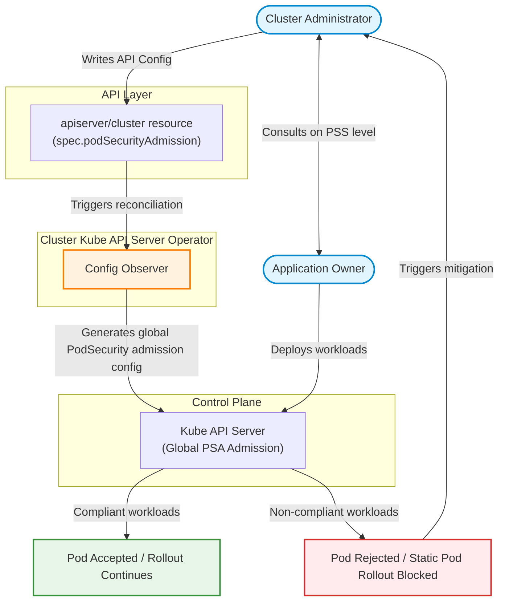
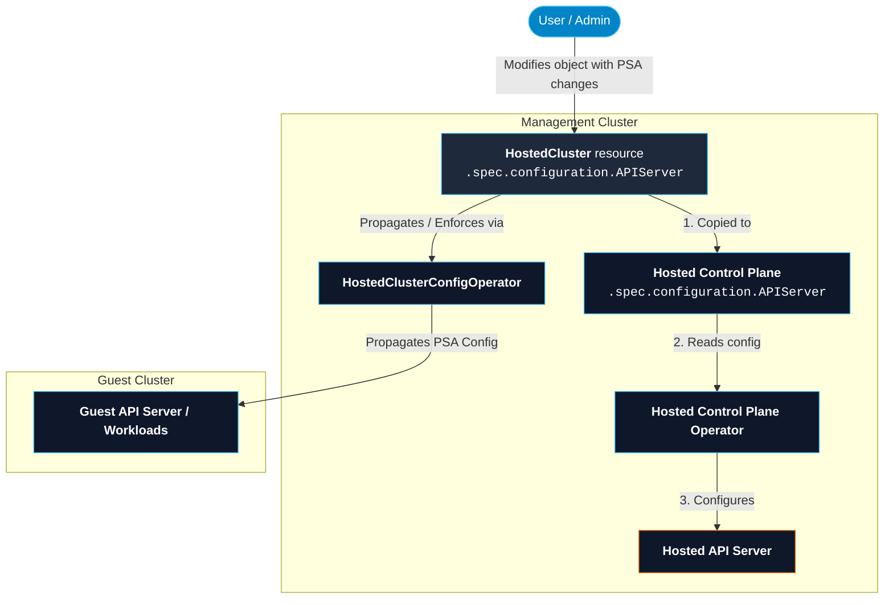
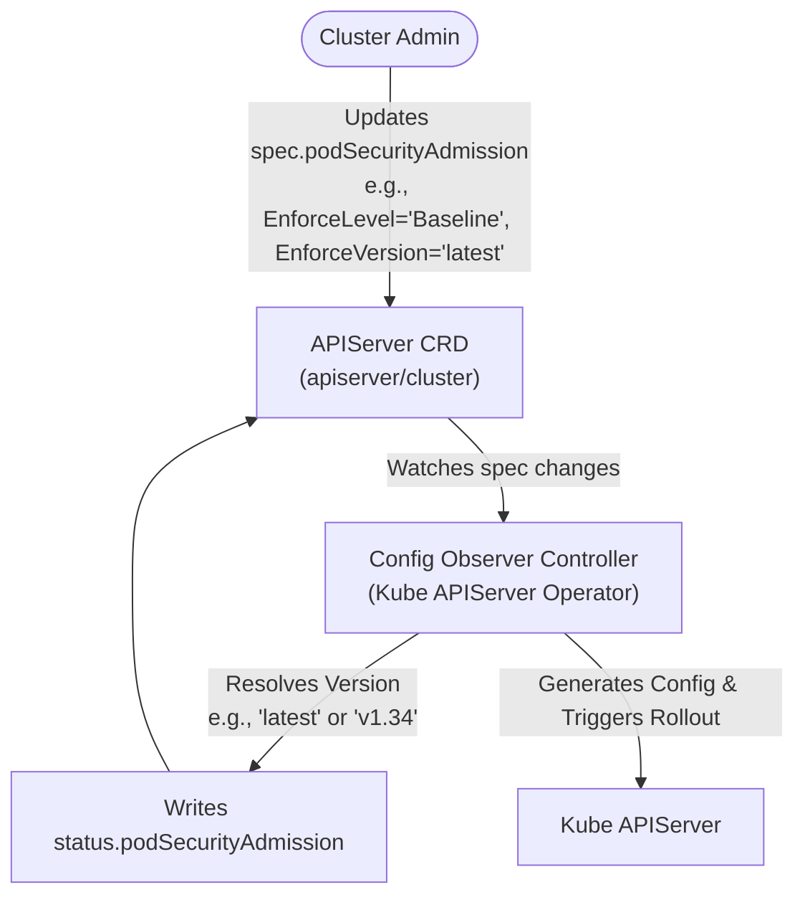
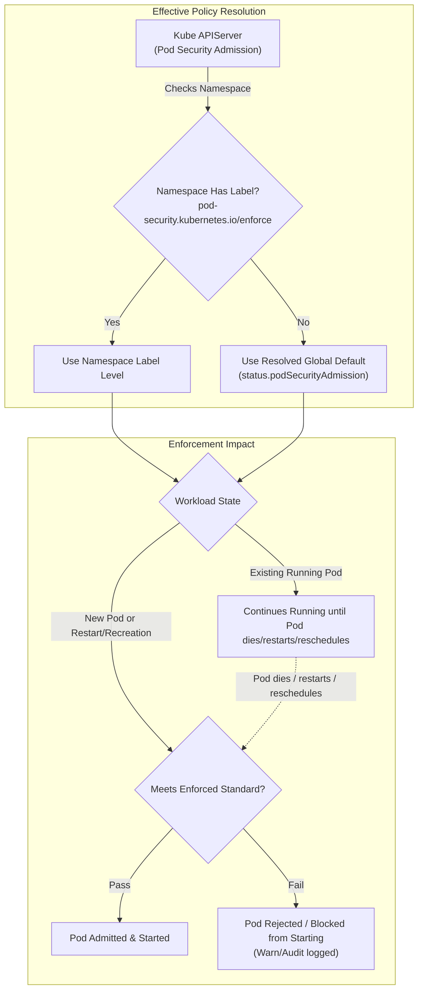

# Pod Security Admission Config / PSA Label Syncer Retirement

## Summary

Pod Security Admission has long been a part of our development process in OpenShift. 
Primarily, this was done through PSA Label Syncer and manually labelling our namespaces
with the appropriate `pod-security.kubernetes.io/*` labels. This enhancement proposes
that we bring this functionality to customers via a new configurable API, which enables 
PSA for customers with `privileged` being the default value. Additionally, it proposes 
the permanent retirement of PSA Label Syncer and its dependent labels, while placing the 
responsibility on us, the developers, to ensure our namespaces are labelled appropriately 
before runtime. 

## Motivation

Pod Security Admission has long been part of our internal development process in OpenShift, 
giving our team a reliable mechanism to enforce Pod Security Standards (PSS) via the PSA 
Label Syncer based on workload SCC pinning.

However, we have not yet extended this capability to our customers. While OpenShift platform 
workloads ship fully secured with their own PSA labels out of the box, customers cannot 
leverage the same label syncer for their custom applications. While SCCs deliver strong 
protection downstream, PSA remains the established upstream standard. Today, we support PSA 
internally, but offer no supported pathway for customer adoption.

Currently, the `OpenShiftPodSecurityAdmission` feature gate enables PSA components—such as the 
label syncer and readiness controller—for platform development. However, while enabled on `main`, 
it is intentionally removed at release branching (release-n).

Even if exposed, the current implementation lacks the controls customers require. Evaluating 
workloads strictly against the `restricted` PSS level is too rigid for general customer workloads. 
Adoption must be elective, allowing customers to choose their desired enforcement level 
(`privileged`, `baseline`, or `restricted`), or stick exclusively with SCCs.

This enhancement provides security-conscious customers with an opt-in mechanism to manage workload 
security effectively. Crucially, it ensures that enabling or removing PSA enforcement is safe, 
controlled, and non-disruptive across cluster upgrades and downgrades.

### User Stories

* As a System Administrator, I want to enable PSA enforcement as I have labelled my namespaces 
effectively and I am confident that my workloads will not break.
* As a System Administrator, I want to pin the Pod Security Standards revision my cluster is 
evaluated against, so that upgrading the cluster does not tighten the standard my workloads 
are held to without my asking.
* As a System Administrator, I want to read back the enforcement level and standards revision 
actually in force, so that I can confirm my change was observed and detect a version that was clamped.
* As a System Administrator, I want to revert my PSA enforcement from `restricted` to either 
`baseline` or `privileged` because I discovered failing workloads.
* As a System Administrator, I want to move PSA enforcement from either `restricted` or 
`baseline` to `privileged` as I want to rely solely on workload SCCs instead.

### Goals

1. A customer can successfully enable or disable PSA enforcement for their 
   workloads via API configuration at will.
2. A status of PSA enforcement is provided to the customer via the API that
   the customer can query.
3. PSA enforcement is completely optional for the customer and serves to 
   compliment their existing security portfolio.
4. OpenShift managed namespaces have been labelled appropriately such that
   customer modification of PSS will not affect the cluster's modus operandi
   in terms of workload admission and operation.

### Non-Goals

1. PSA enforcement in customer workloads is not guaranteed, and the
   customer should be aware that there is always a possibility, that
   the PSS enforcement level set by the customer either globally or at 
   the namespace level, may not be suitable for the customer workloads. 
2. A workload that has failed to meet admission requirements will continue
   to run until it needs to restart, at which point the workload will not
   be redeployed until the system administrator sets the PSS level for the
   workload namespace to the appropriate level.
3. There will be no way to predict whether a workload is safe to be admitted
   when the PSA enforcement level is set either at namespace level or globally.

## Proposal

### Workflow Description



The **cluster administrator** is responsible for the security posture of a 
cluster and is the only actor that writes to the API.

The **application owner**  deploys workloads and is the one who knows which
Pod Security Standard those workloads actually require. They experience the 
consequences when a Pod is rejected. 

The **Config Observer** in `cluster-kube-apiserver-operator` is the single 
consumer, turning the API config into the kube-apiserver's global `PodSecurity` 
admission configuration.

1. The cluster administrator sits down at their keyboard.
2. The cluster administrator takes a look at their workloads. They have not
   configured Pod Security Admission yet. They are interested in setting the
   Pod Security Standard (PSS) for the namespaces in which the workloads lie.
3. The cluster administrator consults the application owner to understand what
   level of enforcement is desirable for the workloads. 
4. After discussion, the cluster administrator decides they would like to set
   the global level of PSA enforcement of the cluster to `baseline` and the version
   of enforcement to `1.34`. Both the cluster administrator and the application
   owner want `version` set explicitly as they do not trust the `latest` version.
5. The cluster administrator configures the API with the `baseline` option for
   `enforce`, `audit` and `warn` labels and `1.34` for the `version` labels 
   associated with the three labels. They also set the `reportLevel` to `restricted`
   so `audit` and `warn` are set to `restricted to see if they could move up to
   that level or not.
6. The Config Observer reconciles the API config. `enforce` is at `baseline`, `warn`
   and `audit` are now at `restricted` and the `version` of PSA enforcement is set 
   to `1.34`. 
7. The workloads in unset namespaces conform with the `baseline` standard, and
   all pods continue to rollout successfully.
8. The cluster administrator sets PSA enforcement back to `privileged` in the future
   when a failing workload happens, and can set it to the desired enforcement level
   at will.

### API Extensions

`PodSecurityAdmissionConfig` is added to the existing `APIServerSpec` in `config/v1/types_apiserver.go`
in openshift/api. 

* While it does not or should not impact others, it does add to an existing struct. This will allow 
  users to modify the `apiserver` resource on their cluster to configure PSA.

`PodSecurityAdmissionStatus` is added to the existing `APIServerStatus` in the same file/repo. 
This makes it the first `status` entry in this file.

* This may be the part that is at risk. The status exists so the apiserver could report whatever
  it may need to. Since it is the first time added, additional logic will be needed to allow
  a status report. The status will allow users to see how the configured PSA is behaving i.e.
  does the PSA configured via the API match the expected values? This is useful for setting
  explicit label versions, so the user can quickly spot a typo e.g. if they set the value to
  something that does not exist, the API status reports the value being unchanged.

What's also of importance is a new `baseline` option. This was previously missing from other
enhancements. We are adding it here so a cluster administrator has a middle ground for PSA
enforcement. It also provides all PSS options to the user.

```go
package v1 // config/v1/types_apiserver.go in openshift/api

type APIServerSpec struct {
	// ... existing fields: servingCerts, clientCA, additionalCORSAllowedOrigins,
	// encryption, tlsSecurityProfile, tlsAdherence, audit ...

	// podSecurityAdmission configures the Pod Security Standard the
	// kube-apiserver enforces, warns on and audits for Namespaces that
	// carry no pod-security.kubernetes.io label of their own.
	//
	// When omitted, this means the cluster has opted out of Pod Security
	// Admission. The PodSecurity admission plugin remains configured, with
	// all three of enforce, warn and audit set to privileged, so an
	// opted-out cluster neither rejects nor reports.
	//
	// +openshift:enable:FeatureGate=OpenShiftPodSecurityAdmission
	// +optional
	PodSecurityAdmission PodSecurityAdmissionConfig `json:"podSecurityAdmission,omitempty,omitzero"`
}

// APIServerStatus gains one subtree, declared below. It is empty today, so this
// enhancement is its first writer; the precedent is argued in "Why there is a
// status after all".

// PodSecurityStandard names one of the upstream Pod Security Standards.
// +kubebuilder:validation:Enum:=Privileged;Baseline;Restricted
type PodSecurityStandard string

const (
	// PodSecurityStandardPrivileged is the unrestricted standard. As an
	// enforcement level it means the cluster has opted out of enforcement.
	PodSecurityStandardPrivileged PodSecurityStandard = "Privileged"
	// PodSecurityStandardBaseline prevents known privilege escalations while
	// permitting the default Pod configuration.
	PodSecurityStandardBaseline PodSecurityStandard = "Baseline"
	// PodSecurityStandardRestricted is the hardened standard, following current
	// Pod hardening best practices.
	PodSecurityStandardRestricted PodSecurityStandard = "Restricted"
)

// PodSecurityAdmissionConfig records the administrator's requested Pod Security
// Admission enforcement. It is never written by a controller.
type PodSecurityAdmissionConfig struct {
	// EnforceLevel sets the default Pod Security Standard level for namespaces without a specific label.
	// Defaults to Privileged.
	// +optional
	EnforceLevel PodSecurityStandard `json:"enforceLevel,omitempty"`

	// EnforceVersion sets the Pod Security Standards revision (e.g. "v1.34" or "latest").
	// Versions higher than the cluster version are clamped down. Defaults to cluster Kubernetes version.
	// +kubebuilder:validation:Pattern=`^(latest|v1\.(0|[1-9][0-9]*))$`
	// +kubebuilder:validation:MaxLength=10
	// +optional
	EnforceVersion string `json:"enforceVersion,omitempty"`

	// ReportLevel sets the global audit and warning level across the cluster.
	// Defaults to Privileged.
	// +optional
	ReportLevel PodSecurityStandard `json:"reportLevel,omitempty"`
}

type APIServerStatus struct {
	// PodSecurityAdmission reports the resolved Pod Security Admission configuration written by the operator.
	// +optional
	PodSecurityAdmission *PodSecurityAdmissionStatus `json:"podSecurityAdmission,omitempty"`
}

// PodSecurityAdmissionStatus reports the effective Pod Security Admission configuration applied to kube-apiserver.
type PodSecurityAdmissionStatus struct {
	// EnforceLevel is the Pod Security level applied by the kube-apiserver.
	// +optional
	EnforceLevel PodSecurityStandard `json:"enforceLevel,omitempty"`

	// EnforceVersion is the actual Pod Security Standards revision applied after clamping to the cluster version.
	// +kubebuilder:validation:MaxLength=10
	// +optional
	EnforceVersion string `json:"enforceVersion,omitempty"`

	// ReportLevel is the resolved global audit and warning level.
	// +optional
	ReportLevel PodSecurityStandard `json:"reportLevel,omitempty"`
}

```

### Topology Considerations

#### Hypershift / Hosted Control Planes



In order to configure PSA in HyperShift, the `HostedCluster` object will need to
be modified. Furthermore, the hosted control plane logic will need to be modified
in HyperShift to be aware of our new fields. 

We will need to add new logic in the hosted cluster configuration so it is aware 
that `APIServerStatus` exists and has a field that a user can query via `HostedCluster`.

Config Observer Logic should not need modification in HyperShift.

#### Standalone Clusters

Yes, the change is very relevant for standalone clusters. The
proposal focuses mainly on this topology.

#### Single-node Deployments or MicroShift

##### Single-node Deployments

As there is only one node available in SNO, updating `APIServer/cluster`
to configure PSA enforcement will cause a kube-apiserver outage. This
is because there is only one API server instance, and it needs to 
perform a static pod rollout to apply the new changes. This should be
temporary in nature.

##### MicroShift

As MicroShift consumes the APIServer config differently, the API
resources added for PSA enforcement config will need to be exposed
through the MicroShift configuration file. This means we need to ensure
both the spec and status fields are accessible in MicroShift so a
MicroShift admin can query the status of PSA enforcement and configure it.

#### OpenShift Kubernetes Engine

The proposed changes do not depend on features excluded from the OKE product 
offering. Therefore, while involved as a part of the proposal, it should not
be any different from a standalone implementation.

### Implementation Details/Notes/Constraints

#### Operator Lifecycle Manager (OLM) Namespaces

OLM does PSA labelling a bit different to the rest of OpenShift. They write their
PSA labels via their own config and follow their own behavior in regards to when
they will write the labels. Therefore, they are exempt from the namespace
labelling requirements due to their distinct nature.

This enhancement proposes not to touch these namespaces e.g. `openshift-operators`
The proposed monitor tests will filter these namespaces out.

#### Repurposing `OpenShiftPodSecurityAdmission` feature gate

The `OpenShiftPodSecurityAdmission` feature gate has been used for development
testing since 4.12 . Its purpose was to ensure OpenShift namespaces and workloads
were labelled as strictly as possible, i.e. `restricted` or `privileged`, so that
customer workloads would not be impacted by PSA. This meant that PSA components, 
such as the PSA Label Syncer or Pod Security Readiness Controller, were enabled in
dev branches, and disabled in release branches. This meant the customer never got
the chance to use these features for their workloads, and more importantly, that
this feature gate was never part of the `Default` feature set.

For this feature proposal, we will be reusing the feature gate for a different
purpose; we will be adding the API, retiring components, and providing testing
to ensure OpenShift workloads adhere to the strictest PSS standard as possible.
This means in development, the feature gate will no longer be used to check if
our workloads conform to a PSS standard; it won't be on in development and off
in production. Rather, it will always be on once implemented, and monitor testing
will take over this responsibility to ensure all OCP namespaces have PSS labels set.

#### Retiring PSA Label Syncer and Pod Security Readiness Controller

The PSA Label Syncer and PodSecurityReadinessController will be retired as part
of this feature work. The PodSecurityReadinessController's purpose was to ensure 
workloads were ready to be labelled with `restricted` or `privileged`. Then, the 
PSA label syncer would label the namespace with the appropriate enforcement level.

Since additional monitor tests to monitor OpenShift managed namespaces will be in
place as part of this proposal, they are no longer needed. Additionally, this serves
the same purpose effectively as the retired components; our workloads must be 
operating in a namespace that uses the strictest PSA enforcement as possible, so that
this does not affect customer workloads. Only this time, we will also provide the levers
needed for customers to enforce PSA on their own workloads at the desired levels. 

Without the monitoring tests to ensure this, we cannot safely provide this feature to
the customer. It does not mitigate the customer risk if they decide to enable the feature,
rather it prevents our workloads from being one of the reasons PSA failed for a customer
workload.

#### Additional Baseline Configuration Option

Previously, `Privileged` and `Restricted` were the only configurable options
for PSA enforcement on OpenShift. Its purpose was to reflect workloads either
would not enforce PSA at all, or would enforce PSA to the highest level. This
meant workloads needing some privileges that `restricted` PSS restricts, would
simply not use PSA at all. This works for OpenShift's development process, but
it does/should not work for customers. 

Customers need options - they have different requirements for their workloads
than what `restricted` may offer. They may prefer to lock down their workloads to
deny some privileges, but not all of them. `Baseline`, an already existing PSS,
bridges the gap for security conscious cluster admins who would like some of
the benefits of PSA, but not to the `restricted` level. 

The following table was inspired from the [upstream PSS documentation](https://kubernetes.io/docs/concepts/security/pod-security-standards). 

|Profile|Description|
|-------|-----------|
|`Privileged`| PSA enforcement is effectively disabled.|
|`Baseline`| Enforces a minimally restrictive policy which prevents known privilege escalations. |
|`Restricted`| Enforces a heavily restricted policy, following Pod hardening best practices relative the the enforcement version set. |

#### Configuring PSA Enforcement at Install Time

Allowing a security conscious customer to configure the level
of PSA enforcement at install time would provide great benefit.
It would allow the cluster admin to set an enforcement level
from the get-go, that an application owner would agree to in
regards to their workloads. This would be the global level being
set, not the namespace level.

In order to enable this, two notable changes are needed. Firstly,
`openshift/installer` repo requires an install-config option wired
up. Let's call it `psaConfig`. `psaConfig` would have the same options
at the APIServer spec i.e. `enforceLevel`, `enforceVersion`, etc. The
manifest generation would need to also be wired up so a user can configure
this at install time, either by YAML or as a config flag. 

Secondly, `openshift/cluster-kube-apiserver-operator` repo would need its
config observer controller logic changed in order to recognise these fields.
Whether this is in addition to other changes to allow it to recognise
`cluster/APIServer` changes is unknown. Then, the bootstrap logic would need
modification to repurpose the feature gate and to expect the aforementioned
API fields.

#### PSA configuration

As mentioned above, PSA Enforcement will be configurable at install time. However,
it will also be configurable once the cluster is running. The cluster administrator
needs to edit the `cluster/APIServer` crd to make this happen. 

Let's say they use `oc edit apiserver cluster` and they add the following changes:

```yaml
apiVersion: config.openshift.io/v1
kind: APIServer
...
spec:
...
  podSecurityAdmission:
    enforceLevel: "Baseline"
    enforceVersion: "1.34"
    reportLevel: "Restricted"
```

Then the config observer controller picks up on these changes, resolves the version, 
generates config, updates `status.podSecurityAdmission` and rolls out PSA Enforcement
via the Kube APIServer.



What PSA Enforcement actually means is discussed below. 

#### PSA Enforcement in Action

The Kube APIServer enforces the level that is configured by either
the cluster administrator or the default level. As mentioned before,
enforcement values are `privileged`, `baseline`, and `restricted` . 
These values align with the upstream PSS values and their restrictions.

The Kube APIServer then begins enforcement on the cluster at both a 
global and namespace level. Namespace level enforcement takes precedence
over the global level, and is the level of restriction enforced for the
workloads in a given namespace. This is also why we need the PSA enforcement
level set in our OpenShift namespaces, so that no matter the level the cluster
administrator has set, the workloads in these namespaces are set.

We therefore encourage the cluster administrator to be mindful about this for
their workloads; if they desire different restrictions dependent on their
workloads, they should configure this where they lie, the namespaces.

Where the namespace level PSA enforcement is not set, the global PSA enforcement
takes precedence for the namespace and their workloads. So, if the global enforcement
is `restricted` and there is no PSA enforcement labels set, the namespace will effectively
have the `restricted` label enforced on their workloads.

What this means in practice, for existing workloads, is that should they pass
evaluation, the workload is admitted and continues to run. Should the workload
fail evaluation, the workload will still continue to run, but if the pod dies
, restarts or reschedules, it will be blocked from starting again. 

For new workloads being evaluated, if they pass evaluation, they are admitted
and run fine. If they fail, they are blocked from starting.

Cluster administrators should keep this in mind when configuring the PSA enforcement
level globally and at namespace level, and remember they can also modify the level
of PSA enforcement desired as needed. 


### Risks and Mitigations

#### PSA Enforcement Configuration Issues

A cluster admin may use invalid enforcement levels and versions. Version will
resolve to `latest` on invalid values e.g. `2.34` instead of `1.34` . Enforcement
would not be re-set, so if the previous enforcement level was `privileged` it would
remain as such. For version to be set to latest a valid enforcement level should
have been selected. Otherwise, both values would remain the same.

This could cause issues as `latest` enforcement could have unexpected restrictions.
The mitigation here would be to re-configure PSA enforcement with valid values.

#### Unexpected failure to admit workload based on enforcement level

The Kube API Server will fail a workload according to the level being set. It
could be that the application owner was not aware of a privilege needed to run
a specific workload or set of workloads. To mitigate, the cluster administrator
would need to re-configure PSA enforcement either at namespace or global level.

#### Impact on OCP workloads (PSA Label Syncer + Readiness Controller disablement)

From the developer perspective, `OpenShiftPodSecurityAdmission` has a completely
new meaning; it is now customer facing. We are disabling the PSA Label Syncer and
the Readiness Controller which leaves a discernable gap in our security posture.

The PSA Label Syncer's job is to auto label namespaces based on the SCCs set on the
workloads. The Readiness Controller checks to see if a workload can accept the PSS
that would be enforced based on SCC violations. They both go hand in hand to ensure
PSA labels on non-labelled OpenShift namespaces. This will now be gone.

To mitigate this, monitor tests to ensure namespaces have an appropriate PSA label
in place to enforce on workload admissions will be used to give insight to developers
to ensure we keep our security posture. The responsibility will be on the developer
to ensure they have labelled their namespace appropriately for either the new workloads
introduced or the new namespaces. 

Nothing will be there to check this, so developers will need to know their workload
permissions and how to compare this with the Pod Security Standards based on the latest
enforcement version available to them at the time.

### Drawbacks

#### PSA Enforcement is Optional

This is important; PSA enforcement is optional. This means the default state
of PSA enforcement will be `privileged` meaning no assertions on workloads
out of the box. This does not improve the security posture for the consumer
right away - they have to determine the level of PSA enforcement that suits
them. 

#### Manual labelling of namespaces

All namespaces that were labelled by the PSA label syncer will now to be labelled
appropriately so that the global enforcement level set by the customer will
not impact OpenShift workloads and vice-versa; OpenShift PSA enforcement does
not conflict with customer PSA enforcement.

#### Customer Responsibility

The responsibility is with the customer to ensure their workloads can meet
the level of enforcement set. This can cause issues for customers who wish
to improve their security posture but do not know where to start.

OpenShift is not becoming more secure by default with the completion of this
feature. What it is becoming, is offering an additional measure of security
for the customer should they wish to use it. 

This conflates with a [previous enhancement proposal draft](https://github.com/ibihim/enhancements/blob/7aad97ca4a0068f0fc50fb76347852d1e683c3ad/enhancements/authentication/pod-security-admission-enforcement.md) that wanted to make 
OpenShift more secure out of the box with the level of enforcement being restricted 
with a temporary API to ease transition issues for customers. Now, the API is 
permanent, the customer can use the feature if they wish to take on the responsibility,
or rely on existing mechanisms such as SCCs for their workloads.

#### Developer Learning Curve

OpenShift developers will need to be aware that the `OpenShiftPodSecurityAdmission`
feature gate will now be used to move this feature forward, not to be used
in development branch anymore as a mechanism to ensure the correct PSA labelling
for their namespace and workloads.

Instead, we will be moving over to monitor tests to report non labelled namespaces
for PSA enforcement, and developers will need to be aware of this moving forward.

Overall, there should not significant maintenance burden beside the manual labelling
of namespaces as appropriate.

## Alternatives (Not Implemented)

Similar to the `Drawbacks` section the `Alternatives` section is used
to highlight and record other possible approaches to delivering the
value proposed by an enhancement, including especially information
about why the alternative was not selected.

### PSA Enforcement being restricted out of the box

As mentioned before, a [previous enhancement proposal draft](https://github.com/ibihim/enhancements/blob/7aad97ca4a0068f0fc50fb76347852d1e683c3ad/enhancements/authentication/pod-security-admission-enforcement.md) proposed making PSA Enforcement mandatory,
and that customers would need to transition towards this reality over a few releases.

This would have kept components such as the PSA Label Syncer and Pod Security
Readiness Controller, allowing customers to understand the risks now introduced
at the cost of a more secure platform. The API mentioned was going to be temporary,
and at a certain release be removed. New clusters had PSA enforcement out of the box,
while existing clusters worked to transition to this new reality. 

This was not something we wanted to move forward with, as customers now had to accept
a `restricted` by default mindset for their workloads, meaning many customers would
need to set the PSA enforcement level to `legacy` until they could not, or set `privileged`
at namespace level for all of their workloads. This creates a lot of work for a customer
to set an enforcement level they never asked for, and would have created major headaches.

### Do Nothing

This is also a potential path forward, but it was not chosen as we needed to
stop the `OpenShiftPodSecurityAdmission` feature gate from constantly being 
removed in release branches. There comes a time where the feature gate should
transition to `Default` feature set, and customers should be able to take advantage
of this. 

By repurposing the feature gate, we can provide another path forward for customers
wanting to use PSA enforcement. Equally, this needs to be made aware to developers
so that they will manually add the appropriate PSA labels to their namespaces when
adding new workloads to OCP.

## Open Questions [optional]

This is where to call out areas of the design that require closure before deciding
to implement the design.  For instance,
 > 1. This requires exposing previously private resources which contain sensitive
  information.  Can we do this?

## Test Plan

**Note:** *Section not required until targeted at a release.*

Consider the following in developing a test plan for this enhancement:
- Will there be e2e and integration tests, in addition to unit tests?
- How will it be tested in isolation vs with other components?
- What additional testing is necessary to support managed OpenShift service-based offerings?

No need to outline all of the test cases, just the general strategy. Anything
that would count as tricky in the implementation and anything particularly
challenging to test should be called out.

All code is expected to have adequate tests (eventually with coverage
expectations).

## Graduation Criteria

**Note:** *Section not required until targeted at a release.*

Define graduation milestones.

These may be defined in terms of API maturity, or as something else. Initial proposal
should keep this high-level with a focus on what signals will be looked at to
determine graduation.

Consider the following in developing the graduation criteria for this
enhancement:

- Maturity levels
  - [`alpha`, `beta`, `stable` in upstream Kubernetes][maturity-levels]
  - `Dev Preview`, `Tech Preview`, `GA` in OpenShift
- [Deprecation policy][deprecation-policy]

Clearly define what graduation means by either linking to the [API doc definition](https://kubernetes.io/docs/concepts/overview/kubernetes-api/#api-versioning),
or by redefining what graduation means.

In general, we try to use the same stages (alpha, beta, GA), regardless how the functionality is accessed.

[maturity-levels]: https://git.k8s.io/community/contributors/devel/sig-architecture/api_changes.md#alpha-beta-and-stable-versions
[deprecation-policy]: https://kubernetes.io/docs/reference/using-api/deprecation-policy/

**If this is a user facing change requiring new or updated documentation in [openshift-docs](https://github.com/openshift/openshift-docs/),
please be sure to include in the graduation criteria.**

**Examples**: These are generalized examples to consider, in addition
to the aforementioned [maturity levels][maturity-levels].

### Dev Preview -> Tech Preview

- Ability to utilize the enhancement end to end
- End user documentation, relative API stability
- Sufficient test coverage
- Gather feedback from users rather than just developers
- Enumerate service level indicators (SLIs), expose SLIs as metrics
- Write symptoms-based alerts for the component(s)

### Tech Preview -> GA

- More testing (upgrade, downgrade, scale)
- Sufficient time for feedback
- Available by default
- Backhaul SLI telemetry
- Document SLOs for the component
- Conduct load testing
- User facing documentation created in [openshift-docs](https://github.com/openshift/openshift-docs/)

**For non-optional features moving to GA, the graduation criteria must include
end to end tests.**

### Removing a deprecated feature

- Announce deprecation and support policy of the existing feature
- Deprecate the feature

## Upgrade / Downgrade Strategy

If applicable, how will the component be upgraded and downgraded? Make sure this
is in the test plan.

Consider the following in developing an upgrade/downgrade strategy for this
enhancement:
- What changes (in invocations, configurations, API use, etc.) is an existing
  cluster required to make on upgrade in order to keep previous behavior?
- What changes (in invocations, configurations, API use, etc.) is an existing
  cluster required to make on upgrade in order to make use of the enhancement?

Upgrade expectations:
- Each component should remain available for user requests and
  workloads during upgrades. Ensure the components leverage best practices in handling [voluntary
  disruption](https://kubernetes.io/docs/concepts/workloads/pods/disruptions/). Any exception to
  this should be identified and discussed here.
- Micro version upgrades - users should be able to skip forward versions within a
  minor release stream without being required to pass through intermediate
  versions - i.e. `x.y.N->x.y.N+2` should work without requiring `x.y.N->x.y.N+1`
  as an intermediate step.
- Minor version upgrades - you only need to support `x.N->x.N+1` upgrade
  steps. So, for example, it is acceptable to require a user running 4.3 to
  upgrade to 4.5 with a `4.3->4.4` step followed by a `4.4->4.5` step.
- While an upgrade is in progress, new component versions should
  continue to operate correctly in concert with older component
  versions (aka "version skew"). For example, if a node is down, and
  an operator is rolling out a daemonset, the old and new daemonset
  pods must continue to work correctly even while the cluster remains
  in this partially upgraded state for some time.

Downgrade expectations:
- If an `N->N+1` upgrade fails mid-way through, or if the `N+1` cluster is
  misbehaving, it should be possible for the user to rollback to `N`. It is
  acceptable to require some documented manual steps in order to fully restore
  the downgraded cluster to its previous state. Examples of acceptable steps
  include:
  - Deleting any CVO-managed resources added by the new version. The
    CVO does not currently delete resources that no longer exist in
    the target version.

## Version Skew Strategy

How will the component handle version skew with other components?
What are the guarantees? Make sure this is in the test plan.

Consider the following in developing a version skew strategy for this
enhancement:
- During an upgrade, we will always have skew among components, how will this impact your work?
- Does this enhancement involve coordinating behavior in the control plane and
  in the kubelet? How does an n-2 kubelet without this feature available behave
  when this feature is used?
- Will any other components on the node change? For example, changes to CSI, CRI
  or CNI may require updating that component before the kubelet.

## Operational Aspects of API Extensions

Describe the impact of API extensions (mentioned in the proposal section, i.e. CRDs,
admission and conversion webhooks, aggregated API servers, finalizers) here in detail,
especially how they impact the OCP system architecture and operational aspects.

- For conversion/admission webhooks and aggregated apiservers: what are the SLIs (Service Level
  Indicators) an administrator or support can use to determine the health of the API extensions

  Examples (metrics, alerts, operator conditions)
  - authentication-operator condition `APIServerDegraded=False`
  - authentication-operator condition `APIServerAvailable=True`
  - openshift-authentication/oauth-apiserver deployment and pods health

- What impact do these API extensions have on existing SLIs (e.g. scalability, API throughput,
  API availability)

  Examples:
  - Adds 1s to every pod update in the system, slowing down pod scheduling by 5s on average.
  - Fails creation of ConfigMap in the system when the webhook is not available.
  - Adds a dependency on the SDN service network for all resources, risking API availability in case
    of SDN issues.
  - Expected use-cases require less than 1000 instances of the CRD, not impacting
    general API throughput.

- How is the impact on existing SLIs to be measured and when (e.g. every release by QE, or
  automatically in CI) and by whom (e.g. perf team; name the responsible person and let them review
  this enhancement)

- Describe the possible failure modes of the API extensions.
- Describe how a failure or behaviour of the extension will impact the overall cluster health
  (e.g. which kube-controller-manager functionality will stop working), especially regarding
  stability, availability, performance and security.
- Describe which OCP teams are likely to be called upon in case of escalation with one of the failure modes
  and add them as reviewers to this enhancement.

## Support Procedures

Describe how to
- detect the failure modes in a support situation, describe possible symptoms (events, metrics,
  alerts, which log output in which component)

  Examples:
  - If the webhook is not running, kube-apiserver logs will show errors like "failed to call admission webhook xyz".
  - Operator X will degrade with message "Failed to launch webhook server" and reason "WehhookServerFailed".
  - The metric `webhook_admission_duration_seconds("openpolicyagent-admission", "mutating", "put", "false")`
    will show >1s latency and alert `WebhookAdmissionLatencyHigh` will fire.

- disable the API extension (e.g. remove MutatingWebhookConfiguration `xyz`, remove APIService `foo`)

  - What consequences does it have on the cluster health?

    Examples:
    - Garbage collection in kube-controller-manager will stop working.
    - Quota will be wrongly computed.
    - Disabling/removing the CRD is not possible without removing the CR instances. Customer will lose data.
      Disabling the conversion webhook will break garbage collection.

  - What consequences does it have on existing, running workloads?

    Examples:
    - New namespaces won't get the finalizer "xyz" and hence might leak resource X
      when deleted.
    - SDN pod-to-pod routing will stop updating, potentially breaking pod-to-pod
      communication after some minutes.

  - What consequences does it have for newly created workloads?

    Examples:
    - New pods in namespace with Istio support will not get sidecars injected, breaking
      their networking.

- Does functionality fail gracefully and will work resume when re-enabled without risking
  consistency?

  Examples:
  - The mutating admission webhook "xyz" has FailPolicy=Ignore and hence
    will not block the creation or updates on objects when it fails. When the
    webhook comes back online, there is a controller reconciling all objects, applying
    labels that were not applied during admission webhook downtime.
  - Namespaces deletion will not delete all objects in etcd, leading to zombie
    objects when another namespace with the same name is created.

## Infrastructure Needed [optional]

Use this section if you need things from the project. Examples include a new
subproject, repos requested, github details, and/or testing infrastructure.
