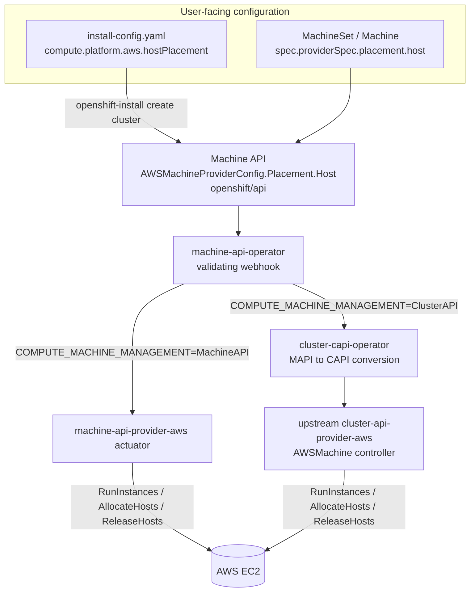
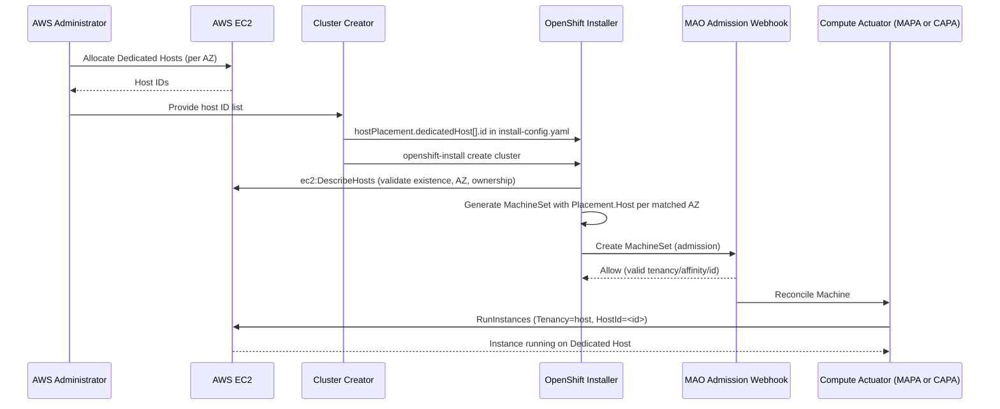
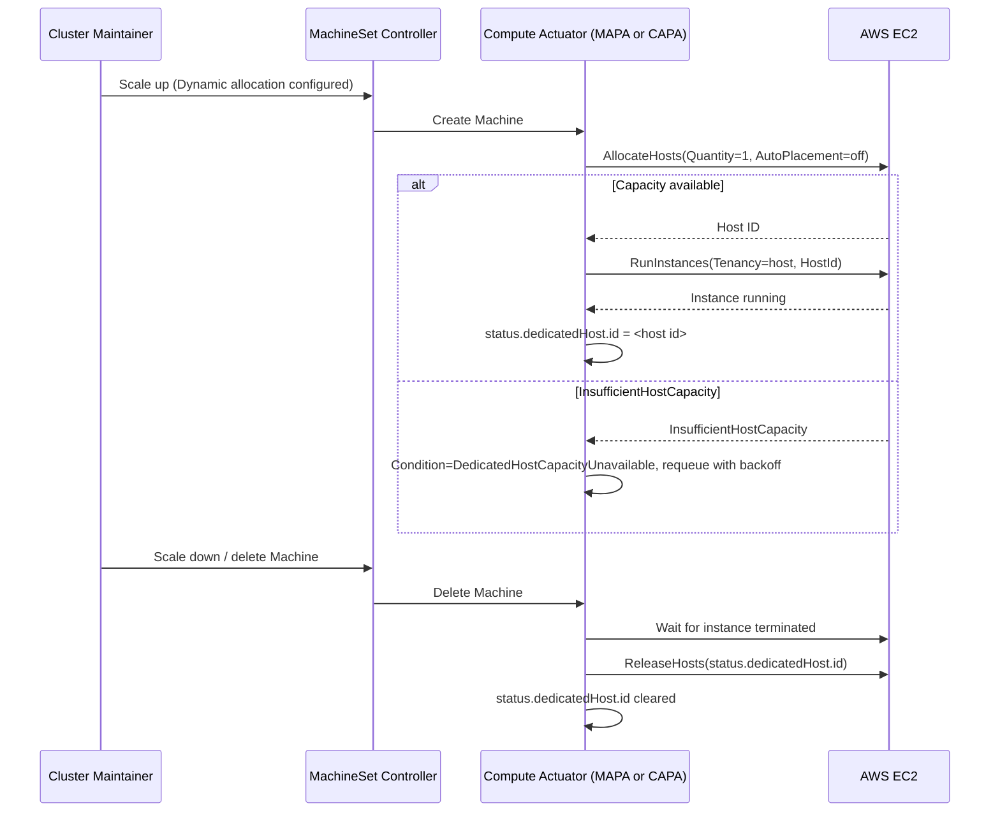

# AWS Dedicated Host Support for Compute Nodes

## Summary

This enhancement adds support for running OpenShift compute nodes on AWS EC2
Dedicated Hosts. Dedicated Hosts give a customer exclusive, single-tenant
access to the physical server underlying an EC2 instance, which is required
for some regulatory/compliance regimes and for software that is licensed
per-socket or per-core (BYOL).

Two placement modes are supported:

- **User-provided ("BYO") Dedicated Hosts**: the administrator allocates a
  Dedicated Host in the AWS console ahead of time and supplies its host ID.
  OpenShift places instances on that host and applies a cluster-association
  tag to it, but never allocates, resizes, or releases it; host lifecycle
  stays entirely with the owner.
- **Dynamically allocated Dedicated Hosts**: OpenShift allocates a Dedicated
  Host automatically (one host per instance, 1:1) when a Machine/instance is
  created, and releases it when the Machine is deleted, with no manual AWS
  console interaction required.

Both modes are available through the Machine API (`AWSMachineProviderConfig`
in `openshift/api`) and, because OpenShift's compute machine management is
migrating from the in-tree Machine API actuator to a Cluster API-backed
actuator, both modes are implemented twice at the runtime level: once in the
in-tree `machine-api-provider-aws` actuator, and once upstream in
`cluster-api-provider-aws` (CAPA), reached through the Machine API ↔ Cluster
API conversion logic in `cluster-capi-operator`. The OpenShift installer
supports provisioning compute nodes directly onto pre-allocated ("BYO")
Dedicated Hosts as part of `openshift-install create cluster`.

The feature is gated by the `AWSDedicatedHosts` feature gate and ships today
as Tech Preview; promotion to GA is tracked by SPLAT-2938.

## Motivation

Some customers run regulated workloads (for example, workloads subject to
per-socket/per-core software licensing, or compliance frameworks that require
physical isolation from other tenants) that cannot run on AWS's default
shared-tenancy EC2 instances. AWS's answer to this is Dedicated Hosts: a
physical server reserved for a single customer's use, onto which instances
can be explicitly placed. Without this enhancement, OpenShift administrators
had no supported way to place compute nodes onto Dedicated Hosts, or to scale
a Dedicated-Host-backed fleet using Machine API/MachineSet the same way they
scale ordinary compute.

### User Stories

- As a cluster creator, I want to install OpenShift compute nodes onto AWS
  Dedicated Hosts I already own, so that my workloads satisfy licensing or
  compliance requirements for single-tenant physical hardware.
- As a cluster administrator, I want to scale a MachineSet backed by my
  pre-allocated Dedicated Hosts, so that I can grow or shrink dedicated
  compute capacity the same way I manage ordinary compute.
- As a cluster administrator, I want OpenShift to dynamically allocate and
  release a Dedicated Host whenever I create or delete a dedicated-host
  Machine, so that I get single-tenant isolation without manually
  pre-provisioning hosts in the AWS console.
- As a cluster administrator, I want relevant conditions and events when a
  Dedicated Host is unavailable, at capacity, or misconfigured, so that I can
  diagnose failed machine provisioning without digging through raw AWS API
  errors.
- As an OpenShift engineer operationalizing this feature, I want CI signal
  across both the Machine API and Cluster API runtime paths, and metrics on
  dynamic-allocation failure rates, so that we know the feature is healthy at
  scale before promoting it to GA default-on.

### Goals

- Allow compute (not control-plane) nodes to run on pre-allocated ("BYO")
  AWS Dedicated Hosts, configurable at install time and on day 2 via
  Machine API/MachineSet.
- Allow OpenShift to dynamically allocate a Dedicated Host per instance on
  demand and release it on Machine deletion, without requiring AWS console
  interaction.
- Support both of OpenShift's compute machine management backends (the
  in-tree Machine API actuator and the Cluster-API-backed actuator), since
  clusters are migrating between the two.
- Provide clear validation, conditions, and events for the failure modes
  specific to Dedicated Hosts (invalid host ID, tenancy/affinity mismatches,
  capacity exhaustion, control-plane rejection).

### Non-Goals

- Dedicated Host support for control-plane/master machines. This is
  explicitly rejected by validation; control-plane nodes always run on
  standard shared-tenancy instances.
- Multiple instances auto-placed onto the same dynamically allocated
  Dedicated Host. Dynamic allocation is strictly 1 instance : 1 host; AWS
  auto-placement across several instances on one host is not exposed.
- AWS License Manager or Host Resource Group integration.
- Fully automatic, unbounded cross-AZ failover when dynamic allocation hits a
  capacity shortage. Best-effort fallback across a worker pool's configured
  AZs has been added (`openshift/machine-api-provider-aws#230`), but more
  robust capacity-aware allocation is still being hardened under SPLAT-3009.
- HyperShift/hosted control planes support (see
  [Topology Considerations](#topology-considerations)).

## Proposal

AWS Dedicated Host configuration is expressed once, as an extension of the
AWS `Placement` type already present on `AWSMachineProviderConfig`
(`openshift/api`). Everything else layers on top of that single API surface:

- The **OpenShift installer** extends the AWS compute machine pool schema in
  `install-config.yaml` to accept a list of pre-allocated Dedicated Host IDs,
  validates them live against AWS (existence, region, AZ alignment, no
  cross-cluster ownership conflicts), and resolves each host to the AZ of the
  generated compute `MachineSet`, writing the resulting `Placement.Host`
  configuration into the generated Machine API manifests. This install-time
  path only supports the BYO/`UserProvided` allocation strategy, and only
  for compute (never control-plane) pools.
- The **Machine API admission webhook** (`machine-api-operator`) validates
  every create/update of `Placement.Host` on `AWSMachineProviderConfig`,
  independent of whether the Machine was created by the installer, a
  MachineSet scale-up, or a user directly. It enforces the tenancy/host
  coupling, rejects control-plane usage, and enforces mutual exclusivity
  between the `UserProvided` and `Dynamic` allocation strategies.
- Actual placement on AWS happens in one of two independent runtime
  implementations of the same contract, depending on which compute machine
  management backend the cluster is running:
  - The in-tree **`machine-api-provider-aws` actuator** calls the AWS EC2
    API directly (`RunInstances` with `Placement.Tenancy=host`, and, for
    dynamic allocation, `AllocateHosts`/`ReleaseHosts`).
  - The **Cluster API-backed actuator** reaches the same outcome through
    `cluster-capi-operator`'s Machine API ↔ Cluster API conversion logic
    (`openshift/cluster-capi-operator#374`), which translates
    `AWSMachineProviderConfig.Placement.Host` to/from upstream CAPA's
    `AWSMachineSpec.HostID`/`HostAffinity`/`DynamicHostAllocation` fields.
    Upstream `cluster-api-provider-aws` then performs the actual
    `AllocateHosts`/`ReleaseHosts`/`RunInstances` calls
    (`kubernetes-sigs/cluster-api-provider-aws#5548`,
    `#5631`, `#5825`).

This "one API, two runtimes" shape mirrors how OpenShift is migrating AWS
compute machine management from the Machine API actuator to Cluster API more
broadly, and lets Dedicated Host support land without blocking on, or being
blocked by, that migration.



### Workflow Description

#### Install-time: pre-allocated ("BYO") Dedicated Hosts

**AWS administrator** is a human user responsible for allocating Dedicated
Hosts in AWS.

1. The AWS administrator creates one or more Dedicated Hosts in the AWS
   console, in the AZs where compute nodes should land.
2. The AWS administrator gives the resulting host IDs to the cluster
   creator.

**cluster creator** is a human user responsible for installing a cluster.

1. The cluster creator lists the Dedicated Host IDs under a compute machine
   pool's `platform.aws.hostPlacement` in `install-config.yaml`.
2. The cluster creator runs `openshift-install create cluster`.
3. The installer looks up each host ID with `ec2:DescribeHosts`, confirms it
   exists, is unowned by another cluster, and is in a region/AZ compatible
   with the cluster, then matches each host to the AZ of the compute
   `MachineSet` it generates.
4. The installer writes `Placement.Tenancy=host` and `Placement.Host` (with
   `AllocationStrategy: UserProvided`) into the generated
   `AWSMachineProviderConfig` for each affected `MachineSet`.



#### Day 2: dynamically allocated Dedicated Hosts

**cluster maintainer** is a human user responsible for day-2 operations.

1. The cluster maintainer sets `Placement.Tenancy: host` together with
   `Placement.Host.Affinity: DedicatedHost` and
   `DedicatedHost.AllocationStrategy: Dynamic` (and optionally tags to apply
   to the host) on a Machine or MachineSet, instead of supplying a host ID.
   `Placement.Tenancy: host` is required: the admission webhook rejects
   `Placement.Host` on any Machine where `Placement.Tenancy` is not `host`.
2. The cluster maintainer scales the MachineSet up.
3. For each new Machine, the actuator allocates a new Dedicated Host
   (`AllocateHosts`, quantity 1, auto-placement off) sized for the instance
   type and AZ, places the instance on it, and records the allocated host ID
   in `status.dedicatedHost.id`.
4. When the Machine is later deleted, the actuator waits for the instance to
   terminate, then releases the Dedicated Host (`ReleaseHosts`) and clears
   `status.dedicatedHost.id`.



If the dynamically allocated host cannot be created at all (a failure
between `AllocateHosts` succeeding and `RunInstances` succeeding), the
in-tree `machine-api-provider-aws` actuator synchronously releases the
just-allocated host so it is never orphaned. The upstream CAPA path does
not have this synchronous cleanup today: if `RunInstances` fails after
`AllocateHosts` succeeds, and the Machine is deleted before a subsequent
reconcile successfully creates the instance, `AWSMachineReconciler.reconcileDelete`
finds no EC2 instance at all and removes the Machine's finalizer immediately,
without ever consulting `status.dedicatedHost.id` — the allocated host is
left behind, still billable, with no further record of it once the Machine
object is gone. See [Risks and Mitigations](#risks-and-mitigations) for how
to detect and recover from this.

### API Extensions

This enhancement extends the existing `Placement` struct on
`AWSMachineProviderConfig` (it does not introduce a new top-level field, CRD,
or webhook server; it adds to the existing Machine API validating webhook
already run by `machine-api-operator`). An earlier top-level
`AWSMachineProviderConfig.HostPlacement` field was tried and then withdrawn
in favor of nesting under `Placement`, since Dedicated Host behavior is
coupled to the pre-existing `Placement.Tenancy` field
(`openshift/api#2614`).

Final shape (`machine/v1beta1/types_awsprovider.go`, `openshift/api`),
gated by `+openshift:enable:FeatureGate=AWSDedicatedHosts`:

```go
type Placement struct {
    Region           string          `json:"region,omitempty"`
    AvailabilityZone string          `json:"availabilityZone,omitempty"`
    Tenancy          InstanceTenancy `json:"tenancy,omitempty"`

    // host configures placement on AWS Dedicated Hosts. Only valid when
    // tenancy is "host".
    // +optional
    Host *HostPlacement `json:"host,omitempty"`
}

// +union
type HostPlacement struct {
    // affinity controls whether the instance always restarts on the same
    // dedicated host if stopped.
    // +required
    // +unionDiscriminator
    Affinity *HostAffinity `json:"affinity,omitempty"`

    // dedicatedHost is required when affinity is DedicatedHost.
    // +optional
    // +unionMember
    DedicatedHost *DedicatedHost `json:"dedicatedHost,omitempty"`
}

// +kubebuilder:validation:Enum:=AnyAvailable;DedicatedHost
type HostAffinity string

// +union
type DedicatedHost struct {
    // allocationStrategy selects between a user-supplied host ID and
    // dynamic allocation by OpenShift. Defaults to UserProvided.
    // +optional
    // +unionDiscriminator
    // +default="UserProvided"
    AllocationStrategy *AllocationStrategy `json:"allocationStrategy,omitempty"`

    // id identifies a pre-allocated AWS Dedicated Host. Required when
    // allocationStrategy is UserProvided, forbidden otherwise.
    // Must match ^h-([0-9a-f]{8}|[0-9a-f]{17})$
    // +optional
    // +unionMember=UserProvided
    ID string `json:"id,omitempty"`

    // dynamicHostAllocation configures OpenShift-managed host allocation.
    // Only valid when allocationStrategy is Dynamic.
    // +optional
    // +unionMember=Dynamic
    DynamicHostAllocation *DynamicHostAllocationSpec `json:"dynamicHostAllocation,omitempty"`
}

// +kubebuilder:validation:Enum:=UserProvided;Dynamic
type AllocationStrategy string

type DynamicHostAllocationSpec struct {
    // tags are applied to the dynamically allocated host (1-50 entries).
    // +optional
    Tags *[]TagSpecification `json:"tags,omitempty"`
}
```

`AWSMachineProviderStatus` gains a matching status field so the allocated
host survives reconciler restarts and can be released correctly on delete:

```go
type AWSMachineProviderStatus struct {
    // ...
    // dedicatedHost tracks the dynamically allocated host once created.
    // +optional
    DedicatedHost *DedicatedHostStatus `json:"dedicatedHost,omitempty"`
}

type DedicatedHostStatus struct {
    ID string `json:"id,omitempty"`
}
```

Two legal host ID lengths are accepted (`^h-([0-9a-f]{8}|[0-9a-f]{17})$`):
AWS's current 17-hex-character format, and an 8-hex-character legacy format
still held by some long-lived AWS accounts from before AWS changed the ID
format in 2018 (`openshift/api#2643`).

**Install-config.yaml schema** (`pkg/types/aws/machinepool.go`,
`openshift/installer`), compute pools only:

```yaml
compute:
- name: worker
  platform:
    aws:
      type: m5.large
      hostPlacement:
        affinity: DedicatedHost
        dedicatedHost:
          - id: "h-0123456789abcdef0"   # resolved to its AZ via DescribeHosts
          - id: "h-0fedcba987654321a"
```

The installer's own `HostPlacement` type takes a *list* of host IDs for a
compute pool (one entry is expected per AZ the pool spans); at manifest
generation time each host ID is resolved to its AWS AZ and matched against
the corresponding generated per-AZ `MachineSet`, which receives a *single*
`Placement.Host` (`AllocationStrategy: UserProvided`) in the Machine API
shape described above. The installer only ever produces the `UserProvided`
allocation strategy — install-time dynamic allocation is not supported; a
cluster creator who wants dynamic allocation configures it on day 2 via
MachineSet.

**Admission webhook** (`machine-api-operator`, existing Machine API
validating webhook, no new webhook server): validates every
`AWSMachineProviderConfig.Placement` on Machine create/update.

- `Placement.Host` may only be set when `Placement.Tenancy == "host"`.
- `Placement.Tenancy == "host"` is rejected outright for control-plane
  machines (`dedicated host tenancy is not supported for control plane
  machines`).
- `Placement.Host.Affinity` is required and must be `AnyAvailable` or
  `DedicatedHost`.
- `DedicatedHost.AllocationStrategy: Dynamic` requires
  `Affinity: DedicatedHost` and a non-empty `dynamicHostAllocation.tags`
  list (1-50 entries); `UserProvided` requires a well-formed `id` and
  forbids `dynamicHostAllocation`.

**Conversion** (`openshift/cluster-capi-operator#374`): when a cluster's
compute machine management is backed by Cluster API, the Machine API
`Placement.Host` is converted to/from upstream CAPA's
`AWSMachineSpec.{HostID,HostAffinity,DynamicHostAllocation}` and
`AWSMachineStatus.DedicatedHost`. This is conversion logic inside the
Machine API/Cluster API migration path, not a CRD conversion webhook.

### Topology Considerations

In general this feature is additive to the existing AWS `Placement`
configuration and is transparent to OpenShift components that do not
interact with machine placement directly.

#### Hypershift / Hosted Control Planes

Not implemented. All of the work described here lives in the Machine API
(`openshift/api`, `machine-api-operator`, `machine-api-provider-aws`) and
`cluster-capi-operator`/upstream CAPA reconciliation used by standalone
clusters; HyperShift NodePools were not touched by any of the PRs backing
this enhancement. Extending Dedicated Host support to HyperShift NodePools
is out of scope for this document and would need its own follow-up design
work in the HyperShift AWS NodePool platform spec and the HyperShift
`cluster-api-provider-aws` integration.

#### Standalone Clusters

This is the primary and only currently-supported topology. Both install-time
(BYO) and day-2 (BYO and dynamic allocation) configuration are available on
standalone clusters, through either compute machine management backend.

#### Single-node Deployments or MicroShift

Not applicable. Dedicated Hosts are a mechanism for isolating a pool of
*additional* compute nodes; SNO has no additional compute nodes to place,
and MicroShift does not run on AWS EC2 Machine API-managed infrastructure.
This feature adds no CPU/memory overhead to either, since it is inert unless
`Placement.Host` is explicitly configured.

#### OpenShift Kubernetes Engine

No known restriction. Dedicated Host placement is a property of AWS compute
node provisioning and does not depend on OCP features excluded from the OKE
offering.

### Implementation Details/Notes/Constraints

**Two independent runtime implementations, one contract.** Because OpenShift
compute machine management can run on either the in-tree Machine API
actuator or a Cluster-API-backed actuator (selected via
`COMPUTE_MACHINE_MANAGEMENT`), Dedicated Host placement had to be
implemented twice against the same `Placement.Host` contract:

- `machine-api-provider-aws` (`pkg/actuators/machine/{dedicatedhosts,instances,reconciler}.go`)
  calls the AWS EC2 API directly. For BYO, it reads
  `Placement.Host.DedicatedHost.ID` and passes it straight through to
  `RunInstances`' `Placement.HostId`; it never manages BYO host lifecycle.
  For dynamic allocation, `launchInstance` calls `AllocateHosts`
  (`Quantity=1`, `AutoPlacement=off`) before `RunInstances`, persists the
  resulting ID to `status.dedicatedHost.id`, and on Machine delete releases
  the host once the instance reaches `terminated`.
- `cluster-capi-operator#374` converts the same `Placement.Host`
  configuration to/from upstream CAPA's `AWSMachineSpec` fields; upstream
  `cluster-api-provider-aws` then independently implements the equivalent
  allocate-before-create / release-after-delete flow
  (`pkg/cloud/services/ec2/dedicatedhosts.go`,
  `kubernetes-sigs/cluster-api-provider-aws#5631`), including idempotent
  reuse of an already-allocated host recorded in
  `AWSMachine.status.dedicatedHost.id` across reconciles.

Keeping these behaviorally identical is an ongoing maintenance cost; a
validation bug in the upstream webhook (dedicated host fields allowed
without `Tenancy: host`) was found and fixed independently in both the
Machine API webhook and upstream CAPA
(`kubernetes-sigs/cluster-api-provider-aws#5825`).

**BYO hosts are tagged, not owned.** Because a BYO Dedicated Host is a
resource the customer pre-created outside of OpenShift's control, the
`machine-api-provider-aws` actuator tags it
`kubernetes.io/cluster/<cluster-id>=shared` (not `owned`) immediately after
placing the first instance on it (`openshift/machine-api-provider-aws#181`).
This lets OpenShift's existing AWS resource-tracking tooling recognize the
host as cluster-associated without ever deleting it on cluster teardown;
tagging failures are logged as warnings and are non-fatal, since the host is
not critical-path infrastructure.

**Capacity shortages are a real, only partially mitigated risk, not just a
CI flake.** `AllocateHosts` can fail with `InsufficientHostCapacity` for a
given AZ/instance-type combination. The actuator now classifies this as a
distinct, byte-stable condition reason (`DedicatedHostCapacityUnavailable`)
instead of churning the Machine's condition message on every retry (which
previously generated hundreds of near-duplicate events per failed run), and
requeues with backoff rather than failing the Machine outright
(`openshift/machine-api-provider-aws#230`). Day-2 tooling (and e2e tests)
can fall back to another AZ in the worker pool, but this fallback is
best-effort, not exhaustive across the whole region; see
[Risks and Mitigations](#risks-and-mitigations) and SPLAT-3009.

**Installer scope is deliberately narrow.** An earlier, more ambitious
attempt at "perform IPI installation on AWS dedicated hosts"
(`openshift/installer#9795`, closed/WIP) was superseded by a narrower,
incremental design: the installer (`openshift/installer#10079`) only
generates the Machine API manifests and validates host IDs exist and align
with AZs; it does not perform or validate actual placement itself. Real
placement enforcement is left entirely to the Machine API webhook and the
compute actuator, keeping the installer decoupled from the actuator-level
implementation.

### Risks and Mitigations

- **AWS Dedicated Host capacity shortages block dynamic allocation.**
  Real-world data gathered from CI (SPLAT-3009) showed roughly a 1-in-5
  failure rate for dynamic allocation due to `InsufficientHostCapacity` in a
  single AZ, with AWS sometimes taking over 15 minutes to free capacity.
  Mitigation: the actuator now backs off and reports a clear condition
  instead of failing the Machine, and AZ fallback was added for the e2e
  suite and is available to administrators who spread a MachineSet across
  multiple AZs; full capacity-aware allocation across all region AZs remains
  open work under SPLAT-3009.
- **Two independently maintained placement implementations can drift.** The
  in-tree actuator and upstream CAPA both implement allocate/release
  semantics against the same API contract; a bug in one does not
  automatically surface in the other, as shown by the `Tenancy: host`
  validation gap that had to be fixed in both places independently
  (`openshift/machine-api-operator#1484`,
  `kubernetes-sigs/cluster-api-provider-aws#5825`). Mitigation: the shared
  conversion layer in `cluster-capi-operator` and parallel e2e coverage in
  both `machine-api-provider-aws` and `cluster-api-actuator-pkg`
  (`#446`) are the primary safety nets; reviewers for future changes to
  either actuator should check the other.
- **A dynamically allocated host can be orphaned if instance creation fails
  on the CAPA path.** Verified directly against
  `kubernetes-sigs/cluster-api-provider-aws` (`controllers/awsmachine_controller.go`,
  `reconcileDelete`): if `AllocateHosts` succeeds but the subsequent
  `RunInstances` fails, and the `AWSMachine` is deleted before a later
  reconcile successfully creates the instance, `reconcileDelete` finds no
  EC2 instance and removes the finalizer immediately — it never checks
  `status.dedicatedHost.id` in that code path, so the host is left allocated
  and billable with no further record once the `AWSMachine` is gone. The
  in-tree `machine-api-provider-aws` actuator does not have this gap, since
  it releases synchronously on any failure between allocation and instance
  creation. Mitigation: none upstream today; dynamically allocated hosts are
  not guaranteed to carry a cluster-identifying tag (see
  [Support Procedures](#support-procedures)), so recovery is a manual,
  careful account-level audit rather than a simple tag-filtered query.
- **Removing dynamic allocation config from a live Machine before deleting
  it can also orphan its host.** CAPA's release logic requires both
  `status.dedicatedHost.id != nil` *and* `spec.dynamicHostAllocation != nil`
  to still be true at the moment the instance is confirmed terminated; if an
  administrator strips `dynamicHostAllocation` from an existing
  dynamic-allocation Machine's spec before deleting it, the release is
  skipped even though the instance terminates normally. Mitigation:
  administrators should only change the MachineSet template (so future
  Machines stop using dynamic allocation) and let existing dynamic-host
  Machines be deleted/replaced with their original configuration intact,
  rather than editing an existing Machine's placement fields in place; see
  [Support Procedures](#support-procedures).
- **BYO Dedicated Hosts are never automatically released.** Because
  OpenShift tags BYO hosts `shared` rather than `owned`, deleting the
  MachineSet or the cluster does not release the host; a customer who
  forgets to release it manually continues to pay AWS for idle Dedicated
  Host capacity. This is intentional (OpenShift must not delete
  infrastructure it did not create) but should be called out clearly in
  user-facing documentation.
- **Control-plane isolation depends on webhook enforcement.** Dedicated Host
  tenancy is rejected for control-plane machines only by the Machine API
  admission webhook; there is no lower-level AWS-side or installer-side
  guard. A regression in the webhook (as happened once in
  `openshift/machine-api-operator#1419`/`#1434`, reverted and relanded as
  `#1436`) could silently reintroduce this risk. CI coverage specifically
  targets this check.
- **Security/UX review.** Reviewed by the SPLAT team (Machine API/installer)
  and by `@JoelSpeed` as API approver for the `openshift/api` changes. No
  new externally reachable surface is introduced; all configuration is
  through existing Machine API/install-config surfaces already subject to
  RBAC and the existing admission webhook.

### Drawbacks

Supporting Dedicated Hosts through two parallel runtime implementations (the
Machine API actuator and upstream CAPA) is more expensive to maintain than a
single implementation would be, but is a direct, unavoidable consequence of
OpenShift's broader, independently-driven migration from Machine API to
Cluster API for compute management; this enhancement does not introduce that
duality, it has to conform to it.

## Alternatives (Not Implemented)

- **Dynamic allocation only, no BYO support.** Considered and rejected:
  customers who already own Dedicated Hosts (for example, hosts tied to
  existing per-socket software licenses) need to place instances on
  *specific* hosts, which only the BYO/`UserProvided` path supports.
- **A separate top-level `HostPlacement` field on `AWSMachineProviderConfig`,
  independent of `Placement`.** This was the original implementation
  (`openshift/api#2484`) and was deliberately withdrawn in favor of nesting
  under the existing `Placement` struct, since Dedicated Host placement is
  inherently coupled to the pre-existing `Placement.Tenancy` field and other
  use cases for combining them were found during review
  (`openshift/api#2614`).
- **Installer-driven dynamic allocation at install time.** Considered but
  deferred: dynamic allocation requires release-on-delete lifecycle
  management that the installer has no ongoing process to perform; it is
  left entirely to the Machine API/Cluster API actuators, which already run
  continuously.

## Open Questions [optional]

- Should HyperShift NodePools gain Dedicated Host support, and if so, does
  the `Placement.Host` shape used here translate directly to the HyperShift
  AWS NodePool platform spec, or does it need its own design?
- Should capacity-aware, region-wide AZ fallback for dynamic allocation
  (SPLAT-3009) be considered a GA blocker, or can it ship as a post-GA
  hardening item given the existing best-effort, pool-scoped fallback?

## Test Plan

- **Installer**: unit tests for install-config schema validation
  (`pkg/types/aws/validation`) and live-AWS validation
  (`pkg/asset/installconfig/aws/validation.go`), covering missing/duplicate
  host IDs, AZ mismatches, and cross-cluster ownership conflicts.
- **Machine API webhook**: unit tests in `machine-api-operator` covering
  every validation rule described in [API Extensions](#api-extensions),
  including the control-plane rejection and `UserProvided`/`Dynamic` mutual
  exclusivity.
- **Machine API actuator e2e**: a Serial, feature-gated OpenShift Test
  Extension (OTE) suite in `openshift/machine-api-provider-aws`
  (`[sig-cluster-lifecycle][OCPFeatureGate:AWSDedicatedHosts][platform:aws][Serial]`)
  covers day-2 scaling of a BYO-host-backed MachineSet and direct creation
  of Machines for both BYO and dynamic allocation, including host-release
  verification after cleanup (`openshift/machine-api-provider-aws#174`,
  `#217`, `#230`). The suite is skipped automatically on clusters that have
  no Dedicated-Host MachineSet configured.
- **Cluster API actuator e2e**: equivalent coverage for the Cluster
  API-backed path lives in `openshift/cluster-api-actuator-pkg#446`.
- **Continuous CI signal**: a dedicated periodic job
  (`e2e-aws-ovn-dedicated-serial-techpreview`) runs against the Machine API
  path with `FEATURE_SET=TechPreviewNoUpgrade`, currently three times daily,
  specifically to build up pass-rate signal ahead of GA promotion
  (`openshift/release#70274`, `#77171`, `#86902`, `#88145`; SPLAT-2938).

## Graduation Criteria

### Dev Preview -> Tech Preview

- [x] Ability to utilize the enhancement end to end (install-time BYO,
  day-2 BYO, day-2 dynamic allocation) on both compute machine management
  backends.
- [x] API is defined and reviewed (`openshift/api#2484`, `#2614`, `#2643`,
  `#2650`).
- [x] Sufficient e2e test coverage on both runtime paths.
- [x] Feature gated behind `AWSDedicatedHosts` / `TechPreviewNoUpgrade`.

### Tech Preview -> GA

This is the current phase, tracked under SPLAT-2938 ("Promote AWS EC2
Dedicated Hosts Feature Gate to GA"):

- [ ] Sufficient CI pass-rate signal accumulated from the increased-frequency
  periodic job to justify default-on promotion.
- [ ] Capacity-aware dynamic allocation hardening (SPLAT-3009) resolved or
  explicitly accepted as a known limitation for GA.
- [ ] Feature gate promoted from Tech Preview to GA/Default across
  `openshift/api`, the installer, and the Machine API operators, with
  Tech-Preview-only validation guards removed.
- [ ] Upgrade/downgrade behavior verified for clusters that enabled the
  feature during Tech Preview.
- [ ] User-facing documentation published in
  [openshift-docs](https://github.com/openshift/openshift-docs/).

### Removing a deprecated feature

Not applicable; this enhancement adds a feature, it does not remove one.

## Upgrade / Downgrade Strategy

`Placement.Host` is an optional, additive field; clusters that do not use it
are unaffected by upgrade or downgrade. Clusters that already have
Dedicated-Host-backed Machines/MachineSets from a Tech Preview release
continue to be reconciled by the same actuator logic after upgrade. No
migration of existing BYO or dynamically allocated hosts is required; a
dynamically allocated host's ID is already persisted in Machine status and
is read back on actuator restart/upgrade like any other status field.

## Version Skew Strategy

No kubelet, CSI, CRI, or CNI interaction. The only components involved are
the installer (run once, at a single version), the Machine API webhook and
actuator, and, where applicable, `cluster-capi-operator` and upstream CAPA —
all of which are rolled out together as part of a single OpenShift release
and do not need to tolerate skew with each other mid-upgrade for this
feature specifically, beyond the version-skew guarantees Machine API and
Cluster API components already provide generally.

## Operational Aspects of API Extensions

This enhancement extends an existing field (`Placement`) on an existing API
(`AWSMachineProviderConfig`) and reuses the existing Machine API validating
webhook; it does not add a new webhook server, aggregated API server, CRD,
or finalizer.

- **SLIs**: the existing `machine-api-operator` conditions
  (`Available=True`, `Degraded=False`) remain the signal that the admission
  webhook and Machine reconciliation, including Dedicated Host handling, are
  healthy; no new SLIs were introduced.
- **Impact on existing SLIs**: negligible. Dedicated Host validation adds a
  constant, small amount of work to admission of AWS Machines that set
  `Placement.Host`; Machines that don't set it are unaffected. Dynamic
  allocation adds one extra AWS API call (`AllocateHosts`) before instance
  creation and one (`ReleaseHosts`) after instance termination, only for
  Machines explicitly configured for dynamic allocation.
- **Failure modes**:
  - Invalid or non-existent host ID: rejected at admission (installer
    validation) or at AWS API call time (`InvalidHostID.NotFound`), surfaced
    as a Machine `FailedCreate` event; does not affect other Machines.
  - Dedicated Host capacity exhaustion during dynamic allocation: the
    Machine is held in a backoff/requeue state with condition reason
    `DedicatedHostCapacityUnavailable` rather than being marked failed; does
    not affect other Machines or cluster health.
  - Tenancy/affinity misconfiguration: rejected outright at admission with a
    descriptive `field.Forbidden`/`field.Invalid`/`field.Required` error;
    the resource is never created.
  - Control-plane Dedicated Host misuse: rejected outright at admission;
    cannot reach the actuator.
- **Escalation**: Cloud Integration/SPLAT team owns the Machine API,
  installer, and actuator changes described here; Cluster Infrastructure is
  a secondary escalation point for broader Machine API/Cluster API issues;
  AWS support is the escalation path for genuine AWS-side Dedicated Host
  capacity or account issues.

## Support Procedures

**Detecting failures.** Machine events and conditions carry specific,
descriptive reasons:

```text
# BYO host ID doesn't exist (actuator/AWS):
FailedCreate: InvalidHostID.NotFound: The specified dedicated host ID 'h-...' does not exist

# Dedicated host misconfiguration (admission webhook, representative examples):
admission webhook "validation.machine.machine.openshift.io" denied the request:
  spec.placement.tenancy: Forbidden: dedicated host tenancy is not supported for control plane machines
  spec.placement.host: Forbidden: host may only be specified when tenancy is 'host'
  spec.placement.host.dedicatedHost.id: Invalid value: "<val>": id must start with 'h-' followed by
    8 or 17 lowercase hexadecimal characters (0-9 and a-f)

# Dynamic allocation capacity shortage (actuator condition, not a failure):
Condition reason: DedicatedHostCapacityUnavailable
Event (once per transition, not per retry): InsufficientDedicatedHostCapacity
```

**Disabling the behavior.** The Dedicated Host validation rules are bundled
into the existing Machine API admission webhook and cannot be disabled
independently of Machine API validation as a whole. To stop using Dedicated
Hosts, remove `Placement.Host`/`Placement.Tenancy: host` from the affected
MachineSet *template* (or the corresponding `hostPlacement` entries in
`install-config.yaml` before installing); new Machines will provision as
ordinary shared-tenancy instances. Existing instances already placed on a
Dedicated Host are unaffected until they are replaced. **Do not** edit the
placement fields on an existing, already-created dynamic-allocation Machine
in place before deleting it: on the CAPA runtime path, release-on-delete is
only triggered when `spec.dynamicHostAllocation` is still present at
deletion time, so stripping it first leaves the host allocated and
billable. Delete/replace existing dynamic-allocation Machines with their
original configuration intact instead, and let the MachineSet controller
recreate them without Dedicated Host configuration from the updated
template.

**Impact on existing/new workloads.** Removing Dedicated Host configuration
has no effect on already-running workloads; it only changes where *future*
replacement instances are placed. Pods are unaffected either way, since
Dedicated Host placement is a node-provisioning-time concern, not a
scheduling concern for pods.

**Graceful failure and recovery.** Dynamic allocation failures (capacity
shortage) do not fail the Machine; the actuator retries with backoff and the
Machine provisions automatically once capacity is available or another AZ
is tried, with no manual intervention required. BYO misconfigurations
(invalid ID, wrong AZ) are rejected before any AWS resources are touched, so
there is nothing to clean up; fixing the configuration and letting
MachineSet reconciliation recreate the failed Machine is sufficient.

**Stranded dynamically allocated hosts.** On the CAPA runtime path, a host
can be left allocated with no corresponding Machine if instance creation
failed after allocation and the Machine was deleted before a retry
succeeded (see [Risks and Mitigations](#risks-and-mitigations)). There is no
reliable automated way to identify these from AWS state alone:

- OpenShift does not apply an automatic cluster-ownership tag to
  dynamically allocated hosts; verified against
  `AllocateDedicatedHost` in `cluster-api-provider-aws`, which only tags a
  dynamically allocated host with `AWSCluster`/`AWSMachine`
  `spec.additionalTags` (empty by default) plus any
  `dynamicHostAllocation.tags` the user set. A stranded host may therefore
  carry no identifying tag at all, so filtering `describe-hosts` by the
  cluster's ownership tag can miss it; a full, untagged `aws ec2
  describe-hosts` inventory for the account/region is needed instead.
- A BYO host also has no instance on it between Machine deletions and the
  next scale-up, and carries the `shared` tag applied to it
  (`openshift/machine-api-provider-aws#181`) — it must never be treated as
  a release candidate. Only consider a host whose ID is not, and has never
  been, referenced by any Machine/AWSMachine's `dedicatedHost.id` (BYO) in
  the cluster's history.
- A host can legitimately be empty and untagged for a short time while a
  dynamic allocation is still in progress (the in-tree actuator allocates
  and tags a host before it launches the instance or records the host ID in
  status). Releasing it mid-allocation fails that Machine's creation. Pause
  new dynamic-host scale-ups (for example, scale the affected MachineSet(s)
  to 0 or suspend the actuator) and wait for any in-flight allocation to
  either resolve into a running instance or fail and age out (allow at
  least the observed worst-case allocation latency, on the order of 15-20
  minutes; see SPLAT-3009) before treating a host as a candidate.

Given these constraints, treat a host as a release candidate only once all
of the following hold: it predates the pause above by a safe margin, it has
never been referenced as a BYO host ID by any Machine in the cluster, and no
currently live Machine/AWSMachine's `status.dedicatedHost.id` references it.
Because this cannot be fully automated or verified from AWS alone, confirm
with the account owner before running `aws ec2 release-hosts` against any
host that isn't unambiguously identifiable as an orphaned dynamic
allocation.

## Infrastructure Needed [optional]

CI already has what it needs: `openshift/release` runs a dedicated,
Dedicated-Host-specific periodic job
(`e2e-aws-ovn-dedicated-serial-techpreview`) against a standing AWS test
account, including automated cleanup of leaked Dedicated Hosts in shared CI
accounts via `aws-janitor` (`kubernetes-sigs/boskos#232`). No additional
infrastructure is required to continue developing this feature toward GA.
