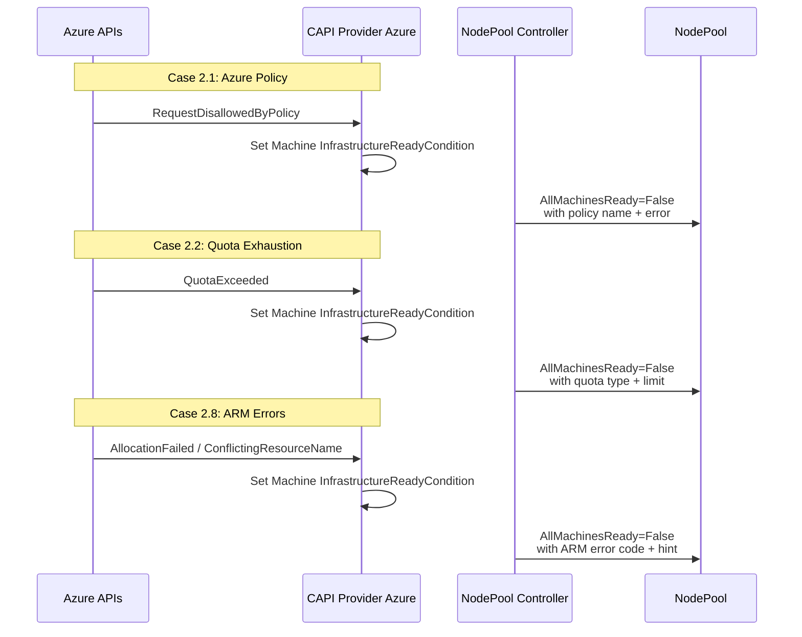

# ARO HCP Installation Failure Debuggability

## Summary

This enhancement adds Azure-specific diagnostic detail
to existing HyperShift conditions for ARO HCP clusters.
It addresses three failure cases where the HyperShift
Operator directly handles Azure ARM API errors: Azure
Policy conflicts, Azure resource quota exhaustion, and
Azure ARM errors (zonal allocation, name conflicts,
OIDC RBAC). The approach follows the pattern established in the
platform-agnostic diagnostic enhancement
([PR #2134](https://github.com/openshift/enhancements/pull/2134),
CNTRLPLANE-4639): add diagnostic detail to existing
condition messages without introducing new condition
types or API fields. This EP is the Azure-specific follow-up, sharing the
OCPSTRAT-1598 strategy. The platform-agnostic
enhancement establishes the shared patterns
(observability, message enrichment); the escape
hatch (`HYPERSHIFT_DISABLE_DIAGNOSTIC_ENRICHMENT`)
and the diagnostic fallback counter already exist
in the HyperShift codebase at
`support/diagnostics/enrichment.go` and do not
depend on PR #2134 merging.

### Relationship to Sibling Enhancements

This EP is the Azure-specific counterpart to the ROSA
enhancement
(`rosa-installation-failure-debuggability.md`). Both
EPs follow the same design principles:

- **Level-driven condition semantics**: Conditions
  reflect current observed state, not events.
  Controllers re-evaluate on every reconciliation
  and set the condition to match the current state,
  ensuring self-healing and eliminating stale
  conditions. This is why condition flapping is
  unlikely — the condition converges to the current
  error on each reconciliation rather than toggling
  between states.
- **Allowlist-based security model**: Only
  structured, customer-owned identifiers (Azure
  resource group names, VM names, policy names)
  appear in condition messages. Free-text
  pass-through from CAPZ is audited before Tech
  Preview. Red Hat-internal subscription IDs, tenant
  IDs, and service principal credentials are never
  included.
- **Message truncation**: Diagnostic messages
  respect the truncation limits already enforced in
  the HyperShift codebase (see Message Truncation
  below).
- **Enrichment over proliferation**: Diagnostic
  detail is added to existing condition messages
  rather than introducing new condition types, to
  avoid expanding the condition surface area.

Seven additional ARO failure cases are deferred:
Entra ID soft-delete limits (managed identities are
created outside HyperShift by the ARO RP), OneCert,
ASO secret export, Maestro propagation, Azure
CNS/DHCP, MCE webhook cert, and DNS domain mismatch.
These involve components outside the HyperShift
Operator's scope and require separate enhancements
owned by the respective component teams.

## Glossary

- **ARO HCP**: Azure Red Hat OpenShift, Hosted Control
  Planes architecture
- **CAPZ**: Cluster API Provider Azure — the CAPI
  provider that manages Azure infrastructure
- **ARM**: Azure Resource Manager — the deployment and
  management service for Azure resources
- **Entra ID**: Microsoft Entra ID (formerly Azure
  Active Directory) — identity and access management
- **Managed Identity**: An Azure identity automatically
  managed by Azure for authenticating to Azure services
- **SCP / Azure Policy**: Governance mechanism that
  enforces rules on Azure resources during creation
  and updates
- **ASO**: Azure Service Operator — bridges Kubernetes
  and Azure resources

## Motivation

ARO HCP SRE teams encounter Azure-specific installation
failures that surface as opaque HyperShift conditions.
The root cause is an Azure platform issue (policy
conflict, quota exhaustion, or ARM error), but the
error appears as a generic condition with no indication
of the underlying Azure-specific cause. SREs must
manually inspect CAPI Machine objects, Azure API
responses, and pod logs across multiple namespaces to
identify the root cause.

The current Azure error handling in HyperShift
(`support/azureutil/errors.go`, `ClassifyAzureError()`)
classifies errors by HTTP status code only (429, 403,
409, other). The default case includes `ErrorCode` in
the message string but does not branch on specific
error codes such as `RequestDisallowedByPolicy` or
`QuotaExceeded`. As a result, known recoverable errors
(like quota exhaustion) are treated as transient
conflicts with a 30-second requeue, and policy errors
are misclassified as permission errors.

### User Stories

- As an ARO SRE, I want to see the specific Azure
  Policy name that blocked resource creation (e.g.,
  `RequestDisallowedByPolicy: Resource 'vm-abc' was
  disallowed by policy 'deny-public-ip'`) in the
  condition message so that I can direct the customer
  to update their policy without manually querying ARM.

- As an ARO SRE, I want to see the specific quota that
  was exceeded (e.g., `QuotaExceeded: Operation could
  not be completed as it results in exceeding approved
  standardDSv3Family Cores quota`) so that I can
  identify the resource type and region without
  inspecting Azure portal.

- As a fleet operator, I want to monitor Azure-specific
  installation failures at scale so that I can identify
  systemic issues (e.g., an Azure Policy rollout
  affecting multiple clusters) before they are
  escalated.

### Goals

1. Surface the specific Azure error code and message in
   existing HyperShift conditions for the three in-scope
   failure cases, replacing opaque generic messages.
2. Enable SREs to diagnose Azure-specific installation
   failures from `HostedCluster` and `NodePool`
   conditions alone, without inspecting CAPI Machine
   objects, Azure portal, or pod logs.
3. Maintain backward compatibility — no new condition
   types, no new API fields, no changes to condition
   `Type` values.

### Non-Goals

1. **New condition types**: This enhancement does not
   add new conditions. All changes are diagnostic
   detail on existing conditions.
2. **Cases outside HyperShift scope**: The following
   ARO failure cases involve components outside the
   HyperShift Operator and are deferred to separate
   enhancements:
   - 2.3: Entra ID soft-delete limit on managed
     identities (managed identities are created by the
     ARO RP, not the HyperShift Operator; no Azure
     identity condition exists on `HostedCluster` for
     Azure; `ReconcileCredentials()` in `azure.go` only
     copies pre-existing client IDs into Kubernetes
     secrets and does not call Entra ID APIs)
   - 2.4: OneCert timeout/throttling/expiry
   - 2.5: ASO secret export failure
   - 2.6: Maestro API URL propagation failure
   - 2.7: Azure CNS / Swift DHCP failures
   - 2.9: MCE webhook certificate expiry
   - 2.10: DNS domain mismatch race condition
3. **ROSA/AWS failure cases**: Covered by a separate
   enhancement
   (`rosa-installation-failure-debuggability.md`).
4. **Pre-flight validation**: This enhancement
   surfaces errors after they occur, not before.
   Pre-flight quota/policy validation is a separate
   concern.
5. **NodePool day-2 diagnostics**: Only installation-
   time failures are in scope.

## Proposal

Enhance the Azure error classification in HyperShift
to parse Azure-specific error codes from ARM API
responses, and surface them in existing condition
messages at three points in the installation flow.

### Case 2.1: Azure Policy Conflicts

**Existing condition**: `AllMachinesReady`
(on `NodePool`) and platform-specific conditions on
`AzurePrivateLinkService`

**Current behavior**: When Azure Policy blocks resource
creation, the ARM API returns HTTP 403 with error code
`RequestDisallowedByPolicy`. The current
`ClassifyAzureError()` in `errors.go:79-101` sees only
the HTTP 403 status and returns the generic message
`"check service principal permissions"` with a
10-minute requeue. The actual policy name and message
are discarded.

**Proposed diagnostic detail**: Parse the
`RequestDisallowedByPolicy` error code from the
`azcore.ResponseError` and include the policy name
in the condition message:

```
AllMachinesReady=False,
Reason=InfrastructureFailure,
Message="2/3 machines not ready. First failure:
  machine-abc — RequestDisallowedByPolicy:
  Resource 'vm-abc' was disallowed by policy
  'deny-public-ip' (policy assignment:
  /subscriptions/.../deny-public-ip)"
```

The diagnostic detail (policy name, error code) comes
from the CAPZ Machine's `InfrastructureReadyCondition`
(a CAPI v1beta2 condition in `Machine.Status.Conditions`),
which is passed through to the `AllMachinesReady`
condition message. `setAllMachinesReadyCondition()`
in `conditions.go:741-818` reads `ReadyCondition`
and, when it is `False`, reads
`InfrastructureReadyCondition` to extract the
`Reason` and `Message`. No additional HyperShift
code changes are needed for this case — the
enrichment depends on CAPZ populating
`InfrastructureReadyCondition` with the full ARM
error including the `RequestDisallowedByPolicy`
error code and policy name.
[PR #9781](https://github.com/openshift/hypershift/pull/9781)
(open, not yet merged) adds `isTerminalInfraReason()`
which checks whether the Machine's condition reason
is a known terminal failure for the platform. For
Azure, the only terminal reason is
`VMProvisionFailed`. When any Machine has a terminal
reason, PR #9781 overrides the aggregated reason
with `Reason=InfrastructureFailure`
(`NodePoolInfrastructureFailureReason`). The ARM
error codes (`RequestDisallowedByPolicy`,
`QuotaExceeded`, etc.) appear in the condition
**message**, not the **reason** — the reason is set
by CAPZ at the provider level (e.g.,
`VMProvisionFailed`), while the message carries the
ARM error detail.

**Implementation**: Verify that CAPZ populates
`InfrastructureReadyCondition` on the Machine with:
- `Reason` = `VMProvisionFailed` (or another
  terminal reason) so that PR #9781's
  `isTerminalInfraReason()` triggers
  `Reason=InfrastructureFailure` on the NodePool
- `Message` = full ARM error response, including
  `ErrorCode` and the `Details` array containing
  the policy name

If CAPZ already provides this data, no HyperShift
code changes are needed — the existing Machine →
NodePool condition pipeline passes the message
through automatically via
`setAllMachinesReadyCondition()`.

### Case 2.2: Azure Resource Quota Exhaustion

**Existing condition**: `AllMachinesReady`
(on `NodePool`)

**Current behavior**: When Azure quota is exceeded, ARM
returns HTTP 409 with error code `QuotaExceeded` or
`OperationNotAllowed`. `ClassifyAzureError()` sees
HTTP 409 and returns `"Azure resource conflict,
retrying"` with a 30-second requeue. This is misleading
— quota exhaustion is not a transient conflict.

**Proposed diagnostic detail**: Parse the quota-specific
error code and include the resource type and limit:

```
AllMachinesReady=False,
Reason=InfrastructureFailure,
Message="1/3 machines not ready. First failure:
  machine-abc — QuotaExceeded: Operation could
  not be completed as it results in exceeding
  approved standardDSv3Family Cores quota.
  Limit: 100, Current: 96, Requested: 8.
  Region: eastus"
```

**Implementation**: As with Case 2.1, the diagnostic
detail flows through CAPZ `InfrastructureReadyCondition`
→ NodePool controller (`setAllMachinesReadyCondition()`).
The quota detail (`QuotaExceeded`, resource type,
limit) appears in the `InfrastructureReadyCondition`
**message**. The condition **reason** is a CAPZ-level
value (e.g., `VMProvisionFailed`) — PR #9781's
`isTerminalInfraReason()` maps this to
`Reason=InfrastructureFailure` on the NodePool. No
additional HyperShift code changes are needed if
CAPZ provides the full ARM error in the
`InfrastructureReadyCondition` message.

Separately, enhance `ClassifyAzureError()` to
recognize `QuotaExceeded` and `OperationNotAllowed`
error codes in the PLS controller path
(`handleAzureError()`). For quota errors, use a
longer requeue interval (10 minutes instead of 30
seconds) since quota increases require manual action.

### Case 2.8: Azure ARM Errors

**Existing condition**: `AllMachinesReady`
(on `NodePool`) and `AzurePrivateLinkServiceAvailable`
(on `AzurePrivateLinkService`)

**Current behavior**: ARM errors such as zonal
allocation failures (`AllocationFailed`), soft-deleted
resource name conflicts (`ConflictingResourceName`),
and OIDC RBAC misconfigurations produce generic error
codes in the `handleAzureError()` function
(`controller.go:734-758`). The condition message
includes the HTTP status code but not the ARM error
code or details.

**Proposed diagnostic detail**: Include the ARM error
code and message for known failure patterns:

For zonal allocation failures:
```
AllMachinesReady=False,
Reason=InfrastructureFailure,
Message="1/3 machines not ready. First failure:
  machine-abc — AllocationFailed: Allocation
  failed. We do not have sufficient capacity for
  the requested VM size in this zone. Zone:
  eastus-1"
```

For name conflicts:
```
AzurePrivateLinkServiceAvailable=False,
Reason=PLSCreationFailed,
Message="PLSCreationFailed: ConflictingResourceName:
  A resource with name 'pls-abc' already exists
  (soft-deleted). Purge the deleted resource or
  use a different name"
```

**Implementation**: Enhance `handleAzureError()`
(`controller.go:734-758`) and `ClassifyAzureError()`
(`errors.go:79-101`) to extract `ErrorCode` from
`azcore.ResponseError` and include it in the condition
message. For known error codes (`AllocationFailed`,
`ConflictingResourceName`, `RoleAssignmentExists`),
add contextual remediation hints.

**Specific ARM errors to surface**:
- `AllocationFailed` (zonal capacity)
- `ConflictingResourceName` (soft-deleted resources)
- `RoleAssignmentExists` (OIDC RBAC duplicate)
- `SkuNotAvailable` (VM size not available)
- Generic ARM errors with error code passthrough

### Workflow Description

The diagnostic detail flows through existing
HyperShift condition pipelines — no new data paths:



### API Extensions

No new API types, conditions, or fields are
introduced. All changes are diagnostic detail
(message text) on existing conditions:

- `AllMachinesReady` (existing on `NodePool`)
- `AzurePrivateLinkServiceAvailable` (existing on
  `AzurePrivateLinkService`)
- `AzurePLSCreated` (existing on
  `AzurePrivateLinkService`)

#### Condition message stability

Although no formal API fields are added, condition
`Message` text and `Reason` codes constitute a de
facto API surface that SRE fleet automation may
depend on. Consumers **must not** regex-parse
`Message` text for programmatic decisions — the
message content is best-effort diagnostic detail and
may change between releases without notice.
Automation should switch on `Reason` codes, which
are stable within a release series.

The exact `Reason` values used by each case are:

| Case | Condition | Reason (stable) | New? |
|------|-----------|-----------------|------|
| 2.1 | `AllMachinesReady` | `InfrastructureFailure` | Yes (PR #9781) |
| 2.2 | `AllMachinesReady` | `InfrastructureFailure` | Yes (PR #9781) |
| 2.8 | `AllMachinesReady` | `InfrastructureFailure` | Yes (PR #9781) |
| 2.8 | `AzurePLSCreated` | `PLSCreationFailed` | No (existing) |
| 2.8 | `AzurePrivateLinkServiceAvailable` | `PLSCreationFailed` | No (existing) |

`Message` field content is enriched with Azure-
specific diagnostic detail (Azure error code, policy
name, quota type, zone, resource name). These fields
are included on a best-effort basis — the message
may omit them if the underlying data is unavailable
(e.g., CAPZ does not include the ARM error details
in the `InfrastructureReadyCondition` message).
Message format is **not guaranteed stable** between
releases.

### Topology Considerations

#### Hypershift / Hosted Control Planes

This enhancement is exclusively for the HyperShift
topology on Azure (ARO HCP). All changes are in the
HyperShift Operator, NodePool controller, and the
`support/azureutil` package.

#### Standalone Clusters

Not applicable — ARO HCP uses HyperShift only.

#### Single-node Deployments or MicroShift

Not applicable.

#### OKE (OpenShift Kubernetes Engine)

Not applicable — OKE does not use ARO HCP.

## Implementation Details/Notes/Constraints

### Data flow architecture

There are two distinct data paths for Azure errors.
Understanding these paths is critical for scoping
the implementation:

**Path 1: CAPZ → Machine → NodePool (Cases 2.1, 2.2,
and AllMachinesReady in Case 2.8)**

```
Azure ARM API error
  → CAPZ sets Machine.Status.Conditions:
    InfrastructureReadyCondition=False with
    Reason and Message from the ARM error
  → NodePool controller's
    setAllMachinesReadyCondition() reads
    ReadyCondition; when False, reads
    InfrastructureReadyCondition.Reason and
    InfrastructureReadyCondition.Message
  → AllMachinesReady condition on NodePool gets
    the InfrastructureReadyCondition content
```

This path does NOT involve `ClassifyAzureError()`.
The NodePool controller reads CAPI v1beta2 Machine
conditions (`Machine.Status.Conditions`), not Azure
API responses directly.
`setAllMachinesReadyCondition()` (`conditions.go:741-818`)
already reads `InfrastructureReadyCondition` when
`ReadyCondition` is `False` and aggregates the reason
and message into the `AllMachinesReady` condition.
No HyperShift code changes are needed for this
path — the diagnostic detail depends entirely on
what CAPZ puts in `InfrastructureReadyCondition`.
[PR #9781](https://github.com/openshift/hypershift/pull/9781)
(open, not yet merged) adds `isTerminalInfraReason()`
which checks whether the Machine's condition reason
matches a per-platform terminal set. For Azure, the
terminal reason is `VMProvisionFailed`. When matched,
PR #9781 overrides the aggregated reason with
`Reason=InfrastructureFailure`. The ARM error codes
(e.g., `QuotaExceeded`, `RequestDisallowedByPolicy`)
appear in the condition message, not the reason.
The base condition pipeline (message passthrough)
already exists without PR #9781.

**Path 2: handleAzureError() → ClassifyAzureError()
(PLS conditions in Case 2.8)**

```
Azure ARM API error
  → handleAzureError() in controller.go:734-758
    calls ClassifyAzureError() in errors.go:79-101
  → ClassifyAzureError() returns message + requeue
    interval based on HTTP status code
  → handleAzureError() sets
    AzurePrivateLinkServiceAvailable=False and
    AzurePLSCreated=False with the message
```

Both functions are in `openshift/hypershift`.
`ClassifyAzureError()` is in `support/azureutil/`
(utility package). `handleAzureError()` is in
`hypershift-operator/controllers/platform/azure/`
(PLS controller). `handleAzureError()` calls
`ClassifyAzureError()` to classify the error, then
formats the condition message as
`fmt.Sprintf("%s: %v", classifiedMessage, err)`.
This is the path where HyperShift code changes
are needed.

### Implementation overview

Changes are in the `openshift/hypershift` repository.
Only Path 2 (PLS controller) requires code changes.
Path 1 (Machine → NodePool) works automatically if
CAPZ provides adequate `InfrastructureReadyCondition`
content.

1. **`support/azureutil/errors.go`**: Enhance
   `ClassifyAzureError()` (lines 79-101) to check
   `azcore.ResponseError.ErrorCode` before the HTTP
   status code switch. The function currently includes
   `ErrorCode` in the default case message but does
   not branch on it. Add `ErrorCode`-first branching
   with named constants:
   - `RequestDisallowedByPolicy` (→ 10-min requeue,
     extract policy name)
   - `QuotaExceeded` / `OperationNotAllowed`
     (→ 10-min requeue, include quota details)
   - `AllocationFailed` (→ 5-min requeue, include
     zone)
   - `ConflictingResourceName` (→ 10-min requeue,
     include purge hint)
   - `RoleAssignmentExists` (→ 30-sec requeue,
     transient)
   - `SkuNotAvailable` (→ 10-min requeue, include
     VM size)
   Unrecognized error codes fall through to the
   existing HTTP status code switch (backward
   compatible).

2. **`support/azureutil/errors.go`**: Add a new
   function `ExtractPolicyDetails()` to parse the
   ARM error response `Details` array and extract the
   policy name and assignment ID from
   `RequestDisallowedByPolicy` errors.

3. **`hypershift-operator/controllers/platform/azure/
   controller.go`**: Enhance `handleAzureError()`
   (lines 734-758) to use the enriched error
   classification and include the Azure error code
   in condition messages set on
   `AzurePrivateLinkService`.

4. **`hypershift-operator/controllers/nodepool/
   conditions.go`**: No changes needed.
   `setAllMachinesReadyCondition()` (`conditions.go:741-818`)
   already reads CAPI v1beta2
   `InfrastructureReadyCondition` from
   `Machine.Status.Conditions` when `ReadyCondition`
   is `False`. The CAPZ `InfrastructureReadyCondition`
   content propagates automatically through the
   existing Machine → NodePool condition pipeline.

### Error code parsing

The `azcore.ResponseError` struct provides:
- `ErrorCode` (string): The Azure error code (e.g.,
  `RequestDisallowedByPolicy`)
- `StatusCode` (int): HTTP status code
- `RawResponse` (*http.Response): Full HTTP response
  for parsing `Details` array

The enhanced `ClassifyAzureError()` checks `ErrorCode`
first (more specific), then falls back to `StatusCode`
(current behavior) for unrecognized error codes. This
preserves backward compatibility.

### Requeue rate limiter

[PR #9781](https://github.com/openshift/hypershift/pull/9781)
also changes the NodePool controller's exponential backoff
rate limiter max delay from 10 seconds to 1 minute
(`nodepool_controller.go`):

```go
// Before:
RateLimiter: workqueue.NewTypedItemExponentialFailureRateLimiter[reconcile.Request](
    1*time.Second, 10*time.Second),
// After:
RateLimiter: workqueue.NewTypedItemExponentialFailureRateLimiter[reconcile.Request](
    1*time.Second, 1*time.Minute),
```

This rate limiter governs automatic error-path retries
(when `Reconcile()` returns an error). It is separate
from the explicit `RequeueAfter` values returned by
`ClassifyAzureError()`, which set fixed requeue delays
for specific HTTP status codes (e.g., 30 seconds for
429 Too Many Requests, 10 minutes for 403 Forbidden).
The two mechanisms interact: if `ClassifyAzureError()`
returns `Result{RequeueAfter: d}` with `err == nil`,
the rate limiter is not involved; if the reconciler
returns a non-nil error, the rate limiter caps the
exponential backoff at 1 minute.

### Message truncation

Diagnostic messages are subject to the truncation
limits in `setAllMachinesReadyCondition()` and
`aggregateMachineReasonsAndMessages()`
(`nodepool_controller.go:1273-1275`):
- `maxMessageLength = 1000` (per-machine message block)
- `maxGlobalMessageLength = 3000` (aggregated condition
  message across all machines)
- `maxReasonLength = 1024` (condition `Reason` field,
  per `+kubebuilder:validation:MaxLength`)

Azure error messages that exceed the per-machine
limit are truncated at a word boundary with `...`.
Policy assignment paths (which can be long) are
truncated to the last two path segments.

### Security considerations

- Azure subscription IDs in policy assignment paths
  are customer-owned and visible in `HostedCluster`
  spec.
- Resource group names and VM names are customer-owned
  Azure resources.
- No Red Hat-internal Azure subscription IDs, tenant
  IDs, or service principal credentials are exposed.
- CAPZ Machine `InfrastructureReadyCondition` message
  content is passed through — verify that CAPZ does
  not include sensitive data (e.g., client secrets)
  in the condition message.

### Diagnostic logic failure modes

The diagnostic enrichment logic itself may encounter
missing or malformed inputs. In every case, the
controller falls back to the existing (pre-
enrichment) behavior — the condition is still set,
just without the enriched detail:

- **Empty `ErrorCode`** (Path 2): If
  `azcore.ResponseError.ErrorCode` is empty or nil,
  `ClassifyAzureError()` skips `ErrorCode` branching
  and falls through to the existing HTTP status code
  switch. The condition is set with the current
  generic message (e.g., "Azure API permission denied,
  check service principal permissions" for HTTP 403).
  The `hypershift_diagnostic_fallback_total` counter
  is incremented with `platform=azure`.

- **Missing or malformed `Details` array** (Path 2):
  If `ExtractPolicyDetails()` receives a
  `RawResponse` with no `Details` array, a malformed
  JSON body, or an empty `Details` array, it returns
  an empty string (no panic). The caller
  (`ClassifyAzureError()`) uses the `ErrorCode`-only
  message without policy details. The fallback
  counter is incremented. Unit tests cover nil body,
  malformed JSON, and empty `Details` array inputs.

- **Empty `InfrastructureReadyCondition` message**
  (Path 1, Cases 2.1/2.2): If a CAPI Machine has
  `InfrastructureReadyCondition=False` but the
  `Message` field is empty, the NodePool controller
  uses the `Reason` string alone (e.g.,
  `"machine-abc: InfrastructureFailure"`). No
  Azure-specific detail is shown, but the machine
  name and reason still provide a starting point.

- **Machines garbage-collected during aggregation**
  (Path 1): The Machine list is fetched once per
  reconciliation loop. If a Machine object is deleted
  between list and condition construction, the
  controller simply reports the remaining machines.
  On the next reconciliation, the list is re-fetched
  and the condition reflects the current set of
  machines.

- **Multiple simultaneous Azure errors** (Path 2):
  If `handleAzureError()` is called with different
  Azure errors in rapid succession, each call
  overwrites the condition. This is the existing
  behavior — the condition reflects the most recent
  error. Level-driven reconciliation ensures the
  condition converges to the current state.

In all cases the `hypershift_diagnostic_fallback_total`
counter is incremented when enriched detail is omitted,
enabling detection of silent degradation (see
Observability below).

### Observability

The implementation uses the platform-agnostic
Prometheus counter defined in the parent enhancement
([PR #2134](https://github.com/openshift/enhancements/pull/2134))
to detect silent degradation of diagnostic
enrichment:

- **Metric name**: `hypershift_diagnostic_fallback_total`
- **Type**: Counter
- **Labels**:
  - `platform`: `azure` (this EP). The counter is
    shared across providers — the sibling ROSA EP
    registers `aws`. This avoids per-provider metric
    proliferation.
  - `condition`: The condition type where enrichment
    was attempted (e.g., `AllMachinesReady`,
    `AzurePLSCreated`, `AzurePrivateLinkServiceAvailable`).
  - `case`: The failure case identifier (`2.1`,
    `2.2`, `2.8`). Cardinality is bounded to these
    three values for Azure; future cases add at most
    7 more (Cases 2.3–2.10).
- **Help string**: "Number of times platform-specific
  diagnostic enrichment fell back to generic message
  due to missing or unparseable input."
- **Registration**: The counter is registered in the
  HyperShift Operator's metric registry (for the
  PLS controller path and NodePool controller path).
  Both registries are already scraped by the
  existing HyperShift telemetry pipeline.
- **Semantics**: The counter increments each time the
  enrichment code path falls back to the pre-
  enrichment condition message — e.g., empty
  `ErrorCode`, malformed ARM `Details` array, or
  empty `InfrastructureReadyCondition` message. A
  zero counter means either no failures occurred or
  no enrichment was attempted; a sustained rise
  indicates the parsing is degrading (e.g., Azure
  SDK error format changed or CAPZ condition message
  format changed).
- **Alerting guidance**: SRE teams should configure
  an alert on
  `rate(hypershift_diagnostic_fallback_total{platform="azure"}[1h]) > 0`
  sustained for 30 minutes. This alert is owned by
  the HyperShift team and should be added to the
  HyperShift alerting rules before GA (tracked as a
  graduation criterion). The alert should fire as a
  warning (not critical) since the fallback behavior
  is safe — the condition is still set, just without
  enriched detail.

No other new metrics are introduced. The enrichment
logic does not affect existing HyperShift metrics.

### Feature gate

No feature gate is required. The rationale follows
the platform-agnostic diagnostic enhancement
([PR #2134](https://github.com/openshift/enhancements/pull/2134)):

1. **Message text and requeue intervals**: All changes
   modify condition `Message` content and adjust
   requeue intervals for recognized Azure error codes.
   No new condition types, no new API fields, no new
   CRD schema changes. The requeue interval changes
   (e.g., 30s → 10min for quota errors) are behavioral
   but scoped to error-path retry timing — they do not
   affect the steady-state reconciliation loop or the
   condition schema. The longer requeue windows match
   the expected resolution time for each error class
   (quota increases and policy exemptions are manual
   processes that take minutes to hours). If the
   underlying Azure issue resolves during the requeue
   window, the next reconciliation detects the fix and
   clears the condition — no watch or event is needed
   because the controller re-evaluates the full state
   on every reconciliation. The escape hatch (item 4)
   reverts both message text and requeue intervals to
   pre-enrichment behavior.
2. **HyperShift API is v1beta1**: HyperShift CRDs
   live in `openshift/hypershift`, not `openshift/api`.
   The v1beta1 API does not use standard OCP feature
   gates from `features.go`.
3. **Backward compatible**: Unrecognized Azure error
   codes fall through to the existing HTTP status code
   handling. No behavioral change for error codes not
   in the explicit list.
4. **Escape hatch**: The
   `HYPERSHIFT_DISABLE_DIAGNOSTIC_ENRICHMENT=true`
   environment variable already exists in the
   HyperShift codebase
   (`support/diagnostics/enrichment.go:18`). Setting
   it on the HO/CPO Deployment disables diagnostic
   enrichment without a restart — the value is read
   on every reconciliation loop via
   `IsEnrichmentDisabled()`. This EP's
   `ClassifyAzureError()` changes will call
   `IsEnrichmentDisabled()` before `ErrorCode`
   branching: when set, the function skips
   `ErrorCode` branching and falls through to the
   existing HTTP status code path. This also reverts
   the requeue interval changes (quota errors return
   to 30-second requeue under the generic HTTP 409
   handling).

## Risks and Mitigations

### Risk 1: Fleet automation breakage from message changes

ARO SRE fleet automation or alert rules may
regex-parse condition messages. Changing message
text could cause silent match failures.

**Mitigation**: ARO SRE teams confirm no fleet
automation regex-parses `AllMachinesReady` or PLS
condition messages before GA (tracked as a
graduation criterion). The enriched messages are
a superset of the current messages — the Azure
error code and details are appended, not
substituted.

### Risk 2: CAPZ InfrastructureReadyCondition contains sensitive data

CAPZ Machine `InfrastructureReadyCondition` message
is passed through to customer-visible `NodePool`
conditions. If CAPZ includes Red Hat-internal Azure
subscription IDs, tenant IDs, or service principal
credentials in the condition message, this data
would be exposed.

**Mitigation**: Audit CAPZ
`InfrastructureReadyCondition` message content for
in-scope ARM error codes before Tech Preview. CAPZ
generally passes through the Azure ARM error
response, which contains customer-owned resource
names and Azure error codes — not Red Hat credentials.
This audit is tracked as a Tech Preview graduation
criterion.

### Risk 3: Azure SDK error format changes

The `azcore.ResponseError` struct format could change
in a future Azure SDK version, breaking `ErrorCode`
parsing or `ExtractPolicyDetails()`.

**Mitigation**: `azcore.ResponseError` is a stable
public type in the Azure SDK for Go. The `ErrorCode`
and `StatusCode` fields are part of the public API.
Unit tests cover each error code pattern and will
catch format changes during SDK version bumps.

## Drawbacks

1. **Incomplete coverage**: Only three of ten ARO
   failure cases are addressed. SREs still need
   manual investigation for the seven deferred cases.

2. **Maintenance burden**: Each new Azure error code
   requires a code change to `ClassifyAzureError()`.
   New error codes from Azure API updates will
   initially fall through to the generic HTTP status
   path until explicitly added.

3. **Provider-specific messages on generic conditions**:
   Azure-specific error codes (e.g.,
   `RequestDisallowedByPolicy`) appear in messages on
   generic conditions (`AllMachinesReady`) that are
   shared across all platforms. This could confuse
   tooling that expects platform-neutral messages.

## Alternatives

### Alternative 1: Dedicated Azure condition types

Add new condition types like
`AzurePolicyCompliance=False` and
`AzureQuotaAvailable=False` on `NodePool`.

**Rejected**: The parent enhancement establishes the
pattern of enriching existing conditions rather than
proliferating new ones. Adding Azure-specific
condition types would require new API fields, CRD
schema changes, and downstream consumer updates —
contradicting the design principle of minimal API
surface change.

### Alternative 2: Structured annotations

Store Azure error details in annotations (e.g.,
`hypershift.openshift.io/azure-error-code:
RequestDisallowedByPolicy`) instead of condition
messages.

**Rejected**: Annotations are not queryable via
Prometheus metrics, not visible in standard `oc get`
output, and not consumed by fleet management tooling
that reads conditions. Condition messages are the
established surface for diagnostic information in
HyperShift.

### Alternative 3: Pre-flight Azure validation

Validate Azure Policy compliance and quota
availability before creating resources, surfacing
issues as pre-flight conditions.

**Rejected**: Pre-flight validation is a separate
concern (Non-Goal 4). It requires Azure API calls
that may not reflect the actual creation-time state
(policies and quotas can change between validation
and creation). This enhancement addresses post-error
diagnostics, which is complementary to — not
replaced by — pre-flight validation.

## Open Questions (tracked as prerequisites)

### OQ-1: CAPZ InfrastructureReadyCondition content (tracked)

Cases 2.1, 2.2, and the AllMachinesReady path in
Case 2.8 depend on CAPZ setting
`InfrastructureReadyCondition` (a CAPI v1beta2
condition in `Machine.Status.Conditions`) with:
- `Reason` = a terminal value (e.g.,
  `VMProvisionFailed`) so that PR #9781's
  `isTerminalInfraReason()` triggers
  `Reason=InfrastructureFailure` on the NodePool
- `Message` = the Azure ARM error response details
  (including `ErrorCode` and `Details` array)

**Scoping commitment**: This question must be
resolved before `implementable`. The outcome
determines the scope of Path 1:
- **If CAPZ provides full ARM error detail**: Path 1
  requires no HyperShift code changes — the existing
  `setAllMachinesReadyCondition()` pipeline passes
  the `InfrastructureReadyCondition` message through
  automatically. Cases 2.1, 2.2, and the
  `AllMachinesReady` part of Case 2.8 are delivered
  with no implementation effort.
- **If CAPZ provides only a summary message**: A CAPZ
  PR is required as a prerequisite. This EP will
  track the CAPZ PR as a dependency. If the CAPZ PR
  cannot be delivered in the same release, Path 1
  cases are deferred to the next release and the EP
  scope reduces to Path 2 only
  (`ClassifyAzureError()` / `handleAzureError()`
  changes for PLS conditions).

**Validation**: Inspect CAPZ error handling for
Machine creation failures before moving to
`implementable`. Confirm that
`RequestDisallowedByPolicy`, `QuotaExceeded`, and
`AllocationFailed` ARM errors produce
`InfrastructureReadyCondition` messages that include
the error code and sufficient detail for SRE
diagnosis.

### OQ-2: Reason values for AllMachinesReady (tracked)

The examples in this EP use `InfrastructureFailure`
for `AllMachinesReady` and `PLSCreationFailed`
(existing) for PLS conditions.

`InfrastructureFailure`
(`NodePoolInfrastructureFailureReason`) is proposed
in [PR #9781](https://github.com/openshift/hypershift/pull/9781)
(open, not yet merged). PR #9781 adds
`isTerminalInfraReason()` which maps per-platform
terminal reasons to `InfrastructureFailure`:
- **Azure**: `VMProvisionFailed`
- **AWS**: `InstanceTerminated`,
  `InstanceProvisionFailed`
- **OpenStack**: `InstanceCreateFailed`,
  `InstanceStateError`
- **KubeVirt**: `VMCreateFailed`

The ARM error codes (`RequestDisallowedByPolicy`,
`QuotaExceeded`, `AllocationFailed`) appear in the
condition **message**, not the **reason**. The
reason is a CAPZ-level value (e.g.,
`VMProvisionFailed`) that `isTerminalInfraReason()`
maps to `InfrastructureFailure`.

**Scoping commitment**: This question must be
resolved before `implementable`. The outcome
determines the Reason values used in examples:
- **If PR #9781 merges**: Examples use
  `Reason=InfrastructureFailure` as shown. CAPZ
  must set `InfrastructureReadyCondition.Reason` to
  `VMProvisionFailed` for the mapping to trigger.
- **If PR #9781 does not merge**: Examples are
  updated to use the raw CAPZ reason propagated
  through `InfrastructureReadyCondition.Reason`
  (e.g., `VMProvisionFailed` or whatever CAPZ
  sets). This EP does not introduce its own Reason
  values.

In either case, `PLSCreationFailed` is an existing
reason used by `handleAzureError()` callers and
requires no changes. No new Reason values are
introduced by this EP.

## Test Plan

### Error injection strategy

Azure ARM errors cannot be triggered on demand in
real Azure environments. The test strategy uses two
layers:

- **Unit tests**: Construct `azcore.ResponseError`
  structs with specific `ErrorCode`, `StatusCode`,
  and `RawResponse` bodies. These are pure Go tests
  with no Azure API dependency.
- **Integration tests**: Create fake CAPI Machine
  objects with pre-populated
  `InfrastructureReadyCondition` (specific `Reason`
  and `Message` values simulating CAPZ error
  output). Feed these into
  `setAllMachinesReadyCondition()` to verify
  end-to-end condition propagation without requiring
  a real CAPZ or Azure API.

All tests carry the `[Jira:"HyperShift"]` label.
No `[OCPFeatureGate:...]` label is needed since no
feature gate is used.

### Test scenarios

1. **Unit tests** for `ClassifyAzureError()` error
   code branching:
   - `TestClassifyAzureError_RequestDisallowedByPolicy`:
     `azcore.ResponseError{ErrorCode:
     "RequestDisallowedByPolicy", StatusCode: 403}`
     → message includes policy name, requeue 10min
   - `TestClassifyAzureError_QuotaExceeded`:
     `azcore.ResponseError{ErrorCode:
     "QuotaExceeded", StatusCode: 409}` → message
     includes resource type and limit, requeue 10min
   - `TestClassifyAzureError_AllocationFailed`:
     `azcore.ResponseError{ErrorCode:
     "AllocationFailed", StatusCode: 409}` → message
     includes zone, requeue 5min
   - `TestClassifyAzureError_ConflictingResourceName`:
     → message includes resource name and purge hint
   - `TestClassifyAzureError_RoleAssignmentExists`:
     → transient, requeue 30sec
   - `TestClassifyAzureError_SkuNotAvailable`:
     → message includes VM size, requeue 10min
   - `TestClassifyAzureError_UnknownErrorCode`:
     unrecognized `ErrorCode` → falls back to
     current HTTP-status-based behavior (no
     regression)
   - `TestClassifyAzureError_EnrichmentDisabled`:
     `HYPERSHIFT_DISABLE_DIAGNOSTIC_ENRICHMENT=true`
     → skips `ErrorCode` branching, uses existing
     HTTP status code path and original requeue
     intervals

2. **Unit tests** for `ExtractPolicyDetails()`:
   - `TestExtractPolicyDetails_WithDetailsArray`:
     ARM response with `Details` array → extracts
     policy name and assignment
   - `TestExtractPolicyDetails_NoDetailsArray`:
     ARM response without `Details` → returns empty
     (no panic)
   - `TestExtractPolicyDetails_MalformedBody`:
     malformed response body → returns empty
   - `TestExtractPolicyDetails_MultipleDetails`:
     `Details` array with multiple entries → extracts
     first policy detail

3. **Integration tests** for end-to-end condition
   propagation (fake Machine objects, no Azure API):
   - `TestAllMachinesReady_CAPZPolicyFailure`:
     Machine with `InfrastructureReadyCondition=False,
     Message="RequestDisallowedByPolicy: ..."` →
     `AllMachinesReady` on NodePool includes policy
     name
   - `TestAllMachinesReady_CAPZQuotaFailure`:
     Machine with `InfrastructureReadyCondition=False,
     Message="QuotaExceeded: ..."` →
     `AllMachinesReady` on NodePool includes quota
     detail
   - `TestAllMachinesReady_MultipleMachineFailures`:
     3 Machines with different ARM errors →
     aggregated message within `maxGlobalMessageLength`
     (3000 chars)
   - `TestPLSCondition_PolicyError`:
     `handleAzureError()` with
     `RequestDisallowedByPolicy` →
     `AzurePLSCreated=False` includes policy name

4. **Backward compatibility tests**:
   - `TestClassifyAzureError_ExistingHTTP429`:
     HTTP 429 handling unchanged (Retry-After header)
   - `TestClassifyAzureError_ExistingHTTP403`:
     HTTP 403 without `RequestDisallowedByPolicy`
     error code → existing message and requeue
   - `TestClassifyAzureError_ExistingHTTP409`:
     HTTP 409 without quota error codes → existing
     30-second requeue
   - `TestConditionTypesUnchanged`: no new condition
     types created on NodePool or
     AzurePrivateLinkService

### CI lane

Tests run in the existing HyperShift Azure
management cluster CI (periodic and presubmit).
Unit tests run in all presubmit lanes. Integration
tests with fake Machine objects run in the
`e2e-hypershift-azure` periodic lane. No new CI
lane is needed.

## Graduation Criteria

### Dev Preview -> Tech Preview

- All three failure cases implemented and unit-tested.
- CAPZ `InfrastructureReadyCondition` message content
  audited for in-scope ARM error codes (OQ-1
  resolved).
- CAPZ `InfrastructureReadyCondition` message
  confirmed not to contain Red Hat-internal
  credentials or subscription IDs.
- ARO SRE team confirms diagnostic messages are
  actionable for the in-scope cases.

### Tech Preview -> GA

- Integration tests passing on Azure management
  cluster CI.
- ARO SRE teams confirm no fleet automation breaks
  from diagnostic message changes.
- Condition flapping validated: fewer than 5% of
  condition transitions reversed within 2 minutes.
- `hypershift_diagnostic_fallback_total{platform="azure"}`
  counter verified as functional: the counter
  increments when enrichment falls back to generic
  messages, and remains zero during normal operation.
- Alert rule for
  `rate(hypershift_diagnostic_fallback_total{platform="azure"}[1h]) > 0`
  sustained for 30 minutes added to HyperShift
  alerting rules.
- Minimum 5 unique e2e tests, 7 runs per week, 14
  runs per supported platform, 95% pass rate.

### Removing a deprecated feature

Not applicable — this enhancement does not deprecate
any existing feature.

## Upgrade / Downgrade Strategy

No upgrade or downgrade concerns. Changes are
diagnostic message text only — no new fields, no new
conditions, no schema changes. Downgrading to a
version without these changes simply reverts to the
previous generic messages. No data migration is
needed.

The enhanced `ClassifyAzureError()` is fully backward
compatible: unrecognized error codes fall through to
the existing HTTP status code handling.

## Version Skew Strategy

Not applicable. All changes are in the HyperShift
Operator and NodePool controller, which are upgraded
together as part of the HyperShift release.

## Operational Aspects of API Extensions

No new API extensions. Existing conditions have
diagnostic detail added to their messages. No changes
to RBAC, CRD schemas, or resource consumption.

## Support Procedures

### Diagnosing Azure Policy conflicts (case 2.1)

```bash
# Check NodePool conditions for policy errors
oc get nodepool <name> -n <namespace> \
  -o jsonpath='{range .status.conditions[?(@.type==
  "AllMachinesReady")]}{.status}{"\t"}{.reason}
  {"\t"}{.message}{"\n"}{end}'
```

If the message shows `RequestDisallowedByPolicy`,
the customer's Azure Policy is blocking resource
creation. Direct the customer to:
1. Identify the policy name shown in the message
2. Check the policy assignment in Azure portal
3. Add an exemption for the ARO HCP resource group
   or update the policy to allow the required
   resources

### Diagnosing Azure quota failures (case 2.2)

```bash
# Check NodePool conditions for quota errors
oc get nodepool <name> -n <namespace> \
  -o jsonpath='{range .status.conditions[?(@.type==
  "AllMachinesReady")]}{.status}{"\t"}{.reason}
  {"\t"}{.message}{"\n"}{end}'
```

If the message shows `QuotaExceeded`, the customer's
Azure subscription has hit a resource limit. Direct
the customer to:
1. Check the quota type and region in the message
2. Request a quota increase via Azure portal
   (Support + troubleshooting → New support request
   → Quota)
3. Alternatively, use a different VM size or region

### Diagnosing ARM errors (case 2.8)

```bash
# Check NodePool conditions for ARM errors
oc get nodepool <name> -n <namespace> \
  -o jsonpath='{range .status.conditions[?(@.type==
  "AllMachinesReady")]}{.status}{"\t"}{.reason}
  {"\t"}{.message}{"\n"}{end}'

# Check PLS conditions for ARM errors
oc get azureprivatelinkservice <name> \
  -n <namespace> \
  -o jsonpath='{range .status.conditions[*]}
  {.type}{"\t"}{.status}{"\t"}{.reason}{"\t"}
  {.message}{"\n"}{end}'
```

Common ARM errors and remediation:
- `AllocationFailed`: The requested VM size is not
  available in the specified zone. Try a different
  zone or VM size.
- `ConflictingResourceName`: A soft-deleted resource
  with the same name exists. Purge the deleted
  resource or use a different name.
- `RoleAssignmentExists`: The OIDC role assignment
  already exists. This is usually transient and
  resolves on retry.

## Future Work

### Deferred ARO cases (outside HyperShift scope)

The following failure cases involve components outside
the HyperShift Operator. They require separate
enhancements owned by the respective component teams:

| Case | Failure | Component | Status |
|---|---|---|---|
| 2.3 | Entra ID soft-delete limit | ARO RP / identity provisioner | Needs separate EP |
| 2.4 | OneCert timeout/throttling/expiry | OneCert / cert-manager | Needs separate EP |
| 2.5 | ASO secret export failure | Azure Service Operator | Needs separate EP |
| 2.6 | Maestro API URL propagation | Maestro | Needs separate EP |
| 2.7 | Azure CNS / Swift DHCP failures | Azure CNI | Needs separate EP |
| 2.9 | MCE webhook cert expiry | MCE | Needs separate EP |
| 2.10 | DNS domain mismatch race | ARO backend | Needs separate EP |

**Note on Case 2.3**: Managed identities for ARO HCP
workload identity federation are created by the ARO
RP, not by the HyperShift Operator. The HyperShift
`ReconcileCredentials()` function (`azure.go:300-338`)
only copies pre-existing client IDs into Kubernetes
secrets — it does not call Entra ID APIs. Additionally,
no Azure-specific identity condition (analogous to
`ValidAWSIdentityProvider` for AWS) exists on
`HostedCluster` for the Azure platform. Addressing
Case 2.3 requires changes in the ARO RP or identity
provisioner, and likely a new condition type, which
is outside the scope of this enhancement.

### Additional in-scope cases (needs verification)

The following Azure error codes could be added to
`ClassifyAzureError()` in a follow-up if verified
by ARO SRE teams:

- `NetworkSecurityGroupCannotBeAttached`
- `SubnetIsFull`
- `PublicIPCountLimitReached`
- `PrivateEndpointCountLimitReached`
- `StorageAccountLimitReached`

## Infrastructure Needed [optional]

No new infrastructure needed. Changes are to existing
HyperShift components. Azure CI environment required
for integration tests (already available in HyperShift
CI).
