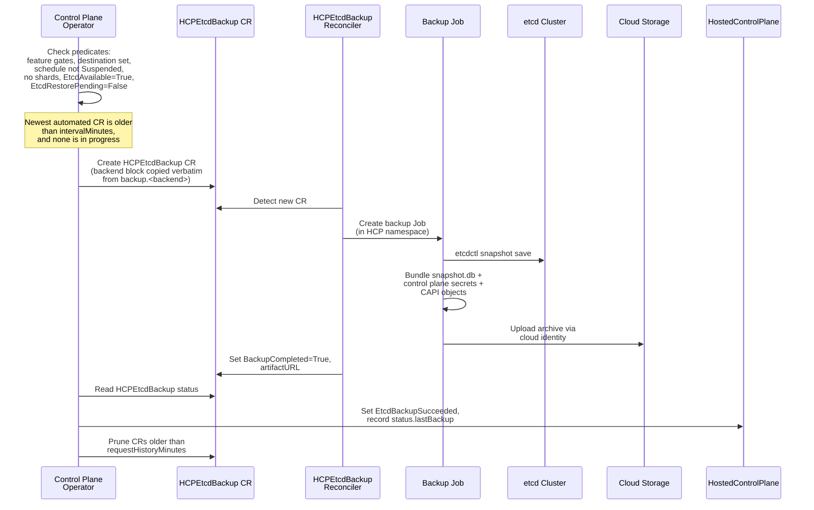
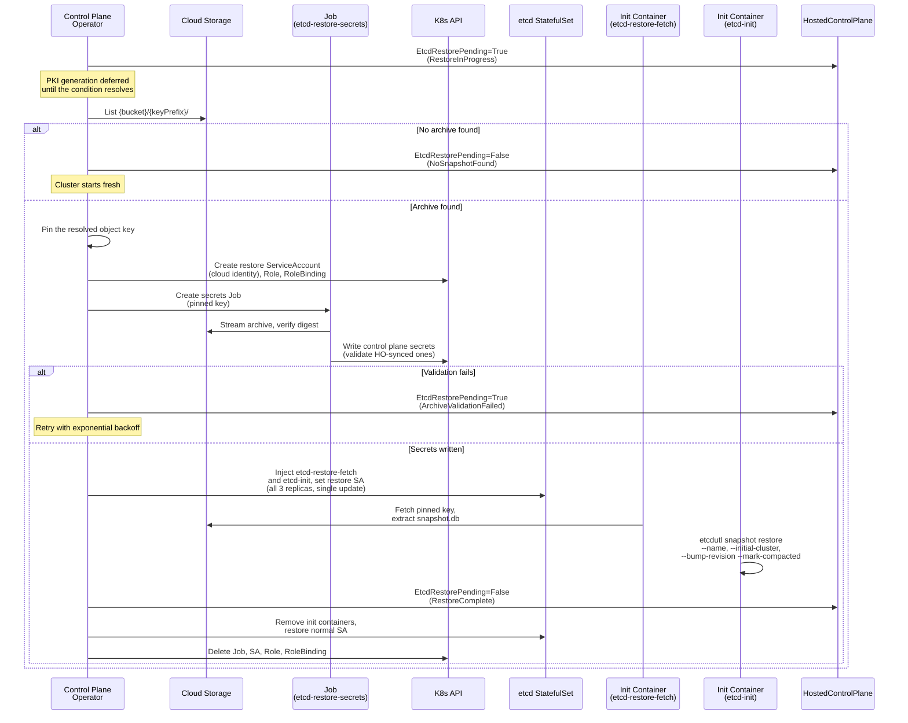

# Automated Etcd Backup and Restore for HyperShift Hosted Control Planes

## Summary

This enhancement adds scheduled etcd backup and automatic restore on cluster creation for HyperShift hosted control planes.
The Control Plane Operator (CPO) creates `HCPEtcdBackup` CRs at a configured interval; the `HCPEtcdBackup` reconciler snapshots etcd, bundles the snapshot with the control plane's cryptographic anchors, and uploads the resulting archive to cloud storage.
When a new cluster is created with a matching `keyPrefix` and a backup exists, the CPO automatically restores the snapshot and those secrets before the control plane finishes starting.

The `HCPEtcdBackup` CRD (see [HCPEtcdBackup enhancement](/enhancements/hypershift/hcp-etcd-backup-crd-for-oadp-integration.md)) is the universal one-shot backup primitive for all HyperShift consumers (ARO, ROSA, GCP, self-managed).
This enhancement builds on that primitive by adding a scheduling layer and an automated restore path, and extends the shared storage API with a Google Cloud Storage backend.
The standalone OCP automated etcd backup enhancement (`/enhancements/etcd/automated-backups.md`) explicitly lists HyperShift as a non-goal; this enhancement fills that gap.

## Motivation

HyperShift hosted control planes run etcd as a StatefulSet in the management cluster's HCP namespace. Unlike standalone OCP clusters where the cluster-etcd-operator manages backups, HyperShift has no built-in mechanism for periodic etcd backup or automated restore. Managed service operators must rely on manual processes or external tools, which are error-prone and do not scale.

### User Stories

1. As a managed service operator, I want etcd to be automatically backed up on a schedule so that I have a recent recovery point without manual intervention.
2. As a managed service operator, I want a new cluster created with the same backup configuration to automatically restore from the most recent backup so that disaster recovery is seamless.
3. As a managed service operator, I want the control plane's cryptographic anchors backed up alongside the etcd snapshot so that the restored cluster can function without regenerating them.
4. As a managed service operator, I want to use cloud-native identity scoped to each HostedCluster so that no fleet-wide static credentials are required.
5. As a managed service operator running on GCP, I want backup artifacts encrypted with a customer-managed Cloud KMS key so that each tenant's artifacts are protected by a key I control.
6. As an SRE, I want to monitor backup and restore health via conditions so that I can detect silent backup failures and stalled restores.
7. As an SRE, I want to suspend backups for a single hosted cluster during an incident without destroying its backup configuration.

### Goals

- Scheduled etcd backup via `HCPEtcdBackup` CRs created by the CPO at a configurable interval
- Automatic restore on cluster creation when a backup exists under the configured `keyPrefix`
- Per-HostedCluster cloud identity, with no fleet-wide static credentials
- A Google Cloud Storage backend, including customer-managed Cloud KMS encryption of artifacts, added to the storage API shared with `HCPEtcdBackup`
- Observable backup and restore status via HostedCluster and HostedControlPlane conditions that are always set
- Bounded growth of `HCPEtcdBackup` CRs on the management cluster
- Integration with `HCPEtcdBackup` as the universal one-shot backup primitive

### Non-Goals

- Standalone OCP cluster backup (covered by `/enhancements/etcd/automated-backups.md`)
- Retention or pruning of backup artifacts in cloud storage (delegated to cloud lifecycle policies)
- Point-in-time recovery, incremental backups, or selecting a backup other than the most recent one. Restore always uses the newest artifact under `keyPrefix`. Artifacts are timestamped and immutable, so a future enhancement can add artifact selection without changing the storage layout or archive format
- Backup of guest cluster workload state (only etcd data and control plane secrets)
- Restoring CAPI objects from the archive (see [Drawbacks](#drawbacks))
- In-place restore of a running cluster (requires delete and recreate)
- Sharded etcd clusters, until multi-shard backup support lands (see [Interaction with Etcd Sharding](#interaction-with-etcd-sharding))
- Evolving the `HCPEtcdBackup` CRD itself, or backup execution mechanics (covered by the [HCPEtcdBackup enhancement](/enhancements/hypershift/hcp-etcd-backup-crd-for-oadp-integration.md))

## Proposal

The implementation adds a scheduling controller and a restore controller within the HyperShift CPO.
The `HCPEtcdBackup` CRD is the backup execution primitive: it runs in the HCP namespace where etcd and the control plane secrets already live, produces a complete restorable artifact, and handles cloud storage upload.
This enhancement layers scheduling and restore on top of that primitive.

The `HCPEtcdBackup` enhancement merged after the first draft of this document, and this proposal is aligned with the merged design rather than the earlier assumptions:

- The `HCPEtcdBackup` reconciler runs in the CPO, and backup Jobs run in the HCP namespace.
- The backup archive already includes the control plane's cryptographic anchors alongside the etcd snapshot.
- Cloud identity is nested inside each storage backend, so an identity can only be paired with a compatible backend.
- `HCPEtcdBackup` deferred GCS to "a separate enhancement when the GCP platform integration is implemented", and stated that the storage API would be extended at that time. This enhancement is that extension.

Three components are introduced:

1. **API extension**: destination, schedule and retention fields added to the existing `backup` stanza on `ManagedEtcdSpec`, plus a GCS backend, gated behind the `HCPAutomatedEtcdBackup` feature gate
2. **Scheduling controller**: a CPO controller that creates `HCPEtcdBackup` CRs when the newest one is older than the configured interval, and prunes old CRs
3. **Restore controller**: CPO reconciliation logic that resolves the newest archive in cloud storage and restores the etcd snapshot and control plane secrets before the control plane finishes starting

### Workflow Description

#### Backup

When a backup destination is configured and etcd is available, the CPO creates `HCPEtcdBackup` CRs directly. There is no CronJob; see [Alternatives](#cronjob-based-scheduling).



1. The cluster creator sets a destination under `spec.etcd.managed.backup` on the HostedCluster.
2. The hypershift-operator propagates the field to the HostedControlPlane's `ManagedEtcdSpec` (see [HostedCluster to HostedControlPlane Propagation](#hostedcluster-to-hostedcontrolplane-propagation)).
3. The CPO checks that both the `HCPAutomatedEtcdBackup` and `HCPEtcdBackup` feature gates are enabled, a destination is configured, `schedule.policy` is not `Suspended`, no etcd shards are configured, `EtcdAvailable=True`, and `EtcdRestorePending=False`. Waiting for the restore to resolve prevents snapshotting an incomplete etcd.
4. If no automated backup exists yet, or the newest one is older than `schedule.intervalMinutes` and none is in progress, the CPO creates an `HCPEtcdBackup` CR. Otherwise it requeues for when the next one is due. The first backup is taken as soon as etcd is available, and again once a restore completes.
5. The CPO copies the backend block from `backup.<backend>` into the CR unchanged. If `keyPrefix` is empty, the CPO defaults it to the cluster's `infraID` before creating the CR.
6. The `HCPEtcdBackup` reconciler creates a backup Job in the HCP namespace, which snapshots etcd, bundles the archive and uploads it. The archive format and upload logic are owned by the `HCPEtcdBackup` enhancement.
7. The reconciler updates the CR status with `BackupCompleted=True` and `artifactURL`.
8. The CPO reads the newest CR status, sets the `EtcdBackupSucceeded` condition, records `status.lastBackup` on the HostedControlPlane, and deletes automated CRs older than `schedule.requestHistoryMinutes`.

Because each cluster's timing follows its own last-backup timestamp rather than a wall-clock schedule, backups spread naturally across a management cluster. A jitter of up to 10% of `intervalMinutes` is added when scheduling the next backup, so that clusters created at the same moment — or a CPO rollout that restarts many operators together — do not converge on a single instant.

The CPO requires `create`, `list`, `watch` and `delete` on `hcpetcdbackups` in its own namespace. The `HCPEtcdBackup` reconciler already runs in the CPO, so this is a shared prerequisite rather than a new component boundary.

#### Restore

When a new cluster is created with a destination configured and a backup exists under the configured `keyPrefix`, the CPO automatically restores the etcd snapshot and the control plane secrets.



1. The CPO detects that the feature gates are enabled, a destination is configured, and the cluster has never completed a restore. It sets `EtcdRestorePending=True` with reason `RestoreInProgress`.
2. **Critical ordering invariant**: the CPO defers generation of the control plane's cryptographic anchors until `EtcdRestorePending` resolves to `False`. If fresh anchors were generated and then overwritten by the restore, or generated after the restore wrote the backed-up values, the restored etcd data would be unusable.
The gate must be in place before the first PKI reconciliation, not merely before the restore Job runs.
3. The CPO lists objects under `{bucket}/{keyPrefix}/` and selects the newest. If the prefix is empty, it sets `EtcdRestorePending=False` with reason `NoSnapshotFound` and the cluster starts with an empty etcd.
4. **The CPO resolves the object key exactly once and pins it.** Every consumer — the secrets Job and all etcd pods — is given that specific key. Nothing lists storage at pod level. Without this, two etcd members could independently resolve different "newest" archives and restore divergent data with no error.
5. The CPO creates a restore ServiceAccount annotated for cloud identity, plus a Role and RoleBinding scoped by `resourceNames` to the secrets being restored.
6. A secrets Job streams the pinned archive, verifies its digest, and writes the control plane secrets. It extracts only the secret members of the archive and never materialises `snapshot.db`, so its footprint is independent of database size.
Writes are idempotent create-or-overwrite; secrets whose source of truth is the HostedCluster are validated rather than overwritten (see [Restoring Secrets](#restoring-secrets)).
7. The CPO injects two init containers into the etcd StatefulSet and switches it to the restore ServiceAccount, in a single update. `etcd-restore-fetch` fetches the pinned key using the cloud identity and extracts `snapshot.db`; the existing `etcd-init` container then restores that member. This happens on **all** replicas (see [Why Multi-Replica Restore Works](#why-multi-replica-restore-works)).
8. Once etcd is healthy, the CPO sets `EtcdRestorePending=False` with reason `RestoreComplete`, removes the init containers, restores the normal ServiceAccount, and deletes the Job, ServiceAccount, Role and RoleBinding.

**Adding a destination to a running cluster**: if a destination is added to a cluster that already has etcd data, the CPO does **not** trigger a restore. It sets `EtcdRestorePending=False` with reason `ExistingCluster`, so the control plane is never blocked during feature adoption, and backups begin on the next scheduling pass.
In-place restore of a running cluster is not supported (see Non-Goals).

**Cluster identity and restore**: in a disaster recovery scenario, the new HostedCluster must be created with the same backup configuration — in particular the same `keyPrefix` — so that the restore controller can locate the backups. Beyond backup lookup, two HyperShift identifiers are relevant:

- **`infraID`** identifies the cloud infrastructure (VPCs, load balancers, DNS records). The new cluster should reuse the same `infraID` so it picks up existing infrastructure resources. This is a general HyperShift DR requirement, not specific to this enhancement.
- **`clusterID`** is the OpenShift cluster UUID. A newly created cluster always receives a new `clusterID`. The etcd data restored from backup contains the old `clusterID`; the CVO and cluster operators reconcile this to match the new cluster after restore.

Neither `infraID` nor `clusterID` plays a role in backup lookup — that is determined solely by `keyPrefix`.

#### Error Handling

**Restore failure**: when the restore Job or the fetch container fails, the CPO keeps `EtcdRestorePending=True` and retries with capped exponential backoff, recording the failure in the condition message.
There is no attempt counter and no terminal failure state: transient causes such as cloud identity propagation delays resolve on their own, and a persistently failing restore is a configuration problem whose remedy is to correct the configuration and recreate the HostedCluster. Retry state lives in the condition and the Job, not in a hand-maintained status field.

**Archive validation failure**: a digest mismatch, a malformed archive or missing expected contents all surface as `ArchiveValidationFailed` and are retried with the same backoff. If the newest archive is permanently corrupt, removing it from the bucket causes the next retry to resolve the next-newest archive.

**Backup failure**: if the `HCPEtcdBackup` reconciler fails to complete a backup, the CR status reflects the failure and the CPO sets `EtcdBackupSucceeded=False` with reason `BackupFailed`. The CPO creates a new CR at the next interval. The etcd data plane is unaffected.

**Etcd pod restart during restore**: the `etcd-init` script exits early when the data directory is non-empty, so a pod that restarts after a successful restore does not restore again. A pod that restarts mid-restore re-runs the fetch and restore steps from the same pinned key.

### API Extensions

#### Extending the existing `backup` stanza on `ManagedEtcdSpec`

`ManagedEtcdSpec` already has a `backup` field gated behind `HCPEtcdBackup`. In the merged `HCPEtcdBackup` design it is a union discriminated on `storageType`, carrying the artifact encryption key for whichever backend is in use.
This enhancement adds the destination, the schedule and the retention limit to that same stanza rather than introducing a sibling field, so that there is one discriminator and one place to configure a backend.

Each backend member then has the same shape as the corresponding member of `HCPEtcdBackup.spec`, and the scheduler copies the block into each CR unchanged.

```yaml
spec:
  etcd:
    managementType: Managed
    managed:
      backup:
        storageType: GCS
        gcs:
          kmsKeyName: projects/my-project/locations/us-central1/keyRings/etcd/cryptoKeys/backup
          bucket: my-etcd-backups
          keyPrefix: clusters/my-hosted-cluster
          identity:
            type: GCPServiceAccount
            gcpServiceAccount: etcd-backup@my-project.iam.gserviceaccount.com
        schedule:
          intervalMinutes: 60
          policy: Scheduled
          requestHistoryMinutes: 1440
```

Behaviour depends on how much is configured:

- **Encryption key only** — the existing behaviour. The key is applied to any `HCPEtcdBackup` CR created by any consumer. No scheduled backups, no restore.
- **Destination configured** (`bucket` plus `identity`) — scheduled backups run at the configured interval, and restore-at-creation reads from the same location.

A useful consequence of sharing one destination: an SRE can create an `HCPEtcdBackup` CR by hand pointing at the same place, and automated restore will find it, because restore resolves the newest artifact under `keyPrefix` regardless of which consumer produced it.

#### New Types

Only the additions are shown. The `S3` and `AzureBlob` members gain the same destination fields and are otherwise unchanged from the `HCPEtcdBackup` enhancement.

```go
// HCPEtcdBackupConfig is the existing backup stanza. Only the markers that
// this enhancement adds are shown; the S3 and AzureBlob members and the
// storageType discriminator are defined by the HCPEtcdBackup enhancement.
//
// Scheduling is meaningless without somewhere to write to, so a schedule
// requires a destination on the selected backend.
// +kubebuilder:validation:XValidation:rule="!has(self.schedule) || (self.storageType == 'S3' ? has(self.s3.bucket) : self.storageType == 'AzureBlob' ? has(self.azureBlob.container) : has(self.gcs.bucket))",message="schedule requires a backup destination on the selected storage backend"
type HCPEtcdBackupConfig struct {
    // schedule configures automated backup scheduling. When omitted, no
    // automated backups are created and the stanza only supplies the
    // artifact encryption key to HCPEtcdBackup CRs created by other
    // consumers.
    // +optional
    Schedule HCPEtcdBackupSchedule `json:"schedule,omitzero"`

    // ...storageType, s3, azureBlob, gcs...
}

// HCPEtcdBackupSchedule configures automated backup scheduling.
// Retaining history for less than one interval would make a request
// eligible for deletion before its successor exists.
// +kubebuilder:validation:XValidation:rule="!has(self.requestHistoryMinutes) || !has(self.intervalMinutes) || self.requestHistoryMinutes >= self.intervalMinutes",message="requestHistoryMinutes must be greater than or equal to intervalMinutes"
type HCPEtcdBackupSchedule struct {
    // intervalMinutes is the minimum number of minutes between automated
    // backups. The CPO creates a new HCPEtcdBackup CR when the newest
    // automated backup is older than this interval and no backup is in
    // progress. Because only one backup runs at a time per hosted control
    // plane, an interval shorter than the time a backup takes results in
    // back-to-back backups rather than the requested cadence.
    // This value approximately bounds how much data a restore can lose.
    // There is deliberately no upper limit; very long intervals leave stale
    // backups that may not restore into a useful state.
    // When omitted, the controller applies a default of 60.
    // +optional
    // +kubebuilder:validation:Minimum=5
    IntervalMinutes int32 `json:"intervalMinutes,omitempty"`

    // policy controls whether automated backups run. Valid values are
    // Scheduled and Suspended. When set to Scheduled, or when omitted, the
    // CPO creates HCPEtcdBackup CRs at the configured interval. When set to
    // Suspended, no new CRs are created while the destination configuration
    // is retained, so restore-at-creation continues to work and backups can
    // be resumed with the same settings.
    // +optional
    // +kubebuilder:validation:Enum=Scheduled;Suspended
    Policy HCPEtcdBackupSchedulePolicy `json:"policy,omitempty"`

    // requestHistoryMinutes is how long completed automated HCPEtcdBackup
    // CRs are retained for this hosted control plane. Older automated CRs
    // are deleted once their status has been recorded. A duration is used
    // rather than a count so that the visible history covers a predictable
    // span regardless of intervalMinutes. Must be greater than or equal to
    // intervalMinutes. Deleting a CR does not delete the backup artifact it
    // produced, and CRs created by other consumers are never pruned.
    // When omitted, the controller applies a default of 1440 (one day).
    // +optional
    // +kubebuilder:validation:Minimum=5
    RequestHistoryMinutes int32 `json:"requestHistoryMinutes,omitempty"`
}

// HCPEtcdBackupConfigGCS configures Google Cloud Storage as the backup
// destination and the artifact encryption key for GCS.
// A destination is only usable if both the bucket and the identity to reach
// it are present, so the two must be set together.
// +kubebuilder:validation:XValidation:rule="has(self.bucket) == has(self.identity)",message="bucket and identity must be set together"
type HCPEtcdBackupConfigGCS struct {
    // kmsKeyName is the resource name of the Cloud KMS key used to encrypt
    // backup artifacts. When omitted, the bucket's default encryption
    // applies. The key's location must be compatible with the bucket's
    // location, and the project's Cloud Storage service agent must hold
    // roles/cloudkms.cryptoKeyEncrypterDecrypter on the key.
    // +optional
    // +kubebuilder:validation:MinLength=1
    // +kubebuilder:validation:MaxLength=256
    // +kubebuilder:validation:XValidation:rule="self.matches('^projects/[^/]+/locations/[^/]+/keyRings/[^/]+/cryptoKeys/[^/]+$')",message="kmsKeyName must be of the form projects/<project>/locations/<location>/keyRings/<ring>/cryptoKeys/<key>"
    KMSKeyName string `json:"kmsKeyName,omitempty"`

    // bucket is the name of the GCS bucket for storing etcd backup
    // archives. The bucket must already exist and the identity must have
    // read and write access to it. Setting a bucket enables scheduled
    // backups and restore-at-creation. bucket and identity must be set
    // together.
    // +optional
    // +kubebuilder:validation:MinLength=3
    // +kubebuilder:validation:MaxLength=63
    Bucket string `json:"bucket,omitempty"`

    // keyPrefix is the object name prefix under which backup archives are
    // stored. Backups are written to {keyPrefix}/{unix-timestamp}.tar.gz and
    // restore resolves the newest object under the same prefix. When empty,
    // the CPO defaults this to the cluster's infraID at reconcile time.
    // Changing this orphans previously written artifacts at the old prefix.
    // +optional
    // +kubebuilder:validation:MaxLength=256
    KeyPrefix string `json:"keyPrefix,omitempty"`

    // identity configures the cloud identity used to read and write
    // artifacts in this bucket. bucket and identity must be set together.
    // +optional
    Identity HCPEtcdBackupGCSIdentity `json:"identity,omitzero"`
}

// HCPEtcdBackupGCSIdentity configures the identity used for GCS access.
// +union
type HCPEtcdBackupGCSIdentity struct {
    // type is the identity type. Valid values are GCPServiceAccount and
    // Secret.
    // +unionDiscriminator
    // +required
    Type HCPEtcdBackupGCSIdentityType `json:"type"`

    // gcpServiceAccount is the email address of a GCP service account
    // granted IAM access to the bucket. The Kubernetes ServiceAccount used
    // by backup and restore pods is annotated with this email for GKE
    // Workload Identity federation. Required when type is
    // GCPServiceAccount, and forbidden otherwise.
    // +optional
    // +unionMember
    GCPServiceAccount string `json:"gcpServiceAccount,omitempty"`

    // credentialsSecretRef references a Secret in the HCP namespace holding
    // a GCP service account key in its 'credentials' key. Use this for
    // self-hosted environments where workload identity is not available.
    // Required when type is Secret, and forbidden otherwise.
    // +optional
    // +unionMember
    CredentialsSecretRef corev1.LocalObjectReference `json:"credentialsSecretRef,omitzero"`
}
```

#### Mutability

No field on `ManagedEtcdSpec.backup` is immutable.

An earlier revision made `keyPrefix` and the storage type immutable to prevent backup and restore from diverging. That does not hold up: restore happens at cluster creation, so disaster recovery always involves authoring a **new** HostedCluster manifest, and immutability on the old object constrains nothing about the new one.
The invariant that matters — the replacement cluster must point at the same prefix — is procedural and cannot be enforced by a CEL rule on an object that no longer exists.

What immutability did prevent was narrower: a running cluster splitting its backup history across two prefixes, leaving a window where the new prefix is empty. That window is bounded by the backup interval and is better made visible than made permanent.
Against that, immutability prevented correcting a mistyped bucket without recreating the cluster, prevented bucket and storage-account migration, and prevented credential rotation.

In its place:

- Changing the destination sets `EtcdBackupSucceeded=False` with reason `BackupDestinationChanged` until the first backup lands at the new location.
- `status.lastBackup` records where backups actually went, so the effective location is auditable rather than inferred from spec.
- In-flight backups need no special handling: each `HCPEtcdBackup` CR pins its configuration at creation, so a running backup completes against the old destination and the change applies to the next CR.
- Artifacts previously written to the old location are orphaned, and retaining or migrating them is the operator's responsibility.

This is deliberately different from `HCPEtcdBackup` CRs, where `keyPrefix` and the encryption key **are** immutable. The rule is **immutable on the one-shot CR, mutable on the long-lived configuration**: a CR represents a single backup operation, so mutating its destination mid-flight is incoherent, whereas `ManagedEtcdSpec.backup` configures a cluster that may run for years.
A mutable union discriminator has precedent in this API — `SecretEncryptionSpec.Type` is a `+unionDiscriminator` and is not immutable.

#### New Conditions

Both conditions are set on the HostedControlPlane by the CPO and bubbled up to the HostedCluster. **Both are always set**, including when the feature is disabled, so that the absence of a condition never has to be interpreted. `EtcdBackupSucceeded` is already in the HostedCluster bubble-up list; `EtcdRestorePending` must be added.

**`EtcdBackupSucceeded`** — reports whether the most recent automated backup succeeded. No value of this condition ever blocks the control plane.

| Status | Reason | Description |
| ------ | ------ | ----------- |
| `True` | `BackupSucceeded` | Most recent backup completed; completion time and artifact in `status.lastBackup` |
| `False` | `BackupInProgress` | An `HCPEtcdBackup` CR has been created and has not yet completed |
| `False` | `BackupFailed` | The most recent `HCPEtcdBackup` CR failed; another is created at the next interval |
| `False` | `WaitingForEtcd` | Waiting for `EtcdAvailable=True` before the first backup |
| `False` | `BackupDestinationChanged` | The destination changed; no backup has landed at the new location yet |
| `False` | `BackupSuspended` | `schedule.policy` is `Suspended`; configuration retained, no new CRs created |
| `False` | `ShardingNotSupported` | Etcd shards are configured; automated backup is withheld |
| `False` | `NotConfigured` | No backup destination is configured; the feature is available but unused |
| `False` | `FeatureDisabled` | A required feature gate is off, so the feature is unavailable |

**`EtcdRestorePending`** — reports whether the control plane is being held back waiting for a restore to resolve. `Status=True` is the abnormal state, and it is exactly the set of cases that block control plane startup.

| Status | Reason | Blocks CP? | Description |
| ------ | ------ | :--------: | ----------- |
| `False` | `RestoreComplete` | No | Snapshot restored successfully |
| `False` | `NoSnapshotFound` | No | No artifact exists under `keyPrefix`; cluster started with an empty etcd |
| `False` | `ExistingCluster` | No | A destination was added to a cluster that already has etcd data; no restore attempted |
| `False` | `ShardingNotSupported` | No | Etcd shards are configured; restore is skipped rather than blocking startup |
| `False` | `NotConfigured` | No | No backup destination is configured, so there is nothing to restore from |
| `False` | `FeatureDisabled` | No | A required feature gate is off, so the feature is unavailable |
| `True` | `RestoreInProgress` | **Yes** | Restore is running; PKI generation and etcd startup are deferred |
| `True` | `WaitingForCredentials` | **Yes** | The restore identity is not yet usable; retrying with backoff |
| `True` | `RestoreFailed` | **Yes** | The restore failed; retrying with backoff |
| `True` | `ArchiveValidationFailed` | **Yes** | Digest mismatch, malformed archive or missing contents; retrying with backoff |

**This replaces the existing `EtcdSnapshotRestored` condition type**, which has the opposite polarity and is only set when `restoreSnapshotURL` is in use. Inverting it collapses "restored", "nothing to restore", "pre-existing cluster" and "feature off" into a single healthy value, and makes `Status=True` mean exactly "the control plane is waiting".
The `restoreSnapshotURL` path is migrated to the new condition so that both restore mechanisms report consistently. This touches the condition type definition, the HostedControlPlane reconciler, the etcd StatefulSet reconciler, and the component framework's precondition handling. Because the condition is API-visible, the change must be called out in release notes.

#### New Status Field

```go
type HostedControlPlaneStatus struct {
    // ...existing fields...

    // lastBackup reports the most recent completed backup for this control
    // plane, rolled up from HCPEtcdBackup CR status. Empty until the first
    // backup completes.
    // +optional
    LastBackup HCPEtcdLastBackupStatus `json:"lastBackup,omitzero"`
}
```

It carries the artifact URL and the completion time. This exists because `EtcdBackupSucceeded` alone cannot express backup freshness: a condition's `lastTransitionTime` does not advance while the status stays `True`, so consecutive successful backups leave it frozen. Alerting on backup staleness requires a timestamp that actually moves.

#### Feature Gate

The new fields are gated behind `HCPAutomatedEtcdBackup`, alongside the existing `HCPEtcdBackup` gate that covers the `backup` stanza itself. Both are hypershift-operator feature gates enabled in `TechPreviewNoUpgrade`, following the pattern of the existing `HCPEtcdBackup` and `EtcdSharding` gates.

A separate gate is used rather than folding into `HCPEtcdBackup` because the risk profiles differ: one-shot backup only reads, whereas restore defers control plane startup. Restore should be able to remain in Tech Preview longer without holding back the primitive that OADP, ARO and ROSA depend on.

`HCPAutomatedEtcdBackup` depends on `HCPEtcdBackup`, since the scheduler creates `HCPEtcdBackup` CRs. CEL cannot express dependencies between gates, so the CPO checks both. `HCPAutomatedEtcdBackup` must never graduate ahead of `HCPEtcdBackup`.

Feature gates control **API availability during graduation**. They are not a runtime switch for this feature: they disappear at GA, `TechPreviewNoUpgrade` cannot be reverted, they apply to every hosted cluster on a management cluster, and disabling one prunes the gated fields — including the destination needed to locate existing backups.
The supported way to stop backups is `schedule.policy: Suspended` (see [Disabling Backup](#disabling-backup)).

### Topology Considerations

#### Hypershift / Hosted Control Planes

This is a HyperShift-only feature. The scheduling and restore logic runs in the Control Plane Operator, and the restore Job and backup Jobs run in the management cluster's HCP namespace. No guest cluster components are affected.

#### Standalone Clusters

Not applicable. Standalone OCP automated backups are covered by `/enhancements/etcd/automated-backups.md`.

#### Single-node Deployments or MicroShift

Not applicable to MicroShift or SNO management clusters, since this feature operates within the HyperShift Control Plane Operator.

A hosted control plane with a single etcd replica is supported, but has no follower to take snapshots from, so the snapshot cost described in [Impact on Existing SLIs](#impact-on-existing-slis) falls on its only member.

#### OpenShift Kubernetes Engine

Not applicable. This feature is HyperShift-specific and does not depend on features excluded from OKE.

### Implementation Details/Notes/Constraints

#### Integration with HCPEtcdBackup

| Component | Owner | Responsibility |
| --------- | ----- | -------------- |
| `HCPEtcdBackup` CRD and reconciler | HCPEtcdBackup enhancement | One-shot backup execution: snapshot etcd, bundle the archive, upload to cloud storage |
| Destination, schedule and retention on `ManagedEtcdSpec.backup` | This enhancement | Scheduling: create `HCPEtcdBackup` CRs at an interval and prune old ones |
| GCS backend and Cloud KMS encryption | This enhancement | The storage API extension `HCPEtcdBackup` deferred |
| Restore controller | This enhancement | Resolve the newest archive, restore the etcd snapshot and control plane secrets |

**Relationship with OADP**: the `HCPEtcdBackup` enhancement describes restore as an OADP-driven flow that downloads the archive, restores secrets and CAPI objects itself, and hands a presigned URL to `restoreSnapshotURL`. This enhancement provides the same capability in-core, so etcd disaster recovery no longer requires OADP.
The OADP flow remains available; the two are not mutually exclusive, since both ultimately read the same archive format from the same location.

**Relationship with `restoreSnapshotURL`**: `restoreSnapshotURL` provides manual, URL-based restore from a presigned URL and does not restore control plane secrets. Automated restore is a superset. The two are mutually exclusive at restore time; if both are configured the CPO rejects the configuration. Both now report through `EtcdRestorePending`.
Long-term, `restoreSnapshotURL` may be deprecated once automated restore is GA.

#### HostedCluster to HostedControlPlane Propagation

The new fields are added to `ManagedEtcdSpec`, which is shared by the HostedCluster and HostedControlPlane APIs, and the hypershift-operator propagates the whole struct during reconciliation, so no HO change is needed for field propagation.

The CPO reads the configuration from the HostedControlPlane spec and sets conditions on HostedControlPlane status. `EtcdBackupSucceeded` is already bubbled up to the HostedCluster; `EtcdRestorePending` must be added to the bubble-up list, which does require an HO change.

#### Why the Control Plane Secrets Must Be Backed Up

The etcd snapshot alone is insufficient. These are cryptographic anchors created once and never regenerated; if replaced with fresh values, the restored data becomes unusable.

| Secret | Purpose | Impact if lost or regenerated |
| ------ | ------- | ----------------------------- |
| `root-ca` | Self-signed root CA for the hosted control plane. Signs control plane certificates and is embedded in every guest cluster kubeconfig | All certificates invalid, kubeconfigs cannot authenticate, nodes cannot join |
| `etcd-signer` | CA that signs all etcd TLS certificates (server, peer, client, metrics) | KAS cannot connect to etcd, peer communication breaks |
| `sa-signing-key` | Keypair used by KAS to sign and verify ServiceAccount tokens | Every existing ServiceAccount token becomes unverifiable |
| `kas-secret-encryption-config` | The KAS `EncryptionConfiguration`, which embeds the key material actually in use for encryption at rest | Encrypted resources in etcd are unreadable |

The encryption config rather than the raw AESCBC key is the right thing to capture, because it reflects every key in use at backup time. HyperShift rotates encryption keys through a two-stage rollout in which a write key and a read key are active simultaneously; capturing only `spec.secretEncryption.aescbc.activeKey` would miss data written under the other key.

- **AESCBC encryption**: the archive carries the encryption config, which embeds the key material. It must be in place before KAS starts.
- **KMS encryption**: key material lives in the cloud KMS service, so no Kubernetes secret needs backing up, but the KMS key must remain accessible and the new HostedCluster must reference the same key.
- **No encryption**: nothing beyond the three PKI secrets is needed.

#### Restoring Secrets

Writes are an idempotent create-or-overwrite: a retry after a partial write converges, because each secret is independently written to its backed-up value.

Two secrets are **validated rather than overwritten**, because the hypershift-operator syncs them into the HCP namespace from the HostedCluster and would immediately revert an overwrite, producing a fight loop:

- the AESCBC active and backup key secrets referenced by `spec.secretEncryption`
- a user-provided ServiceAccount signing key

Similarly, `kas-secret-encryption-config` is derived by the CPO from `spec.secretEncryption` plus those synced secrets, so restoring it directly would be overwritten on the next reconciliation. The restore therefore checks that the key material the new cluster will produce matches what the archive recorded, and fails with `ArchiveValidationFailed` when it does not.
A mismatch means the replacement HostedCluster was created referencing different key material, which is a configuration error worth surfacing loudly rather than silently producing an unreadable cluster.

#### Why Multi-Replica Restore Works

Restore runs with the normal replica count. No scale-down is required.

The existing `etcd-init` container (`control-plane-operator/controllers/hostedcontrolplane/v2/etcd/etcd-init.sh`) is injected into the StatefulSet pod template, so it runs on every etcd pod, and each pod restores its own member into its own `volumeClaimTemplate` PVC, passing that pod's `--name` and `--initial-advertise-peer-urls` along with a shared `--initial-cluster` and `--initial-cluster-token`.
This is the upstream etcd disaster recovery procedure, which states that "all members should restore using the same snapshot" and documents a three-member example passing per-member `--name` and `--initial-advertise-peer-urls` with a shared `--initial-cluster` and `--initial-cluster-token` ([etcd disaster recovery](https://etcd.io/docs/v3.5/op-guide/recovery/)).
It was made correct in HyperShift by OCPBUGS-99310, which added exactly those flags to stop members initialising individually and forming a split brain. The same change moved `etcd-init` ahead of `reset-member` so that the data directory already exists when `reset-member` runs and membership is left unchanged.

A shared restore volume would not merely be awkward here, it would be unusable: etcd pods carry a *required* pod anti-affinity on `topology.kubernetes.io/zone`, so the replicas are always in different zones and no single zonal `ReadWriteOnce` volume can be mounted by all of them.

The only thing the etcd image lacks is a way to reach cloud storage using the cluster's identity, which is why today's `restoreSnapshotURL` path depends on a presigned URL. The `etcd-restore-fetch` init container supplies that, and is more robust than a presigned URL because it cannot expire mid-restore.

#### Restore Staging Storage

`etcdutl snapshot restore` needs a real file with random access, so the snapshot cannot be streamed directly into it and must be staged.

The fetch container stream-extracts the archive so the compressed tarball is never written, leaving only `snapshot.db` on disk. It is staged in an `emptyDir` with a `sizeLimit` and a matching `ephemeral-storage` request derived from the etcd backend quota plus headroom — the on-disk file can exceed the live data size through fragmentation.
In HyperShift that quota is currently a fixed 8 GiB (`ETCD_QUOTA_BACKEND_BYTES` in the etcd StatefulSet asset) rather than a configurable field, so the derived value is constant today; expressing it as a formula means the sizing follows if the quota ever becomes configurable, as it is in standalone OpenShift via `Etcd.spec.backendQuotaGiB`.

Staging on the etcd data PVC was considered and rejected: peak usage would be roughly twice the database size, consuming exactly the headroom that the etcd PV is sized to provide for defragmentation and snapshotting.

#### Per-HostedCluster Cloud Identity

Each HostedCluster has its own cloud identity, scoped to its own backup storage, configured by the `identity` block inside the storage backend. Nesting identity inside the backend makes invalid pairings unrepresentable. This eliminates fleet-wide static credentials that would be a single point of compromise across all clusters.

| Cloud | Identity mechanism | ServiceAccount configuration |
| ----- | ------------------ | ---------------------------- |
| GCP | GKE Workload Identity | Annotated with `iam.gke.io/gcp-service-account` |
| AWS | IRSA / STS | Projected token volume with `sts.amazonaws.com` audience plus `AWS_ROLE_ARN` |
| Azure | Managed Identity | Annotated with `azure.workload.identity/client-id` plus pod label `azure.workload.identity/use: "true"` |
| Self-hosted | Static credentials Secret | Secret mounted as a volume |

The managed service layer provisions these identities; HyperShift exposes the configuration. Isolation between tenants sharing a bucket depends on the identity being scoped to its own path, using IAM conditions, STS session policies or the equivalent — a unique `keyPrefix` alone is a correctness measure, not a security boundary.

During restore the etcd StatefulSet temporarily uses a dedicated restore ServiceAccount carrying this identity, reverting to its normal ServiceAccount when the init containers are removed. Steady-state etcd therefore never holds credentials for the backup bucket. Both changes land in a single pod template update, so there is only one rollout.

For GCS with a customer-managed key, note that Cloud Storage encrypts using the project's Cloud Storage service agent, so it is that agent — not the backup identity — that needs `roles/cloudkms.cryptoKeyEncrypterDecrypter` on the key.

#### Archive Format and Path Contract

The archive format is owned by the `HCPEtcdBackup` enhancement. Each backup produces a single `.tar.gz` containing the etcd snapshot, the control plane secrets listed above, and CAPI objects.

**Path contract**: backup and restore both derive the storage path from `keyPrefix`. This is the single source of truth that guarantees they agree, which matters because at restore time there are no `HCPEtcdBackup` CRs to query.
The CPO copies `keyPrefix` into each CR; the reconciler writes to `{keyPrefix}/{unix-timestamp}.tar.gz`; restore lists the same prefix and selects the newest by timestamp ordering. When `keyPrefix` is empty the CPO defaults it to the cluster's `infraID`.

**Resolution happens once.** The CPO resolves the concrete object key and pins it into the pod spec and the secrets Job. Pods never list storage. This guarantees that all etcd members and the secrets Job act on the same artifact.

CAPI objects in the archive are **not restored**. Recreating the HostedCluster and its NodePools regenerates them (see [Drawbacks](#drawbacks)).

#### Multi-Tenancy and Scale Considerations

Backup timing follows each cluster's own last-backup timestamp rather than a wall-clock schedule, so clusters spread naturally across a management cluster without per-cluster schedule assignment, and a CPO rollout does not synchronise them. Jitter of up to 10% of the interval covers the remaining cases, such as a fleet of clusters created simultaneously.

`HCPEtcdBackup` CRs are a management-cluster resource and must not grow without bound. At the default one-hour interval, a management cluster hosting a thousand control planes would accumulate roughly twenty-four thousand CRs per day. The CPO therefore prunes automated CRs older than `schedule.requestHistoryMinutes` once their status has been recorded.
Pruning a CR does not delete the artifact it produced, and CRs created by other consumers are left alone.

Where multiple hosted clusters share a bucket, operators must ensure `keyPrefix` uniqueness; the `infraID` default is unique by design. A misconfigured prefix on a new cluster could restore from another cluster's backup, so path-scoped identity is the mechanism that makes this safe, with separate buckets per tenant as a stronger option.

#### Interaction with Etcd Sharding

Etcd sharding has shipped as Tech Preview behind the `EtcdSharding` feature gate: `ManagedEtcdSpec.shards` accepts up to ten additional shards and is immutable after creation. Its API documentation states that shard data is **not** included in `HCPEtcdBackup`, so a sharded hosted control plane is not fully covered by the existing backup primitive.
Multi-shard backup and restore support is in progress in hypershift PR #9146 (open as of 2026-11-03).

Until that lands, this enhancement **refuses to schedule backups when shards are configured**, rather than producing artifacts that silently omit shard data. Both conditions report `ShardingNotSupported`, and `EtcdRestorePending` reports it as `False` so that a sharded cluster is never blocked from starting. When multi-shard support lands, this restriction and both condition reasons are removed.

#### Idempotency and CPO Restarts

All restore state lives on the HostedControlPlane via `EtcdRestorePending`, not in operator memory. Once the condition is `False` with reason `RestoreComplete`, no restore is attempted again regardless of restarts or reconciles. A CPO that restarts while a restore Job is running observes the existing Job and waits rather than creating a duplicate.
A CPO that restarts after a failure resumes the backoff.

#### Restoring a Pre-Upgrade Backup

If the cluster was upgraded between the last backup and a disaster, the restored etcd state reflects the pre-upgrade version while the control plane runs the post-upgrade version. The CVO and cluster operators re-reconcile guest cluster state to match the running version.
After an upgrade, operators should confirm a post-upgrade backup exists by comparing `status.lastBackup` against the upgrade completion time, and can take an immediate backup by creating an `HCPEtcdBackup` CR manually.

### Risks and Mitigations

| Risk | Mitigation |
| ---- | ---------- |
| Frequent snapshots increase fragmentation, causing more defragmentation cycles, which do block an etcd member | Documented in [Impact on Existing SLIs](#impact-on-existing-slis); minimum interval of 5 minutes; load testing at maximum database size and minimum interval before GA |
| `HCPEtcdBackup` reconciler unavailable during backup | CRs are processed when it recovers; staleness is detectable from `status.lastBackup` and the `EtcdBackupStale` alert |
| `HCPEtcdBackup` CRD absent or its feature gate disabled | CR creation fails and `EtcdBackupSucceeded=False`; the gate dependency is checked by the CPO |
| Cloud identity not ready at cluster creation | `EtcdRestorePending=True` with `WaitingForCredentials`, retried with exponential backoff |
| Restore archive corruption | Digest verification and content checks before use; removing the corrupt artifact lets the next retry resolve the previous one |
| Etcd members restoring different artifacts | The CPO resolves the object key once and pins it; pods never list storage |
| KMS key deleted or disabled | Artifacts encrypted with it become unrestorable; documented as an operator responsibility |
| Destination changed, leaving a window with no backups at the new location | `EtcdBackupSucceeded=False` with `BackupDestinationChanged` until the first backup lands |
| `HCPEtcdBackup` CR accumulation on the management cluster | The CPO prunes automated CRs older than `schedule.requestHistoryMinutes` |
| Backup artifact accumulation in cloud storage | Documented: operators configure cloud lifecycle policies; an artifact retention API is future work |
| Sharded cluster silently backed up without shard data | Backups are refused while shards are configured, reported as `ShardingNotSupported` |
| Restore of a pre-upgrade backup creates version skew | CVO and cluster operators re-reconcile; operators should verify post-upgrade backups exist |

### Drawbacks

- Depends on the `HCPEtcdBackup` CRD and feature gate, which is an additional prerequisite.
- No built-in artifact retention, so cloud storage costs grow without external lifecycle configuration.
- Restore is one-shot at cluster creation. Restoring a running cluster requires delete and recreate.
- **CAPI objects are not restored.** Recreating the HostedCluster and NodePools regenerates the CAPI resources, but the existing worker VMs are not re-adopted and new instances are provisioned instead. Teaching the cluster-api providers to re-adopt existing instances is a separate initiative and a prerequisite for recovering a cluster without replacing its nodes.
- Renaming `EtcdSnapshotRestored` changes an API-visible condition on a shipped code path.

## Alternatives (Not Implemented)

### CronJob-Based Scheduling

An earlier revision had the CPO create a CronJob per hosted control plane, whose pod created `HCPEtcdBackup` CRs.
Rejected because cron can only express intervals that divide evenly into an hour or a day, so an arbitrary interval cannot be represented exactly;
because it required a scheduler pod, ServiceAccount, Role and RoleBinding per cluster purely to create one object;
because avoiding a thundering herd required deriving a per-cluster offset and encoding it into the schedule;
and because it added a dependency on kube-controller-manager for a loop the CPO can run itself.
Having the CPO create CRs directly removes all of this and makes any interval exact.

### Cron Expressions in the API

Validating a cron expression properly in CEL requires a long regular expression that is hard to review and still accepts impossible dates such as 31 February. Since the goal is a recovery point objective rather than wall-clock alignment, an interval expresses the intent directly and validates trivially.

### A Shared Restore PVC and Single-Replica Restore

An earlier revision provisioned a 20Gi `ReadWriteOnce` PVC for the restore Job and scaled etcd to one replica to avoid a scheduling deadlock. Rejected because the deadlock was created by the shared volume itself: etcd pods carry a required zone anti-affinity, so a single zonal volume can never be mounted by all replicas.
The existing `etcd-init` container already restores every member into its own PVC, so removing the shared volume removes the deadlock, the scale-down, and the question of how to size a volume whose size depended on a database limit that may change.

### Sibling API Field

An earlier revision added `automatedBackup` as a sibling of the existing `backup` stanza. Rejected because both described the same storage backend and would each carry their own discriminator and encryption key, requiring cross-field validation to keep them consistent.
Extending `backup` keeps one discriminator and makes each backend member identical in shape to the corresponding `HCPEtcdBackup` member, so the scheduler copies it verbatim.

### Self-Contained Backup Without HCPEtcdBackup

Having the scheduler snapshot etcd, bundle secrets and upload directly. Rejected to avoid duplicating that logic, and because all managed services expressed a desire to converge on a single backup primitive.

### OADP/Velero-Based Scheduled Backups

Rejected because OADP adds a heavy dependency and targets full cluster disaster recovery rather than etcd-only backup. This approach is deliberately minimal.

### Static Credentials Instead of Per-HostedCluster Identity

A shared fleet-wide credential Secret would work but creates a single point of compromise with no compensating benefit.

### Backup to PersistentVolume

Following the standalone OCP pattern of backing up to local PVs. Rejected because control plane pods run on management cluster nodes that may be ephemeral and PV durability varies by provider. Cloud object storage is the natural durable target.

### In-Place Restore

Restoring a running cluster by scaling etcd to zero, restoring, and scaling back. Rejected due to complexity: connections must be drained, KAS must be stopped, and the risk of inconsistency is high.

## Open Questions

1. **Enforcing the PKI ordering invariant.** Generation of the control plane's cryptographic anchors happens in the HostedControlPlane reconciler, outside the component framework. The restore gate must be in place before the first PKI reconciliation, not merely before the restore Job runs.
The precise mechanism needs to be settled during implementation; if it cannot be guaranteed, the fallback is for the restore to overwrite and the CPO to re-derive, which must then be described explicitly.
2. **Whether HyperShift will expose a configurable etcd backend quota.** Standalone OpenShift has `Etcd.spec.backendQuotaGiB` (8 to 16 GiB, non-decreasing, behind `EtcdBackendQuota`). No corresponding HyperShift work was found at the time of writing. The staging size formula is written to follow it if it arrives.
3. **Snapshot source selection.** Taking snapshots from a follower rather than whichever member the client service selects would remove leader impact entirely, and skipping members currently being defragmented would avoid compounding two expensive operations. The backup Job is owned by the `HCPEtcdBackup` enhancement, so this should be raised there as a dependency rather than specified here.
4. **Secret key name for GCS static credentials.** `credentials` holding a service account key is proposed; this should be confirmed against whatever the AWS and Azure members settle on.

## Test Plan

All E2E tests carry `[OCPFeatureGate:HCPAutomatedEtcdBackup]` so they only run when the gate is enabled, plus `[Jira:"HyperShift"]`.

### CI Lane Design

E2E tests run on periodic Prow jobs against management clusters for each supported cloud (GKE, AWS, Azure). The per-platform GA requirement applies to each platform where backup storage is supported.

### Unit Tests

- Predicate logic across all branches: no destination, destination without identity, suspended, shards configured, etcd unavailable, each feature gate disabled, happy path
- Scheduling loop: first backup taken immediately, next backup due calculation, waiting while a backup is in progress, random delay applied
- CR construction: the backend block is copied verbatim, `keyPrefix` defaulting to `infraID`
- CR pruning: automated CRs older than the retention window are deleted, CRs from other consumers are not; a window shorter than the interval is rejected
- Condition reconciliation for every reason on both conditions, including that both are set when the feature is disabled
- Archive key pinning: the key is resolved once and identical across the secrets Job and all etcd pods
- Secret restore: idempotent overwrite for CPO-owned secrets, validation failure for mismatched HO-synced secrets
- Backoff behaviour on repeated failure, with no terminal state

### Integration Tests

- Restore flow with mock storage, using envtest
- Condition propagation from HostedControlPlane to HostedCluster, including `EtcdRestorePending` bubble-up
- CEL validation: `intervalMinutes` below the minimum rejected, `Suspended` without a destination rejected, `bucket` without `identity` rejected, `kmsKeyName` format
- Destination mutation produces `BackupDestinationChanged` and clears once a backup lands

### E2E Tests

- Full lifecycle: configure a destination, wait for `EtcdBackupSucceeded=True`, delete the HostedCluster, recreate with the same configuration, verify `EtcdRestorePending=False` with `RestoreComplete` and that etcd data is intact
- Empty bucket: verify `EtcdRestorePending=False` with `NoSnapshotFound` and that the cluster starts normally
- AESCBC encryption: verify encrypted data is readable after restore
- Mismatched encryption key on the replacement cluster: verify `ArchiveValidationFailed` rather than a silently unreadable cluster
- Corrupt archive: verify `ArchiveValidationFailed`, then that removing it allows restore from the previous artifact
- Suspension: suspend, verify no new CRs and `BackupSuspended`, resume, verify backups continue
- Sharded cluster: verify `ShardingNotSupported` on both conditions and that the cluster starts normally
- Upgrade: back up at version N, upgrade the CPO, delete and recreate, verify restore succeeds
- Downgrade: verify no orphaned resources and that artifacts in cloud storage survive
- On-demand interop: create an `HCPEtcdBackup` CR manually against the same destination and verify automated restore finds it

## Graduation Criteria

### Dev Preview -> Tech Preview

- `HCPEtcdBackup` at least Tech Preview
- Scheduled backup and restore functional on at least one cloud platform
- At least 3 E2E tests passing in CI with >90% pass rate
- Unit and integration coverage for all controller paths
- Both conditions always set and observable, and `EtcdRestorePending` added to the HostedCluster bubble-up list
- CR pruning implemented and verified
- User-facing documentation
- Container resource requests and limits sized from initial testing

### Tech Preview -> GA

- At least 5 E2E tests passing in CI, run at least 7 times per week, at least 14 times per supported platform, with at least 95% pass rate, in place no less than 14 days before branch cut
- Load testing in collaboration with the Performance and Scale team, covering the maximum supported database size at the minimum interval, measuring p99 write latency and defragmentation frequency, and validating the staging size formula
- Fleet-scale validation of CR pruning on a management cluster with many hosted control planes
- Multi-shard support resolved: either shards are supported, or the restriction is confirmed as the intended long-term behaviour
- Multi-cloud support validated across GCS, S3 and Azure Blob
- `EtcdBackupStale` and `EtcdRestoreFailed` alerts defined and firing
- Upgrade and downgrade testing, including the `EtcdSnapshotRestored` rename
- Feedback from managed service operators incorporated

### Removing a deprecated feature

Not applicable to this feature. The `EtcdSnapshotRestored` condition type is replaced rather than deprecated, since conditions are status rather than spec and no stored object depends on it; the change is called out in release notes.

## Upgrade / Downgrade Strategy

**Upgrade**: the new fields are optional and gated. Existing clusters are unaffected. Clusters configured after upgrade begin receiving backups on the next scheduling pass. No migration is required.

Clusters already using `restoreSnapshotURL` are affected by the condition rename: after upgrade they report `EtcdRestorePending` instead of `EtcdSnapshotRestored`. Tooling that keys off the old condition must be updated.

**Downgrade**: on downgrade to a version without the gate, the gated fields are pruned from stored objects by CRD structural schema pruning, which disables scheduling and restore. No orphaned resources are created, because the CPO predicate checks both the gate and the configuration. Artifacts in cloud storage are unaffected.
`HCPEtcdBackup` CRs created before the downgrade remain and can be removed manually.

Because pruning discards the destination configuration, a downgrade also discards the information needed to locate existing backups. Operators should retain the HostedCluster manifest independently.

**Mid-upgrade behaviour**: creating `HCPEtcdBackup` CRs does not affect the hosted cluster's data plane. A CR created during a CPO upgrade is processed independently. A CPO upgrade mid-restore is safe, because restore state lives on the HostedControlPlane condition.

**EUS upgrades**: EUS upgrades pass through the intermediate odd version, so the gap between a backup and the running cluster is at most one minor version. Operators should verify a post-upgrade backup exists before relying on restore.

## Version Skew Strategy

Both controllers are built from the CPO binary. The CPO ships in the OCP release payload, so its version tracks the hosted control plane's version, while the hypershift-operator is released independently and installs the `HCPEtcdBackup` CRD on the management cluster. The two therefore skew by design, and a hosted cluster can run a CPO newer or older than the installed CRD.

The consequence is asymmetric. A CPO **older** than the CRD is safe: it sets a subset of the fields it knows about. A CPO **newer** than the CRD is not: fields absent from the installed schema are pruned silently on write, so a backup could be created without the encryption key or with a missing destination field, and the failure would be invisible.

Two measures address this:

- This enhancement proposes that the CPO treat a successful write as unverified until it reads the object back and confirms the fields it set are present, reporting a field that did not survive as `BackupFailed` with the missing field named rather than proceeding with a partially configured backup.
  This is a new mechanism rather than an existing HyperShift pattern, and the exact shape should be settled during implementation.
- New fields are additive and optional, and the feature is gated, so a management cluster whose hypershift-operator predates the feature does not have the gate enabled and the CPO does not act.

This is why the scheduling and restore logic lives in the CPO alongside the `HCPEtcdBackup` reconciler rather than being split across the two binaries: a split would put a version boundary in the middle of a single backup operation.

## Operational Aspects of API Extensions

### No Webhooks or Finalizers

This enhancement adds fields to the existing `HostedCluster` and `HostedControlPlane` CRDs. No admission webhooks, conversion webhooks, aggregated API servers or finalizers are introduced.

### SLIs

- **`status.lastBackup.completionTime`** — the authoritative freshness signal. Staleness beyond twice the configured interval indicates silent failure.
- **`EtcdBackupSucceeded`** — whether the most recent backup succeeded, and why not if it did not.
- **`EtcdRestorePending`** — whether a control plane is held back by a restore. `True` sustained beyond a few minutes indicates a stalled restore.

### Alerts

**`EtcdBackupStale`** (critical): fires when `status.lastBackup.completionTime` is older than twice the configured interval. It must not fire for clusters reporting `BackupSuspended`, `ShardingNotSupported`, `NotConfigured` or `FeatureDisabled`, which are deliberate states rather than failures, nor for `BackupDestinationChanged`.
Suppressing a destination change is safe because that state resolves within one interval by construction: the next backup either succeeds, updating `status.lastBackup`, or fails and reports `BackupFailed`, which is not suppressed.
A genuinely broken new destination therefore still alerts.
On a management cluster with many hosted clusters this alert is per-cluster, so routing should aggregate rather than page per tenant.

**`EtcdRestoreFailed`** (critical): fires when `EtcdRestorePending=True` with reason `RestoreFailed`, `ArchiveValidationFailed` or `WaitingForCredentials` persists beyond a grace period long enough that a normal restore does not trigger it.

### Impact on Existing SLIs

Creating the CRs is negligible. **The snapshots they cause are not**, and this section previously claimed otherwise.

Taking a snapshot does **not** freeze the cluster. Etcd's backend is copy-on-write, so the snapshot streams from a consistent read transaction while reads and writes continue. Two qualifications apply:

- There is a brief write serialisation at the start, where pending writes are committed before the read transaction opens. This is the same commit that happens routinely.
- If the database needs to grow while the snapshot is streaming, writers block until the stream completes. This depends on write load and database size rather than being a general property.

Beyond those, the cost is contention rather than blocking: a full sequential read of the database and a full network transfer from one member raise that member's latency, and page reclamation is deferred for the duration, which **increases fragmentation**.

Fragmentation is the part that matters most, because it drives the existing defragmentation controller — and defragmentation **does** block the member it runs on. That controller already treats this as expensive: it processes one member at a time, handles the leader last, waits for the cluster to settle between members, and acts only above a fragmentation threshold and a minimum database size.
More frequent backups therefore increase the number of genuine member stalls indirectly, even though no individual backup causes one.

Practical exposure scales with database size and inversely with `intervalMinutes`. Because only one backup runs at a time per hosted control plane, configuring an interval shorter than a backup takes produces back-to-back backups rather than the requested cadence. A single-replica control plane has no follower, so the cost falls on its only member.

### Failure Modes

- **Scheduling stops**: `status.lastBackup` goes stale and `EtcdBackupStale` fires. The data plane is unaffected.
- **Backup fails**: `EtcdBackupSucceeded=False` with `BackupFailed`; another CR is created at the next interval.
- **Restore fails**: cluster creation is blocked while `EtcdRestorePending=True`, retried with exponential backoff, and `EtcdRestoreFailed` fires. Diagnosis is via the Job and fetch container logs; remediation is to correct the configuration and recreate the cluster.
- **CR pruning stops**: CRs accumulate on the management cluster. Detectable by counting `HCPEtcdBackup` objects per namespace.

## Support Procedures

### Detecting Backup Failures

```bash
# Backup condition and last successful backup
oc get hostedcluster <name> -n clusters \
  -o jsonpath='{.status.conditions[?(@.type=="EtcdBackupSucceeded")]}'
oc get hostedcontrolplane <name> -n <hcp-namespace> \
  -o jsonpath='{.status.lastBackup}'

# Backup requests and the most recent one
oc get hcpetcdbackup -n <hcp-namespace> --sort-by=.metadata.creationTimestamp
oc describe hcpetcdbackup <name> -n <hcp-namespace>
oc logs job/<backup-job-name> -n <hcp-namespace> --all-containers
```

### Detecting Restore Failures

```bash
oc get hostedcontrolplane <name> -n <hcp-namespace> \
  -o jsonpath='{.status.conditions[?(@.type=="EtcdRestorePending")]}'

oc logs job/etcd-restore-secrets -n <hcp-namespace> --all-containers
oc logs etcd-0 -n <hcp-namespace> -c etcd-restore-fetch
oc logs etcd-0 -n <hcp-namespace> -c etcd-init
```

A restore that keeps failing retries with exponential backoff; there is no counter to reset. Fix the underlying cause — identity permissions, bucket configuration, network access, or key material on the replacement cluster — and the next retry picks it up. If the configuration itself is wrong, correct it and recreate the HostedCluster.

### Forcing a Restore

In-place restore is not supported. To restore from an existing backup, delete and recreate the cluster with the same configuration:

1. Verify an artifact exists, for example `gcloud storage ls gs://<bucket>/<keyPrefix>/ | sort | tail -1`.
2. Save the manifest: `oc get hostedcluster <name> -n clusters -o yaml > hc-backup.yaml`
3. Delete the HostedCluster and wait for its namespace to be cleaned up.
4. Recreate from the saved manifest, preserving `keyPrefix`, storage and identity, and referencing the same encryption key material.
5. The CPO resolves the newest artifact and restores during cluster creation.

To restore an older artifact, remove the newer ones from the bucket first; restore always selects the newest.

**Warning**: if the cluster was upgraded since the backup, restore rolls guest cluster state back to the pre-upgrade version. The CVO will attempt to re-drive the upgrade.

### Disabling Backup

Set `schedule.policy: Suspended`. No new `HCPEtcdBackup` CRs are created, the destination configuration is retained so restore-at-creation still works, existing CRs and artifacts are untouched, `EtcdBackupSucceeded` reports `BackupSuspended`, and `EtcdBackupStale` is suppressed. Resuming restores the previous behaviour with the same settings.

Removing the destination also stops backups, but discards the configuration needed to locate existing artifacts for a future restore.

**Disabling the feature gate is not a supported way to stop backups.** Gates disappear at GA, `TechPreviewNoUpgrade` cannot be reverted, the gate applies to every hosted cluster on the management cluster, and disabling it prunes the gated fields — including the destination. For a disaster recovery feature that is a loss of recovery capability, not a kill switch.

### Verifying Backup Integrity

```bash
oc get hostedcontrolplane <name> -n <hcp-namespace> \
  -o jsonpath='{.status.lastBackup.artifactURL}'

gcloud storage cp gs://<bucket>/<keyPrefix>/<timestamp>.tar.gz /tmp/
mkdir -p /tmp/verify && tar xzf /tmp/<timestamp>.tar.gz -C /tmp/verify/
etcdutl snapshot status /tmp/verify/snapshot.db -w table
ls /tmp/verify/secrets/
```

## Infrastructure Needed

- Management clusters with cloud identity support for each target cloud (GKE with Workload Identity, EKS with IRSA, AKS with Managed Identity)
- Cloud storage buckets and containers with path-scoped IAM bindings for test identities, plus a Cloud KMS key for the GCS encryption path
- CI lanes capable of provisioning HyperShift hosted clusters on each target cloud
