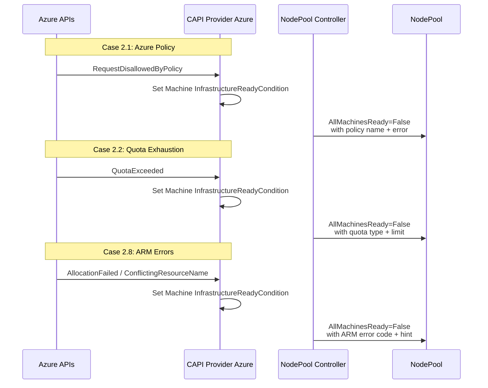
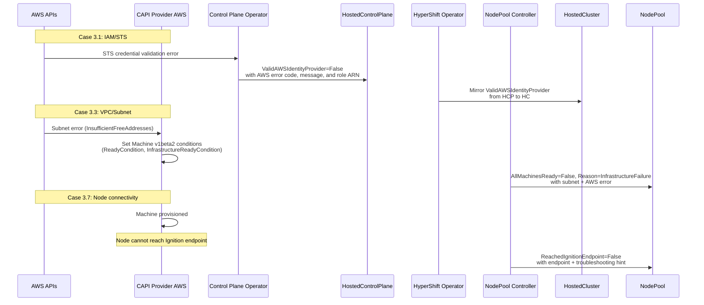

# HCM Installation Failure Debuggability

## Summary

This enhancement adds platform-specific diagnostic
detail to existing HyperShift conditions for managed
HCP clusters (ARO HCP and ROSA HCP). It addresses six
failure cases — three Azure and three AWS — where
opaque conditions currently force SREs to manually
inspect CAPI Machine objects, cloud provider API
responses, and pod logs to identify root causes. The
approach follows the pattern established in the
platform-agnostic diagnostic enhancement
([PR #2134](https://github.com/openshift/enhancements/pull/2134),
CNTRLPLANE-4639): add diagnostic detail to existing
condition messages without introducing new condition
types or API fields. This EP is the platform-specific
Phase 2 follow-up, sharing the OCPSTRAT-1598 strategy.

### Design Principles

This EP follows four design principles, shared across
all platform-specific diagnostic cases:

- **Level-driven condition semantics**: Conditions
  reflect current observed state, not events.
  Controllers re-evaluate on every reconciliation
  and set the condition to match the current state,
  ensuring self-healing and eliminating stale
  conditions. This is why condition flapping is
  unlikely — the condition converges to the current
  error on each reconciliation rather than toggling
  between states.
- **Allowlist-based security model**: Only
  structured, customer-owned identifiers (Azure
  resource group names, VM names, policy names, IAM
  role ARNs, subnet IDs, endpoint URLs) appear in
  condition messages. Free-text pass-through from
  upstream providers (CAPZ, CAPA) is audited before
  Tech Preview. Red Hat-internal subscription IDs,
  tenant IDs, service principal credentials, AWS
  account IDs, and management cluster node names are
  never included.
- **Message truncation**: Diagnostic messages
  respect the truncation limits already enforced in
  the HyperShift codebase (see Message Truncation
  below).
- **Enrichment over proliferation**: Diagnostic
  detail is added to existing condition messages
  rather than introducing new condition types, to
  avoid expanding the condition surface area.

### Prerequisites

This EP is the platform-specific Phase 2 follow-up to
the platform-agnostic Phase 1 enhancement proposed in
[enhancements PR #2134](https://github.com/openshift/enhancements/pull/2134)
(CNTRLPLANE-4639, status: **merged**). Phase 1
introduces installation-stage tracking,
`ManagementClusterResourcePressure` detection, and
generic diagnostic enrichment. This EP builds on
that foundation by adding platform-specific diagnostic
detail for six SRE-confirmed failure cases. Phase 1
is not a hard prerequisite — this EP's cases operate
on different conditions and code paths — but the two
EPs share the same strategy (OCPSTRAT-1598) and are
designed to be complementary.

This EP also depends on
[PR #9781](https://github.com/openshift/hypershift/pull/9781)
(status: **merged**, 2026-11-06), which added
terminal infrastructure failure detection to the
NodePool controller via `isTerminalInfraReason()`
(exact map lookup) and the `InfrastructureFailure`
reason code. Azure Cases 2.1, 2.2, 2.8 and AWS Case
3.3 build on this foundation. AWS Cases 3.1 and 3.7
have no dependency on PR #9781 and can proceed
independently.

## Motivation

Same motivation as the platform-agnostic Phase 1
enhancement
([enhancements PR #2134](https://github.com/openshift/enhancements/pull/2134)):
opaque HyperShift conditions force SREs to manually
inspect CAPI Machine objects, cloud provider API
responses, and pod logs to identify root causes. This
EP extends that motivation to six platform-specific
failure cases (three Azure, three AWS).

### User Stories

- As an **ARO HCP SRE**, I want Azure Policy conflict
  errors (`RequestDisallowedByPolicy`) to appear
  directly in the `AllMachinesReady` condition message
  so that I can identify the blocking policy and guide
  the customer to create an exemption without manually
  inspecting CAPI Machine objects and ARM API responses.

- As a **ROSA HCP SRE**, I want IAM/STS role
  assumption failures to include the target role ARN
  in the `ValidAWSIdentityProvider` condition message
  so that I can identify which role's trust policy
  needs correction without cross-referencing the
  `HostedCluster` spec.

- As an **ARO HCP SRE**, I want Azure quota exhaustion
  errors to show the quota type, current usage, limit,
  and region in the `AllMachinesReady` condition
  message so that I can direct the customer to request
  a quota increase for the correct resource in the
  correct region.

- As a **ROSA HCP SRE**, I want VPC/subnet
  misconfiguration errors to include the AWS error
  code and affected subnet ID in the
  `AllMachinesReady` condition message so that I can
  identify the failing subnet without inspecting CAPI
  Machine objects or AWS CloudTrail logs.

- As a **ROSA HCP SRE**, I want node connectivity
  failure conditions (`ReachedIgnitionEndpoint`,
  `AllNodesHealthy`) to include troubleshooting hints
  (security group ports, NACL rules, DNS, proxy) so
  that I can triage networking issues without
  reproducing the failure on a test cluster.

- As a **fleet operator**, I want a Prometheus metric
  that classifies installation failures by platform,
  condition, and error code so that I can identify
  systemic failure patterns across the fleet (e.g., a
  region-wide quota exhaustion or an IAM policy change
  breaking installs) using existing monitoring
  dashboards.

### Goals

- Surface actionable diagnostic detail (cloud error
  codes, resource identifiers, remediation hints) in
  existing HyperShift condition messages for six
  SRE-confirmed installation failure cases (three
  Azure, three AWS).
- Enable SREs to diagnose the root cause of these six
  failure cases from the `NodePool` or `HostedCluster`
  condition alone, without manual inspection of CAPI
  Machine objects, cloud provider API responses, or
  pod logs.
- Provide fleet-level observability of classified
  installation failures via a Prometheus classification
  counter, enabling fleet operators to detect systemic
  failure patterns.
- Maintain backward compatibility: no new condition
  types, no new API fields, no changes to existing
  `Reason` codes.

### Non-Goals

- Covering all ARO failure cases (Cases 2.3-2.10) or
  all ROSA failure cases (Cases 3.2-3.12). Only the
  six SRE-confirmed cases are in scope; the remaining
  cases are listed in Future Work.
- Adding new condition types or API fields. All
  changes are diagnostic detail on existing
  conditions.
- Implementing provider-side changes in CAPZ or CAPA.
  This EP consumes whatever `InfrastructureReadyCondition`
  content the providers supply and files upstream
  enhancement requests if needed.
- Automated remediation of installation failures.
  This EP surfaces diagnostic detail for human SREs;
  automated remediation (e.g., automatic quota
  increase requests, policy exemption creation) is
  out of scope.
- Addressing failure cases in components outside the
  HyperShift Operator (ARO RP, Maestro, OneCert,
  ASO, MCE, Azure CNI). These require separate
  enhancements owned by the respective component
  teams (see Future Work).

## Proposal

Enhance the HyperShift error handling to parse
platform-specific error codes from cloud provider API
responses, and surface them in existing condition
messages at six points in the installation flow.

### Azure / ARO Cases

#### Case numbering

Azure cases use the 2.x series (Cases 2.1, 2.2, 2.8)
from the full ARO failure case inventory (Cases
2.1–2.10). AWS cases use the 3.x series (Cases 3.1,
3.3, 3.7) from the full ROSA failure case inventory
(Cases 3.1–3.12). The non-contiguous numbering
reflects that only the SRE-confirmed cases are
addressed here; the remaining cases are listed in
Future Work.

#### Case 2.1: Azure Policy Conflicts

**Existing condition**: `AllMachinesReady`
(on `NodePool`) and platform-specific conditions on
`AzurePrivateLinkService`

**Current behavior**: When Azure Policy blocks resource
creation, the ARM API returns HTTP 403 with error code
`RequestDisallowedByPolicy`. The current
`ClassifyAzureError()` in `errors.go:79-101` sees only
the HTTP 403 status and returns the generic message
`"check service principal permissions"` with a
10-minute requeue. The actual policy name and message
are discarded.

**Proposed diagnostic detail**: Parse the
`RequestDisallowedByPolicy` error code from the
`azcore.ResponseError` and include the policy name
in the condition message:

```
AllMachinesReady=False,
Reason=InfrastructureFailure,
Message="2/3 machines not ready. First failure:
  machine-abc — RequestDisallowedByPolicy:
  Resource 'vm-abc' was disallowed by policy
  'deny-public-ip' (policy assignment:
  /subscriptions/.../deny-public-ip)"
```

The diagnostic detail flows through the CAPZ Machine's
`InfrastructureReadyCondition` (CAPI v1beta2) →
`AllMachinesReady` on the NodePool.
`setAllMachinesReadyCondition()` (`conditions.go:
783-885`) reads `ReadyCondition` and, when `False`,
reads `InfrastructureReadyCondition.Reason` and
`.Message`. A step-counter filter
(`isSetupCounterCondMessage`, regex
`\d+ of \d+ completed`) discards CAPI progress
messages; ARM errors pass through unfiltered. No
additional HyperShift code changes are needed — the
enrichment depends on CAPZ populating the condition
with the full ARM error.
[PR #9781](https://github.com/openshift/hypershift/pull/9781)
(merged) added `isTerminalInfraReason()` — an exact
map lookup of the Machine's condition reason against
per-platform terminal values. For Azure:
`VMProvisionFailed` and `Failed`. CAPZ currently
surfaces `Failed` (not `VMProvisionFailed`) because
the CAPI summary picks `DisksReady`'s `Failed` over
`VMRunning`'s `VMProvisionFailed`; a follow-up to
[CAPZ#6737](https://github.com/kubernetes-sigs/cluster-api-provider-azure/pull/6737)
is needed. When matched, the aggregated reason is
overridden with `Reason=InfrastructureFailure`. ARM
error codes appear in the **message**, not the
**reason**.

**Implementation**: Verify that CAPZ populates
`InfrastructureReadyCondition` with `Reason` =
`VMProvisionFailed` or `Failed` and `Message` = full
ARM error (including `ErrorCode` and `Details` array).
If CAPZ provides this data, no HyperShift code changes
are needed — the existing pipeline passes the message
through automatically.

#### Case 2.2: Azure Resource Quota Exhaustion

**Existing condition**: `AllMachinesReady`
(on `NodePool`)

**Current behavior**: When Azure quota is exceeded, ARM
returns HTTP 409 with error code `QuotaExceeded` or
`OperationNotAllowed`. `ClassifyAzureError()` sees
HTTP 409 and returns `"Azure resource conflict,
retrying"` with a 30-second requeue. This is misleading
— quota exhaustion is not a transient conflict.

**Proposed diagnostic detail**: Parse the quota-specific
error code and include the resource type and limit:

```
AllMachinesReady=False,
Reason=InfrastructureFailure,
Message="1/3 machines not ready. First failure:
  machine-abc — QuotaExceeded: Operation could
  not be completed as it results in exceeding
  approved standardDSv3Family Cores quota.
  Limit: 100, Current: 96, Requested: 8.
  Region: eastus"
```

**Implementation**: Same CAPZ → Machine → NodePool
pipeline as Case 2.1. No additional HyperShift code
changes for the `AllMachinesReady` path.

Separately, enhance `ClassifyAzureError()` to
recognize `QuotaExceeded` and `OperationNotAllowed`
error codes in the PLS controller path
(`handleAzureError()`). For quota errors, use a
longer requeue interval (10 minutes instead of 30
seconds) since quota increases require manual action.

#### Case 2.8: Azure ARM Errors

**Existing condition**: `AllMachinesReady`
(on `NodePool`) and `AzurePrivateLinkServiceAvailable`
(on `AzurePrivateLinkService`)

**Current behavior**: ARM errors such as zonal
allocation failures (`AllocationFailed`), soft-deleted
resource name conflicts (`ConflictingResourceName`),
and OIDC RBAC misconfigurations produce generic error
codes in the `handleAzureError()` function
(`controller.go:734-758`). The condition message
includes the HTTP status code but not the ARM error
code or details.

**Proposed diagnostic detail**: Include the ARM error
code and message for known failure patterns:

For zonal allocation failures:
```
AllMachinesReady=False,
Reason=InfrastructureFailure,
Message="1/3 machines not ready. First failure:
  machine-abc — AllocationFailed: Allocation
  failed. We do not have sufficient capacity for
  the requested VM size in this zone. Zone:
  eastus-1"
```

For name conflicts:
```
AzurePrivateLinkServiceAvailable=False,
Reason=PLSCreationFailed,
Message="PLSCreationFailed: ConflictingResourceName:
  A resource with name 'pls-abc' already exists
  (soft-deleted). Purge the deleted resource or
  use a different name"
```

**Implementation**: Enhance `handleAzureError()`
(`controller.go:734-758`) and `ClassifyAzureError()`
(`errors.go:79-101`) to extract `ErrorCode` from
`azcore.ResponseError` and include it in the condition
message. For known error codes (`AllocationFailed`,
`ConflictingResourceName`, `RoleAssignmentExists`),
add contextual remediation hints.

**Specific ARM errors to surface**:
- `AllocationFailed` (zonal capacity)
- `ConflictingResourceName` (soft-deleted resources)
- `RoleAssignmentExists` (OIDC RBAC duplicate)
- `SkuNotAvailable` (VM size not available)
- Generic ARM errors with error code passthrough

### AWS / ROSA Cases

#### Case 3.1: IAM/STS Role Assumption Failures

**Existing condition**: `ValidAWSIdentityProvider`
(on `HostedCluster`)

**Current behavior**: The CPO's health check controller
(`control-plane-operator/controllers/healthcheck/
aws.go`) sets the condition via
`classifyIdentityProviderError()` (lines 92–110),
which already classifies the AWS API error and
includes the error code and message (e.g.,
`"AWS identity provider validation failed:
AccessDenied: <STS error message>"`). However, the
message does not include the target IAM role ARN
from the HCP spec, making it harder for SREs to
correlate the error with the specific role that
needs fixing.

**Proposed diagnostic detail**: When the STS
`AssumeRoleWithWebIdentity` call fails, include the
AWS error code and message in the condition:

```
ValidAWSIdentityProvider=False,
Reason=InvalidIdentityProvider,
Message="STS AssumeRoleWithWebIdentity failed for
  role arn:aws:iam::123456789012:role/cluster-role:
  AccessDenied — User is not authorized to perform
  sts:AssumeRoleWithWebIdentity on resource
  arn:aws:iam::123456789012:oidc-provider/..."
```

**Implementation**: The CPO's health check controller
(`control-plane-operator/controllers/healthcheck/
aws.go:92-110`, `classifyIdentityProviderError()`)
already classifies the AWS API error and includes the
error code and message via `apiErr.ErrorCode()` and
`apiErr.ErrorMessage()`. The change enhances the
condition message to prepend the target role ARN from
the HCP spec (available via `hcp.Spec.Platform.AWS.
RolesRef`), enabling SREs to identify which role's
trust policy needs correction without cross-
referencing the `HostedCluster` spec. Note: the HO's
`GetCredentialStatus()` (`aws.go:363-394`) is
read-only — it reads the condition status set by
the CPO but does not set conditions itself.

**Security note**: The error message includes the IAM
role ARN, which is customer-owned and already visible
in the `HostedCluster` spec. No Red Hat-internal
ARNs or account IDs are exposed.

#### Case 3.3: VPC/Subnet Misconfiguration

**Existing condition**: `AllMachinesReady`
(on `NodePool`)

**Current behavior**: Same CAPI Machine → NodePool
pipeline as Azure Case 2.1. CAPA sets
`InfrastructureReadyCondition` on the Machine;
`isTerminalInfraReason()` (PR #9781, merged) maps
terminal reasons to `Reason=InfrastructureFailure`.
The message includes the CAPI condition content but
does not parse the AWS-specific error code or
identify the affected subnet.

**Proposed diagnostic detail**: Enhance the existing
`InfrastructureFailure` message with AWS-specific
context — parse the AWS error code from the CAPA
failure message and include the subnet ID:

```
AllMachinesReady=False,
Reason=InfrastructureFailure,
Message="2 of 3 machines are not ready.
  Machine machine-abc: InsufficientResources:
  subnet-0abc1234:
  InsufficientFreeAddressesInSubnet: The specified
  subnet does not have enough free addresses"
```

**Implementation**: Same CAPI Machine → NodePool
pipeline as Azure Case 2.1 — the diagnostic detail
(AWS error code, subnet ID) flows through CAPA →
`InfrastructureReadyCondition` → NodePool controller.
No provider-specific reads are added; the NodePool
controller reads only standard CAPI v1beta2 Machine
conditions. If CAPA does not currently include the
subnet ID, a CAPA enhancement will be filed (see
Open Question 2).

**Specific AWS errors to surface**:
- `InsufficientFreeAddressesInSubnet`
- `InvalidSubnetID.NotFound`
- `InvalidParameterValue` (AZ mismatch)
- `InsufficientInstanceCapacity` (detected
  by `isTerminalInfraReason()` in PR #9781 via
  exact map lookup)
- `QuotaExceeded` (detected by PR #9781)
- Generic CAPA provisioning failures with AWS error
  code passthrough

#### Case 3.7: Node Connectivity Failures

**Existing conditions**:
- `ReachedIgnitionEndpoint` (on `NodePool`)
- `AWSSecurityGroupAvailable` (on `NodePool`)
- `AllMachinesReady` / `AllNodesHealthy`
  (on `NodePool`)

**Current behavior**:
- `ReachedIgnitionEndpoint` is `False` with
  reason `ignitionNotReached` when nodes cannot
  retrieve Ignition configuration. No detail on why.
- `AWSSecurityGroupAvailable` blocks node
  creation if the default SG is not ready. No detail
  on which SG or why.
- Nodes stuck in restart loops appear as unhealthy
  Machines with generic `NodeStartupTimeout` reason.

**Proposed diagnostic detail**:

For `ReachedIgnitionEndpoint` (note: these are static
troubleshooting hints derived from platform
knowledge, not observed infrastructure failures — the
controller does not probe network paths. The actual
Ignition endpoint URL is determined by
`HostedCluster.Status.IgnitionEndpoint` and varies by
publishing strategy: Route publishing uses port 443,
NodePort publishing uses port 22623):
```
ReachedIgnitionEndpoint=False,
Reason=ignitionNotReached,
Message="0/3 nodes have reached the Ignition
  endpoint. Nodes may be unable to reach the
  Ignition server (check
  HostedCluster.status.ignitionEndpoint for the
  actual address). Possible causes include security
  group ingress misconfiguration, NACL rules
  blocking traffic to worker subnets, DNS resolution
  failures, or proxy configuration issues."
```

For `AllNodesHealthy` when nodes are stuck (note:
`setAllNodesHealthyCondition()` reads the `NodeHealthy`
condition from each Machine, which reflects node
readiness and pressure conditions. The reason shown
below is the aggregated reason from the Machine's
`NodeHealthy` condition, not the CAPI
`HealthCheckSucceeded` condition. Timestamps use a
stable "unhealthy since" format to avoid condition
writes on every reconciliation):
```
AllNodesHealthy=False,
Reason=NodeNotHealthy,
Message="2 nodes not healthy: machine-abc
  (NodeHealthy=False since 2026-11-11T10:00:00Z),
  machine-def (NodeHealthy=False since
  2026-11-11T10:03:00Z). Nodes may be unable to
  reach the API server. Possible causes include
  security group egress rules blocking port 6443,
  network ACLs, or route table misconfiguration."
```

**Implementation**: The NodePool controller's
`createReachedIgnitionEndpointCondition()`
(`conditions.go:1048-1091`) and
`setAllNodesHealthyCondition()` (`conditions.go:
729-781`) already evaluate the relevant signals.
The change adds contextual messages with the
expected endpoints and troubleshooting hints when
failures are detected.

### Workflow Description

The diagnostic detail flows through existing
HyperShift condition pipelines — no new data paths.

#### Azure workflow



#### AWS workflow



### API Extensions

No new API types, conditions, or fields are
introduced. All changes are diagnostic detail
(message text and reason codes) on existing
conditions:

**Azure conditions**:
- `AllMachinesReady` (existing on `NodePool`)
- `AzurePrivateLinkServiceAvailable` (existing on
  `AzurePrivateLinkService`)
- `AzurePLSCreated` (existing on
  `AzurePrivateLinkService`)

**AWS conditions**:
- `ValidAWSIdentityProvider` (existing on
  `HostedCluster`)
- `AllMachinesReady` (existing on `NodePool`)
- `AllNodesHealthy` (existing on `NodePool`)
- `ReachedIgnitionEndpoint` (existing on `NodePool`)
- `AWSSecurityGroupAvailable` (existing on
  `NodePool`)

#### Condition message stability

Condition `Message` text and `Reason` codes are a de
facto API surface. Automation **must** switch on
`Reason` codes (stable within a release series), not
regex-parse `Message` text (may change without notice).

The `Reason` values used by each case are:

| Case | Condition | Reason (stable) | New? |
|------|-----------|-----------------|------|
| 2.1 | `AllMachinesReady` | `InfrastructureFailure` | Yes (merged, PR #9781) |
| 2.2 | `AllMachinesReady` | `InfrastructureFailure` | Yes (merged, PR #9781) |
| 2.8 | `AllMachinesReady` | `InfrastructureFailure` | Yes (merged, PR #9781) |
| 2.8 | `AzurePLSCreated` | `PLSCreationFailed` | No (existing) |
| 2.8 | `AzurePrivateLinkServiceAvailable` | `PLSCreationFailed` | No (existing) |
| 3.1 | `ValidAWSIdentityProvider` | `InvalidIdentityProvider` | No (existing) |
| 3.3 | `AllMachinesReady` | `InfrastructureFailure` | Yes (merged, PR #9781) |
| 3.7 | `ReachedIgnitionEndpoint` | `ignitionNotReached` | No (existing)\* |
| 3.7 | `AllNodesHealthy` | Per-machine reasons aggregated | No (existing) |

\* `ignitionNotReached` uses camelCase (existing
value; changing it would be a breaking change).

`Message` content is enriched on a best-effort basis
and is **not guaranteed stable** between releases.

### Topology Considerations

#### Hypershift / Hosted Control Planes

This enhancement is exclusively for the HyperShift
topology on Azure (ARO HCP) and AWS (ROSA HCP).

#### Standalone Clusters

Not applicable — ARO HCP and ROSA HCP use HyperShift
only.

#### Single-node Deployments or MicroShift

Not applicable.

#### Disconnected / Restricted Network

ROSA HCP and ARO HCP clusters can operate in
PrivateLink or restricted-networking configurations.
The diagnostic messages in this EP remain accurate in
those scenarios because they report observed failures
(cloud API errors, CAPI condition content), not
assumed causes. The troubleshooting hints in Case 3.7
use "possible causes include..." language that lists
common root causes without asserting which one
applies. In restricted-network deployments,
additional causes such as VPC endpoint
misconfiguration (AWS), Private Endpoint
misconfiguration (Azure), proxy settings, or missing
PrivateLink connections may be relevant.

#### OpenShift Kubernetes Engine

Not applicable — OKE does not use ARO HCP or ROSA
HCP.

### Implementation Details/Notes/Constraints

#### Data flow architecture

Three distinct data paths carry platform-specific
errors to user-visible conditions:

**Path 1: CAPI provider → Machine → NodePool**
(Cases 2.1, 2.2, 2.8 AllMachinesReady, 3.3)

The NodePool controller reads CAPI v1beta2 Machine
conditions — not cloud API responses directly. A
step-counter filter (`isSetupCounterCondMessage`)
discards CAPI progress messages; cloud provider
errors pass through unfiltered.
`isTerminalInfraReason()` (PR #9781, merged) maps
terminal reasons to `Reason=InfrastructureFailure`.
No HyperShift code changes needed — depends entirely
on CAPZ/CAPA `InfrastructureReadyCondition` content.
See Case 2.1 for the full pipeline description.

**Path 2: handleAzureError() → ClassifyAzureError()
→ PLS conditions** (Case 2.8 PLS)

`ClassifyAzureError()` in `support/azureutil/
errors.go` has two callers: the HO PLS controller
(`controller.go:738`) and the CPO PLS controller
(`azureprivatelinkservice/controller.go:1030`).
Both format messages as
`fmt.Sprintf("%s: %v", classifiedMessage, err)`.
Changes to `ClassifyAzureError()` affect both.

**ARO HCP vs self-managed PrivateLink**: ARO HCP
uses Swift networking and both the HO and CPO skip
PLS controller setup for ARO. Path 2
(`ClassifyAzureError()` / `handleAzureError()`
changes) therefore applies only to self-managed
Azure PrivateLink clusters, not to ARO HCP. For ARO
HCP, Azure Cases 2.1, 2.2, and 2.8 depend entirely
on Path 1 (CAPZ `InfrastructureReadyCondition`
passthrough via the `AllMachinesReady` pipeline).
The `ClassifyAzureError()` retry interval changes
(e.g., 30-second to 10-minute requeue for quota
errors) similarly apply only to PLS reconciliation,
not to CAPZ VM provisioning.

**Path 3: CPO health check → HCP → HC**
(Case 3.1)

The CPO health check controller sets the condition
on `HostedControlPlane`; the HO mirrors it to
`HostedCluster` via direct struct copy.

#### Before/after condition messages

The following examples show the current (before) and
proposed (after) condition messages for each path.

**Path 1 — AllMachinesReady (Cases 2.1, 2.2, 2.8, 3.3)**:

Before (current — generic CAPI message):
```
AllMachinesReady=False,
Reason=WaitingForMachines,
Message="2 of 3 machines are not ready"
```

After (with CAPZ/CAPA InfrastructureReadyCondition
passthrough and PR #9781 terminal reason detection):
```
AllMachinesReady=False,
Reason=InfrastructureFailure,
Message="2/3 machines not ready. First failure:
  machine-abc — RequestDisallowedByPolicy:
  Resource 'vm-abc' was disallowed by policy
  'deny-public-ip'"
```

**Path 2 — PLS conditions (Case 2.8)**:

Before (current — HTTP status code only, both callers
use `fmt.Sprintf("%s: %v", classifiedMessage, err)`):
```
AzurePrivateLinkServiceAvailable=False,
Reason=PLSCreationFailed,
Message="check service principal permissions:
  PUT https://management.azure.com/...
  RESPONSE 403 (403 Forbidden)"
```

After (with ErrorCode-based classification):
```
AzurePrivateLinkServiceAvailable=False,
Reason=PLSCreationFailed,
Message="RequestDisallowedByPolicy: Resource
  'pls-abc' was disallowed by policy
  'deny-public-endpoint': PUT https://...
  RESPONSE 403 (403 Forbidden)"
```

Note: both callers append the raw SDK error via
`fmt.Sprintf("%s: %v", classifiedMessage, err)`.
The raw error suffix contains the HTTP request URL
and status code. The classified message replaces the
generic prefix (e.g., `"check service principal
permissions"`) with an error-code-specific prefix
(e.g., `"RequestDisallowedByPolicy: ..."`). The raw
error suffix is retained for backward compatibility
and additional diagnostic context.

**Path 3 — ValidAWSIdentityProvider (Case 3.1)**:

Before (current — error code and message but no role
ARN):
```
ValidAWSIdentityProvider=False,
Reason=InvalidIdentityProvider,
Message="AWS identity provider validation failed:
  AccessDenied: User is not authorized to perform
  sts:AssumeRoleWithWebIdentity"
```

After (with role ARN prepended):
```
ValidAWSIdentityProvider=False,
Reason=InvalidIdentityProvider,
Message="STS AssumeRoleWithWebIdentity failed for
  role arn:aws:iam::123456789012:role/cluster-role:
  AccessDenied — User is not authorized to perform
  sts:AssumeRoleWithWebIdentity on resource
  arn:aws:iam::123456789012:oidc-provider/..."
```

#### Azure implementation

Changes are in the `openshift/hypershift` repository.
Only Path 2 (PLS controller) requires code changes.
Path 1 (Machine → NodePool) works automatically if
CAPZ provides adequate `InfrastructureReadyCondition`
content.

1. **`support/azureutil/errors.go`**: Enhance
   `ClassifyAzureError()` (lines 79-101) to add
   `ErrorCode`-based branching. The classification
   order is:
   1. **HTTP 429 first**: Check `StatusCode == 429`
      before any `ErrorCode` inspection. Azure uses
      `OperationNotAllowed` for both quota exhaustion
      and throttling; a 429 response with
      `ErrorCode: OperationNotAllowed` must honor the
      `Retry-After` header, not enter the quota branch.
      This preserves the existing 429 handling
      (`ParseRetryAfterDuration()`).
   2. **`ErrorCode` branching**: For non-429 responses,
      check `ErrorCode` (more specific than HTTP
      status) with named constants:
      - `RequestDisallowedByPolicy` (→ 10-min requeue,
        extract policy name)
      - `QuotaExceeded` (→ 10-min requeue, include
        quota details)
      - `OperationNotAllowed` — requires secondary
        classification: Azure uses this error code
        for both quota exhaustion and SKU-unsupported
        operations. Classify as quota only when the
        error message contains quota-specific evidence
        (e.g., `"quota"`, `"limit"`, `"exceeded"`);
        otherwise classify as a generic ARM error with
        the default requeue. Only reached for non-429
        status codes (429 is handled above).
      - `AllocationFailed` (→ 5-min requeue, include
        zone)
      - `ConflictingResourceName` (→ 10-min requeue,
        include purge hint)
      - `RoleAssignmentExists` (→ 30-sec requeue,
        transient)
      - `SkuNotAvailable` (→ 10-min requeue, include
        VM size)
   3. **`StatusCode` fallback**: Unrecognized error
      codes fall through to the existing HTTP status
      code switch (backward compatible).

2. **`support/azureutil/errors.go`**: Add a new
   function `ExtractPolicyDetails()` to parse the
   ARM error response `Details` array and extract the
   policy name and assignment ID from
   `RequestDisallowedByPolicy` errors.

3. **`hypershift-operator/controllers/platform/azure/
   controller.go`**: Enhance `handleAzureError()`
   (lines 734-758) to use the enriched error
   classification and include the Azure error code
   in condition messages set on
   `AzurePrivateLinkService`.

4. **`hypershift-operator/controllers/nodepool/
   conditions.go`**: Minor change needed.
   `setAllMachinesReadyCondition()` (`conditions.go:
   783-885`) already reads CAPI v1beta2
   `InfrastructureReadyCondition` from
   `Machine.Status.Conditions` when `ReadyCondition`
   is `False`. The CAPZ `InfrastructureReadyCondition`
   content propagates automatically through the
   existing Machine → NodePool condition pipeline.
   Two additions:
   - Treat an empty
     `InfrastructureReadyCondition.Message` the same
     as a step-counter message (fall back to
     `ReadyCondition.Message`). The existing
     `isSetupCounterCondMessage` regex does not match
     the empty string, so empty messages currently
     pass through as-is, producing a blank diagnostic
     line.
   - Increment `hypershift_diagnostic_fallback_total`
     when Path 1 falls back without enriched detail
     on a terminal failure path (i.e.,
     `isTerminalInfraReason()` matched but the
     infrastructure message was empty or a
     step-counter string).

#### AWS implementation

Changes are in the `openshift/hypershift` repository:

1. **`control-plane-operator/controllers/healthcheck/
   aws.go`**: Enhance `classifyIdentityProviderError()`
   to prepend the target role ARN from the HCP spec
   in the `ValidAWSIdentityProvider` condition message.
   The function already surfaces the AWS error code
   and message; this change adds role ARN context.

2. **`hypershift-operator/controllers/nodepool/
   conditions.go`**: The generic infrastructure
   failure detection via CAPI v1beta2 Machine
   conditions (`ReadyCondition`,
   `InfrastructureReadyCondition`) and the
   `InfrastructureFailure` reason code was
   implemented by
   [PR #9781](https://github.com/openshift/hypershift/pull/9781)
   (merged, 2026-11-06).
   The AWS-specific diagnostic detail (error code,
   subnet ID) flows through the CAPI v1beta2
   `InfrastructureReadyCondition` (set by CAPA) into
   the existing
   `aggregateMachineReasonsAndMessages()` pipeline.
   No provider-specific resource reads are added to
   the NodePool controller (see Open Question 2).

3. **`hypershift-operator/controllers/nodepool/
   conditions.go`**: Enhance
   `createReachedIgnitionEndpointCondition()` (lines
   1048-1091) to include the expected Ignition endpoint
   URL and troubleshooting guidance.

4. **`hypershift-operator/controllers/nodepool/
   conditions.go`**: Enhance
   `setAllNodesHealthyCondition()` (lines 729-781) to
   include per-node duration and API server
   reachability hints.

#### Requeue rate limiter

[PR #9781](https://github.com/openshift/hypershift/pull/9781)
(merged) changed the NodePool controller's exponential
backoff max delay from 10 seconds to 1 minute. This
rate limiter governs automatic error-path retries
(when `Reconcile()` returns an error) and is separate
from the explicit `RequeueAfter` values set by
`ClassifyAzureError()` for specific error codes.

#### Message truncation

Diagnostic messages are subject to the truncation
limits already enforced in the HyperShift codebase.
The following documents the **existing** guarantees;
this EP does not change them:

- **Per-reason-bucket message block**: 1000 characters
  (`maxMessageLength` in the NodePool controller,
  `nodepool_controller.go`). This limit applies per
  reason bucket, not per individual machine — a
  reason bucket may contain several machines that
  share the same condition reason. Oversized messages
  are sliced by bytes (not at word boundaries).
- **Aggregated condition message**: 3000 characters
  (`maxGlobalMessageLength` in the NodePool
  controller). The combined message across all reason
  buckets is truncated after aggregation.
- **HCCO condition messages**: 1024 characters
  (`maxConditionMessageLength` in the HCCO resources
  controller, `resources.go`). Applies to
  HostedCluster-level conditions mirrored by the
  HCCO, such as `ConfigOperatorReconciliationSucceeded`.
  Note: `ValidAWSIdentityProvider` is set by the CPO
  and mirrored by the HO directly — it is not subject
  to the HCCO truncation limit.
- **Condition `Reason` field**: 1024 characters
  (per `+kubebuilder:validation:MaxLength`).

**Improvement planned by this EP**: When multiple
machines share the same failure reason and the
per-reason-bucket limit is exceeded, this EP adds an
omitted-machine count (e.g., `... (3 more machines
with same error)`) so that the total failure scope
is visible even when individual machine details are
truncated. The first failing machine's diagnostic
detail is always preserved. Tests should verify that
the actionable detail (error code, resource
identifiers) survives truncation, not just that the
length constraint is met.

Policy assignment paths (which can be long) are
truncated to the last two path segments.

#### Security considerations

This EP follows the allowlist-based security model
described in the Design Principles section:

- Azure subscription IDs in policy assignment paths
  are customer-owned and visible in `HostedCluster`
  spec.
- Resource group names and VM names are customer-owned
  Azure resources.
- IAM role ARNs included in messages are customer-
  owned (visible in `HostedCluster` spec).
- Subnet IDs are customer-owned AWS resources.
- No Red Hat-internal Azure subscription IDs, tenant
  IDs, service principal credentials, AWS account IDs,
  VPC IDs, or security group rules are exposed.
- Management cluster node names are never included.
- CAPI Machine `InfrastructureReadyCondition` message
  content is passed through — verify that CAPZ and
  CAPA do not include sensitive data (e.g., client
  secrets) in the condition message.

#### Diagnostic logic failure modes

The diagnostic enrichment logic falls back to
existing (pre-enrichment) behavior when inputs are
missing or malformed — the condition is still set,
just without enriched detail:

**Shared (Path 1 — Azure and AWS)**:

- **Empty or step-counter condition message**: If
  `InfrastructureReadyCondition.Message` is empty or
  matches `\d+ of \d+ completed`, the controller
  treats it as non-diagnostic and falls back to
  `ReadyCondition.Message`, then to `Reason` alone.
  An empty message is treated identically to a
  step-counter message because CAPI providers may
  not populate the message during early Machine
  creation or when the infrastructure failure lacks
  detail. Cloud error messages (non-empty, non-
  step-counter) pass through unfiltered.
- **Machines garbage-collected**: The Machine list is
  fetched once per reconciliation; deleted machines
  are simply omitted. Self-corrects next cycle.

**Azure-specific (Path 2)**:

- **Empty `ErrorCode`**: Falls through to HTTP status
  code handling. HTTP 429 always handled first.
- **Missing `Details` array**:
  `ExtractPolicyDetails()` returns empty (no panic).
- **Multiple simultaneous errors**: Each
  `handleAzureError()` call overwrites the condition
  (existing level-driven behavior).

**AWS-specific**:

- **Nil `RolesRef`** (Case 3.1): Role ARN omitted;
  STS error still surfaced.
- **Ignition URL unavailable** (Case 3.7): Falls back
  to existing `ignitionNotReached` message.

On terminal failure paths, the
`hypershift_diagnostic_fallback_total` counter is
incremented when enriched detail is omitted. Normal
provisioning states (step-counter progress, initial
empty conditions) do not increment the counter.

#### Feature gate

No feature gate is required. The rationale follows
the platform-agnostic diagnostic enhancement
([PR #2134](https://github.com/openshift/enhancements/pull/2134)):


#### Observability

This EP introduces two Prometheus metrics and a
structured log line to support fleet-level
observability.

##### Metric 1: Classification counter

A classification counter enables fleet operators to
identify systemic failure patterns (e.g., a
region-wide quota exhaustion or an IAM policy change
breaking installs across the fleet) using existing
monitoring dashboards.

- **Metric name**:
  `hypershift_install_platform_failure_total`
- **Type**: Counter
- **Labels**:
  - `platform`: The cloud platform (`azure`, `aws`).
  - `condition`: The condition type where the failure
    was classified (e.g., `AllMachinesReady`,
    `AzurePrivateLinkServiceAvailable`,
    `ValidAWSIdentityProvider`,
    `ReachedIgnitionEndpoint`, `AllNodesHealthy`).
  - `reason`: The condition `Reason` code (e.g.,
    `InfrastructureFailure`, `PLSCreationFailed`,
    `InvalidIdentityProvider`, `ignitionNotReached`).
    Stable within a release series.
  - `error_code`: The cloud provider error code when
    classified (e.g., `RequestDisallowedByPolicy`,
    `QuotaExceeded`, `AccessDenied`,
    `InsufficientFreeAddressesInSubnet`). Set to
    `unknown` when the error code cannot be extracted
    — for example, when an Azure Machine has reason
    `Failed` and an empty
    `InfrastructureReadyCondition.Message` (the
    controller cannot distinguish Case 2.1 from
    Case 2.2 without the ARM error code). Cardinality
    is bounded to the enumerated error codes in this
    EP plus `unknown`.
- **Help string**: "Number of platform-specific
  installation failures classified by condition,
  reason, and error code."
- **Semantics**: The counter increments each time a
  terminal failure condition is set with a classified
  platform error. It does **not** increment for
  normal provisioning states (step-counter progress
  messages, empty infrastructure conditions during
  initial Machine creation). This scoping ensures the
  counter reflects actual failures, not provisioning
  noise.
- **Registration**: The counter is registered in the
  HyperShift Operator's metric registry (for the
  PLS controller path, NodePool controller path) and
  in the CPO's metric registry (for AWS Case 3.1).
  Both registries are already scraped by the
  existing HyperShift telemetry pipeline.

##### Metric 2: Enrichment fallback counter

A fallback counter detects silent degradation of
diagnostic enrichment (e.g., cloud SDK error format
changes, CAPI provider condition message format
changes).

- **Metric name**:
  `hypershift_diagnostic_fallback_total`
- **Type**: Counter
- **Labels**:
  - `platform`: The cloud platform (`azure`, `aws`).
  - `condition`: The condition type where enrichment
    was attempted.
  - `reason`: The condition `Reason` code. Self-
    describing and survives case numbering changes
    between EP revisions.
- **Help string**: "Number of times platform-specific
  diagnostic enrichment fell back to generic message
  due to missing or unparseable input."
- **Semantics**: The counter increments **only on
  terminal failure paths** — when
  `isTerminalInfraReason()` has matched (Path 1),
  when `handleAzureError()` is invoked (Path 2), or
  when `classifyIdentityProviderError()` is invoked
  (Path 3) — and the enrichment code cannot extract
  the expected diagnostic detail (e.g., empty
  `ErrorCode`, malformed ARM `Details` array, nil
  `RolesRef`). The counter does **not** increment
  for normal provisioning states such as step-counter
  progress messages or empty
  `InfrastructureReadyCondition` messages during
  initial Machine creation. This scoping prevents
  false alerts during every cluster creation.
- **Registration**: Same as the classification
  counter.

##### Alerting guidance

- **Enrichment fallback alert**: Configure on
  `rate(hypershift_diagnostic_fallback_total[1h]) > 0`
  sustained for **1 hour**, filtered by `platform`
  label. The 1-hour sustained window (up from the
  originally proposed 30 minutes) avoids false
  positives from transient fallbacks during normal
  provisioning. When this alert fires, an operator
  should investigate whether a cloud SDK or CAPI
  provider condition format change has broken the
  enrichment parsing. Check the `condition` and
  `reason` labels to identify which enrichment path
  is degrading.
- **Alert ownership and routing**: This alert is
  owned by the HyperShift team and should be added
  to the HyperShift alerting rules before GA
  (tracked as a graduation criterion). For ROSA HCP
  deployments, where warning alerts on HCP PD
  services are currently suppressed, the alert rule
  should be contributed to
  [rosa-rhobs-rules](https://github.com/openshift-online/rosa-rhobs-rules)
  with appropriate routing. The classification counter
  (`hypershift_install_platform_failure_total`) is
  available for ROSA-side dashboards independently
  of the fallback alert.

##### Structured logging

When a terminal failure condition is set with a
classified platform error, emit a structured log
line with a stable format for Loki/LogQL aggregation:

```
level=info msg="platform failure classified"
  cluster=<namespace/name>
  condition=AllMachinesReady
  reason=InfrastructureFailure
  error_code=RequestDisallowedByPolicy
  platform=azure
```

This provides a low-cost mechanism for fleet
operators to aggregate installation failure causes
across the fleet using LogQL queries, satisfying
the fleet operator user story without requiring
condition-message parsing.

##### OpenTelemetry tracing integration

The HyperShift Operator is already instrumented with
OTel tracing
([hypershift#9390](https://github.com/openshift/hypershift/pull/9390)):
HostedCluster and NodePool reconcile spans, per-phase
child spans, links back to the CS provisioning trace,
exported to RHOBS Tempo. Since this EP's enrichment
lands in the same controllers, the classified error
code should be attached as a **span event** when the
failure condition is set. Failed installs would then
show the failing phase and the cloud error code in a
single trace. The CPO can import the same
`support/tracing` package to cover Case 3.1.

OTel integration is a delivery goal for this EP but
is not a prerequisite for Tech Preview — it can be
implemented as a follow-up once the classification
logic is in place. The structured log line provides
equivalent queryability in the interim.

### Risks and Mitigations

#### Risk 1: Fleet automation breakage from message changes

SRE fleet automation or alert rules may regex-parse
condition messages. Changing message text could cause
silent match failures.

**Mitigation**: The `Reason` codes are not changed by
this EP (Azure cases use `InfrastructureFailure` and
`PLSCreationFailed`; AWS cases use existing reason
codes plus `InfrastructureFailure` from PR #9781).
Only the `Message` field content changes. Fleet
automation that switches on `Reason` is unaffected.
SRE teams confirm no fleet automation regex-parses
the affected condition messages before GA (tracked as
a graduation criterion). The enriched messages are a
superset of the current messages.

#### Risk 2: CAPI provider InfrastructureReadyCondition contains sensitive data

CAPI Machine `InfrastructureReadyCondition` message
is passed through to customer-visible `NodePool`
conditions. If CAPZ or CAPA includes Red Hat-internal
identifiers (subscription IDs, tenant IDs, service
principal credentials, internal VPC IDs, account
details) in the condition message, this data would be
exposed.

**Mitigation**: Audit CAPZ and CAPA
`InfrastructureReadyCondition` message content for
in-scope error codes before Tech Preview. CAPI
providers generally pass through the cloud provider
error response, which contains customer-owned resource
names and error codes — not Red Hat credentials. If
the audit identifies sensitive data, a sanitization
filter is applied in the NodePool controller's
aggregation path using an allowlist approach: only
known-safe identifier patterns are retained;
unrecognized identifiers are replaced with
`<redacted>`. This audit is tracked as a Tech Preview
graduation criterion.

#### Risk 3: Azure SDK error format changes

The `azcore.ResponseError` struct format could change
in a future Azure SDK version, breaking `ErrorCode`
parsing or `ExtractPolicyDetails()`.

**Mitigation**: `azcore.ResponseError` is a stable
public type in the Azure SDK for Go. The `ErrorCode`
and `StatusCode` fields are part of the public API.
Unit tests cover each error code pattern and will
catch format changes during SDK version bumps.

#### Risk 4: AWS error message format changes

AWS error messages could change format across AWS
SDK versions, causing the AWS-specific parsing to
miss error codes silently.

**Mitigation**: The AWS-specific parsing uses a
two-layer approach:

1. **Structured field matching (preferred)**: PR
   #9781's `isTerminalInfraReason()` (merged)
   uses exact map lookup on the CAPI v1beta2
   `InfrastructureReadyCondition.Reason` field, which
   is a structured, enumerated value set by CAPA.

2. **Substring matching (supplementary)**: For
   extracting additional diagnostic detail from the
   `InfrastructureReadyCondition.Message` field,
   the EP uses substring matching against known AWS
   error code strings. These error codes are AWS API
   constants that do not change across SDK versions.

If substring matching fails, the `Reason`-based
classification from layer 1 still applies. The
behavior degrades gracefully to the PR #9781
baseline, not to silence. The
`hypershift_diagnostic_fallback_total` counter
detects silent degradation.

### Drawbacks

1. **Incomplete coverage**: Only three of ten ARO
   failure cases and three of twelve ROSA failure
   cases are addressed. SREs still need manual
   investigation for the deferred cases.

2. **Maintenance burden**: Each new cloud error code
   requires a code change to the relevant
   classification function. New error codes from
   cloud provider API updates will initially fall
   through to the generic handling until explicitly
   added.

3. **Provider-specific messages on generic conditions**:
   Cloud-specific error codes (e.g.,
   `RequestDisallowedByPolicy`,
   `InsufficientFreeAddressesInSubnet`) appear in
   messages on generic conditions (`AllMachinesReady`)
   that are shared across all platforms. This is
   acceptable because the condition already carries
   provider-specific content via the CAPI provider's
   `InfrastructureReadyCondition` reason and message
   (aggregated by PR #9781, merged).

## Alternatives (Not Implemented)

## Open Questions

### OQ-1: CAPZ InfrastructureReadyCondition content (tracked)

Azure Cases 2.1, 2.2, and the AllMachinesReady path
in Case 2.8 depend on CAPZ setting
`InfrastructureReadyCondition` (a CAPI v1beta2
condition in `Machine.Status.Conditions`) with:
- `Reason` = a terminal value (`VMProvisionFailed`
  or `Failed` — see Case 2.1 for the current CAPZ
  behavior) so that `isTerminalInfraReason()`
  (PR #9781, merged) triggers
  `Reason=InfrastructureFailure` on the NodePool
- `Message` = the Azure ARM error response details
  (including `ErrorCode` and `Details` array)

**Scoping commitment**: This question must be
resolved before `implementable`. The outcome
determines the scope of Path 1:
- **If CAPZ provides full ARM error detail**: Path 1
  requires no HyperShift code changes — the existing
  `setAllMachinesReadyCondition()` pipeline passes
  the `InfrastructureReadyCondition` message through
  automatically. Cases 2.1, 2.2, and the
  `AllMachinesReady` part of Case 2.8 are delivered
  with no implementation effort.
- **If CAPZ provides only a summary message**: A CAPZ
  PR is required as a prerequisite. This EP will
  track the CAPZ PR as a dependency. If the CAPZ PR
  cannot be delivered in the same release, Path 1
  cases are deferred to the next release and the EP
  scope reduces to Path 2 only
  (`ClassifyAzureError()` / `handleAzureError()`
  changes for PLS conditions).

**Validation**: Inspect CAPZ error handling for
Machine creation failures before moving to
`implementable`. Confirm that
`RequestDisallowedByPolicy`, `QuotaExceeded`, and
`AllocationFailed` ARM errors produce
`InfrastructureReadyCondition` messages that include
the error code and sufficient detail for SRE
diagnosis.

### OQ-2: CAPA InfrastructureReadyCondition content (tracked)

Does CAPA include the full AWS error response —
including the error code (e.g.,
`InsufficientFreeAddressesInSubnet`) and the
affected subnet ID — in the CAPI v1beta2
`InfrastructureReadyCondition` message it sets on
the Machine object? This must be verified against
the CAPA codebase before Case 3.3 implementation
begins. **Tracking**: A CAPA issue will be filed
before this EP moves to `implementable` to
confirm (or request) the required condition
content.

**Scoping commitment**: The CNTRLPLANE-4640
acceptance criteria require both the AWS error code
and the affected subnet ID in the `AllMachinesReady`
condition message for Case 3.3. Both are required
for the case to be considered complete. The
implementation has two phases:

1. **Phase A (no CAPA changes)**: The
   `InfrastructureFailure` reason code (from PR
   #9781) plus passthrough of whatever message
   content CAPA already includes in
   `InfrastructureReadyCondition`. If CAPA already
   includes the AWS error code and subnet ID, Case
   3.3 is complete with no further work.
2. **Phase B (CAPA enhancement)**: If CAPA does not
   currently include the subnet ID, a CAPA
   enhancement PR is a **dependency** for completing
   Case 3.3, not a stretch goal. The CAPA issue
   must be filed before this EP moves to
   `implementable`. If the CAPA PR cannot be
   delivered in the same release, Case 3.3 is
   deferred (not shipped with reduced scope), and
   the EP scope for AWS reduces to Cases 3.1 and
   3.7 only.

This question does not block Cases 3.1 or 3.7.

### OQ-3: CAPI condition message audit (tracked)

Has the CAPA team confirmed that CAPI v1beta2
Machine condition messages do not include Red
Hat-internal resource identifiers? This must be
verified before Tech Preview. Tracking: graduation
criterion.

## Resolved Questions

### OQ-4: Reason values for AllMachinesReady (resolved)

[PR #9781](https://github.com/openshift/hypershift/pull/9781)
merged on 2026-11-06. `isTerminalInfraReason()` maps
per-platform terminal reasons to
`Reason=InfrastructureFailure`
(`NodePoolInfrastructureFailureReason`). For Azure,
the terminal reasons are `VMProvisionFailed` and
`Failed` (CAPZ currently surfaces `Failed` on
`InfrastructureReady` — see Case 2.1). The cloud
error codes appear in the condition **message**, not
the **reason**. CAPZ/CAPA must set
`InfrastructureReadyCondition.Reason` to the
appropriate terminal value for the mapping to trigger.

`PLSCreationFailed` is an existing reason used by
`handleAzureError()` callers and requires no changes.
No new Reason values are introduced by this EP.

## Test Plan

All tests use `[Jira:"HyperShift"]` labels per
`dev-guide/test-conventions.md`. No
`[OCPFeatureGate:...]` label is needed since no
feature gate is used.

### Azure test scenarios

1. **Unit tests** for `ClassifyAzureError()`: One test
   per error code (`RequestDisallowedByPolicy`,
   `QuotaExceeded`, `AllocationFailed`,
   `ConflictingResourceName`, `RoleAssignmentExists`,
   `SkuNotAvailable`) verifying message content and
   requeue interval. Key scenarios: 429 with
   `OperationNotAllowed` must honor `Retry-After`
   (not enter quota branch); unknown error codes fall
   back to HTTP-status-based behavior.

2. **Unit tests** for `ExtractPolicyDetails()`: Tests
   cover valid `Details` array, missing array,
   malformed body, and multiple entries.

3. **Integration tests** (fake Machine objects, no
   Azure API): Verify end-to-end condition propagation
   for policy failures, quota failures, multiple
   machine failures (within 3000-char limit), and PLS
   condition errors.

4. **Empty-message fallback tests**: Construct an
   Azure Machine with reason `Failed` and an empty
   `InfrastructureReadyCondition.Message`. Verify
   that the controller falls back to
   `ReadyCondition.Message` (not a blank diagnostic
   line), that `hypershift_diagnostic_fallback_total`
   increments, and that
   `hypershift_install_platform_failure_total`
   records `error_code=unknown`. Repeat with a
   non-empty `InfrastructureReadyCondition.Message`
   to confirm normal behavior is preserved.

### AWS test scenarios

1. **Unit tests** for each diagnostic code path:
   - **Case 3.1**: Inject smithy API errors into
     `classifyIdentityProviderError()` → assert
     message includes role ARN and AWS error code.
     Cover all three classification paths
     (`stsAuthErrorCodes`, other API errors, non-API).
   - **Case 3.3**: Construct Machine objects with
     `InfrastructureReadyCondition` containing AWS
     errors → assert `AllMachinesReady` includes the
     error code and subnet ID. Test each listed error
     code and fallback behavior.
   - **Case 3.7**: Assert `ReachedIgnitionEndpoint`
     includes Ignition URL and troubleshooting hint;
     assert `AllNodesHealthy` includes per-node
     duration and API server hint.
   - **Truncation**: Verify 1000-char per-machine
     and 3000-char aggregate limits.
   - **Negative scenarios**: Nil `RolesRef`, empty
     condition message, unrecognized error code,
     concurrent multi-category failures.

2. **Integration tests**: IAM trust policy failure →
   `ValidAWSIdentityProvider` on HC; Machine failure
   → `AllMachinesReady` on NodePool.

### Backward compatibility tests (both platforms)

- Condition `Type` values and `Reason` codes unchanged
- No new conditions created
- Azure: HTTP 429 always checked first; unrecognized
  error codes fall back to existing handling

### Provider-to-CAPI boundary validation

The test plan above covers the Machine-to-NodePool
part of the pipeline. To validate the provider-to-
CAPI boundary (CAPZ/CAPA setting
`InfrastructureReadyCondition` with the expected
content), the following additional testing is needed:

1. **Provider-produced fixtures**: Capture actual
   CAPZ and CAPA Machine condition content from
   fault-injection runs against the supported
   provider versions. These fixtures document the
   real condition format and serve as regression
   baselines. For AWS, fixtures must use provider-
   specific reasons (e.g., `InstanceProvisionFailed`)
   rather than raw AWS error codes, since
   `isTerminalInfraReason()` uses exact map lookup
   on the CAPI condition reason, not on AWS error
   code strings.
2. **Failure-to-recovery scenarios**: Verify that
   diagnostic conditions clear correctly when the
   underlying failure resolves (e.g., quota increased,
   policy exemption created). This validates that
   level-driven condition semantics work end-to-end
   and diagnostics do not persist after recovery.
3. **Provider version matrix**: Test against the CAPZ
   and CAPA versions shipped in the target OCP
   release. If the provider version changes condition
   content, update fixtures and re-run.

### Error injection strategy

Unit tests construct provider-specific error structs
(`azcore.ResponseError`, smithy API errors) with no
cloud dependency. Integration tests use fake CAPI
Machine objects with pre-populated conditions (using
provider-produced fixtures) to verify end-to-end
propagation.

### CI lane

Tests run in the existing HyperShift CI lanes
(periodic and presubmit). Unit tests run in all
presubmit lanes. Integration tests with fake Machine
objects run in the `e2e-hypershift-azure` and
`e2e-hypershift` periodic lanes. No new CI lane is
needed.

## Graduation Criteria

### Dev Preview -> Tech Preview

- All six failure cases implemented and unit-tested.
- CAPZ `InfrastructureReadyCondition` message content
  audited for in-scope ARM error codes (OQ-1
  resolved).
- CAPA `InfrastructureReadyCondition` message content
  audited for in-scope AWS error codes (OQ-2 and
  OQ-3 resolved).
- CAPI provider `InfrastructureReadyCondition`
  messages confirmed not to contain Red Hat-internal
  credentials, subscription IDs, or account IDs.
- ARO and ROSA SRE teams confirm diagnostic messages
  are actionable for the in-scope cases.

### Tech Preview -> GA

- Integration tests passing on Azure and AWS
  management cluster CI.
- ARO and ROSA SRE teams confirm no fleet automation
  breaks from diagnostic message changes.
- Condition flapping validated: fewer than 5% of
  condition transitions reversed within 2 minutes.
  The primary anti-flap mechanism is level-driven
  condition semantics (see Design Principles):
  controllers re-evaluate all inputs on every
  reconciliation and set the condition to match
  current observed state, not events.
- `hypershift_install_platform_failure_total`
  classification counter verified as functional:
  increments on terminal failures with correct
  `error_code` labels and does not increment during
  normal provisioning.
- `hypershift_diagnostic_fallback_total` fallback
  counter verified as functional: increments only
  on terminal failure paths when enrichment falls
  back, and remains zero during normal provisioning.
- Alert rule for
  `rate(hypershift_diagnostic_fallback_total[1h]) > 0`
  sustained for 1 hour added to HyperShift alerting
  rules. For ROSA HCP, contributed to
  `rosa-rhobs-rules` with appropriate routing.
- Structured log line emitted on terminal failure
  condition set, verified queryable via LogQL.
- OTel span events attached to failure conditions
  in HO controllers; CPO integration started.
- Minimum 5 unique e2e tests, 7 runs per week, 14
  runs per platform (Azure HyperShift CI and AWS
  HyperShift CI), 95% pass rate.

### Removing a deprecated feature

Not applicable — this enhancement does not deprecate
any existing feature.

## Upgrade / Downgrade Strategy

No upgrade or downgrade concerns for the conditions
themselves. Changes are diagnostic message text
only — no new fields, no new conditions, no schema
changes. Downgrading to a version without these
changes simply reverts to the previous generic
messages. No data migration is needed.

The enhanced `ClassifyAzureError()` is fully backward
compatible: unrecognized error codes fall through to
the existing HTTP status code handling.

**Requeue interval change**: For Azure quota errors
(`QuotaExceeded` and quota-classified
`OperationNotAllowed`), the requeue interval changes
from 30 seconds to 10 minutes. This is an intentional
behavioral change — quota increases require manual
customer action, making 30-second retries wasteful.
On downgrade, the requeue reverts to 30 seconds. This
is safe but generates unnecessary API calls until the
customer resolves the quota issue.

**Fleet automation downgrade consideration**: If SRE
fleet automation is updated to consume the enriched
message content (e.g., extracting IAM role ARNs from
`ValidAWSIdentityProvider` messages or Azure error
codes from `AllMachinesReady` messages), a subsequent
HyperShift downgrade will remove the enriched detail
and those automation paths will receive old-format
messages. Fleet automation that consumes enriched
message content **must** handle both old and new
message formats to be downgrade-safe. Automation that
switches on `Reason` codes (which are stable) rather
than parsing `Message` text is inherently downgrade-
safe.

**EUS skip-version safety**: Managed HCP management
clusters on Extended Update Support (EUS) versions
may skip intermediate Y-streams. This is safe
because the changes are message text only — no
schema migrations, persistent state, or API field
changes are involved.

## Version Skew Strategy

Changes span two independently versioned components:

- **Control Plane Operator (CPO)** — runs per
  HostedCluster in the hosted control plane
  namespace; versioned per HostedCluster release.
  Modified for AWS Case 3.1 and for the CPO Azure
  PLS controller path (Case 2.8
  `AzurePrivateLinkServiceAvailable` on
  self-managed PrivateLink clusters).
- **HyperShift Operator (HO) and NodePool
  controller** — run on the management cluster;
  upgraded as part of the HyperShift management
  plane release. Modified for Azure Cases 2.1, 2.2,
  2.8 (HO PLS controller and NodePool paths) and
  AWS Cases 3.3 and 3.7.

During a HyperShift upgrade the HO is upgraded
first (management cluster), while CPOs for existing
HostedClusters continue running the old version
until each HostedCluster is individually upgraded.
This creates two version skew scenarios for AWS
Case 3.1:

**Scenario A — New HO + Old CPO**: The old CPO
writes a `ValidAWSIdentityProvider` condition with
the old (non-enriched) message. The new HO mirrors
this condition unchanged. Result: the SRE sees the
old generic message. Diagnostic enrichment is simply
absent — no data corruption or misbehavior.

**Scenario B — Old HO + New CPO**: The new CPO
writes `ValidAWSIdentityProvider` with the enriched
message (including role ARN). The old HO mirrors
this condition to the HostedCluster via a direct
struct copy of the `metav1.Condition` — including
the `Message` field — with only
`ObservedGeneration` overridden. This mirroring
exists in both the default reconciliation path
(`hostedcluster_controller.go:496-497`) and the
legacy path (`reconcile_legacy.go:87-88`, activated
by `HYPERSHIFT_RECONCILE_LEGACY=1`); both paths
behave identically. The enriched message is
preserved intact. Result: the SRE sees the enriched
message even before the HO is upgraded.

Both scenarios are safe because the HO's condition
mirroring is a pass-through copy, not a
transformation. The HO does not parse, truncate, or
reformat the `Message` or `Reason` fields during
mirroring.

Azure Cases 2.1, 2.2, and the `AllMachinesReady`
path of Case 2.8 (Path 1) and AWS Cases 3.3, 3.7
are not affected by version skew because the
NodePool controller runs as part of the HO on the
management cluster and is upgraded atomically with
it.

**Azure PLS version skew (Case 2.8, Path 2)**:
`ClassifyAzureError()` is called by both the HO PLS
controller and the CPO PLS controller. Since the CPO
is versioned per HostedCluster, a new HO + old CPO
scenario means:
- The HO PLS controller uses the new
  `ClassifyAzureError()` with `ErrorCode`-based
  classification and updated requeue intervals.
- The old CPO PLS controller continues using the
  prior HTTP-status-based classification and 30-
  second requeue intervals until that HostedCluster
  is upgraded.
- The old CPO's condition message still includes the
  raw error via `fmt.Sprintf("%s: %v",
  classifiedMessage, err)`, so the ARM error details
  are present but not extracted into a structured
  classification prefix.

This is safe — the old CPO behavior is unchanged
from the current release. Enriched PLS diagnostics
on the CPO path become available per-HostedCluster
as each one is upgraded.

### Concurrent controller behavior

The CPO health check controller (AWS Case 3.1) and
the NodePool controller (Cases 3.3, 3.7 and Azure
cases) operate on different resources
(`HostedControlPlane` vs `NodePool`) and do not
contend on the same status subresource. Within the
NodePool controller,
`setAllMachinesReadyCondition()`,
`setAllNodesHealthyCondition()`, and
`createReachedIgnitionEndpointCondition()` run
sequentially within a single reconciliation loop —
they are not concurrent goroutines — so conflicting
condition updates on the same NodePool cannot occur.

The Machine list used by
`setAllMachinesReadyCondition()` is fetched once per
reconciliation from the informer cache. If a Machine
object is deleted between the cache read and
condition construction, the stale entry is harmless:
the condition will reference a machine that no
longer exists, and on the next reconciliation the
list is refreshed and the condition self-corrects.

The CPO-to-HO condition mirroring for AWS Case 3.1
operates on a different cadence (the HO reconciles
the HostedCluster independently of the CPO's
reconciliation). If the CPO updates the condition
between two HO reconciliations, the HO picks up
the latest value on its next cycle. There is no
race window where a partial write is mirrored —
the `metav1.Condition` is an atomic struct copied
in its entirety.

## Operational Aspects of API Extensions

No new API extensions. Existing conditions have
diagnostic detail added to their messages. No changes
to RBAC, CRD schemas, or resource consumption.

## Support Procedures

### Azure support procedures

#### Diagnosing Azure Policy conflicts (Case 2.1)

```bash
# Check NodePool conditions for policy errors
oc get nodepool <name> -n <namespace> -o jsonpath='{range .status.conditions[?(@.type=="AllMachinesReady")]}{.status}{"\t"}{.reason}{"\t"}{.message}{"\n"}{end}'
```

If the message shows `RequestDisallowedByPolicy`,
the customer's Azure Policy is blocking resource
creation. Direct the customer to:
1. Identify the policy name shown in the message
2. Check the policy assignment in Azure portal
3. Add an exemption for the ARO HCP resource group
   or update the policy to allow the required
   resources

#### Diagnosing Azure quota failures (Case 2.2)

```bash
# Check NodePool conditions for quota errors
oc get nodepool <name> -n <namespace> -o jsonpath='{range .status.conditions[?(@.type=="AllMachinesReady")]}{.status}{"\t"}{.reason}{"\t"}{.message}{"\n"}{end}'
```

If the message shows `QuotaExceeded`, the customer's
Azure subscription has hit a resource limit. Direct
the customer to:
1. Check the quota type and region in the message
2. Request a quota increase via Azure portal
   (Support + troubleshooting → New support request
   → Quota)
3. Alternatively, use a different VM size or region

#### Diagnosing ARM errors (Case 2.8)

```bash
# Check NodePool conditions for ARM errors
oc get nodepool <name> -n <namespace> -o jsonpath='{range .status.conditions[?(@.type=="AllMachinesReady")]}{.status}{"\t"}{.reason}{"\t"}{.message}{"\n"}{end}'

# Check PLS conditions for ARM errors
oc get azureprivatelinkservice <name> -n <namespace> -o jsonpath='{range .status.conditions[*]}{.type}{"\t"}{.status}{"\t"}{.reason}{"\t"}{.message}{"\n"}{end}'
```

Common ARM errors and remediation:
- `AllocationFailed`: The requested VM size is not
  available in the specified zone. Try a different
  zone or VM size.
- `ConflictingResourceName`: A soft-deleted resource
  with the same name exists. Purge the deleted
  resource or use a different name.
- `RoleAssignmentExists`: The OIDC role assignment
  already exists. This is usually transient and
  resolves on retry.

### AWS support procedures

#### Diagnosing IAM/STS failures (Case 3.1)

```bash
# Check the ValidAWSIdentityProvider condition
oc get hostedcluster <name> -n <namespace> \
  -o jsonpath='{range .status.conditions[?(@.type=="ValidAWSIdentityProvider")]}{.status}{"\t"}{.reason}{"\t"}{.message}{"\n"}{end}'
```

If the message shows `AccessDenied`, the customer's
IAM trust policy does not permit the OIDC provider
to assume the role. Direct the customer to verify:
1. The OIDC provider ARN in the role's trust policy
2. The `sts:AssumeRoleWithWebIdentity` action is
   allowed
3. The `StringEquals` condition matches the service
   account

If the condition message does not include the
enriched AWS error detail, check CPO logs as a
fallback:
```bash
oc logs -n <hcp-namespace> \
  deploy/control-plane-operator \
  -c control-plane-operator \
  | grep -i "AssumeRoleWithWebIdentity\|InvalidIdentityProvider"
```

#### Diagnosing VPC/subnet failures (Case 3.3)

```bash
# Check NodePool conditions
oc get nodepool <name> -n <namespace> \
  -o jsonpath='{range .status.conditions[?(@.type=="AllMachinesReady")]}{.status}{"\t"}{.reason}{"\t"}{.message}{"\n"}{end}'
```

If `Reason` is `InfrastructureFailure` and the message
shows `InsufficientFreeAddresses`, the subnet has run
out of available IPs. The customer should either free
IPs in the subnet or switch to a larger subnet.
If `Reason` is `InfrastructureFailure` with
`QuotaExceeded` or `InsufficientInstanceCapacity`,
these are persistent failures (detected by PR #9781,
merged) that require the customer to request
quota increases or choose a different instance type.

If the condition message does not include the
enriched AWS error detail, inspect CAPI Machine
objects directly as a fallback:
```bash
oc get machines.v1beta2.cluster.x-k8s.io -n <hcp-namespace> -o jsonpath='{range .items[*]}{.metadata.name}{"\t"}{range .status.conditions[?(@.type=="InfrastructureReady")]}{.reason}{"\t"}{.message}{"\n"}{end}{end}'
```

#### Diagnosing node connectivity failures (Case 3.7)

```bash
# Check Ignition endpoint reachability
oc get nodepool <name> -n <namespace> \
  -o jsonpath='{range .status.conditions[?(@.type=="ReachedIgnitionEndpoint")]}{.status}{"\t"}{.reason}{"\t"}{.message}{"\n"}{end}'

# Check node health
oc get nodepool <name> -n <namespace> \
  -o jsonpath='{range .status.conditions[?(@.type=="AllNodesHealthy")]}{.status}{"\t"}{.reason}{"\t"}{.message}{"\n"}{end}'
```

If nodes cannot reach the Ignition endpoint or API
server, first check the actual Ignition endpoint:
```bash
oc get hostedcluster <name> -n <namespace> \
  -o jsonpath='{.status.ignitionEndpoint}'
```
Then verify:
1. Security group allows ingress on the Ignition
   endpoint port (443 for Route publishing, 22623 for
   NodePort publishing) from worker subnets
2. Security group allows egress on port 6443 (API
   server) from worker subnets
3. NACLs do not block the above ports
4. Route tables in worker subnets have a path to the
   API server endpoint

If the condition message does not include the
enriched troubleshooting detail, check NodePool
controller logs as a fallback:
```bash
oc logs -n hypershift \
  deploy/operator -c operator \
  | grep -i "ignitionNotReached\|NodeStartupTimeout"
```

## Future Work

### Deferred ARO cases (outside HyperShift scope)

The following failure cases involve components outside
the HyperShift Operator. They require separate
enhancements owned by the respective component teams:

| Case | Failure | Component | Status |
|---|---|---|---|
| 2.3 | Entra ID soft-delete limit | ARO RP / identity provisioner | Needs separate EP |
| 2.4 | OneCert timeout/throttling/expiry | OneCert / cert-manager | Needs separate EP |
| 2.5 | ASO secret export failure | Azure Service Operator | Needs separate EP |
| 2.6 | Maestro API URL propagation | Maestro | Needs separate EP |
| 2.7 | Azure CNS / Swift DHCP failures | Azure CNI | Needs separate EP |
| 2.9 | MCE webhook cert expiry | MCE | Needs separate EP |
| 2.10 | DNS domain mismatch race | ARO backend | Needs separate EP |

**Note on Case 2.3**: Managed identities for ARO HCP
workload identity federation are created by the ARO
RP, not by the HyperShift Operator. The HyperShift
`ReconcileCredentials()` function (`azure.go:300-338`)
only copies pre-existing client IDs into Kubernetes
secrets — it does not call Entra ID APIs. Additionally,
no Azure-specific identity condition (analogous to
`ValidAWSIdentityProvider` for AWS) exists on
`HostedCluster` for the Azure platform. Addressing
Case 2.3 requires changes in the ARO RP or identity
provisioner, and likely a new condition type, which
is outside the scope of this enhancement.

### Additional in-scope Azure cases (needs verification)

The following Azure error codes could be added to
`ClassifyAzureError()` in a follow-up if verified
by ARO SRE teams:

- `NetworkSecurityGroupCannotBeAttached`
- `SubnetIsFull`
- `PublicIPCountLimitReached`
- `PrivateEndpointCountLimitReached`
- `StorageAccountLimitReached`

### Deferred ROSA cases (needs verification)

The following ROSA failure cases are deferred until
verified by ROSA SRE teams:

| Case | Failure | Status |
|---|---|---|
| 3.2 | AWS resource quota exhaustion | Needs verification |
| 3.4 | PrivateLink / VPC endpoint failures | Needs verification |
| 3.5 | Route 53 DNS failures | Needs verification |
| 3.6 | KMS key access failures | Needs verification |
| 3.8 | AWS Service Control Policies (SCPs) | Needs verification |
| 3.9 | EC2 instance capacity | Needs verification |
| 3.10 | S3 / OIDC provider misconfiguration | Needs verification |
| 3.11 | AWS API throttling | Needs verification |
| 3.12 | ELB provisioning failures | Needs verification |

## Infrastructure Needed [optional]

No new infrastructure needed. Changes are to existing
HyperShift components. Azure and AWS CI environments
required for integration tests (already available in
HyperShift CI).

## Glossary

For common HyperShift terms (HC, HCP, HO, CPO, HCCO,
CPC, CVO) see the
[parent enhancement glossary](installation-failure-debuggability.md#glossary).

### Azure terms

- **ARO HCP**: Azure Red Hat OpenShift, Hosted Control
  Planes architecture
- **CAPZ**: Cluster API Provider Azure — the CAPI
  provider that manages Azure infrastructure
- **ARM**: Azure Resource Manager — the deployment and
  management service for Azure resources
- **Entra ID**: Microsoft Entra ID (formerly Azure
  Active Directory) — identity and access management
- **Managed Identity**: An Azure identity automatically
  managed by Azure for authenticating to Azure services
- **Azure Policy**: Governance mechanism that enforces
  rules on Azure resources during creation and updates
- **ASO**: Azure Service Operator — bridges Kubernetes
  and Azure resources
- **PLS**: Private Link Service — Azure networking
  resource that enables private connectivity to
  services behind a Standard Load Balancer

### AWS terms

- **ROSA HCP**: Red Hat OpenShift Service on AWS,
  Hosted Control Planes architecture
- **CAPA**: Cluster API Provider AWS — the CAPI
  provider that manages AWS infrastructure
- **STS**: AWS Security Token Service — used for
  temporary credential assumption
- **OIDC**: OpenID Connect — used for workload
  identity federation with AWS
- **SCP**: AWS Service Control Policy — organization-
  level policy restricting API actions
- **NACL**: Network Access Control List — subnet-level
  firewall in AWS VPC
