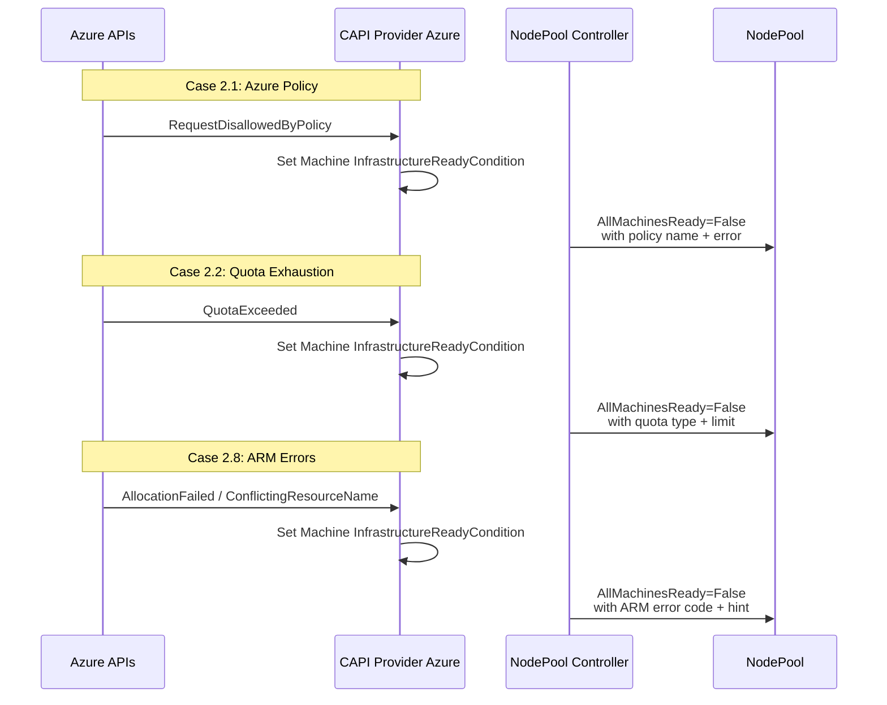
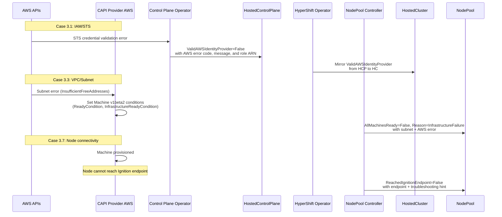

# HCM Installation Failure Debuggability

## Summary

This enhancement adds platform-specific diagnostic
detail to existing HyperShift conditions for managed
HCP clusters (ARO HCP and ROSA HCP). It addresses six
failure cases — three Azure and three AWS — where
opaque conditions currently force SREs to manually
inspect CAPI Machine objects, cloud provider API
responses, and pod logs to identify root causes. The
approach follows the pattern established in the
platform-agnostic diagnostic enhancement
([PR #2134](https://github.com/openshift/enhancements/pull/2134),
CNTRLPLANE-4639): add diagnostic detail to existing
condition messages without introducing new condition
types or API fields. This EP is the platform-specific
Phase 2 follow-up, sharing the OCPSTRAT-1598 strategy.

### Design Principles

This EP follows four design principles, shared across
all platform-specific diagnostic cases:

- **Level-driven condition semantics**: Conditions
  reflect current observed state, not events.
  Controllers re-evaluate on every reconciliation
  and set the condition to match the current state,
  ensuring self-healing and eliminating stale
  conditions. This is why condition flapping is
  unlikely — the condition converges to the current
  error on each reconciliation rather than toggling
  between states.
- **Allowlist-based security model**: Only
  structured, customer-owned identifiers (Azure
  resource group names, VM names, policy names, IAM
  role ARNs, subnet IDs, endpoint URLs) appear in
  condition messages. Free-text pass-through from
  upstream providers (CAPZ, CAPA) is audited before
  Tech Preview. Red Hat-internal subscription IDs,
  tenant IDs, service principal credentials, AWS
  account IDs, and management cluster node names are
  never included.
- **Message truncation**: Diagnostic messages
  respect the truncation limits already enforced in
  the HyperShift codebase (see Message Truncation
  below).
- **Enrichment over proliferation**: Diagnostic
  detail is added to existing condition messages
  rather than introducing new condition types, to
  avoid expanding the condition surface area.

### Prerequisites

This EP is the platform-specific Phase 2 follow-up to
the platform-agnostic Phase 1 enhancement proposed in
[enhancements PR #2134](https://github.com/openshift/enhancements/pull/2134)
(CNTRLPLANE-4639, status: **merged**). Phase 1
introduces installation-stage tracking,
`ManagementClusterResourcePressure` detection, and
generic diagnostic enrichment. This EP builds on
that foundation by adding platform-specific diagnostic
detail for six SRE-confirmed failure cases. Phase 1
is not a hard prerequisite — this EP's cases operate
on different conditions and code paths — but the two
EPs share the same strategy (OCPSTRAT-1598) and are
designed to be complementary.

This EP also depends on
[PR #9781](https://github.com/openshift/hypershift/pull/9781)
(status: **merged**, 2026-11-06), which added
terminal infrastructure failure detection to the
NodePool controller via `isTerminalInfraReason()`
(exact map lookup) and the `InfrastructureFailure`
reason code. Azure Cases 2.1, 2.2, 2.8 and AWS Case
3.3 build on this foundation. AWS Cases 3.1 and 3.7
have no dependency on PR #9781 and can proceed
independently.

## Glossary

For common HyperShift terms (HC, HCP, HO, CPO, HCCO,
CPC, CVO) see the
[parent enhancement glossary](installation-failure-debuggability.md#glossary).

### Azure terms

- **ARO HCP**: Azure Red Hat OpenShift, Hosted Control
  Planes architecture
- **CAPZ**: Cluster API Provider Azure — the CAPI
  provider that manages Azure infrastructure
- **ARM**: Azure Resource Manager — the deployment and
  management service for Azure resources
- **Entra ID**: Microsoft Entra ID (formerly Azure
  Active Directory) — identity and access management
- **Managed Identity**: An Azure identity automatically
  managed by Azure for authenticating to Azure services
- **Azure Policy**: Governance mechanism that enforces
  rules on Azure resources during creation and updates
- **ASO**: Azure Service Operator — bridges Kubernetes
  and Azure resources
- **PLS**: Private Link Service — Azure networking
  resource that enables private connectivity to
  services behind a Standard Load Balancer

### AWS terms

- **ROSA HCP**: Red Hat OpenShift Service on AWS,
  Hosted Control Planes architecture
- **CAPA**: Cluster API Provider AWS — the CAPI
  provider that manages AWS infrastructure
- **STS**: AWS Security Token Service — used for
  temporary credential assumption
- **OIDC**: OpenID Connect — used for workload
  identity federation with AWS
- **SCP**: AWS Service Control Policy — organization-
  level policy restricting API actions
- **NACL**: Network Access Control List — subnet-level
  firewall in AWS VPC

### Case numbering

Azure cases use the 2.x series (Cases 2.1, 2.2, 2.8)
from the full ARO failure case inventory (Cases
2.1–2.10). AWS cases use the 3.x series (Cases 3.1,
3.3, 3.7) from the full ROSA failure case inventory
(Cases 3.1–3.12). The non-contiguous numbering
reflects that only the SRE-confirmed cases are
addressed here; the remaining cases are listed in
Future Work.

## Motivation

SRE teams for managed HCP services (ARO HCP and ROSA
HCP) encounter platform-specific installation failures
that surface as opaque HyperShift conditions. Whether
the root cause is an Azure platform issue (policy
conflict, quota exhaustion, ARM error) or an AWS
platform issue (IAM misconfiguration, network
misconfiguration, connectivity failure), the error
appears as a generic condition with no indication of
the underlying cloud-specific cause. SREs must
manually inspect CAPI Machine objects, cloud provider
API responses, and pod logs across multiple namespaces
to identify the root cause.

**Azure**: The current Azure error handling in
HyperShift (`support/azureutil/errors.go`,
`ClassifyAzureError()`) classifies errors by HTTP
status code only (429, 403, 409, other). The default
case includes `ErrorCode` in the message string but
does not branch on specific error codes such as
`RequestDisallowedByPolicy` or `QuotaExceeded`. As a
result, known recoverable errors (like quota
exhaustion) are treated as transient conflicts with a
30-second requeue, and policy errors are misclassified
as permission errors.

**AWS**: ROSA HCP SRE teams have confirmed three
categories of AWS-specific installation failures that
are difficult to diagnose today. In each case, the
root cause is an AWS platform issue, but the error
surfaces as a generic HyperShift condition with no
indication of the underlying AWS-specific cause.

### User Stories

#### Azure / ARO user stories

- As an ARO SRE, I want to see the specific Azure
  Policy name that blocked resource creation (e.g.,
  `RequestDisallowedByPolicy: Resource 'vm-abc' was
  disallowed by policy 'deny-public-ip'`) in the
  condition message so that I can direct the customer
  to update their policy without manually querying ARM.

- As an ARO SRE, I want to see the specific quota that
  was exceeded (e.g., `QuotaExceeded: Operation could
  not be completed as it results in exceeding approved
  standardDSv3Family Cores quota`) so that I can
  identify the resource type and region without
  inspecting Azure portal.

- As a fleet operator, I want to monitor Azure-specific
  installation failures at scale so that I can identify
  systemic issues (e.g., an Azure Policy rollout
  affecting multiple clusters) before they are
  escalated.

#### AWS / ROSA user stories

- As a ROSA SRE, I want to see the specific AWS IAM
  error (e.g., `AccessDenied: User is not authorized
  to perform sts:AssumeRoleWithWebIdentity`) in the
  `ValidAWSIdentityProvider` condition message so that
  I can direct the customer to fix their IAM trust
  policy without manually querying STS.

- As a ROSA SRE, I want to see which subnet is
  exhausted or misconfigured (e.g., `subnet-0abc1234:
  InsufficientFreeAddresses`) in the NodePool
  condition so that I can identify the affected subnet
  without inspecting individual CAPI Machine objects.

- As a ROSA SRE, I want to see when worker nodes
  cannot reach the control plane (e.g., `Ignition
  endpoint unreachable: connection timeout to
  api-int.cluster.example.com:22623`) so that I can
  identify security group or NACL issues without
  SSH-ing into nodes.

- As a fleet operator, I want to monitor AWS-specific
  installation failures at scale so that I can
  identify systemic issues (e.g., an IAM policy change
  affecting multiple clusters) before they are
  escalated.

### Goals

1. Surface the specific cloud provider error code and
   message in existing HyperShift conditions for the
   six in-scope failure cases (three Azure, three AWS),
   replacing opaque generic messages.
2. Enable SREs to diagnose platform-specific
   installation failures from `HostedCluster` and
   `NodePool` conditions alone, without inspecting
   CAPI Machine objects, cloud provider portals, or
   pod logs.
3. Maintain backward compatibility — no new condition
   types, no new API fields, no changes to condition
   `Type` values.

### Non-Goals

1. **New condition types**: This enhancement does not
   add new conditions. All changes are diagnostic
   detail on existing conditions.
2. **Azure cases outside HyperShift scope**: The
   following ARO failure cases involve components
   outside the HyperShift Operator and are deferred
   to separate enhancements:
   - 2.3: Entra ID soft-delete limit on managed
     identities (managed identities are created by the
     ARO RP, not the HyperShift Operator; no Azure
     identity condition exists on `HostedCluster` for
     Azure; `ReconcileCredentials()` in `azure.go` only
     copies pre-existing client IDs into Kubernetes
     secrets and does not call Entra ID APIs)
   - 2.4: OneCert timeout/throttling/expiry
   - 2.5: ASO secret export failure
   - 2.6: Maestro API URL propagation failure
   - 2.7: Azure CNS / Swift DHCP failures
   - 2.9: MCE webhook certificate expiry
   - 2.10: DNS domain mismatch race condition
3. **Unconfirmed ROSA failure cases**: Cases 3.2
   (quota), 3.4 (PrivateLink), 3.5 (Route 53), 3.6
   (KMS), 3.8 (SCPs), 3.9 (EC2 capacity), 3.10
   (S3/OIDC), 3.11 (API throttling), 3.12 (ELB) are
   deferred until verified by ROSA SRE teams. Cases
   3.1, 3.3, and 3.7 were selected because the ROSA
   SRE team identified them as the most frequently
   escalated installation failure categories in their
   internal incident data.
4. **Pre-flight validation**: This enhancement
   surfaces errors after they occur, not before.
   Pre-flight quota/policy/VPC/IAM validation is a
   separate concern.
5. **NodePool day-2 diagnostics**: Only installation-
   time failures are in scope. However, because the
   underlying conditions are evaluated on every
   reconciliation, the enhanced diagnostic messages
   will also fire during day-2 node scaling events.
   This is acceptable — the same diagnostic detail
   that helps SREs during installation also helps
   during day-2.

## Proposal

Enhance the HyperShift error handling to parse
platform-specific error codes from cloud provider API
responses, and surface them in existing condition
messages at six points in the installation flow.

### Azure / ARO Cases

#### Case 2.1: Azure Policy Conflicts

**Existing condition**: `AllMachinesReady`
(on `NodePool`) and platform-specific conditions on
`AzurePrivateLinkService`

**Current behavior**: When Azure Policy blocks resource
creation, the ARM API returns HTTP 403 with error code
`RequestDisallowedByPolicy`. The current
`ClassifyAzureError()` in `errors.go:79-101` sees only
the HTTP 403 status and returns the generic message
`"check service principal permissions"` with a
10-minute requeue. The actual policy name and message
are discarded.

**Proposed diagnostic detail**: Parse the
`RequestDisallowedByPolicy` error code from the
`azcore.ResponseError` and include the policy name
in the condition message:

```
AllMachinesReady=False,
Reason=InfrastructureFailure,
Message="2/3 machines not ready. First failure:
  machine-abc — RequestDisallowedByPolicy:
  Resource 'vm-abc' was disallowed by policy
  'deny-public-ip' (policy assignment:
  /subscriptions/.../deny-public-ip)"
```

The diagnostic detail (policy name, error code) comes
from the CAPZ Machine's `InfrastructureReadyCondition`
(a CAPI v1beta2 condition in `Machine.Status.Conditions`),
which is passed through to the `AllMachinesReady`
condition message. `setAllMachinesReadyCondition()`
in `conditions.go:783-885` reads `ReadyCondition`
and, when it is `False`, reads
`InfrastructureReadyCondition` to extract the
`Reason` and `Message`. The code applies a step-
counter filter (`isSetupCounterCondMessage`,
regex `\d+ of \d+ completed` in
`nodepool_controller.go:138`): if the
`InfrastructureReadyCondition.Message` matches the
step-counter pattern, the controller falls back to
`ReadyCondition.Message`; if that also matches, only
the `Reason` string is used. ARM error messages
(e.g., `RequestDisallowedByPolicy: ...`) do not
match the step-counter pattern, so they pass through
unfiltered. No additional HyperShift code changes
are needed for this case — the enrichment depends on
CAPZ populating `InfrastructureReadyCondition` with
the full ARM error including the
`RequestDisallowedByPolicy` error code and policy
name.
[PR #9781](https://github.com/openshift/hypershift/pull/9781)
(merged) added `isTerminalInfraReason()` which
checks whether the Machine's condition reason is a
known terminal failure for the platform. For Azure,
the terminal reasons are `VMProvisionFailed` and
`Failed`. CAPZ currently surfaces `Failed` (not
`VMProvisionFailed`) on `InfrastructureReady`
because the CAPI condition summary picks
`DisksReady`'s generic `Failed` reason over
`VMRunning`'s `VMProvisionFailed`; a follow-up to
[CAPZ#6737](https://github.com/kubernetes-sigs/cluster-api-provider-azure/pull/6737)
is needed to reorder the summary so `VMRunning`
takes priority. Until then, `Failed` is the reason
HyperShift observes for Azure VM provisioning
failures.
When any Machine has a terminal reason, the
aggregated reason is overridden with
`Reason=InfrastructureFailure`
(`NodePoolInfrastructureFailureReason`). The ARM
error codes (`RequestDisallowedByPolicy`,
`QuotaExceeded`, etc.) appear in the condition
**message**, not the **reason** — the reason is set
by CAPZ at the provider level (e.g.,
`VMProvisionFailed` or `Failed`), while the message
carries the ARM error detail.

**Implementation**: Verify that CAPZ populates
`InfrastructureReadyCondition` on the Machine with:
- `Reason` = `VMProvisionFailed` or `Failed` (the
  two Azure terminal reasons recognized by
  `isTerminalInfraReason()` in PR #9781, merged) so
  that `Reason=InfrastructureFailure` is triggered
  on the NodePool. Note: CAPZ currently surfaces
  `Failed` rather than `VMProvisionFailed` on
  `InfrastructureReady` (see Case 2.1 above).
- `Message` = full ARM error response, including
  `ErrorCode` and the `Details` array containing
  the policy name

If CAPZ already provides this data, no HyperShift
code changes are needed — the existing Machine →
NodePool condition pipeline passes the message
through automatically via
`setAllMachinesReadyCondition()`.

#### Case 2.2: Azure Resource Quota Exhaustion

**Existing condition**: `AllMachinesReady`
(on `NodePool`)

**Current behavior**: When Azure quota is exceeded, ARM
returns HTTP 409 with error code `QuotaExceeded` or
`OperationNotAllowed`. `ClassifyAzureError()` sees
HTTP 409 and returns `"Azure resource conflict,
retrying"` with a 30-second requeue. This is misleading
— quota exhaustion is not a transient conflict.

**Proposed diagnostic detail**: Parse the quota-specific
error code and include the resource type and limit:

```
AllMachinesReady=False,
Reason=InfrastructureFailure,
Message="1/3 machines not ready. First failure:
  machine-abc — QuotaExceeded: Operation could
  not be completed as it results in exceeding
  approved standardDSv3Family Cores quota.
  Limit: 100, Current: 96, Requested: 8.
  Region: eastus"
```

**Implementation**: As with Case 2.1, the diagnostic
detail flows through CAPZ `InfrastructureReadyCondition`
→ NodePool controller (`setAllMachinesReadyCondition()`).
The quota detail (`QuotaExceeded`, resource type,
limit) appears in the `InfrastructureReadyCondition`
**message**. The condition **reason** is a CAPZ-level
value (e.g., `VMProvisionFailed` or `Failed` — see
Case 2.1 for the current CAPZ behavior) —
`isTerminalInfraReason()` (PR #9781, merged) maps
this to `Reason=InfrastructureFailure` on the
NodePool. No
additional HyperShift code changes are needed if
CAPZ provides the full ARM error in the
`InfrastructureReadyCondition` message.

Separately, enhance `ClassifyAzureError()` to
recognize `QuotaExceeded` and `OperationNotAllowed`
error codes in the PLS controller path
(`handleAzureError()`). For quota errors, use a
longer requeue interval (10 minutes instead of 30
seconds) since quota increases require manual action.

#### Case 2.8: Azure ARM Errors

**Existing condition**: `AllMachinesReady`
(on `NodePool`) and `AzurePrivateLinkServiceAvailable`
(on `AzurePrivateLinkService`)

**Current behavior**: ARM errors such as zonal
allocation failures (`AllocationFailed`), soft-deleted
resource name conflicts (`ConflictingResourceName`),
and OIDC RBAC misconfigurations produce generic error
codes in the `handleAzureError()` function
(`controller.go:734-758`). The condition message
includes the HTTP status code but not the ARM error
code or details.

**Proposed diagnostic detail**: Include the ARM error
code and message for known failure patterns:

For zonal allocation failures:
```
AllMachinesReady=False,
Reason=InfrastructureFailure,
Message="1/3 machines not ready. First failure:
  machine-abc — AllocationFailed: Allocation
  failed. We do not have sufficient capacity for
  the requested VM size in this zone. Zone:
  eastus-1"
```

For name conflicts:
```
AzurePrivateLinkServiceAvailable=False,
Reason=PLSCreationFailed,
Message="PLSCreationFailed: ConflictingResourceName:
  A resource with name 'pls-abc' already exists
  (soft-deleted). Purge the deleted resource or
  use a different name"
```

**Implementation**: Enhance `handleAzureError()`
(`controller.go:734-758`) and `ClassifyAzureError()`
(`errors.go:79-101`) to extract `ErrorCode` from
`azcore.ResponseError` and include it in the condition
message. For known error codes (`AllocationFailed`,
`ConflictingResourceName`, `RoleAssignmentExists`),
add contextual remediation hints.

**Specific ARM errors to surface**:
- `AllocationFailed` (zonal capacity)
- `ConflictingResourceName` (soft-deleted resources)
- `RoleAssignmentExists` (OIDC RBAC duplicate)
- `SkuNotAvailable` (VM size not available)
- Generic ARM errors with error code passthrough

### AWS / ROSA Cases

#### Case 3.1: IAM/STS Role Assumption Failures

**Existing condition**: `ValidAWSIdentityProvider`
(on `HostedCluster`)

**Current behavior**: The CPO's health check controller
(`control-plane-operator/controllers/healthcheck/
aws.go`) sets the condition via
`classifyIdentityProviderError()` (lines 92–110),
which already classifies the AWS API error and
includes the error code and message (e.g.,
`"AWS identity provider validation failed:
AccessDenied: <STS error message>"`). However, the
message does not include the target IAM role ARN
from the HCP spec, making it harder for SREs to
correlate the error with the specific role that
needs fixing.

**Proposed diagnostic detail**: When the STS
`AssumeRoleWithWebIdentity` call fails, include the
AWS error code and message in the condition:

```
ValidAWSIdentityProvider=False,
Reason=InvalidIdentityProvider,
Message="STS AssumeRoleWithWebIdentity failed for
  role arn:aws:iam::123456789012:role/cluster-role:
  AccessDenied — User is not authorized to perform
  sts:AssumeRoleWithWebIdentity on resource
  arn:aws:iam::123456789012:oidc-provider/..."
```

**Implementation**: The CPO's health check controller
(`control-plane-operator/controllers/healthcheck/
aws.go:92-110`, `classifyIdentityProviderError()`)
already classifies the AWS API error and includes the
error code and message via `apiErr.ErrorCode()` and
`apiErr.ErrorMessage()`. The change enhances the
condition message to prepend the target role ARN from
the HCP spec (available via `hcp.Spec.Platform.AWS.
RolesRef`), enabling SREs to identify which role's
trust policy needs correction without cross-
referencing the `HostedCluster` spec. Note: the HO's
`GetCredentialStatus()` (`aws.go:363-394`) is
read-only — it reads the condition status set by
the CPO but does not set conditions itself.

**Security note**: The error message includes the IAM
role ARN, which is customer-owned and already visible
in the `HostedCluster` spec. No Red Hat-internal
ARNs or account IDs are exposed.

#### Case 3.3: VPC/Subnet Misconfiguration

**Existing condition**: `AllMachinesReady`
(on `NodePool`)

**Current behavior**: When CAPA fails to provision an
AWSMachine due to subnet issues, the error surfaces
via CAPI v1beta2 Machine conditions
(`ReadyCondition`, `InfrastructureReadyCondition`).
The NodePool controller's
`setAllMachinesReadyCondition()` aggregates these
conditions and surfaces them on the
`AllMachinesReady` condition.
[PR #9781](https://github.com/openshift/hypershift/pull/9781)
(merged, 2026-11-06) added
terminal infrastructure failure detection via
`isTerminalInfraReason()` (exact map lookup),
which classifies persistent failures with
`Reason=InfrastructureFailure`. The
message includes the CAPI condition reason and
message but does not parse the AWS-specific error
code or identify the affected subnet.

**Proposed diagnostic detail**: Enhance the existing
`InfrastructureFailure` message with AWS-specific
context — parse the AWS error code from the CAPA
failure message and include the subnet ID:

```
AllMachinesReady=False,
Reason=InfrastructureFailure,
Message="2 of 3 machines are not ready.
  Machine machine-abc: InsufficientResources:
  subnet-0abc1234:
  InsufficientFreeAddressesInSubnet: The specified
  subnet does not have enough free addresses"
```

**Implementation**: The NodePool controller's
`setAllMachinesReadyCondition()` already aggregates
CAPI v1beta2 Machine conditions
(`ReadyCondition`, `InfrastructureReadyCondition`)
and — with PR #9781 merged — classifies
terminal infrastructure failures via
`isTerminalInfraReason()` (exact map lookup).
The diagnostic detail (AWS error code,
subnet ID) flows through CAPA → the CAPI v1beta2
`InfrastructureReadyCondition` on the Machine
object. CAPA sets this condition's `Reason` and
`Message` fields when an AWS infrastructure
operation fails. The NodePool controller already
reads `InfrastructureReadyCondition.Reason` and
`.Message` (`conditions.go:838-843`) and aggregates
them via `aggregateMachineReasonsAndMessages()`.
No additional provider-specific reads are needed
in the NodePool controller — the enrichment depends
on CAPA including the AWS error code and affected
subnet ID in the `InfrastructureReadyCondition`
message it sets on the Machine.

This preserves the NodePool controller's provider-
agnostic abstraction boundary: it reads only
standard CAPI v1beta2 Machine conditions, not
provider-specific AWSMachine resources.

If CAPA does not currently include the subnet ID
in the `InfrastructureReadyCondition` message, a
CAPA enhancement will be filed as a prerequisite
(see Open Question 2).

**Specific AWS errors to surface**:
- `InsufficientFreeAddressesInSubnet`
- `InvalidSubnetID.NotFound`
- `InvalidParameterValue` (AZ mismatch)
- `InsufficientInstanceCapacity` (detected
  by `isTerminalInfraReason()` in PR #9781 via
  exact map lookup)
- `QuotaExceeded` (detected by PR #9781)
- Generic CAPA provisioning failures with AWS error
  code passthrough

#### Case 3.7: Node Connectivity Failures

**Existing conditions**:
- `ReachedIgnitionEndpoint` (on `NodePool`)
- `AWSSecurityGroupAvailable` (on `NodePool`)
- `AllMachinesReady` / `AllNodesHealthy`
  (on `NodePool`)

**Current behavior**:
- `ReachedIgnitionEndpoint` is `False` with
  reason `ignitionNotReached` when nodes cannot
  retrieve Ignition configuration. No detail on why.
- `AWSSecurityGroupAvailable` blocks node
  creation if the default SG is not ready. No detail
  on which SG or why.
- Nodes stuck in restart loops appear as unhealthy
  Machines with generic `NodeStartupTimeout` reason.

**Proposed diagnostic detail**:

For `ReachedIgnitionEndpoint` (note: these are static
troubleshooting hints derived from platform
knowledge, not observed infrastructure failures — the
controller does not probe network paths):
```
ReachedIgnitionEndpoint=False,
Reason=ignitionNotReached,
Message="0/3 nodes have reached the Ignition
  endpoint. Nodes may be unable to reach
  api-int.<cluster>.<domain>:22623. Possible causes
  include security group ingress misconfiguration,
  NACL rules blocking traffic to worker subnets,
  DNS resolution failures, or proxy configuration
  issues."
```

For `AllNodesHealthy` when nodes are stuck:
```
AllNodesHealthy=False,
Reason=NodeStartupTimeout,
Message="2 nodes not healthy: machine-abc
  (NodeReady=False for 15m), machine-def
  (NodeReady=False for 12m). Nodes may be unable
  to reach the API server. Possible causes include
  security group egress rules blocking port 6443,
  network ACLs, or route table misconfiguration."
```

**Implementation**: The NodePool controller's
`createReachedIgnitionEndpointCondition()`
(`conditions.go:1048-1091`) and
`setAllNodesHealthyCondition()` (`conditions.go:
729-781`) already evaluate the relevant signals.
The change adds contextual messages with the
expected endpoints and troubleshooting hints when
failures are detected.

### Workflow Description

The diagnostic detail flows through existing
HyperShift condition pipelines — no new data paths.

#### Azure workflow



#### AWS workflow



### API Extensions

No new API types, conditions, or fields are
introduced. All changes are diagnostic detail
(message text and reason codes) on existing
conditions:

**Azure conditions**:
- `AllMachinesReady` (existing on `NodePool`)
- `AzurePrivateLinkServiceAvailable` (existing on
  `AzurePrivateLinkService`)
- `AzurePLSCreated` (existing on
  `AzurePrivateLinkService`)

**AWS conditions**:
- `ValidAWSIdentityProvider` (existing on
  `HostedCluster`)
- `AllMachinesReady` (existing on `NodePool`)
- `AllNodesHealthy` (existing on `NodePool`)
- `ReachedIgnitionEndpoint` (existing on `NodePool`)
- `AWSSecurityGroupAvailable` (existing on
  `NodePool`)

#### Condition message stability

Although no formal API fields are added, condition
`Message` text and `Reason` codes constitute a de
facto API surface that SRE fleet automation may
depend on. Consumers **must not** regex-parse
`Message` text for programmatic decisions — the
message content is best-effort diagnostic detail and
may change between releases without notice.
Automation should switch on `Reason` codes, which
are stable within a release series.

The exact `Reason` values used by each case are:

| Case | Condition | Reason (stable) | New? |
|------|-----------|-----------------|------|
| 2.1 | `AllMachinesReady` | `InfrastructureFailure` | Yes (merged, PR #9781) |
| 2.2 | `AllMachinesReady` | `InfrastructureFailure` | Yes (merged, PR #9781) |
| 2.8 | `AllMachinesReady` | `InfrastructureFailure` | Yes (merged, PR #9781) |
| 2.8 | `AzurePLSCreated` | `PLSCreationFailed` | No (existing) |
| 2.8 | `AzurePrivateLinkServiceAvailable` | `PLSCreationFailed` | No (existing) |
| 3.1 | `ValidAWSIdentityProvider` | `InvalidIdentityProvider` | No (existing) |
| 3.3 | `AllMachinesReady` | `InfrastructureFailure` | Yes (merged, PR #9781) |
| 3.7 | `ReachedIgnitionEndpoint` | `ignitionNotReached` | No (existing)\* |
| 3.7 | `AllNodesHealthy` | Per-machine reasons aggregated | No (existing) |

\* `ignitionNotReached` uses camelCase rather than
PascalCase (the convention for OpenShift reason
codes). This is an existing value in the HyperShift
codebase (`IgnitionNotReached = "ignitionNotReached"`
in `nodepool_conditions.go`); changing it would be a
breaking change and is out of scope for this EP.

`Message` field content is enriched with platform-
specific diagnostic detail (Azure error code, policy
name, quota type, zone, resource name, IAM role ARN,
subnet ID, endpoint URL, troubleshooting hints).
These fields are included on a best-effort basis —
the message may omit them if the underlying data is
unavailable (e.g., CAPZ/CAPA does not include the
relevant detail in the `InfrastructureReadyCondition`
message). Message format is **not guaranteed stable**
between releases.

### Topology Considerations

#### Hypershift / Hosted Control Planes

This enhancement is exclusively for the HyperShift
topology on Azure (ARO HCP) and AWS (ROSA HCP). All
changes are in the HyperShift Operator, NodePool
controller, the `support/azureutil` package (Azure),
and the Control Plane Operator (AWS Case 3.1).

#### Standalone Clusters

Not applicable — ARO HCP and ROSA HCP use HyperShift
only.

#### Single-node Deployments or MicroShift

Not applicable.

#### Disconnected / Restricted Network

ROSA HCP and ARO HCP clusters can operate in
PrivateLink or restricted-networking configurations.
The diagnostic messages in this EP remain accurate in
those scenarios because they report observed failures
(cloud API errors, CAPI condition content), not
assumed causes. The troubleshooting hints in Case 3.7
use "possible causes include..." language that lists
common root causes without asserting which one
applies. In restricted-network deployments,
additional causes such as VPC endpoint
misconfiguration (AWS), Private Endpoint
misconfiguration (Azure), proxy settings, or missing
PrivateLink connections may be relevant.

#### OpenShift Kubernetes Engine

Not applicable — OKE does not use ARO HCP or ROSA
HCP.

### Implementation Details/Notes/Constraints

#### Data flow architecture

There are two distinct data paths for platform-specific
errors. Understanding these paths is critical for
scoping the implementation:

**Path 1: CAPI provider → Machine → NodePool
(Azure Cases 2.1, 2.2, AllMachinesReady in Case 2.8;
AWS Case 3.3)**

```
Cloud provider API error
  → CAPI provider (CAPZ or CAPA) sets
    Machine.Status.Conditions:
    InfrastructureReadyCondition=False with
    Reason and Message from the provider error
  → NodePool controller's
    setAllMachinesReadyCondition() reads
    ReadyCondition; when False, reads
    InfrastructureReadyCondition.Reason and
    InfrastructureReadyCondition.Message
    (filtered by isSetupCounterCondMessage —
    step-counter messages like "1 of 2 completed"
    are discarded; ARM/AWS error messages pass
    through unfiltered)
  → AllMachinesReady condition on NodePool gets
    the InfrastructureReadyCondition content
```

This path does NOT involve `ClassifyAzureError()` or
any provider-specific parsing in the NodePool
controller. The NodePool controller reads CAPI v1beta2
Machine conditions (`Machine.Status.Conditions`), not
cloud API responses directly.
`setAllMachinesReadyCondition()` (`conditions.go:783-885`)
already reads `InfrastructureReadyCondition` when
`ReadyCondition` is `False` and aggregates the reason
and message into the `AllMachinesReady` condition.
A step-counter filter (`isSetupCounterCondMessage`,
regex `\d+ of \d+ completed`) discards CAPI summary
progress messages; if the
`InfrastructureReadyCondition.Message` matches the
pattern, the controller falls back to
`ReadyCondition.Message`, and if that also matches,
only the `Reason` string is used. Cloud provider
error messages do not match this pattern and pass
through unfiltered.
No HyperShift code changes are needed for this
path — the diagnostic detail depends entirely on
what the CAPI provider puts in
`InfrastructureReadyCondition`.
[PR #9781](https://github.com/openshift/hypershift/pull/9781)
(merged) added `isTerminalInfraReason()` which
checks whether the Machine's condition reason
matches a per-platform terminal set. For Azure, the
terminal reasons are `VMProvisionFailed` and
`Failed` (see Case 2.1 for the current CAPZ
behavior). When matched, the aggregated reason is
overridden with `Reason=InfrastructureFailure`.
The cloud error codes
(e.g., `QuotaExceeded`, `RequestDisallowedByPolicy`,
`InsufficientFreeAddressesInSubnet`) appear in the
condition message, not the reason.

**Path 2: handleAzureError() → ClassifyAzureError()
(PLS conditions in Azure Case 2.8)**

```
Azure ARM API error
  → handleAzureError() calls ClassifyAzureError()
    in errors.go:79-101
  → ClassifyAzureError() returns message + requeue
    interval based on HTTP status code
  → handleAzureError() sets
    AzurePrivateLinkServiceAvailable=False and
    AzurePLSCreated=False with the message

Callers:
  HO:  controller.go:738 (management cluster PLS)
  CPO: azureprivatelinkservice/controller.go:1030
       (hosted control plane PLS)
```

Both functions are in `openshift/hypershift`.
`ClassifyAzureError()` is in `support/azureutil/`
(shared utility package) and has **two callers**:
1. **HO PLS controller**:
   `handleAzureError()` in
   `hypershift-operator/controllers/platform/azure/
   controller.go:738` — manages PLS resources on
   the management cluster.
2. **CPO PLS controller**:
   `handleAzureError()` in
   `control-plane-operator/controllers/
   azureprivatelinkservice/controller.go:1030` —
   manages PLS resources within the hosted control
   plane namespace.

Both callers use the same pattern: call
`ClassifyAzureError()` to classify the error, then
format the condition message as
`fmt.Sprintf("%s: %v", classifiedMessage, err)`.
Changes to `ClassifyAzureError()` (requeue intervals,
error code branching) affect both callers. The
requeue interval changes (e.g., 30s to 10min for
`QuotaExceeded`) are appropriate for both callers
since both manage Azure PLS infrastructure resources
where quota and policy errors require the same
backoff strategy.

**Path 3: CPO health check → HostedControlPlane →
HostedCluster (AWS Case 3.1)**

```
AWS STS API error
  → CPO health check controller calls
    classifyIdentityProviderError()
  → Condition set on HostedControlPlane
  → HO mirrors condition to HostedCluster
```

#### Azure implementation

Changes are in the `openshift/hypershift` repository.
Only Path 2 (PLS controller) requires code changes.
Path 1 (Machine → NodePool) works automatically if
CAPZ provides adequate `InfrastructureReadyCondition`
content.

1. **`support/azureutil/errors.go`**: Enhance
   `ClassifyAzureError()` (lines 79-101) to add
   `ErrorCode`-based branching. The classification
   order is:
   1. **HTTP 429 first**: Check `StatusCode == 429`
      before any `ErrorCode` inspection. Azure uses
      `OperationNotAllowed` for both quota exhaustion
      and throttling; a 429 response with
      `ErrorCode: OperationNotAllowed` must honor the
      `Retry-After` header, not enter the quota branch.
      This preserves the existing 429 handling
      (`ParseRetryAfterDuration()`).
   2. **`ErrorCode` branching**: For non-429 responses,
      check `ErrorCode` (more specific than HTTP
      status) with named constants:
      - `RequestDisallowedByPolicy` (→ 10-min requeue,
        extract policy name)
      - `QuotaExceeded` / `OperationNotAllowed`
        (→ 10-min requeue, include quota details).
        Only reached for non-429 status codes (e.g.,
        409), so this branch is genuinely quota-related.
      - `AllocationFailed` (→ 5-min requeue, include
        zone)
      - `ConflictingResourceName` (→ 10-min requeue,
        include purge hint)
      - `RoleAssignmentExists` (→ 30-sec requeue,
        transient)
      - `SkuNotAvailable` (→ 10-min requeue, include
        VM size)
   3. **`StatusCode` fallback**: Unrecognized error
      codes fall through to the existing HTTP status
      code switch (backward compatible).

2. **`support/azureutil/errors.go`**: Add a new
   function `ExtractPolicyDetails()` to parse the
   ARM error response `Details` array and extract the
   policy name and assignment ID from
   `RequestDisallowedByPolicy` errors.

3. **`hypershift-operator/controllers/platform/azure/
   controller.go`**: Enhance `handleAzureError()`
   (lines 734-758) to use the enriched error
   classification and include the Azure error code
   in condition messages set on
   `AzurePrivateLinkService`.

4. **`hypershift-operator/controllers/nodepool/
   conditions.go`**: No changes needed.
   `setAllMachinesReadyCondition()` (`conditions.go:783-885`)
   already reads CAPI v1beta2
   `InfrastructureReadyCondition` from
   `Machine.Status.Conditions` when `ReadyCondition`
   is `False`. The CAPZ `InfrastructureReadyCondition`
   content propagates automatically through the
   existing Machine → NodePool condition pipeline.

#### AWS implementation

Changes are in the `openshift/hypershift` repository:

1. **`control-plane-operator/controllers/healthcheck/
   aws.go`**: Enhance `classifyIdentityProviderError()`
   to prepend the target role ARN from the HCP spec
   in the `ValidAWSIdentityProvider` condition message.
   The function already surfaces the AWS error code
   and message; this change adds role ARN context.

2. **`hypershift-operator/controllers/nodepool/
   conditions.go`**: The generic infrastructure
   failure detection via CAPI v1beta2 Machine
   conditions (`ReadyCondition`,
   `InfrastructureReadyCondition`) and the
   `InfrastructureFailure` reason code was
   implemented by
   [PR #9781](https://github.com/openshift/hypershift/pull/9781)
   (merged, 2026-11-06).
   The AWS-specific diagnostic detail (error code,
   subnet ID) flows through the CAPI v1beta2
   `InfrastructureReadyCondition` (set by CAPA) into
   the existing
   `aggregateMachineReasonsAndMessages()` pipeline.
   No provider-specific resource reads are added to
   the NodePool controller (see Open Question 2).

3. **`hypershift-operator/controllers/nodepool/
   conditions.go`**: Enhance
   `createReachedIgnitionEndpointCondition()` (lines
   1048-1091) to include the expected Ignition endpoint
   URL and troubleshooting guidance.

4. **`hypershift-operator/controllers/nodepool/
   conditions.go`**: Enhance
   `setAllNodesHealthyCondition()` (lines 729-781) to
   include per-node duration and API server
   reachability hints.

#### Error code parsing (Azure)

The `azcore.ResponseError` struct provides:
- `ErrorCode` (string): The Azure error code (e.g.,
  `RequestDisallowedByPolicy`)
- `StatusCode` (int): HTTP status code
- `RawResponse` (*http.Response): Full HTTP response
  for parsing `Details` array

The enhanced `ClassifyAzureError()` checks HTTP 429
first (preserving `Retry-After` handling), then
branches on `ErrorCode` (more specific than HTTP
status), then falls back to `StatusCode` (current
behavior) for unrecognized error codes. The 429-first
ordering is critical because Azure uses
`OperationNotAllowed` for both quota exhaustion
(HTTP 409) and throttling (HTTP 429); without this
guard, a throttled request would be misclassified as
a quota error with a 10-minute requeue instead of
honoring the server's `Retry-After` header.

#### Requeue rate limiter

[PR #9781](https://github.com/openshift/hypershift/pull/9781)
(merged) also changed the NodePool controller's
exponential backoff rate limiter max delay from 10
seconds to 1 minute (`nodepool_controller.go`):

```go
// Before:
RateLimiter: workqueue.NewTypedItemExponentialFailureRateLimiter[reconcile.Request](
    1*time.Second, 10*time.Second),
// After:
RateLimiter: workqueue.NewTypedItemExponentialFailureRateLimiter[reconcile.Request](
    1*time.Second, 1*time.Minute),
```

This rate limiter governs automatic error-path retries
(when `Reconcile()` returns an error). It is separate
from the explicit `RequeueAfter` values returned by
`ClassifyAzureError()`, which set fixed requeue delays
for specific HTTP status codes (e.g., 30 seconds for
429 Too Many Requests, 10 minutes for 403 Forbidden).
The two mechanisms interact: if `ClassifyAzureError()`
returns `Result{RequeueAfter: d}` with `err == nil`,
the rate limiter is not involved; if the reconciler
returns a non-nil error, the rate limiter caps the
exponential backoff at 1 minute.

#### Message truncation

Diagnostic messages are subject to the truncation
limits in the HyperShift codebase:

- **Per-machine message block**: 1000 characters
  (`maxMessageLength` in the NodePool controller,
  `nodepool_controller.go`). Each individual
  machine's diagnostic detail is truncated at a word
  boundary with `...` before aggregation.
- **Aggregated condition message**: 3000 characters
  (`maxGlobalMessageLength` in the NodePool
  controller). The combined message across all
  machines is truncated after aggregation.
- **HCCO condition messages**: 1024 characters
  (`maxConditionMessageLength` in the HCCO resources
  controller, `resources.go`). Applies to
  HostedCluster-level conditions such as
  `ValidAWSIdentityProvider`.
- **Condition `Reason` field**: 1024 characters
  (per `+kubebuilder:validation:MaxLength`).

Azure error messages that exceed the per-machine
limit are truncated at a word boundary with `...`.
Policy assignment paths (which can be long) are
truncated to the last two path segments.

For AWS Case 3.3 (multi-machine failures), when
multiple machines fail with different AWS errors,
the message shows a summary count followed by
per-machine detail up to the aggregated message
limit. If the per-machine details exceed the
aggregated limit, trailing machines are elided with
a count (e.g., `... (3 more)`). The first failing
machine is always included so that at least one
actionable diagnostic is visible.

#### Security considerations

This EP follows the allowlist-based security model
described in the Design Principles section:

- Azure subscription IDs in policy assignment paths
  are customer-owned and visible in `HostedCluster`
  spec.
- Resource group names and VM names are customer-owned
  Azure resources.
- IAM role ARNs included in messages are customer-
  owned (visible in `HostedCluster` spec).
- Subnet IDs are customer-owned AWS resources.
- No Red Hat-internal Azure subscription IDs, tenant
  IDs, service principal credentials, AWS account IDs,
  VPC IDs, or security group rules are exposed.
- Management cluster node names are never included.
- CAPI Machine `InfrastructureReadyCondition` message
  content is passed through — verify that CAPZ and
  CAPA do not include sensitive data (e.g., client
  secrets) in the condition message.

#### Diagnostic logic failure modes

The diagnostic enrichment logic itself may encounter
missing or malformed inputs. In every case, the
controller falls back to the existing (pre-
enrichment) behavior — the condition is still set,
just without the enriched detail:

#### Azure failure modes

- **Empty `ErrorCode`** (Path 2): If
  `azcore.ResponseError.ErrorCode` is empty or nil,
  `ClassifyAzureError()` skips `ErrorCode` branching
  and falls through to the existing HTTP status code
  switch. HTTP 429 is always handled first regardless
  of `ErrorCode` presence (see classification order
  in Azure implementation). The condition is set with
  the current generic message (e.g., "Azure API
  permission denied, check service principal
  permissions" for HTTP 403). The
  `hypershift_diagnostic_fallback_total` counter is
  incremented with `platform=azure`.

- **Missing or malformed `Details` array** (Path 2):
  If `ExtractPolicyDetails()` receives a
  `RawResponse` with no `Details` array, a malformed
  JSON body, or an empty `Details` array, it returns
  an empty string (no panic). The caller
  (`ClassifyAzureError()`) uses the `ErrorCode`-only
  message without policy details. The fallback
  counter is incremented. Unit tests cover nil body,
  malformed JSON, and empty `Details` array inputs.

- **Empty or step-counter `InfrastructureReadyCondition`
  message** (Path 1, Azure Cases 2.1/2.2): If a CAPI
  Machine has `InfrastructureReadyCondition=False` but
  the `Message` field is empty or matches the step-
  counter pattern (`\d+ of \d+ completed`), the
  NodePool controller falls back to
  `ReadyCondition.Message`; if that is also empty or
  a step-counter, only the `Reason` string is used
  (e.g., `"machine-abc: VMProvisionFailed"`). No
  platform-specific detail is shown, but the machine
  name and reason still provide a starting point.
  Cloud provider error messages (e.g.,
  `RequestDisallowedByPolicy: ...`) do not match the
  step-counter pattern and are not affected by this
  filter.

- **Machines garbage-collected during aggregation**
  (Path 1): The Machine list is fetched once per
  reconciliation loop. If a Machine object is deleted
  between list and condition construction, the
  controller simply reports the remaining machines.
  On the next reconciliation, the list is re-fetched
  and the condition reflects the current set of
  machines.

- **Multiple simultaneous Azure errors** (Path 2):
  If `handleAzureError()` is called with different
  Azure errors in rapid succession, each call
  overwrites the condition. This is the existing
  behavior — the condition reflects the most recent
  error. Level-driven reconciliation ensures the
  condition converges to the current state.

#### AWS failure modes

- **Nil `RolesRef`** (Case 3.1): If
  `hcp.Spec.Platform.AWS.RolesRef` is nil or the
  `Platform.AWS` struct is nil, the CPO omits the
  role ARN prefix from the condition message and logs
  the omission at `V(2)`. The STS error code and
  message are still surfaced (existing behavior).

- **Empty or step-counter `InfrastructureReadyCondition`
  message** (Case 3.3): If a CAPI Machine has
  `InfrastructureReadyCondition=False` but the
  `Message` field is empty or matches the step-
  counter pattern (`\d+ of \d+ completed`), the
  NodePool controller falls back to
  `ReadyCondition.Message`; if that is also empty or
  a step-counter, only the `Reason` string is used
  (e.g., `"machine-abc: InstanceProvisionFailed"`).
  No AWS-specific detail is shown, but the machine
  name and reason still provide a starting point.
  AWS error messages (e.g.,
  `InsufficientFreeAddressesInSubnet: ...`) do not
  match the step-counter pattern and are not affected
  by this filter.

- **Machines garbage-collected during aggregation**
  (Case 3.3): Same behavior as Azure Path 1 above.

- **Ignition endpoint URL unavailable** (Case 3.7):
  If the expected Ignition endpoint URL cannot be
  constructed (e.g., `infraStatus.APIHost` is empty),
  the controller omits the URL from the message and
  falls back to the existing `ignitionNotReached`
  message without the enriched detail.

In all cases the `hypershift_diagnostic_fallback_total`
counter is incremented when enriched detail is omitted,
enabling detection of silent degradation (see
Observability below).

#### Feature gate

No feature gate is required. The rationale follows
the platform-agnostic diagnostic enhancement
([PR #2134](https://github.com/openshift/enhancements/pull/2134)):

1. **Message text and requeue intervals**: All changes
   modify condition `Message` content and adjust
   requeue intervals for recognized error codes.
   No new condition types, no new API fields, no new
   CRD schema changes. The requeue interval changes
   (e.g., 30s → 10min for quota errors) are behavioral
   but scoped to error-path retry timing — they do not
   affect the steady-state reconciliation loop or the
   condition schema.
2. **HyperShift API is v1beta1**: HyperShift CRDs
   live in `openshift/hypershift`, not `openshift/api`.
   The v1beta1 API does not use standard OCP feature
   gates from `features.go`.
3. **Backward compatible**: Unrecognized error codes
   fall through to the existing handling. No behavioral
   change for error codes not in the explicit list.
4. **No per-cluster disable toggle**: Consistent with
   the parent EP's stance. Changes are purely
   informational (condition messages) and level-driven
   — bugs self-correct on the next reconciliation.
   HyperShift ships independently and can deploy fixes
   within days.

#### Observability

This EP introduces a platform-agnostic Prometheus
counter to detect silent degradation of diagnostic
enrichment:

- **Metric name**: `hypershift_diagnostic_fallback_total`
- **Type**: Counter
- **Labels**:
  - `platform`: The cloud platform (`azure`, `aws`).
    This metric is platform-agnostic by design so
    that both platforms and future provider-specific
    cases share a single counter rather than each
    defining their own.
  - `condition`: The condition type where enrichment
    was attempted (e.g., `AllMachinesReady`,
    `AzurePLSCreated`, `AzurePrivateLinkServiceAvailable`,
    `ValidAWSIdentityProvider`,
    `ReachedIgnitionEndpoint`, `AllNodesHealthy`).
  - `case`: The failure case identifier (`2.1`,
    `2.2`, `2.8`, `3.1`, `3.3`, `3.7`). Cardinality
    is bounded to these six values; future cases add
    at most 7 more for Azure (Cases 2.3–2.10) and 9
    more for AWS (Cases 3.2–3.12).
- **Help string**: "Number of times platform-specific
  diagnostic enrichment fell back to generic message
  due to missing or unparseable input."
- **Registration**: The counter is registered in the
  HyperShift Operator's metric registry (for the
  PLS controller path, NodePool controller path) and
  in the CPO's metric registry (for AWS Case 3.1).
  Both registries are already scraped by the
  existing HyperShift telemetry pipeline.
- **Semantics**: The counter increments each time the
  enrichment code path falls back to the pre-
  enrichment condition message — e.g., empty
  `ErrorCode`, malformed ARM `Details` array, nil
  `RolesRef`, empty `InfrastructureReadyCondition`
  message, or failure to extract a provider-specific
  error code from a CAPI condition message. A zero
  counter means either no failures occurred or no
  enrichment was attempted; a sustained rise
  indicates the parsing is degrading (e.g., cloud
  SDK error format changed or CAPI provider condition
  message format changed).
- **Alerting guidance**: SRE teams should configure
  an alert on
  `rate(hypershift_diagnostic_fallback_total[1h]) > 0`
  sustained for 30 minutes, filtered by `platform`
  label as needed. This alert is owned by the
  HyperShift team and should be added to the
  HyperShift alerting rules before GA (tracked as a
  graduation criterion). The alert should fire as a
  warning (not critical) since the fallback behavior
  is safe — the condition is still set, just without
  enriched detail.

No other new metrics are introduced. The enrichment
logic does not affect existing HyperShift metrics.

### Risks and Mitigations

#### Risk 1: Fleet automation breakage from message changes

SRE fleet automation or alert rules may regex-parse
condition messages. Changing message text could cause
silent match failures.

**Mitigation**: The `Reason` codes are not changed by
this EP (Azure cases use `InfrastructureFailure` and
`PLSCreationFailed`; AWS cases use existing reason
codes plus `InfrastructureFailure` from PR #9781).
Only the `Message` field content changes. Fleet
automation that switches on `Reason` is unaffected.
SRE teams confirm no fleet automation regex-parses
the affected condition messages before GA (tracked as
a graduation criterion). The enriched messages are a
superset of the current messages.

#### Risk 2: CAPI provider InfrastructureReadyCondition contains sensitive data

CAPI Machine `InfrastructureReadyCondition` message
is passed through to customer-visible `NodePool`
conditions. If CAPZ or CAPA includes Red Hat-internal
identifiers (subscription IDs, tenant IDs, service
principal credentials, internal VPC IDs, account
details) in the condition message, this data would be
exposed.

**Mitigation**: Audit CAPZ and CAPA
`InfrastructureReadyCondition` message content for
in-scope error codes before Tech Preview. CAPI
providers generally pass through the cloud provider
error response, which contains customer-owned resource
names and error codes — not Red Hat credentials. If
the audit identifies sensitive data, a sanitization
filter is applied in the NodePool controller's
aggregation path using an allowlist approach: only
known-safe identifier patterns are retained;
unrecognized identifiers are replaced with
`<redacted>`. This audit is tracked as a Tech Preview
graduation criterion.

#### Risk 3: Azure SDK error format changes

The `azcore.ResponseError` struct format could change
in a future Azure SDK version, breaking `ErrorCode`
parsing or `ExtractPolicyDetails()`.

**Mitigation**: `azcore.ResponseError` is a stable
public type in the Azure SDK for Go. The `ErrorCode`
and `StatusCode` fields are part of the public API.
Unit tests cover each error code pattern and will
catch format changes during SDK version bumps.

#### Risk 4: AWS error message format changes

AWS error messages could change format across AWS
SDK versions, causing the AWS-specific parsing to
miss error codes silently.

**Mitigation**: The AWS-specific parsing uses a
two-layer approach:

1. **Structured field matching (preferred)**: PR
   #9781's `isTerminalInfraReason()` (merged)
   uses exact map lookup on the CAPI v1beta2
   `InfrastructureReadyCondition.Reason` field, which
   is a structured, enumerated value set by CAPA.

2. **Substring matching (supplementary)**: For
   extracting additional diagnostic detail from the
   `InfrastructureReadyCondition.Message` field,
   the EP uses substring matching against known AWS
   error code strings. These error codes are AWS API
   constants that do not change across SDK versions.

If substring matching fails, the `Reason`-based
classification from layer 1 still applies. The
behavior degrades gracefully to the PR #9781
baseline, not to silence. The
`hypershift_diagnostic_fallback_total` counter
detects silent degradation.

### Drawbacks

1. **Incomplete coverage**: Only three of ten ARO
   failure cases and three of twelve ROSA failure
   cases are addressed. SREs still need manual
   investigation for the deferred cases.

2. **Maintenance burden**: Each new cloud error code
   requires a code change to the relevant
   classification function. New error codes from
   cloud provider API updates will initially fall
   through to the generic handling until explicitly
   added.

3. **Provider-specific messages on generic conditions**:
   Cloud-specific error codes (e.g.,
   `RequestDisallowedByPolicy`,
   `InsufficientFreeAddressesInSubnet`) appear in
   messages on generic conditions (`AllMachinesReady`)
   that are shared across all platforms. This is
   acceptable because the condition already carries
   provider-specific content via the CAPI provider's
   `InfrastructureReadyCondition` reason and message
   (aggregated by PR #9781, merged).

## Alternatives (Not Implemented)

### Alternative 1: Dedicated platform-specific condition types

Add new condition types like
`AzurePolicyCompliance=False`,
`AzureQuotaAvailable=False`, or
`AWSInfrastructureError` on `NodePool`.

**Rejected**: The parent enhancement establishes the
pattern of enriching existing conditions rather than
proliferating new ones. Adding platform-specific
condition types would require new API fields, CRD
schema changes, and downstream consumer updates —
contradicting the design principle of minimal API
surface change. SREs already monitor
`AllMachinesReady` and `ValidAWSIdentityProvider` —
adding parallel conditions creates confusion about
which to check.

### Alternative 2: Structured annotations

Store cloud error details in annotations (e.g.,
`hypershift.openshift.io/azure-error-code:
RequestDisallowedByPolicy` or
`hypershift.openshift.io/aws-error: "..."`) instead
of condition messages.

**Rejected**: Annotations are not queryable via
Prometheus metrics, not visible in standard `oc get`
output, and not consumed by fleet management tooling
that reads conditions. Condition messages are the
established surface for diagnostic information in
HyperShift.

### Alternative 3: Pre-flight validation

Validate cloud provider policies, quotas, IAM trust
policies, and subnet capacity before creating
resources, surfacing issues as pre-flight conditions.

**Rejected**: Pre-flight validation is a separate
concern (Non-Goal 4). It prevents failures rather
than diagnosing them. Both approaches are valuable,
but this EP focuses on improving diagnosis of
failures that have already occurred — which is the
more urgent SRE need. Pre-flight validation requires
cloud API calls that may not reflect the actual
creation-time state (policies, quotas, and network
configuration can change between validation and
creation).

## Open Questions

### OQ-1: CAPZ InfrastructureReadyCondition content (tracked)

Azure Cases 2.1, 2.2, and the AllMachinesReady path
in Case 2.8 depend on CAPZ setting
`InfrastructureReadyCondition` (a CAPI v1beta2
condition in `Machine.Status.Conditions`) with:
- `Reason` = a terminal value (`VMProvisionFailed`
  or `Failed` — see Case 2.1 for the current CAPZ
  behavior) so that `isTerminalInfraReason()`
  (PR #9781, merged) triggers
  `Reason=InfrastructureFailure` on the NodePool
- `Message` = the Azure ARM error response details
  (including `ErrorCode` and `Details` array)

**Scoping commitment**: This question must be
resolved before `implementable`. The outcome
determines the scope of Path 1:
- **If CAPZ provides full ARM error detail**: Path 1
  requires no HyperShift code changes — the existing
  `setAllMachinesReadyCondition()` pipeline passes
  the `InfrastructureReadyCondition` message through
  automatically. Cases 2.1, 2.2, and the
  `AllMachinesReady` part of Case 2.8 are delivered
  with no implementation effort.
- **If CAPZ provides only a summary message**: A CAPZ
  PR is required as a prerequisite. This EP will
  track the CAPZ PR as a dependency. If the CAPZ PR
  cannot be delivered in the same release, Path 1
  cases are deferred to the next release and the EP
  scope reduces to Path 2 only
  (`ClassifyAzureError()` / `handleAzureError()`
  changes for PLS conditions).

**Validation**: Inspect CAPZ error handling for
Machine creation failures before moving to
`implementable`. Confirm that
`RequestDisallowedByPolicy`, `QuotaExceeded`, and
`AllocationFailed` ARM errors produce
`InfrastructureReadyCondition` messages that include
the error code and sufficient detail for SRE
diagnosis.

### OQ-2: CAPA InfrastructureReadyCondition content (tracked)

Does CAPA include the full AWS error response —
including the error code (e.g.,
`InsufficientFreeAddressesInSubnet`) and the
affected subnet ID — in the CAPI v1beta2
`InfrastructureReadyCondition` message it sets on
the Machine object? This must be verified against
the CAPA codebase before Case 3.3 implementation
begins. **Tracking**: A CAPA issue will be filed
before this EP moves to `implementable` to
confirm (or request) the required condition
content.

**Scoping commitment**: Case 3.3's base scope is
the `InfrastructureFailure` reason code (from PR
#9781) plus passthrough of whatever message
content CAPA already includes in
`InfrastructureReadyCondition`. Subnet-level
diagnostic detail (extracting the specific subnet
ID and AWS error code) is a stretch goal
contingent on CAPA including that data. If CAPA
does not currently include it, a CAPA enhancement
PR will be filed, but Case 3.3 will ship with
the base scope rather than blocking on the CAPA
enhancement. This question does not block Cases
3.1 or 3.7.

### OQ-3: CAPI condition message audit (tracked)

Has the CAPA team confirmed that CAPI v1beta2
Machine condition messages do not include Red
Hat-internal resource identifiers? This must be
verified before Tech Preview. Tracking: graduation
criterion.

## Resolved Questions

### OQ-4: Reason values for AllMachinesReady (resolved)

[PR #9781](https://github.com/openshift/hypershift/pull/9781)
merged on 2026-11-06. `isTerminalInfraReason()` maps
per-platform terminal reasons to
`Reason=InfrastructureFailure`
(`NodePoolInfrastructureFailureReason`). For Azure,
the terminal reasons are `VMProvisionFailed` and
`Failed` (CAPZ currently surfaces `Failed` on
`InfrastructureReady` — see Case 2.1). The cloud
error codes appear in the condition **message**, not
the **reason**. CAPZ/CAPA must set
`InfrastructureReadyCondition.Reason` to the
appropriate terminal value for the mapping to trigger.

`PLSCreationFailed` is an existing reason used by
`handleAzureError()` callers and requires no changes.
No new Reason values are introduced by this EP.

## Test Plan

All tests use `[Jira:"HyperShift"]` labels per
`dev-guide/test-conventions.md`. No
`[OCPFeatureGate:...]` label is needed since no
feature gate is used.

### Azure test scenarios

1. **Unit tests** for `ClassifyAzureError()` error
   code branching:
   - `TestClassifyAzureError_RequestDisallowedByPolicy`:
     `azcore.ResponseError{ErrorCode:
     "RequestDisallowedByPolicy", StatusCode: 403}`
     → message includes policy name, requeue 10min
   - `TestClassifyAzureError_QuotaExceeded`:
     `azcore.ResponseError{ErrorCode:
     "QuotaExceeded", StatusCode: 409}` → message
     includes resource type and limit, requeue 10min
   - `TestClassifyAzureError_AllocationFailed`:
     `azcore.ResponseError{ErrorCode:
     "AllocationFailed", StatusCode: 409}` → message
     includes zone, requeue 5min
   - `TestClassifyAzureError_ConflictingResourceName`:
     → message includes resource name and purge hint
   - `TestClassifyAzureError_RoleAssignmentExists`:
     → transient, requeue 30sec
   - `TestClassifyAzureError_SkuNotAvailable`:
     → message includes VM size, requeue 10min
   - `TestClassifyAzureError_429_OperationNotAllowed`:
     `azcore.ResponseError{ErrorCode:
     "OperationNotAllowed", StatusCode: 429}` with
     `Retry-After: 120` header → must honor
     `Retry-After` (requeue 2min), NOT enter quota
     branch (10min). Verifies 429-first ordering.
   - `TestClassifyAzureError_UnknownErrorCode`:
     unrecognized `ErrorCode` → falls back to
     current HTTP-status-based behavior (no
     regression)

2. **Unit tests** for `ExtractPolicyDetails()`:
   - `TestExtractPolicyDetails_WithDetailsArray`:
     ARM response with `Details` array → extracts
     policy name and assignment
   - `TestExtractPolicyDetails_NoDetailsArray`:
     ARM response without `Details` → returns empty
     (no panic)
   - `TestExtractPolicyDetails_MalformedBody`:
     malformed response body → returns empty
   - `TestExtractPolicyDetails_MultipleDetails`:
     `Details` array with multiple entries → extracts
     first policy detail

3. **Integration tests** for Azure end-to-end
   condition propagation (fake Machine objects, no
   Azure API):
   - `TestAllMachinesReady_CAPZPolicyFailure`:
     Machine with `InfrastructureReadyCondition=False,
     Message="RequestDisallowedByPolicy: ..."` →
     `AllMachinesReady` on NodePool includes policy
     name
   - `TestAllMachinesReady_CAPZQuotaFailure`:
     Machine with `InfrastructureReadyCondition=False,
     Message="QuotaExceeded: ..."` →
     `AllMachinesReady` on NodePool includes quota
     detail
   - `TestAllMachinesReady_MultipleMachineFailures`:
     3 Machines with different ARM errors →
     aggregated message within `maxGlobalMessageLength`
     (3000 chars)
   - `TestPLSCondition_PolicyError`:
     `handleAzureError()` with
     `RequestDisallowedByPolicy` →
     `AzurePLSCreated=False` includes policy name

### AWS test scenarios

1. **Unit tests** for each diagnostic code path:
   - **Case 3.1**: Inject a smithy `AccessDenied`
     API error into `classifyIdentityProviderError()`
     with a known role ARN in the HCP spec → assert
     the `ValidAWSIdentityProvider` condition message
     includes both the role ARN and the AWS error code.
     Test all three classification paths:
     `stsAuthErrorCodes` (→ `ConditionFalse`), other
     API errors (→ `ConditionUnknown`), and non-API
     errors (→ `ConditionUnknown` with sanitized
     message).
   - **Case 3.3**: Construct CAPI v1beta2 Machine
     objects with `InfrastructureReadyCondition` set
     to `False` with reason and message containing
     AWS error text (e.g.,
     `InsufficientFreeAddressesInSubnet` with subnet
     ID) → assert `AllMachinesReady` condition
     includes the AWS error code and subnet ID via
     the generic condition aggregation pipeline.
     Test each listed AWS error code. Test fallback
     when no known error code is found.
   - **Case 3.7**: Mock the token secret without the
     `TokenSecretIgnitionReachedAnnotation` annotation
     → assert `ReachedIgnitionEndpoint` condition
     message includes the expected Ignition endpoint
     URL and troubleshooting hint. Test
     `AllNodesHealthy` with
     `MachineNodeHealthyCondition` set to `False` →
     assert message includes per-node duration and
     API server reachability hint.
   - **Message truncation**: Verify per-machine
     messages respect the 1000-character limit and
     aggregated messages respect the 3000-character
     limit.
   - **Negative/adversarial scenarios**:
     - Nil `hcp.Spec.Platform.AWS.RolesRef` → assert
       Case 3.1 falls back to the existing message
       without panic.
     - `InfrastructureReadyCondition` with empty
       `Message` → assert Case 3.3 uses the `Reason`
       string alone.
     - Unrecognized AWS error code → assert generic
       message passthrough and fallback counter
       increment.
     - Concurrent multi-category failures → assert
       aggregated message includes both error types
       up to the truncation limit.

2. **Integration tests** verifying end-to-end
   condition propagation:
   - Invalid IAM trust policy →
     `ValidAWSIdentityProvider` shows STS error with
     role ARN on `HostedCluster` (mirrored from HCP
     via HO)
   - Machine provisioning failure with CAPI v1beta2
     `InfrastructureReadyCondition` →
     `AllMachinesReady` shows AWS error on `NodePool`

### Backward compatibility tests (both platforms)

- Condition `Type` values unchanged
- `InfrastructureFailure` reason (introduced by
  PR #9781) still used; this EP enriches the message
  content without changing the reason code
- Existing `Reason` values still used in non-error
  scenarios
- No new conditions created
- Azure: HTTP 429 handling unchanged — always checked
  first, before `ErrorCode` branching, so throttled
  requests with `OperationNotAllowed` still honor
  `Retry-After`; HTTP 403 without
  `RequestDisallowedByPolicy` → existing message;
  HTTP 409 without quota error codes → existing
  30-second requeue

### Error injection strategy

Cloud provider errors cannot be triggered on demand in
real cloud environments. The test strategy uses two
layers:

- **Unit tests**: Construct provider-specific error
  structs (`azcore.ResponseError` for Azure, smithy
  API errors for AWS) with specific error codes and
  response bodies. These are pure Go tests with no
  cloud API dependency.
- **Integration tests**: Create fake CAPI Machine
  objects with pre-populated
  `InfrastructureReadyCondition` (specific `Reason`
  and `Message` values simulating CAPI provider error
  output). Feed these into
  `setAllMachinesReadyCondition()` to verify
  end-to-end condition propagation without requiring
  a real CAPI provider or cloud API.

### CI lane

Tests run in the existing HyperShift CI lanes
(periodic and presubmit). Unit tests run in all
presubmit lanes. Integration tests with fake Machine
objects run in the `e2e-hypershift-azure` and
`e2e-hypershift` periodic lanes. No new CI lane is
needed.

## Graduation Criteria

### Dev Preview -> Tech Preview

- All six failure cases implemented and unit-tested.
- CAPZ `InfrastructureReadyCondition` message content
  audited for in-scope ARM error codes (OQ-1
  resolved).
- CAPA `InfrastructureReadyCondition` message content
  audited for in-scope AWS error codes (OQ-2 and
  OQ-3 resolved).
- CAPI provider `InfrastructureReadyCondition`
  messages confirmed not to contain Red Hat-internal
  credentials, subscription IDs, or account IDs.
- ARO and ROSA SRE teams confirm diagnostic messages
  are actionable for the in-scope cases.

### Tech Preview -> GA

- Integration tests passing on Azure and AWS
  management cluster CI.
- ARO and ROSA SRE teams confirm no fleet automation
  breaks from diagnostic message changes.
- Condition flapping validated: fewer than 5% of
  condition transitions reversed within 2 minutes.
  The primary anti-flap mechanism is level-driven
  condition semantics (see Design Principles):
  controllers re-evaluate all inputs on every
  reconciliation and set the condition to match
  current observed state, not events.
- `hypershift_diagnostic_fallback_total` counter
  verified as functional: the counter increments
  when enrichment falls back to generic messages,
  and remains zero during normal operation.
- Alert rule for
  `rate(hypershift_diagnostic_fallback_total[1h]) > 0`
  sustained for 30 minutes added to HyperShift
  alerting rules.
- Minimum 5 unique e2e tests, 7 runs per week, 14
  runs per platform (Azure HyperShift CI and AWS
  HyperShift CI), 95% pass rate.

### Removing a deprecated feature

Not applicable — this enhancement does not deprecate
any existing feature.

## Upgrade / Downgrade Strategy

No upgrade or downgrade concerns for the conditions
themselves. Changes are diagnostic message text
only — no new fields, no new conditions, no schema
changes. Downgrading to a version without these
changes simply reverts to the previous generic
messages. No data migration is needed.

The enhanced `ClassifyAzureError()` is fully backward
compatible: unrecognized error codes fall through to
the existing HTTP status code handling.

**Fleet automation downgrade consideration**: If SRE
fleet automation is updated to consume the enriched
message content (e.g., extracting IAM role ARNs from
`ValidAWSIdentityProvider` messages or Azure error
codes from `AllMachinesReady` messages), a subsequent
HyperShift downgrade will remove the enriched detail
and those automation paths will receive old-format
messages. Fleet automation that consumes enriched
message content **must** handle both old and new
message formats to be downgrade-safe. Automation that
switches on `Reason` codes (which are stable) rather
than parsing `Message` text is inherently downgrade-
safe.

**EUS skip-version safety**: Managed HCP management
clusters on Extended Update Support (EUS) versions
may skip intermediate Y-streams. This is safe
because the changes are message text only — no
schema migrations, persistent state, or API field
changes are involved.

## Version Skew Strategy

Changes span two independently versioned components:

- **Control Plane Operator (CPO)** — runs per
  HostedCluster in the hosted control plane
  namespace; versioned per HostedCluster release.
  Modified for AWS Case 3.1.
- **HyperShift Operator (HO) and NodePool
  controller** — run on the management cluster;
  upgraded as part of the HyperShift management
  plane release. Modified for Azure Cases 2.1, 2.2,
  2.8 and AWS Cases 3.3 and 3.7.

During a HyperShift upgrade the HO is upgraded
first (management cluster), while CPOs for existing
HostedClusters continue running the old version
until each HostedCluster is individually upgraded.
This creates two version skew scenarios for AWS
Case 3.1:

**Scenario A — New HO + Old CPO**: The old CPO
writes a `ValidAWSIdentityProvider` condition with
the old (non-enriched) message. The new HO mirrors
this condition unchanged. Result: the SRE sees the
old generic message. Diagnostic enrichment is simply
absent — no data corruption or misbehavior.

**Scenario B — Old HO + New CPO**: The new CPO
writes `ValidAWSIdentityProvider` with the enriched
message (including role ARN). The old HO mirrors
this condition to the HostedCluster via a direct
struct copy of the `metav1.Condition` — including
the `Message` field — with only
`ObservedGeneration` overridden. This mirroring
exists in both the default reconciliation path
(`hostedcluster_controller.go:496-497`) and the
legacy path (`reconcile_legacy.go:87-88`, activated
by `HYPERSHIFT_RECONCILE_LEGACY=1`); both paths
behave identically. The enriched message is
preserved intact. Result: the SRE sees the enriched
message even before the HO is upgraded.

Both scenarios are safe because the HO's condition
mirroring is a pass-through copy, not a
transformation. The HO does not parse, truncate, or
reformat the `Message` or `Reason` fields during
mirroring.

Azure cases (2.1, 2.2, 2.8) and AWS Cases 3.3, 3.7
are not affected by version skew because all changes
are in the NodePool controller or Azure PLS
controller, which run as part of the HO on the
management cluster and are upgraded atomically with
it.

### Concurrent controller behavior

The CPO health check controller (AWS Case 3.1) and
the NodePool controller (Cases 3.3, 3.7 and Azure
cases) operate on different resources
(`HostedControlPlane` vs `NodePool`) and do not
contend on the same status subresource. Within the
NodePool controller,
`setAllMachinesReadyCondition()`,
`setAllNodesHealthyCondition()`, and
`createReachedIgnitionEndpointCondition()` run
sequentially within a single reconciliation loop —
they are not concurrent goroutines — so conflicting
condition updates on the same NodePool cannot occur.

The Machine list used by
`setAllMachinesReadyCondition()` is fetched once per
reconciliation from the informer cache. If a Machine
object is deleted between the cache read and
condition construction, the stale entry is harmless:
the condition will reference a machine that no
longer exists, and on the next reconciliation the
list is refreshed and the condition self-corrects.

The CPO-to-HO condition mirroring for AWS Case 3.1
operates on a different cadence (the HO reconciles
the HostedCluster independently of the CPO's
reconciliation). If the CPO updates the condition
between two HO reconciliations, the HO picks up
the latest value on its next cycle. There is no
race window where a partial write is mirrored —
the `metav1.Condition` is an atomic struct copied
in its entirety.

## Operational Aspects of API Extensions

No new API extensions. Existing conditions have
diagnostic detail added to their messages. No changes
to RBAC, CRD schemas, or resource consumption.

## Support Procedures

### Azure support procedures

#### Diagnosing Azure Policy conflicts (Case 2.1)

```bash
# Check NodePool conditions for policy errors
oc get nodepool <name> -n <namespace> -o jsonpath='{range .status.conditions[?(@.type=="AllMachinesReady")]}{.status}{"\t"}{.reason}{"\t"}{.message}{"\n"}{end}'
```

If the message shows `RequestDisallowedByPolicy`,
the customer's Azure Policy is blocking resource
creation. Direct the customer to:
1. Identify the policy name shown in the message
2. Check the policy assignment in Azure portal
3. Add an exemption for the ARO HCP resource group
   or update the policy to allow the required
   resources

#### Diagnosing Azure quota failures (Case 2.2)

```bash
# Check NodePool conditions for quota errors
oc get nodepool <name> -n <namespace> -o jsonpath='{range .status.conditions[?(@.type=="AllMachinesReady")]}{.status}{"\t"}{.reason}{"\t"}{.message}{"\n"}{end}'
```

If the message shows `QuotaExceeded`, the customer's
Azure subscription has hit a resource limit. Direct
the customer to:
1. Check the quota type and region in the message
2. Request a quota increase via Azure portal
   (Support + troubleshooting → New support request
   → Quota)
3. Alternatively, use a different VM size or region

#### Diagnosing ARM errors (Case 2.8)

```bash
# Check NodePool conditions for ARM errors
oc get nodepool <name> -n <namespace> -o jsonpath='{range .status.conditions[?(@.type=="AllMachinesReady")]}{.status}{"\t"}{.reason}{"\t"}{.message}{"\n"}{end}'

# Check PLS conditions for ARM errors
oc get azureprivatelinkservice <name> -n <namespace> -o jsonpath='{range .status.conditions[*]}{.type}{"\t"}{.status}{"\t"}{.reason}{"\t"}{.message}{"\n"}{end}'
```

Common ARM errors and remediation:
- `AllocationFailed`: The requested VM size is not
  available in the specified zone. Try a different
  zone or VM size.
- `ConflictingResourceName`: A soft-deleted resource
  with the same name exists. Purge the deleted
  resource or use a different name.
- `RoleAssignmentExists`: The OIDC role assignment
  already exists. This is usually transient and
  resolves on retry.

### AWS support procedures

#### Diagnosing IAM/STS failures (Case 3.1)

```bash
# Check the ValidAWSIdentityProvider condition
oc get hostedcluster <name> -n <namespace> \
  -o jsonpath='{range .status.conditions[?(@.type=="ValidAWSIdentityProvider")]}{.status}{"\t"}{.reason}{"\t"}{.message}{"\n"}{end}'
```

If the message shows `AccessDenied`, the customer's
IAM trust policy does not permit the OIDC provider
to assume the role. Direct the customer to verify:
1. The OIDC provider ARN in the role's trust policy
2. The `sts:AssumeRoleWithWebIdentity` action is
   allowed
3. The `StringEquals` condition matches the service
   account

If the condition message does not include the
enriched AWS error detail, check CPO logs as a
fallback:
```bash
oc logs -n <hcp-namespace> \
  deploy/control-plane-operator \
  -c control-plane-operator \
  | grep -i "AssumeRoleWithWebIdentity\|InvalidIdentityProvider"
```

#### Diagnosing VPC/subnet failures (Case 3.3)

```bash
# Check NodePool conditions
oc get nodepool <name> -n <namespace> \
  -o jsonpath='{range .status.conditions[?(@.type=="AllMachinesReady")]}{.status}{"\t"}{.reason}{"\t"}{.message}{"\n"}{end}'
```

If `Reason` is `InfrastructureFailure` and the message
shows `InsufficientFreeAddresses`, the subnet has run
out of available IPs. The customer should either free
IPs in the subnet or switch to a larger subnet.
If `Reason` is `InfrastructureFailure` with
`QuotaExceeded` or `InsufficientInstanceCapacity`,
these are persistent failures (detected by PR #9781,
merged) that require the customer to request
quota increases or choose a different instance type.

If the condition message does not include the
enriched AWS error detail, inspect CAPI Machine
objects directly as a fallback:
```bash
oc get machines.v1beta2.cluster.x-k8s.io -n <hcp-namespace> -o jsonpath='{range .items[*]}{.metadata.name}{"\t"}{range .status.conditions[?(@.type=="InfrastructureReady")]}{.reason}{"\t"}{.message}{"\n"}{end}{end}'
```

#### Diagnosing node connectivity failures (Case 3.7)

```bash
# Check Ignition endpoint reachability
oc get nodepool <name> -n <namespace> \
  -o jsonpath='{range .status.conditions[?(@.type=="ReachedIgnitionEndpoint")]}{.status}{"\t"}{.reason}{"\t"}{.message}{"\n"}{end}'

# Check node health
oc get nodepool <name> -n <namespace> \
  -o jsonpath='{range .status.conditions[?(@.type=="AllNodesHealthy")]}{.status}{"\t"}{.reason}{"\t"}{.message}{"\n"}{end}'
```

If nodes cannot reach the Ignition endpoint or API
server, verify:
1. Security group allows ingress on port 22623
   (Ignition) from worker subnets
2. Security group allows egress on port 6443 (API
   server) from worker subnets
3. NACLs do not block the above ports
4. Route tables in worker subnets have a path to the
   API server endpoint

If the condition message does not include the
enriched troubleshooting detail, check NodePool
controller logs as a fallback:
```bash
oc logs -n hypershift \
  deploy/operator -c operator \
  | grep -i "ignitionNotReached\|NodeStartupTimeout"
```

## Future Work

### Deferred ARO cases (outside HyperShift scope)

The following failure cases involve components outside
the HyperShift Operator. They require separate
enhancements owned by the respective component teams:

| Case | Failure | Component | Status |
|---|---|---|---|
| 2.3 | Entra ID soft-delete limit | ARO RP / identity provisioner | Needs separate EP |
| 2.4 | OneCert timeout/throttling/expiry | OneCert / cert-manager | Needs separate EP |
| 2.5 | ASO secret export failure | Azure Service Operator | Needs separate EP |
| 2.6 | Maestro API URL propagation | Maestro | Needs separate EP |
| 2.7 | Azure CNS / Swift DHCP failures | Azure CNI | Needs separate EP |
| 2.9 | MCE webhook cert expiry | MCE | Needs separate EP |
| 2.10 | DNS domain mismatch race | ARO backend | Needs separate EP |

**Note on Case 2.3**: Managed identities for ARO HCP
workload identity federation are created by the ARO
RP, not by the HyperShift Operator. The HyperShift
`ReconcileCredentials()` function (`azure.go:300-338`)
only copies pre-existing client IDs into Kubernetes
secrets — it does not call Entra ID APIs. Additionally,
no Azure-specific identity condition (analogous to
`ValidAWSIdentityProvider` for AWS) exists on
`HostedCluster` for the Azure platform. Addressing
Case 2.3 requires changes in the ARO RP or identity
provisioner, and likely a new condition type, which
is outside the scope of this enhancement.

### Additional in-scope Azure cases (needs verification)

The following Azure error codes could be added to
`ClassifyAzureError()` in a follow-up if verified
by ARO SRE teams:

- `NetworkSecurityGroupCannotBeAttached`
- `SubnetIsFull`
- `PublicIPCountLimitReached`
- `PrivateEndpointCountLimitReached`
- `StorageAccountLimitReached`

### Deferred ROSA cases (needs verification)

The following ROSA failure cases are deferred until
verified by ROSA SRE teams:

| Case | Failure | Status |
|---|---|---|
| 3.2 | AWS resource quota exhaustion | Needs verification |
| 3.4 | PrivateLink / VPC endpoint failures | Needs verification |
| 3.5 | Route 53 DNS failures | Needs verification |
| 3.6 | KMS key access failures | Needs verification |
| 3.8 | AWS Service Control Policies (SCPs) | Needs verification |
| 3.9 | EC2 instance capacity | Needs verification |
| 3.10 | S3 / OIDC provider misconfiguration | Needs verification |
| 3.11 | AWS API throttling | Needs verification |
| 3.12 | ELB provisioning failures | Needs verification |

## Infrastructure Needed [optional]

No new infrastructure needed. Changes are to existing
HyperShift components. Azure and AWS CI environments
required for integration tests (already available in
HyperShift CI).
