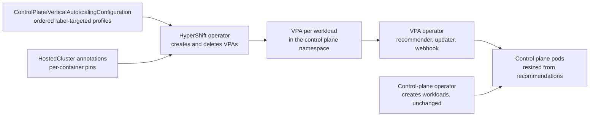

# Control Plane Vertical Autoscaling for Hosted Control Planes

## Summary

This enhancement lets a management cluster administrator resize hosted control plane components with the Vertical Pod Autoscaler (VPA), on every platform and control plane topology.
A new cluster-scoped `ControlPlaneVerticalAutoscalingConfiguration` holds an ordered list of profiles. Each profile selects HostedClusters by label and sets VPA settings for control plane workloads, using the field names and structure of a `VerticalPodAutoscaler` spec.
Matching profiles are layered, so the fleet baseline, canaries, tiers and pausing one cluster each state only what differs. The HyperShift operator creates the VPAs directly, so control planes on every supported release get the feature without a control-plane operator change.

Vertical autoscaling and `ClusterSizingConfiguration` size classes are mutually exclusive: each HostedCluster uses one or the other, and the existing sizing code is unchanged.

## Motivation

Control plane resource needs follow the hosted cluster's size and usage. kube-apiserver, openshift-apiserver and kube-controller-manager keep caches that grow with the number of objects and watches in the hosted cluster. Fixed requests either waste management cluster capacity on small clusters or leave large clusters exposed to OOM kills and CPU throttling.

HyperShift sizes control planes today only in some configurations, and only with coarse size classes:

- `ClusterSizingConfiguration` sets requests per size class, chosen by worker node count, which is a weak proxy for API load. It is used on AWS with the dedicated request-serving topology and on ARO HCP. Control planes on AWS's shared topology, and on other platforms, are not sized at all and run with their template requests.
- The resource-based control plane autoscaler chooses the size class from kube-apiserver's memory usage instead of node count, using a recommendation-only VPA. HyperShift then applies that class's requests to the whole control plane. It only works with the AWS dedicated request-serving topology.
- The `resource-request-override.hypershift.openshift.io/<workload>.<container>` annotation sets requests by hand, one cluster at a time.

None of these can be reused across platforms and topologies. Each is tied to a specific scheduler and node layout, and sizes the whole control plane from one signal, node count or kube-apiserver memory, into classes tuned by hand.
What's missing is one mechanism that works the same everywhere and sizes each component from its own usage.

### User Stories

- As a management cluster administrator, I want control plane components to request resources based on their observed usage, so that small hosted clusters don't hold idle capacity and large ones aren't OOM-killed.
- As a management cluster administrator, I want to define autoscaling once for the fleet and roll changes out to a labelled subset of hosted clusters first, so that the fleet is consistent and a bad setting doesn't disrupt every cluster.
- As a management cluster administrator, I want to choose which workloads and containers are autoscaled, and within which bounds, so that sidecars and components I haven't validated keep their template requests.
- As an SRE, I want to pin the request of one container on one hosted cluster, higher or lower than the autoscaler chose, or pause autoscaling on that cluster, so that I can stop an incident without turning the feature off for the fleet.
- As an SRE, I want to see which workloads are autoscaled and with which settings, so that misconfigurations and forgotten emergency settings are visible.

### Goals

- A management-cluster API of label-targeted, layered profiles that mirrors the VPA spec, so the effective VPA of a workload can be read from the configuration.
- Opt-in autoscaling: only containers that a profile names are autoscaled.
- Works on every platform and topology, and for every control plane release the HyperShift operator supports.
- Per-HostedCluster emergency controls: a per-container request pin, and a pause.
- A clear boundary with `ClusterSizingConfiguration`: a HostedCluster uses one mechanism or the other.
- Status reporting per HostedCluster and as metrics.

### Non-Goals

- Installing or managing the VPA operator. It is a prerequisite on the management cluster.
- Building or shipping a recommender. The VPAs use the VPA operator's default recommender.
- Exposing every VPA field in the first version. Recommender selection, `controlledValues`, `controlledResources`, container `mode` and `evictionRequirements` can be added later under their VPA names.
- Coexisting with `ClusterSizingConfiguration` on the same HostedCluster.
- Changing API server flags such as `--max-requests-inflight` or GOMEMLIMIT from VPA recommendations.
- Horizontal scaling of control plane components, or autoscaling anything in the hosted cluster's data plane.
- A new field on the HostedCluster or HostedControlPlane API.

## Proposal

Add a cluster-scoped singleton, `ControlPlaneVerticalAutoscalingConfiguration`, to the `scheduling.hypershift.openshift.io` API group. For each selected and eligible HostedCluster, the HyperShift operator resolves the configuration and creates one VPA per autoscaled workload in the control plane namespace.
All new API surface is behind the `ControlPlaneVerticalAutoscaling` feature gate.

### Workflow Description

**Management cluster administrator** installs the VPA operator and creates the configuration.

**SRE** operates individual hosted clusters and may set pin annotations and pause labels.

**HyperShift operator** resolves the configuration per HostedCluster and creates, updates and deletes the VPAs in its control plane namespace.

**Control-plane operator** is unchanged; it creates the workloads the VPAs target.

1. The administrator installs the VPA operator with its updater and admission controller running, and leaves the admission webhook's failure policy at its default, `Ignore`, so that a webhook outage doesn't block control plane pods.
2. The administrator creates `ControlPlaneVerticalAutoscalingConfiguration` named `cluster`, selecting HostedClusters and listing profiles: usually one for every cluster, followed by profiles for labelled subsets.
3. For each selected HostedCluster, the HyperShift operator skips clusters sized by `ClusterSizingConfiguration`, deletes any VPAs it created there, and reports them as `ClusterSizingActive`.
4. For each eligible cluster, it merges the matching profiles in order, applies pin annotations, and creates or updates one VPA per workload that has a named container. VPAs for workloads that are no longer autoscaled are deleted.
5. The VPA recommender, updater and admission controller resize the pods.
6. To roll out a change in waves, the administrator labels HostedClusters and adds a profile selecting that label, with only the fields that change.
7. During an incident, an SRE pins one container's request, or pauses the cluster by adding a label that the last profile selects.



### API Extensions

#### New CRD: ControlPlaneVerticalAutoscalingConfiguration

Cluster-scoped, in `scheduling.hypershift.openshift.io/v1alpha1`. Only the instance named `cluster` is honoured. The CRD is installed only with the `TechPreviewNoUpgrade` feature set.

| Field | Purpose |
| --- | --- |
| `hostedClusters` | Which HostedClusters the configuration applies to: `type: All`, or `type: Selector` with a label `selector`. Profiles only apply to clusters selected here. |
| `profiles` | An ordered list of profiles. Each has a `name`, a `hostedClusters` selection of the same shape, and `allWorkloads`, `workloads` or both. |
| `profiles[].allWorkloads.updatePolicy` | The VPA `spec.updatePolicy` for every autoscaled workload of the matching clusters. It never makes a workload autoscaled. |
| `profiles[].workloads[]` | One workload, identified by `resource` (`deployments` or `statefulsets`) and `name`, with an optional `updatePolicy` and `resourcePolicy`. |
| `updatePolicy` | VPA `spec.updatePolicy`: `updateMode` (`Off`, `Initial`, `Recreate`, `InPlaceOrRecreate`) and `minReplicas`. |
| `resourcePolicy.containerPolicies[]` | VPA container policies: `containerName`, and optional `minAllowed` and `maxAllowed` with `cpu` and `memory`. Naming a container makes it autoscaled. |

Each field is a VPA field in the VPA's place. Where it differs from the VPA:

| This API | VPA field | Difference |
| --- | --- | --- |
| `workloads[].resource`, `name` | `spec.targetRef.kind`, `name` | Only `apps/v1` Deployments and StatefulSets. Named `resource` because OpenShift API conventions don't allow a field named `kind`. |
| `updatePolicy.updateMode` | `spec.updatePolicy.updateMode` | Without the deprecated `Auto` and the feature-gated `InPlace`. Defaults to `Off`. |
| `containerPolicies[].containerName` | same | `"*"` isn't accepted; every autoscaled container is named. |
| `minAllowed`, `maxAllowed` | same | Only `cpu` and `memory`, as strings (`cpu: "2"`). |

Workload and container names aren't limited to a fixed list, because control plane workloads differ between releases and platforms; a name that doesn't exist on a cluster is reported in that cluster's condition rather than rejected.

The generated VPAs also differ from VPA defaults in two fixed ways: containers that no profile names get `mode: Off`, and `controlledValues` is `RequestsOnly`, so limits keep their template value.

**Resolution.** For each workload of a cluster, the operator walks the matching profiles in list order. Within a profile, `allWorkloads` applies first and the workload's own entry second. Every field that is set replaces the earlier value; container policies merge by `containerName` and bounds by resource, so a profile can raise `minAllowed.memory` without restating anything else.
A workload gets a VPA only when at least one matching profile names one of its containers. List order is the only precedence rule: the fleet profile goes first, profiles that must win, such as a pause, last. A later profile can change a value but not remove one.

**Extending the API.** New VPA capabilities are added as optional fields under the VPA's name and in the VPA's place (`recommenders` next to `updatePolicy`, `evictionRequirements` in `updatePolicy`, `controlledValues` in container policies).
Unset fields inherit from earlier profiles. When no profile sets a new field, the VPA keeps the behaviour described above, for example `controlledValues: RequestsOnly`, so existing configurations don't change.

Example: a provider that autoscales every control plane, starts new clusters bigger, sells a premium tier, and can pause one cluster during an incident. Values are illustrative.

```yaml
apiVersion: scheduling.hypershift.openshift.io/v1alpha1
kind: ControlPlaneVerticalAutoscalingConfiguration
metadata:
  name: cluster
spec:
  hostedClusters:
    type: All
  profiles:
    # Every cluster: the workloads to autoscale, their main container and
    # bounds. Sidecars aren't named, so they keep their template requests.
    - name: base
      hostedClusters: { type: All }
      allWorkloads:
        updatePolicy:
          updateMode: InPlaceOrRecreate
      workloads:
        - resource: deployments
          name: kube-apiserver
          resourcePolicy:
            containerPolicies:
              - containerName: kube-apiserver
                minAllowed: { cpu: 350m, memory: 2Gi }
                maxAllowed: { cpu: "14", memory: 56Gi }
        # A single-replica operator: a restart is harmless, so the VPA
        # updater may resize it. Elsewhere the updater's default of 2 applies,
        # so the only replica of a SingleReplica control plane isn't evicted.
        - resource: deployments
          name: cluster-version-operator
          updatePolicy:
            minReplicas: 1
          resourcePolicy:
            containerPolicies:
              - containerName: cluster-version-operator
                minAllowed: { cpu: 20m, memory: 70Mi }
                maxAllowed: { cpu: "2", memory: 4Gi }
        - resource: statefulsets
          name: etcd
          resourcePolicy:
            containerPolicies:
              - containerName: etcd
                minAllowed: { cpu: 300m, memory: 600Mi }
                maxAllowed: { cpu: "14", memory: 56Gi }
        # ... one entry per other control plane workload to autoscale.

    # New clusters: higher minimums while the VPA has no history. Clusters
    # with a tier use the tier's minimums instead.
    - name: warmup
      hostedClusters:
        type: Selector
        selector:
          matchLabels: { control-plane-autoscaling-warmup: "true" }
          matchExpressions:
            - { key: control-plane-autoscaling-tier, operator: DoesNotExist }
      workloads:
        - resource: deployments
          name: kube-apiserver
          resourcePolicy:
            containerPolicies:
              - containerName: kube-apiserver
                minAllowed: { cpu: "2", memory: 8Gi }

    - name: premium
      hostedClusters:
        type: Selector
        selector:
          matchLabels: { control-plane-autoscaling-tier: premium }
      workloads:
        - resource: deployments
          name: kube-apiserver
          resourcePolicy:
            containerPolicies:
              - containerName: kube-apiserver
                minAllowed: { cpu: "4", memory: 24Gi }
                maxAllowed: { cpu: "30", memory: 120Gi }

    # Last, so it wins: stop resizing running pods on one cluster.
    - name: paused
      hostedClusters:
        type: Selector
        selector:
          matchLabels: { control-plane-autoscaling-paused: "true" }
      allWorkloads:
        updatePolicy:
          updateMode: Initial
```

The resulting kube-apiserver VPA settings:

| HostedCluster labels | Profiles applied | Update mode | `minAllowed` | `maxAllowed` |
| --- | --- | --- | --- | --- |
| none | base | `InPlaceOrRecreate` | 350m, 2Gi | 14, 56Gi |
| warmup | base, warmup | `InPlaceOrRecreate` | 2, 8Gi | 14, 56Gi |
| warmup, premium | base, premium | `InPlaceOrRecreate` | 4, 24Gi | 30, 120Gi |
| premium, paused | base, premium, paused | `Initial` | 4, 24Gi | 30, 120Gi |

The VPA the operator creates for kube-apiserver on a premium cluster `clusters/example`:

```yaml
apiVersion: autoscaling.k8s.io/v1
kind: VerticalPodAutoscaler
metadata:
  name: kube-apiserver-cp-autoscaling
  namespace: clusters-example
  labels:
    hypershift.openshift.io/control-plane-vertical-autoscaling-managed: "true"
  annotations:
    hypershift.openshift.io/cluster: clusters/example
    hypershift.openshift.io/control-plane-vertical-autoscaling-profiles: base,premium
  ownerReferences:
    - apiVersion: hypershift.openshift.io/v1beta1
      kind: HostedControlPlane
      name: example
      uid: <HostedControlPlane UID>
spec:
  targetRef:
    apiVersion: apps/v1
    kind: Deployment
    name: kube-apiserver
  updatePolicy:
    updateMode: InPlaceOrRecreate
  resourcePolicy:
    containerPolicies:
      - containerName: "*"             # containers no profile names
        mode: "Off"
      - containerName: kube-apiserver
        controlledValues: RequestsOnly
        minAllowed: { cpu: "4", memory: 24Gi }
        maxAllowed: { cpu: "30", memory: 120Gi }
```

#### Per-cluster emergency controls

Planned per-cluster differences, such as canaries and tiers, belong in label-selected profiles. Two controls cover incidents on one cluster:

| Control | How | Effect |
| --- | --- | --- |
| Per-container pin | The existing `resource-request-override.hypershift.openshift.io/<workload>.<container>` annotation, for example `memory=12Gi` | On an autoscaled container, `minAllowed` and `maxAllowed` of each resource it sets become that value on this cluster, replacing the profiles' bounds. Other resources keep autoscaling. On other containers it sets the request, as today. |
| Pause | A label on the HostedCluster, selected by a pause profile listed last | The VPAs stop changing running pods on this cluster until the label is removed. Recommendations keep being computed. |

A pin brings a container down as well as up, so it covers both an OOM-killed component and one the autoscaler made far too large. The VPA applies it to new pods, and with `Recreate` or `InPlaceOrRecreate` also to running pods.
This works for every workload in the namespace, including those that other operators create, which don't read the annotation. On workloads the control-plane operator creates, it also sets the template request to the same value, which rolls the workload.

A pause profile with `updateMode: Initial` keeps running pods unchanged and gives restarted pods the current recommendation, or the pinned value; `Off` gives restarted pods their template requests, for when the recommendations themselves are wrong.
Active pins are listed in the HostedCluster condition, so emergency settings aren't forgotten after the incident.

#### Conditions

A new HostedCluster condition, `ControlPlaneVerticalAutoscaling`, set only on HostedClusters that the configuration selects:

| Status | Reason | Meaning |
| --- | --- | --- |
| True | `AsExpected` | Every autoscaled workload that exists has a VPA. The message lists the matching profiles, autoscaled workloads and active pins. |
| False | `ClusterSizingActive` | The cluster is selected but sized by `ClusterSizingConfiguration`. |
| False | `VPANotInstalled` | The VPA API isn't served on the management cluster. |
| False | `VPAConflict` | A VPA the operator doesn't own targets an autoscaled workload, so that workload is skipped. |
| False | `VPARejected` | The API server rejected a VPA, for example because the installed VPA doesn't support `InPlaceOrRecreate`. |

The message also lists configured workloads and containers that don't exist on the cluster, pins above the configured `maxAllowed` and invalid pin annotations.
Whether the VPAs receive recommendations isn't reported here. A recommender that isn't working affects every VPA on the management cluster, so it is monitored once, on the VPA operator, rather than on every HostedCluster.
The configuration itself has no status; the per-cluster condition is exported as a metric for a fleet view.

### Topology Considerations

#### Hypershift / Hosted Control Planes

This enhancement applies only to hosted control planes, on every platform and topology. On `SingleReplica` control planes, the VPA updater's own `minReplicas` check, which defaults to 2, keeps it from evicting the only replica of a component. Administrators set `minReplicas: 1` only on workloads whose restart is harmless.

#### Standalone Clusters

Not applicable. Standalone control planes run as static pods, which VPA can't manage.

#### Single-node Deployments or MicroShift

Not applicable.

#### OpenShift Kubernetes Engine

Not applicable.

### Implementation Details/Notes/Constraints

A new HyperShift operator controller does all the work; the control-plane operator and the HostedCluster and HostedControlPlane APIs are unchanged, and no RBAC change is needed.

- **VPAs.** One per autoscaled workload, labelled as managed, annotated with the profiles that set it, and owned by the HostedControlPlane. The VPA spec is the merged result, so it shows the effective settings.
- **Conflicts.** A workload already targeted by a VPA the operator doesn't own is skipped and reported, because two VPAs on one pod give conflicting recommendations. If the operator had already created a VPA for it, that VPA is deleted, and created again once the other VPA is gone.
- **No VPA watch.** The recommender updates every VPA's status often, and the operator doesn't use it, so VPAs aren't watched or cached. The operator lists the VPAs of one control plane namespace from the API server when it reconciles that HostedCluster, and reconciles every selected HostedCluster at least every 10 minutes, which restores a VPA that someone else changed or deleted.
- **Paused reconciliation.** While `spec.pausedUntil` pauses a HostedCluster, the operator doesn't change its VPAs or condition. The VPA keeps resizing pods; the pause profile is the way to stop that.

#### Precedence with existing resource settings

| Source | Container not autoscaled, or `updateMode: Off` | `Initial`, `Recreate` or `InPlaceOrRecreate` |
| --- | --- | --- |
| Workload template resources | Applied as today | Starting values; the VPA replaces them at pod admission |
| `resource-request-override` annotation | Sets the request, as today | Pins the container: `minAllowed` and `maxAllowed` for each resource it sets. The control-plane operator also sets the template request. |

#### Exclusivity with cluster sizing

A size class sets requests, priority classes, GOMEMLIMIT and inflight limits, and on AWS also placement on dedicated request-serving nodes. Combining it with VPA would give two owners for the same requests.

A cluster counts as sized by `ClusterSizingConfiguration` when it has a size-class label, or the annotation that lets the resource-based autoscaler choose its class. Such clusters are ineligible and reported as `ClusterSizingActive`.
The sizing controllers and their recommendation-only VPA are unchanged, and this feature never creates a VPA in those namespaces. Moving a cluster to vertical autoscaling is an administrator action: remove both.

### Risks and Mitigations

| Risk | Mitigation |
| --- | --- |
| A fleet-wide configuration change resizes pods in many control planes at once | Roll changes out through a profile on labelled clusters first; VPA updater rate limits and `InPlaceOrRecreate` limit evictions. |
| The VPA undersizes a component, for example a new cluster without history or a sudden load spike, and it is OOM-killed | Fleet-wide `minAllowed`, higher minimums for new clusters, and a per-container pin an SRE can set on one cluster. |
| Resizing etcd risks quorum | Evictions respect etcd's PodDisruptionBudget, so one member moves at a time; `InPlaceOrRecreate` avoids most evictions; etcd can be left out of the configuration. |
| The VPA oversizes a component, wasting capacity or leaving pods Pending | `maxAllowed` per container, set to fit the management cluster's nodes, and a per-container pin an SRE can set lower on one cluster. |

### Drawbacks

- Adds a runtime dependency on the VPA operator, with its admission webhook in the pod creation path of control plane components. With its default failure policy the webhook fails open, so an outage leaves pods at template requests.
- Providers must choose per cluster between size classes and vertical autoscaling; dedicated request-serving placement isn't available to autoscaled clusters.
- A cluster's effective settings are a merge of several profiles. The generated VPAs and the condition show the result per cluster.
- The pin is an annotation, which is not schema-validated and is harder to discover than an API field. A pinned resource stops autoscaling until the annotation is removed.
- The default recommender's percentile-based sizing is a weaker fit for API servers than a tuned recommender, which can be added later through `recommenders`.

## Alternatives (Not Implemented)

- **Extend the resource-based control plane autoscaler to every platform and topology.** It already observes kube-apiserver with a recommendation-only VPA, and could choose a size class everywhere.
  Rejected because it still sizes the whole control plane by one component's usage into a few fixed classes, and today it depends on dedicated request-serving nodes, whose placement doesn't exist on shared topologies or other platforms.
- **Extend node-count size classes (`ClusterSizingConfiguration`) to every platform and topology.** ARO HCP already uses size classes without dedicated request-serving nodes, so AWS's shared topology could too.
  Rejected because node count is a weak proxy for API load, every component in a class gets the same template, and classes have to be tuned by hand per platform. It is still the right choice for providers that want fixed, predictable sizes.
- **Let VPA tune requests within a size class.** Rejected because it gives two owners for the same requests and requires reworking the existing sizing controllers.
- **The control-plane operator creates the VPAs.** It knows each workload and its containers. Rejected because it ships in each cluster's release payload: only new releases would get the feature, every policy fix would need a release, and workloads that other operators create in the namespace would be missed.
- **A field on HostedCluster or HostedControlPlane.** Rejected for now: the settings depend on the management cluster, would be repeated on every HostedCluster, and would put provider settings on the customer-facing API. It can be added later for self-managed users.
- **One profile per cluster instead of layered profiles.** Simpler to read, but tiers, warm-up, canaries and pause combine, and each combination would need its own profile with a full copy of the workload list.
- **The override as a floor.** It would only raise the container's minimum, so autoscaling stays on above it, but an SRE couldn't bring an oversized container down.
- **Turn autoscaling off for an overridden container, or delete its VPA.** The template request would then apply, but only on workloads that the control-plane operator creates; on workloads from other operators the override would do nothing. Deleting the VPA would also drop its history and its other containers.
- **Embed the VPA's Go types.** A full passthrough would track every VPA field, but make the HyperShift API depend on the VPA module, change with every VPA bump, and carry deprecated modes and the VPA's loose validation.

## Test Plan

- **Unit:** resolution (eligibility, selection, ordered merge, pins) and VPA reconciliation (creation, deletion, conflicts, paused reconciliation, the VPA API appearing and disappearing).
- **API:** every CEL rule, in the CRD validation test suite, against every supported management cluster Kubernetes version.
- **E2E**, in the v2 suite with the VPA operator installed: a configuration that selects the test's HostedCluster creates a VPA for each configured workload. Resizing itself is the VPA operator's behaviour and is covered by its own tests.

## Graduation Criteria

### Dev Preview -> Tech Preview

- API and controller behind `ControlPlaneVerticalAutoscaling`, enabled for `TechPreviewNoUpgrade`.
- Unit and E2E tests passing.
- Documentation of prerequisites, precedence, profile ordering and recommended profiles.
- Validated on at least one platform.

### Tech Preview -> GA

- Running in production on at least one managed offering for one release, with no control plane outages attributed to the feature.
- Upgrade and downgrade tested.
- Alerts and runbooks for `VPAConflict`, a VPA recommender that isn't producing recommendations, and repeated OOM kills of autoscaled workloads.
- Final API group and version decided.
- E2E tests meet the OpenShift feature promotion pass-rate requirement.

### Removing a deprecated feature

Not applicable.

## Upgrade / Downgrade Strategy

**Upgrade.** Nothing changes until an administrator creates the configuration. Clusters using size classes are unaffected.

**Downgrade of the HyperShift operator, or disabling the feature gate.** The VPAs keep their last settings and the conditions stay until the control plane is deleted. Deleting the configuration first removes both. Override annotations keep working as plain request overrides.

**Hosted cluster version upgrade.** The rollout restarts pods, and the VPA admission controller sets the recommended resources on the new pods, so an upgrade doesn't reset sizing.

## Version Skew Strategy

The feature doesn't depend on the control-plane operator's version.

- **Workload names.** Releases may have different Deployments and StatefulSets. A configured name that doesn't exist is skipped and listed in the condition.
- **VPA operator version.** `InPlaceOrRecreate` requires a VPA and Kubernetes version that support in-place pod resize. Otherwise the VPA is rejected and reported as `VPARejected`; administrators use `Recreate` there.
- **Management cluster Kubernetes version.** The CRD's validation uses the CEL quantity library, available from Kubernetes 1.30 (OpenShift 4.17).

## Operational Aspects of API Extensions

- **New CRD.** A single cluster-scoped object read by the HyperShift operator. No webhooks, admission policies or finalizers.
- **HyperShift operator load.** The operator adds a cache of every StatefulSet on the management cluster, and never watches pods or VPAs. Each reconcile of a selected HostedCluster lists the VPAs of its namespace from the API server: at 500 HostedClusters and a 10-minute resync, about one small list per second.
  The one burst is the first configuration on a full management cluster, which creates every VPA at once, paced by the operator's client rate limit.
- **VPA operator load.** One VPA per autoscaled workload per hosted control plane. Each adds recommender memory and updater work; the VPA operator's sizing guidance applies.
- **Admission path.** The VPA's mutating webhook is in the pod creation path for control plane pods. It fails open with its default failure policy, `Ignore`; the VPA admission controller's `--webhook-failure-policy-fail` flag must not be set.
- **Failure modes.** Missing VPA operator, missing workloads, conflicting or rejected VPAs and invalid annotations are reported in the condition. None block control plane reconciliation.
- **Metrics.** `hypershift_control_plane_vertical_autoscaling_workloads` (autoscaled workloads per HostedCluster and update mode), `hypershift_control_plane_vertical_autoscaling_profile` (profiles matching each HostedCluster) and `hypershift_control_plane_vertical_autoscaling_condition` (each selected HostedCluster's condition status and reason, the fleet view).

## Support Procedures

- **Check whether a cluster is autoscaled.** Look at the `ControlPlaneVerticalAutoscaling` condition, and `oc get vpa -n <control plane namespace> -l hypershift.openshift.io/control-plane-vertical-autoscaling-managed=true`. Each VPA's spec shows the merged settings and its annotation the profiles applied.
- **VPAs have no recommendations.** `oc get vpa -n <control plane namespace>` shows each VPA's recommendation. If none has one, check that the VPA recommender is running.
- **A container is repeatedly OOM-killed, or far too large.** Pin it, for example `resource-request-override.hypershift.openshift.io/kube-apiserver.kube-apiserver: memory=12Gi` on the HostedCluster. Then fix the profiles' bounds and remove the annotation.
- **Autoscaling is making things worse on one cluster.** Add the pause label to the HostedCluster.
- **Pods are Pending after a resize.** Lower `maxAllowed` to fit the nodes.
- **Disable the feature for the fleet.** Delete the configuration. VPAs and conditions are deleted; pods return to template requests on their next restart.
- **Must-gather.** `hypershift dump cluster` collects the VPAs and the configuration.
