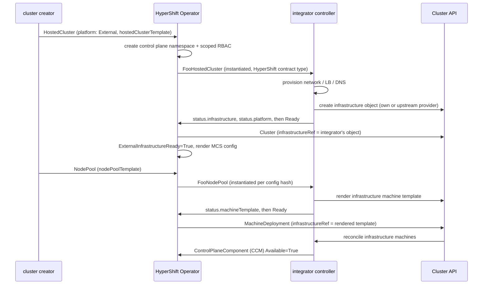

# HyperShift External Platform

## Summary

Add `platform: External` to HostedCluster, so a platform can be integrated without code in the
HyperShift repository.

A HostedCluster references an integrator-owned *hosted cluster template*, and a NodePool references
an integrator-owned *node pool template*. HyperShift instantiates each into the control plane
namespace, grants the integrator scoped RBAC there, and then only reads status. All cloud behaviour
(infrastructure, machines, CCM, CSI, DNS, load balancing) comes from a controller the integrator
ships and versions independently.

This is the HyperShift equivalent of standalone OpenShift's `PlatformType: External`, and produces a
guest cluster with exactly that `Infrastructure` shape.

Red Hat supports the contract, a Go module, and a conformance suite integrators run in their own CI.
Red Hat does not support any integrator's implementation.

## Motivation

Adding a platform in-tree takes quarters (GCP most recently), puts the partner's release cadence
inside OpenShift's, puts third-party code inside Red Hat's support boundary, and caps platform count
at what the HyperShift team can personally maintain.

### User Stories

- As an integrator, I ship and patch platform support on my own cadence, against a versioned
  contract, without contributing to the HyperShift repository.
- As a management cluster admin, I explicitly register which integrations may run, so installing a
  partner's CRDs does not by itself grant access to my tenants' control plane namespaces.
- As an SRE, a stuck external HostedCluster surfaces through the same conditions, events and
  `must-gather` output as an in-tree one, and names who is responsible.

### Goals

- Create, scale, upgrade and delete a HostedCluster on a platform HyperShift has no knowledge of.
- A versioned contract testable outside the HyperShift repository.
- Integrator isolation: one integrator cannot reach another's tenants.

### Non-Goals

- Replacing any in-tree platform, or migrating between platform types (type remains immutable).
  - As a future maintainability task, we may consider extracting the in-tree platform code based on the contract set out in this proposal.
- Red Hat qualifying or certifying any integrator's controller.

## Proposal

### Contract types

The integrator defines two template-and-instance pairs in their own API group, satisfying schemas
HyperShift publishes: `FooHostedClusterTemplate`/`FooHostedCluster` for the cluster, and
`FooNodePoolTemplate`/`FooNodePool` for compute. (Note, these are HyperShift contract types, not
Cluster API types). The template-and-instance split exists because the instance must live in the
control plane namespace, which does not exist when the user writes the HostedCluster.

Both halves use the same pattern deliberately: one mental model, one instantiation code path, one
set of conformance assertions.

The integrator owns `spec` entirely, except for a reserved section HyperShift populates (below).
HyperShift reads only status.

```yaml
# FooHostedCluster
status:
  # CAPI infrastructure object the integrator stood up. HyperShift copies this into
  # Cluster.spec.infrastructureRef. May be the integrator's own type or an upstream
  # provider's. Kind, not resource: CAPI addresses by GVK.
  infrastructure:
    apiGroup: infrastructure.cluster.x-k8s.io
    kind: AWSCluster
    name: my-cluster
  platform:
    name: ExampleCloud
    cloudControllerManager:
      state: External   # or None
  conditions:
    - type: Ready
```

`status.platform` maps to `platformStatus.external.{platformName,cloudControllerManager.state}` in
the guest `Infrastructure`.

```yaml
# FooNodePool
status:
  # Genuine CAPI infrastructure machine template the integrator rendered, in this namespace.
  # HyperShift copies this into MachineDeployment.spec.template.spec.infrastructureRef.
  machineTemplate:
    apiGroup: infrastructure.cluster.x-k8s.io
    kind: AWSMachineTemplate
    name: my-pool-7f3a9c21
  platformImage: ami-0abc123     # optional; surfaces as NodePool ValidPlatformImage
  conditions:
    - type: Ready
```

HyperShift maps `FooNodePool` status onto the NodePool conditions that already exist for in-tree
platforms — `ValidMachineTemplate`, `ValidPlatformConfig`, `ValidPlatformImage` — so a
misconfiguration reads as "your instance type is wrong" rather than "machines never appeared".

**HyperShift-owned spec inputs.** At instantiation HyperShift populates a reserved section of the
instance spec, the analogue of `spec.controlPlaneEndpoint` on the cluster side: release image and
version, architecture, the ignition endpoint URL and token secret name, `infraID`, and the pull
secret reference. The integrator consumes these however their platform requires.

Two things are deliberately *not* passed this way. Bootstrap data stays HyperShift's: the rendered
machine template must leave CAPI's bootstrap fields empty, and HyperShift sets
`MachineSpec.Bootstrap.DataSecretName` on the MachineDeployment exactly as it does today. Node
labels and taints are likewise excluded, because they are propagated out of band onto Machines
precisely so that editing them does not roll the pool.

### HyperShift Operator responsibilities

1. **Instantiate the hosted cluster template** into the control plane namespace: resolve the
   instance resource from the template's by plural naming convention, deep-copy
   `spec.template.spec`, inject `spec.controlPlaneEndpoint`.
2. **Wait**, then create the CAPI `Cluster` with `infrastructureRef` set to the integrator's reported
   `status.infrastructure`.
3. **Grant** a namespaced `Role` + `RoleBinding` in each control plane namespace whose HostedCluster
   references a registered integrator's types.
4. **Instantiate the node pool template** into the control plane namespace, once per configuration
   hash, then wait for `status.machineTemplate` and set it as the MachineDeployment's
   `infrastructureRef`. The MachineDeployment, bootstrap secret, MachineHealthCheck, autoscaling
   annotations and label/taint propagation are unchanged from in-tree platforms.
5. **Read status**, mirroring the integrator's condition message onto the HostedCluster verbatim.
   Everything else (failure domains, etc.) comes from CAPI objects as today.

The integrator reports genuine CAPI objects on both halves — an infrastructure cluster and an
infrastructure machine template — so they can wrap CAPA, CAPZ or any CAPI compliant provider rather
than writing one from scratch. On the machine half this is strictly better than having the user
author the template directly, because the integrator can inject HyperShift's release image,
architecture and ignition endpoint into an off-the-shelf `AWSMachineTemplate` instead of asking the
user to transcribe them.

### Integrator deployment model

One fleet-wide controller per management cluster, installed by the admin. Optionally per-cluster
workloads (CCM, CSI) in control plane namespaces, reporting through `ControlPlaneComponent`.

### Workflow Description

**Registration is separate from CRD installation.** The admin re-runs `hypershift install` with:

```text
--external-platform-provider=<contractAPIGroup>/<Kind>=<namespace>/<serviceaccount>
```

One registration covers both contract types, since they share an API group.

HyperShift needs no grant on the integrator's machine templates. It never reads one: it writes the
reported reference into the MachineDeployment, and CAPI's own controllers resolve it under grants
they already hold. Template lifecycle, including garbage collection of superseded templates,
belongs to the integrator who created them.

HyperShift mints a ClusterRole per registered group, and namespaced bindings only in namespaces of
HostedClusters referencing them. Installing a CRD is cluster-scoped and must not imply consent to
read tenant namespaces.



**Provisioning failure.** Integrator sets `Ready=False`; HyperShift copies the message onto
`ExternalInfrastructureReady`. After 30 minutes it also sets `Degraded=True`, so a crashed integrator
is distinguishable from a slow one and does not read as a HyperShift hang.

**Deletion ordering.** NodePools → Machines (stock CAPI) → `FooNodePool` → `Cluster` →
`FooHostedCluster`. HyperShift deletes both instances directly, since neither is a CAPI object and
so neither gets a cascade. Integrator finalizers on them hold while cloud resources are torn down;
the machine template is the integrator's to remove behind their own `FooNodePool` finalizer. **The
control plane namespace is deleted last**, because it holds the RoleBinding and guest kubeconfig the
integrator needs to finish.

**Escape hatch.** `hypershift.openshift.io/force-external-cleanup=true` strips integrator
finalizers from both instance types after a timeout, leaking whatever had not been cleaned up. Emits an Event and sets `Degraded`.
Deliberate trade of leaked resources against permanently undeletable HostedClusters.

### API Extensions

| Resource | Change |
| --- | --- |
| `hostedclusters` | New `External` platform type + `spec.platform.external`, behind an `ExternalPlatform` feature gate; new read-only `status.platform.name` |
| `nodepools` | New `spec.platform.external.nodePoolTemplate` |
| `controlplanecomponents` | No schema change; existing unfiltered aggregation becomes a documented extension point |
| Integrator CRDs | Consumed via unstructured clients. HyperShift does not define, validate or convert them |
| guest `infrastructures.config.openshift.io` | Populated with the existing External platform fields. No new fields |

```yaml
spec:
  platform:
    type: External
    external:
      hostedClusterTemplate:
        apiGroup: example.io
        resource: foohostedclustertemplates
        name: my-infra
```

Required and immutable. `status.platform.name` exists because
otherwise `kubectl get hostedcluster` shows `External` for every external cluster.

The NodePool reference has the same `{apiGroup, resource, name}` shape and the same plural-naming
resolution, and differs in one way: it is **mutable**. Editing it is how instance shape and image
change, triggering a roll exactly as `spec.platform.aws.instanceType` does today.

```yaml
spec:
  platform:
    type: External
    external:
      nodePoolTemplate:
        apiGroup: example.io
        resource: foonodepooltemplates
        name: my-workers
```

**Instantiation is per configuration hash.** HyperShift creates
`<nodepool>-<hash(template spec)>`, replacing the per-hash machine template copy it makes for
in-tree platforms today. Each instance is immutable once created, so the copy-once rule holds on
this half too.

**The rollout trigger is `status.machineTemplate.name`.** HyperShift repoints `infrastructureRef`
and CAPI rolls the pool if and only if that name changes — which is precisely what the NodePool
controller already does for `AWSMachineTemplate`. The decision about whether a given edit warrants
replacing nodes therefore sits with the integrator, who knows their own schema, and is expressed by
whether they render a new template name.

That matters more than it first appears. In-tree, HyperShift carves fields out of the rollout hash
by hand because it knows what they mean: AWS `additionalTags` are excluded so that retagging does
not replace every worker, and labels and taints are propagated onto Machines out of band for the
same reason. Against a schema HyperShift has never seen, no such judgement is possible — every
field would be a rollout trigger. Delegating the decision recovers those carve-outs generically,
for every platform, with no additional API surface.

### Topology Considerations

#### Hypershift / Hosted Control Planes

No always-on components added. The integrator's fleet controller is one deployment installed by the
admin; per-cluster integrator workloads inherit HyperShift's resource requests, priority classes and
spread defaults via `ControlPlaneComponent`.

> **The one hazard.** The guest `Infrastructure` is serialised into the machine config server
> configuration, which feeds the NodePool config hash. Any change rolls every node.

Therefore: MCS rendering **blocks** until `status.platform` is present, and both of its values
are immutable afterwards. A change raises `Degraded` and is ignored.
Sourcing these from the integrator rather than the HostedCluster spec is what makes this ordering
rule load-bearing, and why the shipped library owns it rather than each integrator.

#### Standalone Clusters

Not affected; no new fields in `openshift/api`. The guest sees exactly the standalone External
`Infrastructure` shape, which is what lets MCO, CCM and CSI behave unmodified.

#### Single-node Deployments or MicroShift

Not applicable.

#### OpenShift Kubernetes Engine

No impact.

### Implementation Details/Notes/Constraints

**Instantiation is once-only, on both halves.** Spec is copied at creation and not reconciled;
only `controlPlaneEndpoint` is maintained on `FooHostedCluster`. Avoids fighting the integrator over
defaulted or observed fields.

The HostedCluster template reference being immutable means there is no "template changed" case
there. The NodePool reference *is* mutable, which is why instances are per-hash rather than
per-NodePool: a template edit produces a new instance rather than mutating a live one, so the
immutability rule survives contact with a mutable reference. Superseded instances are garbage
collected once no MachineSet references the template they produced, the same shape as the existing
machine template cleanup.

**Ordering is instantiate → wait → create `Cluster`**, unlike in-tree platforms which create both at
once. Consequence: absence of the `Cluster` is a normal intermediate state, not a fault, and
conditions must say so. HyperShift validates the reported reference is in a CAPI group and resolves
in the control plane namespace, reporting invalid configuration rather than producing a `Cluster`
that never provisions.

**The hashed object is a user-authored input, which is what makes the hash stable.** Had the
NodePool referenced a machine template directly, HyperShift would be hashing an object the
integrator's own controller may write to, and an integrator who wrote resolved or observed values
back into it would roll the NodePool forever — a fleet-wide failure preventable only by a contract
clause nothing enforces. Hashing `FooNodePoolTemplate` removes the hazard structurally: templates
are inert by construction, HyperShift owns the instance, and the integrator's writes land on
`status`. Integrator CEL and defaulting on their own template CRD are unaffected, since defaulting
fires on write and settles.

**Integrator types use the normal cached client**, which the operator already enables for
unstructured objects, so reconciliation stays watch-driven. This is safe because **registration,
not tenant input, bounds which kinds are ever read** — a HostedCluster naming an unregistered group
is rejected before any read. Informers that are never stopped, and cached cluster-wide, are
accepted on that basis.

The one case needing care: a CRD that exists but denies list or watch leaves an informer that never
syncs, blocking the read. Registration mints the grant, so this only follows a revocation — reads
use a bounded context so it surfaces as invalid configuration rather than a wedged worker. An
absent CRD fails fast in the RESTMapper and reports the same way.

**`ControlPlaneComponent` aggregation is unfiltered** and gates HostedControlPlane availability, so
the contract mandates `status.version`, an owner reference, and an
`hypershift.openshift.io/external-component` label. Without these an integrator can permanently wedge
availability or block version completion. CPO logs unrecognised components; GC is deferred, since
deleting an object a live integrator owns is worse.

**Platform switch audit.** A behaviour-free precursor change makes every platform `switch` explicit
for `External`. The ones with wrong defaults: a `panic` in the NodePool CLI; the architecture support
check (rejects all NodePools); machine template builder and `GetPlatform` (hard error) — for
External the builder instantiates a `FooNodePool` rather than rendering a template; ingress
strategy (silently picks a cloud LB); registry storage (leaves registry degraded); machine health
check timeout (too aggressive for slow provisioning). The cluster storage operator is explicitly
*kept*, since it degrades gracefully without a driver whereas removing it loses the storage API
surface.

**Library.** `github.com/openshift/hypershift/externalplatform`, a separate Go module following the
`api` module precedent, so integrators need not vendor CAPI, CVO, MCO and OLM. Provides contract
constants, a `ControlPlaneComponent` reporter, reconciler skeletons over small `Provisioner` and
`MachineProvisioner` interfaces, and the conformance suite. It takes the platform declaration as a
separate method from provisioning (it is a per-integration constant) and writes both status blocks
before readiness, so a correct implementation cannot trip the render-blocking rule. The
`MachineProvisioner` skeleton hands the integrator HyperShift's reserved spec inputs already
unpacked, and defaults to a content-hash template name so an integrator gets correct rollout
behaviour without thinking about it.

**Contract version** is a label on the integrator's CRD. HyperShift accepts current and predecessor
only; anything else is invalid configuration, not a best-effort attempt. Breaking changes get a new
constant and a two-minor deprecation window. The contract also states which Cluster API contract
version a rendered machine template must satisfy, versioned alongside it.

### Risks and Mitigations

| Risk | Mitigation |
| --- | --- |
| Abandoned or malformed `ControlPlaneComponent` wedges a control plane — the most likely incident | Contract mandate + library correctness + conformance + CPO logging |
| Late or changed `status.platform` rolls every node | Blocked rendering, post-ready immutability, library ordering, conformance assertions |
| Integrator renders an unstable machine template name, rolling nodes on cosmetic edits | The one rollout decision delegated to the integrator, so the one needing explicit coverage: library defaults to a content hash, conformance asserts a no-op template edit produces an unchanged name, e2e covers both the roll and no-roll cases |
| Integrator gains access it should not have | Explicit registration; namespaced RoleBinding so integrators cannot see each other's namespaces; Role grants *named* secrets and excludes etcd secrets and API server signing keys |
| HyperShift/integrator version skew misbehaves silently | Contract label as a hard gate, N and N-1 only, published compatibility matrix, conformance in the integrator's CI |
| Support burden shifts rather than disappears | Conditions must name the external object and copy the provider's message, so triage routes from the condition alone |

Security review should focus on the Role contents and the registration flag; specific rules will be
in the implementation PR.

### Drawbacks

- Converts an internal interface into a public contract. The unfiltered `ControlPlaneComponent`
  aggregation in particular goes from incidental detail to guarantee.
- Weakens "OpenShift on platform X": tested by the integrator, to a standard Red Hat does not
  control. Conformance reduces but does not eliminate this.
- Introduces a failure mode with no in-tree analogue — a HostedCluster undeletable because a third
  party's controller is broken, whose mitigation leaks cloud resources.
- `FooHostedCluster` closely resembles a CAPI infrastructure object without being one; CAPI-literate
  users will wrongly assume contract labels and `clusterctl` apply.
- The integrator writes two controllers rather than one controller and a pair of CRDs. The machine
  half is the cheaper of the two, but it is not free, and it raises the bar to a first integration.
- A second asynchronous hop, and so a second place provisioning can stall. Handled the same way as
  the cluster side: the condition names `FooNodePool`, and a timeout promotes it to `Degraded` so a
  crashed integrator is distinguishable from a slow one.

Accepted because the alternative is not "no external platforms" but "external platforms as one-off
in-tree special cases", with the same risks plus permanent maintenance cost.

## Alternatives (Not Implemented)

| Alternative | Why rejected |
| --- | --- |
| **Make `FooHostedCluster` a real CAPI infrastructure object** (assumed by an earlier draft) | The handoff object carries things CAPI has no concept of — platform name, CCM declaration, future contract growth — so this abuses the CAPI contract and versions HyperShift's needs against CAPI's release cycle. It also forces every integrator to write a provider where a good one exists |
| **Have NodePool reference a CAPI machine template directly** (assumed by an earlier draft) | The mirror of the row above, rejected for the same reason. Expanded below |
| Keep onboarding in-tree | Scales with team capacity, not demand; keeps third-party code inside Red Hat's support boundary |
| HyperShift-owned integration CRD + rendering engine | HyperShift would own every integration's config schema, the exact coupling this removes |
| Direct object reference instead of a template | The instance must live in a namespace that does not exist at HostedCluster creation time |
| Per-HostedCluster integrator controllers deployed by HyperShift (the Agent model) | Cost scales with fleet; HyperShift carries an image reference per integrator; Agent's floating `:latest` is a known problem |
| Go plugins or a webhook `Platform` interface | Impractical across the payload / adds latency and an availability dependency in hosted-on-hosted topologies |
| No registration — grant RBAC to any installed CRD | Installing a CRD must not implicitly confer read access to tenant namespaces |

**On referencing a machine template directly.** The argument for it was that
`MachineDeployment.spec.template.spec.infrastructureRef` must name a genuine Cluster API machine
template, so a handoff object buys nothing and costs a translation layer. That is true of the
reference, and equally true of AWS — where HyperShift also creates a real `AWSMachineTemplate`. The
abstraction was never a substitute for the CAPI object; it is control over who renders its contents.

Giving up that control costs four things. Rollout decisions can no longer be made per field, because
HyperShift cannot judge an unknown schema, so every edit becomes a node replacement. Ignition
plumbing becomes an integrator obligation with a silent failure mode rather than a value HyperShift
supplies. `ValidMachineTemplate` and `ValidPlatformConfig` cannot be set against a schema HyperShift
has never seen, so misconfiguration degrades from a named cause to "no machines appeared". And the
integrator's Cluster API contract version lands permanently in HyperShift's reconcile path.

## Open Questions [optional]

1. Confirm the shape of the ignition inputs HyperShift places in the `FooNodePool` spec with a real
   integrator before the machine management work lands. The endpoint and token secret name are
   certainly needed; whether an integrator whose machine controller cannot follow CAPI's stock
   bootstrap contract needs more than that is the part to verify. Adding to a reserved section is
   cheap; changing its shape after GA is not.
2. Require `status.infrastructure`, or let the integrator own the `Cluster` outright? Current choice
   keeps a single owner; revisit if an integrator wants a shape HyperShift would not produce
   (`ClusterClass`, for instance). Settle before the CAPI wiring lands.
3. Relax zone anti-affinity for External, as for OpenStack and KubeVirt?
4. Should HyperShift ever GC unrecognised `ControlPlaneComponent` resources? Decide before GA.
5. How do per-tenant integrator cloud credentials reach a fleet-singleton controller? Possibly
   answerable entirely within the integrator's own API surface.
6. Confirm private/endpoint-access, KMS and ExternalDNS support is additive rather than a contract
   break.

## Test Plan

Beyond the ordinary unit, CEL/envtest and e2e coverage, three areas carry fleet-wide risk:

- **Guest `Infrastructure` golden files.** MCS output for every *existing* platform must be
  byte-identical before and after; new goldens for External in both CCM states; proof that rendering
  is refused until `status.platform` exists and the resulting hash matches what it would have been —
  i.e. no cluster boots nodes and then rolls them. Also runs the HyperShift Operator upgrade e2e job,
  per repository policy for anything feeding the NodePool config hash.
- **Rollout triggers.** Instance naming is stable across no-op template edits; a template edit
  produces a new instance rather than mutating a live one; `infrastructureRef` is repointed if and
  only if `status.machineTemplate.name` changes. The negative case matters as much as the positive:
  an integrator returning an unchanged name must not roll the pool.
- **Integrator isolation.** Two registered integrators with distinct groups and service accounts;
  assert each can act only in namespaces of HostedClusters referencing its types.

CAPI wiring gets dedicated envtest coverage on both seams between the two object models. Cluster
side: no `Cluster` while `status.infrastructure` is unset; exact reference once set;
invalid-configuration conditions for malformed, non-CAPI-group or unresolvable references. Machine
side: the same, for no MachineDeployment while `status.machineTemplate` is unset, plus assertions
that HyperShift owns `Bootstrap.DataSecretName` and that labels and taints reach Machines without
changing the instance hash.

E2E uses a trivial reference provider built on the shipped library, covering create, scale, roll via
template edit, a cosmetic edit that must *not* roll, and delete with finalizer ordering across both
instances. The conformance suite is developed alongside it and so validated by construction.

## Graduation Criteria

Ships behind `ExternalPlatform`, `TechPreviewNoUpgrade` only.

### Dev Preview -> Tech Preview

- End-to-end lifecycle works with the reference provider.
- Contract published and versioned; `externalplatform` module tagged; conformance suite exists and
  the reference provider passes it.
- Conditions distinguish HyperShift faults from integrator faults and name the responsible object.

### Tech Preview -> GA

- **Two independent integrators**, not written by the HyperShift team, pass conformance and operate
  clusters. One is not enough: a contract validated by a single consumer is shaped around that
  consumer.
- Contract stable across two minor releases with no breaking change.
- Deletion escape hatch exercised in e2e, not just reasoned about.
- `must-gather` collects `FooHostedCluster`, every `FooNodePool`, the referenced CAPI objects,
  machine templates and all `ControlPlaneComponent` resources.
- Management cluster upgrade tested with external HostedClusters present.
- Every open question decided; admin, cluster-creator and integrator documentation published.
- SLIs exposed: time to `ExternalInfrastructureReady`, count blocked on external infrastructure,
  count of unrecognised `ControlPlaneComponent` resources. Alerts on the latter two.

Realistically two to three releases; promotion should not be driven by the first integrator's
schedule.

### Removing a deprecated feature

Nothing is deprecated. Because platform type is immutable, withdrawing External would require
affected clusters to be recreated, which sets a high bar.

## Upgrade / Downgrade Strategy

Existing clusters change nothing: the feature is inert unless the gate is on *and* a HostedCluster
selects the new type, and every change is a new switch case no existing cluster matches. The
golden-file tests are how we know MCS output, and therefore the NodePool config hash, is unchanged.

Management cluster upgrade is the case needing care, since the operator and the integrator's
controller upgrade independently; the contract version gate makes it safe by refusing *new*
HostedClusters with a clear condition while existing ones keep running.

Downgrading to an operator without the feature leaves the field unrecognised; `GetPlatform` reports
an unsupported platform rather than silently mishandling, control planes keep running, and no in-tree
cluster is affected. Recovery is re-upgrading — acceptable for TechPreview.

## Version Skew Strategy

**HyperShift Operator ↔ integrator** is the new axis, handled by the contract version label (hard
gate, N and N-1), the conformance suite, and a published compatibility matrix.

**HyperShift's vendored Cluster API ↔ the integrator's provider** is the second new axis, and the
less obvious one. HyperShift consumes the rendered machine template through
`infrastructureRef`, so its CAPI contract version has to be one HyperShift's vendored CAPI
understands — a live concern while upstream moves from `v1beta1` to `v1beta2`. The contract states
the required contract version and conformance asserts the rendered template carries the matching
labels. The abstraction bounds this axis rather than eliminating it: an integrator still ships CAPI
types, but they ship them from a controller that can be versioned against the contract, instead of
from a user-authored object with no version statement at all. This interacts with the broader
question of how far HyperShift's support range may exceed Cluster API's own skew policy.

**HO ↔ CPO:** note the asymmetry — `status.platform` is resolved CPO-side while `FooHostedCluster` is
created HO-side. The blocking behaviour makes this safe: a CPO that has not seen a declaration waits
rather than guessing.

**Control plane ↔ kubelet:** unchanged. An n-2 kubelet sees exactly the configuration it would on a
standalone External cluster.

## Operational Aspects of API Extensions

No webhooks or aggregated API servers, so no admission latency or availability concerns.

**Scale.** One extra object per HostedCluster and one per live NodePool configuration, alongside the
`AWSCluster`/`AWSMachineTemplate` equivalents this otherwise replaces one-for-one. Superseded
`FooNodePool` instances are garbage collected on the same terms as superseded machine templates, so
the steady-state count does not grow with rollout history. Integrator types are cached and watched
like any other, adding informers in proportion to registered integrations rather than fleet size.

**Failure modes.** An absent or wedged integrator controller stalls *new* HostedClusters and
NodePools, and leaves an in-progress NodePool roll part-done with the old machines still serving;
running control planes and workloads are unaffected, since the integrator is in no data path. The exceptions are a non-available `ControlPlaneComponent` (propagates to HostedCluster
availability) and a stale `status.version` on one (blocks upgrade) — both contract violations, both
scoped to that platform's clusters.

**Escalation** routes from the condition alone, which is why message mirroring is mandatory.

## Support Procedures

| Symptom | Check |
| --- | --- |
| Stuck before infrastructure readiness | `ExternalInfrastructureReady=False`. Reason distinguishes: CRD/template missing, group not registered, unsupported contract version, ready without `status.platform`, or integrator-reported failure (message is theirs — route to them). `Degraded` after 30 min |
| `Available=False`, control plane looks healthy | A `ControlPlaneComponent` in the namespace not `Available` — typically abandoned. Removing the stale resource restores availability; report as a contract violation |
| Upgrade will not complete | A `ControlPlaneComponent` with blank or stale `status.version` |
| Nodes join but never ready | `platformStatus.external.cloudControllerManager.state` is `External` but the integrator's CCM is absent or failing, so the uninitialized taint is never removed |
| Will not delete | Finalizer on `FooHostedCluster`, a `FooNodePool` or a CAPI object. Engage the integrator; force-cleanup annotation only as a last resort, accepting leaked resources |
| No CAPI `Cluster` exists | Expected until `status.infrastructure` is reported |
| NodePool stuck, no MachineDeployment | The `FooNodePool` for the current configuration hash has no `status.machineTemplate`. Its conditions carry the integrator's message — route to them |
| Nodes roll on an edit that should not have rolled | The integrator rendered a new machine template name for a change that did not require replacement. A contract violation, not a HyperShift fault; compare template names across the two `FooNodePool` instances |

**Disabling.** Unregister an integrator's group to stop new RBAC and reject new HostedClusters;
existing RoleBindings are not retroactively removed, so in-flight clusters stay serviceable.
Disabling the gate prevents new external HostedClusters. Removing an integrator's CRDs while
HostedClusters reference them is unsupported — it would delete the `FooHostedCluster` and
`FooNodePool` objects.

Everything here is level-driven, so a downed integrator controller pauses reconciliation and resumes
from current state. The only unrecoverable operation is force-cleanup, hence the explicit gating.

## Infrastructure Needed [optional]

No new repositories; the `externalplatform` module is tagged from `openshift/hypershift`. One new CI
job runs the reference provider end to end, requiring no cloud account. The existing HyperShift
Operator upgrade job must run on the change touching the guest `Infrastructure`.
