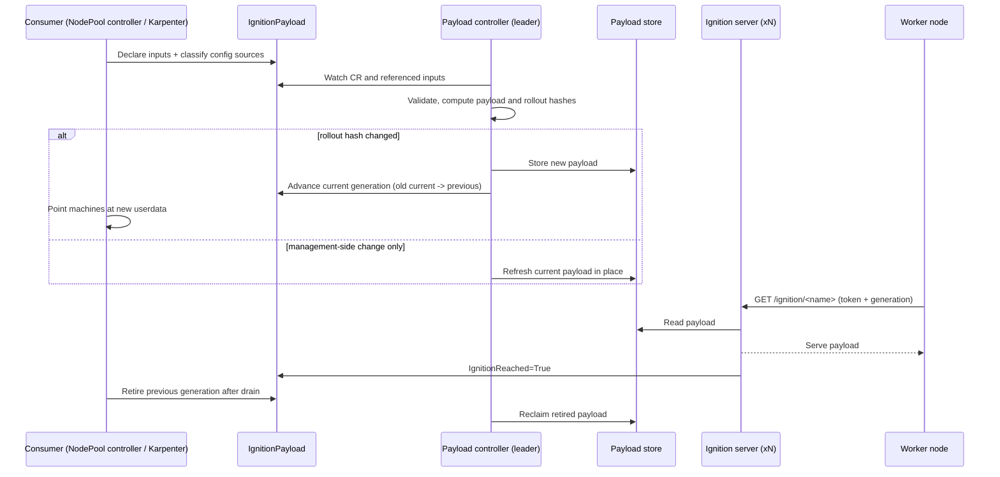

# Ignition System Re-Architecture for Hosted Control Planes

## Summary

The HyperShift ignition system today is spread across several controllers and
an HTTP server. They coordinate through a single Kubernetes Secret that many
actors read and write. This makes the system hard to reason about, debug, and
extend. Most importantly, it cannot scale horizontally: payload generation and
payload serving share an in-pod cache. Every extra replica therefore repeats
the expensive render pipeline and writes its own Secrets, so scaling out
increases load on the registry and the management API server.

This enhancement re-architects the ignition system around a new
`IgnitionPayload` API. The API separates *payload generation* (expensive, a
single active worker) from *payload serving* (cheap, stateless, horizontally
scaled). It also:

- consolidates config parsing, validation, hashing, and rollout detection in
  one component;
- moves the ignition server from the Control Plane Operator (CPO) to the
  HyperShift Operator (HO);
- makes ignition state observable through `kubectl get ignitionpayload`.

## Motivation

The current ignition system has structural problems that block scaling and slow
down every change to worker-node bootstrapping:

- **It cannot scale horizontally.** Generation and serving run in the same pod
  and share an in-memory cache. Running N replicas means all N independently
  render payloads from the release image and write token Secrets, which
  increases load on the registry and the management API server
  (OCPSTRAT-3052).
- **Coordination is fragile.** Annotations act as an implicit protocol between
  controllers. A single token Secret carries inputs, auth credentials, status,
  rotation state, and lifecycle signals all at once.
- **Lifecycle machinery is unnecessary.** Token-Secret rotation, a dedicated janitor
  controller, dual Secrets per config version, and platform-specific cleanup
  workarounds all exist because a Secret is used as a database.
- **Observability is poor.** To understand ignition state you have to decode
  Secret data keys and annotations. There is no `kubectl get` view.
- **HO and CPO versions drift apart.** The ignition server ships in the CPO and
  is tied to the OCP release. The NodePool controller ships in the HO, which
  releases independently. Any change to how they coordinate needs dual code
  paths gated on CPO capabilities.

### User Stories

* As a managed-services SRE operating many hosted clusters, I want the ignition
  serving tier to scale horizontally, so that a burst of node provisioning does
  not overwhelm the registry or the management-cluster API server.
* As a HyperShift developer, I want a single component that owns config
  parsing, validation, hashing, and payload generation, so that I can reason
  about, debug, and extend the ignition path.
* As an autoscaling (Karpenter) integrator, I want to request an ignition
  payload by creating a first-class resource, so that just-in-time nodes can get
  a payload without depending on the NodePool type.
* As an SRE, I want to run `kubectl get ignitionpayload` and see each
  consumer's ignition lifecycle, so that I can diagnose a stuck rollout without
  decoding Secret data.
* As an SRE operating this at scale, I want generation and serving to report
  status conditions and metrics and to recover on their own, so that I can
  monitor fleet health without fixing payloads by hand.

### Goals

- Payload serving scales horizontally. Payload generation keeps a single active
  worker, so each config version is rendered once regardless of how many
  serving replicas run.
- Every consumer's ignition state can be seen at a glance through status
  conditions and `kubectl get`.
- Management-side changes (for example, HAProxy image bumps) never trigger
  fleet-wide node rollouts. Newly provisioned and scaled-up nodes still boot
  with current content. This keeps the guarantee from
  [predictable-nodepool-rollout-control](./predictable-nodepool-rollout-control.md)
  and builds on it.
- Payload generation becomes a service that any controller can consume by
  creating a resource, without depending on the NodePool type.
- The system drops the token-Secret rotation machinery, the janitor
  controller, and the annotation-based protocols, leaving fewer moving parts
  and failure modes. Node credentials stay short-lived: tokens are re-issued in
  place instead (see Node authentication).

### Non-Goals

- Changing the MCO render pipeline that produces payloads from the release
  image. Simplifying it needs collaboration with the MCO team.
- Removing the standalone HAProxy proxy in front of the ignition server. It
  stays the isolation boundary for request serving. Retiring it is future work
  that depends on a serving tier with no API server dependency and on security
  sign-off.
- Moving the in-place upgrade path (the HCCO in-place upgrader) off the legacy
  token Secret. The new system keeps writing a compatible Secret, so the guest
  side needs no change.

## Proposal

Introduce a namespaced `IgnitionPayload` custom resource. There is one per
consumer request, and it lives in the hosted control plane (HCP) namespace. The
consumer's inputs go in `spec` and the generator's results go in `status`.
Around this API:

1. **Separate generation from serving.**
   - A leader-elected **payload controller** renders payloads and writes them
     to a **payload store**.
   - A stateless, horizontally scaled **ignition server** authenticates
     booting nodes and serves payloads from that store.
   - Payload bytes never go through the CR. In v1 the store is backed by
     Secrets. A later version can swap in a different backend without changing
     the API.
2. **Put all config logic in the payload controller.** It does config
   splitting, defaulting, validation, payload and rollout hashing, and
   rendering. The NodePool controller only makes config sources available in
   the HCP namespace and classifies them as rollout-relevant or management-only.
3. **Detect rollouts after validation.** The payload controller is the only
   component that has validated the config, so it decides when a rollout
   happens. An invalid config therefore cannot trigger a rollout that has no
   payload to serve.
4. **Move the ignition server from the CPO to the HO.** The ignition server and
   the payload controller ship in the same binary as the NodePool controller.
   This removes the HO/CPO version drift and the code paths gated on CPO
   capabilities.

These changes land together. The shared payload store and the
generation/serving split are needed either way. A CPO-only first phase would
build on the token-Secret coordination that this redesign removes.

### Workflow Description

**Actors:**

- The **NodePool controller** (the main *consumer*) runs in the HO.
- The **payload controller** (the *generator*) and the **ignition server** run
  in the HCP namespace.
- **Karpenter** is a second consumer.
- A **worker node** fetches its ignition config at boot.

1. The consumer creates or updates an `IgnitionPayload` for its pool. It
   declares the release image, pull secret, trust bundle, and OS stream, and it
   lists the config ConfigMaps in two groups:
   - **rollout configs** (user, core, and NTO machine configs): a change rolls
     nodes;
   - **management configs** (for example, the API-server HAProxy config): a
     change refreshes the payload but does not roll nodes.

   The consumer copies any source that is not already in the HCP namespace into
   that namespace. It never reads the configs or computes hashes.
2. The payload controller watches the CR and everything it references. It
   splits and validates each config. If validation fails, it reports
   `PayloadGenerated=False` and stops: no new payload and no rollout.
3. Over the validated config, the payload controller computes two hashes:
   - a **payload hash**, which identifies the exact bytes to serve, including
     credential and trust-bundle contents;
   - a **rollout hash**, computed only over rollout-relevant inputs.
4. What it does next depends on which hash changed:
   - **If the rollout hash changed**, it renders the new payload, stores it,
     writes a new pointer-ignition userdata Secret, and then advances
     `status.current.rolloutGeneration`. The old current generation moves to
     `status.previous` so that nodes still booting on it keep being served.
   - **If only the payload hash changed** (a management-side change, or a
     rotation of the pull secret's or trust bundle's contents), it refreshes the
     bytes behind the current generation in place. New and scaled-up nodes get
     current content and existing nodes are not rolled.

   A generation is advertised only after its payload is stored. A new rollout
   always evicts the old previous generation, even if rollouts overtake each
   other (A→B→C). Nodes from an overtaken generation are being replaced anyway.
   Older payloads are reclaimed only after status stops referencing them (see
   Reclaim and crash safety).
5. When `rolloutGeneration` advances, the consumer points its machines at
   `status.current.userDataSecret` and runs its rollout. The consumer never
   creates userdata or handles the auth token.
6. A booting node fetches `/ignition/<name>`, presenting the bearer token and
   the rollout generation from its userdata. The ignition server checks the
   token, reads the payload from the store, and serves it.
   - The first fetch of the current generation sets `IgnitionReached=True`.
   - Fetching a generation that has been retired fails permanently.
   - A temporary miss returns a retryable error, so Ignition backs off and
     tries again.
7. When the old nodes have drained, the consumer advances
   `spec.retiredRolloutGeneration`. The payload controller then releases the
   previous payload, but only if that payload's generation is at or below the
   retired value. A drain signal for an older generation therefore never
   releases a newer previous one. At most two generations, current and
   previous, are advertised per CR.
8. On teardown the consumer removes its finalizer and deletes the CR. The
   payload controller frees every stored payload and then removes its own
   finalizer. After that, the objects the CR owns cascade-delete: the
   ConfigMaps the consumer copied in and the userdata Secrets. Core and NTO
   ConfigMaps are referenced in place, have no owner reference, and are never
   deleted.



**Other consumers.** The API does not depend on any particular consumer. Every
consumer creates an `IgnitionPayload`, watches `rolloutGeneration`, and points
new machines at the userdata Secret. The difference is how the rollout runs:

- The NodePool controller runs a coordinated rollout.
- Karpenter, and integrations that provision nodes just in time, always point
  new nodes at the current userdata. They let their own node lifecycle replace
  older nodes.

Each consumer adds its own finalizer to the CR and removes it when it deletes
the CR. Advancing `retiredRolloutGeneration` is optional for just-in-time
consumers. They can rely on eviction at the next rollout and on the
store-cleanup finalizer to reclaim payloads. The concrete Karpenter
integration is out of scope beyond this contract.

### API Extensions

This enhancement adds a new namespaced CRD, `IgnitionPayload`, in group
`hypershift.openshift.io` (v1beta1, to match HyperShift's existing API group).
It is gated by the `IgnitionPayloadSystem` feature gate. It does not modify
APIs owned by other teams and adds no webhooks or aggregated API servers.

Key properties:

- **Does not depend on the consumer.** The CR has no back-reference to a
  NodePool, so other consumers can use it.
- **No secrets in the CR.** Neither payload bytes nor the auth token appear in
  `spec` or `status`. Status references the userdata Secret by name, so anyone
  who can read the CR but not Secrets cannot get a node credential.
- **Lifecycle uses finalizers.** The CR lives in the HCP namespace and its
  consumers live elsewhere, so an owner reference is not possible. The
  creating consumer adds a consumer finalizer. The payload controller adds a
  store-cleanup finalizer, which it removes only after it has freed every
  stored payload for the CR.

The example below shows a populated `IgnitionPayload` in serialized form.
Comments mark the validation each field needs and explain its context. The full
Go types and markers will be reviewed in the HyperShift API PR.

```yaml
apiVersion: hypershift.openshift.io/v1beta1
kind: IgnitionPayload
metadata:
  name: my-nodepool             # One per consumer request (one per NodePool for the NodePool controller).
  namespace: clusters-my-hc     # HCP namespace. Every reference below resolves in this namespace.
  finalizers:
  - example.com/consumer-finalizer                          # Illustrative: each consumer adds and removes its own.
  - hypershift.openshift.io/ignition-payload-store-cleanup  # Removed by the payload controller once all stored payloads are freed.
spec:                           # Written only by the consumer. Read-only to the payload controller.
                                # The consumer never reads ConfigMap contents or computes hashes.
                                # Inputs are explicit name lists, not label selectors: the list a
                                # ConfigMap is in decides whether it can roll nodes, and relabeling or
                                # creating a ConfigMap cannot silently change the inputs.
                                # Every Secret and ConfigMap reference: name is a DNS-1123 subdomain, 1-253 characters.
  releaseImage: quay.io/openshift-release-dev/ocp-release@sha256:abc...
                                # Required. OCP release used to render the payload.
                                # Validation: 1-253 characters, starts with a word character, no whitespace.
  pullSecret:
    name: pull-secret           # Required, immutable (CEL: self == oldSelf).
                                # Rotate the Secret's contents in place. Rotation refreshes the
                                # payload for new nodes without rolling existing nodes.
  additionalTrustBundle:
    name: user-ca-bundle        # Optional. ConfigMap with extra CAs for nodes, read from key "ca-bundle.crt".
  osImageStream:
    name: rhel-10               # Optional. Enum: rhel-9 (RHEL 9 boot images) | rhel-10 (RHEL 10 boot images).
                                # Default: rhel-9 for OCP < 5.0, rhel-10 for OCP >= 5.0.
                                # rhel-9 is the legacy stream and is expected to be retired.
  rolloutGlobalConfig:
    name: my-nodepool-global-config
                                # Optional. IgnitionPayload-owned ConfigMap holding the consumer-authored,
                                # canonicalized subset of the hosted cluster's global config that should
                                # roll nodes when it changes (see predictable-nodepool-rollout-control).
                                # Read from key "config"; contributes nothing if the key is missing.
  rolloutConfigMaps:            # Optional. A change to any of these rolls nodes.
  - name: my-nodepool-user-config-1   # Copied in from the clusters namespace by the consumer.
  - name: core-machineconfig          # Already in the HCP namespace; referenced in place.
  - name: nto-tuned-my-nodepool
                                # List keyed by name, 1-100 items. Each ConfigMap holds
                                # multi-document MachineConfig YAML under key "config".
  managementConfigMaps:         # Optional. A change refreshes the payload for new nodes without rolling.
  - name: my-nodepool-apiserver-haproxy
                                # List keyed by name, 1-100 items.
                                # CEL: a name may not appear in both rolloutConfigMaps and managementConfigMaps.
  additionalRolloutInputs: "endpoint=Public;addr=10.0.0.1;port=6443"
                                # Optional. Opaque summary that feeds only the rollout hash. Lets the
                                # consumer roll nodes for an input that lives in a management config
                                # (here, the API-server endpoint) without making every change to that
                                # config roll. Never part of configHash, so re-rolling onto unchanged
                                # bytes does not re-render the payload.
                                # Validation: 1-1024 printable ASCII characters, no whitespace.
  retiredRolloutGeneration: 3   # Optional, minimum 1. Highest generation whose nodes have all been
                                # replaced; lets the previous payload be released early. A new rollout
                                # always evicts the previous payload, whatever this field says.
                                # Optional for just-in-time consumers.
                                # CEL: cannot decrease or be removed once set.
status:                         # Written by the payload controller. The ignition server only sets
                                # IgnitionReached=True; the payload controller resets it to False on each
                                # rollout. No writer replaces the whole status.
                                # CEL: has at least one field.
  rolloutHashVersion: 1         # Minimum 1. Rollout-hash formula version. A formula change recomputes
                                # the baseline without rolling nodes (see Version Skew Strategy).
  conditions:                   # List keyed by type, max 100 items.
  - type: PayloadGenerated      # False with a reason/message (naming the failing ConfigMap) when
    status: "True"              # validation or rendering fails. observedGeneration tracks the spec
    observedGeneration: 7       # generation last processed.
  - type: IgnitionReached       # Reset to False on each new rollout; set to True when a node first
    status: "True"              # fetches the current generation.
  current:                      # Payload for the latest validated config.
                                # CEL: rolloutGeneration cannot decrease; current cannot be removed.
    rolloutGeneration: 5        # Required, minimum 1. Counter consumers watch; advances only when
                                # rolloutHash changes. Also the payload's serving/storage identity.
                                # Each advance mints a new token. A refresh or periodic re-issue gives
                                # the token a fresh expiry under the same generation.
    rolloutHash: 9f2c...        # Required. Opaque hash of rollout-relevant inputs, 1-64 lowercase hex characters.
    configHash: 4be1...         # Required. Opaque hash identifying the exact payload bytes,
                                # 1-64 lowercase hex characters. Changes on refresh without a rollout.
    userDataSecret:
      name: my-nodepool-5       # Required. Generator-authored pointer-ignition Secret that consumers
                                # point machines at. The bearer token lives only inside this Secret,
                                # never in status.
  previous:                     # Kept during a rollout so nodes still booting on it are served.
                                # CEL: requires current; rolloutGeneration < current.rolloutGeneration.
    rolloutGeneration: 4
    rolloutHash: 71aa...
    configHash: c03d...
    userDataSecret:
      name: my-nodepool-4
```

`kubectl get ignitionpayload` shows `RolloutGeneration`, `Generated`
(`PayloadGenerated`), and `Reached` (`IgnitionReached`) columns. The short name
is `ignpayload`.

### Topology Considerations

#### Hypershift / Hosted Control Planes

This enhancement applies only to Hosted Control Planes, the only topology that
has this ignition system. It affects:

- the NodePool controller in the HO;
- the payload controller, ignition server, and proxy in the HCP namespace.

The serving topology keeps the same shape: Route, Service, and proxy. Its
endpoint and node-facing CA change on the upgrade to 5.1 (see Upgrade /
Downgrade Strategy). The guest cluster is unaffected.

#### Standalone Clusters

Not applicable. Standalone clusters bootstrap nodes through the Machine Config
Server.

#### Single-node Deployments or MicroShift

Not applicable.

#### OpenShift Kubernetes Engine

Not applicable. The change is internal to HyperShift and does not depend on any
capability excluded from OKE.

### Implementation Details/Notes/Constraints

**Components.** The current token-Secret reconciler, the Secret janitor, and
the CPO-hosted ignition server go away. In their place, the HO deploys two
components into each HCP namespace:

- a leader-elected payload controller, with a standby replica for fast
  failover;
- a stateless ignition server with multiple active replicas.

The HAProxy proxy is unchanged. Rendering stays tied to the release-image
version, not to the CPO build, so one HO produces correct payloads for every
OCP version in the fleet.

**Payload store.** The store maps a rollout identity (the CR plus its
`rolloutGeneration`) to the current payload bytes for that generation. It is
not keyed by the token or by a hash. As a result, re-issuing a token or
changing the hash formula never moves a live payload.

- **v1:** Payloads are stored as Secrets in the HCP namespace.
- **Freshness:** Serving replicas read the store on every request, so a
  refreshed payload is served right away and a deleted one is never served.
- **Failover:** Generation is idempotent across leader failover. A failover
  costs at most one extra render.
- **Later backend:** A database-backed store could remove the etcd object-size
  limit without changing the API.
- **Access control:** Payloads embed credentials such as the pull secret, so
  any store backend must keep Secret-level access control. Read access to the
  store and the userdata Secrets is granted only to the payload controller,
  the consumers, and the ignition server, scoped to the HCP namespace. Guest
  cluster and tenant identities have none.

**Reclaim and crash safety.** A rollout is several separate writes, not one
atomic step, so a crash can leave payloads or userdata Secrets that status no
longer names. After every status commit, the payload controller sweeps that
CR's stored payloads and userdata Secrets and deletes any that status does not
name. This covers eviction, retirement, and interrupted or overtaken rollouts.
At teardown, the store-cleanup finalizer frees everything that is left. A crash
during reclaim is finished by the next reconcile. This is not a background
janitor: it is scoped to the one CR being reconciled and runs only on the
leader, so it cannot race the generator. Per CR, at most the two advertised
generations plus one in-flight generation exist at any time.

**Payload refresh policy ("Policy A").** Management-side changes and
credential rotations refresh the payload for the current generation in place.
Scale-up and replacement nodes always boot with current content. Existing
nodes are left alone until a real rollout.

Config inputs are explicit name lists, not label selectors. The list a
ConfigMap is in decides whether it can roll nodes, and relabeling or creating
a ConfigMap cannot silently change the inputs.

Some inputs live in management config but must still roll nodes, for example
an API-server endpoint change inside the HAProxy config. For those, the
consumer writes a summary into `additionalRolloutInputs` instead of
reclassifying the whole ConfigMap. This keeps HAProxy image bumps from rolling
nodes.

**Relationship to predictable-nodepool-rollout-control.** This work depends on
[predictable-nodepool-rollout-control](./predictable-nodepool-rollout-control.md),
which must merge first. That enhancement splits the rollout hash from the
management-side hash. Here, that split moves into the payload controller, and
the rollout state it keeps in annotations moves into CR status. The rollout
hash keeps today's NodePool rollout inputs:
- The pull secret and the trust bundle are hashed by reference, not by
  content, so rotating their contents never rolls nodes.
- The API-server endpoint term now arrives through `additionalRolloutInputs`.

**`IgnitionReached` writes.** The ignition server updates only that condition.
The write cannot overwrite `current` or `previous`. It is applied only if the
generation that was served is still `status.current`, and it is dropped if the
generation has moved on, so a node still booting on the previous generation
never marks the new one as reached. The write happens outside the request
path and is de-duplicated, so a burst of boots costs about one write per
replica.

**Node authentication.** Authentication and payload identification are
decoupled:

- The request path and a static generation header in the userdata say *which*
  payload to serve.
- The token only authenticates and authorizes the request. It is signed by the
  generator, bound to an audience, time-limited, and scoped to one CR.

The ignition server verifies tokens without any stored state, using a public
key. A node can only fetch its own CR's current or previous payload, both of
which it is entitled to. The token is stored only in the userdata Secret, never
in the payload store or in CR status.

*Token freshness.* CAPI may create an instance long after a rollout, for
example during an autoscaler scale-up. To keep stored userdata valid for those
instances, the generator re-issues the token in place on a timer and on every
payload refresh. Re-issuing never changes the generation, so it never triggers
a rollout. The re-issue interval is a fraction of the token lifetime. A token
may already be up to one interval old when CAPI bakes it into an instance, so
every instance has at least (lifetime − interval) from creation to its first
fetch. The default gives a window comparable to the legacy server's.

*Expiry.* Validation tolerates clock skew at first boot, before NTP has
synced. An instance that cannot boot within the token lifetime fails
permanently and must be recreated. This gap already exists today. Automatic
replacement for every pool is follow-up work.

**Legacy in-place upgrade compatibility.** The HCCO in-place upgrader reads a
token Secret with a fixed shape, located through a MachineSet annotation. The
NodePool controller keeps writing a Secret with exactly that shape. Before it
re-points a pool for a rollout, both the Secret and the annotation must exist,
and the step retries until they do. HCCO therefore never sees the annotation
without its Secret, and no guest-side change is needed.

### Risks and Mitigations

- **The v1 serving tier still talks to the API server.** With a Secret-backed
  store, ignition server replicas need access to the management API server.
  *Mitigation:* the serving tier stays behind the standalone HAProxy proxy,
  which remains the only externally reachable hop. A later store backend can
  remove this dependency.
- **Cross-tenant data boundary.** The payload controller reads only resources
  in its own HCP namespace. Copying inputs into that namespace is the
  consumer's job. That copy moves the same data that already crosses the
  boundary today; it is just one step earlier.
- **The generator is temporarily unavailable.** If the generator pod is lost,
  new rollouts and payload refreshes pause until a new leader takes over.
  *Mitigation:* a standby replica with leader election takes over in seconds.
  Nodes that are already booted are unaffected.
- **Config changes that affect every pool.** A core config change requeues
  every `IgnitionPayload` in the namespace. This already happens today. Core
  and NTO configs are referenced in place, not copied per CR, so this does not
  add extra writes.
- **Fleet-wide rollout of these components on HO upgrade.** Hosting these
  components in the HO image means an HO upgrade rolls them in every HCP at
  once. The impact is limited: serving is stateless and the generator pauses
  only briefly. Peak management-cluster resource use during HO upgrades is a
  broader concern, tracked separately (OCPSTRAT-3987).
- **A bad management-side render reaches new nodes.** Under Policy A, a broken
  refresh could reach scale-up nodes without a rollout signal.
  *Mitigation:* render failures show up as `PayloadGenerated=False`, which
  operators can alert on.

### Drawbacks

- **This must be GA-ready at 5.1 GA.** The legacy server is removed from the
  5.1 CPO at GA, so the new system is the only ignition path for 5.1+ clusters.
- **New API surface.** A new CRD and finalizers need API review and long-term
  maintenance.
- **More objects and pods.** Each config source is a separate ConfigMap per
  consumer. Each HCP runs two Deployments instead of one ignition server.

## Alternatives (Not Implemented)

- **Generate payloads on every serving replica.** Each replica would still need
  the release image and the render step. This brings back the amplification
  this design removes.
- **A smaller CPO-only split first.** This builds the split on top of the
  token-Secret coordination that the redesign removes, and it changes the
  ignition path across two releases. It would only be worth it if the scaling
  problem were an active production incident.
- **Keep every node in a pool identical ("Policy B").** Management-side changes
  would reach nodes only through a coordinated rollout. This is deferred, not
  rejected. It could be exposed later as a per-NodePool option.
- **Payload bytes in CR status.** This would cap payloads at the etcd object
  size and make every status read larger.
- **Auth token in CR status.** CR status is readable by principals that cannot
  read Secrets and is captured by some audit profiles. A token there would let
  those principals escalate privileges.
- **Always serve the latest payload.** Serving only the latest payload, with no
  per-generation pinning, is simpler. However, during a release upgrade, a node
  created from the old release could fetch new-release content onto an old OS
  and silently end up with mismatched versions.
- **Node authentication with proof of possession (for example mTLS).** This is
  the stronger long-term option. Ignition's first-boot fetch blocks it today,
  because it can only send static headers. This is future work.

## Open Questions [optional]

1. Should the payload refresh policy (Policy A vs. Policy B) be a per-NodePool
   API field, or is fleet-wide Policy A enough?
2. Which backend should a later payload store use, and when should it land?
3. Under what conditions would security approve retiring the HAProxy proxy once
   the serving tier no longer depends on the API server?
4. How should the token signing key be managed over its lifecycle: where it
   lives, how it is rotated, and how the serving tier receives it? To be
   revisited once the implementation exists.
5. How are legacy ignition resources cleaned up after a cluster upgrades from
   the previous system?
6. Is keeping only current and previous payloads enough, or do some rollout
   patterns need more generations kept?

## Test Plan

<!-- TODO: Complete once targeted at a release. Tests run in the HyperShift e2e
suite with the IgnitionPayloadSystem management feature gate enabled and carry
the appropriate [Jira:"HyperShift"] component label. -->

- **Unit tests:** config validation, both hashes, rollout vs. management-side
  change detection, and generations that overtake each other.
- **Integration tests:**
  - the payload store: refreshed content is served by every replica, retired
    content is never served, and a render failure leaves the existing
    generations servable;
  - the generation/serving split: one render per config version at any replica
    count.
- **e2e tests:**
  - node provisioning through the new endpoint;
  - a config change that triggers a rollout;
  - a management-side change that does not roll nodes;
  - the upgrade to 5.1, covering adoption and in-flight machine handling.
- **Scale tests:** scale out the serving tier under concurrent provisioning and
  confirm there is no extra registry or API server load.

## Graduation Criteria

<!-- TODO: Complete once targeted at a release. Graduation follows HyperShift's
management feature-gate conventions and CI signals. -->

### Dev Preview -> Tech Preview

- The `IgnitionPayloadSystem` management gate is available under
  `TechPreviewNoUpgrade` (off by default), and the CRD installs only under
  that feature set.
- The new ignition path works end to end on at least one platform.
- The conditions and the `kubectl get` view are implemented.
- Metrics cover generation latency, store size, serving read latency, and
  leader failovers.
- Draft alerts exist for stuck generation and stuck `IgnitionReached`.

### Tech Preview -> GA

- Upgrade and scale testing is done, including the upgrade-to-5.1 transition.
- The gate is on by default, the CRD is in the default feature set, and the
  legacy CPO ignition server is removed.
- Migration is validated across supported platforms.
- SLOs are documented and the serving tier is load-tested.

### Removing a deprecated feature

The legacy ignition server is removed from the CPO at GA. Older release
branches keep it until they leave support. The compatible token Secret for HCCO
in-place upgrades is removed only once that path is migrated (see Non-Goals).

## Upgrade / Downgrade Strategy

Which ignition system a cluster uses depends on its **control-plane version**,
not on a fleet-wide switch:

- clusters **created** at 5.1 or later start on the new system;
- clusters **upgraded** to 5.1 move to the new system as part of that upgrade;
- an HO upgrade alone never moves a pre-5.1 cluster.

This is the GA behavior. During Tech Preview, see Feature gate below.

The new system brings its own endpoint, CA, and token model. A node fetches
ignition only once, at first boot, so the move matters only for nodes that have
not booted yet:

- **Nodes that have already joined** never fetch again and are unaffected.
- **Existing pools are adopted without a rollout.** On first encounter, the
  consumer copies the new userdata content into the Secret the pool already
  references. It records the current generation as the pool's baseline and does
  not compare hashes. Differences between the old and new hash formulas
  therefore cannot cause a fleet-wide rollout. Later generation advances drive
  normal rollouts. Accepted limitation: a real config change that lands during
  the first adoption reconcile is absorbed into the baseline and rolls on the
  next change instead.
- **In-flight machines** were created with old userdata and have not joined
  yet, so they have no node and no workloads. The consumer deletes them once,
  and CAPI recreates them from the refreshed userdata. The machines to delete
  are fixed when the userdata is refreshed, and that set only shrinks, so
  machines created afterward are never deleted and the deletion cannot loop. A
  node whose fetch falls in a gap during the handoff just retries.
- **InPlace pools** are unaffected by the serving move. The HCCO in-place path
  reads the compatible Secret directly, and these nodes have already joined.
  Adopting an InPlace pool must not change the target config version HCCO
  reads, otherwise HCCO would reboot the pool's nodes.
- **Agent** platform: the ignition endpoint and CA are updated to the new
  system. Agents that have not joined yet are recreated.
- **None and UPI** platforms: a node provisioned by hand during the upgrade
  must be provisioned again with current userdata. This is documented.
- **Karpenter** follows the same adoption model, adapted to its just-in-time
  lifecycle.

**Feature gate.** `IgnitionPayloadSystem` is a HyperShift management feature
gate, configured on the HyperShift Operator. It is not a hosted-cluster or
openshift/api feature gate. It guards Tech Preview; it does not drive the
migration.
- **During Tech Preview:** the gate is off by default, and the legacy server
  still ships in the 5.1 CPO. Enabling the gate on a non-production Tech
  Preview management cluster moves its 5.1 control planes to the new system
  and stands down their legacy server. This standdown exists only for Tech
  Preview.
- **At GA:** the gate defaults on and the legacy server is deleted from the
  CPO. From then on, the control-plane version alone picks the system. 5.1 has
  not been released yet, so this moves no running production cluster.

**Downgrade** is not supported. HyperShift does not support downgrading a
control plane, so a 5.1+ cluster never returns to the legacy system.

## Version Skew Strategy

- **HO and CPO.** The HO already manages control planes at several OCP versions
  at once. The ignition system is chosen by control-plane version: pre-5.1
  clusters use the legacy server from their own CPO, and 5.1+ clusters use the
  HO-hosted system (at GA; during Tech Preview, only with the gate enabled).
- **Generation and OCP versions.** Rendering depends on the release-image
  version, so one HO produces correct payloads for every supported OCP version.
- **Nodes and kubelet.** Ignition is delivered as a fully rendered,
  version-matched payload at boot, so no kubelet coordination is needed.
- **Changes to the rollout-hash formula.** The inputs to the rollout hash may
  change over time. The formula version is recorded in status. When the payload
  controller sees an older version, it recomputes the baseline hash without
  advancing `rolloutGeneration`, so a formula change never rolls the fleet.
  Accepted limitation: a config change that lands exactly during a controller
  failover at the same moment as a formula change rolls on the *next* change
  instead.

## Operational Aspects of API Extensions

- **SLIs.**
  - `PayloadGenerated` shows whether the latest config produced a payload.
  - `IgnitionReached` shows whether a node has fetched the current generation.
    It resets to `False` on each new rollout, and it backs the existing NodePool
    `IgnitionReached` condition that SREs already use.
  - Fleet-level metrics cover generation latency, store size, serving read
    latency, and leader failovers.
- **Effect on existing SLIs.** Load on the registry and the management API
  server goes down, because each config version is rendered once. Expect
  roughly one CR per NodePool, plus Karpenter's.
- **Failure modes.**
  - **Generator unavailable:** rollouts and refreshes pause until a new leader
    takes over.
  - **Validation failure:** `PayloadGenerated=False` and no rollout.
  - **Store unavailable:** booting nodes retry until it recovers. Nodes that
    are already booted are unaffected.
  - **Consumer down:** CR deletion is blocked by its finalizer.
- **Escalation.** The HyperShift team owns this. The security team owns the
  trust boundary.

## Support Procedures

- **Detecting failures.** Use `kubectl get ignitionpayload -n <hcp-ns>` and
  check the conditions.
  - `PayloadGenerated=False` names the config source that failed validation.
  - Nodes that keep retrying the fetch point to a mismatch between the
    machine's userdata and the payloads that are currently stored.
  - Nodes rejected for a retired generation must be replaced.
  - Ignition server access logs show which CR and generation each request
    asked for.
- **Disabling.** For 5.1+ clusters the new system is the only ignition path.
  The existing HostedCluster annotation that disables the ignition server still
  works and stops node provisioning for that cluster.
- **Recovery.** The serving tier holds no state, so restarts lose nothing.
  Payloads stay in the store across a generator crash, and only new config
  versions wait for the new leader.

## Infrastructure Needed [optional]

- A new `IgnitionPayload` API type in `openshift/hypershift`.
- No new repositories or test infrastructure.
