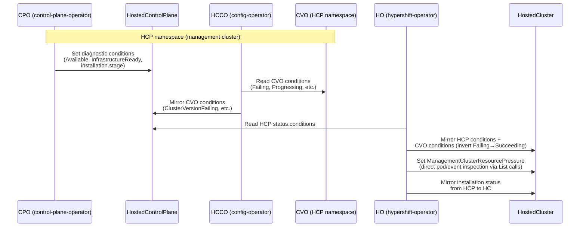
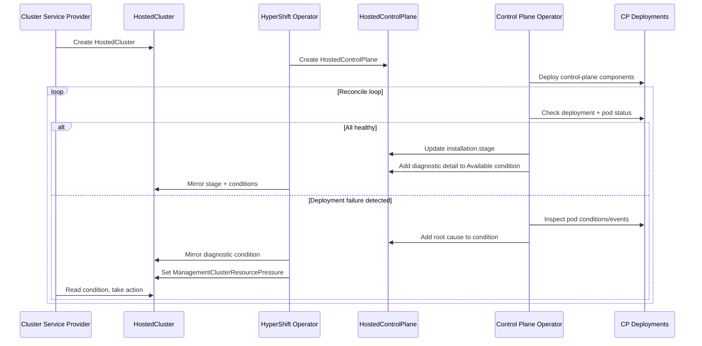

# Enhanced Debuggability for HyperShift Cluster Installation Failures

## Summary

This enhancement improves the debuggability of HyperShift
cluster installations by adding diagnostic detail to existing status conditions
with actionable messages and adding structured
progress tracking on `HostedCluster` resources when
installation is blocked or failing. Today, installation
failures produce opaque timeouts (e.g., `context deadline
exceeded` after 45 minutes) that require manual log
inspection across multiple components to diagnose. This
proposal adds diagnostic detail to existing condition messages including pod-level
failure reasons and component-specific detail, adds a
lightweight installation stage field, and introduces a
genuinely new condition for a gap not covered by the
existing condition surface — enabling cluster service
providers, SREs,
and administrators to quickly identify and resolve
installation blockages.

## Glossary

| Term | Definition |
|------|-----------|
| **HC** | `HostedCluster` — the user-facing CRD representing a hosted cluster |
| **HCP** | `HostedControlPlane` — the management-cluster CRD representing the control plane |
| **HO** | HyperShift Operator — reconciles `HostedCluster` resources, manages `HostedControlPlane` lifecycle |
| **CPO** | Control Plane Operator — reconciles `HostedControlPlane`, manages control-plane component deployments in the HCP namespace |
| **HCCO** | Hosted Cluster Config Operator — runs in the HCP namespace on the management cluster, operates on the guest cluster API, mirrors CVO conditions back to HCP |
| **CPC** | `ControlPlaneComponent` — per-component CRD on the management cluster with `Available` and `RolloutComplete` conditions |
| **CVO** | ClusterVersion Operator — runs in the HCP namespace on the management cluster, manages operator lifecycle for the hosted cluster |

## Motivation

Current debugging of HyperShift clusters stuck during
installation is manual, time-consuming, and produces
uninformative errors. A cluster that fails to install
typically stalls with a generic `Available=False` condition
or an opaque timeout, requiring the operator to inspect
logs across the HyperShift operator, control plane operator,
hosted cluster config operator, and individual control-plane
component pods. This is particularly painful in managed
service environments (ROSA HCP, ARO HCP) where SREs handle
thousands of clusters and need automated, structured signals
to triage failures at scale.

The problem is compounded by the variety of root causes:
some failures are platform-agnostic (e.g., a control-plane
deployment with unavailable replicas), while others are
specific to the cloud provider (e.g., Azure Policy conflicts
blocking resource creation, or AWS IAM role assumption
failures). In all cases, the root cause is buried in logs
rather than surfaced on the API objects that operators and
automation tools consume.

### User Stories

* As a **cluster service provider** (ROSA/ARO), I want
  clear status conditions on `HostedCluster` indicating
  which specific stage of installation is blocked so that
  I can triage failures without manually inspecting logs
  across multiple components.

* As an **SRE**, I want fleet-wide metrics on installation
  failure categories so that I can identify systemic issues
  (e.g., management cluster capacity exhaustion affecting
  multiple clusters) and prioritize remediation.

* As a **self-managed HyperShift administrator**, I want
  the `HostedCluster` status to tell me why my cluster
  is not progressing so that I can take corrective action
  (e.g., increase management cluster capacity, fix DNS
  configuration) without deep HyperShift internals
  knowledge.

* As an **automated provisioning system**, I want
  machine-readable status conditions with structured
  failure reasons so that I can implement automated
  retry/escalation logic and surface actionable messages
  to end users.

* As a **platform operator**, I want Prometheus metrics
  tracking installation stage progression and failure
  counts by category so that I can build dashboards and
  alerts for installation health across my fleet.

### Goals

1. Add diagnostic detail to existing status conditions on `HostedCluster`
   with specific, actionable messages for the most common
   installation failure modes, replacing opaque timeouts
   with diagnostically useful detail (pod-level reasons,
   per-component failure information, operator-specific
   messages).

2. Provide structured installation progress tracking via
   a new status field that indicates the current stage of
   installation.

3. Add a new condition
   (`ManagementClusterResourcePressure` on HC) for the
   diagnostic gap not covered by the existing condition
   surface: management cluster scheduling pressure
   affecting hosted cluster pods. A second condition
   (`PlatformInfrastructureReady`) is deferred to
   Phase 2 in a separate enhancement.

4. Expose Prometheus metrics for installation stage
   progression and failure reason counts to enable
   fleet-wide monitoring and alerting.

5. Cover platform-agnostic failures that benefit all
   HyperShift deployments in Phase 1. Defer
   platform-specific failures (AWS, Azure) to Phase 2
   in a separate enhancement.

### Non-Goals

1. Automatically remediating installation failures. This
   enhancement surfaces diagnostics; it does not implement
   auto-healing.

2. Debugging non-installation issues. Post-installation
   operational failures (day-2 operations, upgrade
   failures) are out of scope. **Exception**:
   `ManagementClusterResourcePressure` persists into
   day-2 as a continuous health signal. This is the only
   condition that crosses the day-1/day-2 boundary, for
   three reasons: (a) management cluster scheduling
   pressure affects running hosted clusters — not just
   new installations — so removing the signal after
   installation would create a monitoring blind spot;
   (b) the HO uses direct `List()` API calls (not
   informers) so pod/event data is transient
   per-reconciliation with no persistent memory
   overhead (see Implementation Details for analysis);
   (c) the condition is level-driven and set
   to `False` when no pressure exists, so it adds no
   noise to day-2 operations.

3. Comprehensive coverage of all platform-specific failure
   modes. Platform-specific cases (ARO HCP Azure failures,
   ROSA HCP AWS failures) are deferred to a follow-up
   enhancement with dedicated CAPI provider team reviewers.
   See [Future Work](#future-work--phase-2) for the full
   list of deferred cases.

4. Integration with third-party monitoring tools beyond
   Prometheus metrics and Kubernetes-native status
   conditions.

5. Error categorization framework. The User Error vs.
   Internal Service Error distinction is a cross-cutting
   concern that affects all HyperShift conditions, not
   just installation-related ones. It deserves its own
   enhancement with input from SRE, support, and managed
   services teams. See
   [Future Work](#future-work--phase-2).

6. `NodePool` installation diagnostics. `NodePool` already
   has `AllMachinesReady` with CAPI Machine condition
   aggregation. NodePool-specific diagnostics will be
   addressed in a follow-up enhancement after the
   `HostedCluster` patterns are proven.

7. Detection of management cluster inode, file descriptor,
   and IP address exhaustion. Standard Kubernetes Node
   conditions do not expose inode or FD pressure. IP
   exhaustion is CNI-specific. Detecting these would
   require querying Prometheus or reading non-standard
   node metrics, adding a monitoring stack dependency
   that HyperShift does not currently have. The
   `ManagementClusterResourcePressure` condition covers
   pod scheduling failures, which is the most common
   symptom of resource exhaustion.

## Proposal

### Current State / Prior Art

HyperShift already has a substantial condition and metrics
surface. This enhancement builds on — rather than
duplicates — what exists today.

**Existing conditions (51+ at time of writing):**

Key gaps in existing conditions relevant to installation:

| Existing Condition | Gap This EP Fills |
|---|---|
| `Available` (on HCP) | `ComponentsNotAvailable` lists component names only — no pod-level failure reasons. |
| `InfrastructureReady` | Does not inspect actual Route admission status. |
| `ClusterVersionSucceeding` | Raw CVO message passthrough with no structured reason. |

CPC resources have `Available` and `RolloutComplete`
conditions, but `controlPlaneComponentsAvailable()`
discards all per-component reason and message detail.
No CPC CRD schema changes are needed — only CPO logic.

**What does NOT exist today:**
- Pod-level failure reasons in any condition
- Installation phase/stage tracking
- Management cluster resource pressure detection

**Condition mirroring pipeline:**



Conditions flow: CPO -> HCP -> HO -> HC. The HO mirrors
conditions from HCP to HC via two code paths:
- 12 HCP conditions (`hostedcluster_controller.go:871-884`)
- 6 CVO conditions (`hostedcluster_controller.go:774-791`),
  mirrored from guest cluster by the HCCO
  (`hcpstatus/hcpstatus.go:161-235`)

Additional conditions are mirrored via separate code paths
(`Degraded`, `ValidKubeVirtInfraNetworkMTU`,
`KubeVirtNodesLiveMigratable`,
`HostedClusterConfigurationDeprecated`), bringing the total
to 25+ mirrored conditions. Adding a new condition to HCP
requires explicitly adding it to the relevant mirroring
code path.

This enhancement does **not** add any new conditions to
the HCP → HC mirroring list. The diagnostic condition
messages flow through the existing mirroring paths
unchanged (they are on existing condition types). The
only new condition, `ManagementClusterResourcePressure`,
is set directly by the HO on the HC — it does not flow
through the mirroring pipeline. The deferred
`PlatformInfrastructureReady` (Phase 2) will require
addition to the mirroring list when implemented.

Propagation delay for diagnostic condition messages is bounded
by the HyperShift operator's reconciliation interval
(typically 1 minute). Diagnostic messages may briefly show
stale information during the propagation window — this is
acceptable because the information is diagnostic, not
control-flow.

### Condition Semantics

All conditions — both existing diagnostic conditions and the
new `ManagementClusterResourcePressure` condition — follow
these principles:

1. **Level-driven**: Every condition is re-evaluated from
   scratch on every reconciliation pass, ensuring
   self-healing. `meta.SetStatusCondition` only updates
   `lastTransitionTime` when `Status` changes, not when
   `Message` or `Reason` changes — so diagnostic message
   updates do not trigger flapping detection.

2. **Top-level only**: All conditions live in
   `status.conditions` on the relevant resource (HC, HCP).
   No nested conditions inside sub-structs. This preserves
   compatibility with `oc get`, Prometheus alert rules, and
   fleet management tools that watch `status.conditions`.

3. **Informational**: Conditions do not affect cluster
   behavior. The installation process runs identically
   regardless of condition state. Conditions are purely
   for diagnostic observability.

### Condition Cleanup

- **Diagnostic detail in existing conditions** (pod-level reasons in
  CPC `Available`, per-component detail in HCP `Available`,
  CVO operator detail in `ClusterVersionSucceeding`):
  level-driven semantics (point 1 above) handle cleanup
  automatically. When pods are healthy, the message returns
  to normal.

- **`ManagementClusterResourcePressure`**: Set to
  `False` when no scheduling pressure exists,
  `Unknown` when pod status is unavailable. Persists
  into day-2 as a continuous health signal (see
  Non-Goal 2). Day-2 transient `True` during rolling
  updates is expected and mitigated by the 60-second
  reconciliation interval and the 15-minute `for:`
  duration on recommended alerts.

- **`installation.stage`**: Persists as `InstallationComplete`
  after installation finishes. On day-2, it serves as a
  record of when installation completed. This does not
  contradict Non-Goal 2 because it is a simple enum, not
  a diagnostic condition.

- **Deletion during installation**: Standard HyperShift
  deletion logic applies. Metrics are deregistered on
  cluster deletion using `DeletePartialMatch`.

### Failure Categories in Scope (Phase 1)

These failures are platform-agnostic and apply to all
HyperShift deployments (ARO HCP, ROSA HCP, self-managed):

| ID  | Failure Case | Approach |
|-----|-------------|----------|
| 1.1 | API server route not admitted or unreachable | Add diagnostic detail to `InfrastructureReady` condition message with actual route admission status |
| 1.2 | Hosted control-plane kubeconfig never created | Already surfaced via `Available=False, Reason=KubeconfigWaitingForCreate`. No change needed. |
| 1.3 | Control-plane deployment has unavailable replicas | Add diagnostic detail to CPC `Available` condition message with pod-level failure reasons (scheduling, crash loop, image pull) |
| 1.4 | Required operators not yet available or degraded | Set `Reason=ClusterVersionFailing` on `ClusterVersionSucceeding`; pass through the CVO message verbatim (no parsing) |
| 1.5 | HostedCluster has no installed version or stops progressing | New `installation.stage` status field |
| 1.6 | Management cluster capacity exhaustion — pod scheduling failures | New `ManagementClusterResourcePressure` condition (set directly by HO on HC) |
| 1.7 | Opaque timeout masking root cause | Addressed by all of the above — diagnostic conditions replace the opaque timeout with specifics |

Note: IP/inode/FD exhaustion was removed from the
failure case table. See [Non-Goals](#non-goals)
item 7.

**Known gap — CPO unavailability:** When the CPO
itself is unavailable (CrashLoopBackOff,
unschedulable, OOMKilled), the `HostedCluster` shows
`Available=False, Reason=WaitingForAvailable,
Message="Waiting for hosted control plane to be
healthy"` — a generic message with no root cause.
Because the CPO is the controller that writes
diagnostic conditions on the `HostedControlPlane`,
all diagnostic enrichment from this enhancement
requires the CPO to be running. If the CPO is dead,
diagnostics go dark. However, the HO's
`ManagementClusterResourcePressure` detection
partially addresses this gap: it inspects all pods
in the HCP namespace (including the CPO pod) via
direct `List()` calls, so if the CPO itself is
unschedulable, the condition will be
`True, Reason=FailedScheduling` on the HC. Other CPO
failure modes (CrashLoopBackOff, OOMKilled) are
detected by the CPC `Available` condition's
diagnostic detail.

**Known gap — HCCO connectivity to guest cluster
API:** The HCCO runs in the HCP namespace and
connects to the guest cluster API server directly
(via kubeconfig), not through Konnectivity. If the
guest cluster API server is unreachable (e.g.,
network partition, KAS not yet running), the HCCO
cannot mirror CVO conditions, so
`ClusterVersionSucceeding` remains at
`Status=Unknown, Reason=StatusUnknown`. The user
sees `installation.stage=WaitingForOperators` with
no indication that the root cause is connectivity.
This gap is partially covered by existing
conditions: `KubeAPIServerAvailable` tracks KAS
readiness and `KASLoadBalancerNotReachable` (reason
on HCP `Available`) signals LB-level failures.
Dedicated HCCO connectivity diagnostics are
deferred to future work.

### Workflow Description

**Actors:**

- **cluster service provider**: A human or automation
  system responsible for creating and managing
  `HostedCluster` resources.
- **HyperShift Operator (HO)**: Reconciles `HostedCluster`
  resources and creates `HostedControlPlane` resources in
  the management cluster.
- **Control Plane Operator (CPO)**: Reconciles the
  `HostedControlPlane` and manages control-plane component
  deployments in the HCP namespace.
- **monitoring system**: Prometheus-based monitoring that
  scrapes metrics from HyperShift components.

**Normal installation flow with enhanced diagnostics:**

1. The cluster service provider creates a `HostedCluster`
   resource.
2. The HO creates a `HostedControlPlane` in the management
   cluster and begins reconciliation.
3. The CPO deploys control-plane components
   (kube-apiserver, etcd, etc.) and updates the
   `installation.stage` field on `HostedControlPlane`
   with the current stage.
4. The HO mirrors the `installation` status and diagnostic
   conditions from `HostedControlPlane` to `HostedCluster`
   status.
5. The cluster service provider or monitoring system
   observes the `HostedCluster` status to track progress.

**Failure scenario — control-plane deployment failure:**

1. A control-plane deployment (e.g., kube-apiserver)
   fails to become available due to pod scheduling
   failures on the management cluster.
2. The CPO detects the unavailable deployment, inspects
   pod conditions (best-effort, with a 5-second timeout
   and fallback to default message), and adds diagnostic detail to
   the CPC `Available` condition on `HostedControlPlane`:
   - Type: `Available` (on CPC `kube-apiserver`)
   - Status: `False`
   - Reason: `PodSchedulingFailed`
   - Message: `kube-apiserver: 0/3 replicas available
     — FailedScheduling: Insufficient cpu`
3. The CPO aggregates this into the HCP `Available`
   condition, preserving the first failure detail:
   - Type: `Available` (on HCP)
   - Status: `False`
   - Reason: `ComponentsNotAvailable`
   - Message: `2 components unavailable. First failure:
     kube-apiserver — PodSchedulingFailed: Insufficient
     cpu`
4. The HO detects `FailedScheduling` events and
   `Pending` pods in the HCP namespace (via direct
   `List()` calls) and sets
   `ManagementClusterResourcePressure=True` on the HC.
5. The HO mirrors the diagnostic `Available` condition
   from HCP to HC.
6. The cluster service provider sees both signals on
   the `HostedCluster` and understands that the
   management cluster needs more capacity.



### API Extensions

This enhancement modifies the status subresource of the
`HostedCluster` and `HostedControlPlane` CRDs, both owned
by the HyperShift project. It does not modify resources
owned by other teams, add webhooks, aggregated API servers,
or finalizers.

**Summary of new API objects:**

| Category | Name | Resource | Set By | Description |
|----------|------|----------|--------|-------------|
| Status field | `installation.stage` | HC, HCP | CPO → HO mirrors to HC | Enum: `Initializing`, `ControlPlaneProvisioning`, `WaitingForKubeconfig`, `WaitingForOperators`, `InstallationComplete`. Forward-only monotonic. |
| Status field | `installation.lastTransitionTime` | HC, HCP | CPO → HO mirrors to HC | Timestamp of most recent stage transition. Non-pointer `metav1.Time` with `omitzero`. |
| Condition type | `ManagementClusterResourcePressure` | HC | HO (direct pod/event inspection) | Scheduling pressure on management cluster affecting this HC's control-plane pods. `True`/`False`/`Unknown`. |
| Reason constant | `PodSchedulingFailed` | CPC `Available` | CPO | Pod cannot be scheduled on management cluster. |
| Reason constant | `CrashLoopBackOff` | CPC `Available` | CPO | Pod is in CrashLoopBackOff. |
| Reason constant | `ImagePullBackOff` | CPC `Available` | CPO | Pod cannot pull container image. |
| Reason constant | `RouteNotAdmitted` | `InfrastructureReady` | CPO | API server route not admitted by any IngressController. |
| Reason constant | `ClusterVersionFailing` | `ClusterVersionSucceeding` | CPO | CVO reports a failure. |
| Reason constant | `FailedScheduling` | `ManagementClusterResourcePressure` | HO | Scheduling pressure detected (`Status=True`). |
| Reason constant | `NoPressure` | `ManagementClusterResourcePressure` | HO | No scheduling pressure (`Status=False`). |
| Reason constant | `ControlPlanePodStatusUnavailable` | `ManagementClusterResourcePressure` | HO | Pod status unavailable (`Status=Unknown`). |
| Metric | `hypershift_hostedclusters_installation_stage` | — | HO | Gauge, labels: `namespace`, `name`, `stage`. State-set pattern (1 for current, 0 for others). |
| Metric | `hypershift_hostedclusters_installation_failure_reason_total` | — | HO | Counter, labels: `namespace`, `name`, `reason`. Best-effort episode count. |

**New status fields:**

```go
// HostedClusterStatus additions
type HostedClusterStatus struct {
    // ... existing fields ...

    // installation tracks the progress of the initial
    // cluster installation. The fields within are updated
    // by the control plane operator and mirrored to the
    // HostedCluster by the HyperShift operator.
    // +optional
    Installation *InstallationStatus `json:"installation,omitempty"`
}

// InstallationStatus contains installation progress
// information for a hosted cluster.
type InstallationStatus struct {
    // stage indicates the current phase of the initial
    // cluster installation. The value is updated by
    // the control plane operator as installation
    // progresses through its stages. Stage transitions
    // are forward-only (monotonic): a stage is never
    // set to a value earlier in the progression than
    // the current value. If a precondition for a later
    // stage is lost (e.g., kubeconfig becomes
    // unavailable), the stage does NOT regress — only
    // the relevant condition (e.g., Available) reflects
    // the problem.
    // Valid values are: "Initializing",
    // "ControlPlaneProvisioning",
    // "WaitingForKubeconfig",
    // "WaitingForOperators", "InstallationComplete".
    // +optional
    Stage InstallationStage `json:"stage,omitempty"`

    // lastTransitionTime is the timestamp of the most
    // recent stage transition. This field is only
    // meaningful for clusters created after this feature
    // was deployed. For clusters that were already
    // installed before this field was introduced, it
    // reflects when the field was first populated on
    // upgrade, not the original installation time.
    // Consumers should not use this field for
    // installation-duration calculations on
    // pre-existing clusters.
    // +optional
    LastTransitionTime metav1.Time `json:"lastTransitionTime,omitempty,omitzero"`
}

// InstallationStage describes the current phase of the
// initial cluster installation. Adding new enum values
// requires a CRD schema update first (the
// +kubebuilder:validation:Enum marker generates schema
// validation that rejects unrecognized values on write).
// In the normal HyperShift upgrade flow, the HO updates
// the CRD schema before the new controller starts, so
// new values are accepted by the time they are written.
// +kubebuilder:validation:Enum=Initializing;ControlPlaneProvisioning;WaitingForKubeconfig;WaitingForOperators;InstallationComplete
type InstallationStage string

const (
    // StageInitializing indicates the HostedControlPlane
    // has been created and initial reconciliation is
    // starting.
    StageInitializing InstallationStage = "Initializing"

    // StageControlPlaneProvisioning indicates
    // control-plane component deployments are being
    // created and waiting for available replicas.
    StageControlPlaneProvisioning InstallationStage = "ControlPlaneProvisioning"

    // StageWaitingForKubeconfig indicates control-plane
    // components are available and the system is waiting
    // for the hosted cluster kubeconfig to be generated.
    StageWaitingForKubeconfig InstallationStage = "WaitingForKubeconfig"

    // StageWaitingForOperators indicates the kubeconfig
    // is available and the system is waiting for required
    // operators (via CVO) to become available.
    StageWaitingForOperators InstallationStage = "WaitingForOperators"

    // StageInstallationComplete indicates installation
    // has finished successfully.
    StageInstallationComplete InstallationStage = "InstallationComplete"
)
```

The `LastTransitionTime` field uses non-pointer
`metav1.Time` with the `omitzero` struct tag. This
follows the newer HyperShift convention established by
`ControlPlaneUpdateHistory`
(`StartedTime metav1.Time
\`json:"startedTime,omitempty,omitzero"\``,
`CompletionTime metav1.Time
\`json:"completionTime,omitempty,omitzero"\``)
in `controlplaneversion_types.go:49,55`,
and aligns with `dev-guide/api-conventions.md`, which
advises against pointers in CRD-based APIs unless
there is an absolute need to distinguish nil from
zero-value. The older `LastReleaseImageTransitionTime`
uses `*metav1.Time` but predates this convention; new
fields should not replicate the older pattern.

Stage transitions are enforced as forward-only via ordinal
comparison in controller logic only — not via API
validation. This is acceptable because `installation.stage`
is a status field authored exclusively by the CPO; no
external actor writes to it. The CPO compares the proposed
new stage against the current stage's ordinal position
and only sets the new value if it is strictly later in
the progression:

```go
// stageOrdinal maps each InstallationStage to its
// position in the progression. A stage transition is
// only applied if the new ordinal > current ordinal.
var stageOrdinal = map[InstallationStage]int{
    StageInitializing:              0,
    StageControlPlaneProvisioning:  1,
    StageWaitingForKubeconfig:      2,
    StageWaitingForOperators:       3,
    StageInstallationComplete:      4,
}
```

**Stage transition trigger conditions:**

Each stage transition is evaluated by the CPO on every
reconciliation of the `HostedControlPlane`. The CPO
checks the trigger condition for each stage and sets
the field to the latest stage whose trigger is
satisfied (subject to the forward-only ordinal
constraint above):

| Transition | Trigger Condition | What the CPO checks |
|---|---|---|
| → `Initializing` | HCP reconciliation starts | The CPO's `Reconcile()` is invoked for this `HostedControlPlane`. Set unconditionally on first reconciliation if `installation.stage` is empty. |
| `Initializing` → `ControlPlaneProvisioning` | At least one control-plane component deployment has been created | The CPO has called `CreateOrUpdate` for any CPC deployment (kube-apiserver, etcd, etc.) in the HCP namespace. |
| `ControlPlaneProvisioning` → `WaitingForKubeconfig` | All required control-plane component deployments have `AvailableReplicas > 0` | `controlPlaneComponentsAvailable()` returns true — every CPC's `Available` condition is `True`. |
| `WaitingForKubeconfig` → `WaitingForOperators` | The hosted cluster admin kubeconfig secret exists | The CPO resolves the kubeconfig secret name via `KASAdminKubeconfigSecret(hcp.Namespace, hcp.Spec.KubeConfig)`, which defaults to `admin-kubeconfig` and honors an explicit `spec.kubeConfig.name` override. The CPO confirms this secret is present in the HCP namespace. This is the same check that drives the existing `Available=False, Reason=KubeconfigWaitingForCreate` condition. |
| `WaitingForOperators` → `InstallationComplete` | The CVO reports the cluster version is available | The `ClusterVersionAvailable` condition on the `HostedControlPlane` is `True`. This indicates the CVO has successfully rolled out all required cluster operators for the target version. |

Note: the CPO evaluates all trigger conditions on
every reconciliation loop, not only the "next" one.
Because of the forward-only constraint, if multiple
triggers become true simultaneously (e.g., after a
fast installation or an informer cache catch-up), the
stage jumps directly to the latest satisfied stage
without pausing at intermediate values.

**`WaitingForKubeconfig` clarification:** The trigger
is purely the **existence** of the admin kubeconfig
secret — not endpoint reachability. Private cluster
and network isolation concerns do not affect stage
progression. In practice, the kubeconfig is created
before all CP components are available, so this stage
is typically skipped (the CPO jumps directly to
`WaitingForOperators`).

**Backfill for pre-existing clusters:** If
`installation.stage` is empty AND HCP `Available` is
`True`, the CPO sets `InstallationComplete` directly,
bypassing trigger evaluation. This prevents a
pre-existing cluster from showing an intermediate stage
if `ClusterVersionAvailable` happens to be transiently
`False` at the moment of the first post-upgrade
reconciliation (e.g., during a concurrent OCP
upgrade). The `Available=True` check is the right
signal because a cluster that has been `Available`
has, by definition, completed installation. Once
`InstallationComplete` is set, the forward-only
constraint prevents any subsequent regression.

If a pre-existing cluster has `Available=False` at
upgrade time, it temporarily shows an intermediate
stage — this self-corrects once `Available` returns
to `True`.

**Control-plane vs full-cluster readiness:** Stages
before `WaitingForOperators` point to control-plane
issues on the management cluster.
`WaitingForOperators` → `InstallationComplete` tracks
CVO/operator rollout in the hosted cluster.

**Diagnostic detail in existing conditions — reason code analysis:**

These are changes to condition *messages* and *reasons* on
existing condition types. No new condition types are created
for these — the `Type` string remains unchanged.

New `Reason` values are declared as Go constants (not just
documented in prose). Note: existing HyperShift reason
constants use bare names without a prefix (e.g.,
`AsExpected`, `ComponentsNotAvailable`). The new
constants use a `Reason` prefix (`ReasonPodSchedulingFailed`)
to avoid collisions with identically named types or
functions in the same package. Both styles are acceptable
in Go — the prefix is a naming convention, not a semantic
distinction. These are proposed constant names for the
HyperShift codebase (`openshift/hypershift`), not
existing constants — they will be added as part of this
enhancement's implementation:

```go
// ManagementClusterResourcePressure is the condition
// type on the HostedCluster, set directly by the HO.
// The HO inspects pods and events in the HCP namespace
// via List() calls to detect scheduling pressure.
const ManagementClusterResourcePressure ConditionType = "ManagementClusterResourcePressure"

const (
    ReasonPodSchedulingFailed = "PodSchedulingFailed"
    ReasonCrashLoopBackOff    = "CrashLoopBackOff"
    ReasonImagePullBackOff    = "ImagePullBackOff"
    ReasonRouteNotAdmitted    = "RouteNotAdmitted"
    ReasonClusterVersionFailing = "ClusterVersionFailing"

    // ReasonControlPlanePodStatusUnavailable — pod
    // status unavailable, used for
    // ManagementClusterResourcePressure Status=Unknown.
    ReasonControlPlanePodStatusUnavailable = "ControlPlanePodStatusUnavailable"

    // ReasonNoPressure — no scheduling pressure,
    // used for ManagementClusterResourcePressure
    // Status=False.
    ReasonNoPressure = "NoPressure"

    // ReasonFailedScheduling — scheduling pressure
    // detected, used for ManagementClusterResourcePressure
    // Status=True.
    ReasonFailedScheduling = "FailedScheduling"
)
```

New reason codes do not collide with existing reason
codes on any condition. New CPC reasons
(`PodSchedulingFailed`, `CrashLoopBackOff`,
`ImagePullBackOff`) appear only when
`AvailableReplicas == 0` and a specific pod failure is
identified. No new reasons are added to HCP `Available`.
`RouteNotAdmitted` on `InfrastructureReady` is set only
when the endpoint publishing strategy uses Routes and
the LB Service is ready but the Route is not admitted.

**Downstream compatibility risk** is concentrated in
two reason codes: `ClusterVersionFailing` (on
`ClusterVersionSucceeding`) and `RouteNotAdmitted`
(on `InfrastructureReady`). These are the only new
reasons on existing conditions visible on HC.
Consumers requiring validation: ROSA/ARO SRE, ACM/MCE,
Hive, OCM console (see Cross-Team Validation Tracker).

**Contingency if consumers break**: Keep existing
`Reason` values unchanged and move diagnostic detail
to `Message` only. Code paths are isolated per
condition type.

| Existing Condition | Diagnostic detail | Example |
|---|---|---|
| CPC `Available` | When `AvailableReplicas == 0`, inspect pods for `FailedScheduling` events, `CrashLoopBackOff`, `ImagePullBackOff`. Include the reason in the condition message. | `Available=False, Reason=PodSchedulingFailed, Message="kube-apiserver: 0/3 replicas available — FailedScheduling: Insufficient cpu"` |
| HCP `Available` (reason `ComponentsNotAvailable`) | Include the first unavailable CPC's reason and message in the aggregated condition, instead of only listing component names. | `Available=False, Reason=ComponentsNotAvailable, Message="2 components unavailable. First failure: etcd — CrashLoopBackOff: OOMKilled"` |
| `ClusterVersionSucceeding` | Set `Reason=ClusterVersionFailing` when the CVO reports a failure. The `Message` is passed through from the CVO verbatim — no parsing is performed. The CVO message format is not a stable API and may change across OCP versions; parsing it would create a fragile coupling. If the CVO message format becomes structured in a future OCP version, the diagnostic detail can be revisited. | `ClusterVersionSucceeding=False, Reason=ClusterVersionFailing, Message="Cluster operator ingress is degraded: IngressController default not admitted"` |
| `InfrastructureReady` | When the LB Service is ready but the route is not admitted, include the actual route admission status. | `InfrastructureReady=False, Reason=RouteNotAdmitted, Message="API server route not admitted: IngressController default has no matching domain"` |

**New condition types (Phase 1 only):**

Only one genuinely new condition type is introduced in
Phase 1. This fills a gap not covered by any existing
condition:

| Condition Type | Set By | Scope | Purpose |
|---|---|---|---|
| `ManagementClusterResourcePressure` (on HC) | HO | Phase 1 | Indicates pod scheduling pressure on the management cluster affecting this hosted cluster's control-plane pods. The HO inspects pods and `FailedScheduling` events in the HCP namespace using direct `List()` API calls, correlating events to pods by UID. Set to `True` when scheduling failures are detected, `False` when none exist, `Unknown` when pod status cannot be retrieved. Scoped to pod scheduling failures only — does not detect inode, FD, or IP exhaustion. The condition message includes a summary of affected pods grouped by resource type (e.g., `"3 pods with FailedScheduling: 2 Insufficient cpu, 1 Insufficient memory"`). |

The condition follows the Kubernetes convention for
"pressure" conditions (matching `DiskPressure`,
`MemoryPressure` on Node): `True` means pressure is
detected, `False` means no pressure.

**Architectural note — HO-direct approach using
`List()` calls:**
The HO detects scheduling pressure directly using
`List()` API calls (not informers/watches) on each
reconciliation. Pod and event data is fetched,
processed, and discarded — there is no persistent
informer cache. This avoids fleet-scale memory growth
that would occur with per-namespace informers (~50MB
at 200 HCPs, ~240MB at 1000 HCPs). The trade-off is
a small increase in API server load (2-3 List calls
per HCP per reconciliation), which is acceptable at
fleet scale given the 60-second reconciliation
interval.

The HO inspects all pods in the HCP namespace
(including the CPO pod itself), so if the CPO is
unschedulable, `ManagementClusterResourcePressure`
is set to `True` — naturally covering the
chicken-and-egg case without a separate check.

**Security consideration for managed services**: In managed
service environments (ROSA, ARO), the `HostedCluster`
resource is visible to customers but the HCP namespace is
not. Diagnostic condition messages include pod and deployment
names from the HCP namespace, which could reveal management
cluster topology. **Management cluster node names are NOT
included in condition messages** — only pod names and
scheduling failure reasons are surfaced. Pod names in
HyperShift follow a deterministic pattern
(`<component>-<hash>`) that does not reveal sensitive
infrastructure details. ROSA/ARO security teams should
confirm this is acceptable before GA (tracked as a
graduation criterion).

**`PlatformInfrastructureReady`** is deferred to
Phase 2 (see [Future Work](#future-work--phase-2)).
It is not included in the API Extensions for this
enhancement.

### No Per-Cluster Disable Toggle

This enhancement does not include a per-cluster toggle
to disable diagnostic detail. Rationale:

- Changes are purely informational (condition messages
  and reasons) — a wrong message is cosmetic, not harmful.
- Level-driven semantics ensure bugs self-correct on
  the next reconciliation after a fix.
- HyperShift ships independently and can deploy fixes
  within days — the escape hatch concern that motivates
  toggles in OCP components does not apply.
- No precedent in HyperShift for per-feature toggles;
  a spec field lives forever with diminishing returns.

### Kubernetes Events Strategy

Kubernetes Events are not *emitted* by this enhancement
in Phase 1. Note: existing Kubernetes Events (e.g.,
`FailedScheduling`) are *consumed* as input signals —
specifically by the HO's `ManagementClusterResourcePressure`
detection logic. Rationale for not emitting new Events:
Events are ephemeral (default TTL 1 hour), not queryable
at fleet scale, and add implementation complexity.
Persistent conditions and metrics cover the diagnostic
needs for installation failures.

Future work may add Events for transient signals that
don't warrant a persistent condition (e.g., individual
`FailedScheduling` events per pod, cloud API throttling
retries). If added, Events will be emitted on the
`HostedControlPlane` resource with reason/message
conventions matching the diagnostic condition patterns.

### Topology Considerations

#### Hypershift / Hosted Control Planes

This enhancement is HyperShift-specific. All changes
target the `HostedCluster` and `HostedControlPlane` CRDs
and the controllers that reconcile them.

**Management cluster impact**: The CPO performs additional
inspection of pod conditions and deployment status during
reconciliation. These pod inspection API calls use a
best-effort strategy with a 5-second timeout and fallback
to default messages. If the management cluster API
is under load (exactly when scheduling failures are most
likely), these calls fail fast and do not exacerbate the
problem.

The HO performs scheduling pressure detection using
direct `List()` API calls (not informers) — pod/event
data is transient per-reconciliation with no persistent
memory overhead. This avoids fleet-scale HO memory
growth.

**Guest cluster impact**: None. All diagnostic logic
runs on the management cluster side. The guest cluster
receives no new components or configuration.

**Disconnected environments**: Phase 1 diagnostics
work identically since they inspect only local
Kubernetes resources. `ImagePullBackOff` in
disconnected environments typically indicates mirror
registry misconfiguration. Phase 2 cloud-API
diagnostics may surface generic connectivity failures
instead of semantic errors.

#### Standalone Clusters

Not applicable — HyperShift-specific enhancement.

#### Single-node Deployments or MicroShift

Not applicable — HyperShift management clusters are
multi-node; this enhancement adds nothing to guest
clusters.

#### OpenShift Kubernetes Engine

Not applicable — HyperShift is not part of OKE.

### Implementation Details/Notes/Constraints

The implementation involves changes to two primary
components:

**1. Control Plane Operator (CPO):**

- Add diagnostic detail to `setAvailableCondition()` in
  `support/controlplane-component/status.go`: when
  `AvailableReplicas == 0`, inspect pods owned by the
  deployment for `FailedScheduling` events,
  `CrashLoopBackOff` container status,
  `ImagePullBackOff` container status, or
  `Unschedulable` node condition. Include the first
  matching reason in the CPC `Available` condition
  message. **Pod inspection uses a best-effort
  strategy with a 5-second context timeout.** If the
  timeout is reached, the condition falls back to the
  default message and an `Info`-level log line
  is emitted so support can distinguish "diagnostic
  unavailable due to timeout" from "no failure
  detected." Since each CPO instance manages a single
  HCP, the 5-second timeout applies to one HCP only
  — there is no accumulation across HCPs. This
  prevents additional API calls from exacerbating
  management cluster pressure. Under sustained API
  pressure, the 5-second timeout may fire every
  reconciliation cycle, meaning diagnostic conditions
  are never populated. This degraded mode is
  acceptable: consecutive timeout failures are visible
  in CPO logs at `Info` level, and the default
  condition messages remain correct (just less
  detailed). A dedicated timeout counter metric is not
  needed — the absence of diagnostic messages combined
  with CPO log entries is sufficient for diagnosis.
- Add diagnostic detail to `controlPlaneComponentsAvailable()` in
  `hostedcontrolplane_controller.go`: instead of
  returning only unavailable component names, include
  the first unavailable CPC's reason and message in
  the aggregated HCP `Available` condition.
- Add diagnostic detail to `ClusterVersionSucceeding` condition mirroring
  in the HCCO -> HCP -> HC pipeline: set
  `Reason=ClusterVersionFailing` when the CVO reports a
  failure. The CVO message is passed through verbatim
  — no parsing of the message string is performed.
  The CVO `Failing` condition's `Reason` and `Message`
  are copied unchanged by the HCCO
  (`hcpstatus.go:212-223`); the HO inverts the status
  but preserves reason/message. This enhancement only
  changes the `Reason` field (from the CVO's original
  reason to `ClusterVersionFailing`) when the condition
  indicates a failure. The `Message` remains the raw
  CVO output, avoiding a fragile coupling to the CVO
  message format which is not a stable API and may
  change across OCP versions.
- Add diagnostic detail to `InfrastructureReady` in `infra/infra.go`:
  when the LB Service is ready but the route is not
  admitted, inspect the actual Route resource status
  and include the admission failure reason.
- Populate the `installation.stage` field with stage
  transitions based on reconciliation state.
  Stage transitions are forward-only (monotonic) —
  the CPO compares the proposed stage ordinal against
  the current stage ordinal and only updates if the
  new stage is strictly later.
**2. HyperShift Operator (HO):**

- Mirror `installation` status (stage and
  lastTransitionTime) from HCP to HC. The HO copies
  the HCP value unconditionally
  — it does **not** enforce the monotonic constraint
  independently. Monotonicity is the CPO's
  responsibility (the single writer of this field on
  HCP). If the HO reads a stale HCP value due to
  informer cache lag, the HC stage could briefly show
  an older value until the next reconciliation
  refreshes the cache. This is self-correcting within
  one reconciliation interval (60 seconds) and
  acceptable because `installation.stage` is
  informational — no controller or automation uses it
  for control-flow decisions.
- Set `ManagementClusterResourcePressure` directly on
  the HC. The HO detects scheduling pressure using
  direct `List()` API calls (not informers) on pods
  and events in the HCP namespace, using two
  mechanisms:
  1. List `FailedScheduling` events and correlate to
     pods by UID. An event is only counted if its
     involved pod still exists and has
     `PodScheduled=False` (preventing stale events
     from keeping the condition `True` after
     recovery).
  2. Directly inspect pods in `Pending` state with
     `PodScheduled=False, reason=Unschedulable` as a
     supplementary check (handles the case where
     events have expired but pods are still
     unschedulable).
  The condition is `True` when at least one pod has
  an active scheduling failure (including the CPO
  pod itself — the chicken-and-egg case is covered
  naturally). When neither signal exists, the
  condition is set to `False`. If pod status cannot
  be retrieved, the condition is set to `Unknown,
  Reason=ControlPlanePodStatusUnavailable`.
- **No persistent memory overhead.** Pod and event
  data is fetched via `List()`, processed, and
  discarded on each reconciliation. No per-namespace
  informer caches are maintained, avoiding the
  fleet-scale memory concern.
- **Compact cluster behavior**: On compact self-managed
  deployments, transient scheduling pressure is more
  common. The condition reports observed state as-is.
  Fleet operators should tune alert thresholds
  accordingly.

**3. Metrics:**

- Add `hypershift_hostedclusters_installation_stage`:
  Gauge indicating current installation stage per
  cluster. Labels: `namespace`, `name`, `stage`.
  **Semantics**: On each reconciliation, the HO sets
  the gauge to `1` for the cluster's current stage
  and `0` for all other stages. This is the standard
  Prometheus info/state-set pattern — at any point
  in time, exactly one `stage` label has value `1`
  per `namespace`/`name` pair. Example: when a cluster
  is in `WaitingForOperators`, the gauge emits:
  `{stage="WaitingForOperators"} 1`,
  `{stage="Initializing"} 0`,
  `{stage="ControlPlaneProvisioning"} 0`, etc.
  This enables queries like
  `hypershift_hostedclusters_installation_stage == 1`
  to select clusters in a specific stage. Uses the
  `hypershift_hostedclusters_` prefix consistent
  with existing metrics.
- Add
  `hypershift_hostedclusters_installation_failure_reason_total`:
  Counter of installation failures by failure reason.
  Labels: `namespace`, `name`, `reason`.
  **Structured input**: The `reason` label is derived
  from the HCP `Available` condition's structured
  `Reason` field (e.g.,
  `PodSchedulingFailed` → `PodSchedulingFailed`,
  `ComponentsNotAvailable` →
  `ComponentsNotAvailable`).
  The HO does **not** parse the free-text `Message`
  field. `ManagementClusterResourcePressure` provides
  its own structured reason. Any reason that does not
  map to the enumerated set is recorded as `Unknown`.
  **Increment semantics**: The counter increments
  **once per failure episode**, not on every
  reconciliation. A failure episode is defined by a
  condition `Status` transition — specifically, when
  a CPC `Available` transitions from `True` (or
  absent) to `False`. Subsequent reconciliations
  that observe the same ongoing failure do **not**
  increment the counter again. A `Reason` change
  within an ongoing `Status=False` (e.g.,
  `CrashLoopBackOff` → `ImagePullBackOff` while the
  CPC remains `Available=False`) is a refinement of
  the same episode, not a new one — the counter
  does not re-increment. If the failure resolves
  (`Status` returns to `True`) and then recurs,
  that is a new episode and the counter increments
  again. Simultaneous CPC failures are tracked
  independently — if 3 CPCs transition to
  `Available=False`, that is 3 episodes.
  This prevents the counter from inflating during
  sustained failures and ensures `rate()` queries
  reflect actual failure frequency rather than
  reconciliation frequency. The `reason`
  label is constrained to a fixed enumerated set:
  `PodSchedulingFailed`, `CrashLoopBackOff`,
  `ImagePullBackOff`, `RouteNotAdmitted`,
  `ClusterVersionFailing`, `Unknown`. This prevents
  unbounded cardinality from dynamic content (pod
  event messages, node names). This complements the
  existing `hypershift_hostedclusters_failure_conditions`
  which counts *which* condition failed — the new
  metric counts *why*.
  **Restart / leader change**: The HO tracks "last
  seen CPC status" in memory. On restart or leader
  change, this state is lost. The HO reads current
  CPC conditions and treats the current state as the
  baseline — it does **not** increment counters for
  CPCs already in `Available=False` at startup. This
  means a failure that started before restart and
  continues after restart may be under-counted (zero
  or one increment total), never double-counted.
  **Best-effort acknowledgment**: This counter is a
  best-effort count of observed failure episodes,
  suitable for `rate()`-based alerting and trend
  analysis. It is not an exact audit trail.
  Deduplication policy: one increment per `Status`
  transition per CPC, with restart boundaries
  causing potential under-count.
  **Cardinality note**: the
  `namespace` × `name` × `reason` label combination
  produces at most 6 time series per cluster (one per
  reason value). At 500 HCPs, this is ~3000 time
  series — consistent with existing metrics like
  `hypershift_hostedclusters_failure_conditions` which
  has comparable cardinality. **Cluster churn**: When
  a `HostedCluster` is deleted, the counter's time
  series are deregistered via `DeletePartialMatch`
  (see "Deletion during installation" above), so
  stale series do not accumulate across cluster
  create/delete cycles.
- No new installation duration metric — existing
  `hypershift_cluster_waiting_initial_availability_duration_seconds`
  and `hypershift_hosted_cluster_transition_seconds`
  already cover this.

**4. Telemetry / Insights:**

Installation failure data (diagnostic condition reasons,
stage at which failures occur, `ManagementClusterResourcePressure`
frequency) should be collected via telemetry for
fleet-wide visibility across Red Hat managed services.
HyperShift management clusters run the Insights Operator
on the management cluster, but the Insights Operator
collects data from the management cluster's own
`ClusterVersion` and operator status — it does not
automatically collect `HostedCluster` conditions. In
managed service environments (ROSA, ARO), telemetry is
typically collected via the service's own pipeline
(e.g., OCM telemetry) rather than the Insights Operator.
The Prometheus metrics added by this enhancement
(`hypershift_hostedclusters_installation_stage`,
`hypershift_hostedclusters_installation_failure_reason_total`)
are the primary fleet-wide telemetry mechanism and are
already scraped by standard managed services monitoring.
Additional integration with OCM telemetry or Insights
Operator, if needed, will be determined during
implementation. Note: in disconnected environments,
Prometheus metrics remain available locally but remote
telemetry collection may be unavailable.

### Risks and Mitigations

**Risk: Condition message instability.** Diagnostic
condition messages include dynamic content (pod names,
event messages). Consumers that parse condition messages
rather than reason codes could break.

*Mitigation*: Diagnostic messages change only the `Message`
field, not the `Type` or `Reason`. Consumers should
use `Reason` for programmatic decisions and `Message`
for human display. New reason codes (e.g.,
`PodSchedulingFailed`, `RouteNotAdmitted`) are added
alongside existing ones — existing reason codes are
not removed or renamed. See the reason code collision
analysis tables above.

**Risk: Increased API object size.** Adding detailed
messages could increase the size of `HostedCluster`
status.

*Mitigation*: Messages are kept concise — one-line
summaries with the first failure reason only, capped
at 256 characters. The 256-character limit is enforced
in controller code via a Go constant (e.g.,
`maxConditionMessageLength = 256`), not via API
validation, since condition messages are part of
upstream `metav1.Condition` which does not define a
max length. No arrays of per-pod or per-node details.
The `installation.stage` field is a single enum string.

**Truncation behavior**: Messages exceeding 256
characters are truncated. CPC/HCP `Available` uses a
"first failure" pattern.
`ManagementClusterResourcePressure` groups by resource
type with trailing groups dropped.
`ClusterVersionSucceeding` truncates CVO messages at
a word boundary.

**Risk: Condition flapping.** Transient errors could
cause conditions to toggle rapidly.

*Mitigation*: The 60-second reconciliation interval
provides natural damping. Level-driven semantics
mean transient failures that resolve between
reconciliations are never surfaced. GA validation:
fewer than 5% of transitions reversed within 2
minutes.

**Risk: Security — exposing internal infrastructure
details.** Detailed error messages might expose
management cluster topology or internal service
details.

*Mitigation*: Each diagnostic message path uses an
allowlist of structured fields that may appear in
HC condition messages:

- **CPC/HCP `Available`**: Allowlist of structured
  fields only (pod name, container name, structured
  `containerStatus.State.Waiting.Reason`). Free-text
  `Waiting.Message` is **not** passed through.
- **`ManagementClusterResourcePressure`**:
  Resource-type summaries only (e.g., `Insufficient
  cpu`). **Management cluster node names NOT
  included.**
- **`ClusterVersionSucceeding`**: CVO message passed
  through verbatim (existing behavior, not new).

**Acceptance criterion**: Unit tests with synthetic
management cluster node names, IPs, and credentials
in source fields assert these do not appear in HC
condition messages. ROSA/ARO security teams confirm
before GA.

**Risk: Event TTL dependency.** The scheduling
pressure detection relies on `FailedScheduling`
events, which have a 1-hour default TTL. If events
have expired, the condition could flip to `False` even
if pods are still unschedulable.

*Mitigation*: The HO supplements event inspection with
direct pod status inspection (checking for pods in
`Pending` state with
`PodScheduled=False, reason=Unschedulable`). Pod
status persists as long as the pod exists, eliminating
the event TTL dependency for the core signal.

### Drawbacks

- **Maintenance burden**: Diagnostic condition messages
  require ongoing maintenance as HyperShift internals
  evolve. New pod failure modes may not be recognized
  by the inspection logic.
- **Incomplete coverage**: The initial implementation
  covers the most common failure modes. Users may
  encounter failures that still produce opaque errors
  until platform-specific coverage is added in Phase 2.

## Open Questions

The following items are pending external team input and
gate `implementable`:

- **V1: ROSA SRE downstream audit** — Audit fleet
  automation, alert rules, and runbooks for
  `Reason`-based logic on `ClusterVersionSucceeding`
  and `InfrastructureReady`. Must confirm no breakage
  from new reason codes before `implementable`.
- **V2: ARO SRE downstream audit** — Same audit for
  ARO fleet automation.

Resolved: **Condition flapping** — 60-second
reconciliation provides natural damping. Validated
during Tech Preview (<5% reversal ratio threshold).

## Alternatives (Not Implemented)

**Alternative 1: Introduce 6 new condition types
instead of adding diagnostic detail to existing conditions.**

The original proposal created 6 new condition types
(`ControlPlaneComponentAvailable`,
`APIServerRouteAdmitted`, `KubeconfigAvailable`,
`RequiredOperatorsAvailable`,
`ManagementClusterResourcePressure`,
`PlatformInfrastructureReady`). Code verification
revealed that 4 of these duplicate or conflict with
existing conditions:
- `ControlPlaneComponentAvailable` collides with the
  existing CPC-level condition type name.
- `KubeconfigAvailable` duplicates
  `Available=False, Reason=KubeconfigWaitingForCreate`.
- `RequiredOperatorsAvailable` duplicates
  `ClusterVersionSucceeding` and
  `ClusterVersionAvailable`.
- `APIServerRouteAdmitted` duplicates
  `InfrastructureReady`.

*Rejected because*: Adding diagnostic detail to existing conditions is
less disruptive, avoids naming collisions, maintains
the existing tooling surface, and requires no changes
to the condition mirroring list for 4 of the 6 cases.

**Alternative 2: Nested `installationProgress` struct
with its own `Conditions` array.**

*Rejected because*: Conditions-within-conditions breaks
standard tooling (`oc get`, Prometheus, fleet tools),
violates the flat conditions convention, and creates
discoverability problems.

**Alternative 3: `InstallationCompleted` condition instead
of `installation.stage` field.**

*Rejected because*: `installation.stage` is a forward-only
(monotonic) watermark that never regresses. This conflicts
with the condition contract (level-driven, re-evaluated
each reconciliation). A condition-based stage either
regresses on transient failures (losing progress info) or
holds a stale `Reason` (breaking the level-driven
contract). Additionally, `meta.SetStatusCondition` only
updates `lastTransitionTime` on `Status` changes, losing
per-stage timestamps.

**Alternative 4: Log-based diagnostics only.**
Improve log messages and structured logging without
adding API-level conditions.

*Rejected because*: Logs require manual inspection or
log aggregation infrastructure. They cannot be consumed
by automation tools, Kubernetes controllers, or simple
`oc get` commands. The goal is to make diagnostics
available on the API objects themselves.

**Alternative 5: Dedicated diagnostic CRD.**
Create a separate `InstallationDiagnostic` CRD per
`HostedCluster` that contains all diagnostic
information.

*Rejected because*: It adds API surface area and
requires consumers to watch an additional resource.
Conditions on the existing `HostedCluster` status are
the standard Kubernetes pattern for surfacing
operational state and are already consumed by existing
tooling.

## Future Work / Phase 2

The following items are explicitly deferred from this
enhancement and will be addressed in follow-up work:

### Platform-Specific Failure Cases

Phase 1 changes are platform-agnostic and work on all
management cluster platforms, including bare metal.
The following platform-specific items require CAPI
provider team alignment and changes in separate
repositories (`cluster-api-provider-aws`,
`cluster-api-provider-azure`).

**`PlatformInfrastructureReady` condition:**

A new condition type indicating platform-specific
infrastructure readiness. Surfaces cloud provider errors
(Azure Policy conflicts, AWS IAM denials, quota
exhaustion) as structured conditions. Requires CAPI
provider team alignment and will be addressed in a
separate enhancement. Set by CPO, aggregating from CAPI
provider conditions.

Platform-specific failure cases (10+ Azure, 12+ AWS,
bare metal/vSphere/Agent) are catalogued in the
platform-specific follow-up EPs (ARO HCP, ROSA HCP).

### Other Deferred Items

- **Error categorization framework**: User Error vs.
  Internal Service Error distinction — separate EP.
- **NodePool diagnostics**: CAPI Machine failure
  reasons — after HC patterns are proven.
- **Events for transient signals**: Per-pod scheduling
  details, cloud API throttling retries.
- **Platform-specific failure reason metric**: Labels
  like `AzurePolicyConflict`, `AWSIAMDenied` added
  in Phase 2.

## Test Plan

**Note on feature gates**: No feature gate required —
purely additive status fields with no behavior changes.
HyperShift `v1beta1` API follows its own release cadence;
standard OCP feature gates do not apply. See "No
Per-Cluster Disable Toggle" for rationale. Initial
rollout goes to ROSA/ARO staging fleet before production.

Testing strategy:

1. **Unit tests** for each condition diagnostic path:
   - Pod failure reason extraction (scheduling, CrashLoopBackOff, ImagePullBackOff)
   - CPC/HCP `Available` aggregation with per-component detail
   - CVO reason override and message passthrough
   - `ManagementClusterResourcePressure`: event-based and pod-status-based detection, UID correlation, recovery clearing, Unknown fallback
   - `installation.stage` monotonic transitions, 5-second pod inspection timeout
   - Failure counter episode semantics (one increment per `Status` transition, no double-count on restart)
   - Security sanitization: node names, IPs, credentials in source fields do not leak to HC conditions

2. **Integration tests** verifying that diagnostic
   conditions are correctly mirrored from
   `HostedControlPlane` to `HostedCluster`, including:
   - Diagnostic `Available` condition with pod-level
     reasons mirrors correctly
   - `installation` status mirrors correctly
   - `ManagementClusterResourcePressure` is set
     directly on HC (no mirroring)

3. **E2e tests** simulating common failure scenarios:
   - Scheduling failure injection (`ResourceQuota` or
     `NoSchedule` taint) → verifies
     `ManagementClusterResourcePressure=True` and
     self-clearing after recovery. Marked `[Serial]`.
   - CrashLoopBackOff, RouteNotAdmitted, CVO degraded
     → verifies correct diagnostic reasons
   - Event TTL expiry fallback → pod-status-based
     detection
   - Stage progression `Initializing` →
     `InstallationComplete`

4. **Backward compatibility tests** verifying that
   existing condition consumers are not broken by
   diagnostic messages or new reason codes:
   - Verify that condition `Type` values are unchanged
   - Verify that existing `Reason` values are still
     used in their original scenarios
   - Verify that new `Reason` values only appear in
     the specific new failure scenarios

5. **Metrics tests** verifying that
   `hypershift_hostedclusters_installation_stage` is
   emitted with correct labels, and
   `hypershift_hostedclusters_installation_failure_reason_total`
   increments only for the enumerated reason set.

Tests should use `[Jira:"HyperShift"]` labels and
appropriate test type labels (`[Serial]`, `[Slow]`,
etc.) per `dev-guide/test-conventions.md`. Tests will
integrate into existing HyperShift e2e test suites —
no new periodic CI lanes are needed.

Unit tests cover all failure categories with synthetic
data. E2e tests include real scheduling failure injection
plus happy path verification.

## Graduation Criteria

This enhancement does not use a feature gate (see
[Test Plan](#test-plan) for justification). Graduation
follows the standard HyperShift release process.

### Dev Preview -> Tech Preview

- All platform-agnostic condition diagnostics (cases
  1.1, 1.3, 1.4) implemented and unit-tested.
- `installation.stage` field implemented with monotonic
  forward-only stage transitions.
- `ManagementClusterResourcePressure` condition
  implemented (FailedScheduling detection and pod
  PodScheduled=False supplementary check).
- Metrics exposed
  (`hypershift_hostedclusters_installation_stage`).
- Feedback collected from ROSA/ARO SRE teams.

### Tech Preview -> GA

- Minimum 5 unique e2e tests on all supported platforms
  (AWS/ROSA, Azure/ARO, bare metal/Agent, GCP if
  supported). 95% pass rate, 7+ runs/week.
- Condition flapping validated: <5% of transitions
  reversed within 2 minutes.
- ROSA/ARO SRE downstream validation and security
  review completed. Staging fleet deployment before GA.
- Telemetry integration, user-facing docs.
- Load testing with ~35 concurrent HCPs.
- `ManagementClusterResourcePressure` day-2 validated:
  correctly reflects scheduling pressure on running
  clusters without false positives.
- SLO: 95% of installation failures produce a specific
  diagnostic condition rather than an opaque timeout.
- All GA criteria met 14 days before the HyperShift
  release (per `feature-zero-to-hero.md`).

### Removing a deprecated feature

Not applicable — this enhancement does not deprecate
any existing feature.

## Upgrade / Downgrade Strategy

This enhancement adds a new `installation` status struct
(containing `stage` and `lastTransitionTime`)
and one new condition type
(`ManagementClusterResourcePressure` on HC) to the
`HostedCluster` and `HostedControlPlane` CRDs. All
changes are purely additive and status-only.

**EUS**: Safe — informational status fields with no
controller dependencies. Phase 2 reason codes must not
remove or rename Phase 1 values. Storage version
migration deferred to the `v1` graduation EP.

**Upgrade**: New fields populated on first
reconciliation. Pre-existing clusters get
`installation.stage=InstallationComplete` and
`ManagementClusterResourcePressure=False`.
`installation.lastTransitionTime` reflects upgrade
time, not original installation. SLO dashboards should
filter the resulting metric spike.

**Downgrade**: Structural schemas prune unknown fields
on writes — `installation` struct silently removed.
Acceptable because fields are informational.
`ManagementClusterResourcePressure` condition persists
(not pruned from `[]metav1.Condition`) but is usually
`Status=False` (harmless). See Support Procedures for
manual cleanup if needed.

## Version Skew Strategy

The HO upgrades first; each CPO runs the version from
its hosted cluster's release payload. During the skew
window (new HO, older CPO):

- HO mirrors existing (default) values from HCP to HC
  — nil/absent fields are safe.
- `ManagementClusterResourcePressure` works regardless
  of CPO version (HO sets it directly via `List()`).
- Diagnostic conditions and `installation` appear once
  the CPO is updated per cluster.
- **Consumer guidance**: nil `installation` means
  "stage tracking not yet available" — must never be
  counted as failure or stuck. `Available` remains
  the authoritative installation completeness signal.
- Propagation delay bounded by reconciliation interval
  (~1 minute).

## Operational Aspects of API Extensions

Status-only changes to existing CRDs. No webhooks,
aggregated API servers, or finalizers.

**SLI impact**: Negligible (<10MB memory, <5ms
reconciliation overhead). HO scheduling pressure uses
transient `List()` calls with no persistent memory. No
API throughput impact (status subresource writes).

**Failure modes**: Misleading messages self-correct on
next reconciliation; `Type`/`Reason` remain correct.
Panics restart the reconciliation loop.

## Support Procedures

**Triage: HostedCluster has `Available=False` for 45+
minutes:**

1. Check `installation.stage`:
   `oc get hostedcluster <name> -o jsonpath='{.status.installation.stage}'`
   - Empty/absent → CPO has not been upgraded yet (see Version
     Skew). Check HCP directly.
   - `ControlPlaneProvisioning` → check CPC `Available`
     conditions for pod-level failure reasons.
   - `WaitingForKubeconfig` → kubeconfig generation is
     blocked; check `Available` condition reason.
   - `WaitingForOperators` → check
     `ClusterVersionSucceeding` for operator failures.
   - `InstallationComplete` → installation succeeded;
     the issue is day-2, not installation.
2. Check `ManagementClusterResourcePressure`:
   `oc get hostedcluster <name> -o jsonpath='{.status.conditions}' | jq '.[] | select(.type=="ManagementClusterResourcePressure")'`
   - `True` → management cluster capacity issue. Add
     nodes or reduce workload.
   - `False` → management cluster is fine; issue is
     within the hosted cluster.
3. Cross-reference the diagnostic condition messages on
   `Available`, `InfrastructureReady`, and
   `ClusterVersionSucceeding` for the specific root
   cause.

**Detecting issues with diagnostics:**

If diagnostics are missing on a stuck cluster: check
CPO logs, check HCP status (conditions may be set but
not mirrored), verify HO is reconciling, and confirm
CRD schema is updated (`oc explain hostedcluster.status.installation.stage`).
Inaccurate messages are informational only — file a
bug against HyperShift.

**Emergency status correction for a stuck
`installation.stage`:**

Patch the **`HostedControlPlane`** (source of truth;
HO mirrors to HC within ~1 minute):

```bash
oc patch hostedcontrolplane <name> -n <hcp-namespace> \
  --subresource=status --type=merge \
  -p '{"status":{"installation":{"stage":"InstallationComplete"}}}'
```

Only use this if the cluster is genuinely healthy
(`Available=True`, CVO success) and the stage is the
only inconsistency. File a bug — a stuck stage
indicates a CPO reconciliation bug.

**Example: diagnosing management cluster capacity
exhaustion:**

```
$ oc get hostedcluster my-cluster -o jsonpath='{.status.installation.stage}'
ControlPlaneProvisioning

$ oc get hostedcluster my-cluster -o jsonpath='{.status.conditions}' \
  | jq '.[] | select(.type=="ManagementClusterResourcePressure")'
{"type":"ManagementClusterResourcePressure","status":"True",
 "reason":"FailedScheduling",
 "message":"3 pods with FailedScheduling: 2 Insufficient cpu, 1 Insufficient memory"}
```

Both `ManagementClusterResourcePressure=True` and
`Available` with `PodSchedulingFailed` point to
management cluster capacity — add nodes or reduce
workload.

**Removing a stale `ManagementClusterResourcePressure`
condition after downgrade:**

If downgraded, the stale condition persists. Remove
with a JSON patch if `Status=True` causes confusion:

```bash
INDEX=$(oc get hostedcluster <name> -o json \
  | jq '.status.conditions | to_entries[] | select(.value.type == "ManagementClusterResourcePressure") | .key')
oc patch hostedcluster <name> --type=json --subresource=status \
  -p "[{\"op\":\"remove\",\"path\":\"/status/conditions/$INDEX\"}]"
```

**Key Prometheus queries:**

```promql
# Stalled installations (stage unchanged for 30min, not complete)
(hypershift_hostedclusters_installation_stage == 1)
  and on(namespace, name, stage)
    (changes(hypershift_hostedclusters_installation_stage[30m]) == 0)
  unless on(namespace, name)
    (hypershift_hostedclusters_installation_stage{stage="InstallationComplete"} == 1)

# Top failure reasons
topk(5, sum by (reason) (hypershift_hostedclusters_installation_failure_reason_total))

# HCs with management cluster pressure (aggregate metric, not per-cluster)
sum(hypershift_hostedclusters_failure_conditions{condition="ManagementClusterResourcePressure"})
```

**Recommended alerts** (tune thresholds per environment):

```yaml
- alert: ManagementClusterWidePressure
  expr: sum(hypershift_hostedclusters_failure_conditions{condition="ManagementClusterResourcePressure"}) > 1
  for: 15m
  labels: { severity: critical }
  annotations: { summary: "{{ $value }} HCs with scheduling pressure" }
- alert: HostedClusterInstallationStuck
  expr: |
    (hypershift_hostedclusters_installation_stage == 1)
      unless on(namespace, name) (hypershift_hostedclusters_installation_stage{stage="InstallationComplete"} == 1)
      unless on(namespace, name) (hypershift_cluster_paused == 1)
  for: 45m
  labels: { severity: warning }
  annotations: { summary: "{{ $labels.name }} stuck at {{ $labels.stage }}" }
- alert: HighInstallationFailureRate
  expr: sum(rate(hypershift_hostedclusters_installation_failure_reason_total[1h])) > 0.1
  for: 10m
  labels: { severity: warning }
```

**Metrics for monitoring:**

- `hypershift_hostedclusters_installation_stage`: If
  this metric is not changing for a cluster, the
  installation is stalled. Cross-reference with the
  conditions on the `HostedCluster` for the root cause.
- `hypershift_hostedclusters_installation_failure_reason_total`:
  Use to identify systemic failure patterns across the
  fleet (e.g., widespread `PodSchedulingFailed` indicates
  management cluster capacity issues).

## Cross-Team Validation Tracker

The following items require confirmation from external
teams before the EP can progress. Each links to the
specific section or case that requires validation.

| # | Item | Team | Target |
|---|------|------|--------|
| V1 | Audit ROSA fleet automation for `Reason`-based logic on `ClusterVersionSucceeding` and `InfrastructureReady` | ROSA SRE | Before `implementable` |
| V2 | Same audit for ARO fleet automation | ARO SRE | Before `implementable` |
| V3 | Confirm ACM/MCE accepts unknown `Reason` values | ACM/MCE | Before Tech Preview |
| V4 | Confirm Hive has no `Reason`-based logic | Hive | Before Tech Preview |
| V5 | Confirm OCM console renders new reasons gracefully | OCM console | Before Tech Preview |
| V6 | Confirm diagnostic messages don't expose management cluster topology | ROSA/ARO security | Before GA |
| V16 | Document new reason codes in release notes | EP author | GA |

Phase 2 validations (V7-V15, V17: platform-specific
ROSA/ARO/self-managed cases) are tracked in the
platform-specific follow-up EPs.

## Infrastructure Needed [optional]

No new infrastructure is needed. Changes are to existing
HyperShift components and CRDs.
