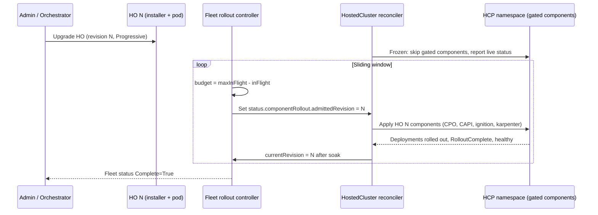

# Progressive Rollout of HO-Owned Per-HCP Components

## Summary

The HyperShift Operator (HO) reconciles a set of pod-bearing components into
every hosted control plane (HCP) namespace: the control-plane-operator (CPO),
the CAPI manager and provider, ignition, and the karpenter operator. In-flight
work moves the images of all of these components into the HO image, so a
single HO upgrade will change the pod template of every one of those
Deployments in every HCP at the same moment, and, through the CPO, may roll the
whole control plane of every hosted cluster at once. This enhancement adds a
fleet rollout controller to the HO that admits HostedClusters (HCs) to a new HO
component revision through a bounded, health-gated sliding window. HCs that
have not been admitted keep running the previous HO's components unchanged
("freeze, don't re-render"). User-driven changes such as release upgrades are
never blocked, and per-HC annotations let administrators and service
orchestrators mark HCs as `Canary`, `Last`, `Hold`, or `Immediate`.

## Motivation

Several in-flight efforts pin per-HCP components to the HO:

- Ignition refactor:
  [OCPSTRAT-3052](https://redhat.atlassian.net/browse/OCPSTRAT-3052)
  (epic [CNTRLPLANE-4735](https://redhat.atlassian.net/browse/CNTRLPLANE-4735)).
- CPO from main (CPO in the HO image):
  [OCPSTRAT-3588](https://redhat.atlassian.net/browse/OCPSTRAT-3588) and
  [OCPSTRAT-4039](https://redhat.atlassian.net/browse/OCPSTRAT-4039).
- CAPI from main (latest, kept in sync with HO-installed CRDs): TBD.

| Component | Image source today | Image source after in-flight work |
|---|---|---|
| CPO | release payload, `ControlPlaneOperatorImageAnnotation`, or overrides | HO image |
| CAPI manager | `capi-manager-image` annotation / release-derived | HO-pinned "latest" |
| CAPI provider | platform `CAPIProviderDeploymentSpec` (mostly payload) | HO-pinned "latest" |
| Ignition (PayloadController, ignition-server) | CPO-managed | HO-managed, HO image |
| Karpenter operator | HO image | HO image |

Once these images come from the HO, one HO upgrade causes:

- **A burst of resource demand on the management cluster.** Surge pods, image
  pulls on every node, and scheduler and apiserver load all arrive together,
  N HCPs × M components.
- **A second-order control-plane roll.** A new CPO re-renders the control
  plane components, so an HO bump can roll KAS, etcd, and the rest of the
  control plane in every HCP simultaneously.
- **No way to limit blast radius.** A bad HO build breaks every HCP at the
  same time.

Kubernetes primitives (PodDisruptionBudgets, `maxSurge`, priority) work per
Deployment, not across namespaces, so they cannot address this.
`spec.pausedUntil` stops all reconciliation for an HC, which is too coarse.

### User Stories

* As a **management cluster administrator**, I want an HO upgrade to roll the
  per-HCP components across my hosted clusters a bounded number at a time, so
  that the management cluster is not overwhelmed by surge pods, image pulls,
  and control-plane re-rollouts.
* As an **SRE for a managed HyperShift service (ROSA HCP / ARO HCP)**, I want
  a bad HO build to be detected on a small number of canary hosted clusters and
  the rollout to pause automatically, so that I can fix forward before the
  whole fleet is affected.
* As a **service orchestrator** that upgrades HOs across many management
  clusters, I want a status signal and controls (pause, window size, per-HC
  priority), so that I only move to the next management cluster or sector
  once the current one has finished and is healthy.
* As a **hosted cluster owner**, I want my release upgrades and HostedCluster
  spec edits to proceed immediately even while an HO rollout is in progress,
  so that the fleet rollout never blocks my own changes.
* As an **HO developer**, I want an explicit, CI-enforced version-skew
  contract between the HO and the frozen components in not-yet-admitted HCPs,
  so that I know which changes are safe and which must be gated per HC.
* As an **on-call engineer operating the fleet at scale**, I want metrics,
  events, and HC conditions that show which HCs are pending, in flight,
  complete, failed or held, so that I can monitor the rollout and remediate
  stuck or failed HCs.

### Goals

- Spread the HO-component transition across HCs with a bounded number in
  flight at a time.
- Gate each step on health, so the rollout also acts as a canary and pauses
  on failure.
- Keep user-driven changes (HC spec edits, release upgrades) unblocked.
- Keep version skew between the HO and its per-HCP components bounded and
  explicit.
- Expose status and controls that external, cross-management-cluster
  orchestrators can consume.

### Non-Goals

- Rollback. HyperShift does not support HO downgrade; a bad build is fixed
  forward.
- Staggering control-plane rollouts triggered by the release payload. Those
  are driven by `spec.release`, which users already schedule.
- Adaptive pacing based on live management-cluster pressure. This is left as
  an extension point.
- Staggering node (NodePool) rollouts on the guest side, which are already
  paced by NodePool `maxUnavailable`.

## Proposal

The proposal has five parts:

1. **Freeze, don't re-render.** For an HC that has not been admitted to the
   new HO component revision, the new HO does not mutate the live objects of
   the gated components. The previous HO's output stays in place exactly as
   it was. Once admitted, the HO reconciles normally. This needs only one new
   concept in the reconcilers ("skip this component unit") and no N-1
   rendering code.
2. **Revision identity.** A `componentRevision` is a hash of the HO image
   digest plus the HO configuration that affects component rendering
   (excluding rollout-policy flags). The installer computes it and passes it
   to the HO via the `HYPERSHIFT_OPERATOR_REVISION` environment variable.
3. **Per-HC rollout state** in HostedCluster status
   (`status.componentRollout`) and a new HC condition
   `HostedOperatorComponentsUpToDate`.
4. **A fleet rollout controller** in the HO (leader-elected) that admits HCs
   through a sliding window, ordered by priority, and pauses on failures.
5. **A skew contract** for HO developers, enforced by compatibility levels,
   a per-HC gating helper and CI.

The gated unit is **all of** {CPO, CAPI manager, CAPI provider, ignition,
karpenter operator}, together with their RBAC and config objects. They move
as one unit because they are tested together as one HO build and share CRD
and HCP-API contracts. Cheap, pod-less HO work (namespace, network policies,
the HCP object, secret sync) is not gated.

The feature is opt-in through an HO install flag,
`--component-rollout-strategy`, defaulting to `Immediate` (today's behavior).
The default flips to `Progressive` once the feature is proven.

### Workflow Description

**Management cluster administrator / SRE** installs and upgrades the HO and
configures the rollout policy.

**Service orchestrator** (optional) is an external automation (e.g. ROSA/ARO
fleet tooling) that upgrades HOs across management clusters and sets per-HC
priority annotations.

**Hosted cluster owner** edits HostedCluster specs and schedules release
upgrades.

**Fleet rollout controller** is a new leader-elected controller inside the
HO.

**HostedCluster reconciler** is the existing HO controller that reconciles
each HC and its HCP namespace.

#### Normal rollout

1. The administrator installs HO N with
   `--component-rollout-strategy=Progressive`. The installer computes
   `HYPERSHIFT_OPERATOR_REVISION` for HO N.
2. HO N starts. For every existing HC, `status.componentRollout
   .admittedRevision` differs from the HO's revision, so the HC reconciler
   treats the gated components as frozen. It keeps reconciling ungated work
   and reports status from the live objects.
3. The fleet rollout controller computes the in-flight set and the budget
   (`maxInFlight - inFlight`), and admits candidates in priority order, at
   most one per `minAdmissionInterval`, by setting `admittedRevision` and
   `admittedTime`. It records each HC's health at admission.
4. The HC reconciler sees the admission, un-freezes, and applies HO N's
   gated components. Each gated workload's metadata is stamped with the
   `hypershift.openshift.io/operator-revision` annotation.
5. The HO monitors completion: every gated Deployment has rolled out at the
   admitted revision and, for operator-type components (CPO,
   karpenter-operator), every `ControlPlaneComponent` in the HCP namespace
   remains `RolloutComplete=True` and the HC remains healthy for
   `minReadyDuration`.
6. The HO sets `currentRevision = admittedRevision`, the HC condition becomes
   `Complete`, and the window slot is freed. The controller admits the next
   candidate.
7. When all eligible HCs are complete, the fleet status reports
   `Complete=True`. An orchestrator may then upgrade the HO on the next
   management cluster.



#### Bypassing the window

These HCs are admitted immediately and do not consume budget:

- A new HC (no gated workloads exist in its HCP namespace).
- An HC whose desired release changed (`spec.release` or
  `spec.controlPlaneRelease` differs from the HCP). Release upgrades never
  run on frozen components.
- An HC annotated `hypershift.openshift.io/component-rollout: Immediate`.
- A no-op revision: rendering with N yields exactly the live objects.
- An HC whose gated workloads are below the HO's `MinCompatibleLevel`.

An HC with an explicit per-HC image-override annotation
(`control-plane-operator-image`, `capi-manager-image`,
`capi-provider-*-image`) is never frozen. An expected-but-missing gated
workload (e.g. deleted by hand) is recreated at the new revision.

#### Prioritization

1. Bypass (above).
2. `Canary`.
3. HCs with an edit that changes a gated pod template (detected via a frozen
   baseline hash). Their pods roll anyway, so combining the rolls saves a
   restart.
4. Default, ordered by `hash(UID + targetRevision)`: stable within a rollout,
   reshuffled per revision so the same HCs are not always first.
5. `Last`.

HCs with `Hold` are not admitted until `maxHoldDuration` elapses or the skew
rule forces admission. HCs with an active `spec.pausedUntil` or being deleted
are ineligible and not counted.

#### Failure handling

1. If an admitted HC does not complete within `progressDeadline`, it is marked
   `Failed` and its window slot is freed.
2. When failures reach `maxFailures` (absolute or a percentage of admitted
   HCs), the fleet rollout pauses: no new admissions; already admitted HCs keep
   reconciling.
3. HCs that were already unhealthy when admitted, and failures during a
   release upgrade, do not count toward `maxFailures`.
4. Until the first K HCs (canaries first) complete, no further admissions are
   made, to bound detection latency.
5. The rollout resumes when a fixed HO build (new revision) is installed, or
   on an explicit resume.

### API Extensions

This enhancement modifies the `HostedCluster` CRD
(`hypershift.openshift.io/v1beta1`) owned by the HyperShift team. It does not
add webhooks, aggregated API servers, or finalizers.

- **New status field** `status.componentRollout`:

  ```go
  type ComponentRolloutStatus struct {
      // admittedRevision is the HO component revision this HC may run.
      // Set by the fleet rollout controller.
      AdmittedRevision string `json:"admittedRevision,omitempty"`
      // currentRevision is the revision whose components are fully
      // rolled out and healthy on this HC.
      CurrentRevision string `json:"currentRevision,omitempty"`
      // admittedTime is used for progress-deadline accounting.
      AdmittedTime *metav1.Time `json:"admittedTime,omitempty"`
  }
  ```

- **New HC condition** `HostedOperatorComponentsUpToDate` with reasons
  `Pending`, `Progressing`, `Complete`, `Failed`, and `Held`.
- **New HC annotation** `hypershift.openshift.io/component-rollout` with
  values `Immediate`, `Canary`, `Last`, `Hold`.
- **New workload/namespace annotations** (internal bookkeeping):
  `hypershift.openshift.io/operator-revision` and a compatibility-level
  annotation on gated workload metadata, a frozen-baseline-hash annotation,
  and an annotation on the HCP namespace recording the set of gated workloads
  deployed by the previous revision.
- **Fleet status** is written to a ConfigMap in the HO namespace in v1. A
  cluster-scoped singleton CR (`HostedClusterComponentRolloutPolicy`) is a
  possible follow-up (see Open Questions).

The enhancement changes the behavior of existing resources: when the
`Progressive` strategy is enabled, the HO no longer immediately updates the
gated components in every HCP namespace after an HO upgrade.

### Topology Considerations

#### Hypershift / Hosted Control Planes

This enhancement is specific to HyperShift. All changes are in the HO running
on the management cluster. It reduces peak resource demand on the management
cluster during HO upgrades and bounds the number of HCPs whose control plane
re-rolls at once. Guest clusters are not directly affected; worker node
rollouts are still governed by the NodePool controller and `maxUnavailable`.

The NodePool controller runs in the HO and is not gated. HO-side changes to
NodePool hash inputs must be gated per HC with `componentrollout.Admitted(hc)`
so that they do not roll every NodePool at once, and CAPI objects it produces
must remain consumable by a frozen CAPI N-1.

#### Standalone Clusters

Not applicable.

#### Single-node Deployments or MicroShift

Not applicable.

#### OpenShift Kubernetes Engine

Not applicable.

### Implementation Details/Notes/Constraints

All changes are in the [openshift/hypershift](https://github.com/openshift/hypershift)
repository.

#### Revision identity

- The installer computes `componentRevision` from the HO image digest plus
  rendering-affecting config, excluding rollout-policy flags, and sets
  `HYPERSHIFT_OPERATOR_REVISION` on the HO Deployment. Each HO pod uses only
  its own value, so during the HO rolling update the old leader cannot admit
  HCs to the new revision using old rendering code.
- Config-only changes that affect rendering (e.g. a new registry override)
  also start a progressive rollout. Rollout-policy changes do not.
- Revisions are unordered hashes; skew is measured with integer
  compatibility levels instead.

#### Gate in the HC reconciler and the cpov2 framework

- Add a `ComponentsFrozen` flag to the control-plane component context. When
  frozen and the workload already exists, `controlPlaneWorkload.Reconcile`
  returns early before applying manifests, but still reports status from the
  live object. The existing predicate mechanism must not be reused, since a
  false predicate triggers the delete path. The frozen check runs after the
  predicate so disabling a component still cleans it up.
- Legacy, non-framework code (`reconcileCAPIManager`, parts of
  `reconcileControlPlaneOperator`) is wrapped at the call site as one unit
  that is skipped when frozen.
- While frozen, CPO capability labels are resolved from the **live** CPO
  Deployment image, not the image HO N would deploy, and cached by digest.
  These labels drive ungated work (PSA, NetworkPolicies, PKI RBAC, KAS custom
  kubeconfig, `defaultToControlPlaneV2`, `utilitiesImage`, etc.). Every label
  consumer needs a unit test.
- Components that are new in N (e.g. ignition moving from the CPO to the HO,
  or karpenter newly enabled by AutoNode) are created only after admission.
  For ignition, CPO N-1 keeps owning the ignition-server while frozen; at
  admission the new CPO stops managing it and the HO creates its own.

#### Fleet rollout controller

- New leader-elected controller in the HO, watching HC status and
  annotations only, implementing the sliding window and priority order
  described in the Workflow Description.
- Edits that change a gated pod template are detected by comparing two
  renders made with the new code: a baseline taken when the HC first becomes
  frozen under N, and the current render. This requires the cpov2 render
  path to be side-effect free in a dry-render mode. Renders are cached by
  input hash. Edits that do not change a pod template are deferred until
  admission.
- Fleet status (target revision, counts, `Progressing`/`Complete`/`Paused`
  conditions) is written to a ConfigMap in the HO namespace.

#### Completion signal

- Every gated component is done when its `operator-revision` annotation
  matches `admittedRevision` and its Deployment has fully rolled out.
- Operator-type components (CPO, karpenter-operator) are additionally done
  only when all `ControlPlaneComponent`s stay `RolloutComplete=True` for the
  soak period (`minReadyDuration`), measured from the later of the operator's
  rollout finishing and the last `RolloutComplete` transition. The soak is
  required because `RolloutComplete=True` may be left over from the old CPO;
  it must exceed the CPO's time to first reconcile, including the 60s
  leader-election lease.
- The HC must be healthy (`Available=True`, `Degraded=False`, key HCP
  conditions True) throughout the soak.

#### Rolling out the feature itself

- Workloads without the `operator-revision` annotation are treated as a
  different revision, so the release that introduces the feature is itself
  rolled out progressively.
- New HCs are detected by absence of gated workloads, not by empty status.
- Workloads without a compatibility-level annotation count as level 0, and
  `MinCompatibleLevel` starts at 0.
- Annotations are on workload metadata, not pod templates, so adding them
  does not restart pods.

#### Configuration (HO install flags)

| Flag | Default | Meaning |
|---|---|---|
| `--component-rollout-strategy` | `Immediate` (GA: `Progressive`) | `Immediate` = today's behavior |
| `--component-rollout-max-in-flight` | `10%` (min 1) | Window size, int or percentage of HCs |
| `--component-rollout-min-admission-interval` | `10s` | Spreads out image pulls and apiserver writes |
| `--component-rollout-progress-deadline` | `20m` | Per-HC deadline, must cover the CPO's downstream roll |
| `--component-rollout-min-ready-duration` | `5m` | Soak period before an HC counts as done |
| `--component-rollout-max-failures` | `3` | Pauses the fleet rollout |
| `--component-rollout-max-hold-duration` | `24h` | Force-admits HCs set to `Hold` |

#### Feature gate

<!-- TODO: Reviewers to confirm whether the new HostedCluster status field
needs a HyperShift API feature gate. -->

This proposal does not use a feature gate. Management-cluster feature gates
for HyperShift exist only as `TechPreviewNoUpgrade`, which is irreversible
and blocks upgrades. That would make a feature that only matters across HO
upgrades impossible to exercise. Instead, `--component-rollout-strategy` is
the opt-in: it defaults to `Immediate` (today's behavior, disabled by
default), and the default flips to `Progressive` once the feature meets the
graduation criteria.

#### Observability

- Metrics:
  `hypershift_component_rollout_hostedclusters{state=pending|in_flight|complete|failed|held}`,
  `hypershift_component_rollout_paused`, and an
  `hypershift_component_rollout_admission_duration_seconds` histogram.
- Events on each HC at admission, completion, and failure.
- A testing hook, `HYPERSHIFT_OPERATOR_REVISION_OVERRIDE`, forces a revision
  change in e2e without building a new HO image.

#### Cross-management-cluster coordination (ROSA/ARO)

External orchestrators need:

- **Gate signal (status):** `targetRevision`, counts
  (`pending`/`inFlight`/`complete`/`failed`), and `Progressing`, `Complete`,
  `Paused` conditions. Rule: do not bump the HO on the next management
  cluster until this one reports `Complete=True` and `Paused=False`.
- **Control (spec):** `paused`, `maxInFlight`, `progressDeadline`,
  `maxFailures`.
- **Per-HC priority:** the `component-rollout` annotation.

### Risks and Mitigations

- **Skew between HO N and frozen N-1 components.** Ungated outputs (CRDs, HCP
  spec, secrets) must work with N-1 components. Mitigated by the skew
  contract, compatibility levels, the `componentrollout.Admitted(hc)` gating
  helper, a frozen-phase e2e, and a CRD compatibility check in `make verify`.
- **Ungated HCP projection changes roll the fleet.** An HO change to the
  HO→HCP spec projection makes every frozen CPO re-render at once. Mitigated
  by gating projection changes with `Admitted(hc)` and a golden-file unit test
  for the frozen and admitted cases.
- **Blast radius larger than `maxFailures`.** Failures appear only after
  `progressDeadline` while the window keeps admitting, and non-counting
  failures are unbounded. Mitigated by holding the window at the first K HCs
  (canaries first) until they complete.
- **Ungated paths are not protected.** The HO's own controllers, network
  policies and the NodePool controller take N fleet-wide immediately. These
  rely on the skew contract and the frozen-phase e2e.
- **Deferred HC edits.** Edits that do not change a gated pod template wait
  until admission. Bounded by the window; `Immediate` is the escape hatch.
- **Security.** The per-HC annotation adds no new privilege: anyone who can
  edit an HC can already change its release or set `spec.pausedUntil`.
  Freezing does not defer certificate rotation, because none of the gated
  workloads put secret-hash annotations on their pod templates; this must be
  preserved when ignition moves to the HO.

<!-- TODO: Identify who will review security and UX. -->

### Drawbacks

- Adds a new controller and per-HC state machine to the HO, increasing
  complexity and the surface for bugs in a critical path.
- Imposes a skew contract on HO developers: incompatible HO-side changes must
  be gated per HC and cleaned up one revision later.
- A full fleet rollout takes longer than today; HC edits that do not need a
  roll are deferred until admission.
- Completion relies on a time-based soak to detect the CPO's downstream roll
  until a CPO-side revision report is added.

## Alternatives (Not Implemented)

- **Deterministic jitter, no central controller.** Each HC takes the new
  revision at `firstSeen(target) + hash(UID) % window`. Stateless and simple,
  but no health gating, no back-pressure, and no canary protection. A
  reasonable fallback if the controller cannot land first.
- **Render N-1 images from the new HO.** Requires the new HO to contain N-1
  rendering code (args, env, RBAC, volumes) for every component, i.e.
  versioned renderers forever. Rejected.
- **Hash the HO Deployment at runtime for revision identity.** During the HO
  rolling update the old leader would see the new template first and admit
  HCs using N-1 rendering. The downward-API `pod-template-hash` also includes
  the policy flags. Rejected in favor of an installer-computed revision.
- **Run old and new HO side by side, sharding HCs by annotation** using the
  existing HostedCluster scoping. Works without code changes, but doubles HO
  resources, complicates CRD ownership and needs manual orchestration. Worth
  documenting as an operational workaround today.
- **Keep these images in the release payload.** Avoids the problem but gives
  up the goals of the in-flight work (CRD and CAPI sync, decoupling the CPO
  from the release).
- **Use an OpenShift feature gate instead of an install flag.** Rejected
  because `TechPreviewNoUpgrade` blocks upgrades, which makes an upgrade-time
  feature impossible to exercise.

## Open Questions [optional]

1. Should the fleet policy CR (`HostedClusterComponentRolloutPolicy`) be
   part of this effort, or should v1 deliver orchestrator hooks through the
   HO-namespace status ConfigMap, HO flags and annotations, with the CR as a
   follow-up only if needed?
2. Ignition-server is in the request-serving path. Is `maxInFlight` enough,
   or does it need its own zero-downtime check before the HC counts as
   complete? Probably fine, since it already rolls with `maxUnavailable=0`.
3. What should be frozen: the whole component (current design), or only its
   pod template? Freezing only the pod template lets non-rollout edits apply
   immediately, but enlarges the skew contract: every non-workload object
   rendered by N must work with N-1 pods.

Resolved during design:

- HCP projection changes are gated per HC with `Admitted(hc)` and caught by a
  golden-file test, rather than adding the HCP object to the gated unit.
- Only HC edits that change a gated pod template jump the queue; other edits
  are deferred until admission.

## Test Plan

All tests live in the openshift/hypershift repository.

- **Unit tests:**
  - Frozen/admitted decisions, including all bypass cases (new HC, release
    change, `Immediate`, no-op revision, below compatibility floor, missing
    workload, image-override annotations).
  - Sliding-window budget, priority ordering, `hash(UID + targetRevision)`
    stability, `maxFailures` pause and resume.
  - Every consumer of CPO capability labels when resolved from the live
    image.
  - Golden-file tests of the HO→HCP projection for frozen and admitted HCs.
  - Dry-render side-effect freedom of the cpov2 render path.
- **e2e:**
  - Add a frozen phase to `e2e-aws-upgrade-hypershift-operator`: upgrade the
    HO with the rollout paused and verify frozen HCs stay healthy, including
    NodePool scale-up.
  - Progressive rollout of multiple HCs using
    `HYPERSHIFT_OPERATOR_REVISION_OVERRIDE`, verifying the window bound,
    completion, and pause on injected failure.
  - Release upgrade of a frozen HC is admitted immediately and completes.
- **verify:** a CRD compatibility check in `make verify` ensuring CRDs still
  serve the versions used by N-1 controllers.
- **Scale:** load testing on a management cluster with many HCs to validate
  the default window and admission interval.

## Graduation Criteria

Flipping the `--component-rollout-strategy` default to `Progressive` is
gated on:

- The progressive-rollout and frozen-phase e2e tests running in HyperShift
  CI (including `e2e-aws-upgrade-hypershift-operator`) with a sustained pass
  rate of at least 95%, on each platform where HyperShift supports HO
  upgrades (at minimum AWS and Azure).
- At least one full HO upgrade cycle with `Progressive` enabled in ROSA HCP
  and ARO HCP without fleet-wide incidents attributable to the feature.

<!-- TODO: Reviewers to confirm the CI jobs, pass-rate window and managed
service exposure required before flipping the default. -->

### Dev Preview -> Tech Preview

- Opt-in via `--component-rollout-strategy=Progressive`.
- Unit tests and the frozen-phase HO upgrade e2e are in place.
- Metrics, events and the HC condition are exposed.

### Tech Preview -> GA

- Default of `--component-rollout-strategy` flips to `Progressive`.
- Exercised in managed services (ROSA HCP / ARO HCP) across multiple HO
  upgrades.
- Load testing at management-cluster scale validates defaults.
- Symptoms-based alerts for paused rollouts and failed HCs.
- User-facing documentation for the flags, annotation and status.

### Removing a deprecated feature

Not applicable.

## Upgrade / Downgrade Strategy

- **Upgrade to the HO that introduces the feature:** existing HCs have no
  `status.componentRollout` and their workloads lack the `operator-revision`
  annotation, so they are treated as a different revision and go through the
  window when `Progressive` is enabled. With the default `Immediate`
  strategy, behavior is unchanged.
- **Subsequent HO upgrades:** each new revision starts a progressive rollout.
  Release upgrades of individual HCs are never blocked.
- **Downgrade:** HyperShift does not support HO downgrade. A bad HO build is
  fixed forward with a new build; HCs on N and HCs still frozen on N-1 both go
  through the window for N+1 as long as N+1 keeps N-1's compatibility level.
- Switching the strategy from `Progressive` back to `Immediate` admits all
  HCs at once (today's behavior).

## Version Skew Strategy

This proposal deliberately introduces bounded skew between HO N and the
frozen components (CPO, CAPI, ignition, karpenter) of HO N-1 in
not-yet-admitted HCPs. The skew contract:

1. **HO N must reconcile correctly while N-1 components run in frozen HCPs**,
   for everything that stays ungated:
   - CRDs (CAPI, ignition) must still serve the API versions N-1 controllers
     use.
   - New HCP fields must be optional and ignorable by CPO N-1; removed fields
     must keep being written for one revision.
   - While frozen, the HO reads CPO capability labels from the live image.
2. **Bounded by compatibility level.** The HO has two compiled-in integers:
   `CompatibilityLevel` (bumped when a gated component's contract changes)
   and `MinCompatibleLevel` (the oldest level it can operate). Frozen HCs
   below `MinCompatibleLevel` bypass the window; skew safety takes priority
   over smoothing. `MinCompatibleLevel` is bumped only one release after the
   level that introduced the break.
3. **Per-HC gating helper.** Incompatible HO-side changes go behind
   `if componentrollout.Admitted(hc) { new } else { old }`; the `else` branch
   is deleted one revision later.
4. **Cert and secret rotation** in frozen HCPs is not deferred, since gated
   workloads do not put secret-hash annotations on their pod templates.

This contract is narrower than today's, where the HO must work with CPO and
CAPI images from every supported OCP release with no time limit.

## Operational Aspects of API Extensions

- The new HostedCluster status field and condition are written by the HO via
  status patching; they add at most one status write per HC per state
  transition and do not materially affect API throughput.
- The fleet rollout controller watches HC status and annotations only.
  Frozen HCs cache renders by input hash to avoid re-rendering on every
  reconcile.
- SLIs: `hypershift_component_rollout_hostedclusters` by state,
  `hypershift_component_rollout_paused`, admission duration histogram, the
  `HostedOperatorComponentsUpToDate` HC condition, and fleet conditions in
  the HO-namespace status ConfigMap.
- Failure modes:
  - The rollout pauses on `maxFailures`; already admitted HCs keep
    reconciling, frozen HCs remain on N-1.
  - An HC stuck in `Held` is force-admitted after `maxHoldDuration`.
  - If the controller malfunctions, HCs remain frozen on N-1 components,
    which keep serving; release upgrades still bypass the freeze.
- Escalations go to the HyperShift team.

## Support Procedures

- **Detecting a paused rollout:** `hypershift_component_rollout_paused` is 1;
  the status ConfigMap in the HO namespace shows `Paused=True` and the failed
  HCs.
- **Detecting a stuck HC:** HC condition `HostedOperatorComponentsUpToDate`
  with reason `Progressing` past `progressDeadline`, or `Failed`; HC events at
  admission and failure; compare `status.componentRollout.admittedRevision`
  and `currentRevision`.
- **Forcing an HC through:** annotate it with
  `hypershift.openshift.io/component-rollout=Immediate`.
- **Holding an HC (e.g. maintenance window):** annotate with `Hold`; bounded
  by `maxHoldDuration` and the compatibility floor.
- **Resuming:** install a fixed HO build (new revision) or use the explicit
  resume control.
- **Disabling the feature:** reinstall the HO with
  `--component-rollout-strategy=Immediate`. All HCs are admitted at once
  (today's behavior); no data is lost.

<!-- TODO: Add log messages and alert names once implemented. -->

## Infrastructure Needed [optional]

- A frozen phase added to the existing
  `e2e-aws-upgrade-hypershift-operator` CI job.
- Scale test environment with many HostedClusters per management cluster.
