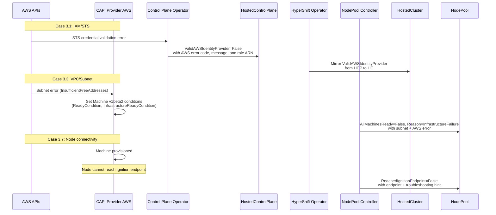

# ROSA HCP Installation Failure Debuggability

## Summary

This enhancement adds AWS-specific diagnostic detail to
existing HyperShift conditions for ROSA HCP clusters.
It addresses three SRE-confirmed failure cases that
currently produce opaque errors during cluster
installation: IAM/STS role assumption failures,
VPC/subnet misconfiguration, and node connectivity
failures. The approach adds diagnostic detail to
existing condition messages and reason codes without
introducing new condition types or API fields.

### Relationship to Sibling Enhancements

This EP is the AWS-specific counterpart to the ARO
enhancement
(`aro-installation-failure-debuggability.md`). Both
EPs follow the same design principles:

- **Level-driven condition semantics**: Conditions
  reflect current observed state, not events.
  Controllers re-evaluate on every reconciliation
  and set the condition to match the current state,
  ensuring self-healing and eliminating stale
  conditions.
- **Allowlist-based security model**: Only
  structured, customer-owned identifiers (IAM role
  ARNs, subnet IDs, endpoint URLs) appear in
  condition messages. Free-text pass-through from
  upstream providers is audited before Tech Preview.
  Management cluster node names are never included.
- **Message truncation**: Diagnostic messages
  respect the truncation limits already enforced in
  the HyperShift codebase (see Message Truncation
  below).
- **Enrichment over proliferation**: Diagnostic
  detail is added to existing condition messages
  rather than introducing new condition types, to
  avoid expanding the condition surface area.

### Prerequisites

This EP is the AWS-specific Phase 2 follow-up to
the platform-agnostic Phase 1 enhancement proposed
in [enhancements PR #2134](https://github.com/openshift/enhancements/pull/2134)
(CNTRLPLANE-4639, status: **open**). Phase 1
introduces installation-stage tracking,
`ManagementClusterResourcePressure` detection, and
generic diagnostic enrichment. This EP builds on
that foundation by adding AWS-specific diagnostic
detail for three ROSA SRE-confirmed failure cases.
Phase 1 is not a hard prerequisite — this EP's
three cases operate on different conditions and
code paths — but the two EPs share the same
strategy (OCPSTRAT-1598) and are designed to be
complementary.

This EP also depends on
[PR #9781](https://github.com/openshift/hypershift/pull/9781)
(status: **open, not yet merged**), which adds
terminal infrastructure failure detection to the
NodePool controller via `isTerminalInfraReason()`
(exact map lookup) and the `InfrastructureFailure`
reason code. Case 3.3 builds on this foundation.
Neither `isTerminalInfraReason()` nor the
`InfrastructureFailure` reason code exist in the
current codebase — they are introduced by PR #9781.
This EP cannot proceed to `implementable` until PR
#9781 is merged. If PR #9781 is rejected or
significantly redesigned, Case 3.3 will be dropped
from scope entirely — this EP will proceed with
Cases 3.1 and 3.7 only, and Case 3.3 will be
re-proposed in a follow-up EP once an alternative
terminal failure detection mechanism is available.
The EP will not introduce its own
`isTerminalInfraReason()` equivalent, as that would
duplicate the infrastructure failure classification
work that PR #9781 is designed to provide across
all providers. Cases 3.1 and 3.7 have no dependency
on PR #9781 and can proceed independently.

## Glossary

For common HyperShift terms (HC, HCP, HO, CPO, HCCO,
CPC, CVO) see the
[parent enhancement glossary](installation-failure-debuggability.md#glossary).

- **ROSA HCP**: Red Hat OpenShift Service on AWS,
  Hosted Control Planes architecture
- **CAPA**: Cluster API Provider AWS — the CAPI
  provider that manages AWS infrastructure
- **STS**: AWS Security Token Service — used for
  temporary credential assumption
- **OIDC**: OpenID Connect — used for workload
  identity federation with AWS
- **SCP**: AWS Service Control Policy — organization-
  level policy restricting API actions
- **NACL**: Network Access Control List — subnet-level
  firewall in AWS VPC

### Case numbering

This EP uses case numbers 3.1, 3.3, and 3.7 from the
full ROSA failure case inventory (Cases 3.1–3.12),
which catalogs all identified AWS-specific failure
categories. The non-contiguous numbering reflects
that only the SRE-confirmed cases are addressed
here; the remaining cases (3.2, 3.4–3.6, 3.8–3.12)
are listed in Future Work.

## Motivation

ROSA HCP SRE teams have confirmed three categories of
AWS-specific installation failures that are difficult
to diagnose today. In each case, the root cause is an
AWS platform issue (IAM misconfiguration, network
misconfiguration, or connectivity failure), but the
error surfaces as a generic HyperShift condition with
no indication of the underlying AWS-specific cause.
SREs must manually inspect CAPI Machine objects, AWS
API responses, and pod logs across multiple namespaces
to identify the root cause.

### User Stories

- As a ROSA SRE, I want to see the specific AWS IAM
  error (e.g., `AccessDenied: User is not authorized
  to perform sts:AssumeRoleWithWebIdentity`) in the
  `ValidAWSIdentityProvider` condition message so that
  I can direct the customer to fix their IAM trust
  policy without manually querying STS.

- As a ROSA SRE, I want to see which subnet is
  exhausted or misconfigured (e.g., `subnet-0abc1234:
  InsufficientFreeAddresses`) in the NodePool
  condition so that I can identify the affected subnet
  without inspecting individual CAPI Machine objects.

- As a ROSA SRE, I want to see when worker nodes
  cannot reach the control plane (e.g., `Ignition
  endpoint unreachable: connection timeout to
  api-int.cluster.example.com:22623`) so that I can
  identify security group or NACL issues without
  SSH-ing into nodes.

- As a fleet operator, I want to monitor AWS-specific
  installation failures at scale so that I can
  identify systemic issues (e.g., an IAM policy change
  affecting multiple clusters) before they are
  escalated.

### Goals

1. Surface the specific AWS error message in existing
   HyperShift conditions for the three confirmed
   failure cases, replacing opaque generic messages.
2. Enable SREs to diagnose AWS-specific installation
   failures from `HostedCluster` and `NodePool`
   conditions alone, without inspecting CAPI Machine
   objects or pod logs.
3. Maintain backward compatibility — no new condition
   types, no new API fields, no changes to condition
   `Type` values.

### Non-Goals

1. **New condition types**: This enhancement does not
   add new conditions. All changes are diagnostic
   detail on existing conditions.
2. **Unconfirmed ROSA failure cases**: Cases 3.2
   (quota), 3.4 (PrivateLink), 3.5 (Route 53), 3.6
   (KMS), 3.8 (SCPs), 3.9 (EC2 capacity), 3.10
   (S3/OIDC), 3.11 (API throttling), 3.12 (ELB) are
   deferred until verified by ROSA SRE teams. Cases
   3.1, 3.3, and 3.7 were selected because the ROSA
   SRE team identified them as the most frequently
   escalated installation failure categories in their
   internal incident data. Exact frequency data is
   internal to the ROSA SRE organization and was
   confirmed by the SRE reviewers listed in this EP's
   metadata. The remaining 9 cases are deferred
   pending similar SRE confirmation, not excluded.
3. **ARO/Azure failure cases**: Covered by a separate
   enhancement
   (`aro-installation-failure-debuggability.md`).
4. **Pre-flight validation**: This enhancement
   surfaces errors after they occur, not before.
   Pre-flight VPC/IAM validation is a separate
   concern and a deliberate phasing decision — a
   future enhancement for pre-flight checks (e.g.,
   validating IAM trust policies and subnet capacity
   before provisioning) is anticipated but not yet
   tracked. See also Alternative 3.
5. **NodePool day-2 diagnostics**: The test plan and
   graduation criteria are validated against
   installation-time scenarios. However, because the
   underlying conditions (`ReachedIgnitionEndpoint`,
   `AllNodesHealthy`) are evaluated on every
   reconciliation, the enhanced diagnostic messages
   will also fire during day-2 node scaling events.
   This is acceptable — the same diagnostic detail
   that helps SREs during installation also helps
   during day-2 — but this EP does not add day-2-
   specific diagnostics (e.g., scale-up-specific
   error correlation). The message format for Case
   3.3 reports failing machines relative to the total
   machine count (e.g., "2 of 12 machines are not
   ready" during a scale-up from 10 to 12), so the
   message remains accurate in both day-0 and day-2
   contexts. The total count comes from the Machine
   list fetched by `setAllMachinesReadyCondition()`
   on each reconciliation, reflecting the current
   desired replica set.

## Proposal

Add AWS-specific diagnostic detail to existing
conditions by inspecting AWS API error responses and
CAPI Machine status at three points in the
installation flow:

### Case 3.1: IAM/STS Role Assumption Failures

**Existing condition**: `ValidAWSIdentityProvider`
(on `HostedCluster`)

**Current behavior**: The CPO's health check controller
(`control-plane-operator/controllers/healthcheck/
aws.go`) sets the condition via
`classifyIdentityProviderError()` (lines 92–110),
which already classifies the AWS API error and
includes the error code and message (e.g.,
`"AWS identity provider validation failed:
AccessDenied: <STS error message>"`). However, the
message does not include the target IAM role ARN
from the HCP spec, making it harder for SREs to
correlate the error with the specific role that
needs fixing.

**Proposed diagnostic detail**: When the STS
`AssumeRoleWithWebIdentity` call fails, include the
AWS error code and message in the condition:

```
ValidAWSIdentityProvider=False,
Reason=InvalidIdentityProvider,
Message="STS AssumeRoleWithWebIdentity failed for
  role arn:aws:iam::123456789012:role/cluster-role:
  AccessDenied — User is not authorized to perform
  sts:AssumeRoleWithWebIdentity on resource
  arn:aws:iam::123456789012:oidc-provider/..."
```

**Implementation**: The CPO's health check controller
(`control-plane-operator/controllers/healthcheck/
aws.go:92-110`, `classifyIdentityProviderError()`)
already classifies the AWS API error and includes the
error code and message via `apiErr.ErrorCode()` and
`apiErr.ErrorMessage()`. The change enhances the
condition message to prepend the target role ARN from
the HCP spec (available via `hcp.Spec.Platform.AWS.
RolesRef`), enabling SREs to identify which role's
trust policy needs correction without cross-
referencing the `HostedCluster` spec. Note: the HO's
`GetCredentialStatus()` (`aws.go:363-394`) is
read-only — it reads the condition status set by
the CPO but does not set conditions itself.

**Security note**: The error message includes the IAM
role ARN, which is customer-owned and already visible
in the `HostedCluster` spec. No Red Hat-internal
ARNs or account IDs are exposed.

### Case 3.3: VPC/Subnet Misconfiguration

**Existing condition**: `AllMachinesReady`
(on `NodePool`)

**Current behavior**: When CAPA fails to provision an
AWSMachine due to subnet issues, the error surfaces
via CAPI v1beta2 Machine conditions
(`ReadyCondition`, `InfrastructureReadyCondition`).
The NodePool controller's
`setAllMachinesReadyCondition()` aggregates these
conditions and surfaces them on the
`AllMachinesReady` condition.
[PR #9781](https://github.com/openshift/hypershift/pull/9781)
(open, not yet merged — see Prerequisites) adds
terminal infrastructure failure detection via
`isTerminalInfraReason()` (exact map lookup),
which will classify persistent failures with
`Reason=InfrastructureFailure`. Once merged, the
message will include the CAPI condition reason and
message but will not parse the AWS-specific error
code or identify the affected subnet.

**Proposed diagnostic detail**: Enhance the existing
`InfrastructureFailure` message with AWS-specific
context — parse the AWS error code from the CAPA
failure message and include the subnet ID:

```
AllMachinesReady=False,
Reason=InfrastructureFailure,
Message="2 of 3 machines are not ready.
  Machine machine-abc: InsufficientResources:
  subnet-0abc1234:
  InsufficientFreeAddressesInSubnet: The specified
  subnet does not have enough free addresses"
```

**Implementation**: The NodePool controller's
`setAllMachinesReadyCondition()` already aggregates
CAPI v1beta2 Machine conditions
(`ReadyCondition`, `InfrastructureReadyCondition`)
and — once PR #9781 is merged — will classify
terminal infrastructure failures via
`isTerminalInfraReason()` (exact map lookup).
The diagnostic detail (AWS error code,
subnet ID) flows through CAPA → the CAPI v1beta2
`InfrastructureReadyCondition` on the Machine
object. CAPA sets this condition's `Reason` and
`Message` fields when an AWS infrastructure
operation fails. The NodePool controller already
reads `InfrastructureReadyCondition.Reason` and
`.Message` (`conditions.go:772-774`) and aggregates
them via `aggregateMachineReasonsAndMessages()`.
No additional provider-specific reads are needed
in the NodePool controller — the enrichment depends
on CAPA including the AWS error code and affected
subnet ID in the `InfrastructureReadyCondition`
message it sets on the Machine.

This preserves the NodePool controller's provider-
agnostic abstraction boundary: it reads only
standard CAPI v1beta2 Machine conditions, not
provider-specific AWSMachine resources.

If CAPA does not currently include the subnet ID
in the `InfrastructureReadyCondition` message, a
CAPA enhancement will be filed as a prerequisite
(see Open Question 2).

**Specific AWS errors to surface**:
- `InsufficientFreeAddressesInSubnet`
- `InvalidSubnetID.NotFound`
- `InvalidParameterValue` (AZ mismatch)
- `InsufficientInstanceCapacity` (will be detected
  by `isTerminalInfraReason()` in PR #9781 via
  exact map lookup, once merged)
- `QuotaExceeded` (will be detected by PR #9781,
  once merged)
- Generic CAPA provisioning failures with AWS error
  code passthrough

### Case 3.7: Node Connectivity Failures

**Existing conditions**:
- `ReachedIgnitionEndpoint` (on `NodePool`)
- `AWSSecurityGroupAvailable` (on `NodePool`)
- `AllMachinesReady` / `AllNodesHealthy`
  (on `NodePool`)

**Current behavior**:
- `ReachedIgnitionEndpoint` is `False` with
  reason `ignitionNotReached` when nodes cannot
  retrieve Ignition configuration. No detail on why.
- `AWSSecurityGroupAvailable` blocks node
  creation if the default SG is not ready. No detail
  on which SG or why.
- Nodes stuck in restart loops appear as unhealthy
  Machines with generic `NodeStartupTimeout` reason.

**Proposed diagnostic detail**:

For `ReachedIgnitionEndpoint`:
```
ReachedIgnitionEndpoint=False,
Reason=ignitionNotReached,
Message="0/3 nodes have reached the Ignition
  endpoint. Nodes may be unable to reach
  api-int.<cluster>.<domain>:22623. Possible causes
  include security group ingress misconfiguration,
  NACL rules blocking traffic to worker subnets,
  DNS resolution failures, or proxy configuration
  issues."
```

For `AllNodesHealthy` when nodes are stuck:
```
AllNodesHealthy=False,
Reason=NodeStartupTimeout,
Message="2 nodes not healthy: machine-abc
  (NodeReady=False for 15m), machine-def
  (NodeReady=False for 12m). Nodes may be unable
  to reach the API server. Possible causes include
  security group egress rules blocking port 6443,
  network ACLs, or route table misconfiguration."
```

**Implementation**: The NodePool controller's
`createReachedIgnitionEndpointCondition()`
(`conditions.go:907-950`) and
`setAllNodesHealthyCondition()` (`conditions.go:
668-710`) already evaluate the relevant signals.
The change adds contextual messages with the
expected endpoints and troubleshooting hints when
failures are detected.

### Workflow Description

The diagnostic detail flows through existing
HyperShift condition pipelines — no new data paths:



### API Extensions

No new API types, conditions, or fields are
introduced. All changes are diagnostic detail
(message text and reason codes) on existing
conditions:

- `ValidAWSIdentityProvider` (existing on
  `HostedCluster`)
- `AllMachinesReady` (existing on `NodePool`)
- `AllNodesHealthy` (existing on `NodePool`)
- `ReachedIgnitionEndpoint` (existing on `NodePool`)
- `AWSSecurityGroupAvailable` (existing on
  `NodePool`)

#### Condition message stability

Although no formal API fields are added, condition
`Message` text and `Reason` codes constitute a de
facto API surface that SRE fleet automation may
depend on. Consumers **must not** regex-parse
`Message` text for programmatic decisions — the
message content is best-effort diagnostic detail and
may change between releases without notice.
Automation should switch on `Reason` codes, which
are stable within a release series.

The exact `Reason` values used by each case are:

| Case | Condition | Reason (stable) | New? |
|------|-----------|-----------------|------|
| 3.1 | `ValidAWSIdentityProvider` | `InvalidIdentityProvider` | No (existing) |
| 3.3 | `AllMachinesReady` | `InfrastructureFailure` | Yes (PR #9781) |
| 3.7 | `ReachedIgnitionEndpoint` | `ignitionNotReached` | No (existing)\* |
| 3.7 | `AllNodesHealthy` | Per-machine reasons aggregated | No (existing) |

\* `ignitionNotReached` uses camelCase rather than
PascalCase (the convention for OpenShift reason
codes). This is an existing value in the HyperShift
codebase (`IgnitionNotReached = "ignitionNotReached"`
in `nodepool_conditions.go`); changing it would be a
breaking change and is out of scope for this EP.

`Message` field content is enriched with AWS-
specific diagnostic detail (role ARN, subnet ID,
endpoint URL, troubleshooting hints). These fields
are included on a best-effort basis — the message
may omit them if the underlying data is unavailable
(e.g., CAPA does not include the subnet ID in the
`InfrastructureReadyCondition` message). Message
format is **not guaranteed stable** between
releases.

### Topology Considerations

#### Hypershift / Hosted Control Planes

This enhancement is exclusively for the HyperShift
topology on AWS (ROSA HCP). All changes are in the
Control Plane Operator (Case 3.1) and NodePool
controller (Cases 3.3, 3.7).

#### Standalone Clusters

Not applicable — ROSA HCP uses HyperShift only.

#### Single-node Deployments or MicroShift

Not applicable.

#### Disconnected / Restricted Network

ROSA HCP clusters can operate in PrivateLink or
restricted-networking configurations. The diagnostic
messages in this EP remain accurate in those
scenarios because they report observed failures (AWS
API errors, CAPI condition content), not assumed
causes. The troubleshooting hints in Case 3.7 use
"possible causes include..." language that lists
common root causes without asserting which one
applies. In restricted-network deployments,
additional causes such as VPC endpoint
misconfiguration, proxy settings, or missing
PrivateLink connections may be relevant. These are
not excluded by the hint text — SREs should evaluate
the listed possibilities alongside environment-
specific factors. Deferred failure cases 3.4
(PrivateLink) and 3.5 (Route 53 DNS) will address
restricted-network-specific diagnostics when
confirmed by ROSA SRE teams.

#### OKE (OpenShift Kubernetes Engine)

Not applicable — OKE does not use ROSA HCP.

## Implementation Details/Notes/Constraints

### Implementation overview

Changes are in the `openshift/hypershift` repository:

1. **`control-plane-operator/controllers/healthcheck/
   aws.go`**: Enhance `classifyIdentityProviderError()`
   to prepend the target role ARN from the HCP spec
   in the `ValidAWSIdentityProvider` condition message.
   The function already surfaces the AWS error code
   and message; this change adds role ARN context.

2. **`hypershift-operator/controllers/nodepool/
   conditions.go`**: The generic infrastructure
   failure detection via CAPI v1beta2 Machine
   conditions (`ReadyCondition`,
   `InfrastructureReadyCondition`) and the
   `InfrastructureFailure` reason code will be
   implemented by
   [PR #9781](https://github.com/openshift/hypershift/pull/9781)
   (open, not yet merged — see Prerequisites).
   The AWS-specific diagnostic detail (error code,
   subnet ID) flows through the CAPI v1beta2
   `InfrastructureReadyCondition` (set by CAPA) into
   the existing
   `aggregateMachineReasonsAndMessages()` pipeline.
   No provider-specific resource reads are added to
   the NodePool controller (see Open Question 2).

3. **`hypershift-operator/controllers/nodepool/
   conditions.go`**: Enhance
   `createReachedIgnitionEndpointCondition()` (lines
   907-950) to include the expected Ignition endpoint
   URL and troubleshooting guidance.

4. **`hypershift-operator/controllers/nodepool/
   conditions.go`**: Enhance
   `setAllNodesHealthyCondition()` (lines 668-710) to
   include per-node duration and API server
   reachability hints.

### Message truncation

Diagnostic messages respect the truncation limits
already enforced in the HyperShift codebase:

- **Per-machine message block**: 1000 characters
  (`maxMessageLength` in the NodePool controller,
  `nodepool_controller.go`). Each individual
  machine's diagnostic detail is truncated at a word
  boundary with `...` before aggregation.
- **Aggregated condition message**: 3000 characters
  (`maxGlobalMessageLength` in the NodePool
  controller). The combined message across all
  machines is truncated after aggregation.
- **HCCO condition messages**: 1024 characters
  (`maxConditionMessageLength` in the HCCO resources
  controller, `resources.go`). Applies to
  HostedCluster-level conditions such as
  `ValidAWSIdentityProvider`.

For Case 3.3 (multi-machine failures), when multiple
machines fail with different AWS errors, the message
shows a summary count followed by per-machine detail
up to the aggregated message limit. For example, if
5 machines fail across 3 subnets, the message shows:

```
AllMachinesReady=False,
Reason=InfrastructureFailure,
Message="5 of 8 machines are not ready.
  machine-abc: InsufficientFreeAddressesInSubnet
  (subnet-0abc1234); machine-def:
  InsufficientFreeAddressesInSubnet
  (subnet-0def5678); ... (3 more)"
```

If the per-machine details exceed the aggregated
limit, trailing machines are elided with a count
(e.g., `... (3 more)`). The first failing machine is
always included so that at least one actionable
diagnostic is visible.

### Security considerations

This EP follows the allowlist-based security model
described in the Design Principles section above:
only structured, customer-owned identifiers appear
in condition messages. Free-text pass-through is
avoided; when CAPI condition messages are included,
they are audited for sensitive content before Tech
Preview (see Graduation Criteria).

Specifically:
- IAM role ARNs included in messages are customer-
  owned (visible in `HostedCluster` spec).
- Subnet IDs are customer-owned AWS resources.
- No Red Hat-internal AWS account IDs, VPC IDs, or
  security group rules are exposed.
- Management cluster node names are never included.
- CAPI v1beta2 Machine condition messages are
  aggregated by the NodePool controller (via PR
  #9781 once merged) — verify that CAPA does not
  include sensitive data in condition messages.

### Diagnostic logic failure modes

The diagnostic enrichment logic itself may encounter
missing or malformed inputs. In every case, the
controller falls back to the existing (pre-
enrichment) behavior — the condition is still set,
just without the enriched detail:

- **Nil `RolesRef`** (Case 3.1): If
  `hcp.Spec.Platform.AWS.RolesRef` is nil or the
  `Platform.AWS` struct is nil, the CPO omits the
  role ARN prefix from the condition message and logs
  the omission at `V(2)`. The STS error code and
  message are still surfaced (existing behavior).

- **Empty `InfrastructureReadyCondition` message**
  (Case 3.3): If a CAPI Machine has
  `InfrastructureReadyCondition=False` but the
  `Message` field is empty, the NodePool controller
  uses the `Reason` string alone (e.g.,
  `"machine-abc: InfrastructureFailure"`). No
  AWS-specific detail is shown, but the machine name
  and reason still provide a starting point.

- **Machines garbage-collected during aggregation**
  (Case 3.3): The Machine list is fetched once per
  reconciliation loop. If a Machine object is deleted
  between list and condition construction, the
  controller simply reports the remaining machines.
  On the next reconciliation, the list is re-fetched
  and the condition reflects the current set of
  machines.

- **Ignition endpoint URL unavailable** (Case 3.7):
  If the expected Ignition endpoint URL cannot be
  constructed (e.g., `infraStatus.APIHost` is empty),
  the controller omits the URL from the message and
  falls back to the existing `ignitionNotReached`
  message without the enriched detail.

In all cases the `hypershift_diagnostic_
fallback_total` counter (see Observability) is
incremented when the enriched detail is omitted.

### Feature gate

No feature gate is required. This enhancement modifies
condition message text and does not introduce new API
fields, new condition types, new CRDs, or new
controller behavior. The existing conditions are
already set by the controllers; this EP changes what
the message string contains. HyperShift CRDs are
v1beta1 in the `openshift/hypershift` repository (not
in `openshift/api`) and follow HyperShift's own
release process, not OCP feature gate lifecycle. The
sibling ARO enhancement reaches the same conclusion
for its diagnostic enrichment changes.

If the enriched messages produce problems at fleet
scale, the changes can be reverted by rolling back
the HyperShift Operator version. As a faster
alternative to a full rollback, this EP introduces
(jointly with the sibling ARO EP) the
`HYPERSHIFT_DISABLE_DIAGNOSTIC_ENRICHMENT=true`
environment variable on the HO and CPO Deployments.
When set, all diagnostic enrichment logic (role ARN
prepending, CAPI condition message aggregation hints,
troubleshooting guidance in Case 3.7) is bypassed
and the controllers fall back to pre-enrichment
condition messages. This provides an emergency
escape hatch without requiring a version rollback or
redeployment. The variable is checked at the start
of each enrichment code path; no restart is needed
after setting it (the next reconciliation loop picks
up the change).

### Observability

This EP introduces a platform-agnostic Prometheus
counter (shared with the sibling ARO EP) to detect
silent degradation of the diagnostic enrichment:

- **Metric name**: `hypershift_diagnostic_fallback_total`
- **Type**: Counter
- **Labels**:
  - `platform`: The cloud platform (`aws`, `azure`,
    etc.). This metric is platform-agnostic by design
    so that the sibling ARO EP and future provider-
    specific EPs share a single counter rather than
    each defining their own. This EP registers the
    `aws` label value; the ARO EP registers `azure`.
  - `condition`: The condition type where enrichment
    was attempted (e.g., `ValidAWSIdentityProvider`,
    `AllMachinesReady`, `ReachedIgnitionEndpoint`,
    `AllNodesHealthy`).
  - `case`: The failure case identifier (`3.1`,
    `3.3`, `3.7`). Cardinality is bounded to these
    three values per platform; future cases will add
    at most 9 more (Cases 3.2–3.12) for AWS.
- **Help string**: "Number of times platform-specific
  diagnostic enrichment fell back to generic message
  due to missing or unparseable input."
- **Registration**: The counter is registered in the
  HyperShift Operator's metric registry (for Cases
  3.3 and 3.7, which run in the NodePool controller)
  and in the CPO's metric registry (for Case 3.1).
  Both registries are already scraped by the
  existing HyperShift telemetry pipeline.
- **Semantics**: The counter increments each time the
  enrichment code path falls back to the pre-
  enrichment condition message — e.g., nil
  `RolesRef`, empty `InfrastructureReadyCondition`
  message, or failure to extract a provider-specific
  error code from a CAPI condition message. A zero
  counter means either no failures occurred or no
  enrichment was attempted; a sustained rise
  indicates the parsing is degrading (e.g., CAPI
  provider message format changed).
- **Alerting guidance**: SRE teams should configure
  an alert on
  `rate(hypershift_diagnostic_fallback_total[1h]) > 0`
  sustained for 30 minutes, filtered by `platform`
  label as needed. This alert is owned by the
  HyperShift team and should be added to the
  HyperShift alerting rules before GA (tracked as a
  graduation criterion). The alert should fire as a
  warning (not critical) since the fallback behavior
  is safe — the condition is still set, just without
  enriched detail.

No other new metrics are introduced. The enrichment
logic does not affect existing HyperShift metrics.

## Risks and Mitigations

**Risk**: Condition message changes break ROSA SRE
fleet automation that regex-parses condition messages.

*Mitigation*: The `Reason` codes are not changed by
this EP (Case 3.3 uses `InfrastructureFailure`
introduced by PR #9781; Cases 3.1 and 3.7 use
existing reason codes). Only the `Message` field content changes.
Fleet automation that switches on `Reason` is
unaffected. Automation that parses `Message` text is
inherently fragile; the graduation criteria require
ROSA SRE confirmation that no fleet automation breaks
before GA.

**Risk**: CAPI v1beta2 Machine condition messages
contain sensitive data (e.g., internal VPC IDs,
account details) that gets surfaced on the NodePool
condition visible to customers.

*Mitigation*: Before Tech Preview, audit CAPA's
condition message content for the listed AWS error
codes to confirm only customer-owned resource
identifiers are included. The audit checks each AWS
error code listed in Case 3.3 against actual CAPA
condition output in a test cluster, verifying that
messages contain only customer-owned identifiers
(subnet IDs, instance IDs, AZ names) and not Red
Hat-internal resources (management cluster VPC IDs,
internal account IDs, security group rules).

If the audit identifies sensitive data, a
sanitization filter is applied in the NodePool
controller's aggregation path — after reading the
CAPI `InfrastructureReadyCondition` message and
before including it in the `AllMachinesReady`
condition. The filter uses an allowlist approach:
only known-safe identifier patterns (AWS resource
ARNs matching the customer account, subnet IDs,
AZ names) are retained; unrecognized identifiers
are replaced with `<redacted>`. This keeps the
filter maintainable — new safe patterns are added
to the allowlist as needed, and unknown content is
conservatively redacted.

The filter is owned by the HyperShift team (in the
NodePool controller) and must be updated when new
AWS error codes are added to the recognized list.
This audit is tracked as a graduation criterion
for Tech Preview.

**Risk**: AWS error messages change format across AWS
SDK versions, causing the AWS-specific parsing to
miss error codes silently.

*Mitigation*: The AWS-specific parsing uses a
two-layer approach that prefers structured fields
over free-text parsing:

1. **Structured field matching (preferred)**: PR
   #9781's `isTerminalInfraReason()` (once merged)
   uses exact map lookup on the CAPI v1beta2
   `InfrastructureReadyCondition.Reason` field, which
   is a structured, enumerated value set by CAPA.
   This is the primary classification mechanism and
   is not fragile — `Reason` values are part of
   CAPI's condition contract.

2. **Substring matching (supplementary)**: For
   extracting additional diagnostic detail (e.g.,
   subnet ID, specific AWS error code) from the
   `InfrastructureReadyCondition.Message` field,
   the EP uses substring matching against known AWS
   error code strings (e.g.,
   `InsufficientFreeAddressesInSubnet`). These error
   codes are AWS API constants that do not change
   across SDK versions — only the surrounding
   message prose may change. The match is performed
   with word-boundary awareness (matching whole
   error code tokens, not arbitrary substrings) to
   avoid false positives.

If substring matching fails to find a known error
code, the `Reason`-based classification from layer 1
still applies. The message falls back to including
the raw `InfrastructureReadyCondition` message
without additional parsing — the behavior degrades
gracefully to the PR #9781 baseline (once merged),
not to silence. False positives are mitigated by
matching against the specific, unambiguous AWS error
code strings (which are unique identifiers, not
common English words).

Unit tests validate the parsing against known CAPA
message formats for each listed AWS error code,
providing a regression safety net when CAPA is
updated.

To detect silent degradation, the
`hypershift_diagnostic_fallback_total` counter
(see Observability above) increments each time the
AWS-specific parsing fails to extract a known error
code, allowing fleet operators to distinguish "no
AWS-specific errors occurred" from "the parser is
falling back due to a CAPA message format change."

## Drawbacks

- **Incomplete coverage**: Only 3 of 12 identified
  ROSA failure cases are addressed. SREs will still
  encounter opaque errors for the remaining 9 cases.
  However, the three confirmed cases are the most
  frequently reported by ROSA SRE teams, and the
  remaining cases are deferred until verified rather
  than excluded.

- **Maintenance burden**: AWS-specific error code
  parsing must be maintained as CAPA and AWS SDK
  evolve. The parsing is substring-based and
  best-effort, so drift degrades gracefully (falls
  back to generic message) rather than failing.

- **Provider-specific messages on generic conditions**:
  `AllMachinesReady` is a provider-agnostic condition,
  but this EP adds AWS-specific detail to its message.
  This is acceptable because the condition already
  carries provider-specific content via CAPA's
  `InfrastructureReadyCondition` reason and message
  (aggregated by PR #9781, once merged); this EP
  relies on that passthrough, not a new coupling.

## Alternatives (Not Implemented)

### Alternative 1: Dedicated AWS-specific condition type

Add a new condition (e.g., `AWSInfrastructureError`)
instead of enriching existing condition messages.

*Rejected*: Adding new condition types increases the
condition surface area (already 51+ conditions on
`HostedCluster`). This EP's design principles (see
above) chose enrichment over proliferation. SREs
already monitor
`AllMachinesReady` and `ValidAWSIdentityProvider` —
adding a parallel condition creates confusion about
which to check.

### Alternative 2: Structured annotations

Store AWS error details in annotations (e.g.,
`hypershift.openshift.io/aws-error: "..."`) instead
of condition messages.

*Rejected*: Annotations are not visible in standard
condition-watching tools (`oc get`, fleet dashboards).
SREs would need custom tooling to discover them.
Condition messages are the established diagnostic
surface in HyperShift.

### Alternative 3: Pre-flight validation

Validate IAM trust policies and subnet capacity
before starting machine provisioning.

*Rejected for this EP*: Pre-flight validation is a
separate concern (Non-Goal 4). It prevents failures
rather than diagnosing them. Both approaches are
valuable, but this EP focuses on improving diagnosis
of failures that have already occurred — which is the
more urgent SRE need.

## Open Questions

1. **CAPI condition message audit**: Has the CAPA team
   confirmed that CAPI v1beta2 Machine condition
   messages do not include Red Hat-internal resource
   identifiers? This must be verified before Tech
   Preview. Tracking: graduation criterion.

2. **CAPA `InfrastructureReadyCondition` content**
   (tracked prerequisite for Case 3.3):
   Does CAPA include the full AWS error response —
   including the error code (e.g.,
   `InsufficientFreeAddressesInSubnet`) and the
   affected subnet ID — in the CAPI v1beta2
   `InfrastructureReadyCondition` message it sets on
   the Machine object? This must be verified against
   the CAPA codebase before Case 3.3 implementation
   begins. **Tracking**: A CAPA issue will be filed
   before this EP moves to `implementable` to
   confirm (or request) the required condition
   content. The CAPA issue link will be added to the
   Prerequisites section alongside PR #9781.

   **Scoping commitment**: Case 3.3's base scope is
   the `InfrastructureFailure` reason code (from PR
   #9781) plus passthrough of whatever message
   content CAPA already includes in
   `InfrastructureReadyCondition`. Subnet-level
   diagnostic detail (extracting the specific subnet
   ID and AWS error code) is a stretch goal
   contingent on CAPA including that data. If CAPA
   does not currently include it, a CAPA enhancement
   PR will be filed, but Case 3.3 will ship with
   the base scope rather than blocking on the CAPA
   enhancement. The base scope still provides value:
   SREs see `InfrastructureFailure` with the raw
   CAPA message (which typically includes the AWS
   API error text) rather than a generic
   `AllMachinesReady=False`.

   This question does not block Cases 3.1 or 3.7.

## Test Plan

All tests use `[Jira:"HyperShift"]` labels per
`dev-guide/test-conventions.md`.

1. **Unit tests** for each diagnostic code path:
   - **Case 3.1**: Inject a smithy `AccessDenied`
     API error into `classifyIdentityProviderError()`
     with a known role ARN in the HCP spec → assert
     the `ValidAWSIdentityProvider` condition message
     includes both the role ARN and the AWS error code.
     Test all three classification paths: `stsAuthErrorCodes`
     (→ `ConditionFalse`), other API errors
     (→ `ConditionUnknown`), and non-API errors
     (→ `ConditionUnknown` with sanitized message).
   - **Case 3.3**: Construct CAPI v1beta2 Machine
     objects with `InfrastructureReadyCondition` set
     to `False` with reason and message containing
     AWS error text (e.g.,
     `InsufficientFreeAddressesInSubnet` with subnet
     ID) → assert `AllMachinesReady` condition
     includes the AWS error code and subnet ID via
     the generic condition aggregation pipeline.
     Test each listed AWS error code. Test fallback
     when no known error code is found (generic
     condition message passed through unchanged).
   - **Case 3.7**: Mock the token secret without the
     `TokenSecretIgnitionReachedAnnotation` annotation
     → assert `ReachedIgnitionEndpoint` condition
     message includes the expected Ignition endpoint
     URL and troubleshooting hint. Test
     `AllNodesHealthy` with `MachineNodeHealthyCondition`
     set to `False` → assert message includes per-node
     duration and API server reachability hint.
   - **Message truncation**: Verify per-machine
     messages respect the 1000-character limit
     (`maxMessageLength`) and aggregated messages
     respect the 3000-character limit
     (`maxGlobalMessageLength`). Verify multi-machine
     scenarios elide trailing machines with a count
     when the aggregated limit is exceeded.
   - **Negative/adversarial scenarios**:
     - Nil `hcp.Spec.Platform.AWS.RolesRef` → assert
       Case 3.1 falls back to the existing message
       (no role ARN) without panic or malformed output.
     - `InfrastructureReadyCondition` with empty
       `Message` → assert Case 3.3 uses the `Reason`
       string alone.
     - Unrecognized AWS error code not in the known
       list → assert generic message passthrough
       and `hypershift_diagnostic_fallback_total`
       counter increment.
     - Concurrent multi-category failures (e.g.,
       some machines with `InsufficientFreeAddresses`,
       others with `InvalidSubnetID.NotFound`) →
       assert aggregated message includes both error
       types up to the truncation limit.

2. **Integration tests** verifying end-to-end
   condition propagation:
   - Invalid IAM trust policy → `ValidAWSIdentityProvider`
     shows STS error with role ARN on `HostedCluster`
     (mirrored from HCP via HO)
   - Machine provisioning failure with CAPI v1beta2
     `InfrastructureReadyCondition` → `AllMachinesReady`
     shows AWS error on `NodePool`

3. **Backward compatibility tests** verifying:
   - Condition `Type` values unchanged
   - `InfrastructureFailure` reason (introduced by
     PR #9781) still used; this EP enriches the
     message content without changing the reason code
   - Existing `Reason` values still used in non-AWS-
     error scenarios
   - No new conditions created

## Graduation Criteria

### Dev Preview -> Tech Preview

- All three failure cases implemented and unit-tested.
- CAPI v1beta2 Machine condition message content
  audited for sensitive data (see Risks and
  Mitigations).
- ROSA SRE team confirms diagnostic messages are
  actionable for the confirmed cases.

### Tech Preview -> GA

- Integration tests passing on AWS management cluster
  CI.
- ROSA SRE teams confirm no fleet automation breaks
  from diagnostic message changes.
- Condition flapping validated: fewer than 5% of
  condition transitions reversed within 2 minutes.
  The primary anti-flap mechanism is level-driven
  condition semantics (see Design Principles):
  controllers re-evaluate all inputs on every
  reconciliation and set the condition to match
  current observed state, not events. This means a
  condition can only transition back to `True` if the
  underlying failure actually resolves — there is no
  event-driven pathway that produces spurious
  transitions. For Cases 3.1 and 3.7, the condition
  value is fully determined by a single check (STS
  call success or Ignition endpoint reachability)
  with no intermediate states. For Case 3.3, the
  condition aggregates across all Machines; transient
  single-machine flaps are absorbed because the
  condition remains `False` as long as any machine
  remains not ready. The 5% threshold is a GA
  validation target, not an implementation mechanism.
- Minimum 5 unique e2e tests, 7 runs per week, 14
  runs per supported platform, 95% pass rate.
- `hypershift_diagnostic_fallback_total` alert
  rule added to HyperShift alerting configuration
  (see Observability).

### Removing a deprecated feature

Not applicable — this enhancement does not deprecate
any existing feature.

## Upgrade / Downgrade Strategy

No upgrade or downgrade concerns for the conditions
themselves. Changes are diagnostic message text
only — no new fields, no new conditions, no schema
changes. Downgrading to a version without these
changes simply reverts to the previous generic
messages. No data migration is needed.

**Fleet automation downgrade consideration**: If ROSA
SRE fleet automation is updated to consume the
enriched message content (e.g., extracting IAM role
ARNs from `ValidAWSIdentityProvider` messages), a
subsequent HyperShift downgrade will remove the
enriched detail and those automation paths will
receive old-format messages. Fleet automation that
consumes enriched message content **must** handle
both old and new message formats to be downgrade-
safe. The graduation criteria (Tech Preview → GA)
require ROSA SRE confirmation that no fleet
automation breaks from message changes; this
confirmation should cover both the upgrade path
(new messages appear) and the downgrade path
(enriched messages disappear). Automation that
switches on `Reason` codes (which are stable) rather
than parsing `Message` text is inherently downgrade-
safe.

**EUS skip-version safety**: ROSA HCP management
clusters on Extended Update Support (EUS) versions
may skip intermediate Y-streams. This is safe
because the changes are message text only — no
schema migrations, persistent state, or API field
changes are involved. When skipping versions, the
enriched messages are either present (if the target
version includes them) or absent (if it does not).
No intermediate version is required for the
transition to succeed.

## Version Skew Strategy

Changes span two independently versioned components:

- **Control Plane Operator (CPO)** — runs per
  HostedCluster in the hosted control plane
  namespace; versioned per HostedCluster release.
  Modified for Case 3.1.
- **HyperShift Operator (HO) and NodePool
  controller** — run on the management cluster;
  upgraded as part of the HyperShift management
  plane release. Modified for Cases 3.3 and 3.7.

During a HyperShift upgrade the HO is upgraded
first (management cluster), while CPOs for existing
HostedClusters continue running the old version
until each HostedCluster is individually upgraded.
This creates two version skew scenarios for Case
3.1:

**Scenario A — New HO + Old CPO**: The old CPO
writes a `ValidAWSIdentityProvider` condition with
the old (non-enriched) message. The new HO mirrors
this condition unchanged. Result: the SRE sees the
old generic message. Diagnostic enrichment is simply
absent — no data corruption or misbehavior.

**Scenario B — Old HO + New CPO**: The new CPO
writes `ValidAWSIdentityProvider` with the enriched
message (including role ARN). The old HO mirrors
this condition to the HostedCluster via a direct
struct copy of the `metav1.Condition` — including
the `Message` field — with only
`ObservedGeneration` overridden
(`reconcile_legacy.go:87-88`). The enriched message
is preserved intact. Result: the SRE sees the
enriched message even before the HO is upgraded.

Both scenarios are safe because the HO's condition
mirroring is a pass-through copy, not a
transformation. The HO does not parse, truncate, or
reformat the `Message` or `Reason` fields during
mirroring.

Cases 3.3 and 3.7 are not affected by version skew
because all changes are in the NodePool controller,
which runs as part of the HO on the management
cluster and is upgraded atomically with it.

### Concurrent controller behavior

The CPO health check controller (Case 3.1) and the
NodePool controller (Cases 3.3, 3.7) operate on
different resources (`HostedControlPlane` vs
`NodePool`) and do not contend on the same status
subresource. Within the NodePool controller,
`setAllMachinesReadyCondition()`,
`setAllNodesHealthyCondition()`, and
`createReachedIgnitionEndpointCondition()` run
sequentially within a single reconciliation loop —
they are not concurrent goroutines — so conflicting
condition updates on the same NodePool cannot occur.

The Machine list used by
`setAllMachinesReadyCondition()` is fetched once per
reconciliation from the informer cache. If a Machine
object is deleted between the cache read and
condition construction, the stale entry is harmless:
the condition will reference a machine that no
longer exists, and on the next reconciliation the
list is refreshed and the condition self-corrects.
This is consistent with level-driven semantics — the
condition converges to the correct state within one
reconciliation cycle.

The CPO-to-HO condition mirroring for Case 3.1
operates on a different cadence (the HO reconciles
the HostedCluster independently of the CPO's
reconciliation). If the CPO updates the condition
between two HO reconciliations, the HO picks up
the latest value on its next cycle. There is no
race window where a partial write is mirrored —
the `metav1.Condition` is an atomic struct copied
in its entirety.

## Operational Aspects of API Extensions

No new API extensions. Existing conditions have
diagnostic detail added to their messages. No changes
to RBAC, CRD schemas, or resource consumption.

## Support Procedures

### Diagnosing IAM/STS failures (case 3.1)

```bash
# Check the ValidAWSIdentityProvider condition
oc get hostedcluster <name> -n <namespace> \
  -o jsonpath='{range .status.conditions[?(@.type=="ValidAWSIdentityProvider")]}{.status}{"\t"}{.reason}{"\t"}{.message}{"\n"}{end}'
```

If the message shows `AccessDenied`, the customer's
IAM trust policy does not permit the OIDC provider
to assume the role. Direct the customer to verify:
1. The OIDC provider ARN in the role's trust policy
2. The `sts:AssumeRoleWithWebIdentity` action is
   allowed
3. The `StringEquals` condition matches the service
   account

If the condition message does not include the
enriched AWS error detail, check CPO logs as a
fallback:
```bash
oc logs -n <hcp-namespace> \
  deploy/control-plane-operator \
  -c control-plane-operator \
  | grep -i "AssumeRoleWithWebIdentity\|InvalidIdentityProvider"
```

### Diagnosing VPC/subnet failures (case 3.3)

```bash
# Check NodePool conditions
oc get nodepool <name> -n <namespace> \
  -o jsonpath='{range .status.conditions[?(@.type=="AllMachinesReady")]}{.status}{"\t"}{.reason}{"\t"}{.message}{"\n"}{end}'
```

If `Reason` is `InfrastructureFailure` and the message
shows `InsufficientFreeAddresses`, the subnet has run
out of available IPs. The customer should either free
IPs in the subnet or switch to a larger subnet.
If `Reason` is `InfrastructureFailure` with
`QuotaExceeded` or `InsufficientInstanceCapacity`,
these are persistent failures (detected by PR #9781
once merged) that require the customer to request
quota increases or choose a different instance type.

If the condition message does not include the
enriched AWS error detail, inspect CAPI Machine
objects directly as a fallback:
```bash
oc get machines -n <hcp-namespace> \
  -o jsonpath='{range .items[*]}{.metadata.name}{"\t"}{range .status.v1beta2.conditions[?(@.type=="InfrastructureReady")]}{.reason}{"\t"}{.message}{"\n"}{end}{end}'
```

### Diagnosing node connectivity failures (case 3.7)

```bash
# Check Ignition endpoint reachability
oc get nodepool <name> -n <namespace> \
  -o jsonpath='{range .status.conditions[?(@.type=="ReachedIgnitionEndpoint")]}{.status}{"\t"}{.reason}{"\t"}{.message}{"\n"}{end}'

# Check node health
oc get nodepool <name> -n <namespace> \
  -o jsonpath='{range .status.conditions[?(@.type=="AllNodesHealthy")]}{.status}{"\t"}{.reason}{"\t"}{.message}{"\n"}{end}'
```

If nodes cannot reach the Ignition endpoint or API
server, verify:
1. Security group allows ingress on port 22623
   (Ignition) from worker subnets
2. Security group allows egress on port 6443 (API
   server) from worker subnets
3. NACLs do not block the above ports
4. Route tables in worker subnets have a path to the
   API server endpoint

If the condition message does not include the
enriched troubleshooting detail, check NodePool
controller logs as a fallback:
```bash
oc logs -n hypershift \
  deploy/operator -c operator \
  | grep -i "ignitionNotReached\|NodeStartupTimeout"
```

## Future Work

The following ROSA failure cases are deferred until
verified by ROSA SRE teams:

| Case | Failure | Status |
|---|---|---|
| 3.2 | AWS resource quota exhaustion | Needs verification |
| 3.4 | PrivateLink / VPC endpoint failures | Needs verification |
| 3.5 | Route 53 DNS failures | Needs verification |
| 3.6 | KMS key access failures | Needs verification |
| 3.8 | AWS Service Control Policies (SCPs) | Needs verification |
| 3.9 | EC2 instance capacity | Needs verification |
| 3.10 | S3 / OIDC provider misconfiguration | Needs verification |
| 3.11 | AWS API throttling | Needs verification |
| 3.12 | ELB provisioning failures | Needs verification |

## Infrastructure Needed [optional]

No new infrastructure needed. Changes are to existing
HyperShift components. AWS CI environment required for
integration tests (already available in HyperShift CI).
