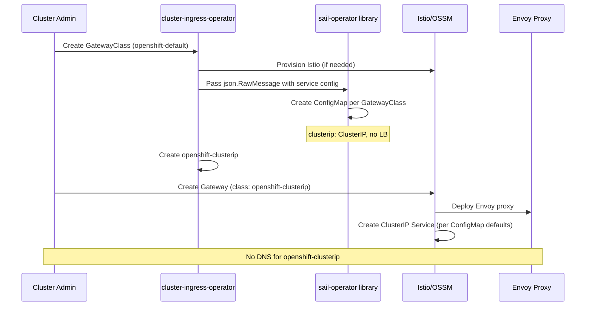

# OpenShift-managed GatewayClass Profiles

## Summary

This enhancement proposes the creation of new OpenShift-managed
GatewayClass Profiles that allow users to provision Gateway instances with
different service topologies. Each GatewayClass maps to a specific service
type and configuration. The first profile is `openshift-clusterip`
(ClusterIP, no load balancer); future profiles will be added as a
follow-up. The Cluster Ingress Operator (CIO) passes the service
configuration to the sail-operator library, which provisions a
GatewayClass defaults ConfigMap following the Istio GatewayClass
defaults mechanism. CIO then creates the GatewayClasses
automatically when `openshift-default` is created and Gateway API management
mode is `Managed`. This mirrors
the service customization that CIO already provides for
IngressControllers, but applied to Gateway API.

## Definitions and Terminology

- **OpenShift-managed GatewayClass Profile (aka Managed Profile)**: A
  GatewayClass created and reconciled by CIO using a reserved `openshift-*` name
  other than `openshift-default`.

- **User-created OpenShift GatewayClass**: A GatewayClass created by a user that
  selects `openshift.io/gateway-controller/v1` and is not a Managed Profile. In
  typical deployments, this is `openshift-default`.

## Motivation

Today, when a user creates a Gateway with the `openshift-default`
GatewayClass, the provisioned service is always a LoadBalancer
with external scope. There is no way for users to request a
Gateway with a ClusterIP service without manually patching the
service after creation, which is fragile and not supported.

Cluster administrators need the ability to provision Gateways with
different service topologies depending on their use case: external
traffic, internal-only traffic, or cluster-internal communication.
This is a common pattern in other Gateway API implementations, where
different GatewayClasses map to different service configurations.

OpenShift’s longer-term goal is a typed API that lets cluster admins
configure supported Service, deployment, scaling, placement, and proxy
settings. This enhancement is Phase 1: curated GatewayClass
profiles address established Service requirements without exposing
Istio configuration. Phase 2, a follow-on enhancement, can extend this approach
with an OpenShift-owned API that lets cluster admins combine supported
customization settings and specify values that fixed profiles cannot
express, such as resource requests and replica counts.

To preserve backward compatibility, the existing `openshift-default`
GatewayClass will not be modified. Instead, new
GatewayClasses will be introduced.

### User Stories

#### Story 1: Cluster-internal Gateway

As a cluster administrator, I want to create a Gateway with a
ClusterIP service, so that I can use Gateway API for
cluster-internal traffic without provisioning a load balancer.

#### Story 2: Gateway where LoadBalancers are unavailable

As a cluster administrator on a cluster that does not provide
LoadBalancer services, I want to create a Gateway with a ClusterIP
service, so that it becomes Programmed instead of failing with
`AddressNotAssigned`.

### Goals

- Let users select a Gateway's Service configuration by choosing a
  GatewayClass.
- Provide a supported ClusterIP Gateway configuration, removing the
  need for unsupported workarounds or Support Exceptions.
- Preserve backward compatibility. The existing `openshift-default`
  GatewayClass is not modified and existing Gateways are unaffected.
- Reserve `openshift-*` names other than `openshift-default` for Managed
  Profiles.
- Distinguish Managed Profiles from User-created OpenShift GatewayClasses
  so their lifecycles can be managed separately.
- Keep the implementation backportable to previous OCP versions.
- Establish a foundation for a future OpenShift API that lets
  administrators configure supported Gateway infrastructure settings
  directly.

### Non-Goals

- Define additional service profiles, such as external and internal
  LoadBalancer profiles. These are a planned follow-up.
- Fan out many GatewayClasses for every service customization
  permutation.
- Expose user-configurable deployment options such as replicas, placement,
  or resource limits.
- Support or block users directly referencing Istio patch ConfigMaps through
  `Gateway.spec.infrastructure.parametersRef` (see
  [Istio ConfigMap generation](#alternative-3-direct-istio-patch-configmap-generation)).
- Support the Models-as-a-Service use case of exposing a ClusterIP Gateway
  through an OpenShift Route. CIO creates the ClusterIP Gateway; supporting a
  Route in front of it is the layered product's responsibility.

## Proposal

When the OpenShift Gateway controller is enabled and Gateway API management
mode is `Managed`, CIO provisions Istio and creates the supported Managed
Profiles, starting with `openshift-clusterip`. CIO passes each
profile's service configuration to the sail-operator library, which creates the
corresponding
[Istio GatewayClass defaults ConfigMap](https://istio.io/latest/docs/tasks/traffic-management/ingress/gateway-api/#gatewayclass-defaults).

One ConfigMap is created per GatewayClass (not per Gateway
instance). All Gateways referencing a given GatewayClass share
the same default configuration.

OpenShift may add or revise profile defaults to address defects,
security issues, or platform requirements. Changes must preserve the
profile's documented Service type and exposure scope and be evaluated
for compatibility with existing Gateways. Changes that cannot preserve
compatibility require a separate profile or an explicit migration strategy.

Phase 1 adds predefined Service configurations through class-default
ConfigMaps; it does not introduce a customization CRD. GatewayClass selection
hides the configuration mechanism, allowing a future customization API to
use other implementation resources without exposing them to users.

CIO ignores the presence of Managed Profiles when determining whether to
install or uninstall Istio. The existing workflows remain unchanged except for
creating and deleting Managed Profiles.

### Workflow Description

**cluster administrator** is a human user responsible for managing
the cluster and Gateway infrastructure.

**application developer** is a human user responsible for
deploying applications and creating routes.

#### Installation Workflow

1. The cluster administrator creates the `openshift-default`
   GatewayClass with `spec.controllerName:
   openshift.io/gateway-controller/v1` (existing enablement
   workflow, unchanged).
2. CIO detects the GatewayClass and provisions Istio (same as today).
3. The sail-operator library creates the GatewayClass defaults ConfigMap for
   each Managed Profile, with the appropriate service type. CIO passes the
   required configuration as `json.RawMessage`, the same way it does for
   HPA provisioning.
4. CIO verifies each ConfigMap and its class-selection label before
   creating the class, helping prevent unintended exposure or
   misconfiguration.
5. After verification, CIO creates or updates the `openshift-clusterip`
   GatewayClass with the same `controllerName` and the CIO ownership label.
6. The cluster administrator creates a Gateway referencing one
   of the available GatewayClasses (e.g.,
   `gatewayClassName: openshift-clusterip`).
7. Istio provisions the Gateway with an Envoy deployment and a
   service matching the defaults from the ConfigMap.
8. For `openshift-clusterip`, CIO creates no Gateway listener `DNSRecord`.
   The generated Service is reachable through standard cluster-local
   Service DNS.
9. The application developer creates an HTTPRoute (or other
   supported route type) and attaches it to the Gateway.



#### Uninstallation Workflow

Today, deleting the final User-created OpenShift GatewayClass uninstalls Istio.
This enhancement preserves that workflow and only adds cleanup of the Managed
Profiles.

1. The cluster administrator deletes all User-created OpenShift GatewayClasses
   (usually just `openshift-default`). Managed Profiles should not be deleted by
   users; CIO excludes them when determining whether to uninstall Istio.
2. CIO stops reconciling and deletes GatewayClasses labeled
   `ingress.operator.openshift.io/managed-gatewayclass-profile: "true"`.
3. CIO uninstalls Istio after it removes the Managed Profiles. The Sail
   uninstall removes the profiles' defaults ConfigMaps.

Note: CIO does not delete the defaults ConfigMaps itself. Sail would recreate
any ConfigMap deleted while it is running, so they are removed as part of the
Sail uninstall.

### API Extensions

This enhancement introduces a ValidatingAdmissionPolicy (VAP) that reserves
Managed Profile names for CIO.

#### ValidatingAdmissionPolicy for Managed Profiles

A ValidatingAdmissionPolicy reserves Managed Profile names for CIO. Users may
create `openshift-default`, but only CIO may create other GatewayClasses using
the `openshift-*` prefix. This serves two purposes:

1. Establish a clear ownership boundary by preventing users from creating
   GatewayClasses whose names are reserved for Managed Profiles.
2. Prevent users from creating GatewayClasses using profile names that CIO does
   not offer on their platform (for example, a LoadBalancer profile on a
   platform that does not support it).

The policy applies only to creation, so it does not prevent updates or deletion
of GatewayClasses that predate the VAP.

```yaml
apiVersion: admissionregistration.k8s.io/v1
kind: ValidatingAdmissionPolicy
metadata:
  name: openshift-ingress-operator-gatewayclasses
spec:
  failurePolicy: Fail
  matchConstraints:
    matchPolicy: Equivalent
    resourceRules:
    - apiGroups:
      - gateway.networking.k8s.io
      apiVersions:
      - v1
      operations:
      - CREATE
      resources:
      - gatewayclasses
      scope: Cluster
  variables:
  - name: gatewayClass
    expression: object
  - name: hasOpenShiftPrefix
    expression: variables.gatewayClass.metadata.name.startsWith('openshift-')
  # Names users may create despite the openshift- prefix. openshift-default is
  # the normal user-created class; openshift-ai-inference is created through
  # the automated MaaS installation path.
  - name: userCreatableNames
    expression: "['openshift-default', 'openshift-ai-inference']"
  - name: hasReservedName
    expression: >-
      variables.hasOpenShiftPrefix &&
      !(variables.gatewayClass.metadata.name in variables.userCreatableNames)
  validations:
  # Allow only the Ingress Operator service account to create a GatewayClass
  # using a reserved name. Users may create openshift-default and
  # openshift-ai-inference. The deny message deliberately names only
  # openshift-default, so the MaaS exception is not advertised to users.
  - expression: >-
      !variables.hasReservedName ||
      (has(request.userInfo.username) &&
      request.userInfo.username ==
      'system:serviceaccount:openshift-ingress-operator:ingress-operator')
    message: >-
      Only openshift-default may be created by users; all other openshift-*
      GatewayClass names are reserved for the Ingress Operator
    reason: Forbidden
  # Require pod-bound token claims, rejecting unbound service account
  # credentials and username-only impersonation. This validation is omitted
  # for HyperShift clusters (ibm-cloud-managed CVO profile), where generated
  # kubeconfig credentials do not include the pod and node claims.
  # See https://redhat.atlassian.net/browse/CNTRLPLANE-710.
  - expression: >-
      !variables.hasReservedName ||
      (has(request.userInfo.extra) &&
      'authentication.kubernetes.io/node-name' in request.userInfo.extra &&
      'authentication.kubernetes.io/pod-name' in request.userInfo.extra)
    message: The Ingress Operator must use a pod-bound service account token
    reason: Forbidden
---
apiVersion: admissionregistration.k8s.io/v1
kind: ValidatingAdmissionPolicyBinding
metadata:
  name: openshift-ingress-operator-gatewayclasses
spec:
  policyName: openshift-ingress-operator-gatewayclasses
  validationActions: [Deny]
```

The VAP and its corresponding ValidatingAdmissionPolicyBinding
will be deployed as CVO static manifests so they are present
on every cluster. Deploying the VAP unconditionally prevents users from
creating GatewayClasses with reserved Managed Profile names,
eliminating special handling when transitioning Gateway API
[management mode](gateway-api-crd-management-mode.md) from `Unmanaged` to
`Managed`.

#### GatewayClass Configuration Status

CIO reports an `openshift.io/Configured` status condition on each Managed Profile.
It checks that the expected class-default ConfigMap exists in
`openshift-ingress` and has the
`gateway.istio.io/defaults-for-class: <gatewayclass-name>` label.
CIO also reports the existing `ControllerInstalled` and `CRDsReady`
installation conditions on Managed Profiles, consistent with User-created
OpenShift GatewayClasses.

- `True / Configured`: the expected ConfigMap and label are present.
- `False / ConfigurationMissing`: the expected ConfigMap is absent or
  its class-selection label is missing or incorrect.

The condition message identifies the ConfigMap by namespace and name
so users can inspect it. The ConfigMap is managed implementation output,
not a supported customization interface.

Example status for `openshift-clusterip`:

```yaml
status:
  conditions:
    - type: openshift.io/Configured
      status: "True"
      reason: Configured
      message: >-
        ConfigMap
        openshift-ingress/istio-openshift-gateway-gatewayclass-openshift-clusterip
        is present and associated with GatewayClass openshift-clusterip.
        Inspect the ConfigMap for configuration details.
```

This condition verifies configuration presence and association; it does
not indicate that Istio has applied the configuration to individual
Gateways. The condition can extend to resources generated by the
Phase 2 customization API.

#### Gateway Status Conditions

A ClusterIP Gateway has no load balancer or external DNS, so CIO removes the
`LoadBalancerReady` and `DNSReady` conditions (Gateway and per-listener) it
would otherwise set, as introduced in
[DNS and LoadBalancer conditions on managed Gateways](add-dns-and-loadbalancer-conditions-to-managed-gateway.md).

### Topology Considerations

#### Hypershift / Hosted Control Planes

This enhancement applies to Hypershift with no additional
considerations beyond existing Gateway API support. The
GatewayClass defaults ConfigMap and Gateway provisioning happen
on the guest cluster where CIO and Istio run.

#### Standalone Clusters

This enhancement is directly applicable to standalone clusters.

#### Single-node Deployments or MicroShift

No additional resource consumption beyond what a Gateway already
requires. The `openshift-clusterip` GatewayClass is useful for
single-node deployments where external LoadBalancers may not be
available.

MicroShift has its own Gateway API support and does not use CIO,
so this enhancement does not directly affect MicroShift.

#### OpenShift Kubernetes Engine

This enhancement works on OKE clusters the same way as on OCP
clusters, provided Gateway API is available (which depends on the
OLM/Helm-based Istio installation being available on OKE, as
addressed by the gateway-api-without-olm enhancement).

### Implementation Details/Notes/Constraints

#### Managed Profiles

After verifying each profile's GatewayClass defaults ConfigMap, CIO creates
and reconciles the following cluster-scoped GatewayClass. It uses the same
controller as `openshift-default` and carries a label that identifies it as a
Managed Profile.

```yaml
apiVersion: gateway.networking.k8s.io/v1
kind: GatewayClass
metadata:
  name: openshift-clusterip
  labels:
    ingress.operator.openshift.io/managed-gatewayclass-profile: "true"
spec:
  controllerName: openshift.io/gateway-controller/v1
  description: OpenShift Gateway using a cluster-internal ClusterIP Service
```

#### Service Configuration Details

The `openshift-clusterip` profile sets the service type to `ClusterIP` and
applies no LoadBalancer annotations. The generated Service is reachable only
within the cluster.

#### Code Changes Required

1. **GatewayClass creation and reconciliation**: Extend the
   gatewayclass-controller to create and reconcile the resources defined in
   [Managed Profiles](#managed-profiles).

2. **ConfigMap provisioning**: The sail-operator library provisions the
   GatewayClass defaults ConfigMap,
   following the mechanism defined at
   https://istio.io/latest/docs/tasks/traffic-management/ingress/gateway-api/#gatewayclass-defaults.
   CIO passes the required service configuration as
   `json.RawMessage` to the sail-operator library, the same
   pattern used for HPA provisioning today.
   Each ConfigMap is placed in Istio's root namespace
   (`openshift-ingress`) and labeled
   `gateway.istio.io/defaults-for-class: <gatewayclass-name>`.

3. **DNS management**: For `openshift-clusterip`, CIO creates no Gateway
   listener `DNSRecord`.

4. **Gateway status**: Remove the `LoadBalancerReady` and `DNSReady`
   conditions for `openshift-clusterip` Gateways (see [Gateway Status
   Conditions](#gateway-status-conditions)), including after transitioning
   from another GatewayClass.

5. **Configuration status**: CIO watches the class-default ConfigMaps
   and reconciles `openshift.io/Configured` on each Managed Profile based
   on ConfigMap presence and its class-selection label, preserving
   conditions owned by other controllers.

6. **Lifecycle management**: User-created OpenShift GatewayClasses retain the
   existing install and uninstall semantics and receive the Sail lifecycle
   finalizer. Managed Profiles do not receive the finalizer, and CIO does not
   count GatewayClasses labeled
   `ingress.operator.openshift.io/managed-gatewayclass-profile: "true"` when
   determining whether to install or uninstall Istio. The final User-created
   OpenShift GatewayClass remains terminating while CIO deletes the Managed
   Profiles and their defaults ConfigMaps, uninstalls Istio, and removes the
   finalizer.

This enhancement does not require a new feature gate. It is a CIO
behavioral change that extends existing Gateway API support.

#### Management Mode Implications

In `Unmanaged` [management mode](gateway-api-crd-management-mode.md),
CIO leaves the Managed Profiles in place but abandons their management:
it stops reconciling them and no longer guarantees their configuration,
consistent with how it treats User-created OpenShift GatewayClasses.
While `Unmanaged`, a profile's `openshift.io/Configured` condition is not
reconciled and may be stale.

Because CVO deploys and manages the VAP, it remains active and continues to
reserve Managed Profile names.

Transitioning to `Unmanaged` mode uninstalls the CIO-managed Istio instance.
The Sail uninstall removes the defaults ConfigMaps that Sail
manages, but not the GatewayClasses. When transitioning back to
`Managed` mode, Istio recreates the defaults ConfigMaps and CIO
resumes reconciliation.

#### Telemetry

Gateways using these profiles are counted in the existing
`openshift:gateway_api_usage:count` recording rule, aggregated as
OpenShift usage via `controllerName`. No new or per-profile metrics are
added, so the telemetry does not distinguish individual profiles.

#### Path to Phase 2

The follow-on enhancement would introduce a typed OpenShift customization
CRD targeting a GatewayClass. The predefined profiles could remain as
base defaults, with cluster admins using the API to override supported
defaults and specify additional settings, such as proxy replicas and
resource requests and limits.

CIO would combine the profile defaults with the declared customization
and translate the resulting configuration into implementation resources.
The `openshift.io/Configured` condition could still be leveraged for
configuration discoverability.

### Risks and Mitigations

**Risk**: Missing or incorrect profile configuration could cause a Gateway
intended to be cluster-only to be provisioned with a different service type.

**Mitigation**: At runtime, CIO verifies ConfigMap presence and association
before creating each GatewayClass, reconciles missing configuration, and
reports failures through `openshift.io/Configured`. Automated tests verify the
resulting Service configuration.

The limitation of this mitigation is that if a user accidentally deletes a
defaults ConfigMap, there is a reconciliation interval before Sail recreates
it. During that interval, CIO cannot prevent Istio from reconciling Gateways
without the profile defaults.

**Risk**: Changing a Gateway's GatewayClass causes Istio to create a new
Service without deleting the Service associated with the previous class. The
old Service, including any cloud load balancer, remains provisioned.

**Mitigation**: User documentation will require administrators to delete the
obsolete Service manually after changing a Gateway's GatewayClass.

**Risk**: The Istio GatewayClass defaults ConfigMap mechanism
changes or is removed in a future Istio version.

**Mitigation**: The ConfigMap mechanism is documented and
supported by Istio. Monitor upstream changes and adapt if needed.

### Drawbacks

- Adds GatewayClasses that users must understand and choose from.
  Supporting more configuration combinations could increase this
  complexity and the maintenance burden.
- Once introduced, profile defaults become a compatibility commitment.
  Changes are limited to those demonstrated to preserve existing
  customer behavior.
- Configuration applies to every Gateway using a class. Per-Gateway
  differences require separate GatewayClasses.
- Gateways reference a class, not its configuration. Troubleshooting may
  require inspecting GatewayClass status and the generated configuration.
- Depends on Istio's ConfigMap-based GatewayClass defaults mechanism.
  If that mechanism changes or is removed, the implementation must adapt.

## Open Questions

1. Should NodePort be supported as a stretch goal? If so, should
   it be a separate GatewayClass, or should users create an
   `openshift-clusterip` Gateway and manually create a NodePort
   Service? The proposed approach is ClusterIP + a manual NodePort
   Service, with documented instructions for users. Note that
   adding a new Listener or port to the Gateway requires a
   corresponding manual update to the NodePort Service.

2. Should the profiles apply the Istio
   [EDGE connection profile](https://github.com/istio/istio/issues/57973)
   (OSSM 3.5+)? EDGE requires Istio 1.31+; if the profiles are
   backported without it, adding EDGE later is a behavioral change.

3. Which previous OCP versions should receive a backport?

## Alternatives (Not Implemented)

### Alternative 1: Modify openshift-default Behavior

Instead of creating new GatewayClasses, modify
`openshift-default` to accept configuration parameters that
control service type.

**Reason Not Chosen**: This would break existing environments
where `openshift-default` always provisions an external
LoadBalancer. The GatewayClass-per-topology approach is the
standard pattern in Gateway API (used by other implementations)
and keeps each class self-contained.

### Alternative 2: Per-Gateway Annotations

Allow users to annotate Gateway resources with desired service
type and platform annotations.

**Reason Not Chosen**: Annotations are not validated and are
error-prone. The GatewayClass approach provides a clear contract
between the platform and the user about what service topology
will be provisioned.

### Alternative 3: Direct Istio Patch ConfigMap Generation

CIO could generate managed Istio patch ConfigMaps that users reference
through `Gateway.spec.infrastructure.parametersRef`. This provides
explicit, per-Gateway customization.
The referenced ConfigMap must be in the Gateway's namespace, requiring
copies of shared profiles when Gateways span namespaces.

**Reason Not Chosen**: Users would reference implementation-specific
resources, making migration to another Gateway implementation more
difficult. This attachment model also limits customization to settings
supported by Istio’s ConfigMap patches; it cannot accommodate other
resources, such as `Telemetry` or `EnvoyFilter`. GatewayClass profiles
hide those implementation details and provide a foundation for broader
customization.

## Test Plan

Testing will cover the following scenarios:

1. Create `openshift-default` and verify CIO automatically
   creates `openshift-clusterip` with the CIO ownership label and the correct
   ConfigMap.
2. Create a Gateway with the `openshift-clusterip` GatewayClass and verify the
   provisioned service has type `ClusterIP` and no LoadBalancer annotations.
   Verify that deleting the Service results in recreation with the correct
   configuration.
3. Verify that `openshift-default` behavior is unchanged
   (regression test).
4. Verify that CIO creates no listener `DNSRecord` for Gateways attached to
   `openshift-clusterip`, that ClusterIP Gateways do not report
   `LoadBalancerReady` or `DNSReady`, and that stale Gateway and listener
   conditions are removed after transitioning to `openshift-clusterip`.
5. Verify that CIO restores a missing Managed Profile and its defaults
   ConfigMap.
6. Verify that upgrading a cluster where `openshift-default`
   already exists results in the Managed Profiles and
   their defaults ConfigMaps being created automatically.
7. Verify the GatewayClass `openshift.io/Configured` status condition reflects
   ConfigMap presence and the class-selection label, identifies
   the ConfigMap in its message, and recovers after the ConfigMap
   or label is deleted and restored.
8. Verify end-to-end connectivity through a Gateway and HTTPRoute
   for the `openshift-clusterip` profile, using an in-cluster client.
9. Verify that the VAP rejects user creation of reserved profile names, does
   not restrict `controllerName`, and permits updates and deletion of
   pre-existing classes.
10. Verify that transitioning to `Unmanaged` mode leaves the Managed Profiles
    in place, removes their defaults ConfigMaps, keeps their names reserved, and
    uninstalls CIO-managed Istio. Verify that transitioning back to `Managed`
    mode recreates the defaults ConfigMaps and resumes reconciliation.
11. Verify that deleting `openshift-default` with no other User-created
    OpenShift GatewayClasses deletes the Managed Profiles and their defaults
    ConfigMaps and uninstalls Istio.

## Graduation Criteria

### Dev Preview -> Tech Preview

N/A. This feature targets direct inclusion as part of the
existing Gateway API support, which is already GA from 4.19.

### Tech Preview -> GA

- All test scenarios pass consistently across supported
  platforms.
- Documentation created in openshift-docs covering the new
  GatewayClass and its use cases.

### Removing a deprecated feature

N/A.

## Upgrade / Downgrade Strategy

### Upgrade

Clusters upgrading to OCP 5.1 where `openshift-default` already
exists and Gateway API management mode is `Managed` will have the supported
Managed Profiles automatically created by CIO during the upgrade. The
`openshift-default` GatewayClass continues to work as before.

This enhancement does not schedule deprecation or removal of the static
profiles or their ConfigMaps. Any transition to the Phase 2 API must
define its own lifecycle and migration plan; introducing that API alone
does not require users to change existing Gateways.

### Downgrade

The downgrade behavior for Gateways using the new GatewayClasses
needs to be defined. Considerations include:

- Gateways created with the `openshift-clusterip` GatewayClass
  will remain on the cluster after downgrade, but the older CIO
  version will not recognize them.
- The GatewayClass defaults ConfigMap will not be managed by the
  older CIO. The ConfigMap may be left orphaned, or it may be
  garbage collected depending on owner references.
- Existing Gateway services may lose their customized
  configuration on the next Istio reconciliation if the ConfigMap
  is removed.
- Both scenarios (Gateways staying with degraded behavior, or
  Gateways being cleaned up by Istio) need to be tested during
  implementation to determine the actual behavior and define the
  supported downgrade procedure.

## Version Skew Strategy

No new version skew concerns. CIO and Istio versions remain
synchronized through the OCP release. The ConfigMap-based
GatewayClass defaults mechanism is handled entirely by Istio,
and CIO supplies the defaults through the sail-operator library.

## Operational Aspects of API Extensions

This enhancement introduces a ValidatingAdmissionPolicy (VAP) that reserves
Managed Profile names and limits the existing Sail lifecycle finalizer to
User-created OpenShift GatewayClasses.

- The VAP applies only to GatewayClass CREATE operations.
- The VAP uses CEL expressions evaluated in-process by the API
  server. There is no external webhook, no network dependency,
  and no additional latency beyond the CEL evaluation itself.
- Managed Profiles do not receive the Sail lifecycle finalizer and cannot block
  the decision to uninstall Istio.
- If the VAP is removed or misconfigured, users could create GatewayClasses
  using reserved Managed Profile names.
- The Gateway API team is responsible for the VAP and should be
  contacted for escalation.

### Failure Modes

- If Sail does not create the GatewayClass defaults ConfigMap, CIO does not
  create the Managed Profile. CIO logs that it is waiting for the ConfigMap and
  retries reconciliation. Because the GatewayClass does not yet exist, CIO
  cannot report the failure through `openshift.io/Configured`.
- If an existing Managed Profile's ConfigMap is deleted, CIO reports
  `openshift.io/Configured=False` with reason `ConfigurationMissing`. Sail
  recreates the ConfigMap through subsequent reconciliation, after which CIO
  restores `openshift.io/Configured=True`.
- If the ValidatingAdmissionPolicy is deleted, the Managed Profile name
  reservation is lost but Gateway provisioning continues to work. CVO will
  restore the VAP as a static manifest.

## Support Procedures

Check the GatewayClass defaults ConfigMap exists:
```bash
oc -n openshift-ingress get configmap \
  -l gateway.istio.io/defaults-for-class
```

Check the ValidatingAdmissionPolicy is in place:
```bash
oc get validatingadmissionpolicy \
  openshift-ingress-operator-gatewayclasses
```

Check CIO logs for GatewayClass reconciliation:
```bash
oc -n openshift-ingress-operator logs \
  deployment/ingress-operator | grep -i gatewayclass
```

Verify the service created for a Gateway has the expected type
and annotations:
```bash
oc -n <gateway-namespace> get svc <gateway-name> -o yaml
```

## Infrastructure Needed

No new infrastructure required.
