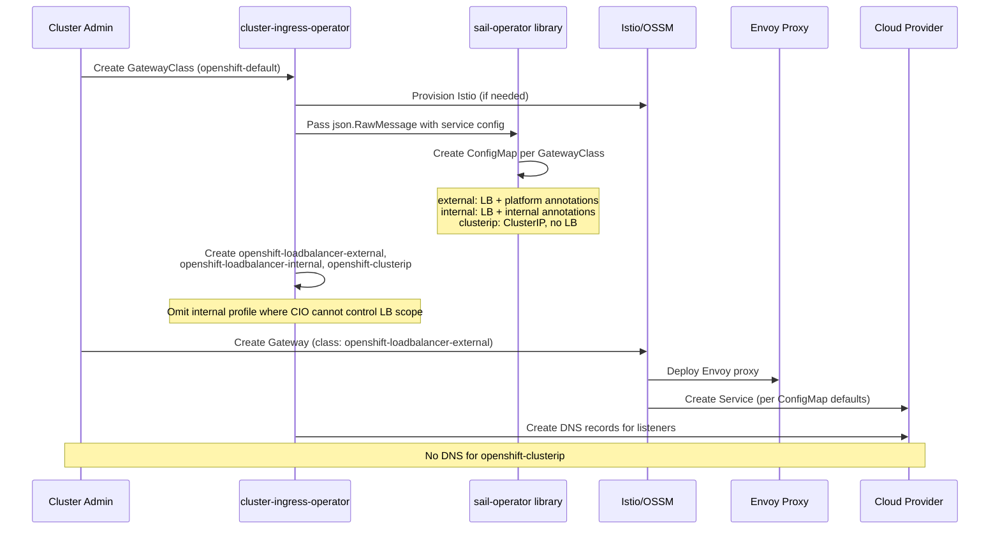

# OpenShift-Managed GatewayClass Service Profiles

## Summary

This enhancement proposes the creation of three new
OpenShift-managed GatewayClasses (`openshift-loadbalancer-external`,
`openshift-loadbalancer-internal`, and `openshift-clusterip`) that allow users
to provision Gateway instances with different service topologies.
Each GatewayClass maps to a specific service type and
configuration: external LoadBalancer, internal LoadBalancer, or
ClusterIP. The Cluster Ingress Operator (CIO) passes the service
configuration to the sail-operator library, which provisions a
GatewayClass defaults ConfigMap following the Istio GatewayClass
defaults mechanism. CIO then creates the GatewayClasses
automatically when `openshift-default` is created and Gateway API management
mode is `Managed`. This mirrors
the service customization that CIO already provides for
IngressControllers, but applied to Gateway API.

## Motivation

Today, when a user creates a Gateway with the `openshift-default`
GatewayClass, the provisioned service is always a LoadBalancer
with external scope. There is no way for users to request a
Gateway with an internal LoadBalancer or a ClusterIP service
without manually patching the service after creation, which is
fragile and not supported.

Cluster administrators need the ability to provision Gateways with
different service topologies depending on their use case: external
traffic, internal-only traffic, or cluster-internal communication.
This is a common pattern in other Kubernetes distributions, where
different GatewayClasses map to different service configurations.

OpenShift’s longer-term goal is a typed API that lets cluster admins
configure supported Service, deployment, scaling, placement, and proxy
settings. This enhancement is Phase 1: curated GatewayClass
profiles address established Service requirements without exposing
Istio configuration. Phase 2, a follow-on enhancement, can extend this approach
with an OpenShift-owned API that lets cluster admins combine supported
customization settings and specify values that fixed profiles cannot
express, such as resource requests and replica counts.

The existing `openshift-default` GatewayClass will not be modified
to preserve backward compatibility. Instead, three new
GatewayClasses will be introduced.

There is a goal to backport this feature to previous OCP versions
because this is a desired capability for existing deployments.

### User Stories

#### Story 1: External LoadBalancer Gateway

As a cluster administrator, I want to create a Gateway with an
external LoadBalancer service including platform-specific
annotations (e.g., AWS NLB annotations, health check
configuration, `externalTrafficPolicy`), so that I can expose
applications to external traffic with the correct cloud provider
configuration without manual service patching.

#### Story 2: Internal LoadBalancer Gateway

As a cluster administrator, I want to create a Gateway with an
internal LoadBalancer service, so that I can expose applications
only within my cloud provider's internal network (e.g., VPC)
using the same platform-specific annotations that CIO applies to
internal IngressControllers.

#### Story 3: ClusterIP Gateway

As a cluster administrator, I want to create a Gateway with a
ClusterIP service, so that I can use Gateway API for
cluster-internal traffic or expose the Gateway through an existing
OpenShift Route without provisioning another load balancer.

This supports patterns such as the ClusterIP Gateway behind an
OpenShift Route documented by
[Models-as-a-Service](https://opendatahub-io.github.io/models-as-a-service/v2.0.1/configuration-and-management/gateway-patterns/).

#### Story 4: Operations at Scale

As a platform engineer managing multiple clusters, I want the
GatewayClass-based service customization to be declarative and
automated by CIO, so that I can rely on consistent service
configurations across clusters without manual intervention, and
monitor the provisioned Gateways through existing telemetry.

### Goals

- Customize service creation based on GatewayClass name. Create
  three new GatewayClasses: `openshift-loadbalancer-external`,
  `openshift-loadbalancer-internal`, and `openshift-clusterip`.
- Define new GatewayClasses so existing environments will not
  break. The `openshift-default` GatewayClass will not be
  modified.
- Define what each GatewayClass represents:
  - `openshift-loadbalancer-external`: external LoadBalancer with
    platform-specific CIO service defaults.
  - `openshift-loadbalancer-internal`: internal LoadBalancer with
    platform-specific CIO service defaults.
  - `openshift-clusterip`: ClusterIP, no LoadBalancer provisioned.
  See [Service Configuration Details](#service-configuration-details)
  for the full list.
- Reserve the `openshift-*` naming prefix for OpenShift
  GatewayClasses (requires `controllerName:
  openshift.io/gateway-controller/v1`).
- Label GatewayClasses created by CIO as managed profiles so they
  can be distinguished from user-created GatewayClasses.
- Existing telemetry already covers these new GatewayClasses
  since we collect `controllerName` to determine OCP Gateway API
  usage.
- Reuse as much as possible the existing CIO service
  customization functions (from IngressController service
  provisioning) for building the GatewayClass defaults, rather
  than creating new logic from scratch.
- Support backporting to previous OCP versions.
- Support the Models-as-a-Service pattern of exposing a ClusterIP
  Gateway through an OpenShift Route, using existing ingress
  infrastructure without provisioning an additional load balancer.
- Establish a foundation for a future OpenShift API that lets
  administrators combine supported GatewayClass customization settings.

### Non-Goals

- Fan out many GatewayClasses for every service customization
  permutation. We will stick with 3 new GatewayClasses. Any
  further customization should be discussed separately.
- Expose customization of Gateway deployment options (nodeSelector, replicas,
  resource limits, etc.). These will be addressed by the customization
  API in a follow-on enhancement.
- Support NodePort service type as a dedicated GatewayClass. This
  is a stretch goal and the approach needs discussion (e.g., a
  ClusterIP GatewayClass with a manually created NodePort
  service).
- Support or block users directly referencing Istio patch ConfigMaps through
  `Gateway.spec.infrastructure.parametersRef`.

## Proposal

When the OpenShift Gateway controller is enabled and Gateway API management
mode is `Managed`, CIO provisions Istio/OSSM and creates the supported managed
profiles: `openshift-loadbalancer-external`,
`openshift-loadbalancer-internal`, and `openshift-clusterip`. CIO passes each
profile's service configuration to the sail-operator library, which creates the
corresponding
[Istio GatewayClass defaults ConfigMap](https://istio.io/latest/docs/tasks/traffic-management/ingress/gateway-api/#gatewayclass-defaults).

This approach is consistent with how CIO already provisions
automatic HPA for Gateways managed by CIO.

One ConfigMap is created per GatewayClass (not per Gateway
instance). All Gateways referencing a given GatewayClass share
the same default configuration.

OpenShift may add or revise profile defaults to address defects,
security issues, or platform requirements. Changes must preserve the
profile's documented Service type and exposure scope and be evaluated
for compatibility with existing Gateways. Changes that cannot preserve
compatibility require a separate profile or an explicit migration strategy.

Phase 1 adds predefined Service configurations and the proxy configuration
required to support them through class-default ConfigMaps; it does not
introduce a customization CRD. GatewayClass selection hides the
configuration mechanism, allowing a future customization API to use
other implementation resources without exposing them to users.

CIO omits `openshift-loadbalancer-internal` on platforms where it cannot
request internal load-balancer scope, as described in
[Platforms Without CIO-Controlled Load-Balancer Scope](#platforms-without-cio-controlled-load-balancer-scope).

"External" and "Internal" follow the same semantics as the
IngressController API's
`spec.endpointPublishingStrategy.loadBalancer.scope`.
"External" is a load balancer reachable from outside the
cluster; on most cloud platforms this is the default and
requires no explicit annotation. "Internal" is a load balancer
exposed only on the cluster's private network; CIO implements
internal scope through provider-specific service annotations,
the same annotations it already uses for IngressControllers.

CIO excludes managed profiles when determining whether to install or uninstall
Istio.

### Workflow Description

**cluster administrator** is a human user responsible for managing
the cluster and Gateway infrastructure.

**application developer** is a human user responsible for
deploying applications and creating routes.

#### Installation Workflow

1. The cluster administrator creates the `openshift-default`
   GatewayClass with `spec.controllerName:
   openshift.io/gateway-controller/v1` (existing enablement
   workflow, unchanged).
2. CIO detects the GatewayClass and provisions Istio/OSSM (same as today).
3. The sail-operator library creates the GatewayClass defaults ConfigMap for
   each new class, with the appropriate service type and
   platform-specific annotations. CIO passes the required
   configuration as `json.RawMessage`, the same way it does for
   HPA provisioning.
4. CIO verifies each ConfigMap and its class-selection label before
   creating the class, helping prevent unintended exposure or
   misconfiguration.
5. After verification, CIO creates or updates
   `openshift-loadbalancer-external`, `openshift-loadbalancer-internal`, and
   `openshift-clusterip` GatewayClasses with the same `controllerName` and the
   CIO ownership label, omitting `openshift-loadbalancer-internal` on platforms
   where CIO cannot request internal load-balancer scope.
6. The cluster administrator creates a Gateway referencing one
   of the available GatewayClasses (e.g.,
   `gatewayClassName: openshift-loadbalancer-external`).
7. Istio provisions the Gateway with an Envoy deployment and a
   service matching the defaults from the ConfigMap.
8. CIO manages DNS for the Gateway listeners (same as today,
   except for `openshift-clusterip` which gets no DNS).
9. The application developer creates an HTTPRoute (or other
   supported route type) attached to the Gateway.



#### Uninstallation Workflow

1. The cluster administrator deletes all user-created, non-managed
   GatewayClasses that select the OpenShift controller (usually just
   `openshift-default`). The managed profiles cannot be deleted by users
   because the VAP reserves them for CIO.
2. CIO stops reconciling and deletes GatewayClasses labeled
   `ingress.operator.openshift.io/managed-gatewayclass-profile: "true"` and
   their defaults ConfigMaps.
3. CIO uninstalls Istio after the managed profiles are removed.

### API Extensions

This enhancement introduces a ValidatingAdmissionPolicy (VAP) that reserves
managed OpenShift GatewayClasses for CIO.

#### ValidatingAdmissionPolicy for Managed GatewayClasses

A ValidatingAdmissionPolicy will enforce these rules:

1. GatewayClasses named `openshift-*` must use `controllerName:
   openshift.io/gateway-controller/v1`.
2. Only CIO may create, update, or delete `openshift-*` GatewayClasses other
   than `openshift-default`.
3. CIO must use its pod-bound service account token.

The ValidatingAdmissionPolicyBinding must set
`validationActions: [Deny]`.

Example VAP:

```yaml
apiVersion: admissionregistration.k8s.io/v1
kind: ValidatingAdmissionPolicy
metadata:
  name: openshift-ingress-operator-gatewayclasses
spec:
  failurePolicy: Fail
  matchConstraints:
    matchPolicy: Equivalent
    resourceRules:
    - apiGroups:
      - gateway.networking.k8s.io
      apiVersions:
      - v1
      operations:
      - CREATE
      - UPDATE
      - DELETE
      resources:
      - gatewayclasses
      scope: Cluster
  variables:
  - name: gatewayClass
    expression: request.operation == 'DELETE' ? oldObject : object
  - name: isOpenShiftName
    expression: variables.gatewayClass.metadata.name.startsWith('openshift-')
  - name: isManagedOpenShiftGatewayClass
    expression: >-
      variables.isOpenShiftName &&
      variables.gatewayClass.metadata.name != 'openshift-default'
  validations:
  - expression: >-
      !variables.isOpenShiftName ||
      variables.gatewayClass.spec.controllerName ==
      'openshift.io/gateway-controller/v1'
    message: OpenShift GatewayClasses must use openshift.io/gateway-controller/v1
    reason: Invalid
  - expression: >-
      !variables.isManagedOpenShiftGatewayClass ||
      (has(request.userInfo.username) &&
      request.userInfo.username ==
      'system:serviceaccount:openshift-ingress-operator:ingress-operator')
    message: >-
      Only openshift-default may be created, modified, or deleted; all other
      OpenShift GatewayClasses are managed by the Ingress Operator
    reason: Forbidden
  - expression: >-
      !variables.isManagedOpenShiftGatewayClass ||
      (has(request.userInfo.extra) &&
      'authentication.kubernetes.io/node-name' in request.userInfo.extra &&
      'authentication.kubernetes.io/pod-name' in request.userInfo.extra)
    message: The Ingress Operator must use a pod-bound service account token
    reason: Forbidden
---
apiVersion: admissionregistration.k8s.io/v1
kind: ValidatingAdmissionPolicyBinding
metadata:
  name: openshift-ingress-operator-gatewayclasses
spec:
  policyName: openshift-ingress-operator-gatewayclasses
  validationActions: [Deny]
```

The VAP and its corresponding ValidatingAdmissionPolicyBinding
will be deployed as CVO static manifests so they are present
on every cluster. Deploying the VAP unconditionally prevents users from
creating, updating, or deleting managed `openshift-*` GatewayClasses,
eliminating special handling when transitioning from
unmanaged to managed
[management mode](gateway-api-crd-management-mode.md).

CIO applies the existing
`openshift.io/ingress-operator-sail-finalizer` only to user-created,
non-managed GatewayClasses. Managed profiles do not receive the finalizer. When
the final user-created, non-managed GatewayClass is deleted, the finalizer holds
its deletion until CIO removes the managed profiles and their defaults
ConfigMaps and uninstalls Istio.

#### GatewayClass Customization Status

CIO reports a `Customized` condition on each managed profile.
It checks that the expected class-default ConfigMap exists in
`openshift-ingress` and has the
`gateway.istio.io/defaults-for-class: <gatewayclass-name>` label.

- `True / Configured`: the expected ConfigMap and label are present.
- `False / ConfigurationMissing`: the expected ConfigMap is absent or
  its class-selection label is missing or incorrect.
- `Unknown / Pending`: CIO has not yet checked the configuration.

The condition message identifies the ConfigMap by namespace and name
so users can inspect it. The ConfigMap is managed implementation output,
not a supported customization interface.

Example status for `openshift-loadbalancer-external`:

```yaml
status:
  conditions:
    - type: Customized
      status: "True"
      reason: Configured
      message: >-
        ConfigMap
        openshift-ingress/openshift-gatewayclass-loadbalancer-external-config
        is present and associated with GatewayClass openshift-loadbalancer-external.
        Inspect the ConfigMap for configuration details.
```

This condition verifies configuration presence and association; it does
not indicate that Istio has applied the configuration to individual
Gateways. The condition can extend to resources generated by the
Phase 2 customization API.

### Topology Considerations

#### Hypershift / Hosted Control Planes

This enhancement applies to Hypershift with no additional
considerations beyond existing Gateway API support. The
GatewayClass defaults ConfigMap and Gateway provisioning happen
on the guest cluster where CIO and Istio run. Platform-specific
annotations in the ConfigMap must match the guest cluster's
infrastructure platform.

#### Standalone Clusters

This enhancement is directly applicable to standalone clusters.
The platform-specific annotations in the GatewayClass defaults
ConfigMap will be derived from the cluster's infrastructure
platform, the same way CIO derives annotations for
IngressController services.

#### Platforms Without CIO-Controlled Load-Balancer Scope

`openshift-clusterip` requires no load balancer integration.
`openshift-loadbalancer-external` creates a LoadBalancer Service, but address
allocation and network reachability depend on the platform's LoadBalancer
implementation. Platforms without native LoadBalancer provisioning, including
BareMetal and vSphere, require a separately configured implementation such as
MetalLB.

CIO creates `openshift-loadbalancer-internal` only on AWS, Azure, GCP, IBM
Cloud, Power VS, and OpenStack, where provider-specific Service annotations can
request internal exposure. CIO omits the profile on other platforms because it
cannot distinguish internal from external exposure. Supporting it would require
a defined integration with the platform's load-balancer configuration.

#### Single-node Deployments or MicroShift

No additional resource consumption beyond what a Gateway already
requires. The `openshift-clusterip` GatewayClass is useful for
single-node deployments where external LoadBalancers may not be
available.

MicroShift has its own Gateway API support and does not use CIO,
so this enhancement does not directly affect MicroShift.

#### OpenShift Kubernetes Engine

This enhancement works on OKE clusters the same way as on OCP
clusters, provided Gateway API is available (which depends on the
OLM/Helm-based Istio installation being available on OKE, as
addressed by the gateway-api-without-olm enhancement).

### Implementation Details/Notes/Constraints

#### Service Configuration Details

`openshift-default` retains its existing external LoadBalancer behavior,
including `externalTrafficPolicy: Cluster`. In contrast,
`openshift-loadbalancer-external` uses CIO's platform-specific Service configuration:
`Local` on most platforms to preserve source IPs, but `Cluster` on IBM
Cloud and Power VS. Selecting `openshift-loadbalancer-external` is therefore an opt-in
to different traffic handling, not merely an alias for `openshift-default`.

The GatewayClass defaults ConfigMap must apply the platform-specific
Service defaults that CIO uses for IngressControllers, excluding
user-specified customizations. The following summarizes these defaults,
based on the existing load balancer service
provisioning code in `cluster-ingress-operator`:

**Common to all platforms (external LoadBalancer):**
- `externalTrafficPolicy: Local` on all platforms except IBM Cloud and
  Power VS, which use `Cluster`.
- `traffic-policy.network.alpha.openshift.io/local-with-fallback: ""`
  annotation when `externalTrafficPolicy: Local` is set (OVN
  local-with-fallback support)

**AWS:**
- External: NLB type
  (`service.beta.kubernetes.io/aws-load-balancer-type: nlb`),
  health check annotations (interval `10`, timeout `4`,
  unhealthy threshold `2`, healthy threshold `2`)
- Internal: adds
  `service.beta.kubernetes.io/aws-load-balancer-internal: "true"`
- NLB protocol: sets
  `service.beta.kubernetes.io/aws-load-balancer-target-group-attributes: "preserve_client_ip.enabled=false,proxy_protocol_v2.enabled=true"`
  to avoid the hairpin connection failures described in
  [OCPBUGS-63219](https://redhat.atlassian.net/browse/OCPBUGS-63219).
  The GatewayClass defaults ConfigMap also patches the generated Deployment's
  `spec.template.metadata.annotations` with
  `proxy.istio.io/config: '{"gatewayTopology":{"proxyProtocol":{}}}'`
  so Istio configures Envoy to receive PROXY protocol. This applies to
  both new AWS LoadBalancer profiles; `openshift-default` remains unchanged.
  See [Istio PROXY protocol configuration](https://istio.io/latest/docs/ops/configuration/traffic-management/network-topologies/#proxy-protocol).
- Resource tags: propagates cluster-defined tags from
  `Infrastructure.status.platformStatus.aws.resourceTags`, when present,
  through `service.beta.kubernetes.io/aws-load-balancer-additional-resource-tags`
  as comma-separated `key=value` pairs, following existing
  IngressController behavior. See
  [AWS resource tagging enhancement](../api-review/custom-tags-aws.md).
- Dual-stack: sets `ipFamilyPolicy: RequireDualStack` and orders
  `ipFamilies` to match the cluster's primary address family, following
  existing IngressController behavior. See
  [AWS dual-stack enhancement](aws-dual-stack-support-for-ingresscontrollers.md).

**Azure:**
- Internal:
  `service.beta.kubernetes.io/azure-load-balancer-internal: "true"`

**GCP:**
- Internal:
  `cloud.google.com/load-balancer-type: "Internal"` and
  `networking.gke.io/internal-load-balancer-allow-global-access: "false"`
  (same-region client access, following the IngressController default).

**IBM Cloud / Power VS:**
- External:
  `service.kubernetes.io/ibm-load-balancer-cloud-provider-ip-type: "public"`
- Internal:
  `service.kubernetes.io/ibm-load-balancer-cloud-provider-ip-type: "private"`
- `externalTrafficPolicy: Cluster` (IBM-specific)

**OpenStack:**
- Internal:
  `service.beta.kubernetes.io/openstack-internal-load-balancer: "true"`

**ClusterIP class:** no LoadBalancer annotations, service type
is `ClusterIP`.

The implementation must reuse the same annotation-derivation
logic that CIO already uses for IngressController services to
ensure consistency.

#### Out-of-scope Service Configurations

Phase 1 does not support the following settings, which require inputs
beyond the predefined profiles:

**Common:**

- Load balancer source ranges.

**AWS:**

- Explicit subnet selection.
- Elastic IP allocations.
- Custom security groups.
- Classic LoadBalancer selection and connection idle timeout.

**GCP:**

- Internal LoadBalancer global access.

**IBM Cloud / Power VS:**

- Optional PROXY protocol.

**OpenStack:**

- Floating IP selection.

These may be considered in the follow-on customization API.

#### Code Changes Required

1. **GatewayClass recognition**: Extend the
   gatewayclass-controller to manage the three new GatewayClass
   profiles. The managed profiles and `openshift-default` use
   the same `controllerName:
   openshift.io/gateway-controller/v1`. GatewayClasses created by CIO are
   labeled `ingress.operator.openshift.io/managed-gatewayclass-profile: "true"`.

2. **ConfigMap provisioning**: The sail-operator library provisions the
   GatewayClass defaults ConfigMap,
   following the mechanism defined at
   https://istio.io/latest/docs/tasks/traffic-management/ingress/gateway-api/#gatewayclass-defaults.
   CIO passes the required service configuration as
   `json.RawMessage` to the sail-operator library, the same
   pattern used for HPA provisioning today.
   Each ConfigMap is placed in Istio's root namespace
   (`openshift-ingress`) and labeled
   `gateway.istio.io/defaults-for-class: <gatewayclass-name>`.

3. **Platform-specific annotations**: CIO derives the
   platform-specific service annotations from the cluster
   infrastructure, reusing the same code path as IngressController
   service provisioning.

4. **DNS management**: For `openshift-loadbalancer-external` and
   `openshift-loadbalancer-internal`, CIO manages DNS the same way as for
   `openshift-default`. For `openshift-clusterip`, no DNS records
   are created since there is no external endpoint.

5. **Customization status**: CIO watches the class-default ConfigMaps
   and reconciles `Customized` on each managed profile based
   on ConfigMap presence and its class-selection label, preserving
   conditions owned by other controllers.

6. **Lifecycle management**: User-created, non-managed GatewayClasses retain
   the existing install and uninstall semantics and receive the Sail lifecycle
   finalizer. Managed profiles do not receive the finalizer, and CIO does not
   count GatewayClasses labeled
   `ingress.operator.openshift.io/managed-gatewayclass-profile: "true"` when
   determining whether to install or uninstall Istio. The final user-created,
   non-managed GatewayClass remains terminating while CIO deletes the managed
   profiles and their defaults ConfigMaps, uninstalls Istio, and removes the
   finalizer.

This enhancement does not require a new feature gate. It is a CIO
behavioral change that extends existing Gateway API support.

#### Management Mode Implications

In `Unmanaged` [management mode](gateway-api-crd-management-mode.md),
CIO leaves the managed profiles and their defaults ConfigMaps in place but
abandons their management. Because CVO deploys and manages the VAP, it remains
active and continues to protect the managed profiles.
Transitioning to `Unmanaged` mode uninstalls the CIO-managed Istio instance.
When transitioning back to `Managed` mode, CIO resumes reconciliation.

#### Path to Phase 2

The follow-on enhancement would introduce a typed OpenShift customization
CRD targeting a GatewayClass. The predefined profiles could remain as
base defaults, with cluster admins using the API to override supported
defaults and specify additional settings, such as proxy replicas and
resource requests and limits.

CIO would combine the profile defaults with the declared customization
and translate the resulting configuration into implementation resources.
The `Customized` condition could still be leveraged for
configuration discoverability.

### Risks and Mitigations

**Risk**: Missing or incorrect profile configuration could expose a
Gateway intended to be internal-only or cluster-only.

**Mitigation**: Verify ConfigMap presence and association before creating
each GatewayClass, reconcile missing configuration, report failures
through `Customized`, and test the resulting Service configuration.
Presence checks do not verify that Istio applied the patch correctly,
and reconciliation does not eliminate the window after ConfigMap deletion.

**Risk**: Platform-specific annotations diverge from what CIO
applies to IngressController services.

**Mitigation**: Reuse the same annotation-derivation code that
CIO uses for IngressController services.

**Risk**: `externalTrafficPolicy: Local` changes load balancer traffic
distribution. With MetalLB BGP, only nodes with local Service endpoints
advertise the address, and uneven proxy placement can produce uneven
per-pod traffic. See [MetalLB traffic policies](https://metallb.io/usage/#traffic-policies).

**Mitigation**: Validate traffic distribution and advertisement changes
during proxy rollout and endpoint loss on supported MetalLB/network
combinations. The `local-with-fallback` annotation allows forwarding to
another node when no local endpoint exists; it does not control MetalLB
advertisements or replace this validation. This enhancement does not
make proxy readiness depend on application backend health.

**Risk**: The Istio GatewayClass defaults ConfigMap mechanism
changes or is removed in a future Istio version.

**Mitigation**: The ConfigMap mechanism is documented and
supported by Istio. Monitor upstream changes and adapt if needed.

### Drawbacks

- Adds three GatewayClasses that users must understand and choose from.
  Supporting more configuration combinations could increase this
  complexity and the maintenance burden.
- Once introduced, profile defaults become a compatibility commitment.
  Changes are limited to those demonstrated to preserve existing
  customer behavior.
- Configuration applies to every Gateway using a class. Per-Gateway
  differences require separate GatewayClasses.
- Gateways reference a class, not its configuration. Troubleshooting may
  require inspecting GatewayClass status and the generated configuration.
- Depends on Istio's ConfigMap-based GatewayClass defaults mechanism.
  If that mechanism changes or is removed, the implementation must adapt.

## Open Questions

1. Should NodePort be supported as a stretch goal? If so, should
   it be a separate GatewayClass, or should users create an
   `openshift-clusterip` Gateway and manually create a NodePort
   Service? The proposed approach is ClusterIP + a manual NodePort
   Service, with documented instructions for users. Note that
   adding a new Listener or port to the Gateway requires a
   corresponding manual update to the NodePort Service.

2. Should the profiles apply the Istio
   [EDGE connection profile](https://github.com/istio/istio/issues/57973)
   (OSSM 3.5+)? EDGE requires Istio 1.31+; if the profiles are
   backported without it, adding EDGE later is a behavioral change.

## Alternatives (Not Implemented)

### Alternative 1: Modify openshift-default Behavior

Instead of creating new GatewayClasses, modify
`openshift-default` to accept configuration parameters that
control service type.

**Reason Not Chosen**: This would break existing environments
where `openshift-default` always provisions an external
LoadBalancer. The GatewayClass-per-topology approach is the
standard pattern in Gateway API (used by other implementations)
and keeps each class self-contained.

### Alternative 2: Per-Gateway Annotations

Allow users to annotate Gateway resources with desired service
type and platform annotations.

**Reason Not Chosen**: Annotations are not validated and are
error-prone. The GatewayClass approach provides a clear contract
between the platform and the user about what service topology
will be provisioned.

### Alternative 3: Direct Istio Patch ConfigMap Generation

CIO could generate managed Istio patch ConfigMaps that users reference
through `Gateway.spec.infrastructure.parametersRef`. This provides
explicit, per-Gateway customization.
The referenced ConfigMap must be in the Gateway's namespace, requiring
copies of shared profiles when Gateways span namespaces.

**Reason Not Chosen**: Users would reference implementation-specific
resources, making migration to another Gateway implementation more
difficult. This attachment model also limits customization to settings
supported by Istio’s ConfigMap patches; it cannot accommodate other
resources, such as `Telemetry` or `EnvoyFilter`. GatewayClass profiles
hide those implementation details and provide a foundation for broader
customization.

## Test Plan

Testing will cover the following scenarios:

1. Create `openshift-default` and verify CIO automatically
   creates `openshift-loadbalancer-external` and `openshift-clusterip` with the
   CIO ownership label and the correct ConfigMap. Verify that AWS, Azure, GCP,
   IBM Cloud, Power VS, and OpenStack also include
   `openshift-loadbalancer-internal`, and that other platforms omit it.
2. Create a Gateway with each new GatewayClass and verify the
   provisioned service has the correct type (LoadBalancer
   external, LoadBalancer internal, ClusterIP), annotations, and
   platform-specific `externalTrafficPolicy`. Verify that
   deleting the Service results in recreation with the correct
   configuration. Run on multiple platforms (AWS, Azure, GCP,
   vSphere) to verify platform-specific behavior.
3. Verify that `openshift-default` behavior is unchanged
   (regression test), including `externalTrafficPolicy: Cluster`.
4. Verify that DNS records are created for
   `openshift-loadbalancer-external` and
   `openshift-loadbalancer-internal` but not for
   `openshift-clusterip`.
5. Verify that CIO restores a missing defaults ConfigMap while reconciling its
   managed profile.
6. Verify that upgrading a cluster where `openshift-default`
   already exists results in the managed profiles and
   their defaults ConfigMaps being created automatically.
7. Verify the GatewayClass `Customized` status condition reflects
   ConfigMap presence and the class-selection label, identifies
   the ConfigMap in its message, and recovers after the ConfigMap
   or label is deleted and restored.
8. Verify end-to-end connectivity through a Gateway and HTTPRoute
   for each profile, using an external client, a private-network
   client, or an in-cluster client as appropriate.
9. Verify that the VAP rejects an `openshift-*` GatewayClass with an incorrect
   `controllerName`; rejects user creation, update, and deletion of managed
   profiles; and permits a non-`openshift-*` name with the OpenShift controller.
10. On AWS, verify that cluster resource tags from
    `Infrastructure.status.platformStatus.aws.resourceTags` are
    propagated to the provisioned Service annotations, and that
    tag changes are reflected on the Service.
11. On AWS, verify dual-stack configuration
    (`ipFamilyPolicy`, `ipFamilies`) on profile Services. Requires
    [OCPBUGS-100314](https://redhat.atlassian.net/browse/OCPBUGS-100314)
    to be resolved first.
12. Verify that transitioning to `Unmanaged` mode leaves the managed profiles and
    their defaults ConfigMaps in place, keeps the profiles protected, and
    uninstalls CIO-managed Istio. Verify that transitioning back to `Managed` mode
    resumes reconciliation.
13. On AWS, verify that the Gateway Deployment pod template
    includes the `proxy.istio.io/config` annotation with PROXY
    protocol configuration.
14. Verify that an `openshift-clusterip` Gateway can be exposed
    through an OpenShift Route (Models-as-a-Service pattern).
15. Verify that deleting `openshift-default` with no other user-created,
    non-managed GatewayClasses deletes the managed profiles and their defaults
    ConfigMaps and uninstalls Istio/OSSM.

## Graduation Criteria

### Dev Preview -> Tech Preview

N/A. This feature targets direct inclusion as part of the
existing Gateway API support, which is already GA from 4.19.

### Tech Preview -> GA

- All test scenarios pass consistently across supported
  platforms.
- Platform-specific annotation coverage verified for AWS, Azure,
  GCP, and vSphere.
- Documentation created in openshift-docs covering the new
  GatewayClasses and their use cases.
- Backport plan finalized.

### Removing a deprecated feature

N/A.

## Upgrade / Downgrade Strategy

### Upgrade

Clusters upgrading to OCP 5.1 where `openshift-default` already
exists and Gateway API management mode is `Managed` will have the supported
managed profiles automatically created by CIO during the upgrade. Platforms
where CIO cannot request internal load-balancer scope omit
`openshift-loadbalancer-internal`. The `openshift-default` GatewayClass
continues to work as before.

This enhancement does not schedule deprecation or removal of the static
profiles or their ConfigMaps. Any transition to the Phase 2 API must
define its own lifecycle and migration plan; introducing that API alone
does not require users to change existing Gateways.

### Downgrade

The downgrade behavior for Gateways using the new GatewayClasses
needs to be defined. Considerations include:

- Gateways created with `openshift-loadbalancer-external`,
  `openshift-loadbalancer-internal`, or `openshift-clusterip` GatewayClasses
  will remain on the cluster after downgrade, but the older CIO
  version will not recognize them.
- The GatewayClass defaults ConfigMap will not be managed by the
  older CIO. The ConfigMap may be left orphaned, or it may be
  garbage collected depending on owner references.
- Existing Gateway services may lose their customized
  configuration on the next Istio reconciliation if the ConfigMap
  is removed.
- Both scenarios (Gateways staying with degraded behavior, or
  Gateways being cleaned up by Istio) need to be tested during
  implementation to determine the actual behavior and define the
  supported downgrade procedure.

## Version Skew Strategy

No new version skew concerns. CIO and Istio versions remain
synchronized through the OCP release. The ConfigMap-based
GatewayClass defaults mechanism is handled entirely by Istio,
and CIO supplies the defaults through the sail-operator library.

## Operational Aspects of API Extensions

This enhancement introduces a ValidatingAdmissionPolicy (VAP) for managed
OpenShift GatewayClass ownership and controller-name enforcement and limits the
existing Sail lifecycle finalizer to user-created, non-managed GatewayClasses.

- The VAP applies to GatewayClass CREATE, UPDATE, and DELETE operations. It does
  not match the status subresource.
- The VAP uses CEL expressions evaluated in-process by the API
  server. There is no external webhook, no network dependency,
  and no additional latency beyond the CEL evaluation itself.
- Managed profiles do not receive the Sail lifecycle finalizer and cannot block
  the decision to uninstall Istio.
- If the VAP is removed or misconfigured, users could modify managed profiles
  or create an `openshift-*` GatewayClass with another controller.
- The Gateway API team is responsible for the VAP and should be
  contacted for escalation.

### Failure Modes

- If CIO fails to create the GatewayClass defaults ConfigMap,
  Gateways referencing that class will be provisioned with
  Istio's default behavior (LoadBalancer, no platform
  annotations). CIO should set a condition on the GatewayClass
  to indicate the failure.
- If the ConfigMap is deleted manually, CIO should recreate it
  on the next reconciliation in `Managed` mode.
- If the ValidatingAdmissionPolicy is deleted, managed-profile protection is
  lost but Gateway provisioning continues to work. CVO will restore the VAP as
  a static manifest.

## Support Procedures

Check the GatewayClass defaults ConfigMap exists:
```bash
oc -n openshift-ingress get configmap \
  -l gateway.istio.io/defaults-for-class
```

Check the ValidatingAdmissionPolicy is in place:
```bash
oc get validatingadmissionpolicy \
  openshift-ingress-operator-gatewayclasses
```

Check CIO logs for GatewayClass reconciliation:
```bash
oc -n openshift-ingress-operator logs \
  deployment/ingress-operator | grep -i gatewayclass
```

Verify the service created for a Gateway has the expected type
and annotations:
```bash
oc -n <gateway-namespace> get svc <gateway-name> -o yaml
```

## Infrastructure Needed

No new infrastructure required.
