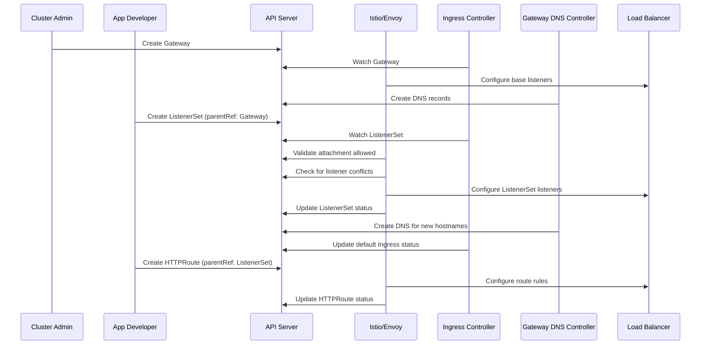

# Gateway API ListenerSets

## Summary

This enhancement adds downstream support in OpenShift Cluster
Ingress for Gateway API ListenerSets. A ListenerSet groups
Gateway listener configurations outside the Gateway resource
itself, enabling decentralized configuration management.
Controllers will now watch ListenerSet entries alongside Gateway
listeners to provide the same functionality as listener watchers,
namely assigning DNS names and providing updated Gateway API
DNS status. This feature allows application developers and tenant
administrators to manage their own TLS settings, certificates,
and listener configurations without requiring cluster
administrator intervention.

## Motivation

By default, only cluster administrators can configure listeners on
a Gateway resource, creating a bottleneck for anyone needing
independent listener management.  Teams that need custom TLS
configurations, dedicated hostnames, or per-application
certificates must request changes from cluster administrators,
slowing down development workflows and creating operational
overhead.

In addition, a single Gateway is limited to 64 listeners.

ListenerSets address these limitations by decentralizing
listener management, enabling self-service TLS configuration,
improving multi-tenancy, and allowing organizations to scale
beyond the 64-listener limit per Gateway while sharing the
backing load-balancer infrastructure.

### User Stories

* As an application developer, I want to create a ListenerSet
  resource and attach it to an existing Gateway so that I can
  manage my own TLS certificates and listener configurations
  without needing cluster administrator involvement.

* As a cluster administrator, I want to delegate listener
  management to application teams via ListenerSets so that I
  can focus on Gateway-level infrastructure concerns while
  teams self-service their own listener configurations.

* As a platform engineer managing a multi-tenant cluster, I
  want teams to independently configure listeners in their own
  namespaces attached to a shared Gateway so that each tenant
  can manage their own hostnames and certificates without
  affecting other tenants.

* As an SRE, I want to monitor ListenerSet health and
  listener conflict status through standard Gateway API status
  conditions so that I can detect and
  remediate listener configuration issues.

### Goals

1. Enable application developers to create and manage
   ListenerSet resources that attach to existing Gateways
   without requiring cluster administrator privileges.

2. Change the gateway-service-dns controller to additionally
   create DNS records for ListenerSet hostnames, so the set of
   listeners work like classic listeners.

3. Support self-service TLS certificate management, allowing
   users to bring their own certificates for listeners within
   a ListenerSet.

4. Allow scaling beyond the 64-listener limit per Gateway by
   distributing listeners across multiple ListenerSet
   resources.

5. Provide clear conflict detection and status reporting via
   default Cluster Ingress Operator status updates when
   listeners within or across ListenerSets conflict.

6. Support cross-namespace attachment of ListenerSets to
   Gateways, enabling multi-tenant use cases where each
   namespace manages its own listeners.

### Non-Goals

1. Modifying the upstream Gateway API ListenerSet
   specification itself.

2. Providing a GUI or web console interface for ListenerSet
   management. Console integration may be addressed in a
   future enhancement.

3. Replacing or deprecating the existing Gateway listener
   model. ListenerSets are additive and complementary to
   direct Gateway listener configuration.

4. Fixing the issue where a dummy listener needs to be added
   to a Gateway that hosts only ListenerSets.

5. Implementing ListenerSet listener validation, conflict
   detection, precedence, or conflict resolution in the Cluster
   Ingress Operator. These features are defined by Gateway API
   and implemented by the managed Istio Gateway controller.

## Proposal

Implement support for Gateway API ListenerSets in the
OpenShift Cluster Ingress Operator and related controllers.
The implementation involves the following high-level changes:

- **ListenerSet controller integration**: Extend the ingress
  controllers to watch ListenerSet entries in addition to
  Gateway listeners. Add a function to combine the entries in
  ListenerSets with the listeners of a Gateway.  The controllers
  will reconcile ListenerSets for configuration of the load balancer,
  assignment of DNS entries, and updates of status conditions in
  ListenerSets and the default Ingress Cluster operator.


- **DNS management**: When a ListenerSet attaches to a
  Gateway, the DNS controller will create and manage DNS
  records for hostnames defined in the ListenerSet's
  listeners, following the same patterns used for Gateway
  listeners today. We currently assign DNS names to
  resolve to the listener's load balancer IP address.  We
  watch listeners and load balancer services on a
  Gateway, and we will need to unpack ListenerSet entries
  to deduplicate hostnames before assigning DNS records.

  When a ListenerSet is in a different namespace than the
  Gateway parentRef, the DNS records must be created in the
  Gateway's namespace. At this point in time, DNS records are
  only created for Gateways in the openshift-ingress namespace.
  DNS records for ListenerSet entries will also be created only
  in the openshift-ingress namespace.  ListenerSet entries
  that attach to Gateways in other namespaces will not have
  DNS management.

  There are special concerns when there are listener hostname
  conflicts because these listeners will be marked `Conflicted`.
  The DNS record should be removed from a listener when it is
  marked `Conflicted`, because the listener is invalid.


  TODO: we could impose our own rules here, but if Istio does
  as the Gateway API spec says to do, no traffic will be served
  to any `Conflicted` listener/s per
  https://github.com/kubernetes-sigs/gateway-api/blob/main/apis/v1/gateway_types.go#L184.


  **Note:**  If two listeners are already allowed to share a
  service, we will need to fix a bug in the
  method of DNS record creation.


- **Conflict detection reporting**: Implement listener conflict
  detection reporting. A ListenerSet
  with one or more conflicting listeners will continue to
  function for its non-conflicting listeners; set appropriate
  status conditions on the default Ingress Cluster operator to report
  when there is a detected conflict.  Add a
  new metric called `listenersets_conflicts_total` for
  ListenerSet conflicts, and an alert for reporting those conflicts.
  It is easy to envision a cluster with hundreds of conflicts, so
  they will need to be carefully aggregated.


- **Status reporting**: Provide Gateway API-compliant status
  updates on ListenerSet resources, including changes to
  `ComputeGatewayAPIDNSStatus` to check all entries in
  ListenerSets as well as individual listeners.


- **RBAC model**: Define RBAC policies that allow namespace
  owners to create ListenerSets in their namespace and attach
  them to Gateways, and also allow cluster administrators to
  retain control over which Gateways accept cross-namespace
  attachments via `allowedListeners` or similar mechanisms.


- **Revert the changes to disallow ListenerSets in 5.0**:
  In cluster ingress operator, ListenerSet support currently
  exists only to mark it unusable for managed Gateway API.
  In 5.1 we install a new Istio version that makes it
  possible to revert the changes to disallow ListenerSets in 5.0
  Remove the alert and metric for alerting, update the
  reconciliation, check cluster role and RBAC, update the
  PILOT_IGNORE_RESOURCES, and complete any other tasks to allow
  ListenerSet use in 5.1.

### Workflow Description

**Cluster administrator** is responsible for deploying and
configuring the Gateway infrastructure, including allowing
ListenerSets from selected namespaces.

**Application developer** is responsible for deploying
applications and configuring ListenerSets for access to them.

**Ingress controller** is the OpenShift component that
reconciles Gateway and ListenerSet resources and creates DNS
records for ListenerSet hostnames.

#### Creating a ListenerSet

1. The cluster administrator creates a Gateway resource with
   the desired infrastructure-level configuration.

2. The cluster administrator configures the Gateway to allow
   cross-namespace ListenerSet attachments from specific
   namespaces or labels, if desired.  If the Gateway has none
   of its own inline listeners, the cluster administrator
   must add a dummy listener to satisfy the listener minimum of 1.

3. The application developer creates a ListenerSet resource
   in their allowed namespace, specifying one or more listeners with
   hostnames, TLS certificates (via Secret references), ports,
   and protocols.

4. The application developer sets the ListenerSet's
   `parentRef` to reference the target Gateway.  Istio checks
   that the referenced Gateway allows the attachment and sets
   the ListenerSet's status.

5. The ingress controller detects the new ListenerSet and
   reconciles the ListenerSet and its entries.

6. The ingress controller creates DNS records for
   the specified hostnames.

7. Istio configures the services and updates the ListenerSet
   status and per-listener conditions.

8. The application developer creates HTTPRoute or other route
   resources referencing the ListenerSet via `parentRefs`.

#### Handling Listener Conflicts

1. Istio detects a conflict (e.g., duplicate
   hostname, port, and/or protocol) between listeners in the same or
   different ListenerSets, or between a ListenerSet listener
   and a Gateway listener.

2. The conflicting listener's status is set to `Conflicted`
   with a descriptive reason.

3. All non-conflicting listeners in the ListenerSet continue
   to function normally.

4. If all listeners are `Conflicted`, then the ListenerSet is
   marked `ListenersNotValid`.

6. The application developer reviews the listeners and ListenerSet
   statuses and resolves the conflict by updating their listener
   and ListenerSet configuration.




### API Extensions

This proposal does not introduce new CRDs, admission
webhooks, conversion webhooks, or finalizers into the
OpenShift API surface.  However, since we are integrating
a new upstream-defined Gateway API CRD and providing DNS
records for it, we can extend the signal for DNS provisioning
into ListenerSet and its entries' status conditions.

We add the `DNSReady` condition to each entry in the ListenerSet
(in `status.listeners[].conditions[]`) and as an aggregate
to the ListenerSet status (in `status.conditions[]`). The
ListenerSet status summarizes `DNSReady`, and the per-listener
status describes each listener's DNS state.

### Topology Considerations

#### Hypershift / Hosted Control Planes

ListenerSet support is relevant for Hypershift deployments.
The ingress controller runs in the management cluster, while
ListenerSet resources are created in the guest cluster. The
controller must be able to watch and reconcile ListenerSet
resources across this divide. No unique changes to the
management cluster components are expected, as the ingress
controller already handles Gateway resources in this topology.

#### Standalone Clusters

This enhancement is fully relevant for standalone clusters.
Standalone clusters are the primary deployment model for
ListenerSet support. All features described in this proposal
apply to standalone clusters without modification.

#### Single-node Deployments or MicroShift

ListenerSet support is applicable to single-node OpenShift
(SNO) deployments. Except for allowing more listeners per
Gateway, and any potential resource consumption increases to
support that, the feature should not introduce significant
additional resource consumption.  Testing remains to be
done.

MicroShift doesn't use Cluster Ingress operator, so it is
not covered here.

#### OpenShift Kubernetes Engine

ListenerSet support does not depend on features excluded from
the OKE product offering. The feature builds on the existing
Gateway API support, which is available in OKE. OKE users
benefit from ListenerSets in the same way as OCP users for
multi-tenant listener management.

### Implementation Details/Notes/Constraints

The implementation requires changes to the following
components:

- **openshift/cluster-ingress-operator**: Extend the Gateway
  API controller to watch and provide DNS for ListenerSet resources.
  Update the DNS management logic to
  handle ListenerSet hostnames on `Accepted` ListenerSets for
  listeners that are not in `Conflict`. Revert the code that disallowed
  ListenerSets in OCP 5.0.  Refactor status updates to reflect
  status of ListenerSets.

<!-- TODO: Fill in specific implementation details as the
design solidifies, including controller reconciliation loop
changes, status condition mappings, and integration points
with the existing Gateway API controller. -->

### Risks and Mitigations

**Listener conflict complexity**: As the number of
ListenerSets grows, conflict detection becomes more complex
and must remain performant. Mitigation: Implement efficient
indexing of listeners by hostname, protocol, and port, and use
the controller's existing watch and cache infrastructure to avoid
full re-scans on each reconciliation.

**ListenerSets allow unbounded number of listeners**: Without
a limit on the number of listeners per Gateway, we face potential
performance issues related to increased sharing of network
bandwidth and load balancer resources.  Mitigation: Benchmark
performance of 64 distinct listeners on a Gateway against a
ListenerSet containing 64 distinct listeners.  Collect the
measurements up to 6400 distinct listeners across 10
ListenerSets.  Attempt to set a recommended cap on the total
number of listeners or document that we have no data and
results may vary.  This testing in this mitigation may be
deferred if we document a recommended cap.

**Cross-namespace trust boundaries**: ListenerSets attached
to Gateways in other namespaces must respect the Gateway's
attachment policies. Mitigation: Istio should enforce Gateway
`allowedListeners` and any namespace selectors to prevent
unauthorized cross-namespace listener attachment.

**Multi-tenancy isolation**: In multi-tenant environments,
one tenant's ListenerSet configuration must not affect
another tenant's traffic. Mitigation: Istio enforces conflict
detection preventing hostname or port collisions across
tenants.

**Security review**: Security aspects of cross-namespace
references, TLS certificate handling, and possibility of
hostname hijacking should be reviewed by the OpenShift
security team or other appropriate party.

### Drawbacks

- ListenerSets add complexity to the ingress controller's
  reconciliation logic. The controller must now track
  listeners from multiple sources (Gateway and ListenerSets)
  and handle DNS name conflicts across them.

- The ListenerSet feature is still evolving in the upstream
  Gateway API project. Downstream implementation must track
  upstream changes and may require updates as the API
  matures.

- Decentralizing listener management may lead to
  configuration sprawl in large clusters, making it harder
  for cluster administrators to maintain an overview of all
  active listeners.

- Documenting the use of ListenerSets could be difficult,
  given the lack of customer demand in Red Hat.

- ListenerSets allow admins to extend DNS provisioning to
  application developers that may not have access to
  resources to troubleshoot why their listeners never
  become `DNSReady`.  The `allowedListeners` mechanism
  may help alleviate this issue.

## Alternatives (Not Implemented)

**Use ExternalDNS for ListenerSet DNS management**: This was
not implemented because it would require an additional layered
product (operator) on OpenShift.  However, in cases where
ExternalDNS Operator is already in use, this could be considered
in the future.

## Open Questions

1. Do we need a FeatureGate for ListenerSets?  We didn't
   need one for BackendTLSPolicy, CORS, or TLSRoutes because
   there were no OpenShift API changes, and use of these
   features remained optional, passed conformance, and
   operated in isolation.  The same rationale applies for ListenerSets.

2. What is the expected maximum number of ListenerSets per
   Gateway, and are there performance implications for the
   controller at scale?

3. Should there be a cluster-wide policy for controlling
   which namespaces can create ListenerSets that attach to
   Gateways in other namespaces?  Due to `allowedListeners`
   we may not need this.  Besides, allowing the cluster
   admin to make this decision is arguably preferred.

4. Do we need a knob for
   cluster administrators to disable the use of ListenerSets
   entirely, or to configure a maximum number of listeners?
   The answer to open question 3 applies here as well.

5. Do we want to set any new Ingress Controller status conditions,
   metrics, or alerts based on the other ListenerSet conditions?
   Invalid, ParentNotProgrammed, ListenersNotValid,
   NotAllowed, ParentNotAccepted, HostnameConflict, ProtocolConflict,
   ListenerConflict, PortUnavailable, UnsupportedProtocol,
   TooManyListeners, InvalidCertificateRef, InvalidRouteKinds,
   or RefNotPermitted. Perhaps any conflicts or certificate
   issues should be aggregated and propagated to status.
   Feedback is that this is out of scope and could be a followup
   enhancement.

6. A dummy listener is required on the Gateway even if only ListenerSets
   are configured.  Do we want to use a mutating admission policy to add
   one if it is accidentally omitted?  Feedback on this is that we don't
   want to add a mutating admission policy that we would revert later
   when Gateways are updated upstream to loosen the restriction on at
   least one listener.

## Test Plan

The test strategy includes:

- **Unit tests**: Cover conflict detection reporting, ListenerSet
  reconciliation, DNS record creation, and status condition
  updates.

- **Integration tests**: Verify end-to-end ListenerSet
  attachment to Gateways, cross-namespace attachment with
  allowedListeners, listener conflict handling, and DNS
  record management in the face of hostname conflicts.

- **E2E tests**:
1. Validate the full workflow from ListenerSet
    creation through DNS resolution and traffic routing, across
    supported platforms.
2. Reparent a ListenerSet and verify the old Gateway’s DNSRecords
    are removed and new records target the new Gateway Service.
3. Create a ListenerSet that is not allowed by allowedListeners;
    verify Accepted=False and no DNSRecords are created.
4. Revoke allowedListeners authorization and verify ListenerSet
    DNSRecords are removed; restore authorization and verify recreation.
5. Change a ListenerSet hostname and verify the old DNSRecord is removed and the new one created.
6. Verify top-level and per-listener DNSReady, including mixed success and failure.
7. Delete the parent Gateway and verify its ListenerSet DNSRecords are cleaned up.

- **Upgrade tests**: Verify that clusters with existing
  ListenerSet resources upgrade cleanly.

Key test scenarios:

1. Create a ListenerSet, attach to a Gateway, and verify
   listeners are programmed and DNS names are created.
2. Create a ListenerSet with a conflicting listener and
   verify the conflict is detected and non-conflicting
   listeners continue to function.
3. Attach a ListenerSet to a Gateway in a different namespace
   using allowedListeners and verify it functions correctly.
4. Attach an HTTPRoute to a ListenerSet and verify
   traffic is routed correctly.
5. Delete a ListenerSet and verify listeners are cleaned up
   from the load balancer and DNS records are removed.
6. Scale to multiple ListenerSets on a single Gateway and
   verify performance remains acceptable.

## Graduation Criteria

- Tests running on all supported platforms (AWS, Azure, GCP,
  vSphere, Bare metal with IPv4/IPv6/Dual stack)
- No regressions seen in other OpenShift components
- ListenerSet controller is implemented and functional.
- End-to-end workflow is operational: create ListenerSet,
  attach to Gateway, route traffic.
- Conflict detection and status reporting are implemented.
- Cross-namespace attachment is functional.
- SLIs defined and exposed as metrics (e.g., ListenerSet
  reconciliation errors, conflict count).
- Upgrade and downgrade testing completed.
- Scale testing with multiple ListenerSets per Gateway.
- User-facing documentation created in
  [openshift-docs](https://github.com/openshift/openshift-docs/).
- Load testing completed for large numbers of ListenerSets.
- Security review completed.

### Removing a deprecated feature

Not applicable. This is a new feature.

## Upgrade / Downgrade Strategy

**Upgrade**: When upgrading to a version that includes
ListenerSet support, no action is required from existing
clusters even if they run a third-party Gateway API
implementation that uses ListenerSets.

**Downgrade**: If a cluster is downgraded from a version with
ListenerSet support to one without it, existing ListenerSet
resources will remain in etcd but will no longer be
reconciled. The backing load balancer configuration for
ListenerSet listeners will be removed during the downgrade as
the controller stops managing them.
Routes attached to ListenerSet listeners will
need to be re-attached to Gateway listeners or will stop
functioning.  DNS records that were provisioned will need
to be manually removed.

## Version Skew Strategy

During an upgrade, the ingress controller may temporarily be
at a different version than the Gateway API CRDs installed in
the cluster. The controller must handle the case where
ListenerSet CRDs are not yet installed by gracefully skipping
ListenerSet reconciliation. Once the CRDs are available, the
controller will begin watching and reconciling ListenerSet
resources.

## Operational Aspects of API Extensions

This proposal does not introduce new OpenShift API
extensions. The ListenerSet CRD is defined upstream in the
Gateway API project.

The ingress controller's reconciliation of ListenerSet
resources has the following operational characteristics:

- **Health indicators**: The ingress operator will report
  conditions reflecting ListenerSet reconciliation health.
  New metrics for ListenerSet conflicts will be exposed.

- **Performance impact**: Each ListenerSet adds a small
  amount of watch cache memory and reconciliation work. For
  clusters with fewer than 100 ListenerSets, the impact on
  API throughput and controller performance should be
  negligible but remains unverified until benchmark results
  are available.

- **Failure modes**: If the ingress controller cannot
  reconcile a ListenerSet or Istio cannot program a ListenerSet
  (e.g., due to an invalid configuration), the ListenerSet's
  status will reflect the error. Other ListenerSets and Gateway
  listeners are not affected.

- **Escalation**: The Networking / gateway-api
  team is responsible for ListenerSet-related issues.

## Support Procedures

**Detecting issues**:

- Check ListenerSet status conditions for `Accepted` and
  `Programmed` states:
  ```
  oc get listenersets -A -o yaml
  ```

- Check the ingress operator logs for ListenerSet
  reconciliation errors or conflicts:
  ```
  oc logs -n openshift-ingress-operator deployment/ingress-operator
  ```

- Monitor the `listenersets_conflicts_total` metric for
  failures due to conflicting listener definitions.

- Check for listener conflict alerts that indicate
  overlapping hostnames or ports across ListenerSets.

**Disabling the feature**:

It is not possible to disable the feature unless we
decide to implement a knob to disable the use of
ListenerSets.

### Dev Preview -> Tech Preview

N/A

### Tech Preview -> GA

N/A

## Infrastructure Needed [optional]

No new infrastructure is needed. The feature uses existing
OpenShift CI infrastructure for testing across supported
platforms.
