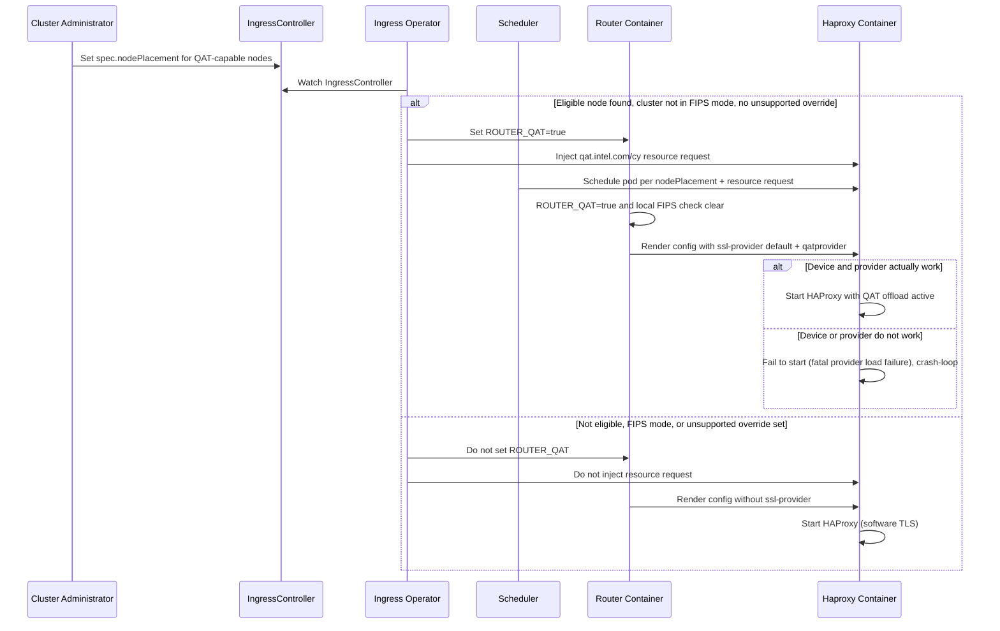

# QAT Acceleration for Ingress

## Summary

This enhancement proposes automatically offloading TLS handshake
cryptographic operations (RSA/ECDHE) from HAProxy to Intel QuickAssist
Technology (QAT) hardware accelerators, when such hardware is present and
usable on a worker node, for ingress router pods running on OpenShift's
haproxy34 image (RHEL10-based). HAProxy has no QAT-specific code; offload is
achieved through OpenSSL 3.x's generic Provider interface and Intel's
`qatengine` package, which is installed unconditionally in the router image
and activated only when a working device is confirmed. For its initial
delivery, this capability ships without a new, versioned IngressController
API field and without an OpenShift feature gate: it is enabled automatically
by default, with an unsupported, undocumented-by-default opt-out exposed
through `spec.unsupportedConfigOverrides`, so that early adopters with QAT
hardware can validate the feature and provide feedback ahead of a committed,
supported API (tentatively targeted for a later release).

## Motivation

Intel QAT is a throughput/CPU-offload accelerator, not a per-connection
latency reducer: offload is asynchronous, so it benefits deployments with
high TLS handshake churn (short-lived connections, frequent renegotiation,
mTLS) by freeing CPU for L7 processing and letting a router sustain a higher
handshake rate, rather than helping an isolated, low-volume handshake.
Red Hat has already validated HAProxy with Intel's `qatengine` on RHEL 9.2
using the legacy OpenSSL ENGINE interface, and the `qatengine`/`qatlib`
packaging is available directly from RHEL AppStream, giving a credible path
to ship this without new third-party repositories or vendored components.

OpenShift's router does not currently take advantage of QAT hardware even
when it is present on a cluster's worker nodes, leaving TLS handshake
capacity on the table for customers who have already invested in QAT-capable
servers (Intel 4th/5th Gen Xeon Scalable with QAT 4xxx). This enhancement
lets those customers realize that investment for ingress traffic without
requiring a new, fully-designed API up front, while providing Red Hat with
real-world feedback to inform the eventual supported interface.

### User Stories

* As a cluster administrator running TLS-heavy ingress workloads (short-lived
  connections, mTLS, frequent renegotiation) on Intel QAT-capable worker
  nodes, I want HAProxy to automatically offload TLS handshake crypto
  operations to the QAT accelerator, so that I can sustain a higher
  handshake rate without over-provisioning CPU.
* As an early-adopter customer validating QAT hardware with OpenShift, I
  want to try QAT acceleration without OpenShift having committed to a new,
  stable API, so that I can give feedback that shapes the eventual supported
  interface.
* As a cluster administrator who does not want this automatic, unsupported
  behavior on my cluster, I want a documented way to disable QAT activation,
  so that I can opt out if it causes problems on my QAT-capable nodes.
* As a platform operations engineer running router fleets at scale, I want
  QAT offload activity, software-fallback counts, and device errors exposed
  through the router's standard Prometheus metrics, so that I can monitor
  whether acceleration is actually helping and detect failures without
  bespoke tooling, life-cycling the feature the same way as any other router
  capability.

### Goals

- Automatically activate Intel QAT TLS crypto offload, through the OpenSSL
  3.x Provider interface, for HAProxy on haproxy34/RHEL10 router pods
  whenever a usable QAT device is confirmed, with no required administrator
  configuration.
- Keep a single router image and configuration path that works unmodified on
  both QAT-capable and commodity hardware; there is no separate "QAT image."
- Keep a QAT failure isolated to the specific router replica it affects:
  when a device or provider genuinely does not work, that replica's
  haproxy container fails to start and is visibly unhealthy (see Risks and
  Mitigations), rather than silently degrading or affecting other
  replicas. Other router replicas, unaffected by the same node-local
  issue, continue serving traffic normally.
- Provide a documented, unsupported escape hatch
  (`spec.unsupportedConfigOverrides`) that lets early adopters disable the
  automatic behavior while Red Hat gathers feedback ahead of a stable API.
- Never activate QAT acceleration in a way that would compromise a cluster's
  FIPS posture.

### Non-Goals

- Introducing a stable, versioned IngressController API field for
  configuring QAT acceleration; this is deferred to a future enhancement
  update (tentatively targeted for OCP 5.2).
- Introducing an OpenShift feature gate for this capability in its initial,
  unsupported, opt-out-only delivery (see Risks and Mitigations).
- Supporting a FIPS-validated QAT acceleration path; FIPS-enabled clusters
  will not activate QAT acceleration at all in this enhancement's scope.
- Supporting the RHEL9/haproxy32 OpenSSL ENGINE-based offload track; only
  the haproxy34/RHEL10 OpenSSL Provider-based path is in scope.
- Supporting the `qat_sw` (software) backend or QAT-accelerated HTTP/data
  compression (`qatzip`); this enhancement is scoped to `qat_hw`-backed TLS
  crypto offload only. `qat_sw` and `qatzip` use different libraries and
  build paths than the `qatengine` TLS offload path proposed here.
- Provisioning or managing node-level QAT infrastructure: RHCOS10 worker
  pools, BIOS/kernel configuration, Node Feature Discovery labeling, or
  installing/configuring the Intel Device Plugin Operator. These are
  prerequisites owned by other components and teams.
- Automatically selecting or scheduling router pods onto QAT-capable nodes;
  placement remains the administrator's responsibility via the existing
  `spec.nodePlacement` field.
- Guaranteeing sufficient VF capacity for rolling update headroom (for
  example, `maxSurge`, where old and new router pods may both request a VF
  simultaneously), node drain, or device-plugin restarts. Sizing the QAT
  node pool to cover this is a capacity-planning and documentation concern
  for the administrator, not a guarantee this enhancement's implementation
  provides; a VF shortage during rollout surfaces as ordinary `Pending`
  pods (see Support Procedures). As a rule of thumb for documentation: the
  number of VFs needed across the matching QAT-capable node pool is at
  least `replicas + maxSurge` - for example, 2 replicas with `maxSurge: 1`
  needs at least 3 VFs available, since a rollout can briefly run both the
  old and new pod for a given replica at once.

## Proposal

QAT-capable worker nodes are required to run the RHCOS10 stream for this
enhancement's initial profile. Intel's QATlib documentation lists a minimum
upstream kernel driver version of 5.15.3 for QAT 4xxx crypto offload. OCP
5.1 ships two RHCOS streams: RHCOS9 (kernel 5.14.0.x) and RHCOS10 (kernel
6.12.0.x). RHCOS9's kernel version string is below that minimum, but RHEL
kernels can carry backported drivers, so a 5.14.0.x version string alone
does not prove QAT is unsupportable on RHCOS9 - it is unsupported for this
enhancement's initial profile until someone does the functional validation
to say otherwise. RHCOS10's kernel does meet the documented minimum, so this
enhancement scopes its initial profile to RHCOS10 and leaves RHCOS9 support
as a possible future validation effort rather than a closed question.

This enhancement spans the router image/binary, the router's control-plane
logic, and the cluster-ingress-operator:

- The haproxy34 (RHEL10) router image installs the `qatengine` RPM
  unconditionally. The package is small and inert on hardware without a QAT
  device, so no separate "QAT image" variant is needed.
- The cluster-ingress-operator computes a single eligibility decision per
  router deployment, gated on three predicates: the target node capability
  (a node matching the IngressController's `spec.nodePlacement` actually
  advertises `qat.intel.com/cy`, i.e., the Intel Device Plugin Operator has
  provisioned virtual functions there), a resolved kernel-compatibility
  signal confirming RHCOS10/kernel compatibility (see Implementation
  Details for how this signal is sourced), and the cluster not being in
  FIPS mode (via `detectFIPS()`, see Implementation Details). Only when all
  three hold does the operator set a `ROUTER_QAT=true` environment variable
  on the router container and the `qat.intel.com/cy` resource request/limit
  on the haproxy container - the resource goes on the haproxy container
  because that is the process that actually runs HAProxy and would touch
  the VF, while `ROUTER_QAT` goes on the router container because that is
  what decides whether to render the `ssl-provider` directives at all. When
  not eligible (no matching QAT-capable node, incompatible kernel, FIPS
  mode, or the admin has set the unsupported opt-out), the operator sets
  neither, and no QAT-related config is ever rendered. The operator does
  not alter placement itself.
- The router container renders `ssl-provider default` followed by
  `ssl-provider qatprovider` whenever `ROUTER_QAT=true` and its own
  independent local check does not detect FIPS (see Implementation Details
  - this is checked locally by the router itself, not inferred from
  `ROUTER_QAT`). There is deliberately no separate preflight that probes
  the device or the OpenSSL provider beforehand: the first time this
  configuration is actually applied to the haproxy container is the
  validation. Loading `qatprovider` explicitly disables OpenSSL's automatic
  loading of the `default` provider, so `default` must also be loaded
  explicitly, or any TLS algorithm not implemented by `qatprovider` would
  fail silently or error out.
- If the device or provider do not actually work, HAProxy's own startup
  fails when it tries to load `qatprovider` - a failed provider load is
  fatal to HAProxy startup - and the haproxy container fails to start. On a
  genuinely broken or absent device, this is expected to crash-loop that
  container; see Risks and Mitigations for why this is an accepted failure
  mode in this initial version rather than something the implementation
  tries to prevent.
- Administrators who do not want this behavior can set a documented, but
  explicitly unsupported, override under `spec.unsupportedConfigOverrides`
  to disable detection, activation, and the associated resource request.
- No new CRD field, CRD validation, or OpenShift feature gate is introduced
  for this initial delivery. A future enhancement will propose the stable,
  gated `v1` API surface once there has been time to gather feedback from
  early adopters (tentatively OCP 5.2).

### Workflow Description

**cluster administrator** is a human user responsible for managing
IngressControllers and the worker nodes that back them.

**cluster-ingress-operator** is the control-plane component that manages
IngressController resources and their router deployments.

**router pod** is the data-plane pod that terminates and load-balances
ingress traffic, made up of (at least) two containers relevant to this
enhancement: the **router container**, which generates HAProxy's
configuration, and the **haproxy container**, which runs the HAProxy
process against that configuration.

1. Infrastructure outside this enhancement's scope provisions QAT-capable
   worker nodes that advertise the `qat.intel.com/cy` extended resource:
   a `MachineConfigPool` (or `NodePool`, for Hypershift) with
   `spec.osImageStream.name: rhel-10` explicitly set, since OCP 5.1 ships
   both RHCOS9 and RHCOS10 streams and only RHCOS10 meets QAT's minimum
   kernel requirement (see Proposal); BIOS/kernel configuration; Node
   Feature Discovery; and the Intel Device Plugin Operator with a
   `QatDevicePlugin` CR.
2. The cluster administrator configures an IngressController's existing
   `spec.nodePlacement` field to target those QAT-capable nodes. No new API
   is required for this step.
3. As a prerequisite, the cluster administrator sets the IngressController's
   existing `haproxyVersion` field to select haproxy34 (HAProxy 3.4), since
   HAProxy 3.2 remains the OCP 5.1 default and this capability only applies
   to haproxy34 or newer (see `select-haproxy-version.md` and
   [NE-2912](https://redhat.atlassian.net/browse/NE-2912), which tracks
   haproxy34 being selectable but non-default in OCP 5.1). None of the
   automatic behavior described below applies until this explicit,
   non-default version selection is made.
4. Unless the administrator has set the unsupported opt-out described
   below, the cluster-ingress-operator checks whether a node matching the
   IngressController's `spec.nodePlacement` advertises the
   `qat.intel.com/cy` resource in its allocatable capacity, is running a
   kernel compatible with QAT (per the resolved kernel-compatibility signal;
   see Implementation Details), and that the cluster is not in FIPS mode (via
   `detectFIPS()`; see Implementation Details). Only if all three hold does
   it automatically add a `ROUTER_QAT=true` environment variable to the
   router container and a matching `qat.intel.com/cy` resource request to
   the haproxy container. Neither is added otherwise. The operator continues
   to watch `Node` objects afterward, so the environment variable and
   resource request are added or removed as matching nodes' QAT
   advertisement appears or disappears (for example, as the Intel Device
   Plugin Operator finishes provisioning virtual functions).
5. The scheduler places router pods according to the administrator's
   `spec.nodePlacement` and the injected resource request, following
   standard Kubernetes scheduling semantics.
6. If `ROUTER_QAT=true` is not set, the router container renders a
   configuration with no `ssl-provider` directives and does no further QAT-
   related work. If `ROUTER_QAT=true` is set, the router container runs its
   own independent local check that FIPS is not enabled on the node (see
   Implementation Details - checked directly by the router, not inferred
   from `ROUTER_QAT`).
7. If `ROUTER_QAT=true` and the local FIPS check does not detect FIPS, the
   router container renders `ssl-provider default` and `ssl-provider
   qatprovider` into the HAProxy configuration. Both directives are
   required together: loading `qatprovider` disables OpenSSL's automatic
   loading of `default`, and without `default` any TLS algorithm not
   implemented by `qatprovider` would fail silently or error out.
8. The haproxy container starts (or reloads) HAProxy against that
   configuration using the existing, unmodified reload mechanism - there is
   no separate preflight step. If the device and provider actually work,
   HAProxy starts normally with QAT offload active. If they do not, loading
   `qatprovider` fails, which is fatal to HAProxy startup, and the haproxy
   container fails to start.
9. On a genuinely broken or absent device, step 8 fails every time it is
   attempted, so the haproxy container crash-loops. This is treated as the
   validation for "is the device available and healthy on this node" -
   there is no separate check beforehand. See Risks and Mitigations for why
   this is an accepted outcome in this initial version, how it is expected
   to surface (alerting on the crash-looping container), and why other
   router replicas are expected to continue serving traffic in the
   meantime.
10. The router exposes Prometheus metrics for offload-active state and
    software-fallback count so operators can confirm whether acceleration
    is engaged.
11. An administrator who wants to disable this behavior entirely sets the
    documented unsupported override in `spec.unsupportedConfigOverrides`;
    on the next rollout, the operator stops setting `ROUTER_QAT` on the
    router container and the resource request on the haproxy container, and
    the router container stops rendering the `ssl-provider` directives.



### API Extensions

This enhancement does not add or modify any CRD, admission or conversion
webhook, ValidatingAdmissionPolicy, MutatingAdmissionPolicy, aggregated API
server, or finalizer.

The only existing API surface touched is IngressController's pre-existing,
intentionally schema-unvalidated `spec.unsupportedConfigOverrides` field.
The cluster-ingress-operator will recognize a documented (but explicitly
unsupported) key under this field to let administrators opt out of the
automatic behavior described in this enhancement. Because
`unsupportedConfigOverrides` carries no schema or support guarantee today,
this does not constitute an API Extension as defined above, and no API
approver review is required for this delivery.

<!-- TODO: The exact key name and shape under unsupportedConfigOverrides
     (e.g. a single boolean flag vs. a nested struct) is still open and
     should be finalized during implementation; see Open Questions. -->

A future enhancement will introduce a stable, versioned IngressController
API field for this capability (tentatively OCP 5.2). That future change will
go through the normal API Extensions review process, including a dedicated
API approver.

### Topology Considerations

#### Hypershift / Hosted Control Planes

QAT hardware is a worker-node (data-plane) resource, so this enhancement
primarily affects guest-cluster node pools where router pods actually run.
The cluster-ingress-operator itself runs in the management cluster, but the
behavior it manages (resource injection and config rendering) executes
against guest-cluster router pods. The
kernel-compatibility resolution described in Implementation Details also
does not carry over as-is: guest-cluster worker nodes are managed through
`NodePool` status rather than `MachineConfigPool`, so whichever option is
chosen there (new RBAC vs. a Node-level signal) needs a Hypershift-specific
equivalent (see Open Questions).

<!-- TODO: This needs validation with the Hypershift team: confirm whether
     any additional handling is required for management-cluster vs.
     guest-cluster router placement, and whether the unsupported override
     needs special handling when hosted control planes are used. -->

#### Standalone Clusters

This is the primary target for this enhancement. Administrators provision
QAT-capable worker nodes and use the existing `spec.nodePlacement` field to
place router pods on them.

#### Single-node Deployments or MicroShift

For Single-Node OpenShift (SNO), a QAT-capable node could serve both control
and data plane; since QAT offloads CPU rather than consuming more, this
enhancement should not meaningfully increase SNO resource consumption when
the device is present, and has no effect when it is not.

MicroShift does not run the cluster-ingress-operator or IngressController
resources in the same way as standalone OpenShift, so this enhancement does
not apply to MicroShift in its current form.

<!-- TODO: Confirm with the MicroShift team whether QAT acceleration is a
     relevant capability for MicroShift's ingress architecture, now or in a
     future iteration. -->

#### OpenShift Kubernetes Engine

This enhancement relies on standard IngressController resources and worker
node infrastructure, which are available in OKE.

<!-- TODO: Confirm with the OKE team whether shipping an automatic,
     explicitly-unsupported behavior (rather than a fully-supported, gated
     feature) raises any concerns specific to the OKE product offering. -->

### Implementation Details/Notes/Constraints

**Router image and packaging**: The haproxy34 (RHEL10) router image installs
the `qatengine` RPM unconditionally via its Dockerfile's `INSTALL_PKGS`
(rather than relying solely on a spec-level `Recommends`), so the same image
works on both QAT and commodity hardware. No HAProxy build-flag change is
required for Provider loading (`ssl-provider`/`ssl-provider-path` only
require `USE_OPENSSL=1` and OpenSSL >= 3.0, already satisfied).

**Router container config-generation**: New Go-side logic (likely in the
router's config-templating package) renders `ssl-provider default` followed
by `ssl-provider qatprovider` whenever `ROUTER_QAT=true` (set by the
cluster-ingress-operator, see below) and the router's own independent local
FIPS check does not detect FIPS. When `ROUTER_QAT` is not `true`, the router
does not do any QAT-related work at all, which keeps the cost of this
enhancement at zero for the vast majority of router pods that never run on
QAT-capable nodes. The router does not itself probe for the device or check
whether OpenSSL can load the `qatprovider.so` Provider: there is no separate
preflight for this in the initial version. The eligibility decision (node
capability, kernel compatibility) belongs to the operator (see below, and
Proposal); if that decision turns out to be wrong for a given node, or the
device is otherwise not actually usable, the result surfaces as the haproxy
container failing to start (see below), not as something the router
detects or works around. FIPS is the one exception the router checks
locally: it reads `/proc/sys/crypto/fips_enabled` directly (a kernel-wide
value visible to any container on the node regardless of the container's
own base image) rather than trusting `ROUTER_QAT` for that determination -
see Risks and Mitigations for why this stays independent of the operator's
own FIPS check. This local check must be fail-safe, not fail-open: if the
file cannot be read or parsed, the router must treat that as FIPS-enabled
and disable QAT, rather than defaulting to "not FIPS." This is a deliberate
departure from the existing `detectFIPS()` helper used elsewhere in the
operator, which defaults to "not FIPS" on a procfs read failure (see
Implementation Details below) - that fail-open default is acceptable for
its existing uses, but must not be inherited by this QAT-specific check.

**Haproxy container startup**: The haproxy container - the one granted the
`qat.intel.com/cy` resource, and therefore the only one with the VF device
visible to it - starts (or reloads) HAProxy against the router-generated
configuration using the existing, unmodified reload mechanism; this
enhancement does not add a wrapper, preflight step, or health-monitoring
loop around it. Whether the device and provider actually work is validated
implicitly, by the real startup attempt itself: if they do not, loading
`qatprovider` fails, which is fatal to HAProxy startup (whether that is the
container's first-ever start, or a later start triggered by the kubelet
restarting it after a liveness probe failure), and the haproxy container
exits. On a genuinely broken or absent device, every such attempt fails the
same way, so the container crash-loops. This is accepted, not prevented, in
this initial version - see Risks and Mitigations. A device that fails
mid-flight while HAProxy is already running successfully is not proactively
detected or reacted to by this enhancement either; whatever behavior
`qatengine`/HAProxy exhibit on their own (see Open Questions) is what
happens, up to and including the existing liveness probe eventually
restarting the container, which then hits the same startup-failure path.

**cluster-ingress-operator**: Adds logic to read `Node` objects (and,
depending on how the next paragraph's open point is resolved,
`MachineConfigPool` objects) and compute a single eligibility decision per
router deployment: a node matching the IngressController's
`spec.nodePlacement` must advertise `qat.intel.com/cy` in its allocatable
capacity, and that node's resolved RHCOS stream/kernel must meet QAT's
minimum kernel-driver requirement (see Proposal). When eligible, the
operator sets a `ROUTER_QAT=true` environment variable on the router
container and the `qat.intel.com/cy` resource request/limit on the haproxy
container; when not eligible, or when the administrator has set the
unsupported opt-out key described in API Extensions, it sets neither.
Collapsing node-capability and kernel-compatibility into a single flag is
deliberate: unlike FIPS (see below), getting this one wrong is low-stakes
in terms of correctness - it surfaces as the haproxy container failing to
start and crash-looping (see Risks and Mitigations), which is a visible,
diagnosable failure rather than a silent one, not a security or compliance
concern the way an incorrect FIPS determination would be. FIPS is handled
as a separate, independent check: the operator reuses the existing
`detectFIPS()` helper's Hypershift-aware handling of a FIPS management
cluster with a non-FIPS guest cluster (via the `FIPS_ENABLED` environment
variable), to skip setting `ROUTER_QAT` and the resource request entirely
on a FIPS-enabled cluster, rather than scheduling a pod onto a QAT node and
consuming a VF only for the router container to never render the directives
that would have used it. However, the QAT
eligibility gate cannot reuse `detectFIPS()`'s existing fail-open default
as-is: `detectFIPS()` returns a plain `bool` and defaults to "not FIPS" when
`/proc/sys/crypto/fips_enabled` cannot be read or parsed, which is
appropriate for its existing callers but not acceptable here, where
defaulting the wrong way means activating a non-FIPS-validated crypto path
on what may actually be a FIPS cluster. `detectFIPS()` should therefore be
changed to return `(bool, error)` instead of a plain `bool`, surfacing an
inconclusive read as a non-nil error rather than silently collapsing it into
`false`. Existing callers that are fine with today's practical behavior can
keep it by ignoring the error; the QAT eligibility gate is the one caller
that must treat a non-nil error as FIPS-enabled and skip setting
`ROUTER_QAT`/the resource request. See Risks and Mitigations for why the
router also independently re-verifies FIPS state itself rather than
trusting this operator-level check alone.

How the operator sources the kernel-compatibility signal is an open choice
between two options (see Open Questions), not a settled
`MachineConfigPool`-based design: (a) read `MachineConfigPool` status
directly, which is the more direct approach but requires adding a new,
currently-missing RBAC scope -
the cluster-ingress-operator's `ClusterRole` on `release-5.1` grants only
`nodes: list/watch` today, with no `machineconfiguration.openshift.io`
permissions, so this option means adding a least-privilege
`machineconfigpools: list/watch` rule and getting it reviewed; or (b)
resolve the signal from a `Node`-level label or annotation the MCO already
sets, which the operator can already read under its existing RBAC, avoiding
the new scope at the cost of depending on a specific `Node` label/annotation
remaining stable. Only option (a) involves reading `MachineConfigPool`
objects at all; option (b) never touches them. For Hypershift, neither
option applies as-is: guest-cluster worker nodes are managed through
`NodePool` status rather than `MachineConfigPool`, so that topology needs
its own resolution regardless of which option is chosen for standalone
clusters.

Reconciling on changes to `Node` objects (and `MachineConfigPool` objects,
if option (a) above is chosen) - not just on IngressController changes -
ensures the resource request and environment variable are added once the
Intel Device Plugin Operator finishes
provisioning virtual functions on a targeted node, without requiring an
unrelated IngressController edit to trigger it. The operator does not
compute or alter node placement; that remains entirely driven by the
administrator's existing `spec.nodePlacement` configuration.

**No feature gate for this delivery**: OpenShift's standard process requires
all new features to ship behind a feature gate, disabled by default. This
enhancement deliberately deviates from that process for its initial
delivery: because there is no new API surface being committed to, gating the
behavior behind a `FeatureGate` would imply a commitment this enhancement
explicitly wants to avoid making yet. Instead, the behavior ships as an
automatic, default-on capability with an unsupported, documented opt-out.
This is called out explicitly in Risks and Mitigations for reviewer
scrutiny. When the stable `v1` API field is introduced in a future
enhancement, that field (and the behavior it controls) will be registered as
a proper feature gate in
https://github.com/openshift/api/blob/master/features/features.go, starting
in an appropriate feature set (`DevPreviewNoUpgrade` or
`TechPreviewNoUpgrade`), per the guidance in
`dev-guide/feature-zero-to-hero.md`.

The absence of a dedicated feature gate is further mitigated by this
capability's dependency on HAProxy version selection (see
`select-haproxy-version.md` and
[NE-2912](https://redhat.atlassian.net/browse/NE-2912)): HAProxy 3.4
(haproxy34) is not available at all until it is introduced, as a
non-default, explicitly-selectable version via the existing
`haproxyVersion` field, alongside this enhancement. It
cannot be pinned today because it does not exist in OCP 5.0. QAT activation
is conditioned on the IngressController running haproxy34 or newer, so an
administrator must already have explicitly set `haproxyVersion` to this new,
non-default version before this enhancement's automatic behavior can ever
apply. This naturally limits exposure to clusters that have deliberately
opted in to the new HAProxy version, even without a feature gate of its own.

### Risks and Mitigations

**Risk**: There is no preflight check before HAProxy actually tries to use
the device: a device or provider that does not work causes the haproxy
container to fail to start, and it will keep failing the same way on every
subsequent start attempt (initial rollout, reschedule, or a kubelet restart
after a liveness probe failure), so the container crash-loops. This is a
deliberate simplification for this initial version rather than an oversight
(see Implementation Details).

**Mitigation**: This is treated as an acceptable, visible failure mode
rather than something the implementation tries to prevent. A crash-looping
container is a standard Kubernetes signal that existing cluster monitoring
already surfaces (restart counts, `CrashLoopBackOff` status/events), so no
new alerting mechanism is required. Other router replicas, scheduled on
nodes not affected by the same node-local issue, continue serving traffic
normally, so the IngressController as a whole keeps working while a single
affected replica does not. An administrator resolves the underlying problem
(fix the device/VF provisioning) or disables QAT acceleration via the
unsupported override (see Support Procedures) to stop the affected replica
from crash-looping. A future iteration may add a real preflight check ahead
of this if early-adopter feedback shows it is needed.

**Risk**: Loading the `qatprovider` OpenSSL provider disables OpenSSL's
automatic loading of the `default` provider. Without `default` also loaded
explicitly, any TLS algorithm not implemented by `qatprovider` would fail
silently or error out, breaking cipher suites and TLS features that have
nothing to do with QAT.

**Mitigation**: The router always renders `ssl-provider default` before
`ssl-provider qatprovider`, never `qatprovider` alone (see Workflow
Description and Proposal). This is covered by a dedicated test exercising a
TLS path that requires a non-QAT algorithm, to catch any regression in this
ordering (see Test Plan).

**Risk**: Shipping an automatic, default-on behavior without a feature gate
deviates from OpenShift's standard feature-development process, and could
set an unwanted precedent.

**Mitigation**: The behavior is strictly scoped to hardware that does not
exist in commodity clusters (QAT-capable nodes), fails in a contained and
visible way when it does not work (a crash-looping replica rather than a
cluster-wide or silent failure, see the preflight risk above), carries an
explicit, documented "unsupported" designation, and is intentionally
time-boxed to a single release cycle ahead of a properly gated, supported
API. This EP calls the deviation out explicitly so reviewers and API
approvers can weigh in before it merges.

**Risk**: Whether `ssl-mode-async` actually drives OpenSSL's
`OSSL_ASYNC_FD`/`ASYNC_WAIT_CTX` machinery for a Provider (as opposed to an
ENGINE) is unverified; without it, this feature may provide functional
correctness but no real throughput benefit.

**Mitigation**: This is treated as a hard gate for promotion beyond this
early-access delivery: the project will not claim a performance benefit, nor
graduate this capability, until async offload is empirically confirmed on
real haproxy34/RHEL10 hardware.

**Risk**: A QAT device that was usable at HAProxy start time can become
unusable afterward (driver reset, VF revoked, firmware issue) while HAProxy
is already running successfully. This enhancement does not proactively
detect or react to that in this initial version.

**Mitigation**: No new monitoring is added for this case; it is explicitly
out of scope for the initial version (see Implementation Details). Whatever
`qatengine`/HAProxy do on their own when the hardware fails mid-operation
(transparent per-request software fallback vs. erroring handshakes vs.
eventually becoming unhealthy enough to fail the existing liveness probe)
is what happens; the last of those would restart the container, which then
hits the same startup-failure path as a device that was never usable (see
the preflight risk above). Whether `qatengine` provides transparent,
per-request fallback still needs empirical confirmation (see Open
Questions); a future iteration may add proactive detection if real-world
feedback shows it is needed.

**Risk**: Real QAT hardware for CI/QE is not yet confirmed, which limits how
much of this feature can be validated before shipping.

**Mitigation**: Hardware access is being arranged; until it is confirmed,
testing is limited to the hardware-independent cases listed in the Test
Plan, and this is tracked explicitly in Infrastructure Needed and Open
Questions.

**Risk**: Automatic, default-on resource injection onto the haproxy
container could surprise administrators who did not explicitly request QAT
acceleration, for example on shared or multi-tenant QAT-capable node pools.

**Mitigation**: The behavior is documented, is visible through router
metrics, and can be disabled cluster-wide (per IngressController) through
the unsupported override.

**Risk**: Collapsing node-capability, kernel-compatibility, and the
unsupported opt-out into a single `ROUTER_QAT` flag means the router
container itself cannot tell *why* the flag is unset (no matching node,
incompatible kernel, or explicit opt-out), which could make support harder.

**Mitigation**: The pod does not need to know why, only what to do; the
"why" is diagnosable from the cluster-ingress-operator's own logs and
events, which record the specific reason (resource unavailability, kernel
incompatibility, FIPS, or opt-out) for each IngressController it reconciles
(see Support Procedures).

**Risk**: FIPS-enabled clusters must never activate a non-FIPS-validated
crypto path, and a FIPS pod should not needlessly consume a QAT VF that the
router container was never going to use anyway. Unlike the node-capability
and kernel-compatibility checks (which are deliberately collapsed into the
single `ROUTER_QAT` flag, since getting them wrong is low-stakes), FIPS is
not something the router should take on the operator's word alone: a stale
reconcile or a bug in the operator's eligibility computation could otherwise
silently activate a non-FIPS-validated crypto path on a FIPS cluster.
Compounding this, the existing `detectFIPS()` helper used elsewhere in the
operator is fail-open by design (it defaults to "not FIPS" when
`/proc/sys/crypto/fips_enabled` cannot be read or parsed), which is the
wrong default to inherit unmodified for a QAT-activation gate.

**Mitigation**: This is enforced at two genuinely independent layers rather
than one flag checked twice, and both layers are fail-safe rather than
fail-open. `detectFIPS()` is updated to return `(bool, error)` instead of a
plain `bool`, so an inconclusive read surfaces as a non-nil error instead of
silently collapsing into `false` (see Implementation Details); the QAT
eligibility gate is written to treat that error as FIPS-enabled, so it skips
setting `ROUTER_QAT` and the `qat.intel.com/cy` resource request both when
the cluster is in FIPS mode and when FIPS state cannot be conclusively
determined, meaning a FIPS pod is not scheduled onto a QAT node and does not
consume a VF. Independently of that,
and regardless of what `ROUTER_QAT` says, the router container's own local
check reads `/proc/sys/crypto/fips_enabled` directly - a kernel-wide
value visible to the container without any special privilege or operator
involvement - and refuses to activate QAT both when it reports FIPS is
enabled and when it cannot be read or parsed at all. Because this check does
not depend on the operator's computation at all, it remains a true backstop
even if the operator-level check is bypassed or stale. This enhancement's
scope is limited to non-FIPS clusters (see Non-Goals).

### Drawbacks

This enhancement introduces an automatic behavior change (new resource
requests, conditional config rendering) without the usual feature-gate
safety net, which increases the burden on the router and ingress operator
teams to get the default-on behavior right the first time. It also accepts
that a genuinely broken or absent device results in a crash-looping haproxy
container rather than a guaranteed graceful fallback, relying on other
router replicas and existing crash-loop monitoring instead of a dedicated
preflight (see Risks and Mitigations). Troubleshooting relies on logs,
metrics, and standard pod-health signals rather than a dedicated
IngressController status condition in this initial delivery (status
reporting is an open question). These trade-offs are accepted in exchange
for a smaller initial implementation and faster, real-world feedback ahead
of committing to a stable API, but reviewers may reasonably push back on
shipping default-on behavior without a feature gate, or on accepting
crash-looping as a valid failure mode instead of a preflight check.

## Alternatives (Not Implemented)

**Ship a fully-gated Tech Preview feature with a stable v1 API now**: This
was not selected for this release because the API shape (opt-in field vs.
automatic detection, resource/placement model, status reporting) has open
questions that are better informed by early-adopter feedback than by
up-front design alone. A future enhancement will revisit this once that
feedback is available.

**Require an explicit opt-in field instead of automatic, default-on
behavior**: Considered, but an opt-out-by-exception model was chosen to
maximize early feedback from customers who already have QAT hardware,
without asking them to learn a new, soon-to-be-replaced API field.

## Open Questions [optional]

1. What is the exact key name and shape for the unsupported opt-out under
   `spec.unsupportedConfigOverrides`?
2. What IngressController status/condition reporting, if any, should exist
   for QAT state in this initial delivery? This is currently left
   unresolved (TBD) and may remain logs/metrics-only until the stable API
   lands.
3. How does this enhancement interact with Hypershift/Hosted Control Planes
   specifically (see Topology Considerations)?
4. Is there a known race where the Intel Device Plugin Operator advertises
   `qat.intel.com/cy` as allocatable, and the scheduler places a pod
   accordingly, before the VF is actually fully usable (for example,
   firmware/driver initialization still in progress)? Since this
   enhancement has no preflight to absorb that kind of transient timing
   issue (see Implementation Details), such a race would be indistinguishable
   from a genuinely broken device: both fail HAProxy's first real startup
   attempt and crash-loop the haproxy container the same way, even though
   one would resolve itself on retry and the other needs an admin.
5. Does shipping an automatic, unsupported-only behavior (rather than a
   fully supported, gated feature) raise concerns for OKE (see Topology
   Considerations)?
6. When will `ssl-mode-async` be empirically confirmed to drive real async
   offload for the Provider path on haproxy34/RHEL10, and what is the plan
   if it does not?
7. What is the concrete timeline for confirming real QAT hardware access
   for CI/QE?
8. What is the migration path from the unsupported override to the future
   supported `v1` API field, for administrators who adopted the unsupported
   behavior early?
9. Does `qatengine` provide its own transparent, per-request fallback to
   software crypto when the QAT hardware fails mid-operation, or does a
   runtime hardware failure error the TLS handshake outright, or eventually
   fail HAProxy's liveness check and get restarted into the same
   startup-failure path described in Implementation Details? This
   determines what a mid-life hardware failure actually looks like in
   practice, since no proactive detection exists in this initial version.
10. **Pre-implementation blocker**: the RHCOS10 kernel requirement itself is
    settled (see Proposal), but the exact supported tuple built on top of
    it (`crun` version, OpenSSL 3.x, `qatprovider`, QAT 4xxx firmware/
    driver) is not yet pinned, and neither is the package source for
    `qatengine` on RHEL10. At the time of writing, Brew shows
    `haproxy34-3.4.5-1.rhaos5.1.el10` (build 4122540) and
    `qatengine-2.1.0-1.el10` (build 4048100) in `rhel-10.3-candidate`, the
    latest RHCOS10 candidate kernel is `6.12.0-211.64.1.el10_2` (build
    4127236), but `qatengine` is not yet present in
    `rhaos-5.1-rhel-10-candidate`. It is not yet decided whether `qatengine`
    will be consumed directly from RHEL AppStream or needs its own
    `rhaos`-candidate build. Unlike the other open questions in this list,
    this one is a hard pre-implementation gate, not something that can be
    deferred to early-adopter feedback: someone must determine the package
    source and pin the exact NVRs before implementation starts.
11. The cluster-ingress-operator's `ClusterRole` on `release-5.1` currently
    grants only `nodes: list/watch` - there is no
    `machineconfiguration.openshift.io`/`MachineConfigPool` permission
    today (verified against `manifests/00-cluster-role.yaml`). Resolving the
    kernel-compatibility check in Implementation Details requires picking
    one of: (a) add a least-privilege `machineconfigpools: list/watch` rule
    to the operator's `ClusterRole`, accepting the new RBAC scope, or (b)
    use an already-authorized, Node-level signal instead (for example, a
    label or annotation the MCO already sets on `Node` objects reflecting
    OS stream), avoiding new RBAC but depending on a specific Node
    label/annotation existing and being documented as stable enough to rely
    on. Separately, this RBAC/signal question does not carry over to
    Hypershift as-is: guest-cluster nodes are managed through `NodePool`
    status, not `MachineConfigPool`, so that path needs its own answer
    regardless of which option is chosen here.

## Test Plan

**Test ownership**: RHEL and Intel are responsible for validating the broad
QAT hardware/software support matrix (device generations, firmware, kernel
driver versions). OpenShift Ingress/QE is responsible for validating one
exact, pinned tuple (see Open Questions) for the HAProxy +
`qatengine`/OpenSSL integration specifically - this enhancement does not
attempt to re-validate the matrix RHEL/Intel already own.

Since no feature gate exists for this initial delivery, tests cannot use an
`[OCPFeatureGate:...]` label yet; one will be added once the future
enhancement introduces the gated v1 API. Until then, all tests should
include a `[Jira:"Network Edge"]` (or appropriate component) label, and
suite/type labels such as `[Suite:...]`, `[Serial]`, `[Slow]`, or
`[Disruptive]` as needed. See `dev-guide/test-conventions.md` for details.

The following do not require real QAT hardware:

- Unit tests for the router container's rendering logic against faked
  `ROUTER_QAT` and local FIPS check inputs, including the "must never emit
  `ssl-provider` unless `ROUTER_QAT=true` and the local FIPS check is clear"
  rule, and the "`ssl-provider default` must always precede `ssl-provider
  qatprovider`" rule.
- A test exercising a TLS handshake path that requires an algorithm not
  implemented by `qatprovider`, with QAT active, to catch any regression
  where `default` is not loaded alongside `qatprovider`.
- Unit tests for the operator's eligibility computation: only setting
  `ROUTER_QAT=true` on the router container and `qat.intel.com/cy` on the
  haproxy container together when a matching node advertises the resource
  and its resolved kernel-compatibility signal meets QAT's minimum, never
  setting either when the cluster is in FIPS mode or FIPS state cannot be
  determined (the fail-safe FIPS guard), reaction to `Node` add/update
  events (and `MachineConfigPool` add/update events, if that option is
  chosen; see Open Questions), and handling of the unsupported opt-out key.
- Unit tests confirming the router container does no QAT-related work when
  `ROUTER_QAT` is unset.
- Unit tests for the router container's independent local FIPS check
  (`/proc/sys/crypto/fips_enabled`), confirming it blocks QAT activation
  regardless of `ROUTER_QAT`'s value, including the case where `ROUTER_QAT`
  is (incorrectly) `true` on a FIPS-enabled node.
- Unit tests for the fail-safe (not fail-open) requirement on both the
  operator's eligibility gate and the router container's local check: a
  missing or invalid `FIPS_ENABLED` environment variable combined with an
  unreadable `/proc/sys/crypto/fips_enabled` must result in QAT staying
  disabled, not in a default-to-non-FIPS outcome.

The following require real QAT hardware, since no credible software
emulator exists for the QAT PCI accelerator:

- End-to-end validation that `ssl-provider qatprovider` actually offloads
  TLS handshakes, including the `ssl-mode-async` question from Risks and
  Mitigations.
- End-to-end validation that a missing or unusable device causes the
  haproxy container to fail to start and crash-loop (rather than, say,
  hanging or partially starting), and that other router replicas continue
  serving traffic in the meantime.
- Validation of the full deployment runbook end to end (RHCOS10 worker
  pool, NFD labeling, Intel Device Plugin Operator, resource advertisement,
  scheduling, and router activation).

## Graduation Criteria

Because this initial delivery has no feature gate, the standard graduation
framework (minimum 5 tests, 7 runs/week, 14 runs per supported platform, 95%
pass rate, coverage across AWS, Azure, GCP, vSphere, and Baremetal
network-stack variants) will be defined once the future enhancement
introduces the gated, supported v1 API. Until then, "graduation" for this
delivery means gathering enough early-adopter feedback and empirical
validation (see Open Questions) to inform that future API design.

<!-- TODO: Numeric performance targets (handshake-rate uplift, throughput,
     CPU savings vs. software-only baseline) are not yet defined. These
     should be set by the perf team once real QAT hardware is available for
     benchmarking (see Infrastructure Needed), rather than asserted here
     without measurement. -->

### Dev Preview -> Tech Preview

<!-- TODO: To be defined alongside the future enhancement that introduces
     the feature-gated v1 API. -->

### Tech Preview -> GA

Confirmation of a real async offload benefit (see Risks and Mitigations,
`ssl-mode-async`) and perf-team-defined numeric performance targets are
treated as hard gates for GA; neither is satisfied yet.

<!-- TODO: The rest of this criteria is to be defined alongside the future
     enhancement that introduces the feature-gated v1 API. -->

### Removing a deprecated feature

N/A - this is a new capability, not a replacement for an existing one.

## Upgrade / Downgrade Strategy

Because this enhancement does not add a new CRD field, upgrades and
downgrades are governed by normal `unsupportedConfigOverrides` semantics:
clusters running an older cluster-ingress-operator version simply do not
recognize the opt-out key and are unaffected by this enhancement. Clusters
running a newer operator version will begin automatically injecting the
`qat.intel.com/cy` resource request on applicable router deployments after
upgrade, unless the administrator has already set the opt-out.

Downgrading to an operator version that predates this enhancement removes
the automatic resource injection and `ROUTER_QAT` behavior; router pods
return to software-only TLS with no QAT-related resource requests. No manual
cleanup is required, since no new persisted API field is introduced.

## Version Skew Strategy

This enhancement does not involve the kubelet, CSI, CRI, or CNI, and does
not require control-plane/data-plane coordination beyond the
cluster-ingress-operator rolling out router deployments as it already does
today. During a rolling upgrade, some router pods may run with QAT
acceleration active and others without it (for example, mid-rollout), which
is acceptable since both are supported, already-handled configurations - a
pod without QAT simply serves software-only TLS, and a pod with QAT either
works or crash-loops in a way that is isolated to that replica (see Risks
and Mitigations), not something version skew makes worse.

## Operational Aspects of API Extensions

N/A - this enhancement does not add or modify any CRD, webhook, aggregated
API server, or finalizer.

## Support Procedures

* **Failure Mode 1**: The router container's local FIPS check detects FIPS
  (or cannot determine FIPS state).
  * **Impact**: None to availability - the router omits `ssl-provider` and
    the haproxy container starts HAProxy with software-only TLS, as it
    would without this enhancement.
  * **Detection**: Router container logs record the FIPS check result.
  * **Teams**: Networking team (ingress maintainers) handles escalations.

* **Failure Mode 2**: `ROUTER_QAT=true` was set, but the device or
  provider do not actually work (misconfigured eligibility, a VF that was
  provisioned but is not functional, or hardware that failed after the
  operator last checked).
  * **Impact**: The haproxy container fails to start and crash-loops on
    that specific replica; it does not serve traffic. Other router
    replicas, unaffected by the same node-local issue, continue serving
    traffic normally. This is an accepted failure mode in this initial
    version rather than something prevented by a preflight check (see
    Risks and Mitigations).
  * **Detection**: Standard Kubernetes container restart/`CrashLoopBackOff`
    signals on the haproxy container; its logs show the HAProxy startup
    error (for example, a failed `qatprovider` load).
  * **Teams**: Networking team (ingress maintainers) handles escalations;
    escalate to the Intel Device Plugin Operator/NFD owners if VF
    provisioning or node hardware looks like the root cause.

* **Failure Mode 3**: The `qat.intel.com/cy` resource request on the
  haproxy container cannot be satisfied (misconfigured `spec.nodePlacement`,
  insufficient VFs, or Intel Device Plugin Operator not installed/healthy).
  * **Impact**: Affected router pods remain `Pending` and do not serve
    traffic; other router replicas that can be scheduled continue serving
    traffic normally.
  * **Detection**: Standard Kubernetes pod scheduling events/status
    (`FailedScheduling`, insufficient `qat.intel.com/cy`).
  * **Teams**: Networking team (ingress maintainers) for the resource
    request itself; escalate to the Intel Device Plugin Operator/NFD owners
    for device-plugin or node-level issues.

### Detecting Failures

* **Symptom 1**: Router container logs show the local FIPS check blocked
  QAT activation.
  ```bash
  oc logs -n openshift-ingress <router-pod-name> -c router
  ```

* **Symptom 2**: Haproxy container is restarting/crash-looping; its logs
  (including from the previous, crashed instance) show an HAProxy startup
  error such as a failed `qatprovider` load.
  ```bash
  oc get pod -n openshift-ingress <router-pod-name>
  oc logs -n openshift-ingress <router-pod-name> -c haproxy --previous
  ```

* **Symptom 3**: Router pods stuck `Pending` due to an unsatisfiable
  `qat.intel.com/cy` resource request on the haproxy container.
  ```bash
  oc describe pod -n openshift-ingress <router-pod-name>
  ```

* **Symptom 4**: Router metrics show QAT offload inactive or a rising
  software-fallback count despite QAT hardware being expected to be in use.

* **Symptom 5**: `ROUTER_QAT` is unexpectedly unset on a router pod expected
  to have QAT acceleration. Since the flag itself does not carry a reason,
  check the cluster-ingress-operator's logs and events for the
  IngressController, which record why eligibility was not met (no matching
  node resource, incompatible kernel, FIPS mode, or the unsupported
  opt-out).
  ```bash
  oc get pod -n openshift-ingress <router-pod-name> -o jsonpath='{.spec.containers[?(@.name=="router")].env}'
  oc logs -n openshift-ingress-operator deployment/ingress-operator
  ```

### Graceful Degradation

This enhancement does not guarantee every pod degrades gracefully on its
own: a genuinely broken or absent device causes the haproxy container on
that specific replica to crash-loop rather than silently falling back to
software-only TLS (see Risks and Mitigations). Degradation happens at the
fleet level instead - other router replicas, unaffected by the same
node-local issue, continue serving traffic - and recovery requires either
fixing the underlying device/VF problem or an administrator disabling the
behavior. An administrator can disable the behavior entirely at any time
via the unsupported override in `spec.unsupportedConfigOverrides`; on the
next rollout, the operator stops setting both the resource request and
`ROUTER_QAT`, and the router - seeing `ROUTER_QAT` unset - does not attempt
QAT detection at all, which stops the affected replica from crash-looping.

## Infrastructure Needed [optional]

- Real Intel QAT-capable hardware (lab, cloud, or CI pool) for CI/QE
  testing. Access is being arranged but not yet confirmed; this is a
  tracked blocker for empirical validation (see Open Questions).
- RHCOS10-based worker pool infrastructure, once haproxy34/RHEL10 images
  exist, to exercise the full deployment runbook end to end.
