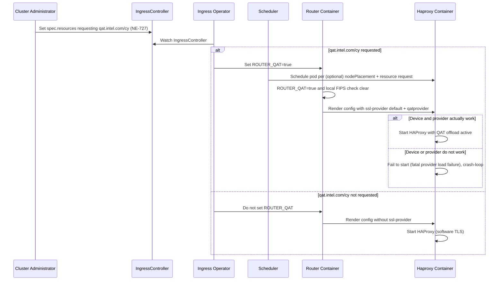

# QAT Acceleration for Ingress

## Summary

This enhancement proposes automatically offloading TLS handshake
cryptographic operations (RSA/ECDHE) from HAProxy to Intel QuickAssist
Technology (QAT) hardware accelerators, when such hardware is present and
usable on a worker node, for ingress router pods running on OpenShift's
haproxy34 image (RHEL10-based). HAProxy has no QAT-specific code; offload is
achieved through OpenSSL 3.x's generic Provider interface and Intel's
`qatengine` package, which is installed unconditionally in the router image
and enabled whenever `ROUTER_QAT=true` and the router's own local check
confirms FIPS is disabled. The router performs no device or provider
preflight of its own; HAProxy's startup is the first real validation that
the device and provider actually work. Rather than introducing a
QAT-specific API field, this enhancement builds on the
generic `spec.resources` field being added to IngressController by
[NE-727](https://redhat.atlassian.net/browse/NE-727): an administrator who
explicitly requests the `qat.intel.com/cy` extended resource is signaling
intent to use QAT, and the cluster-ingress-operator mirrors that request
into the router container as a simple `ROUTER_QAT` flag. No new CRD field
or feature gate is introduced by this enhancement itself; documentation and
release notes set expectations that this is a new capability without a
dedicated preflight or periodic health check yet (see Risks and
Mitigations), rather than relying on a technical gate.

## Motivation

Intel QAT is a throughput/CPU-offload accelerator, not a per-connection
latency reducer: offload is asynchronous, so it benefits deployments with
high TLS handshake churn (short-lived connections, frequent renegotiation,
mTLS) by freeing CPU for L7 processing and letting a router sustain a higher
handshake rate, rather than helping an isolated, low-volume handshake.
Red Hat has already validated HAProxy with Intel's `qatengine` on RHEL 9.2
using the legacy OpenSSL ENGINE interface, and the `qatengine`/`qatlib`
packaging is available directly from RHEL AppStream, giving a credible path
to ship this without new third-party repositories or vendored components.

OpenShift's router does not currently take advantage of QAT hardware even
when it is present on a cluster's worker nodes, leaving TLS handshake
capacity on the table for customers who have already invested in QAT-capable
servers (Intel 4th/5th Gen Xeon Scalable with QAT 4xxx). This enhancement
lets those customers realize that investment for ingress traffic by reusing
an existing, generic mechanism
([NE-727](https://redhat.atlassian.net/browse/NE-727)'s `spec.resources`
field) rather than requiring a new, QAT-specific API, while still gathering
real-world feedback to inform whether a dedicated, higher-level API (for
example, a QAT profile field) is worth building later.

### User Stories

* As a cluster administrator running TLS-heavy ingress workloads (short-lived
  connections, mTLS, frequent renegotiation) on Intel QAT-capable worker
  nodes, I want to explicitly request QAT acceleration for my
  IngressController, so that HAProxy offloads TLS handshake crypto
  operations to the QAT accelerator and I can sustain a higher handshake
  rate without over-provisioning CPU.
* As a cluster administrator, I want to enable QAT acceleration using the
  same generic resource-request mechanism I already use for CPU and memory,
  so that I don't have to learn a new, QAT-specific API field just to try
  this out.
* As a cluster administrator who shares QAT-capable nodes with other
  workloads, I want to additionally constrain router pod placement, so that
  QAT-capable nodes aren't monopolized by router pods, or router pods don't
  compete with unrelated workloads for the same nodes.
* As a platform operations engineer running router fleets at scale, I want
  QAT offload activity, software-fallback counts, and device errors exposed
  through the router's standard Prometheus metrics, so that I can monitor
  whether acceleration is actually helping and detect failures without
  bespoke tooling, life-cycling the feature the same way as any other router
  capability.

### Goals

- Automatically activate Intel QAT TLS crypto offload, through the OpenSSL
  3.x Provider interface, for HAProxy on haproxy34/RHEL10 router pods,
  triggered by the administrator explicitly requesting the
  `qat.intel.com/cy` extended resource via IngressController's
  `spec.resources` field
  ([NE-727](https://redhat.atlassian.net/browse/NE-727)), with no
  QAT-specific API field of this enhancement's own.
- Keep a single router image and configuration path that works unmodified on
  both QAT-capable and commodity hardware; there is no separate "QAT image."
- Keep a QAT failure isolated to the specific router replica it affects:
  when a device or provider genuinely does not work, that replica's
  haproxy container fails to start and is visibly unhealthy (see Risks and
  Mitigations), rather than silently degrading or affecting other
  replicas. Other router replicas, unaffected by the same node-local
  issue, continue serving traffic normally.
- Never activate QAT acceleration in a way that would compromise a cluster's
  FIPS posture.
- Make node placement complementary rather than necessary: requesting the
  resource alone is sufficient for correct scheduling onto a node with an
  available VF; `spec.nodePlacement` remains available for administrators
  who want additional control.

### Non-Goals

- Introducing a QAT-specific IngressController API field; this enhancement
  relies entirely on the generic `spec.resources` field from
  [NE-727](https://redhat.atlassian.net/browse/NE-727) rather than defining
  its own.
- Introducing an OpenShift feature gate for this capability; the
  administrator's explicit resource request is itself treated as the
  opt-in, with documentation and release notes - rather than a technical
  gate - setting expectations during initial adoption (see Risks and
  Mitigations).
- Supporting a FIPS-validated QAT acceleration path; FIPS-enabled clusters
  will not activate QAT acceleration at all in this enhancement's scope.
- Supporting the RHEL9/haproxy32 OpenSSL ENGINE-based offload track; only
  the haproxy34/RHEL10 OpenSSL Provider-based path is in scope.
- Supporting the `qat_sw` (software) backend or QAT-accelerated HTTP/data
  compression (`qatzip`); this enhancement is scoped to `qat_hw`-backed TLS
  crypto offload only. `qat_sw` and `qatzip` use different libraries and
  build paths than the `qatengine` TLS offload path proposed here.
- Provisioning, managing, or validating node-level QAT infrastructure:
  RHCOS10 worker pools (including the kernel-compatibility requirement
  described in Proposal), BIOS/kernel configuration, Node Feature Discovery
  labeling, or installing/configuring the Intel Device Plugin Operator.
  These are prerequisites owned by other components and teams, or
  documented administrator responsibilities with no software check behind
  them.
- Requiring node placement for correct scheduling: requesting
  `qat.intel.com/cy` via `spec.resources` is sufficient for the scheduler to
  place pods on nodes with an available VF, the same as any other
  extended-resource request. `spec.nodePlacement` remains available and
  useful for finer-grained control - for example, isolating QAT-capable
  nodes from unrelated workloads, or pinning to a specific QAT hardware
  generation - but is complementary, not necessary.
- Guaranteeing sufficient VF capacity for rolling update headroom (for
  example, `maxSurge`, where old and new router pods may both request a VF
  simultaneously), node drain, or device-plugin restarts. Sizing the QAT
  node pool to cover this is a capacity-planning and documentation concern
  for the administrator, not a guarantee this enhancement's implementation
  provides; a VF shortage during rollout surfaces as ordinary `Pending`
  pods (see Support Procedures). As a rule of thumb for documentation: the
  number of VFs needed across the matching QAT-capable node pool is at
  least `replicas + maxSurge` - for example, 2 replicas with `maxSurge: 1`
  needs at least 3 VFs available, since a rollout can briefly run both the
  old and new pod for a given replica at once.

## Proposal

QAT-capable worker nodes are expected to run the RHCOS10 stream. Intel's
QATlib documentation lists a minimum upstream kernel driver version of
5.15.3 for QAT 4xxx crypto offload. OCP 5.1 ships two RHCOS streams: RHCOS9
(kernel 5.14.0.x) and RHCOS10 (kernel 6.12.0.x). RHCOS9's kernel version
string is below that minimum, but RHEL kernels can carry backported
drivers, so a 5.14.0.x version string alone does not prove QAT is
unsupportable on RHCOS9 - it is unsupported for this enhancement's initial
profile until someone does the functional validation to say otherwise.
RHCOS10's kernel does meet the documented minimum. This is a documented
administrator prerequisite, not something this enhancement validates in
software: getting it wrong surfaces the same way as any other device
problem - the haproxy container fails to start (see below) - rather than
through a dedicated check.

This enhancement has a hard dependency on
[NE-727](https://redhat.atlassian.net/browse/NE-727)'s `spec.resources`
field landing in OCP 5.1: it is the only administrator-facing trigger this
design has, and this enhancement has no QAT-specific API of its own to fall
back on (see Open Questions for the contingency if NE-727 does not land in
time).

This enhancement spans the router image/binary, the router's control-plane
logic, and the cluster-ingress-operator:

- The haproxy34 (RHEL10) router image installs the `qatengine` RPM
  unconditionally. The package is small and inert on hardware without a QAT
  device, so no separate "QAT image" variant is needed.
- An administrator who wants QAT acceleration explicitly requests the
  `qat.intel.com/cy` extended resource via IngressController's
  `spec.resources` field, introduced by
  [NE-727](https://redhat.atlassian.net/browse/NE-727) (a separate
  enhancement; see Open Questions for how that field maps to this pod's
  containers). This explicit request is the administrator's opt-in - there
  is no automatic activation based merely on detecting QAT-capable
  hardware, and no QAT-specific field for this enhancement to define.
- The cluster-ingress-operator watches the resolved resource configuration
  for the haproxy container and mirrors the presence of `qat.intel.com/cy`
  into a `ROUTER_QAT=true` environment variable on the router container;
  when absent, it unsets `ROUTER_QAT`. This is a simple mirroring
  operation, not an eligibility computation: the operator does not
  independently verify node capability, kernel compatibility, or FIPS state
  before doing this.
- The router container renders `ssl-provider default` followed by
  `ssl-provider qatprovider` whenever `ROUTER_QAT=true` and its own
  independent local check does not detect FIPS (see Implementation Details
  - this is checked locally by the router itself, not inferred from
  `ROUTER_QAT` or anything the operator computes). There is deliberately no
  separate preflight that probes the device or the OpenSSL provider
  beforehand: the first time this configuration is actually applied to the
  haproxy container is the validation. Loading `qatprovider` explicitly
  disables OpenSSL's automatic loading of the `default` provider, so
  `default` must also be loaded explicitly, or any TLS algorithm not
  implemented by `qatprovider` would fail silently or error out.
- If the device or provider do not actually work, HAProxy's own startup
  fails when it tries to load `qatprovider` - a failed provider load is
  fatal to HAProxy startup - and the haproxy container fails to start. On a
  genuinely broken or absent device, this is expected to crash-loop that
  container; see Risks and Mitigations for why this is an accepted failure
  mode in this initial version rather than something the implementation
  tries to prevent.
- Node placement (`spec.nodePlacement`) is not required: the
  `qat.intel.com/cy` resource request alone is sufficient for the
  Kubernetes scheduler to place the pod on a node with an available VF, the
  same as any other extended-resource request. `spec.nodePlacement` remains
  available and continues to be useful for finer-grained control beyond
  what the resource request alone provides - for example, isolating
  QAT-capable nodes from unrelated workloads, or pinning to a specific QAT
  hardware generation - but it is complementary, not necessary.
- This enhancement introduces no new CRD field and no OpenShift feature
  gate of its own; it depends on
  [NE-727](https://redhat.atlassian.net/browse/NE-727)'s `spec.resources`
  field, and relies on documentation and release notes rather than a
  technical gate to set expectations during initial adoption (see Risks and
  Mitigations).

### Workflow Description

**cluster administrator** is a human user responsible for managing
IngressControllers and the worker nodes that back them.

**cluster-ingress-operator** is the control-plane component that manages
IngressController resources and their router deployments.

**router pod** is the data-plane pod that terminates and load-balances
ingress traffic, made up of (at least) two containers relevant to this
enhancement: the **router container**, which generates HAProxy's
configuration, and the **haproxy container**, which runs the HAProxy
process against that configuration.

1. Infrastructure outside this enhancement's scope provisions QAT-capable
   worker nodes that advertise the `qat.intel.com/cy` extended resource:
   a `MachineConfigPool` (or `NodePool`, for Hypershift) with
   `spec.osImageStream.name: rhel-10` explicitly set, since OCP 5.1 ships
   both RHCOS9 and RHCOS10 streams and only RHCOS10 meets QAT's minimum
   kernel requirement (see Proposal); BIOS/kernel configuration; Node
   Feature Discovery; and the Intel Device Plugin Operator with a
   `QatDevicePlugin` CR.
2. (Optional) The cluster administrator may configure an IngressController's
   existing `spec.nodePlacement` field for additional control over where
   router pods land - for example, isolating QAT-capable nodes from
   unrelated workloads, or pinning to a specific QAT hardware generation.
   This is not required for correct scheduling; see step 4.
3. As a prerequisite, the cluster administrator sets the IngressController's
   existing `haproxyVersion` field to select haproxy34 (HAProxy 3.4), since
   HAProxy 3.2 remains the OCP 5.1 default and this capability only applies
   to haproxy34 or newer (see `select-haproxy-version.md` and
   [NE-2912](https://redhat.atlassian.net/browse/NE-2912), which tracks
   haproxy34 being selectable but non-default in OCP 5.1). None of the
   behavior described below applies until this explicit, non-default
   version selection is made.
4. The cluster administrator explicitly requests the `qat.intel.com/cy`
   extended resource via the IngressController's `spec.resources` field
   ([NE-727](https://redhat.atlassian.net/browse/NE-727)). This is the
   administrator's deliberate opt-in; there is no automatic activation
   based on node capability alone.
5. The cluster-ingress-operator observes that `qat.intel.com/cy` is present
   in the resolved resource configuration for the haproxy container and
   sets a `ROUTER_QAT=true` environment variable on the router container
   accordingly. It continues to watch for changes, so `ROUTER_QAT` is added
   or removed as the administrator's `spec.resources` configuration
   changes.
6. The scheduler places the router pod according to `spec.nodePlacement`
   (if set) and the resource request, following standard Kubernetes
   scheduling semantics; the resource request alone ensures the pod lands
   on a node with an available VF.
7. If `ROUTER_QAT=true` is not set, the router container renders a
   configuration with no `ssl-provider` directives and does no further
   QAT-related work. If `ROUTER_QAT=true` is set, the router container
   runs its own independent local check that FIPS is not enabled on the
   node (see Implementation Details - checked directly by the router, not
   inferred from `ROUTER_QAT`).
8. If `ROUTER_QAT=true` and the local FIPS check does not detect FIPS, the
   router container renders `ssl-provider default` and `ssl-provider
   qatprovider` into the HAProxy configuration. Both directives are
   required together: loading `qatprovider` disables OpenSSL's automatic
   loading of `default`, and without `default` any TLS algorithm not
   implemented by `qatprovider` would fail silently or error out.
9. The haproxy container starts (or reloads) HAProxy against that
   configuration using the existing, unmodified reload mechanism - there is
   no separate preflight step. If the device and provider actually work,
   HAProxy starts normally with QAT offload active. If they do not, loading
   `qatprovider` fails, which is fatal to HAProxy startup, and the haproxy
   container fails to start.
10. On a genuinely broken or absent device, step 9 fails every time it is
    attempted, so the haproxy container crash-loops. This is treated as the
    validation for "is the device available and healthy on this node" -
    there is no separate check beforehand. See Risks and Mitigations for
    why this is an accepted outcome in this initial version, how it is
    expected to surface (alerting on the crash-looping container), and why
    other router replicas are expected to continue serving traffic in the
    meantime.
11. The router exposes Prometheus metrics for offload-active state and
    software-fallback count so operators can confirm whether acceleration
    is engaged.
12. An administrator who wants to disable this behavior removes
    `qat.intel.com/cy` from the IngressController's `spec.resources`; on
    the next reconcile, the operator stops setting `ROUTER_QAT` on the
    router container, and the router container stops rendering the
    `ssl-provider` directives.



### API Extensions

This enhancement does not add or modify any CRD, admission or conversion
webhook, ValidatingAdmissionPolicy, MutatingAdmissionPolicy, aggregated API
server, or finalizer.

The API surface this enhancement depends on - the generic `spec.resources`
field (`corev1.ResourceRequirements`) on `IngressControllerSpec` - is
introduced by [NE-727](https://redhat.atlassian.net/browse/NE-727), a
separate enhancement that owns its own API Extensions review. This
enhancement does not add that field; it only defines a semantic on top of
it (presence of `qat.intel.com/cy` in the resolved resource configuration
triggers `ROUTER_QAT=true`).

<!-- TODO: It is not yet confirmed how `spec.resources` maps to this pod's
     multiple containers (router, haproxy, init-router) - see Open
     Questions. This enhancement's design assumes the field can target (or
     at minimum reach) the haproxy container specifically, where the
     `qat.intel.com/cy` resource must actually land. -->

Because this enhancement introduces no new API of its own, api-approvers is
"None"; NE-727 is responsible for its own API review.

### Topology Considerations

#### Hypershift / Hosted Control Planes

QAT hardware is a worker-node (data-plane) resource, so this enhancement
primarily affects guest-cluster node pools where router pods actually run.
The cluster-ingress-operator itself runs in the management cluster, but the
behavior it manages (mirroring `spec.resources` into `ROUTER_QAT`, and
config rendering) executes against guest-cluster router pods.

<!-- TODO: This needs validation with the Hypershift team: confirm whether
     any additional handling is required for management-cluster vs.
     guest-cluster router placement, and whether NE-727's `spec.resources`
     field behaves the same way for Hypershift-managed IngressControllers. -->

#### Standalone Clusters

This is the primary target for this enhancement. Administrators provision
QAT-capable worker nodes and request `qat.intel.com/cy` via
`spec.resources`; `spec.nodePlacement` remains available for additional
control but is not required.

#### Single-node Deployments or MicroShift

For Single-Node OpenShift (SNO), a QAT-capable node could serve both control
and data plane; since QAT offloads CPU rather than consuming more, this
enhancement should not meaningfully increase SNO resource consumption when
the device is present, and has no effect when it is not.

MicroShift does not run the cluster-ingress-operator or IngressController
resources in the same way as standalone OpenShift, so this enhancement does
not apply to MicroShift in its current form.

<!-- TODO: Confirm with the MicroShift team whether QAT acceleration is a
     relevant capability for MicroShift's ingress architecture, now or in a
     future iteration. -->

#### OpenShift Kubernetes Engine

This enhancement relies on standard IngressController resources and worker
node infrastructure, which are available in OKE.

<!-- TODO: Confirm with the OKE team whether this capability (built on
     NE-727's generic resources field, without a QAT-specific feature gate)
     raises any concerns specific to the OKE product offering. -->

### Implementation Details/Notes/Constraints

**Router image and packaging**: The haproxy34 (RHEL10) router image installs
the `qatengine` RPM unconditionally via its Dockerfile's `INSTALL_PKGS`
(rather than relying solely on a spec-level `Recommends`), so the same image
works on both QAT and commodity hardware. No HAProxy build-flag change is
required for Provider loading (`ssl-provider`/`ssl-provider-path` only
require `USE_OPENSSL=1` and OpenSSL >= 3.0, already satisfied).

**Router container config-generation**: New Go-side logic (likely in the
router's config-templating package) renders `ssl-provider default` followed
by `ssl-provider qatprovider` whenever `ROUTER_QAT=true` (set by the
cluster-ingress-operator, see below) and the router's own independent local
FIPS check does not detect FIPS. When `ROUTER_QAT` is not `true`, the router
does not do any QAT-related work at all, which keeps the cost of this
enhancement at zero for the vast majority of router pods that never request
QAT. The router does not itself probe for the device or check whether
OpenSSL can load the `qatprovider.so` Provider, and does not independently
verify node capability or kernel compatibility: there is no separate
preflight for any of this in the initial version. Whether `ROUTER_QAT`
turns out to be a correct signal depends entirely on whether the
administrator's `qat.intel.com/cy` request actually corresponds to a
working device; if it does not, the result surfaces as the haproxy
container failing to start (see below), not as something the router
detects or works around. FIPS is the one exception the router checks
locally: it reads `/proc/sys/crypto/fips_enabled` directly (a kernel-wide
value visible to any container on the node regardless of the container's
own base image). This local check must be fail-safe, not fail-open: if the
file cannot be read or parsed, the router must treat that as FIPS-enabled
and disable QAT, rather than defaulting to "not FIPS." This is the only
FIPS check in this design - see Risks and Mitigations for why relying on
this single layer is an accepted trade-off.

**Haproxy container startup**: The haproxy container - the one granted the
`qat.intel.com/cy` resource, and therefore the only one with the VF device
visible to it - starts (or reloads) HAProxy against the router-generated
configuration using the existing, unmodified reload mechanism; this
enhancement does not add a wrapper, preflight step, or health-monitoring
loop around it. Whether the device and provider actually work is validated
implicitly, by the real startup attempt itself: if they do not, loading
`qatprovider` fails, which is fatal to HAProxy startup (whether that is the
container's first-ever start, or a later start triggered by the kubelet
restarting it after a liveness probe failure), and the haproxy container
exits. On a genuinely broken or absent device, every such attempt fails the
same way, so the container crash-loops. This is accepted, not prevented, in
this initial version - see Risks and Mitigations. A device that fails
mid-flight while HAProxy is already running successfully is not proactively
detected or reacted to by this enhancement either; whatever behavior
`qatengine`/HAProxy exhibit on their own (see Open Questions) is what
happens, up to and including the existing liveness probe eventually
restarting the container, which then hits the same startup-failure path.

**cluster-ingress-operator**: Adds logic to watch the IngressController's
`spec.resources` field (introduced by
[NE-727](https://redhat.atlassian.net/browse/NE-727)) and mirror the
presence of `qat.intel.com/cy` in the resolved resource configuration for
the haproxy container into a `ROUTER_QAT=true` environment variable on the
router container; when absent, it unsets `ROUTER_QAT`. This is a simple
mirroring operation, not an eligibility computation: the operator does not
independently check node capability, kernel compatibility, or FIPS state
before doing this - those are, respectively, a documented administrator
prerequisite (see Proposal) and the router container's own local check (see
above). This also means the operator needs no new RBAC beyond what it
already has to read `IngressController` resources and manage `Deployment`
objects: it does not read `Node` or `MachineConfigPool` objects for this
purpose.

<!-- TODO: It is not yet confirmed whether `spec.resources` (NE-727) can
     target the haproxy container specifically, applies uniformly to all
     containers, or needs explicit per-container addressing; see Open
     Questions. The mirroring logic above assumes the operator can observe
     the resolved resource configuration for the haproxy container
     specifically. -->

**No feature gate for this delivery**: This enhancement does not register a
new OpenShift feature gate. The administrator's explicit `qat.intel.com/cy`
request is itself a deliberate, informed opt-in - a materially different
situation from automatically activating a capability whenever matching
hardware is merely present, which is what the standard feature-gate process
is primarily meant to protect against. Early-adoption caution is instead
communicated through documentation and release notes (see Risks and
Mitigations and Non-Goals), not a technical gate.

### Risks and Mitigations

**Risk**: There is no preflight check before HAProxy actually tries to use
the device: a device or provider that does not work causes the haproxy
container to fail to start, and it will keep failing the same way on every
subsequent start attempt (initial rollout, reschedule, or a kubelet restart
after a liveness probe failure), so the container crash-loops. This is a
deliberate simplification for this initial version rather than an oversight
(see Implementation Details).

**Mitigation**: This is treated as an acceptable, visible failure mode
rather than something the implementation tries to prevent. A crash-looping
container is a standard Kubernetes signal that existing cluster monitoring
already surfaces (restart counts, `CrashLoopBackOff` status/events), so no
new alerting mechanism is required. Other router replicas, scheduled on
nodes not affected by the same node-local issue, continue serving traffic
normally, so the IngressController as a whole keeps working while a single
affected replica does not. An administrator resolves the underlying problem
(fix the device/VF provisioning) or removes `qat.intel.com/cy` from
`spec.resources` (see Support Procedures) to stop the affected replica from
crash-looping. A future iteration may add a real preflight check ahead of
this if early-adopter feedback shows it is needed.

**Risk**: Loading the `qatprovider` OpenSSL provider disables OpenSSL's
automatic loading of the `default` provider. Without `default` also loaded
explicitly, any TLS algorithm not implemented by `qatprovider` would fail
silently or error out, breaking cipher suites and TLS features that have
nothing to do with QAT.

**Mitigation**: The router always renders `ssl-provider default` before
`ssl-provider qatprovider`, never `qatprovider` alone (see Workflow
Description and Proposal). This is covered by a dedicated test exercising a
TLS path that requires a non-QAT algorithm, to catch any regression in this
ordering (see Test Plan).

**Risk**: This enhancement does not register a feature gate, which deviates
from OpenShift's standard process for new features.

**Mitigation**: The administrator's explicit `qat.intel.com/cy` request is
treated as the opt-in a feature gate would otherwise provide - a
deliberate, auditable action already visible in the IngressController's own
spec, not a hidden or automatic default triggered merely by hardware
presence. Documentation and release notes set expectations that this is a
new capability, without a dedicated preflight or periodic health check yet,
during initial adoption. This EP calls the deviation out explicitly so
reviewers and API approvers can weigh in before it merges.

**Risk**: Whether `ssl-mode-async` actually drives OpenSSL's
`OSSL_ASYNC_FD`/`ASYNC_WAIT_CTX` machinery for a Provider (as opposed to an
ENGINE) is unverified; without it, this feature may provide functional
correctness but no real throughput benefit.

**Mitigation**: This is treated as a hard gate for promotion beyond this
early-access delivery: the project will not claim a performance benefit, nor
graduate this capability, until async offload is empirically confirmed on
real haproxy34/RHEL10 hardware.

**Risk**: A QAT device that was usable at HAProxy start time can become
unusable afterward (driver reset, VF revoked, firmware issue) while HAProxy
is already running successfully. This enhancement does not proactively
detect or react to that in this initial version.

**Mitigation**: Mid-flight device loss behavior is not proactively detected
in this initial version. Depending on the provider's runtime behavior,
affected connections may see TLS errors, or HAProxy may eventually fail
liveness and be restarted (at which point `CrashLoopBackOff` surfaces the
issue, via the same startup-failure path as a device that was never usable
- see the preflight risk above). Proactive mid-flight detection is deferred
to a follow-on. Whether `qatengine` provides transparent, per-request
fallback still needs empirical confirmation (see Open
Questions); a future iteration may add proactive detection if real-world
feedback shows it is needed.

**Risk**: Real QAT hardware for CI/QE is not yet confirmed, which limits how
much of this feature can be validated before shipping.

**Mitigation**: Hardware access is being arranged; until it is confirmed,
testing is limited to the hardware-independent cases listed in the Test
Plan, and this is tracked explicitly in Infrastructure Needed and Open
Questions.

**Risk**: Node placement is optional, so an administrator could request
`qat.intel.com/cy` without configuring `spec.nodePlacement`. On a shared
node pool, router pods could then land alongside unrelated workloads
competing for the same QAT-capable nodes, or unrelated workloads could
consume VFs intended for routers.

**Mitigation**: `spec.nodePlacement` remains fully available precisely for
this case; using it on shared node pools is documented as a recommended
practice, not something the implementation enforces. The underlying
resource request still guarantees a router pod never lands on a node
without an available VF, regardless of whether `nodePlacement` is set.

**Risk**: It is not yet confirmed how NE-727's `spec.resources` field maps
to this pod's multiple containers (router, haproxy, init-router). This
enhancement's entire design assumes an administrator can get
`qat.intel.com/cy` onto the haproxy container specifically; if the field
cannot target a specific container, the design needs to be revisited.

**Mitigation**: Tracked as a pre-implementation open question (see Open
Questions); this must be resolved, in coordination with the NE-727
enhancement, before implementation of this enhancement begins.

**Risk**: FIPS-enabled clusters must never activate a non-FIPS-validated
crypto path. Since the operator does not compute any eligibility - including
FIPS - before mirroring the administrator's resource request into
`ROUTER_QAT`, the router container's own local check is the only
enforcement point; there is no second, independent layer the way there
would be if the operator also gated on FIPS.

**Mitigation**: This is accepted as a single, well-defined enforcement point
rather than two redundant layers, in exchange for keeping the operator's
logic a simple mirror rather than an eligibility computation. The router
container's local check is fail-safe, not fail-open: it reads
`/proc/sys/crypto/fips_enabled` directly - a kernel-wide value visible to
the container without any special privilege - and refuses to activate QAT
both when it reports FIPS is enabled and when it cannot be read or parsed
at all. This enhancement's scope is limited to non-FIPS clusters (see
Non-Goals). A future iteration may add an operator-side check as well if a
single enforcement point proves insufficient.

### Drawbacks

This enhancement introduces a new automatic behavior (an operator mirroring
a resource request into an environment variable, conditional config
rendering) without a feature gate, relying on an explicit administrator
action as the opt-in instead. It also accepts that a genuinely broken or
absent device results in a crash-looping haproxy container rather than a
guaranteed graceful fallback, relying on other router replicas and existing
crash-loop monitoring instead of a dedicated preflight (see Risks and
Mitigations). FIPS enforcement relies on a single layer (the router
container's own local check) rather than two independent layers, since the
operator no longer computes any eligibility of its own. Troubleshooting
relies on logs, metrics, and standard pod-health signals rather than a
dedicated IngressController status condition in this initial delivery
(status reporting is an open question). These trade-offs are accepted in
exchange for a smaller implementation that reuses an existing, generic API
rather than inventing a QAT-specific one, but reviewers may reasonably push
back on the single-layer FIPS enforcement, or on accepting crash-looping as
a valid failure mode instead of a preflight check.

## Alternatives (Not Implemented)

**Automatic, default-on activation with an unsupported opt-out**: An
earlier iteration of this proposal activated QAT automatically whenever the
cluster-ingress-operator detected a capable node (matching node capability,
kernel compatibility, and FIPS state), with a
`spec.unsupportedConfigOverrides` escape hatch for administrators who
wanted to opt out. This was not selected for this version: it provided no
explicit administrator consent, could unexpectedly consume VFs on shared
node pools, and relied on an unsupported field rather than a real API.
Standardizing on [NE-727](https://redhat.atlassian.net/browse/NE-727)'s
generic `spec.resources` field instead gives administrators the same
explicit, deliberate opt-in a dedicated QAT field would have provided,
without this enhancement needing to define and own its own API surface.

**Define a QAT-specific IngressController API field**: Rather than reusing
NE-727's generic `spec.resources` field, this enhancement could define its
own field (for example, a `qat` or `quickAssist` profile) for
administrators to opt in. Not selected because reusing the generic
mechanism avoids introducing a new, QAT-specific CRD surface this
enhancement would have to define and own API review for, and because the
same mechanism is more broadly useful (it works for any extended resource,
not just QAT). A dedicated, higher-level API (for example, exposing a
simpler `enabled: true` toggle instead of requiring administrators to know
the exact extended-resource name) remains a possible future enhancement if
early feedback shows the generic mechanism is too low-level for comfortable
day-to-day use.

## Open Questions [optional]

1. What IngressController status/condition reporting, if any, should exist
   for QAT state in this initial delivery? This is currently left
   unresolved (TBD) and may remain logs/metrics-only.
2. How does this enhancement interact with Hypershift/Hosted Control Planes
   specifically (see Topology Considerations)?
3. Is there a known race where the Intel Device Plugin Operator advertises
   `qat.intel.com/cy` as allocatable, and the scheduler places a pod
   accordingly, before the VF is actually fully usable (for example,
   firmware/driver initialization still in progress)? Since this
   enhancement has no preflight to absorb that kind of transient timing
   issue (see Implementation Details), such a race would be indistinguishable
   from a genuinely broken device: both fail HAProxy's first real startup
   attempt and crash-loop the haproxy container the same way, even though
   one would resolve itself on retry and the other needs an admin.
4. Does this capability (built on NE-727's generic resources field, without
   a QAT-specific feature gate) raise concerns specific to the OKE product
   offering (see Topology Considerations)?
5. When will `ssl-mode-async` be empirically confirmed to drive real async
   offload for the Provider path on haproxy34/RHEL10, and what is the plan
   if it does not?
6. What is the concrete timeline for confirming real QAT hardware access
   for CI/QE?
7. Does `qatengine` provide its own transparent, per-request fallback to
   software crypto when the QAT hardware fails mid-operation, or does a
   runtime hardware failure error the TLS handshake outright, or eventually
   fail HAProxy's liveness check and get restarted into the same
   startup-failure path described in Implementation Details? This
   determines what a mid-life hardware failure actually looks like in
   practice, since no proactive detection exists in this initial version.
8. **Pre-implementation blocker**: the RHCOS10 kernel requirement itself is
   settled (see Proposal), but the exact supported tuple built on top of
   it (`crun` version, OpenSSL 3.x, `qatprovider`, QAT 4xxx firmware/
   driver) is not yet pinned, and neither is the package source for
   `qatengine` on RHEL10. At the time of writing, Brew shows
   `haproxy34-3.4.5-1.rhaos5.1.el10` (build 4122540) and
   `qatengine-2.1.0-1.el10` (build 4048100) in `rhel-10.3-candidate`, the
   latest RHCOS10 candidate kernel is `6.12.0-211.64.1.el10_2` (build
   4127236), but `qatengine` is not yet present in
   `rhaos-5.1-rhel-10-candidate`. It is not yet decided whether `qatengine`
   will be consumed directly from RHEL AppStream or needs its own
   `rhaos`-candidate build. This is a hard pre-implementation gate, not
   something that can be deferred to early-adopter feedback: someone must
   determine the package source and pin the exact NVRs before
   implementation starts.
9. **Pre-implementation blocker**: How does NE-727's `spec.resources` field
   (`corev1.ResourceRequirements` on `IngressControllerSpec`) map to this
   pod's multiple containers (router, haproxy, init-router)? This
   enhancement's design requires `qat.intel.com/cy` to be able to reach the
   haproxy container specifically. This must be resolved, in coordination
   with the NE-727 enhancement/implementation, before this enhancement's
   implementation begins.
10. This enhancement depends entirely on
    [NE-727](https://redhat.atlassian.net/browse/NE-727)'s `spec.resources`
    field landing in OCP 5.1 (see Infrastructure Needed); without it, there
    is no way for an administrator to trigger `ROUTER_QAT`. If NE-727 slips
    past OCP 5.1, would it be valid to fall back to the
    `spec.unsupportedConfigOverrides`-based opt-in from the earlier
    iteration of this proposal (see Alternatives) as an interim mechanism,
    or should this enhancement itself slip to the release where NE-727
    ships?

## Test Plan

**Test ownership**: RHEL and Intel are responsible for validating the broad
QAT hardware/software support matrix (device generations, firmware, kernel
driver versions). OpenShift Ingress/QE is responsible for validating one
exact, pinned tuple (see Open Questions) for the HAProxy +
`qatengine`/OpenSSL integration specifically - this enhancement does not
attempt to re-validate the matrix RHEL/Intel already own.

Since no feature gate exists for this capability, tests cannot use an
`[OCPFeatureGate:...]` label; all tests should include a
`[Jira:"Network Edge"]` (or appropriate component) label, and suite/type
labels such as `[Suite:...]`, `[Serial]`, `[Slow]`, or `[Disruptive]` as
needed. See `dev-guide/test-conventions.md` for details.

The following do not require real QAT hardware:

- Unit tests for the router container's rendering logic against faked
  `ROUTER_QAT` and local FIPS check inputs, including the "must never emit
  `ssl-provider` unless `ROUTER_QAT=true` and the local FIPS check is clear"
  rule, and the "`ssl-provider default` must always precede `ssl-provider
  qatprovider`" rule.
- A test exercising a TLS handshake path that requires an algorithm not
  implemented by `qatprovider`, with QAT active, to catch any regression
  where `default` is not loaded alongside `qatprovider`.
- Unit tests for the operator's mirroring logic: setting `ROUTER_QAT=true`
  on the router container only when `qat.intel.com/cy` is present in the
  haproxy container's resolved resource configuration, unsetting it when
  removed, and reacting to `IngressController` spec changes.
- Unit tests confirming the router container does no QAT-related work when
  `ROUTER_QAT` is unset.
- Unit tests for the router container's independent local FIPS check
  (`/proc/sys/crypto/fips_enabled`), confirming it blocks QAT activation
  regardless of `ROUTER_QAT`'s value, including the case where `ROUTER_QAT`
  is (incorrectly) `true` on a FIPS-enabled node.
- Unit tests for the fail-safe (not fail-open) requirement on the router
  container's local FIPS check: an unreadable or unparsable
  `/proc/sys/crypto/fips_enabled` must result in QAT staying disabled, not
  in a default-to-non-FIPS outcome.

The following require real QAT hardware, since no credible software
emulator exists for the QAT PCI accelerator:

- End-to-end validation that `ssl-provider qatprovider` actually offloads
  TLS handshakes, including the `ssl-mode-async` question from Risks and
  Mitigations.
- End-to-end validation that a missing or unusable device causes the
  haproxy container to fail to start and crash-loop (rather than, say,
  hanging or partially starting), and that other router replicas continue
  serving traffic in the meantime.
- Validation of the full deployment runbook end to end: administrator
  explicitly requests `qat.intel.com/cy` via `spec.resources` (RHCOS10
  worker pool, NFD labeling, and Intel Device Plugin Operator already in
  place), with and without `spec.nodePlacement` set, confirming the pod
  schedules correctly and the router activates QAT either way.
- QAT-specific lifecycle tests: verify that router reload, certificate
  rotation, rolling upgrades, and node drain preserve the documented
  availability and QAT-state invariants. A replacement must retain QAT only
  when the operator mirrors the resource and a QAT-capable node is available.

## Graduation Criteria

Because this capability does not have a dedicated feature gate (see
Non-Goals and Risks and Mitigations), the standard graduation framework
(minimum 5 tests, 7 runs/week, 14 runs per supported platform, 95% pass
rate, coverage across AWS, Azure, GCP, vSphere, and Baremetal network-stack
variants) does not directly apply. "Graduation" here instead means
gathering enough early-adopter feedback and empirical validation (see Open
Questions) to confirm whether a dedicated, higher-level API or a formal
feature gate is warranted for this capability.

**Performance validation**: Performance validation uses the standard router
performance test suite. Run with and without QAT on the same supported
tuple. Pass criterion: absence of performance regression. Numeric
improvement targets to be set after the first benchmark on real hardware
(see Infrastructure Needed).

### Dev Preview -> Tech Preview

- Async offload confirmed on real hardware.
- One-tuple E2E passing.

### Tech Preview -> GA

- No-regression benchmark met (see Performance validation above).
- CI lane stable.
- Docs complete.

Confirmation of a real async offload benefit (see Risks and Mitigations,
`ssl-mode-async`) and the no-regression benchmark are treated as hard gates
for any future promotion; neither is satisfied yet.

<!-- TODO: The rest of this criteria is to be defined if/when a dedicated,
     higher-level API or a formal feature gate is introduced for this
     capability. -->

### Removing a deprecated feature

N/A - this is a new capability, not a replacement for an existing one.

## Upgrade / Downgrade Strategy

Because this enhancement does not add a new CRD field, upgrades and
downgrades are governed by NE-727's `spec.resources` field semantics (owned
by that enhancement) plus this operator's mirroring logic. Clusters running
an older cluster-ingress-operator version simply do not recognize or mirror
`qat.intel.com/cy` into `ROUTER_QAT`, even if `spec.resources` already
requests it - no activation occurs until the operator is upgraded. Clusters
running a newer operator version will begin mirroring `qat.intel.com/cy`
presence into `ROUTER_QAT` on the next reconcile after upgrade, for any
IngressController that already requests it.

Downgrading to an operator version that predates this enhancement stops the
`ROUTER_QAT` mirroring; router pods revert to software-only TLS. The
administrator's `spec.resources` configuration itself is unaffected (it is
owned by NE-727, not this enhancement) and persists across the downgrade;
no manual cleanup is required.

## Version Skew Strategy

This enhancement does not involve the kubelet, CSI, CRI, or CNI, and does
not require control-plane/data-plane coordination beyond the
cluster-ingress-operator rolling out router deployments as it already does
today. During a rolling upgrade, some router pods may run with QAT
acceleration active and others without it (for example, mid-rollout), which
is acceptable since both are supported, already-handled configurations - a
pod without QAT simply serves software-only TLS, and a pod with QAT either
works or crash-loops in a way that is isolated to that replica (see Risks
and Mitigations), not something version skew makes worse.

## Operational Aspects of API Extensions

N/A - this enhancement does not add or modify any CRD, webhook, aggregated
API server, or finalizer. Operational aspects of the `spec.resources` field
itself are owned by NE-727.

## Support Procedures

* **Failure Mode 1**: The router container's local FIPS check detects FIPS
  (or cannot determine FIPS state).
  * **Impact**: None to availability - the router omits `ssl-provider` and
    the haproxy container starts HAProxy with software-only TLS, as it
    would without this enhancement.
  * **Detection**: Router container logs record the FIPS check result.
  * **Teams**: Networking team (ingress maintainers) handles escalations.

* **Failure Mode 2**: `ROUTER_QAT=true` was set because `qat.intel.com/cy`
  was requested, but the device or provider do not actually work (the
  request was made on a node where QAT isn't properly provisioned, a VF
  that was provisioned but is not functional, or hardware that failed after
  the request was made).
  * **Impact**: The haproxy container fails to start and crash-loops on
    that specific replica; it does not serve traffic. Other router
    replicas, unaffected by the same node-local issue, continue serving
    traffic normally. This is an accepted failure mode in this initial
    version rather than something prevented by a preflight check (see
    Risks and Mitigations).
  * **Detection**: Standard Kubernetes container restart/`CrashLoopBackOff`
    signals on the haproxy container; its logs show the HAProxy startup
    error (for example, a failed `qatprovider` load).
  * **Teams**: Networking team (ingress maintainers) handles escalations;
    escalate to the Intel Device Plugin Operator/NFD owners if VF
    provisioning or node hardware looks like the root cause.

* **Failure Mode 3**: The `qat.intel.com/cy` resource request on the
  haproxy container cannot be satisfied (no matching node, insufficient
  VFs, or Intel Device Plugin Operator not installed/healthy).
  * **Impact**: Affected router pods remain `Pending` and do not serve
    traffic; other router replicas that can be scheduled continue serving
    traffic normally.
  * **Detection**: Standard Kubernetes pod scheduling events/status
    (`FailedScheduling`, insufficient `qat.intel.com/cy`).
  * **Teams**: Networking team (ingress maintainers) for the resource
    request itself; escalate to the Intel Device Plugin Operator/NFD owners
    for device-plugin or node-level issues.

### Detecting Failures

* **Symptom 1**: Router container logs show the local FIPS check blocked
  QAT activation.
  ```bash
  oc logs -n openshift-ingress <router-pod-name> -c router
  ```

* **Symptom 2**: Haproxy container is restarting/crash-looping; its logs
  (including from the previous, crashed instance) show an HAProxy startup
  error such as a failed `qatprovider` load.
  ```bash
  oc get pod -n openshift-ingress <router-pod-name>
  oc logs -n openshift-ingress <router-pod-name> -c haproxy --previous
  ```

* **Symptom 3**: Router pods stuck `Pending` due to an unsatisfiable
  `qat.intel.com/cy` resource request on the haproxy container.
  ```bash
  oc describe pod -n openshift-ingress <router-pod-name>
  ```

* **Symptom 4**: Router metrics show QAT offload inactive or a rising
  software-fallback count despite QAT hardware being expected to be in use.

* **Symptom 5**: `ROUTER_QAT` is unexpectedly unset on a router pod expected
  to have QAT acceleration. Since `ROUTER_QAT` is a direct mirror of the
  IngressController's own `spec.resources`, check that field first; if
  `qat.intel.com/cy` is requested there but `ROUTER_QAT` is still unset on
  the pod, check the operator's logs for a reconcile error.
  ```bash
  oc get ingresscontroller -n openshift-ingress-operator <name> -o jsonpath='{.spec.resources}'
  oc get pod -n openshift-ingress <router-pod-name> -o jsonpath='{.spec.containers[?(@.name=="router")].env}'
  oc logs -n openshift-ingress-operator deployment/ingress-operator
  ```

### Graceful Degradation

This enhancement does not guarantee every pod degrades gracefully on its
own: a genuinely broken or absent device causes the haproxy container on
that specific replica to crash-loop rather than silently falling back to
software-only TLS (see Risks and Mitigations). Degradation happens at the
fleet level instead - other router replicas, unaffected by the same
node-local issue, continue serving traffic - and recovery requires either
fixing the underlying device/VF problem or an administrator disabling the
behavior. An administrator can disable the behavior entirely at any time by
removing `qat.intel.com/cy` from the IngressController's `spec.resources`;
on the next reconcile, the operator stops setting `ROUTER_QAT`, and the
router - seeing `ROUTER_QAT` unset - does not attempt QAT detection at all,
which stops the affected replica from crash-looping.

## Infrastructure Needed [optional]

- Real Intel QAT-capable hardware (lab, cloud, or CI pool) for CI/QE
  testing. Access is being arranged but not yet confirmed; this is a
  tracked blocker for empirical validation (see Open Questions).
- RHCOS10-based worker pool infrastructure, once haproxy34/RHEL10 images
  exist, to exercise the full deployment runbook end to end.
- [NE-727](https://redhat.atlassian.net/browse/NE-727)'s `spec.resources`
  field landing in OCP 5.1: this enhancement has no effect without it,
  since the administrator's `qat.intel.com/cy` request is this
  enhancement's only trigger (see Proposal). This is an external,
  cross-enhancement dependency this EP does not control; see Open Questions
  for the contingency if it does not land in time.
