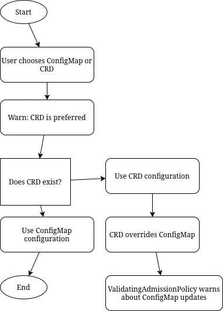

# CRD ClusterMonitoring

## Release Signoff Checklist

- [ ] Enhancement is `implementable`
- [ ] Design details are appropriately documented from clear requirements
- [ ] Test plan is defined
- [ ] Graduation criteria for dev preview, tech preview, GA
- [ ] User-facing documentation is created in [openshift-docs](https://github.com/openshift/openshift-docs/)

## Summary

* Currently, the OCP monitoring stacks are configured using ConfigMaps (1 for platform monitoring and 1 for user-defined monitoring). In OpenShift though the best practice is to configure operators using custom resources.


## Motivation

* The specification is well known and largely self-documenting.
* The Kubernetes API Server validates custom resources based on their API specification, so users get immediate feedback on errors instead of checking the ClusterOperator object and the cluster monitoring operator's logs. Common expressions language even allows to write complex validation logic, including cross-field tests.
* Many users expect to interact with operators through a CRD.
* Custom resources play better with GitOps workflows.
* CRDs supports multiple actors managing the same resource which is a key property for the Observability service of Advanced Cluster Management.

### User Stories

As a cluster administrator, I want to be able to add a CRD so that I can configure monitoring stack.
as a cluster administrator, I want to create a CR (possibly via gitops style systems) and observe the status of the created CR. Today this is spread over the config map and feedback via CMO status conditions and CMO logs.


### Goals

- Replace the existing ConfigMaps with CRDs.
- Automated and friction-less upgrade for users.

### Non-Goals

- Make things more complicated and easy to break.
- Change any behavior of monitoring stack

## Proposal

Currently in CMO, a config map provides a way to inject configuration data into pods. There are two configmaps for the different stacks:

    cluster-monitoring-config: Default platform monitoring components. A set of platform monitoring components are installed in the openshift-monitoring project by default during an OpenShift Container Platform installation. This provides monitoring for core cluster components including Kubernetes services. The default monitoring stack also enables remote health monitoring for clusters.

    user-workload-monitoring-config: Components for monitoring user-defined projects. After optionally enabling monitoring for user-defined projects, additional monitoring components are installed in the openshift-user-workload-monitoring project. This provides monitoring for user-defined projects. These components are illustrated in the User section in the following diagram.


Two distinct CRDs are necessary because they are managed by different personas with specific roles and responsibilities:

    - UWM admins: manage the configuration of the UWM components (edit permissions on the openshift-user-workload-monitoring/user-workload-monitoring-config ConfigMap).
    - Cluster admins: manage the configuration of the Platform monitoring components.

In managed OpenShift clusters like OSD/ROSA, two separate CRDs are necessary because platform SREs manage the cluster's platform monitoring stack, while customers manage the user-defined monitoring stack. This separation ensures that each group maintains control over their specific monitoring configurations, reducing conflicts and enhancing system management.

[More info](https://github.com/openshift/enhancements/blob/master/enhancements/monitoring/multi-tenant-alerting.md)


- Replace configmaps with CRD:

Current Config struct in CMO

```
  type Config struct {
	Images                               *Images `json:"-"`
	RemoteWrite                          bool    `json:"-"`
	CollectionProfilesFeatureGateEnabled bool    `json:"-"`

	ClusterMonitoringConfiguration *ClusterMonitoringConfiguration `json:"-"`
	UserWorkloadConfiguration      *UserWorkloadConfiguration      `json:"-"`
}
```

We will strive to maintain the previous structure as much as possible while adapting it to OpenShift API standards.

[Current ClusterMonitoringConfiguration struct:](
https://github.com/openshift/cluster-monitoring-operator/blob/eca25a9571d721a90f1b7f8d26931c679ae93aec/pkg/manifests/types.go#L36)
```
type ClusterMonitoringConfiguration struct {
	AlertmanagerMainConfig *AlertmanagerMainConfig `json:"alertmanagerMain,omitempty"`
	UserWorkloadEnabled *bool `json:"enableUserWorkload,omitempty"`
	HTTPConfig *HTTPConfig `json:"http,omitempty"`
	K8sPrometheusAdapter *K8sPrometheusAdapter `json:"k8sPrometheusAdapter,omitempty"`
	MetricsServerConfig *MetricsServerConfig `json:"metricsServer,omitempty"`
	KubeStateMetricsConfig *KubeStateMetricsConfig `json:"kubeStateMetrics,omitempty"`
	PrometheusK8sConfig *PrometheusK8sConfig `json:"prometheusK8s,omitempty"`
	PrometheusOperatorConfig *PrometheusOperatorConfig `json:"prometheusOperator,omitempty"`
	PrometheusOperatorAdmissionWebhookConfig *PrometheusOperatorAdmissionWebhookConfig `json:"prometheusOperatorAdmissionWebhook,omitempty"`
	OpenShiftMetricsConfig *OpenShiftStateMetricsConfig `json:"openshiftStateMetrics,omitempty"`
	TelemeterClientConfig *TelemeterClientConfig `json:"telemeterClient,omitempty"`
	ThanosQuerierConfig *ThanosQuerierConfig `json:"thanosQuerier,omitempty"`
	NodeExporterConfig NodeExporterConfig `json:"nodeExporter,omitempty"`
	MonitoringPluginConfig *MonitoringPluginConfig `json:"monitoringPlugin,omitempty"`
}
```


Each component within the ConfigMap will be migrated to the OpenShift API in separate PRs. This approach allows for a thorough review, improvement, and modification of each ConfigMap component to ensure it aligns with OpenShift API standards. As part of this process, types will be modified, outdated elements will be removed and names and configurations will be refined.


## Design Details

To initiate the process, let's establish a feature gate that will serve as the entry point for implementing a CRD configuration approach. This strategy enables us to make incremental advancements without the immediate burden of achieving complete feature equivalence with the config map. We can commence with the basics and progressively incorporate additional functionalities as they develop.

One proposal for a minimal DoD was:
- Feature gate in openshift/api
- API types moved to openshift/api
- Client-go codegen
- Reconcile logic: https://github.com/openshift/cluster-monitoring-operator/pull/2350
- Add merge ConfigMap / CustomResource for phase 1


### Configuration source and enablement

The `ClusterMonitoring` CRD is served as `v1alpha1` and is gated by the
`ClusterMonitoringConfig` FeatureGate.

Per-cluster activation is driven by the existence of the custom resource itself.
This is the steady-state behavior from phase 2 onward (see [Migration
path](#migration-path)); phase 1 instead merges the two sources by top-level key
with the ConfigMap taking precedence.

- If the `ClusterMonitoring` custom resource (named `cluster`, in the `openshift-monitoring`
  namespace) exists, CMO uses the custom resource as its configuration source.
- If the CR does not exist, CMO falls back to the `cluster-monitoring-config`
  ConfigMap.

There is no dedicated `configurationSource` field on the API to select between
the ConfigMap and the CRD. An enum field of that shape was considered and
rejected in [openshift/api#2938](https://github.com/openshift/api/pull/2938): we
do not want to ship an API knob that we intend to remove later, and the presence
of the CR is a cleaner signal of admin intent. Using an annotation on the
ConfigMap as the switch was also rejected (annotations should not be used as an
API).


### Example configuration


#### current ConfigMap

```
apiVersion: v1
kind: ConfigMap
metadata:
  name: cluster-monitoring-config
  namespace: openshift-monitoring
data:
  config.yaml: |
    telemeterClient:
      enabled: false
    prometheusK8s:
      volumeClaimTemplate:
        metadata:
          name: prometheus-data
          annotations:
            openshift.io/cluster-monitoring-drop-pvc: "yes"
        spec:
          resources:
            requests:
              storage: 20Gi
```

### CRD

```
apiVersion: clustermonitoring.config.openshift.io
kind: ClusterMonitoring
metadata:
  name: cluster
  namespace: openshift-monitoring
spec:
  prometheusK8s:
    volumeClaimTemplate:
      metadata:
        name: prometheus-data
        annotations:
          openshift.io/cluster-monitoring-drop-pvc: "yes"
      spec:
        resources:
          requests:
            storage: 20G
```


### Workflow Description

See example in the [Proposal](#Proposal) for details.

### API Extensions

Add two new CRD's:
- ClusterMonitoring
- UserWorkloadClusterMonitoring

### Topology Considerations

Will function identically in all topologies.

#### Hypershift / Hosted Control Planes

For hosted control planes the current direction is to hand off CMO completely to the cluster admin Persona. In that scenario the monitoring config would live solely within the guest cluster. Still Hypershift has an API knob within the HostedCluster for openshift/api targeted types. If desired at any time, the new monitoring config could be exposed there and reconciled down to the guest cluster.

#### Standalone Clusters
No special considerations.

#### Single-node Deployments or MicroShift
No special considerations.

### Implementation Details/Notes/Constraints


### Migration path

The migration is split into five phases. The first two happen while the feature
is in Tech Preview (TP); the last two happen once the feature is GA. Each phase
narrows the gap between "ConfigMap is the source of truth" and "the CR is the
only source of truth", always leaving admins an escape hatch until the final GA
phase.

- Phase 1 [TP]: Merge CR and ConfigMap by top-level keys
  - In this phase only developers are expected to use the CR, and both the
    ConfigMap and the CR coexist. The feature is gated by the
    `ClusterMonitoringConfig` FeatureGate.
  - The two sources are merged at the top-level fields, and the ConfigMap takes
    precedence over the CR.
  - Behavior: if a top-level field exists in the ConfigMap, that value is used
    and the CR value for that field is ignored; if the field is absent from the
    ConfigMap, the CR value is used.
  - Merge process (phase 1 only): for each top-level field (e.g.
    `AlertmanagerMainConfig` in the ConfigMap vs. `spec.alertmanagerMain` in the
    CR), if the field is nil in the ConfigMap, use the CR; otherwise, use the
    ConfigMap.

- Phase 2 [TP]: Introduce CR-over-ConfigMap preference
  - The merge process is dropped. The configuration source is selected solely by
    the existence of the custom resource.
  - If the `ClusterMonitoring` custom resource exists, CMO uses it and ignores
    the ConfigMap. If the custom resource does not exist, CMO uses the ConfigMap.
  - Admins opt in by creating the CR and opt out by deleting it.
  - Dual support is kept for at least 2 ELC releases.

    

- Phase 3: Graduate the feature and deprecate the ConfigMap
  - The feature graduates to GA and the `cluster-monitoring-config` ConfigMap is
    formally deprecated. The CR becomes the recommended configuration source.
  - CR existence continues to select the source; the ConfigMap keeps working so
    this phase does not strand any cluster.
  - Deprecation steps:
    - Documentation and release notes warn users about the upcoming change.
    - A deprecation **alerting rule** fires at `info` severity when a cluster is
      still configured through the `cluster-monitoring-config` ConfigMap, pointing
      admins to the migration docs. It escalates to `warning` severity in phase 4,
      when the migration starts blocking upgrades.
    - Cluster Fleet Evaluation / telemetry is used to track how many clusters
      already use the CR instead of the ConfigMap.

- Phase 4 [GA]: Block upgrade when the CR does not exist
  - CMO sets `Upgradeable=false` when a cluster is still configured through the
    ConfigMap (i.e. no `ClusterMonitoring` CR exists), preventing the cluster
    from upgrading past this release until the admin has migrated.
  - This is the point of no return for the escape hatch, so it must not land
    before clusters have had a full deprecation window to react (see
    [ELC and skip-level updates](#elc-and-skip-level-updates)).

- Phase 5 [GA]: Remove ConfigMap support
  - CMO no longer reads the `cluster-monitoring-config` ConfigMap. The
    `ClusterMonitoring` CR is the only supported configuration source.

#### ELC and skip-level updates

The migration must account for the EUS lifecycle (ELC) and skip-level / EUS-to-EUS
upgrades, where a cluster can jump across several releases in a single upgrade
path. Phases that remove an escape hatch must be spread far enough apart that a
cluster upgrading across EUS boundaries always lands on at least one release
where the ConfigMap still works and is only being warned about, before reaching a
release that blocks the upgrade.

Concretely, the transition from phase 3 (deprecation + alert) to phase 4 (block
upgrade when the CR is missing) should span **at least 2 ELC releases**, so that
no skip-level upgrader is blocked without having first seen a release that
surfaced the deprecation warning. The same reasoning applies before phase 5
removes ConfigMap support entirely.

#### Migration tool

To help admins move off the ConfigMap, phase 3 will ship a migration tool
(delivery form to be decided). The tool reads an existing
`cluster-monitoring-config` ConfigMap and prints the equivalent
`ClusterMonitoring` YAML manifest for the admin to review and apply. It is
output-only and does not apply the resource directly. The tool is a best-effort
aid scoped to basic/common configurations; it will not cover all corner cases,
which admins are expected to translate manually.

Beyond generating the manifest, the tool and workflow give admins confidence the
migration will run cleanly before they switch sources:

- **Client-side / dry-run validation**: the generated CR can be validated against
  the API server without persisting it (`oc apply --dry-run=server`), so schema
  and CEL validation run and surface problems before the CR is created.
- **Coverage report**: the tool reports any ConfigMap fields it could not
  translate, so unsupported or corner-case settings are flagged explicitly
  instead of being silently dropped.
- **Safe trial with rollback**: because the source is selected by CR existence,
  admins can create the CR, confirm CMO reconciles cleanly (the
  `monitoring` ClusterOperator stays `Available` with no new `Degraded`
  conditions), and fall back by deleting the CR if anything looks wrong (see
  [Risks and Mitigations](#risks-and-mitigations)).

- Extensive testing will be required to validate the new behavior.
- Some fields in CRD and ConfigMap diverge due to API requirements. Helper functions will be needed to resolve this.

### Risks and Mitigations

- Issues when ConfigMap and CRD are merged in a single structure (phase 1 only), which could be error prone and requires extensive testing. From phase 2 onward the sources are no longer merged (CR existence selects the source), so this risk is limited to phase 1.
- Mismatch in the configuration of operators with ConfigMap and CR
- Migration may not always be smooth, given that almost all clusters already
  have a `cluster-monitoring-config` ConfigMap. Admins need a reliable escape
  hatch to fall back to the ConfigMap. Since the switch is CR existence, the
  rollback path is to back up and delete the CR:

  ```
  oc get clustermonitoring/cluster -o yaml -n openshift-monitoring > clustermonitoring-backup.yaml
  oc delete clustermonitoring/cluster -n openshift-monitoring
  ```

  CMO then falls back to the ConfigMap. Re-applying the backup returns to CRD
  mode. We deliberately do not use an annotation on the ConfigMap as a switch
  (annotations should not be used as an API).

### Drawbacks

- Migration. The user can use either ConfigMap or CRD, or both; we need to explain how to make the transition, and the preference is to use the CRD.
- Coexisting of both ConfigMap and CRD.


## Test Plan

- Unit tests for the feature
- e2e tests covering the feature
- Upgrade testing
- FeatureGate

### Open questions

- Merging CRD and ConfigMap could be error prone and will need extra tests (phase 1 only; from phase 2 onward the sources are not merged)
- How do we tell cluster admins that they need to migrate? CMO conditions could be an option as well as alerting and Insights?- How do we know how many clusters have migrated to the new CRD? Telemetry?

## Graduation Criteria

From Tech Preview to GA

### Dev Preview -> Tech Preview

### Tech Preview -> GA

- Tech Preview was available for at least one release
- High severity bugs are fixed
- Reliable CI signal, minimal test flakes.
- e2e tests are in place

### Removing a deprecated feature

## Upgrade / Downgrade Strategy

Feature will not affect standard upgrade or downgrade process of the cluster.

## Version Skew Strategy

The configuration source is resolved entirely within CMO on a single cluster, so
there is no cross-component version skew to coordinate. The main
version-sensitive concern is the migration schedule across releases: phases that
remove the ConfigMap escape hatch (phase 4 blocking upgrades, phase 5 removing
ConfigMap support) must be spaced to survive skip-level and EUS-to-EUS upgrades.
See [ELC and skip-level updates](#elc-and-skip-level-updates).

## Implementation History

- API types for `ClusterMonitoring` landed in openshift/api as `v1alpha1`,
  gated by the `ClusterMonitoringConfig` FeatureGate.
- [openshift/api#2938](https://github.com/openshift/api/pull/2938) proposed a
  `configurationSource` enum field to select between the ConfigMap and the CRD.
  It was closed in November 2026 after a team decision: the configuration source
  is instead driven by the existence of the CR.

## Operational Aspects of API Extensions

## Support Procedures

## Alternatives (Not Implemented)
