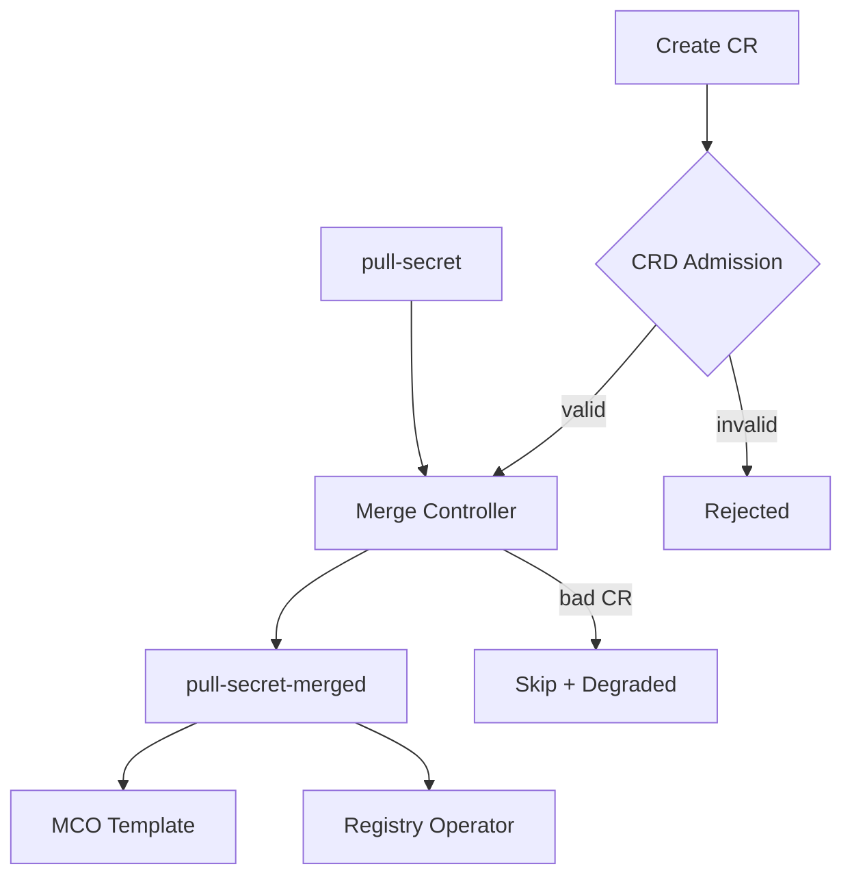

# Multi-Secret Global Pull Configuration

## Summary

OpenShift manages global container registry credentials through a single Secret, `openshift-config/pull-secret`. Administrators must download, decode, and hand-edit this file to add a registry, risking corruption of installer-provided credentials and breaking GitOps workflows. This proposal introduces a new cluster-scoped CRD, `GlobalPullCredential` (`config.openshift.io/v1alpha1`), that provides a structured, declarative API for adding registry credentials. Each instance represents exactly one registry hostname with structured `username` and `password` fields. Duplicate hostnames across `GlobalPullCredential` instances are rejected — each hostname may only be claimed by one CR. A controller in MCO's `machine-config-controller` watches all `GlobalPullCredential` instances, validates them, merges their auth entries with the existing `pull-secret`, and writes the merged result to a persistent controller-owned Secret `openshift-config/pull-secret-merged`. The original `pull-secret` is never modified and always serves as the baseline. When the feature gate is enabled, `pull-secret-merged` is always present — it reflects the merged content when CRs exist, or a copy of `pull-secret` when no CRs are active. Existing consumers (MCO template controller, `cluster-image-registry-operator`) are updated to read from `pull-secret-merged`; fallback to `pull-secret` is used only during version skew when the feature gate is disabled.

## Motivation

Enterprise and GitOps-managed clusters need to add or revoke registry credentials independently, without a single shared file forcing every change through one risky manual edit. A bad edit today can wipe Red Hat baseline credentials and degrade the whole cluster.

### User Stories

As a cluster administrator, I want to add credentials for a new private registry by creating a `GlobalPullCredential` resource, so that I never have to hand-edit `pull-secret`.

As a GitOps/SRE engineer, I want to manage registry credentials declaratively as independent cluster-scoped objects, so that one bad change does not affect unrelated registries.

As a cluster administrator, I want immediate feedback when I create an invalid pull credential, so that I don't have to search controller logs to discover problems.

### Goals

- Eliminate manual edits to `pull-secret` for adding modular registry credentials.
- Provide a structured, cluster-scoped API (`GlobalPullCredential`) with admission-time validation.
- Deterministic merge and validation with cross-CR hostname uniqueness enforcement.
- Safe create/update/delete lifecycle for `GlobalPullCredential` instances.
- Malformed input never overwrites a working effective configuration (last-known-good).
- Original `pull-secret` is never modified by the controller; merged output is a separate Secret.

### Non-Goals

- Namespace-scoped `imagePullSecrets` / pod-level credential injection.
- External vault integration (Vault, CyberArk).
- Automated migration off the existing manual-edit workflow.
- Console UI components (status contract only).
- Replacing HyperShift's existing `kube-system/additional-pull-secret` sync model.
- Deprecating the existing `openshift-config/pull-secret` in this release. Long-term, controllers may read `GlobalPullCredential` directly, potentially eliminating the intermediate Secret; that is out of scope for this proposal.

## Proposal

### Workflow Description

1. An administrator creates a `GlobalPullCredential` cluster-scoped resource specifying a single registry hostname with username and password.
2. The CRD schema validates the resource at admission time — malformed objects (missing hostname or missing auth) are rejected by the API server before any controller acts on them.
3. The merge controller (inside MCO's `machine-config-controller`) watches all `GlobalPullCredential` instances and `openshift-config/pull-secret`. On any create, update, or delete it reads the current `openshift-config/pull-secret` as the baseline and lists all `GlobalPullCredential` instances.
4. The controller validates each CR and enforces cross-CR hostname uniqueness — if two CRs claim the same hostname, the duplicate is marked `Degraded` and skipped. Baseline (original `pull-secret` content) always wins for a given registry hostname; a CR whose hostname overlaps with the baseline is accepted but its credential is not merged, and the overlap is reported in the CR's status.
5. The merged result is written to the persistent controller-owned Secret `openshift-config/pull-secret-merged`. The original `pull-secret` is never modified. If any `GlobalPullCredential` has a hostname conflict with another CR, the duplicate is skipped and marked `Degraded`; valid CRs are still merged and written. The `ClusterOperator machine-config` is set `Degraded` if any CR has a conflict.
6. Consumers (MCO template controller, `cluster-image-registry-operator`) read from `pull-secret-merged`. When the feature gate is enabled, `pull-secret-merged` is always present — it contains the merged output when CRs exist, or a copy of `pull-secret` when no CRs are active. Fallback to reading `pull-secret` directly is used only during version skew when the feature gate is disabled on the control plane.



### API Extensions

This proposal introduces one new CRD:

**`GlobalPullCredential`** — a cluster-scoped resource in the `config.openshift.io` API group.

```go
// GlobalPullCredential is a cluster-scoped resource for declaring a single
// registry credential to merge into the cluster pull configuration. Each
// instance represents exactly one registry hostname.
// +genclient
// +genclient:nonNamespaced
// +k8s:deepcopy-gen:interfaces=k8s.io/apimachinery/pkg/runtime.Object
// +openshift:compatibility-gen:level=4
type GlobalPullCredential struct {
    metav1.TypeMeta   `json:",inline"`
    metav1.ObjectMeta `json:"metadata,omitempty"`

    // +required
    Spec GlobalPullCredentialSpec `json:"spec"`
    // +optional
    Status GlobalPullCredentialStatus `json:"status,omitempty"`
}

type GlobalPullCredentialSpec struct {
    // hostname is the registry host that this credential applies to, for
    // example "quay.io" or "registry.example.com:5000". Each hostname may
    // only be claimed by one GlobalPullCredential instance across the cluster.
    // +required
    // +kubebuilder:validation:MinLength=1
    // +kubebuilder:validation:MaxLength=253
    // +kubebuilder:validation:Pattern=`^[a-zA-Z0-9]([a-zA-Z0-9.-]*[a-zA-Z0-9])?(:[0-9]+)?$`
    Hostname string `json:"hostname"`

    // auth holds the registry credential for this hostname.
    // +required
    Auth RegistryAuth `json:"auth"`
}

// RegistryAuth holds the username and password for a single registry.
// The controller constructs the base64-encoded Docker config.json auth
// string (base64("username:password")) from these fields at reconcile time.
type RegistryAuth struct {
    // username is the registry username.
    // +required
    // +kubebuilder:validation:MinLength=1
    Username string `json:"username"`

    // password is the registry password or token.
    // +required
    // +kubebuilder:validation:MinLength=1
    Password string `json:"password"`
}

type GlobalPullCredentialStatus struct {
    // conditions represent the latest available observations of this resource's
    // state. Known condition types are "Applied" and "Degraded".
    // +optional
    // +listType=map
    // +listMapKey=type
    Conditions []metav1.Condition `json:"conditions,omitempty"`
}
```

Example `GlobalPullCredential` instances (one per registry):

```yaml
apiVersion: config.openshift.io/v1alpha1
kind: GlobalPullCredential
metadata:
  name: team-a-quay
spec:
  hostname: quay.io
  auth:
    username: user
    password: pass
---
apiVersion: config.openshift.io/v1alpha1
kind: GlobalPullCredential
metadata:
  name: team-a-example-registry
spec:
  hostname: registry.example.com:5000
  auth:
    username: robot
    password: s3cret-token
```

The CRD schema enforces at admission time:

- `spec.hostname` is required (non-empty, valid hostname or host:port pattern, max 253 characters).
- `spec.auth.username` is required (non-empty).
- `spec.auth.password` is required (non-empty).

Because all field-level validation is handled at admission time, presence of a `GlobalPullCredential` resource means its contents are valid — invalid resources are rejected before the controller ever sees them.

The controller constructs the base64-encoded Docker config.json `auth` string (`base64("username:password")`) from the structured fields at reconcile time and writes it into the merged output Secret. Administrators never need to manually base64-encode credentials.

Cross-CR hostname uniqueness is enforced by the controller at reconcile time — the CRD schema does not prevent two CRs from declaring the same hostname, but the controller detects the conflict and marks the duplicate CR `Degraded`.

**Status conditions:** The controller sets two condition types on each `GlobalPullCredential` instance:

- `Applied=True`: The CR's credential was successfully included in `pull-secret-merged`. If the CR's hostname overlaps with the baseline `pull-secret`, the condition message notes that the baseline credential is used instead.
- `Degraded=True`: The CR's hostname is already claimed by another `GlobalPullCredential` instance (cross-CR conflict). This is the only runtime validation that cannot be enforced at admission time, since it requires cross-object comparison.

A `Degraded` CR is skipped during the merge; other valid CRs are still processed. If any CR is `Degraded`, the `ClusterOperator machine-config` is also set `Degraded`.

The `GlobalPullCredential` CRD is gated behind the `MultiSecretGlobalPullConfig` feature gate. When the gate is disabled, the CRD definition exists but the controller does not reconcile.

### Topology Considerations

#### Hypershift / Hosted Control Planes

Where the merge controller runs in Hosted Control Planes and how it aligns with HyperShift's `kube-system/additional-pull-secret` model is not defined in this proposal. The CRD and controller are designed for standalone clusters; HyperShift integration is deferred to a follow-up enhancement if needed.

#### Standalone Clusters

Primary topology. `GlobalPullCredential` instances are merged with `openshift-config/pull-secret` content and the result is written to the persistent `openshift-config/pull-secret-merged` by the controller inside `machine-config-controller`. Consumers read from `pull-secret-merged` when the feature gate is enabled.

#### Single-node Deployments or MicroShift

SNO uses the same control-plane reconcile path as multi-node. MicroShift is out of scope for MVP.

#### OpenShift Kubernetes Engine

Uses the same global pull-secret model as standalone OCP; no OKE-specific exclusion identified for MVP.

### Implementation Details/Notes/Constraints

The merge controller runs inside `machine-config-controller` as a new reconcile loop. The Node team owns the CRD definition, merge logic, validation, and controller correctness; the MCO team owns propagation of merged content to nodes and consumer coordination.

The controller watches all `GlobalPullCredential` cluster-scoped instances and `openshift-config/pull-secret`. On any change it runs the reconcile described below.

**Separate rendered Secret:**

The controller writes the merged output to a **persistent** Secret `openshift-config/pull-secret-merged` of type `kubernetes.io/dockerconfigjson`, labeled `machineconfiguration.openshift.io/managed-by: global-pull-credential-controller` to indicate controller ownership. The original `openshift-config/pull-secret` is **never modified** — it always serves as the baseline. This design eliminates the baseline persistence problem entirely: because `pull-secret` is never written to, the controller can always read the true installer/administrator-provided credentials fresh on every reconcile. There is no need for an annotation, snapshot, or any other baseline storage mechanism.

When the feature gate is enabled, `pull-secret-merged` is **always present**. When `GlobalPullCredential` instances exist, it contains the merged output. When all `GlobalPullCredential` instances are deleted, the controller updates `pull-secret-merged` to be a copy of `pull-secret` — it is not deleted. This persistent design ensures consumers always have a single, reliable source of truth without fallback logic when the feature gate is active.

Direct edits to `pull-secret-merged` are not supported — the controller overwrites this Secret on every reconcile, and any manual changes will be silently lost. The controller uses server-side apply with a dedicated field manager to establish ownership over `pull-secret-merged`, providing Kubernetes-native conflict detection. The `managed-by` label provides additional informational signaling. Users should create or update `GlobalPullCredential` resources instead.

**Consumer coordination:**

The following consumers must be updated to read from `pull-secret-merged` when it exists, falling back to `pull-secret` otherwise:

- **MCO template controller** (`machine-config-operator` `pkg/controller/template/template_controller.go`): Reads `openshift-config/pull-secret` to render node pull configuration. Must be updated to prefer `pull-secret-merged` if present.
- **`cluster-image-registry-operator`**: Copies `pull-secret` by name into `openshift-image-registry/installation-pull-secrets`. Must be updated to prefer `pull-secret-merged` if present.

This consumer coordination is within scope of this proposal. Both changes are small (check for existence of `pull-secret-merged`, read it instead of `pull-secret`). Because `pull-secret-merged` is persistent when the feature gate is enabled, consumers always have a single source of truth and do not need fallback logic during normal operation. The fallback to `pull-secret` exists only as a transitional mechanism for version skew during upgrades (when the feature gate is disabled on the control plane); it may be removed post-GA.

**Reconcile algorithm:**

1. Read `openshift-config/pull-secret` as the baseline (always fresh, never cached).
2. List all `GlobalPullCredential` instances. If none exist, write `pull-secret-merged` as a copy of `pull-secret` (persistent Secret) and return.
3. Check for duplicate hostnames across CRs. If two or more CRs claim the same hostname, the CR with the earliest `.metadata.creationTimestamp` owns it; later CRs are marked `Degraded` with a message identifying the conflicting CR. Duplicate CRs are skipped; valid CRs proceed. If any CR is `Degraded`, set `ClusterOperator machine-config` `Degraded` condition. Field-level validation (non-empty hostname, username, password) is already enforced at admission time, so every CR that exists is structurally valid.
4. Build the effective `auths` map starting from the baseline `auths` entries (read-only, never overridden). Then iterate valid CRs. For each CR's hostname:
   - If the hostname exists in the baseline, **skip** — baseline always wins. Set `Applied=True` on the CR with a message noting the baseline overlap.
   - Otherwise, construct the Docker config.json `auth` value (`base64("username:password")`) from the CR's structured fields, add it to the effective map, and set `Applied=True`.
5. Preserve any non-`auths` top-level keys from the baseline (e.g. `HttpHeaders`).
6. Serialize the complete output as canonical JSON with stable ordering for all object keys and stable whitespace, to guarantee byte-identical output for equivalent inputs.
7. Write to `openshift-config/pull-secret-merged` only if the serialized content differs from the current value.

**Example:** `pull-secret` baseline has `registry.redhat.io`. CR `team-a-quay` (hostname: `quay.io`) and CR `team-b-ghcr` (hostname: `ghcr.io`) are created. The controller adds `quay.io` from `team-a-quay` and `ghcr.io` from `team-b-ghcr` to the merged map. `registry.redhat.io` remains from the baseline. Both CRs are set `Applied=True`. If a third CR `team-c-quay` is created with hostname `quay.io`, it conflicts with `team-a-quay` — the controller marks `team-c-quay` as `Degraded` (hostname already claimed by `team-a-quay`). If `team-a-quay` is deleted, next reconcile: `quay.io` is removed from `pull-secret-merged` and `team-c-quay` is now the sole claimer, transitions to `Applied=True`. If all CRs are deleted, `pull-secret-merged` is updated to a copy of `pull-secret`.

When the feature gate is **off**, the controller does not start — no watching, no merging, no writing. `GlobalPullCredential` resources may exist but are inert.

**MCO node update behavior:** Today, the MCO operator sets `ControllerConfig.Spec.PullSecret` to reference `openshift-config/pull-secret`, and the template controller reads that Secret to render `/var/lib/kubelet/config.json` into a `MachineConfig`. This reference is not changed by this feature. Instead, the template controller is updated to check for `openshift-config/pull-secret-merged` first — if it exists, use its content; otherwise fall back to `pull-secret`. When `pull-secret-merged` is created or updated, the template controller re-renders the `MachineConfig` and MCD applies it as a **non-reboot** update — nodes pick up the new credentials without a drain or reboot cycle.

### Risks and Mitigations

- **Sensitive data in a CRD:** `GlobalPullCredential` stores registry credentials (username and password) in spec fields rather than a Kubernetes Secret. The password is stored as a plain string in the CRD spec; the controller constructs the base64-encoded Docker config.json auth string at reconcile time. By default, only cluster-admins have access to new CRDs. The etcd encryption controller must be updated to include `GlobalPullCredential` in its encrypted resources list, ensuring credentials are protected at rest without requiring manual administrator action. The API is documented as security-sensitive. RBAC must be configured carefully if non-admin access is ever granted.
- **Consumer coordination:** MCO template controller and `cluster-image-registry-operator` must be updated to read from `pull-secret-merged`. Both changes are small (prefer new Secret, fall back to original). Until all consumers are updated, the merged credentials are not propagated to that consumer. The fallback-to-`pull-secret` path exists only for version skew during upgrades; during normal operation `pull-secret-merged` is always present when the feature gate is enabled.
- **Controller-vs-manual-edit isolation:** The controller never modifies `pull-secret`. Administrators can continue editing `pull-secret` via `oc` at any time; those changes are picked up on the next reconcile and included in the merged output. There is no mutual exclusivity between manual edits and CR-based credentials.
- **Ownership boundary:** The Node team owns the CRD, merge logic, validation, and controller correctness. The MCO team owns ensuring that merged content is propagated to nodes and that consumer coordination changes land.
- **Blast-radius shift:** A controller defect can affect cluster-wide pulls; mitigations include admission-time validation, skip-invalid-and-continue, last-known-good retention on `pull-secret-merged`, CO Degraded conditions, and disabling the feature gate.

### Drawbacks

- Introduces a new cluster-scoped CRD and a new Secret (`pull-secret-merged`), adding API surface and operational complexity.
- Registry credentials in a CRD rather than a Secret may be perceived as less secure, though access control is equivalent (cluster-admin by default) and the credentials use the same username/password pairing as Docker config.json and the existing `pull-secret`.
- Requires coordinated changes in MCO template controller and `cluster-image-registry-operator` to read from the new Secret.

## Alternatives (Not Implemented)

### Labeled Secrets (original proposal)

The original design used labeled `kubernetes.io/dockerconfigjson` Secrets in `openshift-config` as modular inputs, with a controller merging them into `pull-secret` in place. This required no new CRD.

This was rejected based on arch and API review feedback during the enhancement review process:

- **No admission-time validation:** Invalid Secrets would only manifest as controller logs or events — opaque to administrators and easy to miss.
- **Baseline persistence problem:** Merging into `pull-secret` in place required the controller to capture and persist a baseline snapshot of the original content. On controller restart, if the snapshot was lost, the already-merged `pull-secret` would be incorrectly treated as baseline, permanently baking in stale modular entries.
- **History loss:** If a contributing Secret was deleted after merge and before the baseline could be reconstructed, the controller could not distinguish which entries came from modular Secrets vs the original installer credentials.

A structured CRD with a separate rendered output Secret avoids all three problems.

### Merge-in-place (write back to `pull-secret`)

Writing the merged result directly back into `openshift-config/pull-secret` instead of a separate Secret.

This was considered because it requires no consumer changes — MCO and `cluster-image-registry-operator` already read `pull-secret` by name. However, it introduces a fragile baseline problem: the controller must capture and persist the original `pull-secret` content before its first write, and any annotation or snapshot mechanism used for this is vulnerable to tampering, data loss, or stale state on controller restart. The separate rendered Secret approach eliminates this problem by design — `pull-secret` is always the untouched baseline.

### Multi-registry list per CR

An earlier iteration of this proposal used a `registries` list field in each `GlobalPullCredential` spec, allowing multiple hostname/auth entries per CR. This was changed to one-per-CR (each instance represents exactly one hostname) based on API review feedback: a list combined with multiple instances creates ambiguity about why entries are grouped, complicates cross-CR hostname conflict resolution, and does not provide a meaningful advantage over creating separate CR instances. The one-per-CR model is simpler, makes ownership per hostname unambiguous, and enables straightforward cross-CR hostname uniqueness enforcement.

### CRD with Secret reference

A CRD where each instance references a Kubernetes Secret containing the actual credentials, rather than embedding them in the CRD spec.

This was rejected because it does not provide stronger admission-time validation — the Secret payload remains an unstructured blob validated only post-admission by the controller. It adds an extra object per credential without meaningful UX improvement.

## Test Plan

Unit and integration tests validate:

- CRD admission validation (schema enforcement for required `hostname`, `auth.username`, and `auth.password` fields, hostname pattern, non-empty values). Invalid resources are rejected at admission — they never reach the controller.
- Cross-CR hostname uniqueness: two CRs with the same hostname → later CR marked `Degraded`, earlier CR's credential used.
- Merge algorithm: baseline wins over CR hostnames, auth values passed through to merged output, deterministic byte-stable canonical JSON output.
- Persistent rendered Secret: `pull-secret-merged` created when gate is enabled; updated to copy of `pull-secret` when all CRs removed (not deleted).
- Baseline integrity: `pull-secret` is never modified by the controller.
- Create/update/delete lifecycle: adding a CR adds its hostname to `pull-secret-merged`, updating changes the auth, deleting removes the hostname.
- Duplicate CR handling: cross-CR hostname conflict → duplicate CR skipped and marked `Degraded`, other valid CRs still merged, CO Degraded set.
- Feature gate disabled: controller does not start, no `pull-secret-merged` created.
- Diff-before-write: no-op update when merged output equals current `pull-secret-merged`.
- Controller restart: `pull-secret` baseline is always fresh; no stale entries.
- Consumer fallback: when `pull-secret-merged` does not exist (feature gate disabled), consumers read `pull-secret`.
- Baseline overlap signaling: CR whose hostname matches baseline is `Applied=True` with a message noting the overlap.

End-to-end tests on a multi-node cluster with a private test registry validate:

- `GlobalPullCredential` create → hostname's credential appears in node `/var/lib/kubelet/config.json`.
- `GlobalPullCredential` delete → hostname's credential removed from node `config.json`.
- All CRs deleted → `pull-secret-merged` reverts to copy of `pull-secret`, nodes use original baseline content.
- Duplicate hostname across CRs → later CR marked `Degraded`, earlier CR's credential used.
- Invalid CR (missing fields) → rejected at admission time, never reaches controller.
- Feature gate toggle behavior.

## Graduation Criteria

### Dev Preview -> Tech Preview

- CRD defined in `config.openshift.io/v1alpha1` behind `MultiSecretGlobalPullConfig` feature gate.
- End-to-end CR-to-node-pull flow working via `pull-secret-merged`.
- Consumer changes landed in MCO template controller and `cluster-image-registry-operator`.
- Unit and integration coverage for merge, conflict, baseline integrity, and last-known-good.
- No impact when feature gate is disabled.

### Tech Preview -> GA

- CRD promoted to `config.openshift.io/v1`.
- Consumer behavior confirmed with owning teams (MCO, builds, registry).
- Blast-radius mitigations tested (invalid CR, controller restart, feature gate disable).
- Upgrade/downgrade tested.
- User-facing documentation in openshift-docs.

### Removing a deprecated feature

N/A

## Upgrade / Downgrade Strategy

On upgrade to a version with this feature, the controller starts and creates `pull-secret-merged` as a copy of `pull-secret` (even if no `GlobalPullCredential` instances exist). Consumers on the new version read from `pull-secret-merged`. Existing `pull-secret` content is unchanged.

On downgrade to a version without this feature, `GlobalPullCredential` CRD instances remain in etcd as orphaned resources. The `pull-secret-merged` Secret persists but is no longer updated. Consumers in the older version read `pull-secret` (they do not know about `pull-secret-merged`), so behavior reverts to pre-feature state. Administrators should delete all `GlobalPullCredential` instances and the `pull-secret-merged` Secret before downgrading to clean up orphaned resources.

## Version Skew Strategy

Not applicable for MVP — control-plane-only reconciliation. Nodes continue to consume pull credentials through MCO as today. The `GlobalPullCredential` CRD and controller exist only on the control plane; no node-side component is introduced. During upgrade, if MCO template controller is updated before `cluster-image-registry-operator`, node pulls use merged credentials while image-registry still uses original `pull-secret` until it is updated.

## Operational Aspects of API Extensions

The `GlobalPullCredential` CRD introduces a cluster-scoped resource with the following operational characteristics:

- **Expected scale:** Tens of instances per cluster (one per registry hostname). Does not impact general API throughput.
- **Controller health:** The merge controller reports status via `ClusterOperator machine-config` conditions. `Degraded` is set when any `GlobalPullCredential` fails controller-level validation.
- **Failure modes:**
  - Controller not running (pod crash/restart): `pull-secret-merged` retains last-known-good content. `pull-secret` is unchanged. No new CR changes are reconciled until the controller restarts.
  - Duplicate hostname conflict: CR with a conflicting hostname is skipped and marked `Degraded`; other valid CRs are still merged and written to `pull-secret-merged`; CO Degraded is set.
  - RBAC misconfiguration: Non-admin users creating `GlobalPullCredential` resources could inject registry credentials cluster-wide. No custom ClusterRole is defined; this relies on existing OpenShift RBAC where cluster-admins have full access to all CRDs by default.
- **Escalation teams:** Node team (CRD/controller issues), MCO team (propagation to nodes, consumer coordination).

## Support Procedures

- **Detect:** Check `ClusterOperator machine-config` for `Degraded` condition. Check `GlobalPullCredential` status conditions: `oc get globalpullcredentials -o yaml`. Review `machine-config-controller` logs for `GlobalPullSecret` prefixed messages.
- **Recover:** Fix or delete the invalid `GlobalPullCredential` instance; controller re-reconciles automatically. Verify merged content: `oc get secret pull-secret-merged -n openshift-config -o jsonpath='{.data.\.dockerconfigjson}' | base64 -d | jq .auths`. Verify baseline is intact: `oc get secret pull-secret -n openshift-config -o jsonpath='{.data.\.dockerconfigjson}' | base64 -d | jq .auths`.
- **Disable:** Turn off the `MultiSecretGlobalPullConfig` feature gate; controller stops reconciling; `pull-secret-merged` retains last content but consumers on older code fall back to `pull-secret`. To fully clean up, delete all `GlobalPullCredential` instances and the `pull-secret-merged` Secret, then disable the gate.
