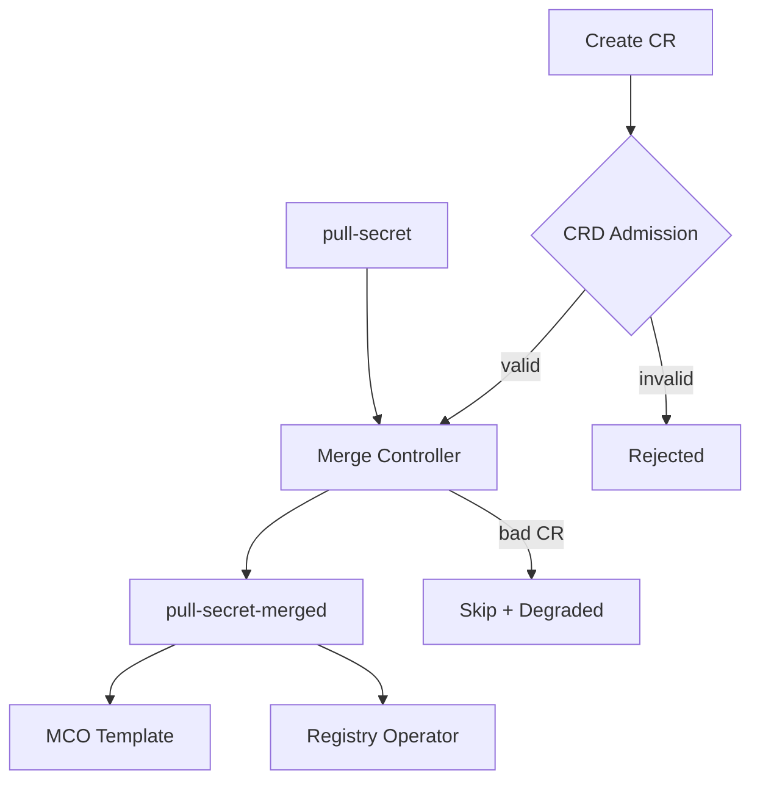

# Multi-Secret Global Pull Configuration

## Summary

OpenShift manages global container registry credentials through a single Secret, `openshift-config/pull-secret`. Administrators must download, decode, and hand-edit this file to add a registry, risking corruption of installer-provided credentials and breaking GitOps workflows. This proposal introduces a new cluster-scoped CRD, `GlobalPullCredential` (`config.openshift.io/v1alpha1`), that provides a structured, declarative API for adding registry credentials. Each credential entry specifies a registry hostname and a base64-encoded `auth` field matching the Docker config.json convention (`base64("username:password")`). A controller in MCO's `machine-config-controller` watches all `GlobalPullCredential` instances, validates them at admission time through CRD schema enforcement, merges their auth entries with the existing `pull-secret`, and writes the merged result to a new controller-owned Secret `openshift-config/pull-secret-merged`. The original `pull-secret` is never modified and always serves as the baseline; among `GlobalPullCredential` instances, merge order is determined lexicographically by object name. Existing consumers (MCO template controller, `cluster-image-registry-operator`) are updated to read from `pull-secret-merged` when it exists, falling back to `pull-secret` otherwise.

## Motivation

Enterprise and GitOps-managed clusters need to add or revoke registry credentials independently, without a single shared file forcing every change through one risky manual edit. A bad edit today can wipe Red Hat baseline credentials and degrade the whole cluster.

### User Stories

As a cluster administrator, I want to add credentials for a new private registry by creating a `GlobalPullCredential` resource, so that I never have to hand-edit `pull-secret`.

As a GitOps/SRE engineer, I want to manage registry credentials declaratively as independent cluster-scoped objects, so that one bad change does not affect unrelated registries.

As a cluster administrator, I want immediate feedback when I create an invalid pull credential, so that I don't have to search controller logs to discover problems.

### Goals

- Eliminate manual edits to `pull-secret` for adding modular registry credentials.
- Provide a structured, cluster-scoped API (`GlobalPullCredential`) with admission-time validation.
- Deterministic merge, validation, and conflict resolution.
- Safe create/update/delete lifecycle for `GlobalPullCredential` instances.
- Malformed input never overwrites a working effective configuration (last-known-good).
- Original `pull-secret` is never modified by the controller; merged output is a separate Secret.

### Non-Goals

- Namespace-scoped `imagePullSecrets` / pod-level credential injection.
- External vault integration (Vault, CyberArk).
- Automated migration off the existing manual-edit workflow.
- Console UI components (status contract only).
- Replacing HyperShift's existing `kube-system/additional-pull-secret` sync model.
- Deprecating the existing `openshift-config/pull-secret` in this release. Long-term, controllers may read `GlobalPullCredential` directly, potentially eliminating the intermediate Secret; that is out of scope for this proposal.

## Proposal

### Workflow Description

1. An administrator creates a `GlobalPullCredential` cluster-scoped resource defining one or more registry credentials with structured fields (hostname and base64-encoded auth).
2. The CRD schema validates the resource at admission time — malformed objects (missing hostname or missing auth) are rejected by the API server before any controller acts on them.
3. The merge controller (inside MCO's `machine-config-controller`) watches all `GlobalPullCredential` instances and `openshift-config/pull-secret`. On any create, update, or delete it reads the current `openshift-config/pull-secret` as the baseline and lists all valid `GlobalPullCredential` instances.
4. The controller merges the baseline with all `GlobalPullCredential` contributions using deterministic conflict rules: baseline (original `pull-secret` content) always wins for a given registry hostname; among `GlobalPullCredential` instances, objects are sorted lexicographically by name and the last writer wins for the same registry.
5. The merged result is written to a separate controller-owned Secret `openshift-config/pull-secret-merged`. The original `pull-secret` is never modified. If any `GlobalPullCredential` fails controller-level validation, the invalid CR is skipped and marked `Degraded`; valid CRs are still merged and written. The `ClusterOperator machine-config` is set `Degraded` if any CR is invalid.
6. Consumers (MCO template controller, `cluster-image-registry-operator`) are updated to read from `pull-secret-merged` when it exists, falling back to `pull-secret` when no `GlobalPullCredential` instances are active. When all CRs are deleted, the controller deletes `pull-secret-merged` and consumers fall back to the original `pull-secret`.



### API Extensions

This proposal introduces one new CRD:

**`GlobalPullCredential`** — a cluster-scoped resource in the `config.openshift.io` API group.

```go
// GlobalPullCredential is a cluster-scoped resource for declaring registry
// credentials to merge into the cluster pull configuration.
// +genclient
// +genclient:nonNamespaced
// +k8s:deepcopy-gen:interfaces=k8s.io/apimachinery/pkg/runtime.Object
// +openshift:compatibility-gen:level=4
type GlobalPullCredential struct {
    metav1.TypeMeta   `json:",inline"`
    metav1.ObjectMeta `json:"metadata,omitempty"`

    // +required
    Spec GlobalPullCredentialSpec `json:"spec"`
    // +optional
    Status GlobalPullCredentialStatus `json:"status,omitempty"`
}

type GlobalPullCredentialSpec struct {
    // registries lists credentials to merge. Each entry covers one hostname.
    // +required
    // +listType=map
    // +listMapKey=hostname
    // +kubebuilder:validation:MinItems=1
    Registries []RegistryCredential `json:"registries"`
}

type RegistryCredential struct {
    // hostname is the registry host (e.g. "quay.io", "registry.example.com:5000").
    // +required
    // +kubebuilder:validation:MinLength=1
    // +kubebuilder:validation:Pattern=`^[a-zA-Z0-9]([a-zA-Z0-9.-]*[a-zA-Z0-9])?(:[0-9]+)?$`
    Hostname string `json:"hostname"`

    // auth is the base64-encoded "username:password" string, matching the
    // Docker config.json auth field format.
    // +required
    // +kubebuilder:validation:MinLength=1
    Auth string `json:"auth"`
}

type GlobalPullCredentialStatus struct {
    // conditions: known types are "Applied" and "Degraded".
    // +optional
    // +listType=map
    // +listMapKey=type
    Conditions []metav1.Condition `json:"conditions,omitempty"`
}
```

An example `GlobalPullCredential` instance:

```yaml
apiVersion: config.openshift.io/v1alpha1
kind: GlobalPullCredential
metadata:
  name: team-a-quay
spec:
  registries:
  - hostname: quay.io
    auth: dXNlcjpwYXNz              # base64("user:pass")
  - hostname: registry.example.com:5000
    auth: cm9ib3Q6czNjcmV0LXRva2Vu  # base64("robot:s3cret-token")
```

The CRD schema enforces at admission time:

- `spec.registries` is required and must have at least one entry.
- Each entry requires `hostname` (non-empty, valid hostname or host:port pattern) and `auth` (non-empty).
- `hostname` is unique within a single CR (enforced via `listType=map` with `listMapKey=hostname`).

The `auth` field uses the standard Docker config.json format: `base64("username:password")`. This is the same encoding used by `openshift-config/pull-secret` and `~/.docker/config.json`. The controller validates that `auth` is well-formed base64 containing a colon-separated `username:password` at reconcile time; a CR with an invalid `auth` value is skipped and marked `Degraded`.

The `GlobalPullCredential` CRD is gated behind the `MultiSecretGlobalPullConfig` feature gate. When the gate is disabled, the CRD definition exists but the controller does not reconcile.

### Topology Considerations

#### Hypershift / Hosted Control Planes

Where the merge controller runs in Hosted Control Planes and how it aligns with HyperShift's `kube-system/additional-pull-secret` model is not defined in this proposal. The CRD and controller are designed for standalone clusters; HyperShift integration is deferred to a follow-up enhancement if needed.

#### Standalone Clusters

Primary topology. `GlobalPullCredential` instances are merged with `openshift-config/pull-secret` content and the result is written to `openshift-config/pull-secret-merged` by the controller inside `machine-config-controller`. Consumers are updated to read from `pull-secret-merged` when present.

#### Single-node Deployments or MicroShift

SNO uses the same control-plane reconcile path as multi-node. MicroShift is out of scope for MVP.

#### OpenShift Kubernetes Engine

Uses the same global pull-secret model as standalone OCP; no OKE-specific exclusion identified for MVP.

### Implementation Details/Notes/Constraints

The merge controller runs inside `machine-config-controller` as a new reconcile loop. The Node team owns the CRD definition, merge logic, validation, and controller correctness; the MCO team owns propagation of merged content to nodes and consumer coordination.

The controller watches all `GlobalPullCredential` cluster-scoped instances and `openshift-config/pull-secret`. On any change it runs the reconcile described below.

**Separate rendered Secret:**

The controller writes the merged output to a **separate** Secret `openshift-config/pull-secret-merged` of type `kubernetes.io/dockerconfigjson`, labeled `machineconfiguration.openshift.io/managed-by: global-pull-credential-controller` to indicate controller ownership. The original `openshift-config/pull-secret` is **never modified** — it always serves as the baseline. This design eliminates the baseline persistence problem entirely: because `pull-secret` is never written to, the controller can always read the true installer/administrator-provided credentials fresh on every reconcile. There is no need for an annotation, snapshot, or any other baseline storage mechanism.

When all `GlobalPullCredential` instances are deleted, the controller deletes `pull-secret-merged`. Consumers fall back to reading the original `pull-secret`, restoring pre-feature behavior.

Direct edits to `pull-secret-merged` are unsupported — the controller overwrites this Secret on every reconcile. The `managed-by` label is informational; it does not prevent manual edits but signals that the Secret is controller-owned.

**Consumer coordination:**

The following consumers must be updated to read from `pull-secret-merged` when it exists, falling back to `pull-secret` otherwise:

- **MCO template controller** (`machine-config-operator` `pkg/controller/template/template_controller.go`): Reads `openshift-config/pull-secret` to render node pull configuration. Must be updated to prefer `pull-secret-merged` if present.
- **`cluster-image-registry-operator`**: Copies `pull-secret` by name into `openshift-image-registry/installation-pull-secrets`. Must be updated to prefer `pull-secret-merged` if present.

This consumer coordination is within scope of this proposal. Both changes are small (check for existence of `pull-secret-merged`, read it instead of `pull-secret`). The fallback ensures backward compatibility with clusters that have the feature gate disabled or no `GlobalPullCredential` instances.

**Reconcile algorithm:**

1. Read `openshift-config/pull-secret` as the baseline (always fresh, never cached).
2. List all `GlobalPullCredential` instances. If none exist, delete `pull-secret-merged` if it exists, and return.
3. Validate each CR at reconcile time: decode each `auth` field (must be valid base64 containing a colon-separated `username:password`) and check for duplicate hostnames across CRs. Invalid CRs are skipped and marked `Degraded` with an event; valid CRs proceed. If any CR is invalid, set `ClusterOperator machine-config` `Degraded` condition. This skip-and-continue policy ensures one bad CR does not block merging of other valid CRs.
4. Sort valid CRs lexicographically by `.metadata.name`.
5. Build the effective `auths` map starting from the baseline `auths` entries (read-only, never overridden). Then iterate CRs in sort order. For each registry hostname in each CR:
   - If the hostname exists in the baseline, **skip** — baseline always wins.
   - Otherwise, write to the effective map. A later CR (lexicographically) overwrites an earlier one for the same hostname.
6. Preserve any non-`auths` top-level keys from the baseline (e.g. `HttpHeaders`).
7. Serialize the complete output as canonical JSON with stable ordering for all object keys and stable whitespace, to guarantee byte-identical output for equivalent inputs.
8. Write to `openshift-config/pull-secret-merged` only if the serialized content differs from the current value.
9. Set `Applied=True` condition on each valid CR whose registries were successfully included.

**Example:** `pull-secret` baseline has `registry.redhat.io`. CR `team-a` (spec: `quay.io`) and CR `team-b` (spec: `quay.io`, `ghcr.io`) are created. Sorted: `team-a` < `team-b`. The controller writes `quay.io` from `team-a`, then `team-b` overwrites `quay.io` (later name wins) and adds `ghcr.io`. `registry.redhat.io` is skipped from both CRs because the baseline always wins. Result is written to `pull-secret-merged`. If `team-b` is deleted, next reconcile: only `team-a`'s `quay.io` remains; `ghcr.io` is removed. If both CRs are deleted, `pull-secret-merged` is deleted and consumers fall back to `pull-secret`.

When the feature gate is **off**, the controller does not start — no watching, no merging, no writing. `GlobalPullCredential` resources may exist but are inert.

**MCO node update behavior:** MCO's template controller watches `openshift-config/pull-secret-merged` (when present) or `pull-secret` and re-syncs `ControllerConfig` when the Secret's data changes. The rendered node file `/var/lib/kubelet/config.json` is updated as part of the new `MachineConfig`. The MCD classifies pull-secret/`config.json` changes as a **non-reboot** update; nodes pick up the new credentials without a drain or reboot cycle.

### Risks and Mitigations

- **Sensitive data in a CRD:** `GlobalPullCredential` stores registry credentials in spec fields rather than a Kubernetes Secret. The `auth` field is base64-encoded, using the same format as Docker config.json and the existing `openshift-config/pull-secret` (base64 is encoding, not encryption). By default, only cluster-admins have access to new CRDs. Clusters should enable etcd encryption for this resource to protect credentials at rest. The API is documented as security-sensitive. RBAC must be configured carefully if non-admin access is ever granted.
- **Consumer coordination:** MCO template controller and `cluster-image-registry-operator` must be updated to read from `pull-secret-merged`. Both changes are small (prefer new Secret, fall back to original). Until all consumers are updated, the merged credentials are not propagated to that consumer. The fallback-to-`pull-secret` path ensures no regression when the feature is disabled or no CRs exist.
- **Controller-vs-manual-edit isolation:** The controller never modifies `pull-secret`. Administrators can continue editing `pull-secret` via `oc` at any time; those changes are picked up on the next reconcile and included in the merged output. There is no mutual exclusivity between manual edits and CR-based credentials.
- **Ownership boundary:** The Node team owns the CRD, merge logic, validation, and controller correctness. The MCO team owns ensuring that merged content is propagated to nodes and that consumer coordination changes land.
- **Blast-radius shift:** A controller defect can affect cluster-wide pulls; mitigations include admission-time validation, skip-invalid-and-continue, last-known-good retention on `pull-secret-merged`, CO Degraded conditions, and disabling the feature gate.

### Drawbacks

- Introduces a new cluster-scoped CRD and a new Secret (`pull-secret-merged`), adding API surface and operational complexity.
- Registry credentials in a CRD rather than a Secret may be perceived as less secure, though access control is equivalent (cluster-admin by default) and the `auth` field uses the same base64 encoding as Docker config.json and the existing `pull-secret`.
- Requires coordinated changes in MCO template controller and `cluster-image-registry-operator` to read from the new Secret.

## Alternatives (Not Implemented)

### Labeled Secrets (original proposal)

The original design used labeled `kubernetes.io/dockerconfigjson` Secrets in `openshift-config` as modular inputs, with a controller merging them into `pull-secret` in place. This required no new CRD.

This was rejected based on arch/API review feedback ([#forum-api-review discussion](https://github.com/openshift/enhancements/pull/2116)):

- **No admission-time validation:** Invalid Secrets would only manifest as controller logs or events — opaque to administrators and easy to miss.
- **Baseline persistence problem:** Merging into `pull-secret` in place required the controller to capture and persist a baseline snapshot of the original content. On controller restart, if the snapshot was lost, the already-merged `pull-secret` would be incorrectly treated as baseline, permanently baking in stale modular entries.
- **History loss:** If a contributing Secret was deleted after merge and before the baseline could be reconstructed, the controller could not distinguish which entries came from modular Secrets vs the original installer credentials.

A structured CRD with a separate rendered output Secret avoids all three problems.

### Merge-in-place (write back to `pull-secret`)

Writing the merged result directly back into `openshift-config/pull-secret` instead of a separate Secret.

This was considered because it requires no consumer changes — MCO and `cluster-image-registry-operator` already read `pull-secret` by name. However, it introduces a fragile baseline problem: the controller must capture and persist the original `pull-secret` content before its first write, and any annotation or snapshot mechanism used for this is vulnerable to tampering, data loss, or stale state on controller restart. The separate rendered Secret approach eliminates this problem by design — `pull-secret` is always the untouched baseline.

### CRD with Secret reference

A CRD where each instance references a Kubernetes Secret containing the actual credentials, rather than embedding them in the CRD spec.

This was rejected because it does not provide stronger admission-time validation — the Secret payload remains an unstructured blob validated only post-admission by the controller. It adds an extra object per credential without meaningful UX improvement.

## Test Plan

Unit and integration tests validate:

- CRD admission validation (schema enforcement for required fields, hostname pattern, hostname uniqueness within a CR, non-empty auth).
- Auth field validation: invalid base64 or missing colon separator → CR skipped and marked `Degraded` at reconcile time.
- Merge algorithm: baseline wins, lexicographic CR name ordering, last writer wins for same registry, auth values passed through to merged output, deterministic byte-stable canonical JSON output.
- Separate rendered Secret: `pull-secret-merged` created when CRs exist, deleted when all CRs removed.
- Baseline integrity: `pull-secret` is never modified by the controller.
- Create/update/delete lifecycle: adding a CR adds registries to `pull-secret-merged`, updating changes them, deleting removes them.
- Invalid CR handling: controller-level validation failure → CR skipped and marked `Degraded`, other valid CRs still merged, CO Degraded set.
- Feature gate disabled: controller does not start, no `pull-secret-merged` created.
- Diff-before-write: no-op update when merged output equals current `pull-secret-merged`.
- Controller restart: `pull-secret` baseline is always fresh; no stale entries.
- Consumer fallback: when `pull-secret-merged` does not exist, consumers read `pull-secret`.

End-to-end tests on a multi-node cluster with a private test registry validate:

- `GlobalPullCredential` create → registries appear in node `/var/lib/kubelet/config.json`.
- `GlobalPullCredential` delete → registries removed from node `config.json`.
- All CRs deleted → `pull-secret-merged` removed, nodes use original `pull-secret` content.
- Invalid CR → skipped, other CRs still merged, CO Degraded set.
- Feature gate toggle behavior.

## Graduation Criteria

### Dev Preview -> Tech Preview

- CRD defined in `config.openshift.io/v1alpha1` behind `MultiSecretGlobalPullConfig` feature gate.
- End-to-end CR-to-node-pull flow working via `pull-secret-merged`.
- Consumer changes landed in MCO template controller and `cluster-image-registry-operator`.
- Unit and integration coverage for merge, conflict, baseline integrity, and last-known-good.
- No impact when feature gate is disabled.

### Tech Preview -> GA

- CRD promoted to `config.openshift.io/v1`.
- Consumer behavior confirmed with owning teams (MCO, builds, registry).
- Blast-radius mitigations tested (invalid CR, controller restart, feature gate disable).
- Upgrade/downgrade tested.
- User-facing documentation in openshift-docs.

### Removing a deprecated feature

N/A

## Upgrade / Downgrade Strategy

On upgrade to a version with this feature, clusters without `GlobalPullCredential` instances behave as today — the controller starts but performs no writes and does not create `pull-secret-merged`. Existing `pull-secret` content is unchanged. Consumers fall back to reading `pull-secret`.

On downgrade to a version without this feature, `GlobalPullCredential` CRD instances remain in etcd as orphaned resources. The `pull-secret-merged` Secret persists but is no longer updated. Consumers in the older version read `pull-secret` (they do not know about `pull-secret-merged`), so behavior reverts to pre-feature state. Administrators should delete all `GlobalPullCredential` instances before downgrading to clean up orphaned resources.

## Version Skew Strategy

Not applicable for MVP — control-plane-only reconciliation. Nodes continue to consume pull credentials through MCO as today. The `GlobalPullCredential` CRD and controller exist only on the control plane; no node-side component is introduced. During upgrade, if MCO template controller is updated before `cluster-image-registry-operator`, node pulls use merged credentials while image-registry still uses original `pull-secret` until it is updated.

## Operational Aspects of API Extensions

The `GlobalPullCredential` CRD introduces a cluster-scoped resource with the following operational characteristics:

- **Expected scale:** Tens of instances per cluster (one per team or registry). Does not impact general API throughput.
- **Controller health:** The merge controller reports status via `ClusterOperator machine-config` conditions. `Degraded` is set when any `GlobalPullCredential` fails controller-level validation.
- **Failure modes:**
  - Controller not running (pod crash/restart): `pull-secret-merged` retains last-known-good content. `pull-secret` is unchanged. No new CR changes are reconciled until the controller restarts.
  - Invalid CR: CR is skipped and marked `Degraded`; other valid CRs are still merged and written to `pull-secret-merged`; CO Degraded is set.
  - RBAC misconfiguration: Non-admin users creating `GlobalPullCredential` resources could inject registry credentials cluster-wide. No custom ClusterRole is defined; this relies on existing OpenShift RBAC where cluster-admins have full access to all CRDs by default.
- **Escalation teams:** Node team (CRD/controller issues), MCO team (propagation to nodes, consumer coordination).

## Support Procedures

- **Detect:** Check `ClusterOperator machine-config` for `Degraded` condition. Check `GlobalPullCredential` status conditions: `oc get globalpullcredentials -o yaml`. Review `machine-config-controller` logs for `GlobalPullSecret` prefixed messages.
- **Recover:** Fix or delete the invalid `GlobalPullCredential` instance; controller re-reconciles automatically. Verify merged content: `oc get secret pull-secret-merged -n openshift-config -o jsonpath='{.data.\.dockerconfigjson}' | base64 -d | jq .auths`. Verify baseline is intact: `oc get secret pull-secret -n openshift-config -o jsonpath='{.data.\.dockerconfigjson}' | base64 -d | jq .auths`.
- **Disable:** Turn off the `MultiSecretGlobalPullConfig` feature gate; controller stops reconciling; `pull-secret-merged` retains last content but consumers on older code fall back to `pull-secret`. To fully clean up, delete all `GlobalPullCredential` instances (which triggers `pull-secret-merged` deletion) before disabling the gate.
