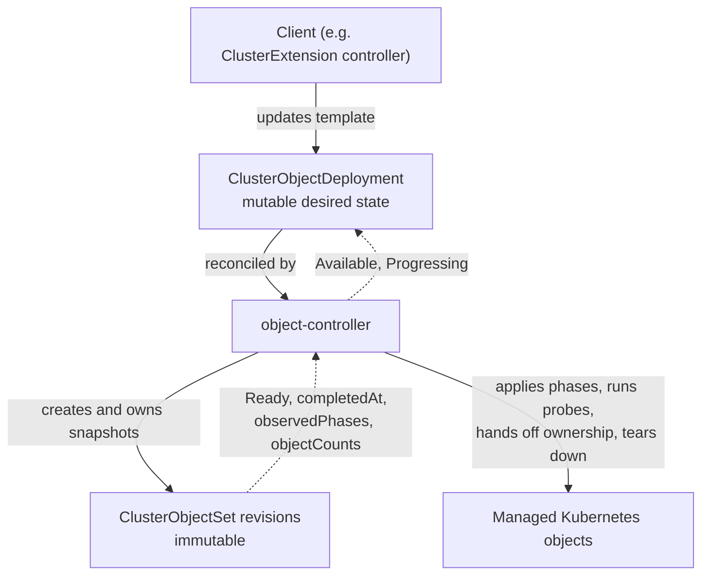

# OLMv1 Object Orchestration: ClusterObjectDeployment and ClusterObjectSet APIs

## Summary

This enhancement enables predictable, phased rollouts of Kubernetes resources with
readiness gating, actionable per-object diagnostics, and an auditable, bounded revision
history. It introduces two cluster-scoped APIs in `olm.operatorframework.io/v1`:
`ClusterObjectDeployment` (COD), which captures mutable desired state and manages
rollouts and revision history, and `ClusterObjectSet` (COS), which captures an immutable
content revision and applies or tears down its objects in ordered phases. A dedicated,
package-independent `object-controller` reconciles both APIs, allowing OLMv1 and other
clients to reuse the same rollout capabilities without depending on catalog, package,
or bundle concepts.

## Motivation

OLMv1 (GA) applies a resolved bundle to the cluster with a Helm-based applier. That
applier is a single, opaque step: it offers no phased rollout, no readiness gating
between groups of objects, no detailed per-object status, and no clean seam for other
actors to participate in the rollout lifecycle. OLMv1's roadmap (phased rollouts,
rollback, richer status, anomaly detection, policy/approval hooks) needs a
reconciliation kernel built around *revisions*.

[openshift/enhancements#1890](https://github.com/openshift/enhancements/pull/1890)
proposed adopting the [Boxcutter](https://github.com/package-operator/boxcutter)
library and a single `ClusterExtensionRevision` API to provide that kernel. While
building it, the design evolved: a single revision resource conflated two distinct
responsibilities — *mutable desired state / rollout orchestration* and *immutable
applied content*. Kubernetes already separates these concerns with
`Deployment`/`ReplicaSet`. OLMv1 adopts the same split:

- **`ClusterObjectSet`** captures the *immutable* applied content of one revision and
  owns phased application, probes, shared-object ownership handoff, and teardown.
- **`ClusterObjectDeployment`** captures the *mutable* desired state and owns revision
  creation, template-metadata propagation, rollout status, archival, and history
  pruning.

Decoupling these from `ClusterExtension` yields three benefits:

**Separation of concerns.** The `ClusterExtension` controller can focus on catalog
resolution and intent mapping; orchestration and application move to purpose-built
controllers.

**Reusability.** Because COS and COD reference no catalog/package/bundle concepts, any
controller or user can drive phased rollouts of arbitrary Kubernetes resources with
readiness gates — not just OLMv1 extensions.

**Roadmap acceleration.** Immutable revisions, phased rollout/teardown, per-object
status probes, collision/anomaly detection, and a rollout history (enabling rollback)
are provided by the kernel rather than reimplemented per consumer.

### User Stories

- As an OLMv1 developer, I want to evolve bundle resolution independently of resource
  rollout and cleanup, so I can add resolution features without reimplementing
  lifecycle behavior.
- As a platform engineer, I want to roll out arbitrary Kubernetes resources in ordered
  phases with readiness gates, without depending on `ClusterExtension` or a catalog,
  so I can use the same lifecycle capabilities for non-catalog workloads.
- As a cluster administrator, I want each phase and object of a rollout to report
  detailed status (which phase is blocked, which objects are not ready, and why), so I
  can quickly diagnose a stuck installation or upgrade.
- As a cluster administrator, I want an immutable, auditable record of exactly what was
  deployed at each revision and a bounded history of prior revisions, so I can
  understand changes over time and support rollback.
- As a cluster administrator, I want rollout health to be visible through OLMv1 status
  and metrics and reconciliation to resume safely after recovery, so I can monitor and
  remediate installations at scale.
- As an operator author, I want my operator's resources to be applied in the required
  order, with readiness checks and clear feedback when a rollout exceeds its deadline,
  so users can reliably install and upgrade my operator.
- As an operator author, I want resources used only by the previous revision to remain
  until the replacement revision completes its rollout, so a stalled upgrade does not
  prematurely remove resources still needed by the running operator.

The operator-author stories describe capabilities enabled by this enhancement, not a
new author-facing configuration interface. How authors declare phases, readiness
checks, and rollout policy, and how that intent is packaged and mapped into COD
templates, will be defined in a separate enhancement for a new package format.

### Goals

1. Users can install and upgrade resources in a predictable order, advancing only when
   configured readiness requirements are met and preventing unintended takeover of
   resources managed by other controllers.
2. Users can change desired content while preserving an auditable revision history,
   retaining resources unique to prior revisions until the replacement rollout
   completes, and cleaning up obsolete content and history according to configured
   policies.
3. Platform engineers and other controllers can reuse the same rollout and cleanup
   capabilities for arbitrary Kubernetes resources without depending on catalogs,
   packages, bundles, or `ClusterExtension`.
4. Administrators can determine installation availability, rollout progress, and the
   phase, objects, and reasons blocking a rollout from reported status.
5. Users of default (non-Tech-Preview) clusters retain existing installation and upgrade
   behavior while the new capabilities are in preview and require explicit opt-in.

### Non-Goals

1. **No `ClusterExtension` API change.** `ClusterExtension` continues to resolve
   catalogs and express user intent; its API surface is unchanged. Its controller
   already drives these APIs under `BoxcutterRuntime` — it creates a
   `ClusterObjectDeployment` rather than reconciling `ClusterObjectSet` revisions
   itself. The one remaining direct-`ClusterObjectSet` path is the legacy
   Helm→Boxcutter migrator (see [Risks and Mitigations](#risks-and-mitigations));
   adapting that path to be COD-backed is a follow-up tracked separately.
2. **No namespace-scoped variants.** `ObjectDeployment` / `ObjectSet` are out of scope;
   they can follow once the cluster-scoped APIs are stable.
3. **No scoped-RBAC model for applied content.** The `object-controller` runs with
   `cluster-admin`, consistent with
   [openshift/enhancements#2054](https://github.com/openshift/enhancements/pull/2054).
   A least-privilege model is a separate effort.
4. **No new rollout strategies** (canary, blue-green) and **no pause/rollback API** in
   this proposal. The immutable revision history is the foundation for a future
   rollback API; rollback itself is out of scope here.
5. **No author-facing package format or configuration workflow.** These APIs enable
   author-oriented rollout features, but this enhancement does not define how authors
   express that intent or how packages convey it to OLMv1. A separate enhancement for a
   new package format will define that interaction.

## Proposal

### Architecture

Before `ClusterObjectDeployment` (COD) existed, OLMv1 under the `BoxcutterRuntime`
feature gate was a two-layer system: the `ClusterExtension` controller resolved a bundle
and created `ClusterObjectSet` revisions directly.

```text
ClusterExtension ──creates──▶ ClusterObjectSet (rev 1, 2, 3 …)
                                 └──manages──▶ cluster objects
```

This enhancement's APIs introduce `ClusterObjectDeployment` as an orchestration layer,
yielding a three-layer system. The `ClusterExtension` controller already adopts this
layering under `BoxcutterRuntime`: it creates a `ClusterObjectDeployment` rather than
reconciling `ClusterObjectSet` revisions itself.

```text
ClusterExtension ──manages──▶ ClusterObjectDeployment  (mutable desired state)
                                 └──stamps out──▶ ClusterObjectSet (rev 1, 2, 3 …)  (immutable revisions)
                                                    └──manages──▶ cluster objects
```

- **`ClusterExtension`** (its API unchanged by this proposal) resolves catalogs and
  expresses intent, and creates/updates a `ClusterObjectDeployment`.
- **`ClusterObjectDeployment` (COD)** holds a COS template. When the template content
  changes (detected by a content hash), it creates a new COS revision; it observes
  rollout and garbage-collects archived revisions beyond its retention limit
  (`revisionHistoryLimit`).
- **`ClusterObjectSet` (COS)** is one immutable revision. The controller applies its
  objects phase by phase via server-side apply, runs readiness probes, hands off
  shared-object ownership to succeeding revisions in the same `group`, and tears down
  objects on archival.

Both APIs are reconciled by the dedicated **`object-controller`**, which depends on
neither `ClusterExtension` nor `ClusterCatalog`.

### Workflow Description

This workflow describes the runtime clients of COD/COS. The author-facing workflow for
expressing rollout intent is left to the separate package-format enhancement described
in [Non-Goals](#non-goals).

**cluster administrator** installs an extension by creating a `ClusterExtension`.

**ClusterExtension controller** resolves the bundle and creates or updates a
`ClusterObjectDeployment`, placing the resolved objects into `spec.template.spec.phases`
and the resolution metadata (package name, bundle version, image reference) into
`spec.template.metadata` labels/annotations.

**ClusterObjectDeployment controller** first adopts any ownerless revision in its group
that the `object-controller` created (proven by the
`apps.kubernetes.io/managed-by=object-controller` label), taking a controller owner
reference on it. It then compares the template's hash with the hash of the latest owned
active COS. If that revision does not exist or its hash differs, it allocates the next
revision number and creates a `ClusterObjectSet` named `<group>-<revision>` with
`spec.group` set to the COD name, `spec.lifecycleState: Active`, a controller owner
reference to the COD, and the `apps.kubernetes.io/managed-by=object-controller` label.

**ClusterObjectSet controller** reconciles the new revision, applying each phase's
objects via server-side apply and advancing only after every object in the phase passes
its readiness probes. During a transition, both the old and new revisions are Active;
shared objects transfer ownership from the old revision to the new one via a shared
field manager.

**ClusterObjectDeployment controller** observes the new revision become `Ready`,
reports `Available`/`Progressing`, and garbage-collects archived revisions beyond
`revisionHistoryLimit`.

Step by step:

1. A client (the `ClusterExtension` controller, or any other actor) creates/updates a
   `ClusterObjectDeployment` with the desired phases in `spec.template`.
2. The COD controller adopts ownerless group members it can prove the `object-controller`
   created (those carrying the `apps.kubernetes.io/managed-by=object-controller`
   label), then computes the template identity. If the latest owned active COS matches,
   nothing is created. If no such revision exists or its hash differs, it allocates
   `max(revision in group) + 1` (or `1` for an empty group) and creates the COS snapshot.
   An older matching active revision does not suppress creation of a new revision.
3. The COS controller applies phase 1's objects via server-side apply, evaluates their
   probes, and records `completedAt` on the phase when all objects are Ready. It then
   proceeds to phase 2, and so on.
4. During an upgrade, the old and new revisions are both Active. Objects common to both
   transfer ownership to the new revision; objects only in the old revision stay owned
   by it until archival.
5. When all phases are Ready, the COS sets `Ready=True` and stamps
   `status.completedAt`. The COD observes this and sets `Available=True` /
   `Progressing=False` (reason `NewClusterObjectSetProgressed`).
6. After the head revision completes successfully, the COD controller transitions
   lower-revision owned active COSs to `lifecycleState: Archived`. The COS controller
   tears down objects still under each archived revision's exclusive ownership
   (reverse phase order) and removes its finalizer.
7. The COD garbage-collects archived COSs beyond `spec.revisionHistoryLimit`
   (default 5).



### API Extensions

This enhancement adds two new cluster-scoped CRDs in group
`olm.operatorframework.io`, version `v1`: `ClusterObjectSet` and
`ClusterObjectDeployment`. Both use the `/status` subresource. Neither modifies
resources owned by other parties; each manages its own CRs and the arbitrary
Kubernetes objects declared in its phases. The `object-controller` holds a finalizer
on COS resources to drive ordered teardown on archival/deletion.

Operational impact is covered in
[Operational Aspects of API Extensions](#operational-aspects-of-api-extensions).

#### `ClusterObjectSet` (immutable revision)

Cluster-scoped, `kind: ClusterObjectSet`. `metadata.name` **must** equal
`<spec.group>-<spec.revision>` (enforced by a CEL `XValidation` rule);
`metadata.generateName` is not supported.

Spec fields:

| Field | Contract |
| --- | --- |
| `spec.group` | Required, **immutable**. 1–52 chars, `^[a-z]([a-z0-9-]*[a-z0-9])?$`. Links related revisions into one ordered sequence regardless of owner references. |
| `spec.revision` | Required, **immutable**. `int64`, 1–9999999999. Unique within a group. Ten digits plus a hyphen fit a 52-char group within the 63-char name limit. |
| `spec.lifecycleState` | Required enum `Active` / `Archived`. May only transition `Active → Archived` (CEL-enforced "cannot un-archive"). Multiple revisions can be `Active` simultaneously during a transition. |
| `spec.phases` | Required, **immutable from creation**. Ordered, `listMapKey=name`, 1–20 phases. Each phase has a DNS-label `name`, up to 50 `objects`, and an optional phase-level `collisionProtection`. |
| `spec.progressionProbes` | Optional, **immutable from creation**. Experimental. Max 20. Custom readiness probes applied to every phase; each probe selects objects (`GroupKind` or `Label`) and runs assertions (`ConditionEqual` / `FieldsEqual` / `FieldValue`). A probe passes vacuously for phases with no matching objects. |
| `spec.collisionProtection` | Required enum, **immutable from creation**: `Prevent` / `IfNoController` / `None`. Default for all phases/objects; resolution order is object > phase > spec. `phases`, `progressionProbes`, and `collisionProtection` together form the revision *content*, defined by a struct shared with `ClusterObjectDeployment`'s `spec.template.spec`. |

Each phase object (`spec.phases[].objects[]`) is a discriminated union with a required
`type` field (enum `InlineManifest` / `SecretReference`) and **exactly one** of the
matching members:

- `inlineManifest` (`type: InlineManifest`) — an embedded Kubernetes manifest
  (`EmbeddedResource`, `PreserveUnknownFields`), CEL-validated to be a well-formed
  resource (non-empty `apiVersion`, `kind`, and `metadata.name`); or
- `secretRef` (`type: SecretReference`) — a reference (`name`, `namespace`, `key`) to an
  **immutable** `Secret` holding the serialized manifest. This externalizes large
  manifests so a COS stays within etcd's object-size limit. See
  [Object storage](#object-storage-inline-vs-references).

Status fields:

| Field | Contract |
| --- | --- |
| `status.conditions` | A single `Ready` condition (`listMapKey=type`). Reasons: `Pending` (Unknown, initial), `AllObjectsReady` (True), `ObjectsNotReady`, `Superseded`, `ObjectCollision`, `PreconditionsNotMet`, `InvalidSpecification`, `Archiving`, `Archived` (all False). |
| `status.completedAt` | Timestamp set once when the revision first became Ready; **immutable** and cannot be removed once set (CEL-enforced). Marks that the revision rolled out successfully at least once. |
| `status.objectCounts` | Aggregate `total` / `present` / `synced` / `ready` counts across phases. Reported only at the top level — there is no per-phase `objectCounts`. |
| `status.observedPhases` | Per-phase records (`listMapKey=name`, max 20) containing `status`, `digest`, `completedAt`, `lastTransitionTime`, `message`, and `objectDetails`. |

Each observed phase has a `status` from the `PhaseStatus` enum and an immutable
`<algorithm>:<hex>` digest of its resolved content to detect `secretRef` tampering.
`objectDetails` lists up to 50 incomplete objects, identified by `group` / `resource` /
`namespace` / `name`, with per-object failure messages.

`PhaseStatus` is one of: `InvalidSpecification`, `PreconditionsNotMet`, `Pending`,
`Reconciling`, `Stabilizing`, `Ready`, `Unknown`, `Superseded`, `Archiving`,
`Archived`.

Example (inline objects):

```yaml
apiVersion: olm.operatorframework.io/v1
kind: ClusterObjectSet
metadata:
  name: my-app-1          # must be <group>-<revision>
spec:
  group: my-app
  revision: 1
  lifecycleState: Active
  collisionProtection: Prevent
  phases:
    - name: crds
      objects:
        - type: InlineManifest
          inlineManifest:
            apiVersion: apiextensions.k8s.io/v1
            kind: CustomResourceDefinition
            metadata: {name: widgets.example.com}
            spec: {group: example.com, scope: Namespaced, names: {kind: Widget, plural: widgets}, versions: [{name: v1, served: true, storage: true, schema: {openAPIV3Schema: {type: object}}}]}
    - name: deploy
      objects:
        - type: InlineManifest
          inlineManifest:
            apiVersion: apps/v1
            kind: Deployment
            metadata: {name: my-app-controller, namespace: my-app-system}
            spec: {replicas: 1, selector: {matchLabels: {app: my-app-controller}}, template: {metadata: {labels: {app: my-app-controller}}, spec: {containers: [{name: manager, image: example.com/my-app:v1.0.0}]}}}
```

#### `ClusterObjectDeployment` (mutable orchestration)

Cluster-scoped, `kind: ClusterObjectDeployment`, short name `cod`. `metadata.name` is
limited to a valid COS group (≤52 chars, `^[a-z]([a-z0-9-]*[a-z0-9])?$`) because each
child COS is named `<cod-name>-<revision>`.

Spec fields:

| Field | Contract |
| --- | --- |
| `spec.revisionHistoryLimit` | Optional `*int32`, min 0, max 50, **default 5**. Maximum number of *archived* revisions to retain for inspection/rollback. Active revisions are never removed and never count against the limit. `0` retains no archived revisions. |
| `spec.progressDeadlineMinutes` | Optional `int32`, min 1, max 720 (12 h). Maximum rollout duration, measured from COS creation across all phases. Omitted means no deadline. Rollout policy, not revision content; see details below. |
| `spec.template` | Required. The desired content of newly-created COSs. A change to `template` creates a new revision; existing revisions remain immutable. |
| `spec.template.metadata.labels` / `.annotations` | Optional maps (1–32 entries each when set), copied onto each new COS. If template metadata is provided, at least one map must be set. Reserved labels and annotation validation are described below. |
| `spec.template.spec.phases` | Required ordered list, 1–20 phases (`listMapKey=name`), reusing the COS phase/object types and limits (≤50 objects/phase). |
| `spec.template.spec.progressionProbes` | Optional (max 20), reusing the COS selector/assertion semantics. |
| `spec.template.spec.collisionProtection` | Required enum `Prevent` / `IfNoController` / `None`. |

Template metadata is the seam between the resolution and orchestration layers. The
controller owns the reserved `olm.operatorframework.io/template-hash` and
`apps.kubernetes.io/managed-by` (value `object-controller`) labels; callers cannot set
them. Annotations are validated against Kubernetes rules before a revision is created.

`group`, `revision`, `lifecycleState`, and ownership are controller-assigned on each
child COS and are therefore absent from the template.

The rollout deadline (`progressDeadlineMinutes`) lives on `spec` as rollout policy,
not in `spec.template` or COS revision content. Changing it does not create a new
revision and applies immediately to the latest active revision. It is measured from
the COS creation timestamp across all phases: completing a phase does not reset it,
and time spent waiting for COS creation is not counted. Once a revision completes,
the deadline no longer applies.

Status fields:

`status.conditions` carries `Available` and `Progressing` (`listMapKey=type`); each
condition records the evaluated `observedGeneration`. Per-revision and per-phase detail
remains on the COS resources; the COD does not duplicate it.

- **`Available`** — health of the owned active (non-archived) revisions.
  - `False` / `NoActiveRevision` — no active revision exists.
  - `True` / `Available` — at least one active revision is `Ready`. The deployment
    stays available across a rollout while a previous revision is still Ready.
  - `False` / `Unavailable` — active revisions exist but none are Ready yet.

- **`Progressing`** — progress of the desired (head) rollout and why the head revision
  is not yet Ready.
  - `True` / `NewClusterObjectSetProgressing` — the desired rollout is incomplete.
  - `False` / `NewClusterObjectSetProgressed` — completed (latched; stays recorded even
    if the completed revision later becomes unhealthy).
  - `False` / `ProgressDeadlineExceeded` — the latest revision did not roll out within
    `progressDeadlineMinutes`.
  - `False` / `InvalidSpecification` — `spec.template.metadata` labels/annotations are
    invalid; no new revision is created until corrected.
  - `True` / `RevisionPreconditionsNotMet` — the head revision's preconditions (e.g.
    RBAC or a dependency CRD) are not yet met; the controller keeps retrying.
  - `False` / `RevisionObjectCollision` — the head revision's managed objects are owned
    by another controller or already exist; user intervention required.
  - `False` / `RevisionInvalidSpecification` — the head revision's own objects are
    invalid (distinct from the template-metadata `InvalidSpecification` above).
  - `False` / `OwnerConflict` — the head revision (the `ClusterObjectSet` itself) is
    controlled by another controller. The COD does not replace a foreign owner; no
    higher revision is created while the conflict persists, even if an owned revision
    has completed or exceeded its deadline. (Distinct from `RevisionObjectCollision`,
    which concerns the objects a revision *manages*, not ownership of the revision CR.)
  - `False` / `UnmanagedRevision` — the head revision is ownerless but lacks the
    `apps.kubernetes.io/managed-by=object-controller` label, so the controller cannot
    prove the `object-controller` created it; it is not adopted and no higher revision
    is created while it persists. Recovers once the revision is labeled (and adopted) or
    removed. A revision that instead still references an *older UID* of this COD (e.g. a
    restored revision) is left to garbage collection rather than adopted, and is not
    reported as a distinct condition because it is transient and self-healing.

Example:

```yaml
apiVersion: olm.operatorframework.io/v1
kind: ClusterObjectDeployment
metadata:
  name: my-app
spec:
  revisionHistoryLimit: 5
  progressDeadlineMinutes: 10
  template:
    metadata:
      labels:
        app.kubernetes.io/name: my-app
    spec:
      collisionProtection: Prevent
      phases:
        - name: crds
          objects:
            - type: InlineManifest
              inlineManifest: {apiVersion: apiextensions.k8s.io/v1, kind: CustomResourceDefinition, metadata: {name: widgets.example.com}, spec: {group: example.com, scope: Namespaced, names: {kind: Widget, plural: widgets}, versions: [{name: v1, served: true, storage: true, schema: {openAPIV3Schema: {type: object}}}]}}
        - name: deploy
          objects:
            - type: InlineManifest
              inlineManifest: {apiVersion: apps/v1, kind: Deployment, metadata: {name: my-app-controller, namespace: my-app-system}, spec: {replicas: 1, selector: {matchLabels: {app: my-app-controller}}, template: {metadata: {labels: {app: my-app-controller}}, spec: {containers: [{name: manager, image: example.com/my-app:v1.0.0}]}}}}
```

### Topology Considerations

#### Hypershift / Hosted Control Planes

The `object-controller` reconciles cluster-scoped CRs and manages objects in the
cluster it runs in, the same as `operator-controller` today. In a Hypershift topology
it follows the same placement as the rest of OLMv1; there are no new management-cluster
vs. guest-cluster split considerations beyond those that already apply to OLMv1.

#### Standalone Clusters

Fully relevant; this is the primary topology. The feature is gated by
`BoxcutterRuntime` and off by default.

#### Single-node Deployments or MicroShift

The `object-controller` is an additional Deployment (one replica, with a leader-election
lease) that runs only when `BoxcutterRuntime` is enabled — i.e. not on default SNO
installs. When enabled, it adds a modest, bounded memory/CPU footprint: COD
reconciliation is lightweight (it acts on template changes and otherwise aggregates
status), and COS reconciliation scales with the number of managed objects, which is the
same workload OLMv1 performs today via the Helm applier. MicroShift does not ship
OLMv1/operator-controller, so there is no MicroShift impact and no MicroShift
configuration surface is added.

#### OpenShift Kubernetes Engine (OKE)

No dependency on features excluded from OKE. The APIs and controller are part of OLMv1
and behave identically wherever OLMv1 is present.

### Implementation Details/Notes/Constraints

**The `object-controller`.** COS and COD are reconciled by the experimental
`object-controller`, which runs in its own Deployment with its own service account and
leader-election lease. It watches `ClusterObjectSet`, `ClusterObjectDeployment`, and the
objects they manage (via dynamic watches); it requires neither `ClusterExtension` nor
`ClusterCatalog`. Upstream it may be deployed into the single OLMv1 namespace alongside
`operator-controller`; downstream (OpenShift) it becomes a first-class payload image
(`ose-olm-object-controller`) in its own `openshift-object-controller` namespace,
rendered by `cluster-olm-operator` only when `BoxcutterRuntime` is enabled. Object
application uses the [Boxcutter](https://github.com/package-operator/boxcutter) library.

**Revision identity and allocation (COD).** The COD hashes the declared template
(`spec.template` metadata + spec, before controller-assigned fields are filled). Edits to
fields outside the template — root metadata, status, `spec.revisionHistoryLimit`, and
`spec.progressDeadlineMinutes` (rollout policy, which lives on `spec`, not the template)
— do not create a revision. Phase/object/probe *order* participates in identity;
map-key order does not. The controller compares the current hash with the latest owned
active COS: the owned `Active` revision with the highest `spec.revision` that is not
being deleted. If none exists or its hash differs, the controller allocates
`max(revision across the whole group) + 1` (including archived/foreign members), or `1`
for an empty group, and refuses allocation at the API revision ceiling of `9999999999`
rather than wrapping. Each child is named `<group>-<revision>`, `lifecycleState: Active`,
with a controller owner reference to the COD. A reverted template (A → B → A) produces a
new higher revision even if an older A revision is still active; an older matching
revision is not reused and an archived COS is never reactivated.

**Group membership vs. ownership.** All COSs sharing an immutable `spec.group` form one
revision chain, regardless of owner references. A COD manages the COSs it controls (by
UID); it never replaces a foreign controller reference. Revision allocation considers
the whole group, but health and history summaries consider only the owned subset.

**Adoption of ownerless revisions.** The COD controller adopts ownerless revisions in
its group, but only those it can prove the `object-controller` created — i.e. those
carrying the `apps.kubernetes.io/managed-by=object-controller` label, which the
controller stamps on every revision it creates. Adoption takes a controller owner
reference (via a conflict-safe optimistic patch) before health/history are computed.
The label gate prevents a COD from hijacking an ownerless COS that merely happens to
share its group but was created by some other actor. Three cases are *not* adopted:

- A revision controlled by a **foreign owner** → reported `Progressing=False /
  OwnerConflict` when it leads the group; the COD never rewrites a foreign reference.
- An ownerless revision **missing the managed-by label** → reported `Progressing=False /
  UnmanagedRevision` when it leads the group; blocks creation of a higher revision until
  the revision is labeled (then adopted) or removed.
- A revision referencing a **stale (older) UID of this COD** (e.g. a restored revision)
  → left to garbage collection rather than racing it by rewriting the reference. The
  controller watches every group member, so once GC removes the stale revision it
  re-reconciles and rolls the deployment forward. This is transient and self-healing, so
  it is not surfaced as a distinct condition.

**Phase application and ownership handoff (COS).** Phases apply sequentially via
server-side apply; a phase advances only after all its objects pass their probes. Revisions in the same group share the field manager
`cos-group/<group>`, which lets ownership of a shared object transfer from one revision
to the next without a collision. On archival, a COS is removed from the owner list of
objects adopted by a successor and deletes any objects that did not transition, in
reverse phase order, before its finalizer is removed. Single-owner semantics across
`ClusterExtension`s are preserved.

**Archival and history.** The COD controller owns the cross-revision archival decision.
Once the head active revision has completed its rollout (`status.completedAt` is set),
it transitions lower-revision owned active COSs to `lifecycleState: Archived`. It does
not archive foreign-controlled or unmanaged group members. The COS controller executes
ordered teardown for its own archived revision, reporting `Ready=False` with reason
`Archiving`, then `Archived`, and removing its teardown finalizer. The COD controller
prunes owned archived revisions beyond `revisionHistoryLimit` only after their teardown
has completed. Pruning is best-effort and never blocks rollout.

**Implementation note.** The COS controller currently makes the predecessor-archival
decision when a successor completes successfully. Moving this decision to the COD
controller, while leaving per-revision teardown with COS, is tracked in
[OPRUN-4832](https://redhat.atlassian.net/browse/OPRUN-4832) and is required before GA
(see [Tech Preview -> GA](#tech-preview---ga)).

**Collision protection.** Three strategies — `Prevent` (only manage self-created
objects), `IfNoController` (adopt pre-existing objects not owned by another controller),
`None` (adopt anything; dangerous) — resolved object > phase > spec.

#### Object storage (inline vs references)

Each phase object is stored either inline
(`type: InlineManifest`, via `inlineManifest`) or as a reference (`type:
SecretReference`, via `secretRef`) to an immutable `Secret`. When OLMv1 builds revisions it
externalizes manifests into content-addressable, immutable Secrets (packed up to
~900 KiB with headroom below etcd's ~1.5 MiB limit, gzip-compressing larger manifests
and transparently decompressing on read), keeping revisions within etcd limits. See
[Large Bundle Support][large-bundle].

**Referenced Secret lifecycle.** The client that submits a COD or COS is responsible
for creating, retaining, and cleaning up its referenced Secrets. The
`object-controller` reads their content but does not take ownership of or
garbage-collect them. Clients must keep Secrets available for as long as a COD
template or retained COS references them, including Secrets shared across revisions.

For `ClusterExtension`-managed content, `operator-controller` is that client: it creates
the Secrets with owner references to the `ClusterExtension` and is responsible for
managing their lifecycle. Archiving or pruning a COS does not cause the
`object-controller` to delete its referenced Secrets; `revisionHistoryLimit` bounds
COS history, not Secret retention.

**Status contract choices (as implemented).** COS exposes a single `Ready` condition
plus `completedAt` and rich `observedPhases`/`objectCounts`; rollout *completion* is a
timestamp, not a condition. COD exposes `Available` (owned installation health) and
`Progressing` (desired-rollout progress and head-revision blockers), using the
condition-based deadline/completion model rather than persisted timer fields. COD
status does not duplicate per-revision/per-phase detail — that remains the source of
truth on COS.

**Relationship to `ClusterExtension`.** Under `BoxcutterRuntime`, the
`ClusterExtension` controller creates a `ClusterObjectDeployment` named after the
extension (owned by the extension for garbage collection) and server-side-applies its
template; the COD controller owns `ClusterObjectSet` revision creation, rollout, and
retention. Before adopting an existing COD, the applier verifies it is not controlled by
another owner and, if ownerless, carries the
`apps.kubernetes.io/managed-by=operator-controller` label, mirroring the COD-level
adoption gating. Two items remain follow-ups: (1) the legacy Helm→Boxcutter migrator
still creates an initial `ClusterObjectSet` (revision 1) directly rather than a
COD-backed revision, and (2) moving the predecessor-archival decision from the COS
controller to the COD controller (see *Archival and history* above).

**Dependency on `cluster-admin`.** The `object-controller` applies arbitrary Kubernetes
objects on behalf of callers and therefore operates with `cluster-admin`, consistent
with [openshift/enhancements#2054](https://github.com/openshift/enhancements/pull/2054).
The per-revision ServiceAccount-scoped client model is not part of these APIs; a
least-privilege model is a separate effort.

**Immutability enforcement.** COS `spec.group`, `spec.revision`, and the content fields
`spec.phases`, `spec.progressionProbes`, and `spec.collisionProtection` are immutable via
CEL `XValidation` — the content fields strictly from creation (they can only change by
creating a new revision); `spec.lifecycleState` may only move `Active → Archived`;
`status.completedAt` and per-phase `digest`/`completedAt` are immutable once set.
`secretRef`-backed objects require the referenced Secret to be `immutable: true`; the
controller blocks (`Ready=False`, reason `PreconditionsNotMet`) if it is not, or if the
observed `digest` no longer matches.

### Risks and Mitigations

**Migration from the GA Helm-based applier.** Clusters upgrading from GA (Helm applier)
to a `BoxcutterRuntime`-enabled state need their existing releases represented as COD +
COS. *Mitigation:* the existing Helm→Boxcutter storage migrator today synthesizes an
initial `ClusterObjectSet` (revision 1) directly from each deployed Helm release; it is to
be extended to produce a COD-backed representation so the migrated install is managed the
same way as a fresh one (tracked as a follow-up — see the *Relationship to
`ClusterExtension`* note). Because the Boxcutter runtime
is behind a feature gate and has not reached GA, migration from an older COS/revision
format is not required — only migration from the GA Helm applier matters.

**Added API surface and indirection.** Two new CRDs and a new controller add RBAC,
objects in etcd, and a third resource to reason about when debugging. *Mitigation:* this
mirrors Kubernetes' own `Deployment`/`ReplicaSet`/`Pod` layering; the COD controller is
lightweight; expected instance counts are low (order of the number of extensions). The
layering buys separation of concerns and reuse.

**Security review.** The controller runs with `cluster-admin` and applies arbitrary
objects; this is the same trust model as OLMv1's current applier and is reviewed with
the OLMv1 team under the umbrella of
[openshift/enhancements#2054](https://github.com/openshift/enhancements/pull/2054).
*UX review* (status surfaces, `kubectl` columns, diagnostics) is handled with the OLMv1
and docs teams during Tech Preview.

### Drawbacks

The primary drawback is an extra layer of indirection: debugging a rollout can require
looking at `ClusterExtension` → `ClusterObjectDeployment` → `ClusterObjectSet` rather
than two resources. This is the same trade-off Kubernetes makes with
`Deployment`/`ReplicaSet`/`Pod`; the detailed per-phase/per-object status on COS and the
`Available`/`Progressing` summary on COD are designed to make the common diagnostic path
short. A second drawback is that keeping `progressionProbes` at the spec level (rather
than inline per-object assertions) means a controller populating the template repeats
common probes programmatically; this is an implementation detail for generated
templates and avoids coupling this proposal to a probe redesign.

## Alternatives (Not Implemented)

### Single `ClusterExtensionRevision` API (the original #1890 approach)

[openshift/enhancements#1890](https://github.com/openshift/enhancements/pull/1890)
proposed one revision API. Rejected because it conflates mutable desired state /
orchestration with immutable applied content, which Kubernetes itself separates
(`Deployment`/`ReplicaSet`). Splitting into COD + COS makes each layer independently
usable and independently evolvable.

### Keep the two-layer architecture (no COD)

The `ClusterExtension` controller could keep creating COSs directly and simply adopt the
`group` field. Rejected because orchestration concerns (revision stamping, archival,
pruning, deadline tracking) would remain embedded in `ClusterExtension`, and any other
controller wanting phased rollout would have to reimplement them.

### Express revision chains with labels instead of a `group` spec field

The chain could be identified by labels (as earlier prototypes did). Rejected because
labels are mutable and unsuitable for a correctness-critical grouping. An immutable,
validated `group` spec field is a stronger contract and makes a COS self-describing.

### CEL-based probes

Support for CEL-based probes is not part of the initial (Tech Preview) API so it does not
block introducing the APIs. It is, however, a GA gate: if the selector+assertion probe
structure is retained, a CEL-expression-based assertion type must be added before the API
freezes so the assertion model is complete (see
[Tech Preview -> GA](#tech-preview---ga)).

### Persisted rollout record for deadline timing

A future COD could persist the desired-template identity and a rollout start timestamp
in status to give each template change its own creation window independent of condition
transition times. Not implemented: the condition-based deadline model is sufficient for
the current requirements and avoids additional status fields and recovery logic.

## Open Questions

1. What exactly must the Helm→Boxcutter storage migrator produce to represent an
   existing Helm release as a COD + initial COS (naming, metadata, revision number)?
2. How should the archival-decision handoff from COS to COD preserve in-flight rollouts,
   and should standalone COS groups retain automatic archival or require caller-driven
   lifecycle transitions?
3. Should a purpose-built `ClusterObjectSlice` type eventually replace Secret-backed
   `secretRef` storage, or is content-addressable immutable Secret storage sufficient
   long-term?

## Test Plan

- **Unit tests** for the COD controller (template hashing/identity, A → B → A reverts
  while older revisions remain active, revision allocation, adoption, archival, history
  pruning, deadline evaluation, status derivation) and the COS controller (phase
  progression, probe evaluation, collision protection modes, ownership handoff,
  teardown, `secretRef` resolution incl. gzip).
- **Integration tests** (envtest) for end-to-end flows: first install, upgrade with
  shared objects, upgrade that removes objects, archival, teardown, deadline exceeded,
  precondition-not-met recovery, collision handling, and the restart/recovery scenarios
  enumerated in the COD contract.
- **API validation tests** for the CEL immutability rules (group/revision/phases/
  probes/collisionProtection, `lifecycleState` transitions, `completedAt`,
  `<group>-<revision>` name rule) and bounds (phase/object/probe/annotation limits).
- **E2E tests** on a real cluster exercising the full
  `ClusterExtension` → COD → COS pipeline under `BoxcutterRuntime`, plus a standalone
  COD/COS walkthrough with no `ClusterExtension`.
- **Migration tests** verifying GA Helm releases are correctly migrated to COD + COS.
- **Upgrade/downgrade and version-skew tests** for the GA compatibility contract,
  including supported micro/minor upgrade paths, skipped micro releases, non-atomic
  CRD and controller rollouts, and recovery from interrupted upgrades without losing
  revision state or inadvertently tearing down installed workloads.

## Graduation Criteria

The feature is delivered behind the `BoxcutterRuntime` feature gate. On OpenShift this
gate is reachable only through `*NoUpgrade` feature sets (TechPreview/DevPreview/
CustomNoUpgrade), so enabling it blocks cluster upgrades and there is no installed base
to migrate across the gate.

### Dev Preview -> Tech Preview

- COD and COS are functional end-to-end under `BoxcutterRuntime`.
- Phased rollout, readiness probes, collision protection, ownership handoff, archival,
  teardown, and history pruning work and are covered by unit/integration tests.
- Per-phase and per-object status (`observedPhases`, `objectDetails`) plus aggregate
  `objectCounts`, and COD `Available`/`Progressing` conditions, provide actionable
  diagnostics.
- The `object-controller` ships as its own component (downstream: its own payload image
  and namespace) and is deployed only when `BoxcutterRuntime` is enabled.
- SLIs exposed as metrics; symptom-based alerts drafted.
- Initial user-facing documentation.

### Tech Preview -> GA

- API stability: no breaking changes to COD/COS spec; `api-approvers` sign-off.
- **Progress-deadline field decision.** Finalize the progress-deadline field: its time
  unit (`progressDeadlineMinutes` vs a seconds-based field) and its semantics (the
  current model, measured from the `ClusterObjectSet` creation timestamp, vs a Kubernetes
  `Deployment`-style `progressDeadlineSeconds`). Alternatively, decide whether the
  progress-deadline capability should move behind its own feature gate rather than ship
  as part of the core COD/COS APIs.
- **Group-dynamics decision.** Confirm the revision-chain membership mechanism: the
  current immutable `.spec.group` field vs a label-selector-based approach. The current
  design deliberately rejects labels for correctness (see
  [Alternatives](#express-revision-chains-with-labels-instead-of-a-group-spec-field)),
  but this must be explicitly settled before the API is frozen.
- **Probe API-structure decision.** Finalize how probes are defined on `ClusterObjectSet`:
  the current spec-level selector-plus-assertions model (`.spec.progressionProbes`) vs
  moving assertions directly under the phase objects. If the selector+assertion structure
  is kept, the following must also be resolved before GA:
  - **Do not expose `metav1.LabelSelector` directly.** Use a local copy of the type with
    stricter validation and convert it to `metav1.LabelSelector` in the operator code, so
    the published API surface is not bound to the upstream type's looser validation.
  - **Select by `GroupResourceKind` / `GroupVersionKind`, not just `GroupKind`.** A single
    revision can apply two versions of the same resource; a `GroupKind`-only selector
    leaves a gap where an assertion that is only valid for one version is applied to
    both. Version-aware selection closes that gap.
  - **Add a CEL-expression-based assertion type.** Pull CEL-based assertions in as a GA
    gate (rather than leaving them to the separate deferred enhancement) so the assertion
    model is complete when the API freezes.
- **Condition-type reuse decision.** Determine whether the per-phase status
  (`status.observedPhases[].status`, currently the bespoke `PhaseStatus` enum) can reuse
  the standard `metav1.Condition` type instead.
- `ClusterExtension`-to-COD integration finalized (legacy Helm→Boxcutter migrator made
  COD-backed).
- **Archival ownership.** The COD controller owns the decision to archive superseded
  revisions, while the COS controller remains responsible for per-revision teardown
  ([OPRUN-4832](https://redhat.atlassian.net/browse/OPRUN-4832)).
- **Migration of Helm-installed `ClusterExtension`s.** Existing `ClusterExtension`s
  installed with the GA Helm-based applier are automatically migrated to the
  boxcutter-based representation (a `ClusterObjectDeployment` and its `ClusterObjectSet`
  revisions), with no user action and without disrupting the installed workload. This
  includes making the legacy Helm→Boxcutter migrator COD-backed (today it synthesizes an
  initial `ClusterObjectSet` directly — see *Relationship to `ClusterExtension`*). The
  migration is automated, idempotent, and covered by migration and upgrade/downgrade
  tests.
- **Upgrade, version skew, and downgrade recovery.** Define, document, and test the
  supported compatibility contract across COD/COS CRD/schema updates,
  `operator-controller`, and `object-controller`. Cover supported micro/minor upgrades
  (including skipped micro releases), mixed-version rolling-upgrade windows, any
  required update ordering, and recovery from interrupted upgrades. Document and test
  any manual steps needed to restore a supported prior version without losing revision
  state or inadvertently tearing down installed workloads; delivering the components
  together must not be treated as an atomic-upgrade guarantee.
- Scale/load testing with realistic bundle sizes; SLOs documented and SLI telemetry
  backhauled.
- End-to-end tests required for GA.
- User-facing documentation in [openshift-docs](https://github.com/openshift/openshift-docs/).

### Removing a deprecated feature

When the Boxcutter runtime replaces the Helm applier by default, the Helm applier is
deprecated and removed per the standard deprecation/support policy, with the migrator
retained for the supported upgrade window.

## Upgrade / Downgrade Strategy

The CRDs and controller are delivered and upgraded by `cluster-olm-operator` in lockstep
with the rest of OLMv1; micro and minor version upgrades follow the standard OLMv1
upgrade path. On upgrade into a `BoxcutterRuntime`-enabled state from the GA Helm
applier, the extended Helm→Boxcutter migrator synthesizes COD + COS from existing
releases.

Because the feature is only reachable on `*NoUpgrade` feature sets, a cluster that has
enabled it cannot upgrade, so there is no cross-version COD/COS skew to support while the
feature is pre-GA. Downgrade to a pre-COD GA version is not automatic: the migrator does
not keep Helm release records current as revisions progress, so the Helm applier cannot
resume from stale state; a downgrade requires documented manual steps (e.g. reinstalling
affected extensions). Before GA, supported upgrade/downgrade paths, rolling-version
compatibility windows, and recovery procedures must be defined, documented, and tested
(see [Tech Preview -> GA](#tech-preview---ga)).

## Version Skew Strategy

The COD and COS controllers run in the single `object-controller` binary, so there is no
version skew between those two reconciliation loops. The `object-controller`,
`operator-controller`, and their CRDs are versioned and delivered together by
`cluster-olm-operator`, but their Deployments and CRD schemas can change at different
points during a rolling upgrade. Lockstep versioning does not eliminate transient
controller-to-controller or controller-to-CRD skew.

While the feature is pre-GA, the `*NoUpgrade` restriction described above prevents
cross-release upgrades with the feature enabled. Before GA, the supported compatibility
windows, any update-ordering requirements, and recovery behavior must be finalized and
verified by the upgrade/downgrade and version-skew tests in the
[Test Plan](#test-plan). Both the legacy direct-COS migration path and the COD-backed
path write the COS API; the compatibility contract must cover all writers while both
paths exist. The APIs manage arbitrary Kubernetes objects via server-side apply and
tolerate normal control-plane version skew the same way other OLMv1-applied content does.

## Operational Aspects of API Extensions

- **CRDs (no admission/conversion webhooks, no aggregated apiserver).** Validation is
  schema- and CEL-based, so there is no webhook availability dependency on the API path.
- **Instance counts.** Expected on the order of the number of installed extensions (tens,
  not thousands) plus bounded archived history per COD (`revisionHistoryLimit`, default
  5). These CR counts are expected to have negligible impact on general API throughput.
  Referenced Secret counts and storage depend on client-managed lifecycle and are not
  bounded by `revisionHistoryLimit`.
- **Health SLIs.** COD `Available` / `Progressing` conditions; COS `Ready` condition
  plus `objectCounts`/`observedPhases`; `object-controller` reconcile latency/error
  metrics and leader-election status. A stale `observedGeneration` or missing conditions
  indicates the controller is not reconciling.
- **Failure modes.** If the `object-controller` stops, no new revisions are stamped and
  archival/pruning halts, but already-applied objects remain in their last-applied
  state; active COSs resume reconciling when the controller returns. A revision can
  stall on `RevisionObjectCollision` / `RevisionInvalidSpecification` (hard stalls
  needing user action) or `RevisionPreconditionsNotMet` (auto-retried).
- **Measurement and ownership.** Performance/scale impact is assessed by the OLMv1 team
  via CI e2e and periodic scale testing; the OLMv1 team is the escalation owner.

## Support Procedures

These procedures describe operation of the GA feature.

Detecting and diagnosing issues:

- `kubectl get clusterobjectdeployments` — the `Available` and `Progressing` columns
  show the overall state; `Progressing`'s reason distinguishes "in progress" from a hard
  stall (`RevisionObjectCollision`, `RevisionInvalidSpecification`, `OwnerConflict`,
  `UnmanagedRevision`), `ProgressDeadlineExceeded`, or template `InvalidSpecification`.
  `OwnerConflict`/`UnmanagedRevision` indicate a group member that leads the group but is
  owned by another controller or cannot be proven to belong to this COD (missing the
  `apps.kubernetes.io/managed-by=object-controller` label).
- `kubectl get clusterobjectset <name> -o jsonpath='{.status.observedPhases}'` — per-phase
  `status`, `message`, and `objectDetails` identify the blocking phase and the specific
  objects with failure messages (probe failures, collisions, apply errors). Printed
  columns show `Ready`, `Reason`, and object counts.
- Controller logs: `kubectl -n <object-controller-namespace> logs deploy/object-controller-controller-manager`.

Common situations:

- COS `Ready=False` / `PreconditionsNotMet`: a referenced Secret is mutable/changed, or
  RBAC/dependency CRDs have not propagated — grant RBAC / install the dependency / fix
  the Secret; it recovers automatically.
- COS `Ready=False` / `ObjectCollision`: resolve ownership of the conflicting objects.
- COD `Progressing` stuck with multiple active revisions: the head revision is not yet
  Ready — inspect its `observedPhases`.
- Archived COS retaining its finalizer: teardown is in progress or blocked — inspect its
  `observedPhases` for `Archiving` phases with `objectDetails`.

**Temporarily stopping reconciliation.** For support-directed containment, stop the
controller rather than deleting its APIs or managed resources:

1. Record the current `object-controller` Deployment replica count and the management
   state of the `OLM` resource named `cluster` in `operator.openshift.io/v1`.
2. Set that OLM resource's `spec.managementState` to `Unmanaged` and wait for
   `cluster-olm-operator` to stop managing operands so it does not immediately restore
   the Deployment. This suspends operand management for all OLMv1 components, not only
   `object-controller`; keep this maintenance window short and do not perform cluster
   upgrades during it.
3. Scale the `object-controller` Deployment to zero and wait for all its replicas to
   terminate before considering reconciliation stopped. Leave CODs, COSs, their
   referenced Secrets, and managed objects intact.

While reconciliation is stopped:

- Already-applied resources are not deleted merely because the controller is absent.
  Kubernetes and installed operators continue reconciling their own workloads, but
  OLMv1 no longer repairs or advances the managed installation. An interrupted rollout
  may already be partially applied; stopping the controller does not roll it back.
- The API server continues serving COD/COS requests and enforcing schema/CEL validation.
  New or updated rollout requests can be stored, but no new content is applied and
  reported rollout status becomes stale. Unrelated API requests do not depend on the
  controller's availability.
- Archival, ordered teardown, and history pruning stop. Deletions requiring the COS
  finalizer remain pending until reconciliation resumes; do not remove finalizers to
  bypass teardown.

**Restoring reconciliation.** Restore the recorded Deployment replica count and the
OLM resource's previous management state (normally `Managed`). Verify controller
readiness, leader election, fresh status, and progress of any pending rollouts or
deletions. Reconciliation is idempotent and resumes from immutable revision content,
persisted status, and observed resources, provided the client has retained referenced
Secrets. Pending teardown also resumes. Rollout deadlines continue to elapse during the
outage, so inspect deadline-exceeded conditions after recovery rather than expecting a
restart to reset them.

**Removing the APIs is not a containment procedure.** Deleting a COD or COS can trigger
teardown of managed resources; deleting a CRD removes its custom-resource records and
loses the associated revision history and management state. Do not delete CRDs, CRs, or
referenced Secrets merely to stop reconciliation. Intentional uninstall must run with
the controller available so ordered teardown can complete, with referenced Secret
cleanup remaining the client's responsibility.

## Infrastructure Needed

No new source repository. The APIs and controller live in the existing
[operator-framework/operator-controller](https://github.com/operator-framework/operator-controller)
repo (the `object-controller` binary and `api/v1` types already exist). Downstream, a new
payload image (`ose-olm-object-controller`) and namespace (`openshift-object-controller`)
are onboarded via `ocp-build-data` and rendered by `cluster-olm-operator`.

[large-bundle]: https://github.com/operator-framework/operator-controller/blob/main/docs/draft/concepts/large-bundle-support.md
