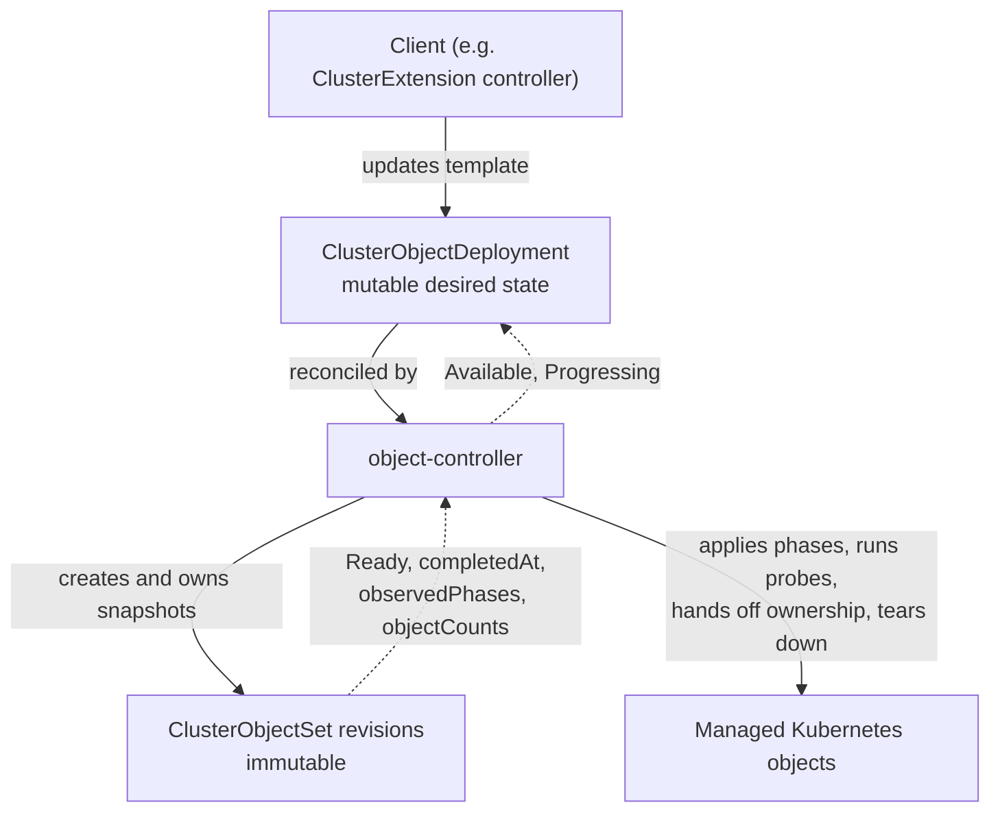

# OLMv1 Object Orchestration: ClusterObjectDeployment and ClusterObjectSet APIs

## Summary

This enhancement proposes two new cluster-scoped APIs in the
`olm.operatorframework.io/v1` group that together form OLMv1's content-application
kernel:

1. **`ClusterObjectSet` (COS)** — an *immutable* revision resource that describes a
   set of Kubernetes objects organized into ordered phases, applied via server-side
   apply with readiness gates between phases. It is analogous to a Kubernetes
   `ReplicaSet`.

2. **`ClusterObjectDeployment` (COD)** — a *mutable* orchestration resource that holds
   a `ClusterObjectSet` template and stamps out a new immutable `ClusterObjectSet`
   revision whenever the template content changes. It observes rollout and prunes
   archived revision history. It is analogous to a Kubernetes
   `Deployment`.

Both APIs are reconciled by a dedicated `object-controller` that is
decoupled from catalog, package, and bundle concepts. This lets any controller or
user drive phased rollouts of arbitrary Kubernetes resources, and gives OLMv1 a
layered architecture: *resolution* (`ClusterExtension`) → *orchestration*
(`ClusterObjectDeployment`) → *content application* (`ClusterObjectSet`).

This enhancement replaces the approach proposed in
[openshift/enhancements#1890](https://github.com/openshift/enhancements/pull/1890)
("Boxcutter Library"), which introduced a single `ClusterExtensionRevision` API as
the revision primitive. It supersedes that design by splitting the revision concept
into the two complementary resources above.

## Motivation

OLMv1 (GA) applies a resolved bundle to the cluster with a Helm-based applier. That
applier is a single, opaque step: it offers no phased rollout, no readiness gating
between groups of objects, no detailed per-object status, and no clean seam for other
actors to participate in the rollout lifecycle. OLMv1's roadmap (phased rollouts,
rollback, richer status, anomaly detection, policy/approval hooks) needs a
reconciliation kernel built around *revisions*.

[openshift/enhancements#1890](https://github.com/openshift/enhancements/pull/1890)
proposed adopting the [Boxcutter](https://github.com/package-operator/boxcutter)
library and a single `ClusterExtensionRevision` API to provide that kernel. While
building it, the design evolved: a single revision resource conflated two distinct
responsibilities — *mutable desired state / rollout orchestration* and *immutable
applied content*. Kubernetes already separates these concerns with
`Deployment`/`ReplicaSet`. OLMv1 adopts the same split:

- **`ClusterObjectSet`** captures the *immutable* applied content of one revision and
  owns phased application, probes, shared-object ownership handoff, and teardown.
- **`ClusterObjectDeployment`** captures the *mutable* desired state and owns revision
  creation, template-metadata propagation, rollout status, archival, and history
  pruning.

Decoupling these from `ClusterExtension` yields three benefits:

**Separation of concerns.** The `ClusterExtension` controller can focus on catalog
resolution and intent mapping; orchestration and application move to purpose-built
controllers.

**Reusability.** Because COS and COD reference no catalog/package/bundle concepts, any
controller or user can drive phased rollouts of arbitrary Kubernetes resources with
readiness gates — not just OLMv1 extensions.

**Roadmap acceleration.** Immutable revisions, phased rollout/teardown, per-object
status probes, collision/anomaly detection, and a rollout history (enabling rollback)
are provided by the kernel rather than reimplemented per consumer.

### User Stories

- As an OLMv1 developer, I want the content-application kernel (phased rollout,
  readiness gating, ownership handoff, teardown) to live in dedicated APIs and a
  dedicated controller, so the `ClusterExtension` controller can focus on resolution
  and intent mapping.
- As a platform engineer, I want to use `ClusterObjectDeployment` and
  `ClusterObjectSet` directly — without `ClusterExtension` — to roll out an arbitrary
  set of Kubernetes resources in ordered phases with readiness gates, so I can reuse
  the orchestration layer for non-catalog use cases.
- As a cluster administrator, I want each phase and object of a rollout to report
  detailed status (which phase is blocked, which objects are not ready, and why), so I
  can quickly diagnose a stuck installation or upgrade.
- As a cluster administrator, I want an immutable, auditable record of exactly what was
  deployed at each revision and a bounded history of prior revisions, so I can
  understand changes over time and support rollback.
- As an operator author, I want to configure how my operator's content is rolled out —
  grouping objects into ordered phases with readiness gates between them, attaching
  custom readiness probes, and setting a progress deadline — so that the rollout
  matches my operator's installation and upgrade requirements.
- As an operator author, I want a new revision to roll out only after it becomes
  healthy before the previous revision is torn down, so upgrades do not leave the
  cluster in a partially-applied state.

This proposal will be operationalized as an experimental feature of OLMv1, gated by the
`BoxcutterRuntime` feature gate (see [Graduation Criteria](#graduation-criteria)). It is
life-cycled, monitored, and remediated through the existing OLMv1 operator
(`cluster-olm-operator`) machinery: the controllers report status conditions, expose
metrics, and are upgraded in lockstep with the rest of OLMv1.

### Goals

1. Introduce `ClusterObjectSet` as an immutable, independently-usable revision API that
   applies a phased set of Kubernetes objects with readiness gating, collision
   protection, inter-revision ownership handoff, and teardown.
2. Introduce `ClusterObjectDeployment` as a mutable orchestration API that stamps out
   `ClusterObjectSet` revisions from a template, observes rollout, and prunes
   superseded (archived) revision history.
3. Keep both APIs free of catalog/package/bundle concepts so they are reusable by any
   controller or user; express revision-chain membership through the immutable `group`
   spec field rather than labels.
4. Provide detailed, actionable status: a single `Ready` condition plus per-phase and
   per-object reporting on COS; `Available` and `Progressing` conditions on COD.
5. Deliver these behind the `BoxcutterRuntime` feature gate (experimental /
   Tech Preview) via a dedicated `object-controller`, without changing the behavior of
   default (non-Tech-Preview) clusters.

### Non-Goals

1. **No `ClusterExtension` API change.** `ClusterExtension` continues to resolve
   catalogs and express user intent. Migrating `ClusterExtension` to create a
   `ClusterObjectDeployment` (instead of creating `ClusterObjectSet` revisions
   directly, as it does today under `BoxcutterRuntime`) is a follow-up tracked
   separately.
2. **No namespace-scoped variants.** `ObjectDeployment` / `ObjectSet` are out of scope;
   they can follow once the cluster-scoped APIs are stable.
3. **No scoped-RBAC model for applied content.** The `object-controller` runs with
   `cluster-admin`, consistent with
   [openshift/enhancements#2054](https://github.com/openshift/enhancements/pull/2054).
   A least-privilege model is a separate effort.
4. **No new rollout strategies** (canary, blue-green) and **no pause/rollback API** in
   this proposal. The immutable revision history is the foundation for a future
   rollback API; rollback itself is out of scope here.

## Proposal

### Architecture

Today, under the `BoxcutterRuntime` feature gate, OLMv1 is a two-layer system: the
`ClusterExtension` controller resolves a bundle and creates `ClusterObjectSet`
revisions directly.

```
ClusterExtension ──creates──▶ ClusterObjectSet (rev 1, 2, 3 …)
                                 └──manages──▶ cluster objects
```

This proposal adds `ClusterObjectDeployment` as an orchestration layer, yielding a
three-layer system:

```
ClusterExtension ──manages──▶ ClusterObjectDeployment  (mutable desired state)
                                 └──stamps out──▶ ClusterObjectSet (rev 1, 2, 3 …)  (immutable revisions)
                                                    └──manages──▶ cluster objects
```

- **`ClusterExtension`** (unchanged by this proposal) resolves catalogs and expresses
  intent.
- **`ClusterObjectDeployment` (COD)** holds a COS template. When the template content
  changes (detected by a content hash), it creates a new COS revision; it observes
  rollout and garbage-collects archived revisions beyond its retention limit
  (`revisionHistoryLimit`).
- **`ClusterObjectSet` (COS)** is one immutable revision. The controller applies its
  objects phase by phase via server-side apply, runs readiness probes, hands off
  shared-object ownership to succeeding revisions in the same `group`, and tears down
  objects on archival.

Both APIs are reconciled by the dedicated **`object-controller`**, which depends on
neither `ClusterExtension` nor `ClusterCatalog`.

### Workflow Description

**cluster administrator** installs an extension by creating a `ClusterExtension`.

**ClusterExtension controller** resolves the bundle and (in the target architecture)
creates or updates a `ClusterObjectDeployment`, placing the resolved objects into
`spec.template.spec.phases` and the resolution metadata (package name, bundle version,
image reference) into `spec.template.metadata` labels/annotations.

**ClusterObjectDeployment controller** hashes the template; if no owned active COS
matches, it allocates the next revision number and creates a `ClusterObjectSet` named
`<group>-<revision>` with `spec.group` set to the COD name, `spec.lifecycleState:
Active`, and a controller owner reference to the COD.

**ClusterObjectSet controller** reconciles the new revision, applying each phase's
objects via server-side apply and advancing only after every object in the phase passes
its readiness probes. During a transition, both the old and new revisions are Active;
shared objects transfer ownership from the old revision to the new one via a shared
field manager.

**ClusterObjectDeployment controller** observes the new revision become `Ready`,
reports `Available`/`Progressing`, and garbage-collects archived revisions beyond
`revisionHistoryLimit`.

Step by step:

1. A client (the `ClusterExtension` controller, or any other actor) creates/updates a
   `ClusterObjectDeployment` with the desired phases in `spec.template`.
2. The COD controller computes the template identity. If an owned active COS already
   matches, nothing is created. Otherwise it allocates `max(revision in group) + 1`
   (or `1` for an empty group) and creates the COS snapshot.
3. The COS controller applies phase 1's objects via server-side apply, evaluates their
   probes, and records `completedAt` on the phase when all objects are Ready. It then
   proceeds to phase 2, and so on.
4. During an upgrade, the old and new revisions are both Active. Objects common to both
   transfer ownership to the new revision; objects only in the old revision stay owned
   by it until archival.
5. When all phases are Ready, the COS sets `Ready=True` and stamps
   `status.completedAt`. The COD observes this and sets `Available=True` /
   `Progressing=False` (reason `NewClusterObjectSetProgressed`).
6. A superseded predecessor is transitioned to `lifecycleState: Archived`. Once
   archived, the COS controller tears down objects still under the predecessor's
   exclusive ownership (reverse phase order) and removes its finalizer.
7. The COD garbage-collects archived COSs beyond `spec.revisionHistoryLimit`
   (default 5).



### API Extensions

This enhancement adds two new cluster-scoped CRDs in group
`olm.operatorframework.io`, version `v1`: `ClusterObjectSet` and
`ClusterObjectDeployment`. Both use the `/status` subresource. Neither modifies
resources owned by other parties; each manages its own CRs and the arbitrary
Kubernetes objects declared in its phases. The `object-controller` holds a finalizer
on COS resources to drive ordered teardown on archival/deletion.

Operational impact is covered in
[Operational Aspects of API Extensions](#operational-aspects-of-api-extensions).

#### `ClusterObjectSet` (immutable revision)

Cluster-scoped, `kind: ClusterObjectSet`. `metadata.name` **must** equal
`<spec.group>-<spec.revision>` (enforced by a CEL `XValidation` rule);
`metadata.generateName` is not supported.

Spec fields:

| Field | Contract |
|---|---|
| `spec.group` | Required, **immutable**. 1–52 chars, `^[a-z]([a-z0-9-]*[a-z0-9])?$`. Links related revisions into one ordered sequence regardless of owner references. |
| `spec.revision` | Required, **immutable**. `int64`, 1–9999999999. Unique within a group. Ten digits plus a hyphen fit a 52-char group within the 63-char name limit. |
| `spec.lifecycleState` | Required enum `Active` / `Archived`. May only transition `Active → Archived` (CEL-enforced "cannot un-archive"). Multiple revisions can be `Active` simultaneously during a transition. |
| `spec.phases` | **Immutable** once set (even if empty). Ordered, `listMapKey=name`, max 20 phases. Each phase has a DNS-label `name`, up to 50 `objects`, and an optional phase-level `collisionProtection`. |
| `spec.progressionProbes` | Optional, **immutable** once set. Experimental. Max 20. Custom readiness probes applied to every phase; each probe selects objects (`GroupKind` or `Label`) and runs assertions (`ConditionEqual` / `FieldsEqual` / `FieldValue`). A probe passes vacuously for phases with no matching objects. |
| `spec.collisionProtection` | Required enum, **immutable**: `Prevent` / `IfNoController` / `None`. Default for all phases/objects; resolution order is object > phase > spec. |

Each phase object (`spec.phases[].objects[]`) sets **exactly one** of:

- `object` — an embedded Kubernetes manifest (`EmbeddedResource`,
  `PreserveUnknownFields`); or
- `ref` — a reference (`name`, `namespace`, `key`) to an **immutable** `Secret` holding
  the serialized manifest. This externalizes large manifests so a COS stays within
  etcd's object-size limit. See [Object storage](#object-storage-inline-vs-references).

Status fields:

| Field | Contract |
|---|---|
| `status.conditions` | A single `Ready` condition (`listMapKey=type`). Reasons: `Pending` (Unknown, initial), `AllObjectsReady` (True), `ObjectsNotReady`, `Superseded`, `ObjectCollision`, `PreconditionsNotMet`, `InvalidSpecification`, `Archiving`, `Archived` (all False). |
| `status.completedAt` | Timestamp set once when the revision first became Ready; **immutable** and cannot be removed once set (CEL-enforced). Marks that the revision rolled out successfully at least once. |
| `status.objectCounts` | Aggregate `total` / `present` / `synced` / `ready` counts across phases. |
| `status.observedPhases` | Per-phase (`listMapKey=name`, max 20) record of `status` (`PhaseStatus` enum), `digest` (immutable `<algorithm>:<hex>` content digest of the resolved phase, used to detect `ref` content tampering), `completedAt`, `lastTransitionTime`, `message`, `objectCounts`, and `objectDetails` (up to 50 incomplete objects with per-object failure messages). |

`PhaseStatus` is one of: `InvalidSpecification`, `PreconditionsNotMet`, `Pending`,
`Reconciling`, `Stabilizing`, `Ready`, `Unknown`, `Superseded`, `Archiving`,
`Archived`.

Example (inline objects):

```yaml
apiVersion: olm.operatorframework.io/v1
kind: ClusterObjectSet
metadata:
  name: my-app-1          # must be <group>-<revision>
spec:
  group: my-app
  revision: 1
  lifecycleState: Active
  collisionProtection: Prevent
  phases:
    - name: crds
      objects:
        - object:
            apiVersion: apiextensions.k8s.io/v1
            kind: CustomResourceDefinition
            metadata: {name: widgets.example.com}
            spec: {group: example.com, scope: Namespaced, names: {kind: Widget, plural: widgets}, versions: [{name: v1, served: true, storage: true, schema: {openAPIV3Schema: {type: object}}}]}
    - name: deploy
      objects:
        - object:
            apiVersion: apps/v1
            kind: Deployment
            metadata: {name: my-app-controller, namespace: my-app-system}
            spec: {replicas: 1, selector: {matchLabels: {app: my-app-controller}}, template: {metadata: {labels: {app: my-app-controller}}, spec: {containers: [{name: manager, image: example.com/my-app:v1.0.0}]}}}
```

#### `ClusterObjectDeployment` (mutable orchestration)

Cluster-scoped, `kind: ClusterObjectDeployment`, short name `cod`. `metadata.name` is
limited to a valid COS group (≤52 chars, `^[a-z]([a-z0-9-]*[a-z0-9])?$`) because each
child COS is named `<cod-name>-<revision>`.

Spec fields:

| Field | Contract |
|---|---|
| `spec.revisionHistoryLimit` | Optional `*int32`, min 0, max 50, **default 5**. Maximum number of *archived* revisions to retain for inspection/rollback. Active revisions are never removed and never count against the limit. `0` retains no archived revisions. |
| `spec.template` | Required. The desired content of newly-created COSs. A change to `template` creates a new revision; existing revisions remain immutable. |
| `spec.template.metadata.labels` / `.annotations` | Optional maps (max 32 each) copied onto every COS created from the template. This is the seam between the resolution layer and the orchestration layer. The controller owns the reserved `olm.operatorframework.io/template-hash` label; callers cannot set it. Annotations are validated against Kubernetes rules before a revision is created. |
| `spec.template.spec.phases` | Required ordered list, 1–20 phases (`listMapKey=name`), reusing the COS phase/object types and limits (≤50 objects/phase). |
| `spec.template.spec.progressDeadlineMinutes` | Optional `int32`, min 10, max 720 (12 h). Maximum time a revision may take to roll out, measured from the COS creation timestamp; covers all phases together (completing a phase does not reset it). Time spent waiting for the COS to be created is not counted. Omitted means no deadline. Once a revision completes, the deadline no longer applies. |
| `spec.template.spec.progressionProbes` | Optional (max 20), reusing the COS selector/assertion semantics. |
| `spec.template.spec.collisionProtection` | Required enum `Prevent` / `IfNoController` / `None`. |

`group`, `revision`, `lifecycleState`, and ownership are controller-assigned on each
child COS and are therefore absent from the template. The COD's inactivity deadline
(`progressDeadlineMinutes`) lives on the COD, not inside the COS revision content.

Status fields:

`status.conditions` carries `Available` and `Progressing` (`listMapKey=type`); each
condition records the evaluated `observedGeneration`. Per-revision and per-phase detail
remains on the COS resources; the COD does not duplicate it.

- **`Available`** — health of the owned active (non-archived) revisions.
  - `False` / `NoActiveRevision` — no active revision exists.
  - `True` / `Available` — at least one active revision is `Ready`. The deployment
    stays available across a rollout while a previous revision is still Ready.
  - `False` / `Unavailable` — active revisions exist but none are Ready yet.

- **`Progressing`** — progress of the desired (head) rollout and why the head revision
  is not yet Ready.
  - `True` / `NewClusterObjectSetProgressing` — the desired rollout is incomplete.
  - `False` / `NewClusterObjectSetProgressed` — completed (latched; stays recorded even
    if the completed revision later becomes unhealthy).
  - `False` / `ProgressDeadlineExceeded` — the latest revision did not roll out within
    `progressDeadlineMinutes`.
  - `False` / `InvalidSpecification` — `spec.template.metadata` labels/annotations are
    invalid; no new revision is created until corrected.
  - `True` / `RevisionPreconditionsNotMet` — the head revision's preconditions (e.g.
    RBAC or a dependency CRD) are not yet met; the controller keeps retrying.
  - `False` / `RevisionObjectCollision` — the head revision's objects are owned by
    another controller or already exist; user intervention required.
  - `False` / `RevisionInvalidSpecification` — the head revision's own objects are
    invalid (distinct from the template-metadata `InvalidSpecification` above).

Example:

```yaml
apiVersion: olm.operatorframework.io/v1
kind: ClusterObjectDeployment
metadata:
  name: my-app
spec:
  revisionHistoryLimit: 5
  template:
    metadata:
      labels:
        app.kubernetes.io/name: my-app
    spec:
      collisionProtection: Prevent
      progressDeadlineMinutes: 10
      phases:
        - name: crds
          objects:
            - object: {apiVersion: apiextensions.k8s.io/v1, kind: CustomResourceDefinition, metadata: {name: widgets.example.com}, spec: {group: example.com, scope: Namespaced, names: {kind: Widget, plural: widgets}, versions: [{name: v1, served: true, storage: true, schema: {openAPIV3Schema: {type: object}}}]}}
        - name: deploy
          objects:
            - object: {apiVersion: apps/v1, kind: Deployment, metadata: {name: my-app-controller, namespace: my-app-system}, spec: {replicas: 1, selector: {matchLabels: {app: my-app-controller}}, template: {metadata: {labels: {app: my-app-controller}}, spec: {containers: [{name: manager, image: example.com/my-app:v1.0.0}]}}}}
```

### Topology Considerations

#### Hypershift / Hosted Control Planes

The `object-controller` reconciles cluster-scoped CRs and manages objects in the
cluster it runs in, the same as `operator-controller` today. In a Hypershift topology
it follows the same placement as the rest of OLMv1; there are no new management-cluster
vs. guest-cluster split considerations beyond those that already apply to OLMv1.

#### Standalone Clusters

Fully relevant; this is the primary topology. The feature is gated by
`BoxcutterRuntime` and off by default.

#### Single-node Deployments or MicroShift

The `object-controller` is an additional Deployment (one replica, with a leader-election
lease) that runs only when `BoxcutterRuntime` is enabled — i.e. not on default SNO
installs. When enabled, it adds a modest, bounded memory/CPU footprint: COD
reconciliation is lightweight (it acts on template changes and otherwise aggregates
status), and COS reconciliation scales with the number of managed objects, which is the
same workload OLMv1 performs today via the Helm applier. MicroShift does not ship
OLMv1/operator-controller, so there is no MicroShift impact and no MicroShift
configuration surface is added.

#### OpenShift Kubernetes Engine (OKE)

No dependency on features excluded from OKE. The APIs and controller are part of OLMv1
and behave identically wherever OLMv1 is present.

### Implementation Details/Notes/Constraints

**The `object-controller`.** COS and COD are reconciled by the experimental
`object-controller`, which runs in its own Deployment with its own service account and
leader-election lease. It watches `ClusterObjectSet`, `ClusterObjectDeployment`, and the
objects they manage (via dynamic watches); it requires neither `ClusterExtension` nor
`ClusterCatalog`. Upstream it may be deployed into the single OLMv1 namespace alongside
`operator-controller`; downstream (OpenShift) it becomes a first-class payload image
(`ose-olm-object-controller`) in its own `openshift-object-controller` namespace,
rendered by `cluster-olm-operator` only when `BoxcutterRuntime` is enabled (see the
[component-separation work][component-sep]). Object application uses the
[Boxcutter](https://github.com/package-operator/boxcutter) library.

**Revision identity and allocation (COD).** The COD hashes the declared template
(metadata + spec, before controller-assigned fields are filled). Root metadata, status,
and `progressDeadlineMinutes`-only edits do not create a revision. Phase/object/probe
*order* participates in identity; map-key order does not. If no owned active COS matches
the current hash, the controller allocates `max(revision across the whole group) + 1`
(including archived/foreign members), or `1` for an empty group, and refuses allocation
at `int64` max rather than wrapping. Each child is named `<group>-<revision>`,
`lifecycleState: Active`, with a controller owner reference to the COD. A reverted
template (A → B → A) produces a new higher revision; an archived COS is never
reactivated.

**Group membership vs. ownership.** All COSs sharing an immutable `spec.group` form one
revision chain, regardless of owner references. A COD manages the COSs it controls (by
UID); it never replaces a foreign controller reference. Revision allocation considers
the whole group, but health and history summaries consider only the owned subset.
Legitimate adoption of an ownerless COS in the group is a designed behavior that is not
yet implemented in the controller today (the reconciler sets a controller reference only
when it creates a revision).

**Phase application and ownership handoff (COS).** Phases apply sequentially via
server-side apply; a phase advances only after all its objects pass their probes. Revisions in the same group share the field manager
`cos-group/<group>`, which lets ownership of a shared object transfer from one revision
to the next without a collision. On archival, a COS is removed from the owner list of
objects adopted by a successor and deletes any objects that did not transition, in
reverse phase order, before its finalizer is removed. Single-owner semantics across
`ClusterExtension`s are preserved.

**Archival and history (current state).** The COD controller today (a) creates a new
revision when the template changes or no matching active revision exists, (b) derives the
COD `Available`/`Progressing` conditions from the group's revisions, and (c)
garbage-collects (deletes) revisions already in `lifecycleState: Archived` beyond
`revisionHistoryLimit` (best-effort, never blocking rollout). It does **not** itself set
a predecessor's `spec.lifecycleState` to `Archived`. The COS controller performs
teardown of a revision's objects once that revision is already `Archived` (reporting
`Ready=False` with reason `Archiving`, then `Archived`), but does not perform the
`Active → Archived` transition either. Consolidating the predecessor archival transition
(and full teardown ownership) under the COD controller is a documented follow-up; until
it lands, multiple revisions can remain `Active` and callers/consumers drive the
transition.

**Collision protection.** Three strategies — `Prevent` (only manage self-created
objects), `IfNoController` (adopt pre-existing objects not owned by another controller),
`None` (adopt anything; dangerous) — resolved object > phase > spec.

#### Object storage (inline vs references)

Each phase object is stored either inline
(`object`) or as a `ref` to an immutable `Secret`. When OLMv1 builds revisions it
externalizes manifests into content-addressable, immutable Secrets (packed up to
~900 KiB with headroom below etcd's ~1.5 MiB limit, gzip-compressing larger manifests
and transparently decompressing on read), keeping revisions within etcd limits. See
[Large Bundle Support][large-bundle].

**Status contract choices (as implemented).** COS exposes a single `Ready` condition
plus `completedAt` and rich `observedPhases`/`objectCounts`; rollout *completion* is a
timestamp, not a condition. COD exposes `Available` (owned installation health) and
`Progressing` (desired-rollout progress and head-revision blockers), using the
condition-based deadline/completion model rather than persisted timer fields. COD
status does not duplicate per-revision/per-phase detail — that remains the source of
truth on COS.

**Relationship to `ClusterExtension`.** Under `BoxcutterRuntime` today, the
`ClusterExtension` controller creates `ClusterObjectSet` revisions directly, setting
`spec.group` to the extension name and keeping the extension as the owner for garbage
collection. Introducing COD does not require changing that immediately: the
`object-controller` continues to reconcile COSs created by `ClusterExtension`.
Migrating `ClusterExtension` to create a `ClusterObjectDeployment`, and consolidating
the revision archival transition under the COD controller (see *Archival and history*
above), are explicit follow-ups.

**Dependency on `cluster-admin`.** The `object-controller` applies arbitrary Kubernetes
objects on behalf of callers and therefore operates with `cluster-admin`, consistent
with [openshift/enhancements#2054](https://github.com/openshift/enhancements/pull/2054).
The per-revision ServiceAccount-scoped client model is not part of these APIs; a
least-privilege model is a separate effort.

**Immutability enforcement.** COS `spec.group`, `spec.revision`, `spec.phases`,
`spec.progressionProbes`, and `spec.collisionProtection` are immutable via CEL
`XValidation`; `spec.lifecycleState` may only move `Active → Archived`;
`status.completedAt` and per-phase `digest`/`completedAt` are immutable once set.
`ref`-backed objects require the referenced Secret to be `immutable: true`; the
controller blocks (`Ready=False`, reason `PreconditionsNotMet`) if it is not, or if the
observed `digest` no longer matches.

### Risks and Mitigations

**Migration from the GA Helm-based applier.** Clusters upgrading from GA (Helm applier)
to a `BoxcutterRuntime`-enabled state need their existing releases represented as COD +
COS. *Mitigation:* the existing Helm→Boxcutter storage migrator is extended to
synthesize a COD and initial COS from each Helm release. Because the Boxcutter runtime
is behind a feature gate and has not reached GA, migration from an older COS/revision
format is not required — only migration from the GA Helm applier matters.

**Added API surface and indirection.** Two new CRDs and a new controller add RBAC,
objects in etcd, and a third resource to reason about when debugging. *Mitigation:* this
mirrors Kubernetes' own `Deployment`/`ReplicaSet`/`Pod` layering; the COD controller is
lightweight; expected instance counts are low (order of the number of extensions). The
layering buys separation of concerns and reuse.

**Security review.** The controller runs with `cluster-admin` and applies arbitrary
objects; this is the same trust model as OLMv1's current applier and is reviewed with
the OLMv1 team under the umbrella of
[openshift/enhancements#2054](https://github.com/openshift/enhancements/pull/2054).
*UX review* (status surfaces, `kubectl` columns, diagnostics) is handled with the OLMv1
and docs teams during Tech Preview.

### Drawbacks

The primary drawback is an extra layer of indirection: debugging a rollout can require
looking at `ClusterExtension` → `ClusterObjectDeployment` → `ClusterObjectSet` rather
than two resources. This is the same trade-off Kubernetes makes with
`Deployment`/`ReplicaSet`/`Pod`; the detailed per-phase/per-object status on COS and the
`Available`/`Progressing` summary on COD are designed to make the common diagnostic path
short. A second drawback is that keeping `progressionProbes` at the spec level (rather
than inline per-object assertions) means a controller populating the template repeats
common probes programmatically; this is an implementation detail for generated
templates and avoids coupling this proposal to a probe redesign.

## Alternatives (Not Implemented)

### Single `ClusterExtensionRevision` API (the original #1890 approach)

[openshift/enhancements#1890](https://github.com/openshift/enhancements/pull/1890)
proposed one revision API. Rejected because it conflates mutable desired state /
orchestration with immutable applied content, which Kubernetes itself separates
(`Deployment`/`ReplicaSet`). Splitting into COD + COS makes each layer independently
usable and independently evolvable.

### Keep the two-layer architecture (no COD)

The `ClusterExtension` controller could keep creating COSs directly and simply adopt the
`group` field. Rejected because orchestration concerns (revision stamping, archival,
pruning, deadline tracking) would remain embedded in `ClusterExtension`, and any other
controller wanting phased rollout would have to reimplement them.

### Express revision chains with labels instead of a `group` spec field

The chain could be identified by labels (as earlier prototypes did). Rejected because
labels are mutable and unsuitable for a correctness-critical grouping. An immutable,
validated `group` spec field is a stronger contract and makes a COS self-describing.

### CEL-based probes

Support for CEL-based probes is deferred to its own enhancement so it can
be evaluated on its own merits without blocking the introduction of the APIs.

### Persisted rollout record for deadline timing

A future COD could persist the desired-template identity and a rollout start timestamp
in status to give each template change its own creation window independent of condition
transition times. Not implemented: the condition-based deadline model is sufficient for
the current requirements and avoids additional status fields and recovery logic.

## Open Questions

1. What exactly must the Helm→Boxcutter storage migrator produce to represent an
   existing Helm release as a COD + initial COS (naming, metadata, revision number)?
2. When `ClusterExtension` migrates to drive COD (follow-up), how and when does archival
   responsibility move from the COS controller to the COD controller without disrupting
   in-flight rollouts?
3. Should a purpose-built `ClusterObjectSlice` type eventually replace Secret-backed
   `ref` storage, or is content-addressable immutable Secret storage sufficient
   long-term?
4. Which `api-approvers` own the CRD review for these two APIs?

## Test Plan

- **Unit tests** for the COD controller (template hashing/identity, revision
  allocation, adoption, archival, history pruning, deadline evaluation, status
  derivation) and the COS controller (phase progression, probe evaluation, collision
  protection modes, ownership handoff, teardown, `ref` resolution incl. gzip).
- **Integration tests** (envtest) for end-to-end flows: first install, upgrade with
  shared objects, upgrade that removes objects, archival, teardown, deadline exceeded,
  precondition-not-met recovery, collision handling, and the restart/recovery scenarios
  enumerated in the COD contract.
- **API validation tests** for the CEL immutability rules (group/revision/phases/
  probes/collisionProtection, `lifecycleState` transitions, `completedAt`,
  `<group>-<revision>` name rule) and bounds (phase/object/probe/annotation limits).
- **E2E tests** on a real cluster exercising the full
  `ClusterExtension` → COD → COS pipeline under `BoxcutterRuntime`, plus a standalone
  COD/COS walkthrough with no `ClusterExtension`.
- **Migration tests** verifying GA Helm releases are correctly migrated to COD + COS.

## Graduation Criteria

The feature is delivered behind the `BoxcutterRuntime` feature gate. On OpenShift this
gate is reachable only through `*NoUpgrade` feature sets (TechPreview/DevPreview/
CustomNoUpgrade), so enabling it blocks cluster upgrades and there is no installed base
to migrate across the gate.

### Dev Preview -> Tech Preview

- COD and COS are functional end-to-end under `BoxcutterRuntime`.
- Phased rollout, readiness probes, collision protection, ownership handoff, archival,
  teardown, and history pruning work and are covered by unit/integration tests.
- Per-phase/per-object status (`observedPhases`, `objectCounts`, `objectDetails`) and
  COD `Available`/`Progressing` conditions provide actionable diagnostics.
- The `object-controller` ships as its own component (downstream: its own payload image
  and namespace) and is deployed only when `BoxcutterRuntime` is enabled.
- SLIs exposed as metrics; symptom-based alerts drafted.
- Initial user-facing documentation.

### Tech Preview -> GA

- API stability: no breaking changes to COD/COS spec; `api-approvers` sign-off.
- `ClusterExtension` migrated to drive COD; archival responsibility consolidated.
- Migration from the GA Helm applier automated and tested; upgrade/downgrade tested.
- Scale/load testing with realistic bundle sizes; SLOs documented and SLI telemetry
  backhauled.
- End-to-end tests required for GA.
- User-facing documentation in [openshift-docs](https://github.com/openshift/openshift-docs/).

### Removing a deprecated feature

When the Boxcutter runtime replaces the Helm applier by default, the Helm applier is
deprecated and removed per the standard deprecation/support policy, with the migrator
retained for the supported upgrade window.

## Upgrade / Downgrade Strategy

The CRDs and controller are delivered and upgraded by `cluster-olm-operator` in lockstep
with the rest of OLMv1; micro and minor version upgrades follow the standard OLMv1
upgrade path. On upgrade into a `BoxcutterRuntime`-enabled state from the GA Helm
applier, the extended Helm→Boxcutter migrator synthesizes COD + COS from existing
releases.

Because the feature is only reachable on `*NoUpgrade` feature sets, a cluster that has
enabled it cannot upgrade, so there is no cross-version COD/COS skew to support while the
feature is pre-GA. Downgrade to a pre-COD GA version is not automatic: the migrator does
not keep Helm release records current as revisions progress, so the Helm applier cannot
resume from stale state; a downgrade requires documented manual steps (e.g. reinstalling
affected extensions). This constraint is removed as the feature approaches GA with a
supported, tested migration path.

## Version Skew Strategy

The COD and COS controllers run in the single `object-controller` binary, so there is no
intra-feature version skew. The `object-controller`, `operator-controller`, and their
CRDs are versioned and upgraded together by `cluster-olm-operator`. During the window
where `ClusterExtension` still creates COSs directly (pre-migration), both paths target
the same COS API served by the same controller, so no API skew arises. The APIs manage
arbitrary Kubernetes objects via server-side apply and tolerate normal control-plane
version skew the same way other OLMv1-applied content does.

## Operational Aspects of API Extensions

- **CRDs (no admission/conversion webhooks, no aggregated apiserver).** Validation is
  schema- and CEL-based, so there is no webhook availability dependency on the API path.
- **Instance counts.** Expected on the order of the number of installed extensions (tens,
  not thousands) plus bounded archived history per COD (`revisionHistoryLimit`, default
  5). Negligible impact on general API throughput.
- **Health SLIs.** COD `Available` / `Progressing` conditions; COS `Ready` condition
  plus `objectCounts`/`observedPhases`; `object-controller` reconcile latency/error
  metrics and leader-election status. A stale `observedGeneration` or missing conditions
  indicates the controller is not reconciling.
- **Failure modes.** If the `object-controller` stops, no new revisions are stamped and
  archival/pruning halts, but already-applied objects remain in their last-applied
  state; active COSs resume reconciling when the controller returns. A revision can
  stall on `RevisionObjectCollision` / `RevisionInvalidSpecification` (hard stalls
  needing user action) or `RevisionPreconditionsNotMet` (auto-retried).
- **Measurement and ownership.** Performance/scale impact is assessed by the OLMv1 team
  via CI e2e and periodic scale testing; the OLMv1 team is the escalation owner.

## Support Procedures

Detecting and diagnosing issues:

- `kubectl get clusterobjectdeployments` — the `Available` and `Progressing` columns
  show the overall state; `Progressing`'s reason distinguishes "in progress" from a hard
  stall (`RevisionObjectCollision`, `RevisionInvalidSpecification`),
  `ProgressDeadlineExceeded`, or template `InvalidSpecification`.
- `kubectl get clusterobjectset <name> -o jsonpath='{.status.observedPhases}'` — per-phase
  `status`, `message`, and `objectDetails` identify the blocking phase and the specific
  objects with failure messages (probe failures, collisions, apply errors). Printed
  columns show `Ready`, `Reason`, and object counts.
- Controller logs: `kubectl -n <object-controller-namespace> logs deploy/object-controller-controller-manager`.

Common situations:

- COS `Ready=False` / `PreconditionsNotMet`: a referenced Secret is mutable/changed, or
  RBAC/dependency CRDs have not propagated — grant RBAC / install the dependency / fix
  the Secret; it recovers automatically.
- COS `Ready=False` / `ObjectCollision`: resolve ownership of the conflicting objects.
- COD `Progressing` stuck with multiple active revisions: the head revision is not yet
  Ready — inspect its `observedPhases`.
- Archived COS retaining its finalizer: teardown is in progress or blocked — inspect its
  `observedPhases` for `Archiving` phases with `objectDetails`.

Disabling the extension: because the APIs are gated by `BoxcutterRuntime`, the feature is
disabled by not enabling the gate. Deleting a CRD requires removing its CRs first;
deleting COSs triggers finalizer-driven teardown of managed objects, so operators should
archive/delete deliberately to avoid unintended teardown of workloads. Functionality
resumes cleanly when the controller is restored: reconciliation is idempotent and driven
by immutable revision content plus persisted status.

## Infrastructure Needed

No new source repository. The APIs and controller live in the existing
[operator-framework/operator-controller](https://github.com/operator-framework/operator-controller)
repo (the `object-controller` binary and `api/v1` types already exist). Downstream, a new
payload image (`ose-olm-object-controller`) and namespace (`openshift-object-controller`)
are onboarded via `ocp-build-data` and rendered by `cluster-olm-operator` (see the
[component-separation design][component-sep]).

[component-sep]: https://github.com/operator-framework/operator-controller/blob/main/docs/superpowers/specs/2026-10-19-object-controller-component-separation-design.md
[large-bundle]: https://github.com/operator-framework/operator-controller/blob/main/docs/draft/concepts/large-bundle-support.md
