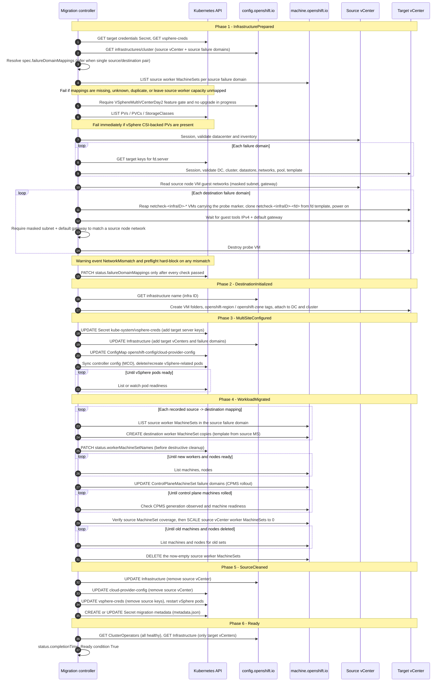

# VCF Migration Operator

## Summary

Migrate OpenShift clusters from a source vCenter to a destination vCenter. Worker placement on destination failure domains follows an explicit, validated source→destination failure domain mapping in `spec.failureDomainMappings`.

## Motivation

Customers are upgrading to greenfield VCF environments, they need a better method of migration than rebuild and MTC.

### User Stories

Child issues of epic [SPLAT-2644](https://issues.redhat.com/browse/SPLAT-2644):

| Area | Child issues |
|------|--------------|
| Preflight validation and hardening | [SPLAT-2652](https://issues.redhat.com/browse/SPLAT-2652) (Closed), [SPLAT-2875](https://issues.redhat.com/browse/SPLAT-2875) (Closed), [SPLAT-2965](https://issues.redhat.com/browse/SPLAT-2965) (Closed), [SPLAT-2969](https://issues.redhat.com/browse/SPLAT-2969) (Closed), [SPLAT-2961](https://issues.redhat.com/browse/SPLAT-2961) (Closed), [SPLAT-2879](https://issues.redhat.com/browse/SPLAT-2879) (Closed), [SPLAT-2900](https://issues.redhat.com/browse/SPLAT-2900) (Closed), [SPLAT-2962](https://issues.redhat.com/browse/SPLAT-2962) (Closed) |
| Control plane and worker migration | [SPLAT-2654](https://issues.redhat.com/browse/SPLAT-2654) (Closed), [SPLAT-2655](https://issues.redhat.com/browse/SPLAT-2655) (Closed), [SPLAT-2877](https://issues.redhat.com/browse/SPLAT-2877) (Closed), [SPLAT-2958](https://issues.redhat.com/browse/SPLAT-2958) (Closed), [SPLAT-3013](https://issues.redhat.com/browse/SPLAT-3013) (In Progress), [SPLAT-2864](https://issues.redhat.com/browse/SPLAT-2864) (In Progress) |
| Destination inventory and image import | [SPLAT-2663](https://issues.redhat.com/browse/SPLAT-2663) (Closed), [SPLAT-2683](https://issues.redhat.com/browse/SPLAT-2683) (Closed), [SPLAT-2684](https://issues.redhat.com/browse/SPLAT-2684) (Closed), [SPLAT-2876](https://issues.redhat.com/browse/SPLAT-2876) (Closed), [SPLAT-2959](https://issues.redhat.com/browse/SPLAT-2959) (Closed), [SPLAT-2960](https://issues.redhat.com/browse/SPLAT-2960) (Closed), [SPLAT-2966](https://issues.redhat.com/browse/SPLAT-2966) (Closed) |
| Lifecycle, API, and metadata | [SPLAT-2656](https://issues.redhat.com/browse/SPLAT-2656) (Closed), [SPLAT-2657](https://issues.redhat.com/browse/SPLAT-2657) (Closed), [SPLAT-2863](https://issues.redhat.com/browse/SPLAT-2863) (Closed), [SPLAT-2662](https://issues.redhat.com/browse/SPLAT-2662) (Closed) |
| Operator delivery and installation | [SPLAT-2653](https://issues.redhat.com/browse/SPLAT-2653) (Closed), [SPLAT-2659](https://issues.redhat.com/browse/SPLAT-2659) (Closed), [SPLAT-2658](https://issues.redhat.com/browse/SPLAT-2658) (Closed), [SPLAT-2706](https://issues.redhat.com/browse/SPLAT-2706) (Closed), [SPLAT-2681](https://issues.redhat.com/browse/SPLAT-2681) (Closed), [SPLAT-2701](https://issues.redhat.com/browse/SPLAT-2701) (In Progress), [SPLAT-2837](https://issues.redhat.com/browse/SPLAT-2837) (In Progress), [SPLAT-2968](https://issues.redhat.com/browse/SPLAT-2968) (Backlog) |
| Testing and enhancement | [SPLAT-2647](https://issues.redhat.com/browse/SPLAT-2647) (Closed), [SPLAT-2645](https://issues.redhat.com/browse/SPLAT-2645) (Backlog), [SPLAT-2646](https://issues.redhat.com/browse/SPLAT-2646) (Backlog), [SPLAT-2661](https://issues.redhat.com/browse/SPLAT-2661) (Backlog), [SPLAT-2702](https://issues.redhat.com/browse/SPLAT-2702) (Backlog) |

Related work that is not a child of SPLAT-2644: [SPLAT-2649](https://issues.redhat.com/browse/SPLAT-2649), [SPLAT-2651](https://issues.redhat.com/browse/SPLAT-2651), [SPLAT-2664](https://issues.redhat.com/browse/SPLAT-2664) (Closed) and [SPLAT-2703](https://issues.redhat.com/browse/SPLAT-2703), [SPLAT-2704](https://issues.redhat.com/browse/SPLAT-2704) (Backlog).

### Goals

- Migrate OpenShift on vSphere from a source vCenter to a destination vCenter using Machine API and Control Plane Machine Set (CPMS), with operator-driven validation and phased reconciliation.

### Non-Goals

- Migration of vSphere CSI persistent volumes in v1 (Phase 2 / Storage); Phase 1 should **fail preflight immediately** if vSphere CSI-backed persistent volumes are detected on the cluster.


## Proposal

Implementation lives in [`openshift/vcf-migration-operator`](https://github.com/openshift/vcf-migration-operator): Kubebuilder / Operator SDK v4, Go 1.25+, `controller-runtime`, OpenShift `config` and `machine` clients, and `govmomi`. The manager deploys into **`openshift-vcf-migration`** (kustomize default).

In-tree deliverables: the **`VmwareCloudFoundationMigration`** CRD (`migration.openshift.io/v1alpha1`, namespaced, short name `vcfm`), the reconciler with ordered conditions, the OLM **`bundle/`**, Prometheus metrics, envtest unit tests (`make test`), and Ginkgo e2e scaffolding against Kind (`test/e2e`).

### Workflow Description

Reconciliation runs only when **`spec.state`** is **`Running`**; **`Pending`** and **`Paused`** skip work (pause is spec-driven). Stages map to **`status.conditions`** in order:

1. **InfrastructurePrepared** — Preflight validation: CR, secrets, **Infrastructure**, failure domain mapping and source MachineSet coverage, storage eligibility, live vSphere inventory, and probe-VM network compatibility per destination failure domain. See [checklist](#controller-enforced-checklist-order-enforced-in-controller).
2. **DestinationInitialized** — On target vCenter: VM folders, **`openshift-region` / `openshift-zone`** tag categories and tags, attach tags to datacenter/cluster (govmomi vAPI).
3. **MultiSiteConfigured** — Add target vCenter(s) and failure domains to **`Infrastructure`** `spec.platformSpec.vsphere`, merge **`cloud-provider-config`** in `openshift-config` (YAML, `k8s.io/cloud-provider-vsphere` config types), refresh affected pods; cluster must see both sites.
4. **WorkloadMigrated** — Copy worker MachineSets per recorded failure domain mapping, roll CPMS failure domains out to the target, and scale source worker sets to zero only after a coverage gate proves every source MachineSet has a recorded replacement. After the old Machines and Nodes are gone, the empty source MachineSets are deleted. See [Implementation Details](#implementation-detailsnotesconstraints).
5. **SourceCleaned** — Remove the source vCenter from `Infrastructure`, cloud config, and active credentials; write installer **`metadata.json`** to the `<migration-name>-metadata` Secret in the CR namespace.
6. **Ready** — Aggregate completion.

End-to-end interactions (controller ↔ cluster APIs ↔ vSphere): [Migration sequence (end-to-end)](#migration-sequence-end-to-end).

### Migration sequence (end-to-end)

High-level sequence aligned with the reconciler in [`openshift/vcf-migration-operator`](https://github.com/openshift/vcf-migration-operator). Steps **requeue** with backoff while waiting for pods, machines, or rollouts; the diagram omits those loops except where noted.



### InfrastructurePrepared: prerequisites validation

This stage runs only when **`spec.state: Running`**. Status is set to **`InfrastructurePrepared`** = **False**, **`reason: Progressing`**, with **`message`** updated as checks advance. Any failure returns an error, sets the condition **False** / **`Failed`**, and blocks further reconciliation.

#### Controller-enforced checklist (order enforced in controller)

| Step | Check | Failure symptom (representative) |
|------|-------|----------------------------------|
| 1 | **`spec.failureDomains`** non-empty | `spec.failureDomains must not be empty` |
| 2 | Failure domain names are unique | duplicate failure domain name |
| 3 | Every destination failure domain sets **`topology.template`** | `topology.template is required` |
| 4 | Destination `regionAffinity` / `zoneAffinity` types are supported | unsupported region / zone type |
| 5 | Every destination failure domain has a non-empty **`server`**, and all share one server | `spec.failureDomains must use a single vCenter server` |
| 6 | **`targetVCenterCredentialsSecret.name`** set and the Secret exists (namespace defaults to the CR's) | secret not found |
| 7 | Source failure domain affinity types are supported | unsupported region / zone type |
| 8 | Source **`Infrastructure`** has exactly one vCenter and one datacenter | `source infrastructure must have exactly one vCenter` |
| 9 | Source failure domains sharing a datacenter have distinct, non-empty **`topology.resourcePool`** | `overlapping topology in datacenter …` |
| 10 | **`spec.failureDomainMappings`** names known source and destination failure domains and covers each side exactly once; inferred only for a single 1:1 pair | `failureDomainMappings is required`, `references unknown … failure domain`, `must cover … exactly once` |
| 11 | Generated MachineSet names are ≤ **63** characters and collide with neither each other nor existing MachineSets | `exceeds the 63-character limit`, `collides with existing MachineSet` |
| 12 | Every source worker MachineSet with running replicas matches exactly one mapped source failure domain | `validating source machineset coverage: …` |
| 13 | **Cluster readiness:** `VSphereMultiVCenterDay2` feature gate enabled and no ClusterVersion upgrade in progress | `feature gate … is not enabled`, `cluster upgrade is in progress` |
| 14 | ClusterOperators healthy | unhealthy ClusterOperator |
| 15 | No bound or provisioned **vSphere CSI** storage (PVs / PVCs / StorageClasses) | vSphere CSI storage detected |
| 16 | `ClusterCSIDriver/vsphere` is `Removed`; `Storage/cluster` is `Unmanaged` or `Removed` (warning otherwise) | `set ClusterCSIDriver/vsphere spec.managementState to Removed` |
| 17 | No user **MachineHealthCheck**, **ClusterAutoscaler**, or **MachineAutoscaler** resources | `remove interfering rollout resources before migration` |
| 18 | Source vCenter session using `kube-system/vsphere-creds`; per destination failure domain: target credentials and session, with datacenter, cluster, datastore, networks, resource pool, and template resolving | missing keys, connect failure, object not found |
| 19 | **Probe VM** per destination failure domain: guest masked subnet, prefix length, and default gateway match a source node VM (10-minute budget) | `destination networking preflight failed: … does not match any source node network` |

Step 19 clones a throwaway `netcheck-<infraID>-<fd>` VM from `topology.template` on `topology.networks[0]` and reaps it on every path; a mismatch raises a **`NetworkMismatch`** warning Event.
Before cloning, each destination datacenter is swept for VMs whose name starts with `netcheck-<infraID>-` and that carry the probe marker; matching probes are destroyed regardless of age. It needs open-vm-tools in the template and on source nodes, source node names equal to VM names, and one source datacenter.

On success: **`InfrastructurePrepared`** = **True** / **`Completed`**, and only then is the resolved mapping recorded write-once in **`status.failureDomainMappings`**; later spec changes are rejected order-insensitively; for multi-failure-domain migrations the spec list must remain present.

#### Additional customer prerequisites before setting `spec.state: Running`

Phase 1 is not a complete cutover validator. Before starting, customers must confirm:

- **Stable endpoints:** `api`, `api-int`, and `*.apps` keep resolving to reachable VIPs / load balancers for the whole window; endpoint or certificate changes are a separate workflow.
- **External services:** load balancers / VIP managers (F5, Avi, NSX, hardware), DNS, firewall, IPAM, and NTP are not reconciled by the operator; prepare pools, health checks, and routing for mixed sites.
- **Proxy scope:** both sites' vCenter, DNS, NTP, and storage endpoints are in the correct `proxy` / `noProxy` scope.
- **Network parity:** destination port groups match source **MTU**, ACL, and micro-segmentation policy; the probe VM checks subnet and gateway only.
- **Ownership and backup:** take an etcd / cluster-state backup and identify owners for external DNS, load balancer, firewall, and IPAM changes.

#### Reviewer notes

- **Credential layout:** vCenter address strings must match exactly across `Infrastructure`, `vsphere-creds`, `failureDomains[].server`, and Secret key prefixes.
- **Probe VM scope:** it exercises only `topology.networks[0]` and depends on guest-tools reporting. It does not test RTT, MTU, ACLs, or API / ingress VIP reachability.
- **Out of scope for v1:** routed-only or NAT topologies between sites, and destination failure domains spanning more than one vCenter server.

### API design

Reviewers: canonical schema is generated in [`openshift/vcf-migration-operator`](https://github.com/openshift/vcf-migration-operator) as CRD `vmwarecloudfoundationmigrations.migration.openshift.io` (OpenAPI from `controller-gen`).

#### Group, version, resource

| Item | Value |
|------|--------|
| **Group** | `migration.openshift.io` |
| **Version** | `v1alpha1` (breaking changes allowed until beta) |
| **Kind** | `VmwareCloudFoundationMigration` |
| **Resource** | `vmwarecloudfoundationmigrations` |
| **Short name** | `vcfm` |
| **Scope** | Namespaced |
| **Subresources** | `status` |

Additional printer columns: **`spec.state`**, **`status.conditions[Ready].status`**, **age**.

#### `spec`

| Field | Type | Required | Description |
|-------|------|----------|-------------|
| `state` | string enum | yes | `Pending` (default), `Running`, or `Paused`. Only `Running` reconciles; `Paused` stops work without tearing down completed steps. |
| `targetVCenterCredentialsSecret` | object | yes | `name` plus optional `namespace` (defaults to the CR's). Must contain `{server}.username` and `{server}.password` for each `failureDomains[].server`. Server values must be FQDNs or IPv4 addresses: IPv6 literals contain `:` and cannot be used as Secret key prefixes. |
| `failureDomains` | array | yes | 1–64 embedded `configv1.VSpherePlatformFailureDomainSpec` entries, same shape as `Infrastructure` failure domains. `topology.template` is required; all entries must share one non-empty `server`. |
| `failureDomainMappings` | array | no | 1–64 `{source, destination}` pairs, list map keyed by `source`. Required unless both sides have exactly one failure domain (then inferred). Both names must exist and each side must be covered exactly once. CEL enforces uniqueness and destination membership; the controller enforces source membership and completeness. |

The CR has no `source` block: the source vCenter and source failure domains come from **`Infrastructure`**; only their names appear in `failureDomainMappings`.

#### `status`

| Field | Description |
|-------|-------------|
| `conditions` | `metav1.Condition` list, map key `type`; types and order below. |
| `startTime` | Set on the first reconcile while `Running`. |
| `completionTime` | Set when all conditions are satisfied. |
| `failureDomainMappings` | Effective mapping resolved at preflight (inferred pair when the spec list is omitted). Write-once; later phases use this recorded mapping, not the spec. |
| `workerMachineSetNames` | Generated destination worker MachineSet names (max 256), persisted before source MachineSets are deleted so retries require them to exist and be ready. |
| `completionSpecHash` | Hash of the spec that completed; binds `completionTime` to it so later spec edits do not inherit the old timestamp. |

#### Condition types (ordered pipeline)

Each type uses standard **`status`**, **`reason`**, **`message`**, **`lastTransitionTime`**. Recommended reasons (from implementation): `Progressing`, `Completed`, `Failed`, `Paused`, `Pending`.

| `type` | Meaning when **True** |
|--------|------------------------|
| `InfrastructurePrepared` | Preflight passed; the cluster is clear to start platform edits. |
| `DestinationInitialized` | Target vCenter has required folders and **openshift-region / openshift-zone** tags applied. |
| `MultiSiteConfigured` | **Infrastructure** and **cloud-provider-config** include target vCenter(s); multi-site wiring complete. |
| `WorkloadMigrated` | CPMS/workers reflect target failure domains; old source workers scaled away. |
| `SourceCleaned` | Source vCenter removed from active config and credentials; installer metadata written to the retained `<migration-name>-metadata` Secret. |
| `Ready` | Aggregate: migration complete from the operator’s perspective. |

The reconciler advances **the first condition that is not True**; failures set that condition **False** with `reason: Failed` and an error **message**.

#### Minimal example

```yaml
apiVersion: migration.openshift.io/v1alpha1
kind: VmwareCloudFoundationMigration
metadata:
  name: example
  namespace: openshift-vcf-migration
spec:
  state: Running
  targetVCenterCredentialsSecret:
    name: target-vcenter-creds
  failureDomains:
    - name: target-fd-1
      region: target-region
      zone: target-zone-1
      server: vcenter-target.example.com
      topology:
        datacenter: TargetDC
        computeCluster: /TargetDC/host/TargetCluster
        networks:
          - VM Network
        datastore: /TargetDC/datastore/TargetDatastore
        folder: /TargetDC/vm/my-cluster-infra-id
        resourcePool: /TargetDC/host/TargetCluster/Resources
        template: /TargetDC/vm/rhcos-template
  # Optional when the source and destination each have exactly one failure
  # domain; required otherwise.
  failureDomainMappings:
    - source: source-fd-1
      destination: target-fd-1
```

#### API review notes

- **Alpha:** field renames or condition semantics may change; prefer **`beta`** before declaring GA-stable install paths.
- **Embedding `VSpherePlatformFailureDomainSpec`:** couples this CR to OpenShift **`config/v1`**; when OpenShift adds fields or validation, regenerate CRD and re-test.
- **Single active migration:** enforced by the controller (one `openshift-vcf-migration/cluster` resource), documented in the operator’s API reference.
- **Mapping validation is split:** CEL checks destination membership, field lengths, list size, and source/destination uniqueness; the controller checks source membership and completeness because source names live in `Infrastructure`.
  The effective mapping is recorded write-once in status and immutability is enforced by comparing the spec order-insensitively. For multi-failure-domain migrations the CRD requires the spec list to stay present.

### API Extensions

Day-2 updates to `Infrastructure` (`config.openshift.io/v1`, `cluster`) must allow more than one `spec.platformSpec.vsphere.vcenters` entry after install. Three CEL `+kubebuilder:validation:XValidation` rules in [`openshift/api` `config/v1/types_infrastructure.go`](https://github.com/openshift/api/blob/master/config/v1/types_infrastructure.go) currently prevent it:

1. **`PlatformSpec`** — when `vsphere` is first set, `size(self.vsphere.vcenters) < 2`.
2. **`VSpherePlatformSpec`** — same restriction when `vcenters` first appears on the nested spec.
3. **`vcenters` list field** — size may only change from empty to fewer than two entries.

**Required change:** remove all three markers so admission no longer blocks growing `vcenters`, then re-run `openshift/api` codegen; the maximum list length stays whatever the CRD and feature gates already enforce.
[SPLAT-2649](https://issues.redhat.com/browse/SPLAT-2649) (Closed) shipped the relaxation behind the historical `VSphereMultiVCenters` gate tracked by [SPLAT-2664](https://issues.redhat.com/browse/SPLAT-2664) (Closed). The current day-2 gate is `VSphereMultiVCenterDay2`, and GA promotion is [SPLAT-2864](https://issues.redhat.com/browse/SPLAT-2864) (In Progress).

### Topology Considerations

#### Hypershift / Hosted Control Planes

N/A

#### Standalone Clusters

**In scope for the current code path:** vSphere **IPI-style** clusters with **ControlPlaneMachineSet** and **Machine API** (workers as MachineSets). The controller updates CPMS failure domains and creates/targets MachineSets explicitly.

Source worker placement is driven by `spec.failureDomainMappings`: each mapped source failure domain's worker MachineSets are copied one-for-one onto the mapped destination failure domain (preserving per-MachineSet VM shape), so clusters whose source failure domains share a datacenter must distinguish them with distinct `topology.resourcePool` values.
A single source/destination failure domain pair needs no explicit mapping; anything larger requires every failure domain on both sides to be named exactly once.

**Deferred:** **UPI** control-plane and worker flows ([SPLAT-2703](https://issues.redhat.com/browse/SPLAT-2703), [SPLAT-2704](https://issues.redhat.com/browse/SPLAT-2704)), and multi-cluster/fleet orchestration beyond applying one CR per cluster. UPI design options will be covered in a separate document.

#### Single-node Deployments or MicroShift

N/A

#### OpenShift Kubernetes Engine

Same vSphere/Machine API assumptions as standalone clusters where those subsystems are available; product packaging and support stance **TBD** with OpenShift Kubernetes Engine PM/enablement.

### Implementation Details/Notes/Constraints

- **API group:** `migration.openshift.io`, `VmwareCloudFoundationMigration` `v1alpha1`.
- **Secrets:** target vCenter credentials come from the referenced Secret. Installer metadata is written during `SourceCleaned` to the `<migration-name>-metadata` Secret in the CR namespace (key `metadata.json`). It is installer-compatible JSON that includes vCenter credentials, so restrict read access.
  The operator sets no owner reference and never deletes it, so it survives failed cleanup and CR deletion.
- **Cloud config:** `openshift-config/cloud-provider-config` key `config` is read and written as YAML only; supported clusters are OpenShift **4.20+**, whose installs use YAML configs.
- **Failure domain mapping:** `spec.failureDomainMappings` is the only source→destination relationship in the CR; source topology is read from `Infrastructure`. Preflight resolves it once and records it write-once in `status.failureDomainMappings`; later reconciles reject spec changes order-insensitively (reordering equivalent entries is fine);
  for multi-failure-domain migrations the list must stay present.
- **Worker MachineSet copies:** for each mapping, source worker MachineSets are sorted by name and copied one-for-one to the destination failure domain. Each source provider spec (VM size, disks) is preserved while template and target topology come from the destination failure domain;
  replicas are copied exactly (a source set at zero stays at zero), and one source MachineSet feeding two destinations is rejected.
- **Generated names:** `{infraID}-worker-{sanitizedDestinationFD}`, truncated to **59** characters so `-2`…`-999` copy suffixes fit the 63-character label limit. Names are added to `status.workerMachineSetNames` and persisted before any destructive step, failing closed if publication fails; on retry, unrecorded-but-created names are re-derived and verified.
  The planned copy count must be bounded by the 256-entry `workerMachineSetNames` limit; if it would exceed the limit, fail before creating any copy.
- **Coverage gate:** preflight rejects source worker MachineSets with running replicas that match no mapped source failure domain; scale-down re-checks and additionally requires a recorded destination MachineSet per mapped source failure domain. Zero-replica sets and empty source failure domains are skipped because they run no capacity.
- **Readiness scope:** checks iterate the recorded mappings, so a mapping whose source failure domain had no MachineSets is skipped unless destination MachineSets already exist.
- **Rollout gate:** a MachineConfigPool counts as rolled out only with `Updated=True`, `UpdatedMachineCount == MachineCount`, `observedGeneration >= generation`, and `status.configuration.name == spec.configuration.name`.
- **Single destination vCenter:** multiple destination servers are rejected in preflight; the API shape allows them later.
- **Cross-site networking:** L2 continuity (stretched VLAN / same subnet) is required; routed-only or NAT topologies are out of scope. The probe VM enforces subnet and gateway parity, but not MTU, ACLs, micro-segmentation, or latency — long RTT can inflate Machine API, CSI, and etcd timeouts and needs capacity planning.
- **`openshift/api` dependency:** growing `vcenters` after install requires the validation relaxation described in [API Extensions](#api-extensions).

### Risks and Mitigations

| Risk | Mitigation |
|------|------------|
| Unrelated cluster changes during migration (upgrades, operator drift) | Preflight blocks while an upgrade is in progress; keep conditions and events visible and requeue rather than force progress. |
| Partial rollout (mixed vCenters) | Ordered conditions with requeue semantics; status conditions and events for visibility. |
| Endpoint, load balancer, proxy, or firewall drift | Require stable `api` / `api-int` / `*.apps` endpoints; pre-validate LB pools, `Proxy` / `noProxy`, and routing from nodes before starting (see [prerequisites](#additional-customer-prerequisites-before-setting-specstate-running)). |
| L2/L3 mismatch (destination would not preserve node IP connectivity) | Probe-VM preflight hard-blocks on subnet/prefix/gateway mismatch; MTU, ACL, and micro-segmentation checks stay manual. |
| High latency between sites | Longer rollout windows and timeout tuning where supported; consider an optional RTT check or a documented manual test. |
| Non-vSphere storage or node-local dependencies fail after replacement | Qualify a support matrix, audit local PV / `hostPath` / device dependencies, and verify storage endpoint reachability from destination nodes. |
| Workload or remediation controllers interfere with rollout | Preflight blocks while user `MachineHealthCheck`, `ClusterAutoscaler`, or `MachineAutoscaler` resources exist; remove them first. Audit topology spread, affinity, and PDBs separately. |
| Source worker capacity left behind | Fail-closed coverage gate at preflight and before scale-down; require distinct resource pools for source failure domains sharing a datacenter. |
| Generated names collide or exceed the label limit | Name derivation reserves suffix room; preflight rejects collisions with an actionable "rename the destination failure domain" error. |
| Crash between MachineSet creation and status update strands capacity | Persist generated names before cleanup; re-derive and verify unrecorded names on retry. |
| Mapping changed mid-migration | Effective mapping is immutable in status; spec changes are rejected order-insensitively. |
| Rollout expectations unclear once dual-site changes begin | Publish a per-phase recovery matrix, require an etcd backup, and prefer pause/resume or forward-fix over automatic rollback. |
| `v1alpha1` API changes | Version the CRD carefully; document in the OLM upgrade graph and release notes. |

### Drawbacks

- **Alpha API** and behavior may change.
- **Reduced capacity** during rolling replacement (by design).
- **No Console UI:** the initial release is operated through the CR; no Console plugin is shipped.

## Alternatives (Not Implemented)

- Full **cluster reinstall** and application move.
- **MTC** for app-centric migration without in-place platform move.
- **vMotion / HCX** VM moves without OpenShift-aware node identity (breaks Machine API references).

## Open Questions [optional]

- **Addressing / IPAM:** who allocates replacement-node addresses in static-IP and external-IPAM clusters, and should the operator also extend `Infrastructure.spec.platformSpec.vsphere.machineNetworks` when the destination uses a new subnet?
- **External DNS / LB ownership:** keep v1 validation-only, or add explicit pause points or hooks so customer automation can update DNS and load balancers mid-cutover?
- **Controller coordination:** v1 blocks while user `MachineHealthCheck`, `ClusterAutoscaler`, or `MachineAutoscaler` resources exist. Should a future version pause and restore them automatically?
- **Non-vSphere storage:** which stacks besides vSphere CSI are explicitly supported, unsupported, or need partner certification for Phase 1?
- **Finer mapping:** should a future version map below failure-domain granularity, and how should mappings express destination failure domains spanning multiple vCenters?
- **Probe and latency checks:** extend the probe VM to API (6443), MCS (22623), ingress (80/443), DNS, proxy, storage, and MTU checks, and add RTT measurement with documented thresholds?

## Test Plan

- **CI:** existing Prow job with a two-pool vSphere lease; install on one pool and migrate to the other.
- **Unit / integration:** `make test` (envtest) covers reconciliation, `internal/openshift`, `internal/vsphere` (probe VM lifecycle and network matching), and `internal/metadata`. Probe networking:
  name generation, mismatch messages, source-network collection, hard-block path. Failure domain mapping: resolution and inference, immutability, coverage gate, name generation/collision/truncation, per-mapping creation with copy suffixes, name persistence and crash recovery, rollout gate.
- **E2E (Kind):** `test/e2e` manager deployment, CR lifecycle smoke, and metrics RBAC probe.
- **Pre-migration (real infrastructure):** validate `api` / `api-int` / `*.apps` reachability, certificates, load balancer health checks, `Proxy` / `noProxy`, node-to-vCenter and node-to-storage reachability, NTP, and MTU. Deliberately test a subnet/gateway mismatch and a template without open-vm-tools to confirm preflight hard-blocks with `NetworkMismatch`.
- **Full migration:** install on the source, run the CR, and validate nodes, a workload matrix (stateless, PDB-sensitive, topology-aware, one supported non-CSI storage footprint), external LB behavior, and cluster health after completion ([SPLAT-2646](https://issues.redhat.com/browse/SPLAT-2646), [SPLAT-2647](https://issues.redhat.com/browse/SPLAT-2647)).
- **Recovery drills:** pause/resume during `MultiSiteConfigured` and `WorkloadMigrated`, restart the operator mid-migration, and delete an unrecorded destination MachineSet before a restart to confirm scale-down refuses until coverage is restored.

## Graduation Criteria

- OLM bundle published and installable without cluster breakage; CRD promoted toward **beta** once API stabilizes.
- Documented migration procedure, limitations (Phase 1 storage), and failure recovery.
- Passing automated tests on representative topologies (multi-node; SNO if claimed).
- Downstream docs and errata path agreed with OpenShift release management.

### Dev Preview -> Tech Preview

- Alpha API with explicit “not production” messaging; basic e2e on real vSphere; SPLAT-owned support.

### Tech Preview -> GA

- Beta API (or GA-stable contract), scale testing, defined SLOs for migration duration, support lifecycle documented, storage Phase 2 scope clearly separate.

### Removing a deprecated feature

N/A for initial release; future API versions should follow Kubernetes deprecation policy.

## Upgrade / Downgrade Strategy

- **Operator:** OLM-based upgrades replace manager Deployment; in-flight migrations should complete or be **`Paused`** before upgrade (exact matrix **TBD** in runbooks).
- **Downgrade:** Not supported while a migration is **`Running`**; document rollback to prior CSV only when safe.

## Version Skew Strategy

- Target **OpenShift 4.20+** on vSphere; operator must pin/test against supported `openshift/api` and `machine` API levels bundled in that stream.

## Operational Aspects of API Extensions

- **`VmwareCloudFoundationMigration`:** namespaced admin workflow; default namespace `openshift-vcf-migration`.
- **RBAC:** the bundle ships scaffolded admin/editor/viewer ClusterRoles; editor grants create/update/delete on migration CRs, viewer is read-only. Restrict bindings because `Infrastructure` and `cloud-provider-config` mutations are cluster-critical.
- **Metrics:** scrape the controller metrics Service where monitoring allows (the namespace may need the `metrics: enabled` label).

## Support Procedures

- **Troubleshooting:** conditions, Kubernetes events, and operator logs; re-run preflight when stuck in early conditions.
- **Before migration:** take an etcd / cluster-state backup and record the current `Infrastructure`, `cloud-provider-config`, and relevant Secrets.
- **Recovery by phase:**
  - Before `InfrastructurePrepared` completes: correct or delete the CR; no cluster-critical mutations should have landed.
  - After `InfrastructurePrepared`, before `WorkloadMigrated`: the cluster is still source-primary but target-side artifacts may exist. Preflight does not re-run once `InfrastructurePrepared` is True (conditions are monotonic): forward-fix the partial target state and resume via `Paused` -> `Running`.
    To start over, clean up target artifacts, set `migration.openshift.io/allow-deletion: "true"` (only that exact value releases the retention finalizer), delete the CR, and create a new one. Deleting the CR does not roll back, power off, or delete VMs, and it does not delete the metadata Secret.
  - During `WorkloadMigrated`: mixed source/target machines are expected; prefer `Paused` plus forward-fix and resume.
  - After `SourceCleaned`: the destination is authoritative; returning to the old vCenter is a new migration or a restore from backup, not a rollback.
- **Escalation:** epic [SPLAT-2644](https://issues.redhat.com/browse/SPLAT-2644) until GSS handoff is defined.

## Infrastructure Needed [optional]

- **Lab:** source vCenter/VCF and destination VCF9 (or equivalent), L2-aligned networking (stretched segment / same subnet), site latency inside the supported envelope, credentials Secrets, and an OCP install matching the CPMS + IPI assumptions.
- Record RTT baselines (administrator → vCenter, node ↔ vCenter) for CI and support.
- **CI:** Prow job with a leased dual-environment vSphere once available ([SPLAT-2647](https://issues.redhat.com/browse/SPLAT-2647)).

