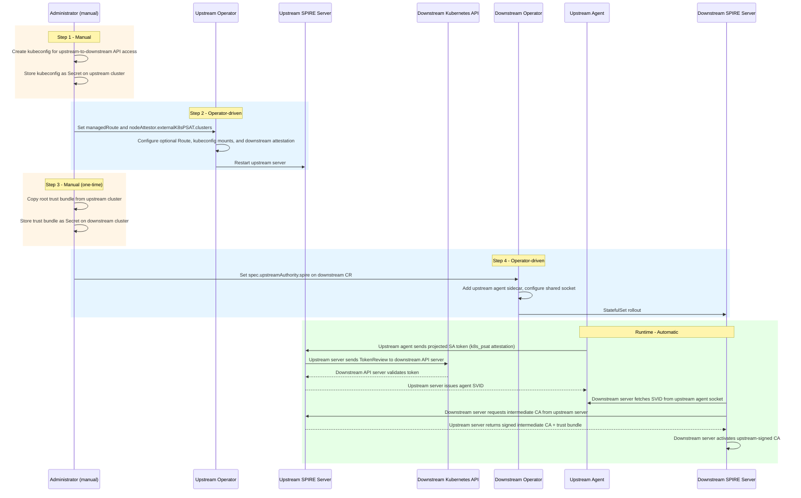

# Nested SPIRE Support for Zero Trust Workload Identity Manager

## Summary

This enhancement introduces new configuration fields to the Zero Trust Workload Identity Manager (ZTWIM) operator to support [nested SPIRE](https://spiffe.io/docs/latest/planning/scaling_spire/#nested-spire) topologies. With this enabled, a downstream server in one OpenShift cluster obtains its intermediate signing CA from an upstream server in another cluster, rather than generating its own CA. All servers in the topology share a single trust domain and form a certificate hierarchy: the upstream server holds the top-level signing CA (self-signed or chained to an external PKI), each downstream server holds an intermediate CA signed by the upstream server, and X.509 workload SVIDs chain back to a common root of trust. JWT-SVIDs are verified using signing keys propagated across the topology.

## Motivation

Organizations running multiple OpenShift clusters need workload identities that chain to a single root of trust so that cross-cluster workload authentication works transparently. Peers verify each other's SVIDs against one CA hierarchy without requiring SPIFFE federation between separate trust domains.

Support for nested SPIRE topologies enables scalable, highly available workload identity management across multi-cluster environments without a shared global datastore. It allows downstream servers to issue identities under a single trust domain, improving resilience and segmenting failure domains across distinct infrastructure boundaries.

### User Stories

- As an OpenShift cluster administrator, I want to configure a local SPIRE server to use an upstream server as its authority, so that workload identities across clusters chain back to a common root of trust instead of using isolated self-signed CAs.
- As an OpenShift cluster administrator, I want the operator to manage operator-owned infrastructure that nested SPIRE requires, so that I do not have to hand-assemble and maintain those resources myself.
- As an OpenShift cluster administrator of the upstream cluster, I want to onboard a downstream cluster declaratively, so that the upstream server issues an intermediate signing CA to that cluster.
- As an SRE, I want to see the health of nested SPIRE through status conditions on each cluster, so that I can detect and remediate configuration or connectivity problems at scale.
- As an OpenShift security engineer, I want enabling nested SPIRE to maintain the least-privilege posture for all components involved, so that the feature does not introduce unnecessary privilege escalation.

### Goals

1. Allow a **downstream cluster** to obtain its intermediate signing CA from an upstream server, with the operator managing all required infrastructure end to end.
2. Enable communication with the upstream server, allowing downstream clusters to reach it across a multi-cluster environment.
3. Allow an **upstream cluster's operator** to register one or more downstream clusters for CA chaining through CR configuration.
4. Garbage-collect all operator-created nested SPIRE resources when the feature is removed from the CR.
5. Report nested SPIRE health through status conditions so administrators can detect and remediate problems.

### Non-Goals

1. **Automating cross-cluster credential distribution using ZTWIM operator.** The administrator manually provisions the required credentials and trust material on each cluster. See [Workflow Description](#workflow-description) for details.
2. **Node attestors other than** `k8s_psat`**.** Only projected service account token attestation is supported in this iteration.
3. **Automatic cross-cluster discovery.** Each upstream-downstream link must be configured explicitly on both clusters.

## Proposal

**Key terms**

1. *Upstream cluster*: a cluster whose SPIRE server signs intermediate CAs for downstream servers.
2. *Downstream cluster*: a cluster whose SPIRE server holds an intermediate CA from an upstream server.
3. *Mid-tier cluster*: a cluster that is both upstream and downstream simultaneously.
4. *Upstream agent*: a SPIRE agent running as a sidecar container in the downstream cluster's `spire-server` StatefulSet, attested against the upstream server. It is distinct from the existing `spire-agent` DaemonSet that serves workloads.

**Supported topologies.** A nested topology is a tree of SPIRE servers sharing one trust domain. Each downstream chains to exactly one upstream; an upstream may register many downstreams. All clusters share the same trust bundle, so workloads in any tier can authenticate workloads in any other tier. The root server's CA may also come from external PKI (cert-manager, Vault) rather than being self-signed; in that case, the issuing CA's path length constraint must be greater than or equal to the total number of intermediate CA tiers below it in the longest chain.

**Why** `k8s_psat`**.** The upstream agent uses `k8s_psat` attestation. Each attestation attempt presents a fresh token, so the attestation data is never reused. This gives `k8s_psat` two properties: `CanReattest=true` (the agent re-attests automatically on pod restart without manual eviction) and no trust-on-first-use (TOFU) problem (there is no static secret to trust only once). Cloud attestors (`gcp_iit`, `aws_iid`, `azure_`*) and `http_challenge` (default `tofu=true`) hardcode `CanReattest=false`, causing crash-loops on restart unless stale entries are manually evicted. `k8s_psat` is also cloud-agnostic. See [Alternatives](#alternatives-not-implemented) for the full attestor comparison.

**On the upstream cluster**, the operator optionally exposes the SPIRE server's gRPC API over the network and configures the server to recognize agents from each registered downstream cluster, so downstream cluster's SPIRE server can request an intermediate CA.

**On the downstream cluster**, the operator:

1. Adds the upstream agent as a sidecar container (`spire-agent-upstream`) in the downstream cluster's `spire-server` StatefulSet, sharing the Workload API socket via an `emptyDir` volume.
2. Configures the downstream server's `UpstreamAuthority spire` plugin to read from the shared socket.

A dedicated agent is needed because the existing `spire-agent` DaemonSet is attested to the *local* SPIRE server, not the upstream one. The full list of resources and the design rationale are in [Implementation Details](#implementation-detailsnotesconstraints) and [Alternatives](#alternatives-not-implemented).

### Workflow Description

**Starting state:** Both clusters have ZTWIM installed.

The workflow has four steps. Steps 1 and 3 are **manual** administrator steps. Steps 2 and 4 are **operator-driven** reconciliation.

**Step 1 - Manual: prepare cross-cluster credentials**

1. On the **downstream cluster**, create a dedicated ServiceAccount with `create` on `tokenreviews` and `get` on `pods` and `nodes`. Build a kubeconfig using its credentials and that cluster's API endpoint and CA.
2. On the **upstream cluster**, store it in Secret `nested-spire-<cluster-name>-kubeconfig`, with data key `kubeconfig`, in the operator namespace. The cluster name must match the downstream `ZeroTrustWorkloadIdentityManager.spec.clusterName`.
3. During step 2, the operator mounts it read-only in the **upstream** `spire-server` **container** at `/run/spire/kubeconfigs/<cluster-name>/kubeconfig`. The administrator maintains and rotates these credentials.

**Step 2 - Operator-driven: configure the upstream cluster**

1. Administrator adds downstream cluster names to `spec.nodeAttestor.externalK8sPSAT.clusters`. Optionally sets `spec.managedRoute: "true"` to have the operator create a passthrough Route exposing the upstream SPIRE server's gRPC endpoint; the default is `"false"`, in which case the administrator manages external reachability to the upstream SPIRE server themselves.
2. The operator validates that each kubeconfig Secret exists before updating the upstream server's configuration. If a Secret is missing, the operator sets `DownstreamClustersValid=False` with a message identifying the affected cluster and expected Secret name, and skips that cluster's configuration. For clusters with valid Secrets, the operator configures downstream attestation and registration entries, and restarts the upstream server. It creates a passthrough Route when `managedRoute` is `"true"`.

**Step 3 - Manual: bootstrap trust bundle (one-time)**

1. Copy the upstream cluster's root trust bundle from the `spire-bundle` ConfigMap.
2. On the downstream cluster, create a Secret containing the trust bundle PEM.

**Step 4 - Operator-driven: configure the downstream cluster**

1. Administrator sets `spec.upstreamAuthority.spire` on the downstream SpireServer CR, referencing the trust bundle Secret and upstream server address.
2. The operator adds the upstream agent as a sidecar container in the `spire-server` StatefulSet, configures the downstream server to read from the shared socket, and triggers a StatefulSet rollout to apply the changes.

**Runtime (automatic):**

1. The upstream agent attests to the upstream server using `k8s_psat`. The upstream server validates the agent's projected SA token via TokenReview against the downstream cluster's API server.
2. The downstream server's UpstreamAuthority spire plugin obtains an SVID from the upstream agent's Workload API socket and uses it to authenticate a gRPC call to the upstream server, requesting an intermediate CA.
3. The downstream server activates the upstream-signed CA and issues workload SVIDs chaining to the shared root.



**Day-2 operations:**

- **Adding another downstream cluster.** Append an entry to `spec.nodeAttestor.externalK8sPSAT.clusters`. Regenerating `k8s_psat` configuration restarts the upstream server briefly; existing downstreams keep issuing from their cached intermediate CAs.
- **Removing a downstream cluster.** Offboard in leaf -> mid-tier -> root order. For each link, first clear `spec.upstreamAuthority.spire` on the downstream cluster and confirm detachment, then remove its entry from the upstream cluster’s `spec.nodeAttestor.externalK8sPSAT.clusters`.
- **Partial removal.** If the upstream cluster drops a downstream entry from `externalK8sPSAT.clusters` while the downstream sidecar is still running, the sidecar's re-attestation fails and CA renewal stops; the downstream server continues issuing from its cached intermediate CA until that CA expires. If the downstream cluster clears `upstreamAuthority.spire` without removing its entry from the upstream cluster, the upstream retains stale attestation configuration and registration entries until the administrator removes the entry.
- **Upstream outage.** The downstream server continues issuing from its cached intermediate CA until that CA expires. The upstream agent sidecar retries re-attestation with exponential backoff. Nesting recovers automatically once the upstream server is reachable again.
- **Upstream root CA rotation.** After attestation, the upstream agent receives live trust bundle updates via the gRPC stream and caches them to its `data_dir`. On container restart within the same pod, the agent uses the cached bundle - the `trustBundleSecret` is not consulted. On pod restart or reschedule, `emptyDir` is wiped and the agent falls back to the `trustBundleSecret`. If the upstream root CA has rotated since the Secret was created and the old root is no longer in the server's certificate chain, TLS verification fails and the agent cannot attest. The administrator must update the `trustBundleSecret` content whenever the upstream root CA rotates.

### API Extensions

This enhancement modifies the existing cluster-scoped `SpireServer` CRD. It does not add new CRDs, admission webhooks, conversion webhooks, aggregated API servers, or finalizers.

#### Downstream cluster: `spec.upstreamAuthority.spire`

`UpstreamAuthorityConfig` today requires exactly one of `certManager` or `vault`. This adds `spire` as a third option.

```go
// UpstreamAuthorityConfig selects and configures an UpstreamAuthority plugin.
// Exactly one of certManager, vault, or spire must be set.
// +kubebuilder:validation:XValidation:rule="(has(self.certManager) && !has(self.vault) && !has(self.spire)) || (!has(self.certManager) && has(self.vault) && !has(self.spire)) || (!has(self.certManager) && !has(self.vault) && has(self.spire))",message="exactly one of certManager, vault, or spire must be set"
type UpstreamAuthorityConfig struct {
    // certManager and vault are unchanged.

    // spire configures the SPIRE UpstreamAuthority plugin.
    // +kubebuilder:validation:Optional
    Spire *UpstreamAuthoritySpire `json:"spire,omitempty"`
}

// UpstreamAuthoritySpire configures nested SPIRE on a downstream cluster.
type UpstreamAuthoritySpire struct {
    // serverAddress is the DNS hostname of the upstream SPIRE server's gRPC endpoint.
    // Must not include a URL scheme, port, or path.
    // +kubebuilder:validation:Required
    // +kubebuilder:validation:MinLength=1
    // +kubebuilder:validation:MaxLength=253
    // +kubebuilder:validation:Pattern=`^[a-z0-9]([-a-z0-9]*[a-z0-9])?(\.[a-z0-9]([-a-z0-9]*[a-z0-9])?)*$`
    // +kubebuilder:validation:XValidation:rule="!self.contains('://') && !self.contains(':') && !self.contains('/')",message="serverAddress must be a hostname without scheme, port, or path"
    ServerAddress string `json:"serverAddress"`

    // serverPort is the port of the upstream gRPC endpoint.
    // +kubebuilder:default=443
    // +kubebuilder:validation:Minimum=1
    // +kubebuilder:validation:Maximum=65535
    // +kubebuilder:validation:Optional
    ServerPort int32 `json:"serverPort,omitempty"`

    // trustBundleSecret is the name of a Secret in the operator namespace that
    // holds the upstream SPIRE server's trust bundle. The Secret must contain
    // data key bundle.crt with PEM-encoded X.509 root certificate(s).
    // +kubebuilder:validation:Required
    TrustBundleSecret string `json:"trustBundleSecret"`
}
```

#### Upstream cluster: `spec.managedRoute` and `spec.nodeAttestor.externalK8sPSAT`

```go
type SpireServerSpec struct {
    // ... existing fields ...

    // managedRoute exposes the SPIRE server's gRPC port externally through
    // an operator-managed passthrough Route. "false" leaves exposure to the administrator.
    // +kubebuilder:default:="false"
    // +kubebuilder:validation:Enum:="true";"false"
    // +kubebuilder:validation:Optional
    ManagedRoute string `json:"managedRoute,omitempty"`

    // nodeAttestor configures additional node attestation sources.
    // +kubebuilder:validation:Optional
    NodeAttestor *NodeAttestorConfig `json:"nodeAttestor,omitempty"`
}

type NodeAttestorConfig struct {
    // externalK8sPSAT configures attestation for downstream Kubernetes clusters.
    // +kubebuilder:validation:Optional
    ExternalK8sPSAT *ExternalK8sPSATConfig `json:"externalK8sPSAT,omitempty"`
}

type ExternalK8sPSATConfig struct {
    // clusters enumerates clusters whose SPIRE servers chain to this one.
    // +listType=map
    // +listMapKey=name
    // +kubebuilder:validation:MaxItems=100
    // +kubebuilder:validation:Optional
    Clusters []DownstreamCluster `json:"clusters,omitempty"`
}

type DownstreamCluster struct {
    // name identifies the downstream cluster.
    // Must match the downstream cluster's ZeroTrustWorkloadIdentityManager.spec.clusterName.
    // The operator reads Secret nested-spire-<name>-kubeconfig, key kubeconfig,
    // from its namespace.
    // +kubebuilder:validation:Required
    // +kubebuilder:validation:MinLength=1
    // +kubebuilder:validation:MaxLength=63
    // +kubebuilder:validation:Pattern=`^[a-z0-9]([-a-z0-9]*[a-z0-9])?(\.[a-z0-9]([-a-z0-9]*[a-z0-9])?)*$`
    Name string `json:"name"`
}
```

The `+listType=map` with `+listMapKey=name` enforces cluster name uniqueness at the API level. The proposed 100-entry bound limits generated configuration and resources; it is not an upstream limit or tested capacity.

`managedRoute` defaults to `"false"` to preserve existing exposure on upgrade and is independent of the cluster list. The clusters list in `ExternalK8sPSAT` configures incoming downstream agent attestation on the upstream cluster; `upstreamAuthority.spire` selects downstream server's parent authority.

### Topology Considerations

#### Hypershift / Hosted Control Planes

Not supported.

#### Standalone Clusters

Supported. This is the primary target topology.

#### Single-node Deployments or MicroShift

Not supported.

#### OpenShift Kubernetes Engine

Not applicable.

### Implementation Details/Notes/Constraints

#### Why a sidecar upstream agent with unix workload attestor

The `UpstreamAuthority spire` plugin fetches an SVID from a local Workload API Unix socket. There is no option to bypass the socket. The existing `spire-agent` DaemonSet cannot provide that SVID because it is attested to the *local* SPIRE server. A second agent, attested to the upstream server, is required.

The upstream agent runs as a sidecar container (`spire-agent-upstream`) in the downstream cluster's `spire-server` StatefulSet. The sidecar and the downstream server share the Workload API socket via an `emptyDir` volume. This approach:

- Uses the `unix` workload attestor with `discover_workload_path: true` and `shareProcessNamespace: true` to produce a `unix:path:/spire-server` selector. The path is baked into the container image and portable across clusters.
- Keeps the `spire-server` pod on the `restricted` SCC.

The sidecar shares the `spire-server` ServiceAccount. The `unix` workload attestor and `k8s_psat` node attestor do not require any additional RBAC beyond what the `spire-server` SA already has.

#### Resources created by the operator on the downstream cluster

| Resource                | Kind                   | Purpose                                                                                                                                    | SCC                     |
| ----------------------- | ---------------------- | ------------------------------------------------------------------------------------------------------------------------------------------ | ----------------------- |
| `spire-agent-upstream`  | ConfigMap              | Generated `agent.conf` with `k8s_psat` attestor, `unix` workload attestor (`discover_workload_path: true`), and upstream server address    |                         |
| `spire-server`          | StatefulSet (modified) | Gains sidecar container, `emptyDir` socket volume, `shareProcessNamespace: true`, projected SA token volume, parent trust bundle mount      | `restricted`, unchanged |

#### Resources created by the operator on the upstream cluster

When `spec.managedRoute` is `"true"`, the operator creates a passthrough Route with host `grpc.<clusterName>.<trustDomain>`. The Route must use passthrough TLS because SPIRE requires mutual TLS with SPIFFE IDs; edge or re-encrypt termination would present the router's certificate instead of the SPIRE server's SVID. When `"false"`, the administrator manages the Route. DNS and external reachability are administrator responsibilities.

`ExternalK8sPSAT` entries are merged into the existing `k8s_psat` clusters map, preserving local agent attestation. Reject a name matching the local cluster. Administrator-provided Secrets are not deleted by the operator.

| Resource                                          | Kind                   | Purpose                                                        |
| ------------------------------------------------- | ---------------------- | -------------------------------------------------------------- |
| `spire-server-grpc`                               | Route                  | Passthrough Route to `spire-server` Service `grpc` port        |
| `spire-server`                                    | ConfigMap (modified)   | `k8s_psat` clusters map gains one entry per downstream cluster |
| `spire-server`                                    | StatefulSet (modified) | Mounts kubeconfig Secrets for each downstream cluster          |
| `nested-spire-<downstreamClusterName>-node-alias` | ClusterStaticEntry     | Node alias for the downstream cluster's upstream agents        |
| `nested-spire-<downstreamClusterName>-downstream` | ClusterStaticEntry     | `downstream: true` entry for intermediate CA minting           |

#### Generated registration entries

For each downstream cluster (e.g., `cluster01` in trust domain `example.com`), the operator generates two `ClusterStaticEntry` objects. `ClusterStaticEntry` is an existing CRD owned by `spire-controller-manager`.

**Node alias** (`nested-spire-cluster01-node-alias`): provides a stable parent SPIFFE ID so that child entries do not track per-node agent IDs that change on node replacement.

```yaml
apiVersion: spire.spiffe.io/v1alpha1
kind: ClusterStaticEntry
metadata:
  name: nested-spire-cluster01-node-alias
spec:
  className: zero-trust-workload-identity-manager-spire
  parentID: spiffe://example.com/spire/server
  spiffeID: spiffe://example.com/downstream/cluster01
  selectors:
  - k8s_psat:cluster:cluster01
  - k8s_psat:agent_ns:<operator-namespace>
  - k8s_psat:agent_sa:spire-server
  - k8s_psat:agent_pod_name:spire-server-0
```

The node-alias uses four stable `k8s_psat` selectors. `agent_sa:spire-server` reflects the sidecar sharing the StatefulSet's ServiceAccount. `agent_pod_name:spire-server-0` is stable because the StatefulSet has exactly one replica with a deterministic name. Unstable selectors (`agent_pod_uid`, `agent_node_uid`, `agent_node_name`, `agent_node_ip`) are excluded because they change on pod or node replacement.

On the upstream server, the `k8s_psat` plugin's `service_account_allow_list` is set to `<operator-namespace>:spire-server`. Only agents presenting a projected SA token from that namespace and ServiceAccount are allowed to attest.

**Downstream server entry** (`nested-spire-cluster01-downstream`): authorizes the downstream server to request an intermediate CA. The `downstream: true` flag grants the SPIRE `Downstream` role. Uses `unix:path:/spire-server` to validate the binary path of the connecting process.

```yaml
apiVersion: spire.spiffe.io/v1alpha1
kind: ClusterStaticEntry
metadata:
  name: nested-spire-cluster01-downstream
spec:
  className: zero-trust-workload-identity-manager-spire
  parentID: spiffe://example.com/downstream/cluster01
  spiffeID: spiffe://example.com/downstream/cluster01/spire-server
  selectors:
  - unix:path:/spire-server
  downstream: true
  x509SVIDTTL: 1h
```

#### Status conditions

Downstream:

- `UpstreamAgentAvailable`: upstream agent sidecar container in `spire-server-0` is ready, trustBundleSecret exists. Reasons: `Ready`, `UpstreamAgentNotReady`, `TrustBundleMissing`.

Upstream:

- `ManagedGRPCRouteAvailable`: managed Route exists with the expected spec and is admitted. Reasons: `RouteAdmitted`, `RouteNotAdmitted`, `RouteCreationFailed`. Omit when `managedRoute` is `"false"`; this condition does not verify external connectivity.
- `DownstreamClustersValid`: each external cluster has a kubeconfig Secret with a non-empty `kubeconfig` key, and both generated clusterStaticEntries have `status.rendered=true` and `status.masked=false`. Reasons: `Ready`, `KubeConfigMissing`, `KubeConfigInvalid`, `ClusterNameConflict`, `EntryNotApplied`, `EntryMasked`.
- Error messages identify the cluster and Secret, for example: `cluster01: Secret nested-spire-cluster01-kubeconfig not found`.

Readiness conditions do not prove CA issuance or a full requested TTL. Diagnose CA acquisition failures through SPIRE server logs.

#### Constraints

1. Every cluster in a hierarchy must share the same `trustDomain`.
2. `k8s_psat` only in this iteration. Each upstream cluster must reach every registered downstream cluster's API server.
3. Kubeconfigs and trust bundles are administrator-provided Secrets, not generated by the operator.
4. When the root CA comes from external PKI, the issuing CA's path length constraint must be greater than or equal to the total number of intermediate CA tiers below it in the longest chain.
5. **Day-0 enablement is recommended.** Nested SPIRE is best enabled before the downstream server issues any workload SVIDs (day 0). A server that already holds a valid self-signed CA (day 2) continues using it until the next CA rotation. This is SPIRE's standard behavior and applies equally to the `certManager` and `vault` plugins. While the stale self-signed CA is active, workloads receive SVIDs that do not chain to the shared root. To force immediate use of the upstream-signed CA on a day-2 cluster, re-initialize the datastore: scale the StatefulSet to zero, delete its PVC, and scale back to one. The operator does not perform this destructive step automatically.
6. The plugin propagates X.509 CA chain and JWT signing keys only, not federated trust bundles ([spiffe/spire#4128](https://github.com/spiffe/spire/issues/4128)). Downstream clusters needing federation must configure their own `ClusterFederatedTrustDomain`.
7. **Same operator namespace across the topology.** All clusters in a nested hierarchy must deploy the operator in the same namespace. The upstream server uses its own `OPERATOR_NAMESPACE` to build the downstream attestation allow-list and registration entry selectors; a namespace mismatch causes silent attestation failure.
8. **Nesting depth and cluster count.** SPIRE does not enforce a fixed maximum nesting depth or [number of downstream clusters per upstream server](https://github.com/spiffe/spire/blob/d00947ffa79f65eecedfd19c18666d8829e011d5/pkg/server/plugin/nodeattestor/k8spsat/psat.go#L43-L140).

   ZTWIM's supported limits must be established through scale and recovery testing. Certificate-chain constraints and OIDC consumer limits also apply.

    **CA TTL.** `spec.caValidity` sets SPIRE's `ca_ttl`. An issued child CA cannot outlive the parent CA that signed it: if the parent has 5 hours remaining, a child requesting 8 hours receives approximately 5. To avoid such shortening during normal rotation, [SPIRE recommends](https://github.com/spiffe/spire/blob/d00947ffa79f65eecedfd19c18666d8829e011d5/doc/plugin_server_upstreamauthority_spire.md#ca-lifetimes) `child CA TTL <= min(parent CA lifetime / 6, 7 days)` at each level. The divisor 6 reflects SPIRE's rotation schedule: a parent CA switches to its replacement when roughly 1/6 of its lifetime remains, so a child requesting at most 1/6 of the parent's lifetime can receive its full requested TTL even just before the switch. The 7-day cap is the maximum remaining time at the switch point for very long-lived CAs.
    For example, 1-hour workload SVIDs can use an 8-hour leaf CA (`8 <= 64/6 ≈ 10.6`) and a 64-hour parent CA. This rule is sizing guidance, not an enforced depth limit; deeper topologies work if administrators accept that some CAs may be shortened near rotation.

    **JWT/OIDC.** Each SPIRE server instance generates its own JWT signing keys. The public keys of all servers are distributed across the hierarchy and published in the shared JWKS. Replicas and keys retained during rotation (each server keeps a current and a prepared-next key) increase the key count: for example, 90 servers with two keys each contribute 180 public keys. Additional nesting levels do not reduce this shared key set.
    [AWS IAM](https://docs.aws.amazon.com/IAM/latest/UserGuide/id_roles_providers_create_oidc.html) allows up to 100 RSA and 100 EC keys; token exchange fails if the token's signing key type exceeds its limit. [GCP](https://docs.cloud.google.com/iam/docs/workload-identity-federation-with-other-providers#oidc) has no downloaded-key count limit; manually uploaded JWKS files allow at most 8 keys.
    These consumer limits can restrict cluster count even when X.509 issuance works ([spiffe/spire#4699](https://github.com/spiffe/spire/issues/4699)).

#### Network policies for nested SPIRE

**Upstream agent sidecar** (downstream cluster): the sidecar shares the downstream cluster's `spire-server` pod's network namespace. When nested SPIRE is enabled, the `spire-server` pod's NetworkPolicy gains egress to the upstream server gRPC port (`serverPort`, default 443/TCP). The downstream server accesses the upstream agent via Unix socket (`emptyDir` mount), which requires no NetworkPolicy.

**SpireServer - new capability gates:**

| Capability | Gate | Effect | Ports |
|------------|------|--------|-------|
| Upstream authority (downstream) | `spec.upstreamAuthority.spire != nil` | Feature-egress | `serverPort` (default 443/TCP) |
| gRPC endpoint (upstream) | `spec.managedRoute == "true"` | Ingress from `openshift-ingress` | 8081/TCP |
| Downstream attestation (upstream) | `spec.nodeAttestor.externalK8sPSAT.clusters` non-empty | Feature-egress | Downstream API server ports (typically 6443/TCP) |

### Risks and Mitigations

**Route exposure.** External exposure of the gRPC port is required for nested SPIRE - downstream agents must reach the upstream server to attest and receive CA updates. The operator uses a passthrough Route as the OpenShift-native mechanism; alternatives (VPN, service mesh interconnect) still expose the same endpoint over a different transport.  
SPIRE's [auth policy](https://github.com/spiffe/spire/blob/d00947ffa79f65eecedfd19c18666d8829e011d5/pkg/server/authpolicy/policy_data.json) marks two gRPC methods as `allow_any`: `Bundle/GetBundle` and `Agent/AttestAgent`. Both still require the caller to possess the trust bundle for TLS verification, so neither is reachable by an arbitrary network attacker. `GetBundle` returns only public keys. `AttestAgent` additionally requires a valid Projected ServiceAccount Token from a cluster configured in `externalK8sPSAT.clusters`; a successful rogue attestation yields an auto-rotating SVID - eviction requires removing the cluster entry or rotating the trust bundle. All other methods require agent, downstream, or admin authorization.  
Each attestation attempt triggers a `TokenReview` against the downstream API server, so a flood amplifies into downstream traffic. SPIRE rate-limits attestation to 1 request/second per source IP by default (boolean toggle, not tunable). Because the Route proxies all traffic through the router pod's IP, the 1 request/second allowance is shared across all legitimate downstream agents and any attacker - NetworkPolicy cannot distinguish them. Rate-limited agents [retry with exponential backoff](https://github.com/spiffe/spire/blob/d00947ffa79f65eecedfd19c18666d8829e011d5/pkg/agent/agent.go#L226) (starting at 5 seconds, up to 1 minute), so throttled agents recover without manual intervention. Private ingress controllers or infrastructure-level network controls (cloud firewall, security groups) can reduce DoS exposure but do not add authentication beyond what TLS verification and PSAT validation already provide.

| Risk                                                                                                                                                         | Impact                                        | Mitigation                                                                                                                                                           |
| ------------------------------------------------------------------------------------------------------------------------------------------------------------ | --------------------------------------------- | -------------------------------------------------------------------------------------------------------------------------------------------------------------------- |
| Upstream cluster holds `TokenReview` + pod/node read credentials on every downstream cluster                                                                 | High: lateral movement across fleet           | Grant only `create` on `tokenreviews` (ClusterRole) and `get` on `nodes` (ClusterRole) to a dedicated SA; scope `get` on `pods` to the operator namespace on the downstream cluster (Role) |
| Upstream outage stops CA rotation on downstream clusters                                                                                                     | High, time-delayed                            | Downstream keeps issuing from cached intermediate until it expires; SPIRE retries automatically                                                                      |
| Trust domain or cluster name mismatch across clusters                                                                                                        | Medium: attestation failure            | Three distinct failure modes, each producing a diagnosable SPIRE server log error (see [Support Procedures](#support-procedures))                                                                 |
| Kubeconfig Secret targets wrong cluster's API server                                                                                                         | Medium: TokenReview failure (`Unauthorized`, `Forbidden`, or `token not authenticated` depending on the misconfiguration)         | Document that the Secret `nested-spire-<name>-kubeconfig` must contain credentials for the API server of the cluster identified by that `name` in `nodeAttestor.externalK8sPSAT.clusters[]`; error is diagnosable via server logs                                                                |
| Deeper chains and larger cluster lists increase resource use and recovery time. | Medium | Validate the proposed cluster-count bound and root → intermediate → leaf topology before GA; document tested limits. Apply certificate-chain and OIDC consumer constraints. |
| Each external cluster list change rolls the upstream server                                                                                                   | Low: brief unavailability                     | Batch onboarding during maintenance windows                                                                                                                          |
| Impersonation of downstream server via unix socket                                                                                                           | High: intermediate CA minting                 | If a process other than the real spire-server connects to the upstream agent's unix socket and passes verification, it receives an intermediate CA. The socket is pod-scoped (`emptyDir`) - only processes inside the pod can connect. The upstream agent verifies the connecting process's executable path via `/proc/<pid>/exe` (kernel-reported, not spoofable). `unix:sha256` is not used because the binary hash changes on every image upgrade. To impersonate, an attacker must get a process with the same executable path as the spire-server binary. `kubectl exec` into the container runs a shell (e.g., `/bin/sh`) - different path, rejected. Overwriting the spire-server binary with a malicious one is blocked by `readOnlyRootFilesystem: true`. The remaining realistic vector is injecting a malicious container into the pod with a binary at the same path - mitigated by pod admission policies and RBAC restricting `pods`/`pods/exec` in the operator namespace. |
| StatefulSet rollout restarts server and sidecar together                                                                                                     | Low: brief I/O disruption                     | Issuance and renewal pause on the restarting server. Existing SVIDs remain usable until expiry; other running downstream servers can issue while their CAs remain valid. |

### Drawbacks

**Operational complexity.** Each upstream-downstream link requires configuration on both clusters and manual cross-cluster credential management. An upstream cluster holds N kubeconfig credentials and restarts its SPIRE server when the downstream list changes, increasing the blast radius.

**Maintenance burden.** The operator must track SPIRE's nesting behavior across upstream SPIRE versions. Changes to the UpstreamAuthority plugin, k8s_psat attestor, or downstream registration semantics could require operator updates.

## Alternatives (Not Implemented)

### 1. Upstream agent as a separate Deployment + second CSI driver

Upstream agent as a one-replica Deployment with pod affinity to downstream `spire-server-0` pod, delivering the Workload API socket to the SPIRE server pod via a second CSI driver (`upstream.csi.spiffe.io`). **Not chosen**: the operator must detect co-location drift (server moves while agent stays behind), delete the agent pod, and wait for pod affinity to reschedule it. Also requires a second CSI driver DaemonSet, a dedicated SCC, and a separate ServiceAccount with ClusterRole and ClusterRoleBinding.

### 2. Raw `hostPath`

Simplest socket delivery. **Rejected**: a `hostPath` mount moves the SPIRE server off `restricted` SCC; SELinux MCS labels prevent cross-pod socket access without broader SCC grants.

### 3. Reuse the existing `spire-agent` DaemonSet

**Not possible**: it is attested to the local SPIRE server, which is the server that needs the upstream-signed CA.

### 4. `gcp_iit` / `aws_iid` / `azure_*` cloud attestors for upstream agent to upstream server attestation

**Rejected**: cloud attestors hardcode `CanReattest=false` because their attestation data is fixed per VM instance. If the upstream agent pod restarts on the same node, the upstream server rejects the agent because an entry for that instance already exists; the stale entry must be manually evicted before re-attestation can succeed. A PVC-backed `KeyManager` allows the agent to persist its SVID across restarts, but it only defers the problem: if the SVID expires or the PVC is lost, eviction is still required. Cloud attestors also require `hostNetwork: true` to reach the metadata endpoint, which means the downstream server's pod would need to move off the `restricted` SCC. They also do not work on bare-metal clusters.

### 5. `http_challenge` attestor for upstream agent to upstream server attestation

**Rejected**: with default `tofu=true`, `CanReattest=false`, producing the same restart problem as cloud attestors. With `tofu=false`, `CanReattest=true`, but any process controlling the configured hostname can attest. Also requires the upstream agent on the downstream cluster to expose an HTTP endpoint (via a Service and Route) that the upstream server can reach to issue the challenge.

### 6. Upstream agent as a DaemonSet

**Rejected**: only the agent on the SPIRE server's node is useful. N-1 extra agents waste resources and multiply attestation load.

## Open Questions [optional]

1. **Maximum downstream clusters per upstream.** The API proposes a 100-cluster `MaxItems` bound, but the effective limit may be lower depending on the OIDC consumer -100 clusters with 2 JWT keys each produce 200 public keys, which may exceed per-type key limits on some cloud providers (see JWT/OIDC section above). Validate steady-state resource consumption, mass re-attestation after upstream restart (1 request/second shared rate limit through the Route), CA/JWT rotation load, and JWKS key count against target OIDC consumers before finalizing the supported limit.
2. **Nesting depth and breadth limits.** A 3-level topology (root -> mid-tier -> leaf with workloads) has been validated on GCP. Deeper hierarchies increase certificate chain length and CA rotation latency at each level (see CA TTL guidance above). We do not claim support for arbitrary depth or breadth; practical limits depend on CA TTL sizing across tiers and cumulative network latency. These limits should be characterized through further testing before expanding the supported topology.

## Test Plan

### Unit tests

- Config generation: downstream `UpstreamAuthority` block, local and external `k8s_psat` entries, fixed Secret names, and registration entry pairs. Reject local cluster name collisions (downstream cluster name matching the local cluster name).
- Status condition transitions.

### Integration tests

- API schema validation: exactly one of `certManager`/`vault`/`spire`; `managedRoute` defaults to `"false"`; unique cluster names via `listType=map`; at most 100 entries, with 101 rejected.
- CRUD lifecycle for `spec.upstreamAuthority.spire`, `spec.managedRoute`, and `spec.nodeAttestor.externalK8sPSAT`: assert resource creation, update, and garbage collection. Test missing/updated Secrets, cluster-specific errors, and preservation of administrator-owned Secrets.

### End-to-end tests

Requires at least two clusters; mid-tier scenarios need three.

- **Happy path**: upstream + downstream; assert downstream receives an intermediate CA, workloads get SVIDs with the shared trust domain root, and a downstream workload can authenticate to an upstream service via mTLS.
- **Multiple downstreams**: two downstreams on one upstream; assert each downstream receives a distinct intermediate CA (different serial numbers) and issues SVIDs independently.
- **Mid-tier**: A -> B -> C; assert B acts as both upstream and downstream, and a workload on C can authenticate to a service on A via mTLS through the shared trust domain.
- **Cleanup**: remove nested SPIRE config; assert all operator-created resources (Route, sidecar, registration entries, ConfigMap changes) are deleted.
- **Upstream outage**: configure short `ca_ttl` (minutes) for CI feasibility. Verify downstream continues issuing from the cached intermediate while it is valid, receives shortened lifetimes when requesting near the intermediate's expiry, fails to issue after expiry, and resumes after upstream recovery.
- **JWT/OIDC key propagation**: verify JWT public keys from all servers appear in the shared JWKS and are updated after key rotation. Cloud-provider OIDC consumer validation (e.g., token exchange against AWS IAM or GCP Workload Identity Federation) is environment-dependent and tested separately where infrastructure is available.
- **Misconfiguration**: trust domain mismatch, cluster name mismatch, missing trust bundle Secret, invalid kubeconfig - assert each produces a diagnosable error in status conditions or server logs. Attempt attestation through the Route without a valid PSAT and assert the server rejects the request.

## Graduation Criteria

### Dev Preview

Not applicable. This feature will be GA'd directly.

### Dev Preview -> Tech Preview

Not applicable. This feature will be GA'd directly.

### Tech Preview -> GA

- End-to-end tests pass for all supported topologies.
- Validate the cluster-count bound and root -> intermediate -> leaf topology. Document resource profiles: upstream server memory and CPU growth per downstream cluster, upstream agent sidecar overhead on the downstream pod, datastore entry growth, and steady-state network connections. Document OIDC consumer key-count limits for target cloud providers.
- Upgrade and downgrade tested.
- Document SLOs for CA rotation and upstream agent availability.
- Alerts and metrics implemented.
- User-facing documentation created for single-upstream and multi-tier procedures.

### Removing a deprecated feature

Not applicable.

## Upgrade / Downgrade Strategy

**Upgrade**: no action required. New configuration is optional and `managedRoute` defaults to `"false"`.

**Adopting the feature**: set `spec.upstreamAuthority.spire` and wait for `UpstreamAgentAvailable=True`. SPIRE prepares the next CA using the upstream authority plugin at the next rotation cycle, so the server transitions from `self_signed=true` to `self_signed=false` automatically. If immediate switchover is required, the administrator must manually re-initialize the datastore (scale StatefulSet to 0, delete PVC, scale to 1); the operator does not perform this destructive step automatically. This invalidates all SVIDs and is a maintenance-window operation. The same behavior applies to `certManager` and `vault` plugins.

**Downgrade**: orphans generated resources. The older operator regenerates the ConfigMap without the plugin; the server self-signs after the current CA expires. To clean up orphaned resources, the administrator can delete them by label (`app.kubernetes.io/managed-by=zero-trust-workload-identity-manager`). If immediate self-signed CA is needed, the administrator must re-initialize the SPIRE server's datastore by scaling the `spire-server` StatefulSet to 0, deleting its PVC, and scaling back to 1.

## Version Skew Strategy

Within a cluster, the upstream agent uses the same SPIRE image the operator ships. The consequential skew is between clusters: SPIRE requires [agents not newer than the oldest server, and at most one minor version older](https://github.com/spiffe/spire/blob/main/doc/upgrading.md). The upstream agent runs in the downstream cluster but talks to the upstream server, so **upgrade from the root outward** (each tier before the one below it).

## Operational Aspects of API Extensions

- **CRD changes**: optional `spec.upstreamAuthority.spire`, `spec.managedRoute`, and `spec.nodeAttestor.externalK8sPSAT` configuration on `SpireServer`.
- `ClusterStaticEntry`: two per downstream cluster. Processed by existing `spire-controller-manager`.
- **Route**: one passthrough Route per upstream cluster when `managedRoute` is `"true"`.

Health indicators (SLIs):

- `UpstreamAgentAvailable` condition on the downstream `SpireServer` CR.
- `ManagedGRPCRouteAvailable` and `DownstreamClustersValid` conditions on the upstream `SpireServer` CR.

Impact is validated by e2e tests in CI that assert these status conditions are true across supported topologies.

Failure modes:

- Externally deleted `ClusterStaticEntry` objects are recreated on next reconcile (the operator watches them, so the gap is typically seconds). During the gap:
  - **Unaffected**: agent attestation (handled by the node attestor plugin, independent of registration entries) and workload issuance (uses the cached intermediate CA).
  - **Paused**: new intermediate CA acquisition. The two entries form a chain - the node-alias gives the agent an alias SPIFFE ID, and the downstream entry uses that alias as its `parentID` to authorize CA minting. Deleting either entry breaks this chain.
  - **Recovery**: automatic once the operator recreates the entries.
- Externally deleted Route is recreated. Downstream clusters cannot reach upstream until restored.

The ZTWIM team owns all components and is the escalation point.

## Support Procedures

Primary diagnostic, downstream server CA report:

```bash
oc logs spire-server-0 -c spire-server -n zero-trust-workload-identity-manager | grep "X509 CA"
```

A healthy nested downstream logs `X509 CA prepared` with `self_signed=false` and a non-empty `upstream_authority_id`. After initial setup, verify every tier's logs for `self_signed=false` .

### Symptom -> Cause -> Action

| Symptom                                             | Likely Cause                                       | Action                                                              |
| --------------------------------------------------- | -------------------------------------------------- | ------------------------------------------------------------------- |
| `self_signed=true` in server logs after configuring upstream authority | Server has not yet rotated to upstream-signed CA | Wait for the next CA rotation cycle; for immediate switchover, the administrator must manually re-initialize the datastore (scale to 0, delete PVC, scale to 1) - the operator does not perform this step |
| `no X.509 bundle found for trust domain`            | Trust domain mismatch between clusters             | Ensure all clusters share the same `trustDomain`                    |
| `not configured for cluster "<name>"`               | Cluster name not registered on upstream            | Verify `nodeAttestor.externalK8sPSAT.clusters[].name` matches downstream `clusterName` |
| TokenReview error (`Unauthorized`, `Forbidden`, or `token not authenticated`) | Kubeconfig targets wrong API server, SA lacks permissions, or PSAT is from a different cluster | Fix kubeconfig Secret to target the correct downstream cluster; verify SA has `create tokenreviews`, `get nodes` (ClusterRole) and `get pods` (Role in operator namespace) |
| `certificate contains no URI SAN`                   | Route is not passthrough - router terminates TLS and presents its own cert (DNS SANs, not SPIFFE URI SANs) | Ensure Route uses passthrough TLS termination          |
| Connection or TLS handshake error (`EOF`, `connection refused`, `context deadline exceeded`) | Upstream server unreachable or Route misconfigured | Check upstream server pod, Route status, and network connectivity   |
| Pod stuck in `ContainerCreating`                    | A referenced Secret (trust bundle or kubeconfig) was deleted after the StatefulSet was configured | Verify the Secret exists in the operator namespace; check pod events for `FailedMount` |
| TLS handshake error on upstream agent after pod restart or reschedule | `trustBundleSecret` contains a stale root CA - the upstream root CA rotated and the cached bundle was lost with `emptyDir` | Update the `trustBundleSecret` with the current upstream root trust bundle |
| Sidecar container in `CrashLoopBackOff`             | Misconfigured upstream agent ConfigMap              | Check `UpstreamAgentAvailable` condition and sidecar logs           |
| `too many intermediates for path length constraint` | External PKI CA has `pathLenConstraint` set too low (only applies when using an external PKI upstream authority, not SPIRE's self-signed root) | Reissue CA with pathLen >= nesting levels                           |

### Disabling nested SPIRE

Removal and fallback behavior is described in [Workflow Description](#workflow-description) and [Upgrade / Downgrade Strategy](#upgrade--downgrade-strategy). Impact on workloads:

- **Existing workloads**: SVIDs remain valid until their individual TTL expires. No disruption.
- **New workloads**: receive SVIDs signed by the self-signed CA once the current intermediate expires.
- **Re-enabling**: operator recreates all resources; SPIRE re-establishes the CA chain on the next rotation cycle without manual intervention.

## Infrastructure Needed [optional]

Multi-cluster CI lane: two clusters for single-upstream scenarios, three clusters for mid-tier (A → B → C). 