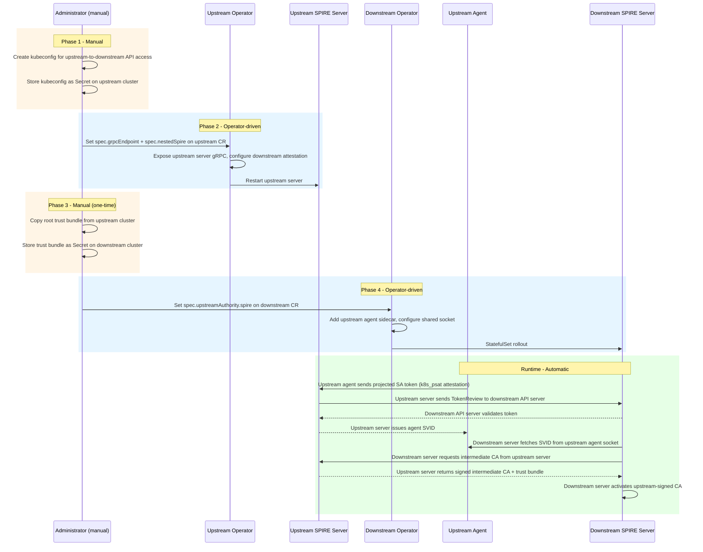

# Nested SPIRE Support for Zero Trust Workload Identity Manager

## Summary

This enhancement introduces new configuration fields to the Zero Trust Workload Identity Manager (ZTWIM) operator to support [nested SPIRE](https://spiffe.io/docs/latest/planning/scaling_spire/#nested-spire) topologies. With this enabled, a downstream server in one OpenShift cluster obtains its intermediate signing CA from an upstream server in another cluster, rather than generating its own CA. All servers in the topology share a single trust domain and form a certificate hierarchy: the upstream server holds the top-level signing CA (self-signed or chained to an external PKI), each downstream server holds an intermediate CA signed by the upstream server, and X.509 workload SVIDs chain back to a common root of trust. JWT-SVIDs are verified using signing keys propagated across the topology.

## Motivation

Organizations running multiple OpenShift clusters need workload identities that chain to a single root of trust so that cross-cluster workload authentication works transparently. Peers verify each other's SVIDs against one CA hierarchy without requiring SPIFFE federation between separate trust domains.

Support for nested SPIRE topologies enables scalable, highly available workload identity management across multi-cluster environments without a shared global datastore. It allows downstream servers to issue identities under a single trust domain, improving resilience and segmenting failure domains across distinct infrastructure boundaries.

### User Stories

- As an OpenShift cluster administrator, I want to configure a local SPIRE server to use an upstream server as its authority, so that workload identities across clusters chain back to a common root of trust instead of using isolated self-signed CAs.
- As an OpenShift cluster administrator, I want the operator to manage all infrastructure that nested SPIRE requires, so that I do not have to hand-assemble and maintain those resources myself.
- As an OpenShift cluster administrator of the upstream cluster, I want to onboard a downstream cluster declaratively, so that the upstream server issues an intermediate signing CA to that cluster.
- As an SRE, I want to see the health of nested SPIRE through status conditions on each cluster, so that I can detect and remediate configuration or connectivity problems at scale.
- As an OpenShift security engineer, I want enabling nested SPIRE to maintain the least-privilege posture for all components involved, so that the feature does not introduce unnecessary privilege escalation.

### Goals

1. Allow a **downstream cluster** to obtain its intermediate signing CA from an upstream server, with the operator managing all required infrastructure end to end.
2. Enable communication with the upstream server via the gRPC API, allowing downstream clusters to reach it across a multi-cluster environment.
3. Allow an **upstream cluster's operator** to register one or more downstream clusters for CA chaining through CR configuration.
4. Support **N-level nesting**: a cluster may be both upstream and downstream simultaneously.
5. Garbage-collect all operator-created nested SPIRE resources when the feature is removed from the CR.
6. Report nested SPIRE health through status conditions so administrators can detect and remediate problems.

### Non-Goals

1. **Automating cross-cluster credential distribution using ZTWIM operator.** The administrator manually provisions the required credentials and trust material on each cluster. See [Workflow Description](#workflow-description) for details.
2. **Node attestors other than** `k8s_psat`**.** Only projected service account token attestation is supported in this iteration.
3. **Automatic cross-cluster discovery.** Each upstream-downstream link must be configured explicitly on both clusters.

## Proposal

**Key terms**

1. *Upstream cluster*: a cluster whose SPIRE server signs intermediate CAs for downstream servers.
2. *Downstream cluster*: a cluster whose SPIRE server holds an intermediate CA from an upstream server.
3. *Mid-tier cluster*: a cluster that is both upstream and downstream simultaneously.
4. *Upstream agent*: a SPIRE agent running as a sidecar container in the downstream cluster's `spire-server` StatefulSet, attested against the upstream server. It is distinct from the existing `spire-agent` DaemonSet that serves workloads.

**Supported topologies.** A nested topology is a tree of SPIRE servers sharing one trust domain. Each downstream chains to exactly one upstream; an upstream may register many downstreams. All clusters share the same trust bundle, so workloads in any tier can authenticate workloads in any other tier. The root server's CA may also come from external PKI (cert-manager, Vault) rather than being self-signed; in that case, the issuing CA's path length constraint must be greater than or equal to the total number of intermediate CA tiers below it in the longest chain.

**Why `k8s_psat`.** The upstream agent uses `k8s_psat` attestation. Each attestation attempt presents a fresh token, so the attestation data is never reused. This gives `k8s_psat` two properties: `CanReattest=true` (the agent re-attests automatically on pod restart without manual eviction) and no trust-on-first-use (TOFU) problem (there is no static secret to trust only once). Cloud attestors (`gcp_iit`, `aws_iid`, `azure_*`) and `http_challenge` (default `tofu=true`) hardcode `CanReattest=false`, causing crash-loops on restart unless stale entries are manually evicted. `k8s_psat` is also cloud-agnostic. See [Alternatives](#alternatives-not-implemented) for the full attestor comparison.

**On the upstream cluster**, the operator exposes the SPIRE server's gRPC API over the network, configures the server to recognize agents from each registered downstream cluster, so downstream cluster's SPIRE server can request an intermediate CA.

**On the downstream cluster**, the operator:

1. Adds the upstream agent as a sidecar container (`spire-agent-upstream`) in the downstream cluster's `spire-server` StatefulSet, sharing the Workload API socket via an `emptyDir` volume.
2. Configures the downstream server's `UpstreamAuthority spire` plugin to read from the shared socket.

A dedicated agent is needed because the existing `spire-agent` DaemonSet is attested to the *local* SPIRE server, not the upstream one. The full list of resources and the design rationale are in [Implementation Details](#implementation-detailsnotesconstraints) and [Alternatives](#alternatives-not-implemented).

### Workflow Description

**Starting state:** Both clusters have ZTWIM installed.

The workflow has four phases. Phases 1 and 3 are **manual** administrator steps. Phases 2 and 4 are **operator-driven** reconciliation.

**Phase 1 - Manual: prepare cross-cluster credentials**

1. Create a kubeconfig that allows the upstream cluster's SPIRE server to reach the downstream cluster's API server with sufficient permissions for TokenReview and `get` on `pods` and `nodes`.
2. On the upstream cluster, store that kubeconfig in a Secret in the operator namespace.

**Phase 2 - Operator-driven: configure the upstream cluster**

1. Administrator sets `spec.grpcEndpoint` and `spec.nestedSpire` on the upstream SpireServer CR, referencing the kubeconfig Secret for each downstream cluster.
2. The operator exposes the upstream server's gRPC API over the network, configures it to recognize agents from the downstream cluster, creates registration entries that authorize the downstream cluster to request an intermediate CA, and restarts the upstream server to apply the changes.

**Phase 3 - Manual: bootstrap trust bundle (one-time)**

1. Copy the upstream cluster's root trust bundle from the `spire-bundle` ConfigMap.
2. On the downstream cluster, create a Secret containing the trust bundle PEM.

**Phase 4 - Operator-driven: configure the downstream cluster**

1. Administrator sets `spec.upstreamAuthority.spire` on the downstream SpireServer CR, referencing the trust bundle Secret and upstream server address.
2. The operator adds the upstream agent as a sidecar container in the `spire-server` StatefulSet, configures the downstream server to read from the shared socket, and triggers a StatefulSet rollout to apply the changes.

**Runtime (automatic):**

1. The upstream agent attests to the upstream server using `k8s_psat`. The upstream server validates the agent's projected SA token via TokenReview against the downstream cluster's API server.
2. The downstream server's UpstreamAuthority spire plugin obtains an SVID from the upstream agent's Workload API socket and uses it to authenticate a gRPC call to the upstream server, requesting an intermediate CA.
3. The downstream server activates the upstream-signed CA and issues workload SVIDs chaining to the shared root.



**Day-2 operations:**

- **Adding another downstream cluster.** Append an entry to `spec.nestedSpire.downstreamClusters`. Regenerating `k8s_psat` configuration restarts the upstream server briefly; existing downstreams keep issuing from their cached intermediate CAs.
- **Removing a downstream cluster.** On the downstream cluster, clearing `spec.upstreamAuthority.spire` removes all operator-created nested SPIRE resources. On the upstream cluster, the operator removes the downstream cluster's attestation configuration and registration entries.
- **Upstream outage.** The downstream server keeps issuing from its cached intermediate CA. SPIRE retries CA preparation automatically until upstream returns.

### API Extensions

This enhancement modifies the existing cluster-scoped `SpireServer` CRD. It does not add new CRDs, admission webhooks, conversion webhooks, aggregated API servers, or finalizers.

#### Downstream cluster: `spec.upstreamAuthority.spire`

`UpstreamAuthorityConfig` today requires exactly one of `certManager` or `vault`. This adds `spire` as a third option.

```go
// UpstreamAuthorityConfig selects and configures an UpstreamAuthority plugin.
// Exactly one of certManager, vault, or spire must be set.
// +kubebuilder:validation:XValidation:rule="(has(self.certManager) && !has(self.vault) && !has(self.spire)) || (!has(self.certManager) && has(self.vault) && !has(self.spire)) || (!has(self.certManager) && !has(self.vault) && has(self.spire))",message="exactly one of certManager, vault, or spire must be set"
type UpstreamAuthorityConfig struct {
    // certManager and vault are unchanged.

    // spire configures the SPIRE UpstreamAuthority plugin.
    // +kubebuilder:validation:Optional
    Spire *UpstreamAuthoritySpire `json:"spire,omitempty"`
}

// UpstreamAuthoritySpire configures nested SPIRE on a downstream cluster.
type UpstreamAuthoritySpire struct {
    // serverAddress is the DNS hostname of the upstream SPIRE server's gRPC endpoint.
    // Must not include a URL scheme, port, or path.
    // +kubebuilder:validation:Required
    // +kubebuilder:validation:MinLength=1
    // +kubebuilder:validation:MaxLength=253
    // +kubebuilder:validation:Pattern=`^[a-z0-9]([-a-z0-9]*[a-z0-9])?(\.[a-z0-9]([-a-z0-9]*[a-z0-9])?)*$`
    // +kubebuilder:validation:XValidation:rule="!self.contains('://') && !self.contains(':') && !self.contains('/')",message="serverAddress must be a hostname without scheme, port, or path"
    ServerAddress string `json:"serverAddress"`

    // serverPort is the port of the upstream gRPC endpoint.
    // +kubebuilder:default=443
    // +kubebuilder:validation:Minimum=1
    // +kubebuilder:validation:Maximum=65535
    // +kubebuilder:validation:Optional
    ServerPort int32 `json:"serverPort,omitempty"`

    // trustBundleSecret is the name of a Secret in the operator namespace that
    // holds the upstream SPIRE server's trust bundle. The Secret must contain
    // data key bundle.crt with PEM-encoded X.509 root certificate(s).
    // +kubebuilder:validation:Required
    TrustBundleSecret string `json:"trustBundleSecret"`
}
```

#### Upstream cluster: `spec.grpcEndpoint` and `spec.nestedSpire`

```go
type GRPCEndpointConfig struct {
    // managedRoute enables or disables automatic Route creation for the gRPC endpoint.
    // +kubebuilder:default:="true"
    // +kubebuilder:validation:Enum:="true";"false"
    // +kubebuilder:validation:Optional
    ManagedRoute string `json:"managedRoute,omitempty"`
}

// +kubebuilder:validation:XValidation:rule="!has(self.nestedSpire) || has(self.grpcEndpoint)",message="grpcEndpoint is required when nestedSpire is set"
type SpireServerSpec struct {
    // ... existing fields ...

    // grpcEndpoint exposes the SPIRE server's gRPC API.
    // +kubebuilder:validation:Optional
    GRPCEndpoint *GRPCEndpointConfig `json:"grpcEndpoint,omitempty"`

    // nestedSpire registers downstream clusters for node attestation.
    // Requires grpcEndpoint to be set.
    // +kubebuilder:validation:Optional
    NestedSpire *NestedSpireConfig `json:"nestedSpire,omitempty"`
}

type NestedSpireConfig struct {
    // downstreamClusters enumerates clusters whose SPIRE servers chain to this one.
    // +listType=map
    // +listMapKey=name
    // +kubebuilder:validation:Optional
    DownstreamClusters []DownstreamCluster `json:"downstreamClusters,omitempty"`
}

type DownstreamCluster struct {
    // name identifies the downstream cluster.
    // Must match the downstream cluster's ZeroTrustWorkloadIdentityManager.spec.clusterName.
    // +kubebuilder:validation:Required
    // +kubebuilder:validation:MinLength=1
    // +kubebuilder:validation:MaxLength=63
    // +kubebuilder:validation:Pattern=`^[a-z0-9]([-a-z0-9]*[a-z0-9])?(\.[a-z0-9]([-a-z0-9]*[a-z0-9])?)*$`
    Name string `json:"name"`

    // kubeConfigSecret is the name of a Secret in the operator namespace
    // holding a kubeconfig for the downstream cluster's API server.
    // +kubebuilder:validation:Required
    KubeConfigSecret string `json:"kubeConfigSecret"`
}
```

The `+listType=map` with `+listMapKey=name` enforces cluster name uniqueness at the API level.

### Topology Considerations

#### Hypershift / Hosted Control Planes

Not supported.

#### Standalone Clusters

Supported. This is the primary target topology.

#### Single-node Deployments or MicroShift

Not supported.

#### OpenShift Kubernetes Engine

Not applicable.

### Implementation Details/Notes/Constraints

#### Why a sidecar upstream agent with unix workload attestor

The `UpstreamAuthority spire` plugin fetches an SVID from a local Workload API Unix socket. There is no option to bypass the socket. The existing `spire-agent` DaemonSet cannot provide that SVID because it is attested to the *local* SPIRE server. A second agent, attested to the upstream server, is required.

The upstream agent runs as a sidecar container (`spire-agent-upstream`) in the downstream cluster's `spire-server` StatefulSet. The sidecar and the downstream server share the Workload API socket via an `emptyDir` volume. This approach:

- Uses the `unix` workload attestor with `discover_workload_path: true` and `shareProcessNamespace: true` to produce a `unix:path:/spire-server` selector. The path is baked into the container image and portable across clusters.
- Keeps the `spire-server` pod on the `restricted` SCC.

The sidecar shares the `spire-server` ServiceAccount. The `unix` workload attestor and `k8s_psat` node attestor do not require any additional RBAC beyond what the `spire-server` SA already has.

#### Resources created by the operator on the downstream cluster


| Resource                | Kind                   | Purpose                                                                                                                                    | SCC                     |
| ----------------------- | ---------------------- | ------------------------------------------------------------------------------------------------------------------------------------------ | ----------------------- |
| `spire-agent-upstream`  | ConfigMap              | Generated `agent.conf` with `k8s_psat` attestor, `unix` workload attestor (`discover_workload_path: true`), and upstream server address    |                         |
| `spire-server`          | StatefulSet (modified) | Gains sidecar container, `emptyDir` socket volume, `shareProcessNamespace: true`, projected SA token volume, parent trust bundle mount      | `restricted`, unchanged |


#### Resources created by the operator on the upstream cluster

When `managedRoute` is `"true"`, the operator creates a passthrough Route with host `grpc.<clusterName>.<trustDomain>`. The Route must use passthrough TLS because SPIRE requires mutual TLS with SPIFFE IDs; edge or re-encrypt termination would present the router's certificate instead of the SPIRE server's SVID. When `"false"`, the administrator manages the Route.


| Resource                                          | Kind                   | Purpose                                                        |
| ------------------------------------------------- | ---------------------- | -------------------------------------------------------------- |
| `spire-server-grpc`                               | Route                  | Passthrough Route to `spire-server` Service `grpc` port        |
| `spire-server`                                    | ConfigMap (modified)   | `k8s_psat` clusters map gains one entry per downstream cluster |
| `spire-server`                                    | StatefulSet (modified) | Mounts kubeconfig Secrets for each downstream cluster          |
| `nested-spire-<downstreamClusterName>-node-alias` | ClusterStaticEntry     | Node alias for the downstream cluster's upstream agents        |
| `nested-spire-<downstreamClusterName>-downstream` | ClusterStaticEntry     | `downstream: true` entry for intermediate CA minting           |


#### Generated registration entries

For each downstream cluster (e.g., `cluster01` in trust domain `example.com`), the operator generates two `ClusterStaticEntry` objects. `ClusterStaticEntry` is an existing CRD owned by `spire-controller-manager`.

**Node alias** (`nested-spire-cluster01-node-alias`): provides a stable parent SPIFFE ID so that child entries do not track per-node agent IDs that change on node replacement.

```yaml
apiVersion: spire.spiffe.io/v1alpha1
kind: ClusterStaticEntry
metadata:
  name: nested-spire-cluster01-node-alias
spec:
  className: zero-trust-workload-identity-manager-spire
  parentID: spiffe://example.com/spire/server
  spiffeID: spiffe://example.com/downstream/cluster01
  selectors:
  - k8s_psat:cluster:cluster01
  - k8s_psat:agent_ns:<operator-namespace>
  - k8s_psat:agent_sa:spire-server
  - k8s_psat:agent_pod_name:spire-server-0
```

The node-alias uses four stable `k8s_psat` selectors. `agent_sa:spire-server` reflects the sidecar sharing the StatefulSet's ServiceAccount. `agent_pod_name:spire-server-0` is stable because the StatefulSet has exactly one replica with a deterministic name. Unstable selectors (`agent_pod_uid`, `agent_node_uid`, `agent_node_name`, `agent_node_ip`) are excluded because they change on pod or node replacement.

On the upstream server, the `k8s_psat` plugin's `service_account_allow_list` is set to `<operator-namespace>:spire-server`. Only agents presenting a projected SA token from that namespace and ServiceAccount are allowed to attest.

**Downstream server entry** (`nested-spire-cluster01-downstream`): authorizes the downstream server to request an intermediate CA. The `downstream: true` flag grants the SPIRE `Downstream` role. Uses `unix:path:/spire-server` to validate the binary path of the connecting process.

```yaml
apiVersion: spire.spiffe.io/v1alpha1
kind: ClusterStaticEntry
metadata:
  name: nested-spire-cluster01-downstream
spec:
  className: zero-trust-workload-identity-manager-spire
  parentID: spiffe://example.com/downstream/cluster01
  spiffeID: spiffe://example.com/downstream/cluster01/spire-server
  selectors:
  - unix:path:/spire-server
  downstream: true
  x509SVIDTTL: 1h
```

#### Status conditions

Downstream:

- `UpstreamAgentAvailable`: upstream agent sidecar container in `spire-server-0` is ready, trustBundleSecret exists. Reasons: `Ready`, `UpstreamAgentNotReady`, `TrustBundleMissing`.

Upstream:

- `GRPCEndpointAvailable`. Route exists with the expected spec. Reasons: `RouteCreated`, `RouteCreationFailed`, `RouteDisabled`.
- `DownstreamClustersValid`: for each `downstreamClusters[]` entry, kubeconfig Secret exists, operator-created `ClusterStaticEntry` objects exist, and `spire-controller-manager` has set `status.rendered=true` and `status.masked=false` on both. Reasons: `Ready`, `KubeConfigMissing`, `EntryNotApplied` (`status.rendered=false`), `EntryMasked` (`status.masked=true`)

#### Constraints

1. Every cluster in a hierarchy must share the same `trustDomain`.
2. `k8s_psat` only in this iteration. Each upstream cluster must reach every registered downstream cluster's API server.
3. Kubeconfigs and trust bundles are administrator-provided Secrets, not generated by the operator.
4. When the root CA comes from external PKI, the issuing CA's path length constraint must be greater than or equal to the total number of intermediate CA tiers below it in the longest chain.
5. **Day-0 enablement is recommended.** Nested SPIRE is best enabled before the downstream server issues any workload SVIDs (day 0). A server that already holds a valid self-signed CA (day 2) continues using it until the next CA rotation. This is SPIRE's standard behavior and applies equally to the `certManager` and `vault` plugins. While the stale self-signed CA is active, workloads receive SVIDs that do not chain to the shared root. To force immediate use of the upstream-signed CA on a day-2 cluster, re-initialize the datastore: scale the StatefulSet to zero, delete its PVC, and scale back to one. The operator does not perform this destructive step automatically.
6. The plugin propagates X.509 CA chain and JWT signing keys only, not federated trust bundles ([spiffe/spire#4128](https://github.com/spiffe/spire/issues/4128)). Downstream clusters needing federation must configure their own `ClusterFederatedTrustDomain`.

#### Network policies for nested SPIRE

**Upstream agent sidecar** (downstream cluster): the sidecar shares the `spire-server` pod's network namespace. When nested SPIRE is enabled, the `spire-server` pod's NetworkPolicy gains egress to the upstream server gRPC port (`serverPort`, default 443/TCP). The downstream server accesses the upstream agent via Unix socket (`emptyDir` mount), which requires no NetworkPolicy.

**SpireServer - new capability gates:**

| Capability | Gate | Effect | Ports |
|------------|------|--------|-------|
| Upstream authority (downstream) | `spec.upstreamAuthority.spire != nil` | Feature-egress | `serverPort` (default 443/TCP) |
| gRPC endpoint (upstream) | `spec.grpcEndpoint != nil` | Ingress from `openshift-ingress` | 8081/TCP |
| Downstream attestation (upstream) | `spec.nestedSpire.downstreamClusters` non-empty | Feature-egress | Downstream API server ports (typically 6443/TCP) |

### Risks and Mitigations
| Risk                                                                                                                                                         | Impact                                        | Mitigation                                                                                                                                                           |
| ------------------------------------------------------------------------------------------------------------------------------------------------------------ | --------------------------------------------- | -------------------------------------------------------------------------------------------------------------------------------------------------------------------- |
| Upstream cluster holds `TokenReview` + pod/node read credentials on every downstream cluster                                                                 | High: lateral movement across fleet           | Bind kubeconfig to a SA with exactly `system:auth-delegator` + `get` on `pods` and `nodes`                                                                           |
| Upstream outage stops CA rotation on downstream clusters                                                                                                     | High, time-delayed                            | Downstream keeps issuing from cached intermediate until it expires; SPIRE retries automatically                                                                      |
| Trust domain or cluster name mismatch across clusters                                                                                                        | Medium: opaque attestation failure            | Three distinct failure modes with diagnosable errors (see [Support Procedures](#support-procedures))                                                                 |
| Kubeconfig Secret targets wrong cluster's API server                                                                                                         | Medium: `Unauthorized` at TokenReview         | Document that kubeconfig must match `downstreamClusters[].name`; error is diagnosable via server logs                                                                |
| No enforced limit on nesting depth. Each tier adds an intermediate CA to the chain, increasing TLS handshake size and blast radius of a mid-tier compromise. | Medium                                        | SPIRE imposes no depth limit. With external PKI, the issuing CA's path length constraint caps the maximum depth; set it to at least the total number of intermediate CA tiers below it in the longest chain. Tested up to 2 levels of nesting depth. Deeper topologies are untested. |
| Each `downstreamClusters` change rolls the upstream server                                                                                                   | Low: brief unavailability                     | Batch onboarding during maintenance windows                                                                                                                          |
| Impersonation of downstream server via unix socket                                                                                                           | High: intermediate CA minting                 | `unix:path:/spire-server` selector validates the binary path of the connecting process; only the real `spire-server` binary at that path can match. |
| StatefulSet rollout restarts server and sidecar together                                                                                                     | Low: brief I/O disruption                     | CA rotation pauses during rollout; workload issuance continues from cached intermediate CA. |

### Drawbacks

**Operational complexity.** Each upstream-downstream link requires configuration on both clusters and manual cross-cluster credential management. An upstream cluster holds N kubeconfig credentials and restarts its SPIRE server when the downstream list changes, increasing the blast radius.

**Maintenance burden.** The operator must track SPIRE's nesting behavior across upstream SPIRE versions. Changes to the UpstreamAuthority plugin, k8s_psat attestor, or downstream registration semantics could require operator updates.

## Alternatives (Not Implemented)

### 1. Upstream agent as a separate Deployment + second CSI driver

Upstream agent as a one-replica Deployment with pod affinity to downstream `spire-server-0` pod, delivering the Workload API socket to the SPIRE server pod via a second CSI driver (`upstream.csi.spiffe.io`). **Not chosen**: the operator must detect co-location drift (server moves while agent stays behind), delete the agent pod, and wait for pod affinity to reschedule it. Also requires a second CSI driver DaemonSet, a dedicated SCC, and a separate ServiceAccount with ClusterRole and ClusterRoleBinding.

### 2. Raw `hostPath`

Simplest socket delivery. **Rejected**: a `hostPath` mount moves the SPIRE server off `restricted` SCC; SELinux MCS labels prevent cross-pod socket access without broader SCC grants.

### 3. Reuse the existing `spire-agent` DaemonSet

**Not possible**: it is attested to the local SPIRE server, which is the server that needs the upstream-signed CA.

### 4. `gcp_iit` / `aws_iid` / `azure_*` cloud attestors for upstream agent to upstream server attestation

**Rejected**: cloud attestors hardcode `CanReattest=false` because their attestation data is fixed per VM instance. If the upstream agent pod restarts on the same node, the upstream server rejects the agent because an entry for that instance already exists; the stale entry must be manually evicted before re-attestation can succeed. A PVC-backed `KeyManager` allows the agent to persist its SVID across restarts, but it only defers the problem: if the SVID expires or the PVC is lost, eviction is still required. Cloud attestors also require `hostNetwork: true` to reach the metadata endpoint (e.g., `169.254.169.254`), which means the downstream server's pod would need to move off the `restricted` SCC. They also do not work on bare-metal clusters.

### 5. `http_challenge` attestor for upstream agent to upstream server attestation

**Rejected**: with default `tofu=true`, `CanReattest=false`, producing the same restart problem as cloud attestors. With `tofu=false`, `CanReattest=true`, but any process controlling the configured hostname can attest. Also requires the upstream agent on the downstream cluster to expose an HTTP endpoint (via a Service and Route) that the upstream server can reach to issue the challenge.

### 6. Upstream agent as a DaemonSet

**Rejected**: only the agent on the SPIRE server's node is useful. N-1 extra agents waste resources and multiply attestation load.


## Open Questions [optional]

1. **Maximum downstream clusters per upstream.** Each downstream cluster adds a kubeconfig Secret mount and a `k8s_psat` entry to the upstream server, and every change to the `downstreamClusters` list rolls the StatefulSet. Is there a practical ceiling that should be documented or enforced?

## Test Plan

### Unit tests

- CEL validation: exactly one of `certManager`/`vault`/`spire`; `nestedSpire` requires `grpcEndpoint`; `downstreamClusters[].name` immutability.
- Config generation: downstream `UpstreamAuthority` block, upstream `k8s_psat` clusters map, node alias and downstream entry pairs.
- Status condition transitions.

### Integration tests

- CRUD lifecycle for `spec.upstreamAuthority.spire`, `spec.grpcEndpoint`, and `spec.nestedSpire`: assert resource creation, update, and garbage collection.

### End-to-end tests

Requires at least two clusters; mid-tier scenarios need three.

- **Happy path**: upstream + downstream; assert intermediate CA, shared-root SVIDs, cross-cluster authentication.
- **Multiple downstreams**: two downstreams on one upstream; assert independent CA issuance.
- **Mid-tier**: A → B → C; assert B is both upstream and downstream, cross-tier authentication works.
- **Cleanup**: remove config; assert all operator-created resources deleted.
- **Upstream outage**: assert downstream keeps issuing from cached CA.
- **Misconfiguration**: trust domain mismatch, cluster name mismatch, missing trust bundle, invalid kubeconfig.

## Graduation Criteria

### Dev Preview

Not applicable. This feature will be GA'd directly.

### Dev Preview -> Tech Preview

Not applicable. This feature will be GA'd directly.

### Tech Preview -> GA

- End-to-end tests pass for all supported topologies.
- Load testing at maximum downstream cluster count.
- Upgrade and downgrade tested.
- Document SLOs for CA rotation and upstream agent availability.
- Alerts and metrics implemented.
- User-facing documentation created for single-upstream and multi-tier procedures.

### Removing a deprecated feature

Not applicable.

## Upgrade / Downgrade Strategy

**Upgrade**: no action required. New fields are optional and absent by default.

**Adopting the feature**: set `spec.upstreamAuthority.spire` and wait for `UpstreamAgentAvailable=True`. If the server still logs `self_signed=true`, re-initialize the datastore (scale StatefulSet to 0, delete PVC, scale to 1). This invalidates all SVIDs and is a maintenance-window operation. The same applies to `certManager` and `vault` plugins.

**Downgrade**: orphans generated resources. The older operator regenerates the ConfigMap without the plugin; the server self-signs after the current CA expires. Delete orphaned resources by label and re-initialize if immediate self-signed CA is needed.

## Version Skew Strategy

Within a cluster, the upstream agent uses the same SPIRE image the operator ships. The consequential skew is between clusters: SPIRE requires [agents not newer than the oldest server, and at most one minor version older](https://github.com/spiffe/spire/blob/main/doc/upgrading.md). The upstream agent runs in the downstream cluster but talks to the upstream server, so **upgrade from the root outward** (each tier before the one below it).

## Operational Aspects of API Extensions

- **CRD changes**: three optional fields on `SpireServer`.
- `ClusterStaticEntry`: two per downstream cluster. Processed by existing `spire-controller-manager`.
- **Route**: one passthrough Route per upstream cluster.

Health indicators (SLIs):

- `UpstreamAgentAvailable` condition on the downstream `SpireServer` CR.
- `GRPCEndpointAvailable` and `DownstreamClustersValid` conditions on the upstream `SpireServer` CR.

Impact is validated by e2e tests in CI that assert these conditions reach `Ready` across supported topologies.

Failure modes:

- Externally deleted `ClusterStaticEntry` objects are recreated on next reconcile. Downstream CA minting pauses until restored; workload issuance continues from cached CAs.
- Externally deleted Route is recreated. Downstream clusters cannot reach upstream until restored.

The ZTWIM team owns all components and is the escalation point.

## Support Procedures

Primary diagnostic, downstream server CA report:

```bash
oc logs spire-server-0 -c spire-server -n zero-trust-workload-identity-manager | grep "X509 CA"
```

A healthy nested downstream logs `X509 CA prepared` with `self_signed=false` and a non-empty `upstream_authority_id`. After initial setup, verify every tier's logs for `self_signed=false` .

### Symptom → Cause → Action


| Symptom                                             | Likely Cause                                       | Action                                                              |
| --------------------------------------------------- | -------------------------------------------------- | ------------------------------------------------------------------- |
| `self_signed=true` in server logs                   | Server holds valid self-signed CA, ignoring plugin | Re-initialize datastore (scale to 0, delete PVC, scale to 1)        |
| `no X.509 bundle found for trust domain`            | Trust domain mismatch between clusters             | Ensure all clusters share the same `trustDomain`                    |
| `not configured for cluster "<name>"`               | Cluster name not registered on upstream            | Verify `downstreamClusters[].name` matches downstream `clusterName` |
| `Unauthorized` at TokenReview                       | Kubeconfig points to wrong API server              | Fix kubeconfig Secret to target correct downstream cluster          |
| `certificate contains no URI SAN`                   | Route hostname mismatch or not passthrough         | Ensure Route host matches `serverAddress`, passthrough TLS          |
| `authentication handshake failed: EOF`              | Upstream server unreachable                        | Check upstream server and Route                                     |
| Pod stuck in `ContainerCreating`                    | Trust bundle Secret missing or not yet created     | Verify `parent-trust-bundle` Secret exists; check pod events        |
| Sidecar container in `CrashLoopBackOff`             | Misconfigured upstream agent ConfigMap              | Check `UpstreamAgentAvailable` condition and sidecar logs           |
| `too many intermediates for path length constraint` | External PKI CA has pathLen 0                      | Reissue CA with pathLen >= nesting levels                           |

### Disabling nested SPIRE

Removal and fallback behavior is described in [Workflow Description](#workflow-description) and [Upgrade / Downgrade Strategy](#upgrade--downgrade-strategy). Impact on workloads:

- **Existing workloads**: SVIDs remain valid until their individual TTL expires. No disruption.
- **New workloads**: receive SVIDs signed by the self-signed CA once the current intermediate expires.
- **Re-enabling**: operator recreates all resources; SPIRE re-establishes the CA chain on the next rotation cycle without manual intervention.

## Infrastructure Needed [optional]

Multi-cluster CI lane: two clusters for single-upstream scenarios, three clusters for mid-tier (A → B → C). 